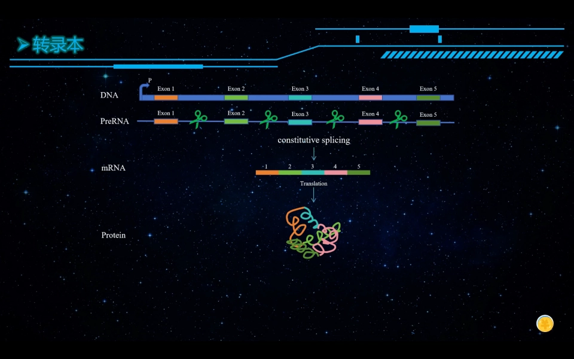
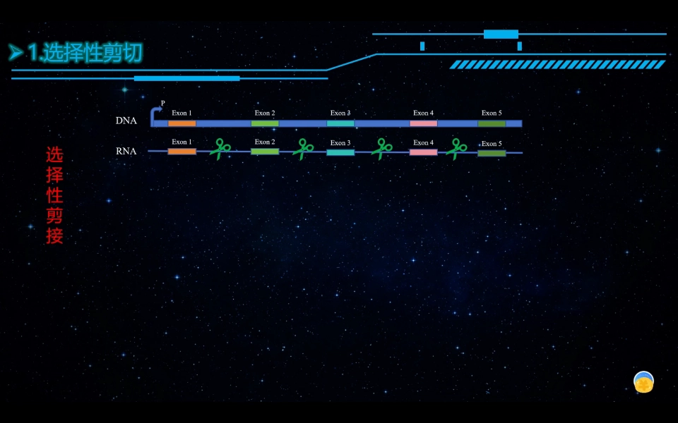
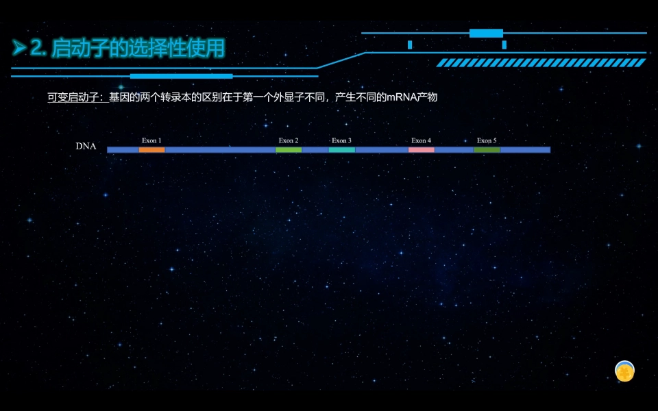
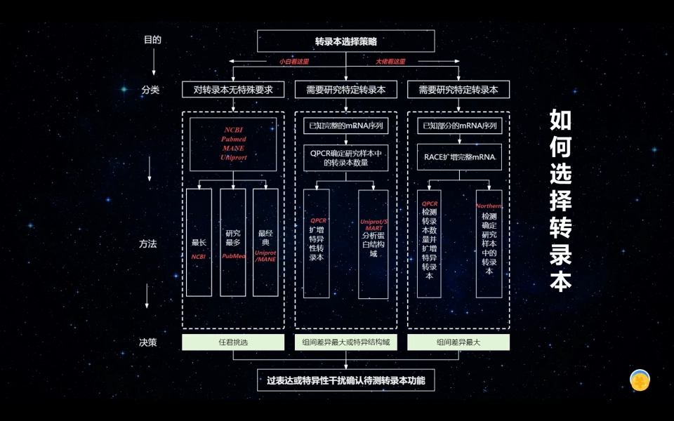

# 转录本是什么：一个基因为什么会有多种转录本

> 视频来源：[《UP主爆肝输出：一个视频搞定转录本！期待已久的转录本理论知识及选择策略-1》](https://www.bilibili.com/video/BV1Yf421B7yi/)（B 站 · 噗啦噗啦实验室）｜时长约 19 分钟
> 导读：这支视频前半段讲理论——转录本的定义、一个基因产生多种转录本的三条机制、以及「多个转录本时怎么选」；后半段是数据库操作演示，但演示段没有字幕，本文只覆盖有讲解的前半段（约 0:00–11:24）。文中术语按分子生物学通用写法订正（字幕里的「外弦子」「简洁」「MAN1」分别是外显子、剪接、MANE）。

## 本讲要解决的核心问题（SCQA）

**背景**：按中心法则的入门版本，一个基因转录成一种 mRNA、翻译成一种蛋白质。做实验时，我们通常也只想研究「这个基因」，默认它对应一个产物。

**冲突**：真核基因在数据库里往往挂着好几个转录本。要设计引物、做基因干扰时，必须回答「我针对的是哪一个」。更麻烦的是，不同转录本之间的差别可能只是一小段外显子，甚至只是 5′ 端从哪里开始转录、从哪里开始翻译。

**疑问**：一个基因座究竟能产生多少种转录本？这些转录本是怎么来的？面对多个转录本，应该按什么标准挑一个？

**回答（中心思想）**：**转录本是基因表达的直接产物，一个基因可以对应多个转录本，一个转录本还可以对应不同的蛋白产物。** 一对多关系有两条来源：在 RNA 层面由可变剪接和可变启动子产生不同转录本；在翻译层面由不同的起始密码子产生不同 N 端的蛋白亚型。理解了这两层，才知道数据库里的 gene / transcript / protein 三级记录分别指什么，也才知道「选哪个转录本」为什么是一个必须交代的实验条件。

---

## 一、转录本是基因和性状之间的那一层

视频先给定义：**转录本（transcript，也叫 transcript variant）是一个基因通过转录形成的一种或多种、可供翻译成蛋白质的成熟信使 RNA**。它由转录加加工修饰而来，再翻译成蛋白质。[【跳转到 00:47】](https://www.bilibili.com/video/BV1Yf421B7yi/?t=47)

这张图把层级摆得很清楚，从上到下是四个不同的对象：

| 层级 | 对象 | 在数据库里通常怎么出现 |
| --- | --- | --- |
| 基因座 | DNA 上的一段区间（含外显子、内含子、调控区） | 一个 gene ID，只有一个 |
| 前体 RNA | 刚转录出来、还含内含子的 RNA | 一般不单独建记录 |
| 转录本 | 剪接加工后的成熟 mRNA | 一个 gene 下挂多个 transcript ID |
| 蛋白产物 | 翻译得到的多肽链 | 每个编码转录本对应一个 protein 记录 |

所以「一个基因」和「一个转录本」不是同一层的东西：基因是 DNA 上的位置，转录本是这个位置上加工出来的一种 RNA 产物。视频把不同转录本比作「同一个妈妈生出来的、长相各异的兄弟姐妹」——它们有相似的保守序列和功能，也有差异的非编码序列和功能差异。[【跳转到 01:45】](https://www.bilibili.com/video/BV1Yf421B7yi/?t=105)

> 这个比方点出了本节的主线：**相似性来自同一个基因座，差异性来自加工与翻译的选择**。研究转录本的意义也在这里——在发育、疾病进展中，到底是哪一个「兄弟姐妹」在起作用，往往并不清楚。[【跳转到 02:24】](https://www.bilibili.com/video/BV1Yf421B7yi/?t=144)

---

## 二、一对多的三条路：剪接、启动子、翻译起点

视频把「为什么会出现多个转录本／多个产物」归为三类机制：前两类在 RNA 层面改变转录本的序列，第三类在翻译层面改变读的起点。[【跳转到 02:43】](https://www.bilibili.com/video/BV1Yf421B7yi/?t=163)

### 2.1 可变剪接：同一份外显子清单，不同的拼接方式

真核基因的内含子和外显子交替排布，只有外显子进入成熟 mRNA。把同一基因的各个外显子以不同方式组合、或缺失部分外显子，就会得到不同的 mRNA，翻译出不同的蛋白质亚型。[【跳转到 03:08】](https://www.bilibili.com/video/BV1Yf421B7yi/?t=188)

视频列了五种常见类型，用「一只十根手指的手」打比方：

| 类型 | 发生了什么 | 视频里的比方 |
| --- | --- | --- |
| 外显子跳跃 | 某个外显子连同两侧内含子一起被剪掉，上下游外显子直接相连 | 本该十根手指，多切掉一根，只剩九根 |
| 外显子互斥 | 两个外显子不能同时出现在同一转录本里，只能分处不同转录本 | 无名指和小拇指不能同时长在同一只手上 |
| 内含子保留 | 本该切除的内含子留在成熟 mRNA 里并被翻译 | 十根手指之外多长出一根 |
| 外显子 5′ 端可变剪接 | 5′ 剪接位点位置不同，外显子的一部分序列多出或缺失 | 从左往右砍时，下刀位置不一样 |
| 外显子 3′ 端可变剪接 | 3′ 剪接位点位置不同，同样造成部分序列多出或缺失 | 从右往左砍时，下刀位置不一样 |

[【跳转到 03:58】](https://www.bilibili.com/video/BV1Yf421B7yi/?t=238) [【跳转到 04:23】](https://www.bilibili.com/video/BV1Yf421B7yi/?t=263) [【跳转到 05:01】](https://www.bilibili.com/video/BV1Yf421B7yi/?t=301) [【跳转到 05:26】](https://www.bilibili.com/video/BV1Yf421B7yi/?t=326) [【跳转到 06:16】](https://www.bilibili.com/video/BV1Yf421B7yi/?t=376)

这五种类型的共同点是：**基因组序列一个字没变，变的是哪些片段被连在一起**。所以同一个基因座在不同细胞、不同条件下可以产出不同的转录本组合。剪接体如何识别位点、两步酯交换反应怎么完成，属于 B01 的剪接机制内容，这里只关心「组合方式可变」这一层结果。

### 2.2 可变启动子：从不同位置开始转录

除了剪接，**启动子的选择性使用**也会产生不同转录本。同一个基因可以有不同的启动子，从第一个启动子起始转录，产物包含第一个外显子；从第二个启动子起始，产物就不包含第一个外显子。[【跳转到 06:41】](https://www.bilibili.com/video/BV1Yf421B7yi/?t=401)

这一条常被忽略，因为它不改变剪接模式，只改变**转录起点**。后果是 5′ 端序列（包括 5′ UTR 和起始外显子）不同，因而 N 端序列也可能不同。视频的总结是：基因从哪里开始转录，决定了转录本有哪些序列差异。[【跳转到 07:31】](https://www.bilibili.com/video/BV1Yf421B7yi/?t=451)

> 与可变启动子对称的另一端是**可变加尾**：同一个基因座上有多个 poly(A) 位点，选近端的位点就提前结束转录，3′ UTR 变短。这条机制在 [同一个基因，不同产物：可变剪接、可变加尾与 RNA 编辑](同一个基因，不同产物：可变剪接、可变加尾与RNA编辑.md) 里有具体的位点级演示。

### 2.3 选择性翻译起始：同一条 mRNA，不同的蛋白 N 端

即使转录本完全相同，翻译产物也未必一样。视频指出：成熟的 mRNA 在 5′ 端可能存在**多个起始密码子**（以 AUG 居多，也有 GUG、AUA 等），使用不同的起始密码子，就能翻译出 N 端有序列差异的不同蛋白亚型。[【跳转到 07:56】](https://www.bilibili.com/video/BV1Yf421B7yi/?t=476)

这一条把「一对多」从 RNA 层推到了蛋白层：**一个转录本可以对应多个蛋白产物**。两者的区别可以这样记：可变剪接改变的是「读哪一段」，选择性翻译起始改变的是「从哪里开始读」。阅读框本身的规则（三联体、连续、不重叠）见 [遗传密码](../../../../B01_生命科学基础主干/2_遗传信息流与中心法则/2.2_从基因到产物/2.2.4_遗传密码：密码子、简并性与阅读框/【分子生物学】遗传密码（遗传密码的特点）.md)；翻译后再加工（切割、修饰）如何进一步增加产物种类，见 [翻译如何发生](../../../../B01_生命科学基础主干/2_遗传信息流与中心法则/2.2_从基因到产物/2.2.5_翻译：核糖体、mRNA%20与多肽合成/翻译如何发生：从密码子到多肽链的分子流水线.md) 的「六、翻译后修饰」。

### 2.4 规模：90% 的基因有可变剪接

视频给了一个量级判断：人类基因组中**约 90% 的基因存在选择性剪接**；这种复杂性让生物体能更精准地调控基因表达，其意义在于增加基因功能的多样性、增加基因组复杂度、对基因功能进行调控，并与疾病的发生和进展密切相关。[【跳转到 08:46】](https://www.bilibili.com/video/BV1Yf421B7yi/?t=526)

所以「一个基因一个产物」在真核里是特例而非通例。这不是中心法则错了，而是中心法则的入门图画得太粗：DNA → RNA → 蛋白这条链上，每一步都可以有多个出口。

---

## 三、多个转录本时，怎么挑一个

视频后半段给出一个选择流程，并明确说明这是该实验室的经验总结、仅供学习交流。[【跳转到 09:36】](https://www.bilibili.com/video/BV1Yf421B7yi/?t=576)

### 3.1 没有特殊要求：用「最长」「研究最多」「最经典」

| 判据 | 用什么数据库 | 逻辑 |
| --- | --- | --- |
| 最长转录本 | NCBI | 理论上最长转录本翻译出功能最全面的蛋白亚型，代表该基因最完善的功能 |
| 研究最多 | PubMed | 检索该转录本，选文献数量最多的那个，通常最保险 |
| 最具代表性 | MANE | 收录人类编码基因的一个代表性转录本，有充分实验数据支持，代表该基因的生物学功能 |
| 最标准 | UniProt | 结果页 sequence 区给出的标准转录本，其氨基酸序列 100% 对应 NCBI RefSeq 中某条转录本 |

[【跳转到 11:04】](https://www.bilibili.com/video/BV1Yf421B7yi/?t=664) [【跳转到 11:29】](https://www.bilibili.com/video/BV1Yf421B7yi/?t=689) [【跳转到 11:54】](https://www.bilibili.com/video/BV1Yf421B7yi/?t=714) [【跳转到 12:19】](https://www.bilibili.com/video/BV1Yf421B7yi/?t=739)

这四条判据对应的是同一个现实：**注释里的「一个基因」下面挂着多个 transcript，每个 transcript 有自己的 ID，编码转录本还各有一个 protein 记录**。挑哪一个，等于在 gene → transcript → protein 这条链上选定一条路径。MANE 和 UniProt 的价值就在于它们替你做了这个选择，并保证跨库一致。

> 数据库页面怎么读、RefSeq 与 GENCODE 的标识符和版本怎么对照，属于数据资源脉络：见 [D01 §2.2 基因产物与注释层级](../../../../../生物数据/D01_基因组与遗传变异数据/README.md#d01-2-2)。

### 3.2 有特殊要求：先确认「样本里到底有哪几条」

如果研究要求针对特定转录本，视频给了一条从粗到细的路径：

1. **已知完整 mRNA 序列**：针对变异区设计上下游引物，用 qPCR 加琼脂糖凝胶电泳，按分子量区分不同转录本的含量，找出组间差异最大的那条。[【跳转到 13:09】](https://www.bilibili.com/video/BV1Yf421B7yi/?t=789)
2. **确认功能差异**：用 UniProt 与 SMART 分析所选转录本编码蛋白的结构域；结构域多了或少了，往往意味着功能与常见亚型不同。[【跳转到 14:24】](https://www.bilibili.com/video/BV1Yf421B7yi/?t=864)
3. **未知全部转录本**：先做 RACE，从 5′ 端到 3′ 端扩出完整 mRNA，再回到上一步检测。[【跳转到 14:49】](https://www.bilibili.com/video/BV1Yf421B7yi/?t=889)
4. **定量手段的取舍**：qPCR 需要信号放大、经过 20–30 个循环，起始偏差会被放大；Northern blot 用探针直接杂交，特异性更高但成本更高、操作更复杂。本底表达高的转录本适合 Northern blot，表达低的适合 qPCR。[【跳转到 15:14】](https://www.bilibili.com/video/BV1Yf421B7yi/?t=914) [【跳转到 16:04】](https://www.bilibili.com/video/BV1Yf421B7yi/?t=964)

这条路径的共同前提是：**「这个基因表达了」是一个基因层结论，「表达的是哪条转录本」是转录本层结论，两者不能互相替代**。视频最后一步也落在这里——选定转录本后，还要做特异性的过表达或干扰，确保不影响其他不想研究的转录本，再做功能验证。[【跳转到 17:54】](https://www.bilibili.com/video/BV1Yf421B7yi/?t=1074)

---

## 四、把「一对多」放回注释和实验里看

- **注释是分层的**：gene 是位置，transcript 是加工产物，protein 是翻译产物。一个 gene 下多个 transcript、每个编码转录本对应一个 protein，是注释文件的常规结构，不是数据错误。
- **「基因表达量」掩盖了转录本差异**：基因层计数把多条转录本加在一起，转录本层面的变化（某条亚型上调、另一条下调）在基因层可能互相抵消。这一后果在 [转录如何发生](../../../../B01_生命科学基础主干/2_遗传信息流与中心法则/2.2_从基因到产物/2.2.1_转录：DNA%20模板与%20RNA%20合成/转录如何发生：从启动子到成熟mRNA的分子流水线.md) 的「六、把这条流水线放回单细胞研究里看」第 3 条也有说明。
- **实验必须交代用的是哪条转录本**：引物、干扰序列、过表达构建都只对特定序列有效；不说明转录本 ID，结果无法复现。
- **一对多不等于功能冗余**：不同亚型可以有不同组织分布、不同结构域、不同功能，视频举的 90% 可变剪接正是这种多样性的来源。

---

## 小结

- **转录本是基因表达的直接产物**，是基因型与表型之间的那一层；一个基因可以有多个转录本。
- 一对多有两条来源：RNA 层的**可变剪接**（五种常见类型）与**可变启动子**；翻译层的**选择性起始密码子**。
- 人类约 **90%** 的基因存在可变剪接，因此「一个基因一个产物」在真核里是特例。
- 注释按 **gene → transcript → protein** 分层，每条 transcript 有独立 ID，编码转录本对应独立 protein 记录。
- 多个转录本时的选择有两条路：无特殊要求时用最长/研究最多/MANE/UniProt 标准转录本；有特殊要求时先用 qPCR、RACE、Northern blot 确认样本里有哪几条，再做特异性干扰或过表达。

## 关键术语速查

| 术语 | 一句话解释 |
| --- | --- |
| 转录本（transcript / transcript variant） | 一个基因转录加工后得到的、可翻译成蛋白质的成熟 mRNA |
| 可变剪接（alternative splicing） | 同一前体 mRNA 以不同外显子组合剪接，产生不同成熟 mRNA |
| 外显子跳跃 | 某个外显子连同两侧内含子一起被剪掉 |
| 外显子互斥 | 两个外显子不能同时出现在同一转录本中 |
| 内含子保留 | 本应切除的内含子留在成熟 mRNA 中 |
| 可变启动子 | 同一基因从不同启动子起始转录，5′ 端序列不同 |
| 选择性翻译起始 | 同一条 mRNA 使用不同起始密码子，产生 N 端不同的蛋白亚型 |
| MANE | 为人类编码基因挑选代表性转录本的数据库，保证跨库一致 |
| RefSeq | NCBI 的参考序列集合，转录本与蛋白各有登录号 |