# 转录起始：核心启动子定位、通用转录因子装配与中介体激活

> 视频来源：[真核生物启动子结构](https://www.bilibili.com/video/BV19sh8ziEzk/)（Bilibili · 轻轻松松学分子，约 11 分钟）、[核心启动子元件——TATA框与BRE元件](https://www.bilibili.com/video/BV1ZhiEB6E2B/)（Bilibili · 动画讲解，约 9 分钟）、[真核细胞转录过程](https://www.bilibili.com/video/BV1qt411d7Zk/)（Bilibili · 学堂在线，约 12 分钟）
> 导读（100 字以内）：三支视频分工互补：第一支讲启动子分几层、每个元件管什么；第二支讲元件如何组合、起点是聚焦还是分散；第三支按装配顺序走一遍通用转录因子与前起始复合体，并说明体内为什么还需要中介体。本文按「启动子结构 → 起点选择 → 复合体装配 → 特异调控」重排，延伸与终止只作为出口带过。

## 本讲要解决的核心问题（SCQA）

**背景**：真核基因的转录由 RNA 聚合酶 II 完成。聚合酶负责把核糖核苷酸按模板一个个接上去，但它自己并不能认出"从哪个碱基开始转录"，也不知道此刻该不该转录这个基因。

**冲突**：麻烦有三层。第一，真核启动子不像原核那样只有 -10 区和 -35 区两段保守序列，它由多个可替换的元件拼成，而且**没有任何一个元件是所有启动子都有的**；第二，即使通用转录因子把聚合酶装到了启动子上，这套"体外最小系统"也只是在裸露 DNA 上成立的模型，真实细胞里 DNA 缠在核小体上，单靠它还很难有效起始；第三，不同基因要在不同细胞、不同时刻以不同强度转录，这套通用机器本身不提供这种特异性。

**疑问**：转录起点到底由什么决定？通用转录因子按什么顺序把聚合酶装上去、又靠什么"放行"？细胞又如何在不改变通用机器的前提下，让某个基因转录得更多或更少？

**回答（中心思想）**：真核转录起始可以拆成两套逻辑。**定位与装配**由核心启动子和通用转录因子完成：核心启动子用 TATA 盒、起始子（Inr）、BRE、DPE 等元件的组合标出起点，通用转录因子 TFIID（经 TBP）→ TFIIA/TFIIB → TFIIF+Pol II → TFIIE/TFIIH 依次装配成前起始复合体，最后由 TFIIH 解旋并磷酸化 CTD，让聚合酶脱离启动子。**调强弱**则由另一套系统完成：特异转录因子结合增强子等元件，经中介体（Mediator）把信号传给聚合酶，从而在通用机器之上加一层可调的"油门"。

---

## 一、启动子分两层：核心启动子定起点，上游元件管频率

### 1.1 核心启动子是"保证起始的最少 DNA 序列"

真核生物启动子的结构比原核复杂，可以分成两部分：**核心启动子**和**上游启动子元件**。

[【跳转到 00:00】](https://www.bilibili.com/video/BV19sh8ziEzk/?t=0)

核心启动子的定义很明确：它是**保证 RNA 聚合酶 II 转录起始所必需的最少的 DNA 序列**。这里限定"RNA 聚合酶 II"很重要——聚合酶 I、聚合酶 II、聚合酶 III 各自识别不同的启动子，本节讲的全是聚合酶 II 的世界。

[【跳转到 01:15】](https://www.bilibili.com/video/BV19sh8ziEzk/?t=75)

一个容易误解的地方是"最少"不等于"固定"。核心启动子由四个元件构成：**TATA 盒、起始子（Inr）、TFIIB 识别元件（BRE）、下游启动子元件（DPE）**，但一个启动子通常只包含其中两到三个，并非四个齐全。

[【跳转到 02:05】](https://www.bilibili.com/video/BV19sh8ziEzk/?t=125)

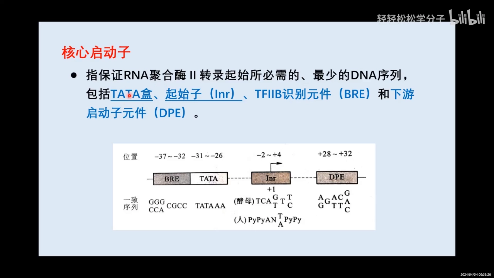

### 1.2 四个核心元件各管一段

**TATA 盒**：共有序列是 TATA(A/T)A(T/A)，位于 -31 到 -26 左右。它富含 AT，这一点有直接后果——AT 碱基对之间只有两个氢键，所以转录起始阶段双链打开时，这里比较容易解链。TATA 盒在功能上相当于原核启动子的 -10 区，只是位置比 -10 更靠上游一些。

[【跳转到 03:20】](https://www.bilibili.com/video/BV19sh8ziEzk/?t=200)

**起始子（Inr）**：位置大约在 -2 到 +4，最关键的属性是它**覆盖了转录起始点**（+1）。TATA 盒和起始子共同决定转录起点，这也是这两个元件被认为最重要的原因。

[【跳转到 04:35】](https://www.bilibili.com/video/BV19sh8ziEzk/?t=275)

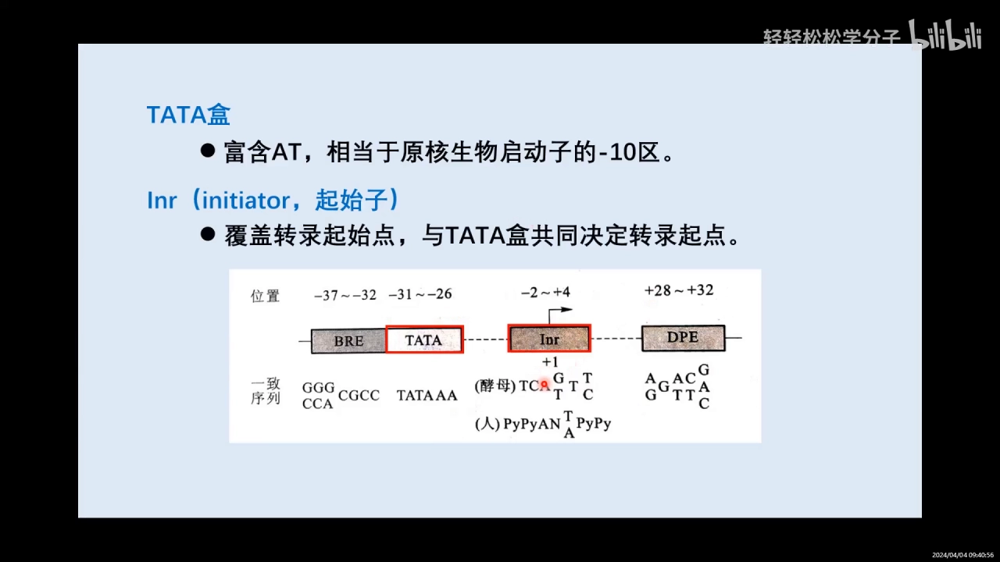

**TFIIB 识别元件（BRE）**：位于 TATA 盒上游（约 -37 到 -32），是转录因子 TFIIB 的识别序列。它的作用是**帮助招募 RNA 聚合酶 II**。这一点呼应了真核转录的一个基本事实：聚合酶自己不能直接识别、结合启动子，必须由转录因子辅助它间接完成识别。

[【跳转到 05:25】](https://www.bilibili.com/video/BV19sh8ziEzk/?t=325)

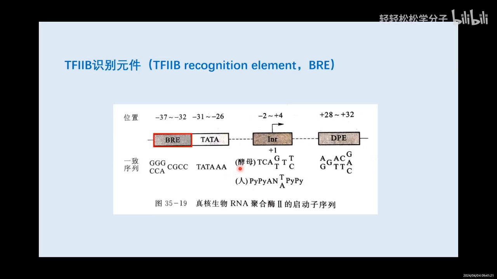

**下游启动子元件（DPE）**：位于转录起点下游（约 +28 到 +32）。它有一个特殊约束——**作用依赖起始子**，没有 Inr，DPE 就发挥不了作用。

[【跳转到 06:40】](https://www.bilibili.com/video/BV19sh8ziEzk/?t=400)

### 1.3 上游启动子元件：不决定"从哪开始"，而决定"多久一次"

核心启动子之外，还有一层**上游启动子元件**，位于 TATA 盒再往上游。典型成员是 **CAAT 盒**（约 -70 到 -80）和 **GC 盒**。

[【跳转到 08:20】](https://www.bilibili.com/video/BV19sh8ziEzk/?t=500)

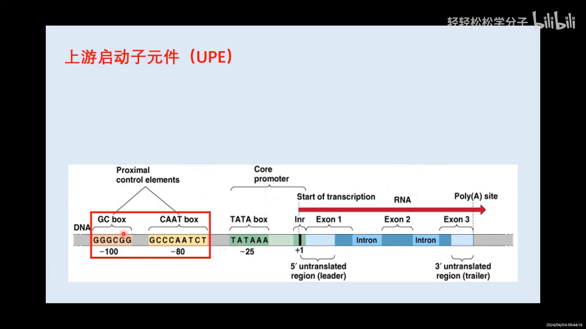

它们与核心元件的分工不同：CAAT 盒和 GC 盒都是 RNA 聚合酶 II 的**松弛结合位点**，作用是**调控转录起始的频率**，而不是精确定位起点。两者之中，CAAT 盒对起始频率的影响更大。

[【跳转到 08:45】](https://www.bilibili.com/video/BV19sh8ziEzk/?t=525)

### 1.4 与原核启动子的对应关系，以及"不是每个基因都齐全"

把原核和真核启动子放在一张图上对比，可以得到一个便于记忆的映射：

| 原核启动子 | 真核启动子 | 管什么 |
| --- | --- | --- |
| -10 区（富含 AT） | TATA 盒 | 解链与定位 |
| -35 区 | 上游元件中的 CAAT 区 | 起始频率 |

[【跳转到 09:53】](https://www.bilibili.com/video/BV19sh8ziEzk/?t=593)

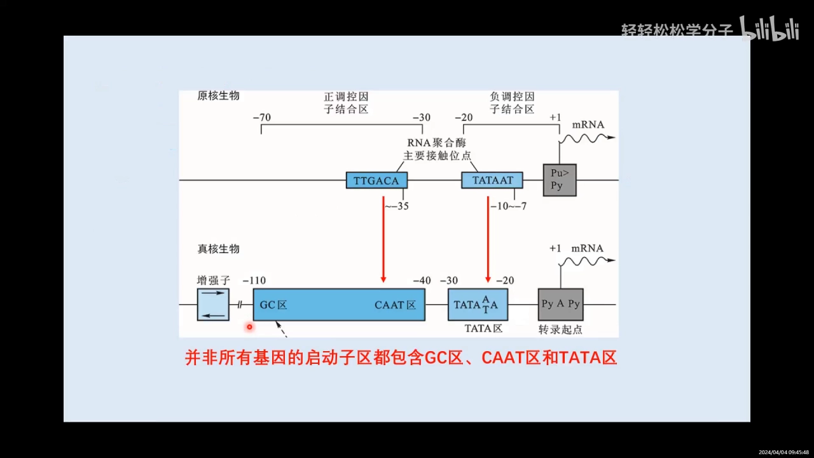

但这张对应表不能推得太远。视频特别提醒：**并非所有基因的启动子都包含 GC 区、CAAT 区和 TATA 盒**。缺少这些结构的基因，转录效率可能就比较低；例如缺少 CAAT 区的启动子，起始频率会明显偏低。

[【跳转到 10:18】](https://www.bilibili.com/video/BV19sh8ziEzk/?t=618)

---

## 二、起点不是由单一序列决定的：元件组合、聚焦型与分散型

### 2.1 没有"所有启动子共有"的核心元件

换一个更现代的视角看核心启动子：它是一段**指导转录起始的 DNA 序列**，通用转录因子结合这些元件，启动 RNA 聚合酶 II 的招募，整个过程由基本转录机器（前起始复合体）介导。

[【跳转到 00:15】](https://www.bilibili.com/video/BV1ZhiEB6E2B/?p=1&t=15)

核心启动子元件可以位于起始位点上游（如 TATA 盒、BRE），也可以位于下游（如 DPE）。长度也不固定，大约在 100 到 1000 碱基对之间，取决于基因和具体元件。

[【跳转到 01:12】](https://www.bilibili.com/video/BV1ZhiEB6E2B/?p=1&t=72)

关键在于：**目前并不存在所有启动子都有的通用核心启动子元件**。不同基因拿的是不同的元件组合，而每种元件对应不同的转录因子。例如 TFIIB 特异性结合 BRE，TFIID 结合 TATA 盒。

[【跳转到 01:45】](https://www.bilibili.com/video/BV1ZhiEB6E2B/?p=1&t=105)

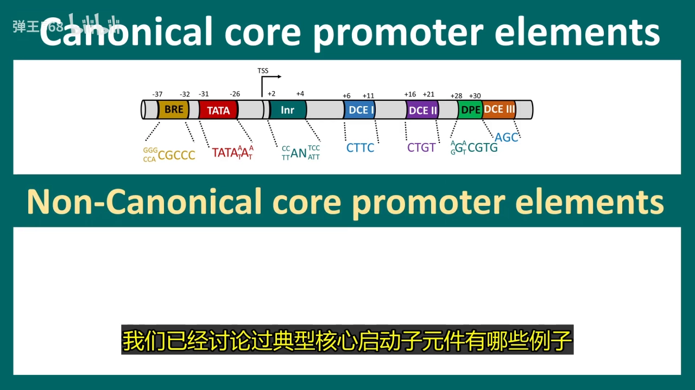

组合还有排他性。一种常见情况是 TATA 盒与 BRE 共存；另一种情况是 DCE 与 DPE 共存；但你不会在同一个基因的启动子里同时找到 TATA 盒、BRE 和 DPE。

[【跳转到 02:29】](https://www.bilibili.com/video/BV1ZhiEB6E2B/?p=1&t=149)

### 2.2 聚焦型与分散型：起点可以是一个点，也可以是一片区域

元件组合的差异，直接对应两类启动子：

- **聚焦型启动子（focused）**：转录起始位点非常独特，只落在一个特定位置。这类启动子常见于需要被精细调控的基因。
- **分散型启动子（dispersed）**：有多个转录起始位点，起点是一片区域。这类启动子对管家基因等功能很重要。

[【跳转到 03:04】](https://www.bilibili.com/video/BV1ZhiEB6E2B/?p=1&t=184)

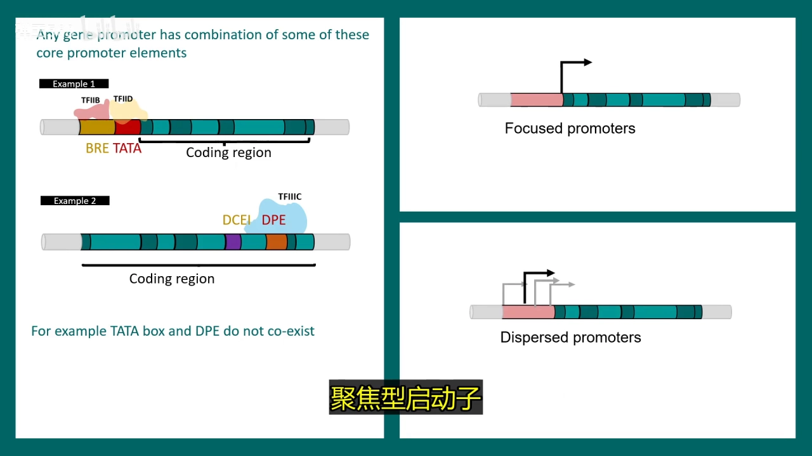

这张图解释了"起始位点选择"的实质：**起点不是一个绝对坐标，而是启动子元件组合的产物**。有 TATA 盒和 Inr 时，机器被钉在一个点上；元件组合松散或缺失时，机器只能在一片区域里择一启动。

### 2.3 非典型核心启动子：没有经典元件的启动子怎么工作

除了典型元件，还存在**非典型核心启动子元件**：它们不含任何已知的、特征明确的启动子元件，只是一段被划为核心启动子的宽泛区域。典型例子是 **CpG 岛**和**转录起始平台（TSS 平台，TIPs）**。

[【跳转到 03:44】](https://www.bilibili.com/video/BV1ZhiEB6E2B/?p=1&t=224)

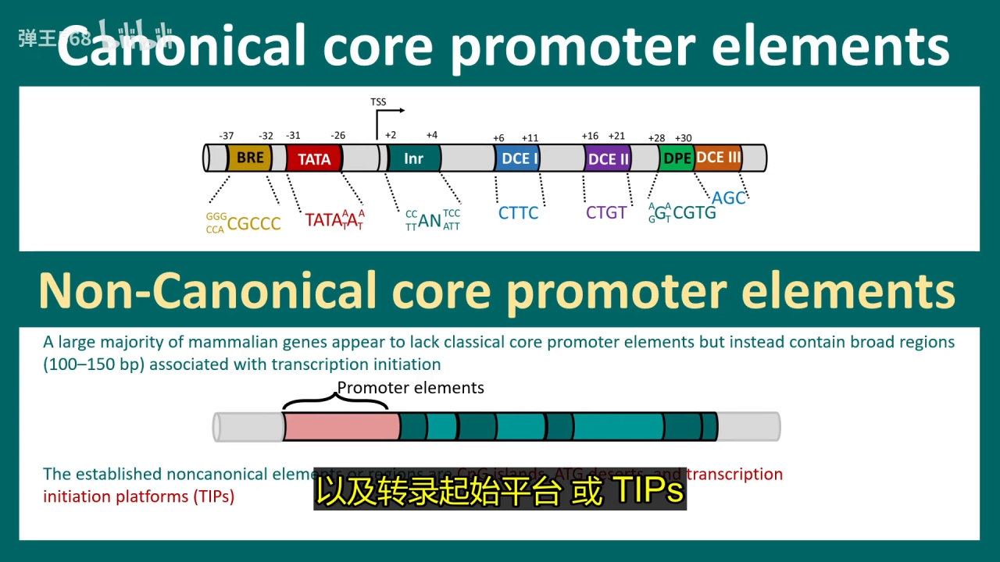

这也解释了教科书为什么总讲 TATA 盒：**TATA 盒只存在于一部分转录本中，但它的特征最明确**，所以书上反复出现；而大量基因其实用的是没有经典元件的宽泛起始区域。

[【跳转到 04:09】](https://www.bilibili.com/video/BV1ZhiEB6E2B/?p=1&t=249)

### 2.4 强启动子与弱启动子：用产量而不是序列来判断

启动子有强弱之分，判断标准很直接：**看产生的 RNA 量**。强启动子能启动更多轮转录，产生更多 mRNA。实验上用报告基因检测——把报告基因放在待测启动子下游，比较荧光强度就能间接判断启动子强弱（视频里的例子是同样条件下产生两个 GFP 与四个 GFP 的差别）。

[【跳转到 06:07】](https://www.bilibili.com/video/BV1ZhiEB6E2B/?p=1&t=367)

---

## 三、通用转录因子按固定顺序装配成前起始复合体

### 3.1 先明确一件事：起始是限速步骤

真核转录同样分起始、延伸、终止三个阶段，**起始阶段是转录的限速步骤**，对起始的调控也是对基因表达调控最重要、最主要的环节。下面以一个含 TATA 盒的启动子为例，走一遍前起始复合体的装配。

[【跳转到 00:38】](https://www.bilibili.com/video/BV1qt411d7Zk/?t=38)

### 3.2 第一步：TFIID 经 TBP 认住 TATA 盒，并把 DNA 掰弯

在 RNA 聚合酶被招募之前，已经有一些通用转录因子先结合到启动子的特定元件上，再由它们招募聚合酶和其他通用因子。

TATA 盒由通用转录因子 **TFIID** 识别。TFIID 是一个多亚基复合体，真正与 TATA 盒结合的是其中的 **TBP（TATA 盒结合蛋白）**，其余亚基统称 **TAF（TBP 相关因子）**。

[【跳转到 01:16】](https://www.bilibili.com/video/BV1qt411d7Zk/?t=76)

TBP 结合 TATA 盒的方式很不寻常。通常蛋白质用 α 螺旋插入 DNA 大沟来识别序列（原核 σ 因子的区域四识别 -35 区就是这种方式）；而 TBP 是用一个 **β 折叠插入 DNA 小沟**，把小沟拉平，并使双链发生约 80 度的弯曲。

[【跳转到 01:44】](https://www.bilibili.com/video/BV1qt411d7Zk/?t=104)

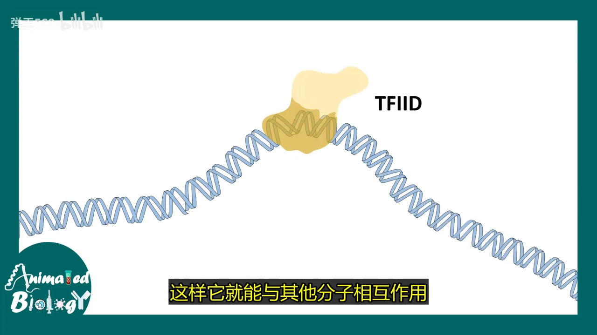

这个弯曲不是装饰：TFIID 与 TATA 盒的结合，为其他通用因子（包括 RNA 聚合酶）的募集**提供了一个平台**。

### 3.3 第二步：TFIIA 与 TFIIB 加入，并定下方向

接下来 TFIIB 与 TFIIA 被募集到前起始复合体上。TFIIB 是单链多肽，在 TBP 之后结合到启动子上。

[【跳转到 02:27】](https://www.bilibili.com/video/BV1qt411d7Zk/?t=147)

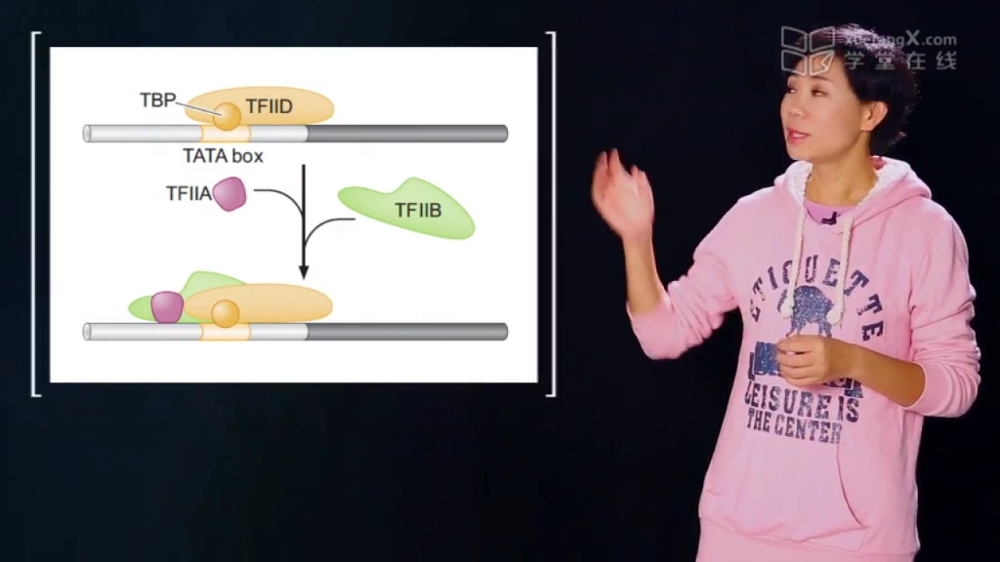

这里有一个容易被忽略但很重要的细节：晶体结构研究显示，TFIIB 与 TBP-DNA 复合体的相互作用是**不对称**的，这使得前起始复合体中其他部分的组装也不对称，即各因子的结合具有**方向性**。结果是转录只能按单一方向进行。

[【跳转到 02:35】](https://www.bilibili.com/video/BV1qt411d7Zk/?t=155)

### 3.4 第三步：TFIIF 带着聚合酶上场，TFIIE/TFIIH 收尾

再往后，结合在一起的 **TFIIF 与 RNA 聚合酶 II** 一起被招募到启动子上；聚合酶与启动子的结合，又使最后两个通用因子 **TFIIE 和 TFIIH** 相继被募集。

[【跳转到 02:59】](https://www.bilibili.com/video/BV1qt411d7Zk/?t=179)

到这一步，前起始复合体（PIC）装配完成，可以开始解旋了。这里有一个原核与真核的差别值得记住：原核启动子的解旋**不需要 ATP**，靠 σ 因子与 -10 区相互作用完成；真核的解旋**需要水解 ATP 提供能量**，由 TFIIH 负责。

[【跳转到 03:19】](https://www.bilibili.com/video/BV1qt411d7Zk/?t=199)

### 3.5 TFIIH：一把双功能扳手

TFIIH 是通用转录因子中最大、最复杂的一个，有九个亚基：其中两个具有 ATP 酶活性（作为解旋酶参与启动子处 DNA 双链的溶解和解旋），还有一个亚基起蛋白激酶作用。

[【跳转到 03:39】](https://www.bilibili.com/video/BV1qt411d7Zk/?t=219)

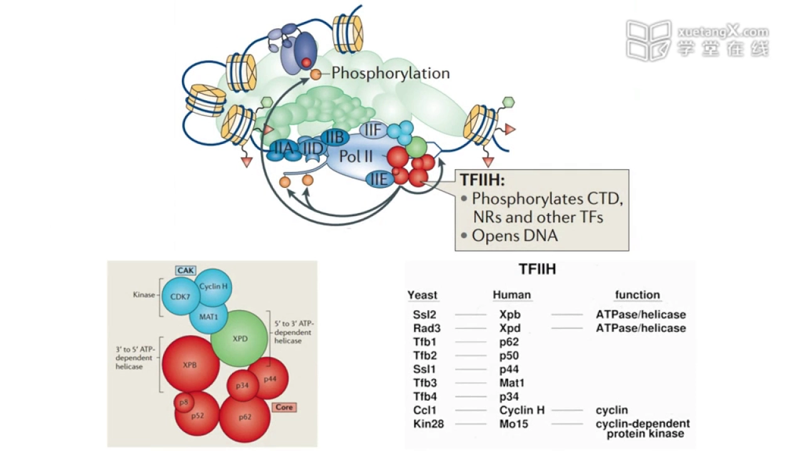

### 3.6 CTD 磷酸化：聚合酶"逃离"启动子的信号

TFIIH 的激酶活性作用对象是 RNA 聚合酶 II 大亚基的羧基末端结构域 **CTD**。CTD 由一系列重复的七肽序列延伸成一个尾巴，七肽中含三个丝氨酸和一个苏氨酸——这类氨基酸往往是可被磷酸化修饰的位点。

[【跳转到 04:09】](https://www.bilibili.com/video/BV1qt411d7Zk/?t=249)

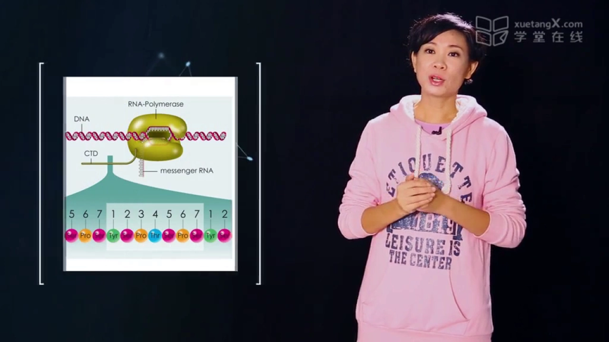

聚合酶刚被招募到启动子上时，CTD 几乎不被修饰；在转录激活过程中，包括 TFIIH 在内的多个蛋白激酶可以对 CTD 上不同位点进行磷酸化。磷酸化改变了聚合酶与通用转录因子的结合，使它**摆脱启动子上结合的大部分通用因子、从启动子上逃离**，进入延伸阶段。

[【跳转到 04:54】](https://www.bilibili.com/video/BV1qt411d7Zk/?t=294)

所以"起始完成"的标志不是聚合酶坐上 DNA，而是**CTD 被磷酸化、聚合酶成功逃离启动子**。磷酸化的不同位点还进一步控制后续的 RNA 加工与终止（延伸与终止见 2.1.6，本节不展开）。

---

## 四、体外模型不够：中介体与特异转录因子

### 4.1 裸 DNA 上的最小系统，解释不了细胞里的起始

上面那套装配流程看起来并不复杂，但它其实只是 **RNA 聚合酶 II 在体外、以一条裸露 DNA 起始转录的模型**。

[【跳转到 05:38】](https://www.bilibili.com/video/BV1qt411d7Zk/?t=338)

体内环境不同：DNA 包装在核小体里，要被转录基因的启动子有时并不那么容易接近；单靠通用转录因子和聚合酶组成的起始复合体，有时很难有效起始转录。要在细胞内真正有效起始，还需要其他蛋白质因子，包括**中介蛋白复合体、转录调节蛋白以及染色质重塑复合物**。它们一方面解决启动子的可接近性，另一方面为"以多大强度转录某个特定基因"提供调控靶点。

[【跳转到 06:06】](https://www.bilibili.com/video/BV1qt411d7Zk/?t=366)

### 4.2 中介体：一边抓 CTD，一边接激活因子

体内基本转录装置中，除了通用转录因子和聚合酶，另一个很重要的成分就是庞大的**中介蛋白复合体（Mediator）**。酵母和人的中介体各自都含 20 多个亚基，这些亚基的功能还没有一一鉴定。

[【跳转到 06:37】](https://www.bilibili.com/video/BV1qt411d7Zk/?t=397)

它的两个接口决定了它的地位：一方面与聚合酶大亚基的 **CTD 尾巴**相互作用，另一方面为**诸多转录调节因子提供相互作用位点**。

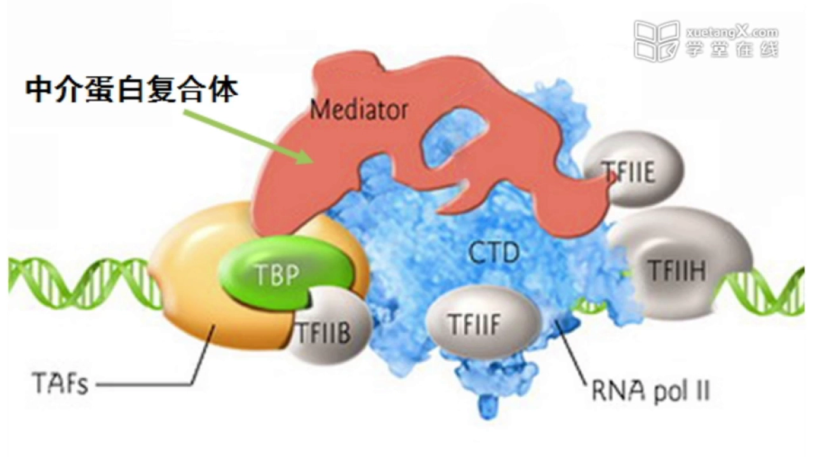

### 4.3 亚基与基因的对应：中介体不是一套固定零件

一个很有信息量的实验现象：中介体中**某一个亚基的缺失，往往只会导致一小部分基因失去表达活性**，每个亚基对应不同的基因。合理的解释是——不同基因的转录激活因子需要与中介体中不同的亚基相互作用，才能募集基本转录装置并激活转录。

[【跳转到 07:01】](https://www.bilibili.com/video/BV1qt411d7Zk/?t=421)

因此中介体并不是"某一些特定亚基的固定组合"，而是一群蛋白质因子复合体的统称，很可能由一些功能相关的模块组合而成。不同基因、不同分离手段会得到不同组合的中介体：这可能说明不同模块负责不同类型的基因或不同类别的调节因子，也可能只是分离方法造成的差异——视频把这个不确定性明确保留了下来。

[【跳转到 07:19】](https://www.bilibili.com/video/BV1qt411d7Zk/?t=439)

### 4.4 一条完整的信号链：增强子 → 特异因子 → 中介体 → 起始复合体

把前面几节拼起来，就得到"特异调控"这一侧的完整路径：远处的**增强子**通过 DNA 成环靠近启动子，结合在增强子上的**特异转录因子**与中介体接触，中介体再作用于启动子上的**起始复合体**，最终提高这个基因的起始效率。

[【跳转到 06:22】](https://www.bilibili.com/video/BV1qt411d7Zk/?t=382)

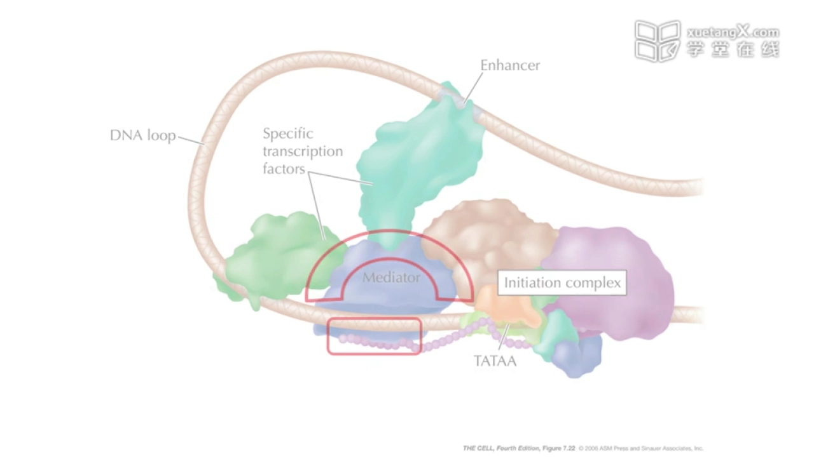

在众多转录激活因子的共同作用下，聚合酶 CTD 上多个位点被磷酸化，聚合酶离开启动子，转录进入延伸。

[【跳转到 07:54】](https://www.bilibili.com/video/BV1qt411d7Zk/?t=474)

---

## 五、两套系统放在一起比较

| 比较项 | 基本转录机器（通用转录因子 + Pol II） | 特异调控因子（特异 TF + 中介体 + 增强子） |
| --- | --- | --- |
| 识别什么 | 核心启动子元件：TATA 盒、Inr、BRE、DPE | 增强子等调节元件，可远距离、双向作用 |
| 谁在用 | 几乎所有聚合酶 II 基因都需要 | 只有特定基因、特定细胞与时刻需要 |
| 管什么 | 起点定位与装配顺序，决定"从哪里、按什么方向开始" | 起始频率与强度，决定"这个基因转录多少" |
| 作用方式 | 蛋白质—DNA 识别 + 蛋白质—蛋白质依次招募 | 经中介体与 CTD 接触，把信号传给基本机器 |
| 缺了会怎样 | 无法形成前起始复合体，转录不能起始 | 基因仍可基础转录，但失去诱导性与细胞特异性 |

一句话总结这两套系统的关系：**通用机器负责"能不能开始"，特异因子负责"开始多少"**。前者由启动子元件组合决定起点形态（聚焦或分散），后者通过中介体在通用机器上加一个可调的增益。

---

## 小结

- 真核启动子分两层：**核心启动子**（保证聚合酶 II 起始的最少序列）与**上游启动子元件**（CAAT 盒、GC 盒，调控起始频率）。
- 核心启动子由 **TATA 盒、起始子 Inr、BRE、DPE** 等元件组合而成，通常只含其中两到三个；**不存在所有启动子共有的核心元件**。
- 起点由元件组合决定：TATA 盒在 -31~-26 定位、Inr 覆盖 +1，两者共同决定起点；有经典元件时多为**聚焦型**起点，缺少经典元件、靠 CpG 岛或 TSS 平台指定时多为**分散型**起点。
- 通用转录因子按顺序装配：**TFIID（TBP）→ TFIIA/TFIIB → TFIIF + Pol II → TFIIE/TFIIH**；TFIIB 的不对称结合决定了转录方向。
- **TFIIH** 是双功能因子：ATP 依赖地解开 DNA，并磷酸化 CTD；CTD 磷酸化使聚合酶逃离启动子，起始阶段结束。
- 体外最小系统不足以保证体内起始：还需要**中介体、转录调节蛋白与染色质重塑复合物**。中介体一边接 CTD，一边接转录激活因子，其亚基与基因存在对应关系。
- 两套逻辑要分清：**通用机器管起点与装配，特异因子经中介体管强度**。

## 关键术语速查

| 术语 | 一句话解释 |
| --- | --- |
| 核心启动子 | 保证 RNA 聚合酶 II 转录起始所必需的最少 DNA 序列 |
| 上游启动子元件（UPE） | 核心启动子上游的 CAAT 盒、GC 盒等，调控起始频率而非起点 |
| TATA 盒 | 富含 AT、位于 -31~-26 的核心元件，功能上对应原核 -10 区 |
| 起始子（Inr） | 覆盖转录起始点 +1 的核心元件，与 TATA 盒共同决定起点 |
| BRE | TFIIB 识别元件，位于 TATA 盒上游，帮助招募聚合酶 II |
| DPE | 下游启动子元件，位于起点下游，作用依赖起始子 |
| 聚焦型启动子 | 转录起始位点集中在单一位置的启动子，多见于受调控基因 |
| 分散型启动子 | 有多个转录起始位点的启动子，对管家基因重要 |
| CpG 岛 / TSS 平台 | 不含经典元件的非典型核心启动子区域，用宽泛区域指定起始 |
| 前起始复合体（PIC） | 通用转录因子与 Pol II 在启动子上装配成的复合体 |
| TFIID / TBP / TAF | 识别 TATA 盒的通用因子复合体；TBP 是真正结合 DNA 的亚基，其余为 TAF |
| TFIIH | 最大的通用因子，兼具解旋酶与激酶活性，负责解链与 CTD 磷酸化 |
| CTD | Pol II 羧基末端的七肽重复尾巴，磷酸化状态决定启动子逃离与后续加工 |
| 启动子逃离 | CTD 磷酸化后聚合酶摆脱通用因子、离开启动子进入延伸的过程 |
| 中介体（Mediator） | 20 多个亚基的复合体，连接 CTD 与转录激活因子，传递调控信号 |
| 转录激活因子 | 结合增强子等元件、经中介体提高特定基因起始效率的调控蛋白 |