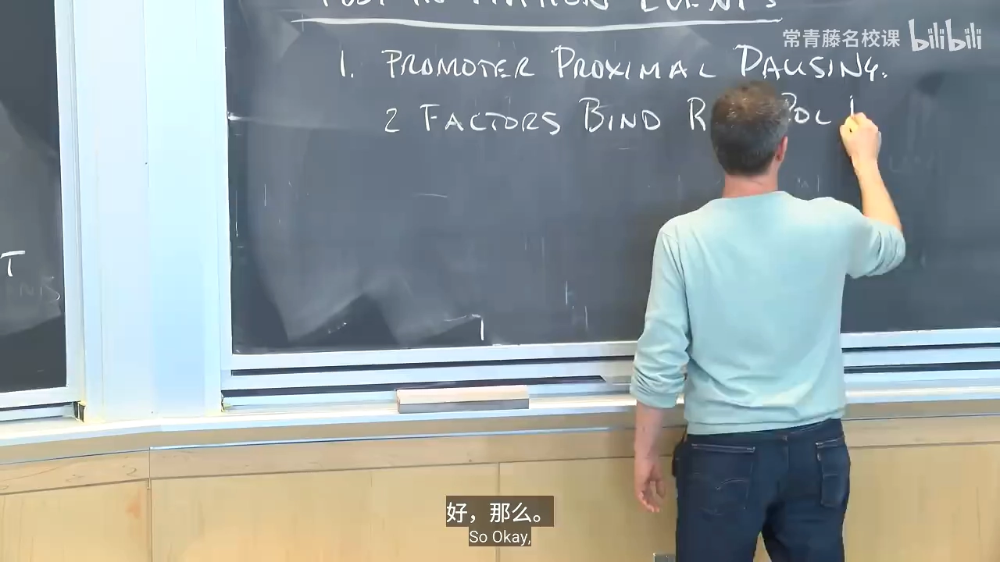
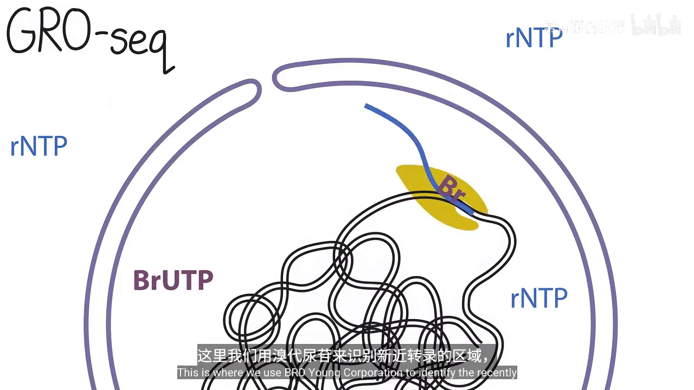
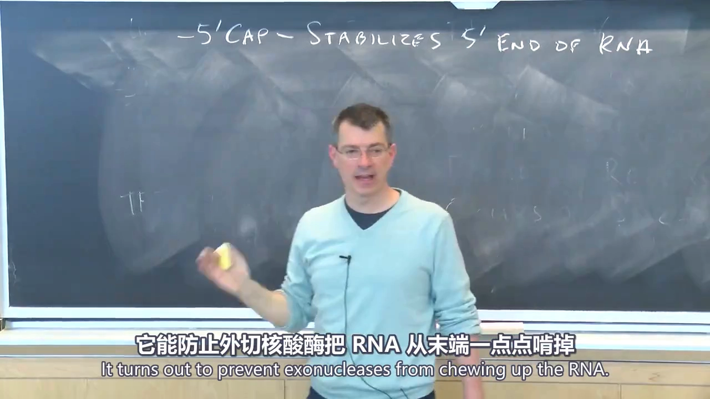
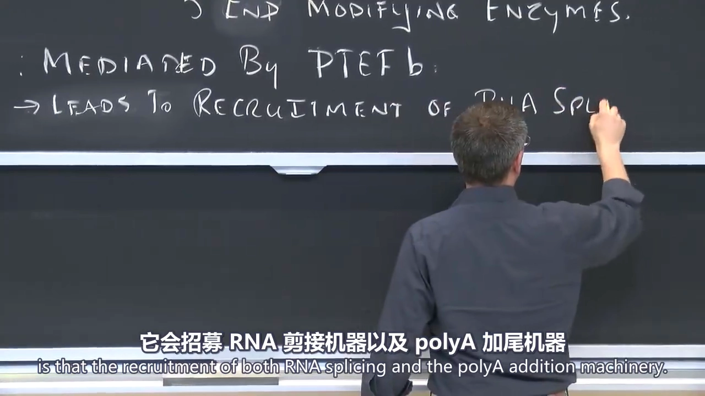
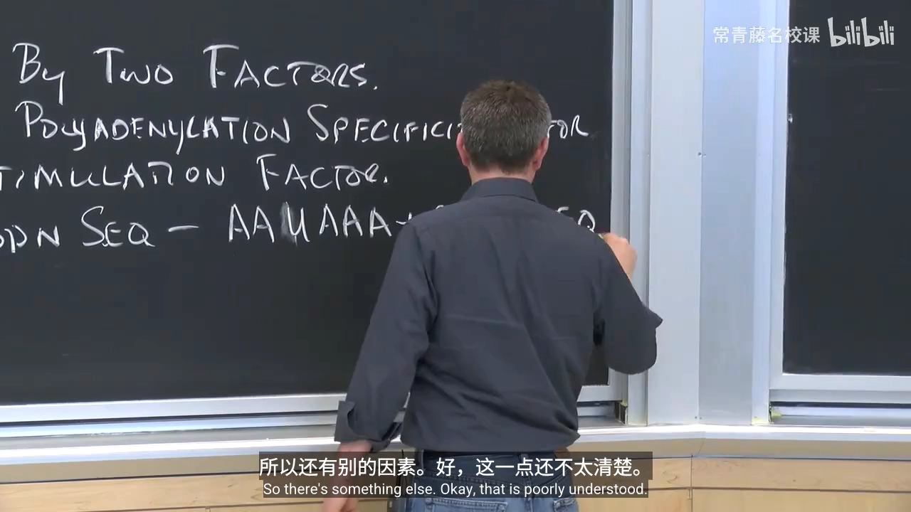
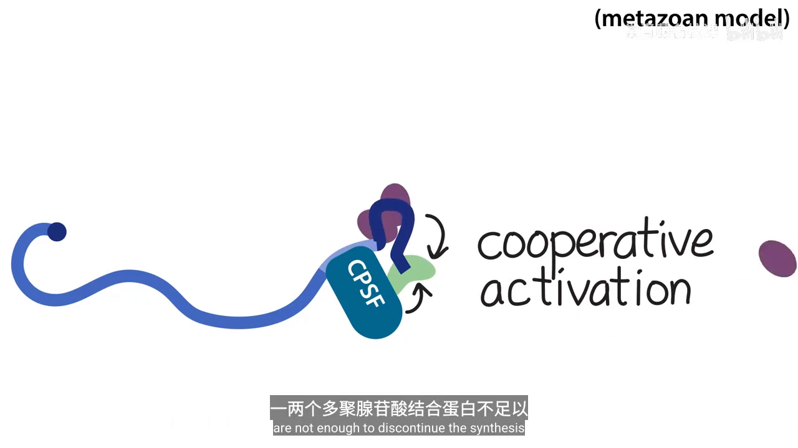
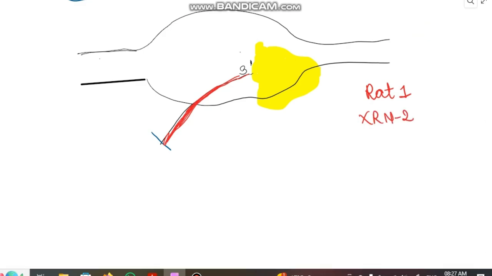
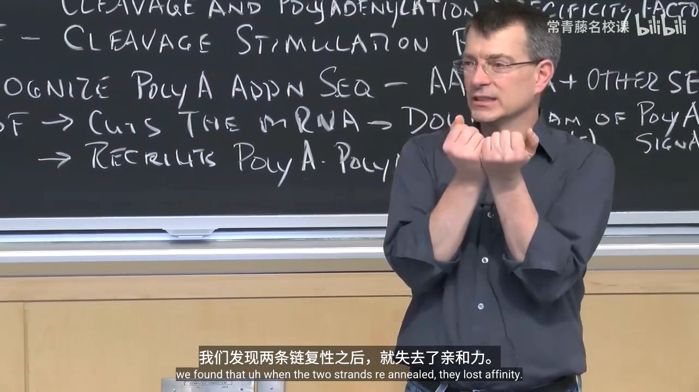
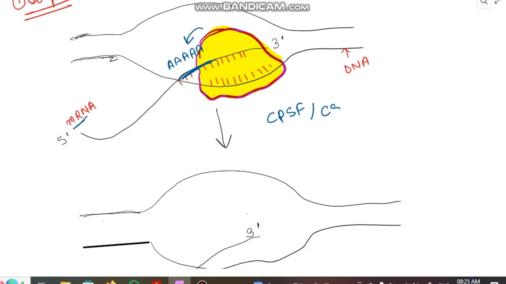
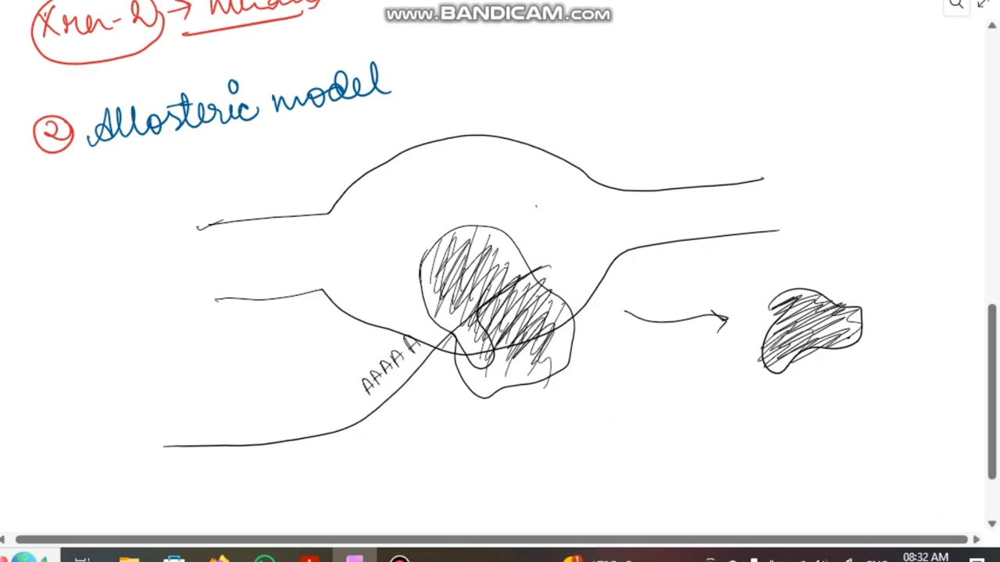

# 转录终止：多聚腺苷酸化信号、鱼雷模型与变构模型

> 视频来源：[Eukaryotic transcription termination: allosteric and torpedo model](https://www.youtube.com/watch?v=QwGv6C8SX9A)（YouTube · 英语讲解，约 11 分钟）、[MITx 7.28.2x 分子生物学 II（中配）](https://www.bilibili.com/video/BV1hP4n6LE8c/) 第 67、68、70、71 分 P（约 3–5 分钟/段）、[【分子生物学】32 真核转录终止](https://www.bilibili.com/video/BV1NVfsBoEKX/)（Bilibili · 生命中国，约 50 分钟，本讲完整版）
> 导读（100 字以内）：一支英语短视频把终止的两条路线——鱼雷模型与变构模型——并排画出来；MIT 课堂片段补上暂停、加帽、切割与加尾的分子细节。本文按「聚合酶状态 → 加工偶联 → 切割 → 追尾 → 变构 → 终止与成熟的区别」重排，英语字幕已译成中文，术语按分子生物学通用写法订正。

## 本讲要解决的核心问题（SCQA）

**背景**：RNA 聚合酶 II 从启动子出发，一路把核糖核苷酸接到新生 RNA 的 3′ 端。它读过编码区、读过终止密码子，还会继续往下游走一段。

**冲突**：聚合酶本身没有"到站下车"的开关。它不像火车司机那样看到终点标志就刹车；只要前面还有模板、还有核苷酸，它就会继续合成。可细胞必须把它从 DNA 上弄下来，否则它会一直占着基因、继续产出没有用的 RNA。更麻烦的是，转录的"结束"并不是把 RNA 剪断就完事：剪断只造出了 RNA 的末端，聚合酶还在跑。

**疑问**：细胞用什么信号标记"该结束了"？这个信号如何先变成一次 RNA 切割，再变成聚合酶的下车？"鱼雷模型"和"变构模型"分别在说什么，它们是二选一吗？转录终止之后，RNA 就成熟了吗？

**回答（中心思想）**：真核 mRNA 的终止是一套**"先加工、后释放"**的连锁反应。聚合酶转录出多聚腺苷酸化信号（AAUAAA 等）后，CPSF/CstF 在 RNA 上完成切割并加上 poly(A) 尾；切割留下的下游 RNA 片段没有 5′ 帽，被核内 5′→3′ 外切酶 Rat1（酵母）/XRN2（人）追着降解，外切酶追上聚合酶、把 RNA 从活性位点拽出，两条 DNA 链重新配对，聚合酶失去亲和力而脱落——这是**鱼雷模型**。另一条路线是聚合酶遇到信号后自身构象改变、直接脱落——这是**变构模型**。两者不是互斥选项，同一细胞里可以先后或同时发生。关键区别是：**切割与加尾发生在转录仍在进行时，转录终止只是聚合酶离开 DNA，此时产物仍是需要剪接的前体 mRNA**。

---

## 一、先分清聚合酶的两种"停"

在讲终止之前，需要把"停"拆开。聚合酶在 DNA 上停住，可能是两种完全不同的状态：

- **暂停（pausing）**：正常的、可逆的临时停顿，聚合酶还坐在 DNA 上，等着被放行。
- **终止（termination）**：聚合酶彻底离开 DNA，转录结束。

本节处理暂停与终止；暂停是理解终止的前提，因为两者都发生在聚合酶离开启动子之后。

暂停最典型的位置在**启动子近端**：聚合酶刚跑出 25–60 个碱基就停住。这个位置很讲究——聚合酶已经走出启动子，但还没有走远，细胞可以在这里决定"继续"还是"放弃"。

[【跳转到 00:40】](https://www.bilibili.com/video/BV1hP4n6LE8c/?p=67&t=40)

介导暂停的是两个负延伸因子：**NELF**（负延伸因子）和 **DSIF**（DRB 敏感因子）。DRB 是一种核苷酸类似物，最初正是用它抑制早期转录才发现这套因子的。两个因子结合上去后，聚合酶往前走一小段就停住，停的位置并不总是完全相同。

[【跳转到 01:35】](https://www.bilibili.com/video/BV1hP4n6LE8c/?p=67&t=95)

放行靠 **P-TEFb**：它是一种激酶，磷酸化 CTD 上的丝氨酸 2，同时也磷酸化 DSIF 和 NELF。磷酸化之后 NELF 被释放，聚合酶进入真正的延伸。有些启动子上这一步极快，看不到暂停；另一些启动子上则能看到大量明显暂停的聚合酶。

暂停有多普遍？用 **GRO-seq** 可以直接看：把带溴标记的尿苷（BrUTP）掺进新生 RNA，再深度测序，就能标出"此刻正在转录的区域"。结果发现，暂停的聚合酶在起始位点下游广泛存在，而且很多启动子是**双向转录**的——两个方向都有暂停的聚合酶。更意外的是，约 30% 的基因既有暂停的聚合酶、基因内部又有转录读段，说明暂停不是"待命"，而是正常转录过程的一部分。

[【跳转到 00:05】](https://www.bilibili.com/video/BV1hP4n6LE8c/?p=68&t=5)

---

## 二、CTD 是一块"状态屏"：磷酸化位点决定谁来接班

聚合酶最大的亚基末端拖着一条 **CTD**（C 端结构域），由一段重复序列构成。CTD 上可被磷酸化的丝氨酸，是整条流水线的"状态标签"：

- **Ser5 磷酸化**（由 TFIIH 加上）：标记"刚起步"，招募**加帽酶**。
- **Ser2 磷酸化**（由 P-TEFb 加上）：标记"已进入延伸"，招募 RNA 剪接机器和 poly(A) 加尾机器。

[【跳转到 02:00】](https://www.bilibili.com/video/BV1NVfsBoEKX/?t=120)

加帽为什么必须"抢时间"？因为 RNA 一从聚合酶的出口通道探出来，就暴露在核内的外切核酸酶面前；没有帽子的 5′ 端会被当成"残次品"降解。加帽酶结合到磷酸化的 CTD 上，加帽效率可以提高约 10⁵ 倍，并且它的位置正好在 RNA 出口旁边——RNA 一出来就被戴上帽子。帽子最直接的作用，就是保护 5′ 端不被外切酶啃掉。

[【跳转到 05:00】](https://www.bilibili.com/video/BV1NVfsBoEKX/?t=300)

Ser2 磷酸化则把"加工机器"叫到现场：**RNA 剪接机器**和 **poly(A) 加尾机器**都通过 CTD 被招募到新生 RNA 附近。这就是"转录与加工偶联"的分子基础——剪接和加尾不是等转录彻底结束才在核质里慢慢发生，而是在 RNA 还在合成时就已经就位。

> 本节不展开剪接体如何识别剪接位点，那属于 §2.1.7；这里只需要记住：**加工机器是被 CTD 的磷酸化状态招来的**。

---

## 三、终止的第一幕不是终止，而是切割

聚合酶走过编码区，进入 3′ 非翻译区，会遇到一段 DNA 序列，其中最关键的是**多聚腺苷酸化信号**。在 RNA 上它写作 **AAUAAA**（DNA 上写作 AATAAA）。

[【跳转到 00:00】](https://www.bilibili.com/video/BV1hP4n6LE8c/?p=70&t=0)

这个信号有意思的地方在于：**被识别的是 RNA 形式，不是 DNA 形式**。这和大肠杆菌的转录终止子有点像——真正起作用的是转录出来的 RNA 序列/结构，而不是 DNA 本身。识别 AAUAAA 的是两个因子：

- **CPSF**（切割与多聚腺苷酸化特异性因子）：真正执行切割的酶。
- **CstF**（切割刺激因子）：帮助识别信号、刺激切割。

[【跳转到 01:02】](https://www.bilibili.com/video/BV1hP4n6LE8c/?p=70&t=62)

只有 AAUAAA 还不够。如果单靠这六个碱基决定切割位点，切割会发生得太频繁，导致大量错误的终止。实际细胞里还有别的因素参与——可能涉及 RNA 二级结构，也可能涉及上下游的其他序列，但这一点目前还研究得不够清楚。因此，"序列里出现 AAUAAA"不等于"这里一定会加尾"。

切割之后，CPSF 留在 RNA 的新末端，把 **poly(A) 聚合酶（PAP）** 招募过来。PAP 做的是**非模板依赖**的加 A：它不需要模板链上有一串 T，就一个接一个地往上接腺苷酸。新加的 poly(A) 尾立刻被 **PABP**（多聚腺苷酸结合蛋白）覆盖。

[【跳转到 03:32】](https://www.bilibili.com/video/BV1hP4n6LE8c/?p=70&t=212)

尾长就是这样被"数"出来的：只有一两个 PABP 时，PAP 还会继续加 A；随着 PABP 越聚越多，PAP 脱落的概率上升，最后留下一条约 200 个 A 的尾巴。尾长并不完全固定，但很少见到只有十个 A 的尾，也几乎见不到 1 kb 长的尾。

---

## 四、鱼雷模型：切割只是造出了末端，聚合酶还在跑

到这里必须停下来强调一件事：**切割不等于终止**。

[【跳转到 00:00】](https://www.bilibili.com/video/BV1hP4n6LE8c/?p=71&t=0)

切割只是把 mRNA 的 3′ 末端"造"了出来，聚合酶并没有停。它还在沿着 DNA 往下游走，继续合成一段"没有生物学用途"的 RNA。问题是：这段 RNA 已经没有帽保护了——它的 5′ 端就是切割位点，是一个没有帽子的 5′ 端。

这正是细胞的解法。核内有一种 5′→3′ 的**外切核酸酶**，酵母里叫 **Rat1**，人里叫 **XRN2**。它有几个关键性质：

- **进行性**：一旦开始，就沿着 RNA 一路啃下去，不会啃两口就掉下来。
- **只在核内**：所以不会误伤已经出核的 mRNA。
- **只作用于没有帽的 RNA**：所以刚释放出来的、带帽的 mRNA 不会被它降解。

[【跳转到 01:48】](https://www.bilibili.com/video/BV1hP4n6LE8c/?p=71&t=108)

Rat1 的招募依赖 **CTD 的 Ser2 磷酸化**。这一点很妙：如果 Rat1 从一开始就等在旁边，新生 RNA 的 5′ 端还没加帽就会被啃掉。Ser2 磷酸化是"延伸已经走了一段"的标志，Rat1 这时才被叫来，正好只对切割后的下游片段下手。

[【跳转到 02:46】](https://www.bilibili.com/video/BV1hP4n6LE8c/?p=71&t=166)

接下来是"追尾"：Rat1 沿着下游 RNA 一路降解，追到 RNA 聚合酶的位置。它不像细菌的 Rho 因子那样只是把 RNA 拽出来；它是一边降解、一边把 RNA 从聚合酶的活性位点里拉出来。

[【跳转到 03:11】](https://www.bilibili.com/video/BV1hP4n6LE8c/?p=71&t=191)

RNA 被拉走之后，DNA 模板链和编码链重新配对（复性）。聚合酶对双链 DNA 的亲和力很低，两条链一合上，它就没有立足之地了；周围又没有重新打开双链所需的通用转录因子（最明显的是 TFIIH 不在场），所以它无法重新启动，只能从模板上掉下来。

[【跳转到 04:33】](https://www.bilibili.com/video/BV1hP4n6LE8c/?p=71&t=273)

聚合酶掉下来之后，CTD 上的磷酸基团会被磷酸酶去掉，好让中介体（Mediator）重新结合，参与下一轮起始。细胞如何区分"还在延伸的聚合酶"和"已经释放的聚合酶"，目前还不完全清楚，但想必有相应的机制。

用一张手绘图把鱼雷模型串起来：聚合酶读到 poly(A) 信号，CPSF/CstF 在信号下游切开 RNA；切下来的上游片段去加尾、去翻译，下游片段被 Rat1/XRN2 从 5′ 端啃掉，追到聚合酶把它撞下来。

[【跳转到 01:15】](https://www.youtube.com/watch?v=QwGv6C8SX9A&t=75)

---

## 五、变构模型：聚合酶自己"变脸"下车

鱼雷模型讲的是"被外切酶撞下来"。另一条路线是**变构模型（allosteric model）**：不需要外切酶追尾，聚合酶自己改变构象，直接从 DNA 上脱落。

[【跳转到 06:40】](https://www.youtube.com/watch?v=QwGv6C8SX9A&t=400)

它的逻辑是：当聚合酶转录出 poly(A) 信号、或遇到信号相关的 RNA 结构时，聚合酶内部发生**构象改变**——视频里画成聚合酶"卷起来"或"变形"——构象改变让聚合酶松开 DNA，于是自己离开模板。

[【跳转到 09:15】](https://www.youtube.com/watch?v=QwGv6C8SX9A&t=555)

一个常见的误解是把两个模型当成"二选一"：要么鱼雷，要么变构。视频明确说不是这样。**两种机制可以先后发生，也可以同时发生**；有时鱼雷模型先起作用，有时变构模型先起作用，有时两者一起把聚合酶弄下来。选择哪一种，取决于当时的情况，而不是物种或基因类型。

[【跳转到 08:20】](https://www.youtube.com/watch?v=QwGv6C8SX9A&t=500)

> 视频里把 poly(A) 尾画在切割之前，还把 XRN1 和 XRN2 混着说。按 MIT 课堂的讲法，顺序是"识别信号 → 切割 → 加尾"；核内执行追尾的是 Rat1（酵母）/XRN2（人）。这里按更准确的版本写。

---

## 六、转录结束 ≠ RNA 成熟

把上面几步按时间排一下，就能看清两个常被混为一谈的事件：

| 事件 | 发生了什么 | 聚合酶在哪 | 产物状态 |
| --- | --- | --- | --- |
| 加帽 | 新生 RNA 刚探出聚合酶出口通道时，加帽酶在 5′ 端加帽 | 还在启动子近端，可能正暂停 | 有 5′ 帽，但仍是前体 |
| 切割 | CPSF 在 poly(A) 信号下游切开 RNA | 仍在延伸，继续往下游走 | 上游片段有了 3′ 末端 |
| 加尾 | PAP 非模板依赖地加约 200 个 A，PABP 覆盖 | 仍在延伸 | 有帽、有尾，但仍含内含子 |
| 转录终止 | 鱼雷或变构机制让聚合酶离开 DNA | 离开模板 | 转录结束，RNA 仍是前体 |
| 剪接 | 剪接体切除内含子、连接外显子 | 可在转录仍在进行时，也可在终止之后 | 成熟 mRNA（详见 §2.1.7） |

所以，"转录终止"回答的是**聚合酶什么时候离开 DNA**；"RNA 成熟"回答的是**这条 RNA 什么时候具备出核、翻译的资格**。两者在时间上重叠，但在机制上是两件事：

- 切割和加尾可以在聚合酶还在跑的时候就完成；
- 聚合酶离开 DNA 之后，RNA 可能还要经过剪接；
- 一条 RNA 可以已经被切割、加尾，却还没有剪接；反过来，剪接也可以与转录同时进行。

---

## 小结

- 聚合酶的"停"有两种：暂停（正常、可逆）与终止（离开 DNA）。启动子近端暂停由 NELF 和 DSIF 建立，P-TEFb 通过磷酸化 CTD Ser2 及这两个因子来放行。
- CTD 的磷酸化状态是一块"状态屏"：Ser5 磷酸化招募加帽酶，Ser2 磷酸化招募剪接与加尾机器；加帽必须抢在 RNA 暴露于外切酶之前完成。
- 真核 mRNA 的终止从**多聚腺苷酸化信号**开始：CPSF/CstF 识别 RNA 上的 AAUAAA 并在其下游切割，PAP 非模板依赖地加约 200 个 A，PABP 通过协同结合控制尾长。
- **切割不等于终止**：切割只造出 RNA 末端，聚合酶还在跑。切剩的下游片段没有 5′ 帽，被 Rat1/XRN2 从 5′→3′ 降解，追到聚合酶、把 RNA 拽出活性位点，两条 DNA 链复性后聚合酶脱落——这是鱼雷模型。
- **变构模型**是另一条路线：聚合酶遇到信号后自身构象改变、直接脱落。两个模型不是二选一，可以先后或同时发生。
- **转录终止 ≠ RNA 成熟**：终止只说明聚合酶离开 DNA；此时 RNA 可能已经加帽、加尾，但仍需剪接，才是成熟 mRNA。

## 关键术语速查

| 术语 | 一句话解释 |
| --- | --- |
| 启动子近端暂停 | 聚合酶在起始位点下游 25–60 nt 处可逆地停住，等待放行信号 |
| NELF | 负延伸因子，与 DSIF 一起建立并维持暂停 |
| DSIF | DRB 敏感因子，与 NELF 协同抑制早期延伸；P-TEFb 磷酸化后释放 |
| P-TEFb | 正转录延伸因子，磷酸化 CTD Ser2、DSIF 和 NELF，解除暂停 |
| CTD | RNA 聚合酶 II 最大亚基的 C 端结构域，磷酸化状态决定招募哪些加工因子 |
| 多聚腺苷酸化信号 | RNA 上的 AAUAAA 等序列，被 CPSF/CstF 识别，触发切割与加尾 |
| CPSF | 切割与多聚腺苷酸化特异性因子，执行切割并招募 PAP |
| CstF | 切割刺激因子，帮助识别信号、促进切割 |
| PAP | poly(A) 聚合酶，非模板依赖地加腺苷酸 |
| PABP | 多聚腺苷酸化结合蛋白，覆盖 poly(A) 尾并控制尾长 |
| 鱼雷模型 | Rat1/XRN2 从切剩 RNA 的 5′ 端追尾降解，把聚合酶撞下来 |
| 变构模型 | 聚合酶遇到终止信号后构象改变，直接从 DNA 上脱落 |
| Rat1 / XRN2 | 核内 5′→3′ 外切核酸酶，酵母为 Rat1，人为 XRN2 |
| 前体 mRNA | 已加帽、可能已加尾，但仍含内含子、尚未成熟的转录本 |