# RNA 剪接：四个信号、两次酯交换与外显子连接

> 导读：这支课用一小时拆解剪接体：内含子上的四个信号（5′ 剪接位点 GU、分支点 A、多聚嘧啶区、3′ 剪接位点 AG）、五个 snRNP 的装配顺序、两步酯交换反应与套索结构，最后用「手和绳子」把整个机制比一遍。本文按「基因为什么分段 → 四个信号 → 剪接体 → 两步反应 → 转录本与基因组区间」重排，只取机制部分；可变剪接、剪接相关疾病与生物电延伸属于后续小节。字幕中的「简介／简接」已订正为剪接、「外弦子」订正为外显子、「内涵子」订正为内含子、「只交换」订正为酯交换、「二枪机」订正为 2′ 羟基。

**一句话结论：剪接是在转录本上按四个固定信号切两刀，把两段外显子接成一条连续序列，内含子则以套索形式被丢掉。** 两刀都是酯交换反应——一个磷酸二酯键断开的同时另一个形成，全程没有净水解，所以这个反应本身不消耗高能键 [【跳转到 29:29】](https://www.bilibili.com/video/BV1pXRzBQEYD/?t=1769)。

## 一、基因组上的基因是分段的

### 1.1 外显子与内含子交替排列

一个真核基因画得正经一点是这样的：前头有启动子，转录从那儿开始；中间是编码区；末尾是终止子。把镜头拉进编码区，会发现它不是一条连续跑下去的 DNA，而是被切成一段一段交替出现的区块——最后会进到成品信息里的那些块叫**外显子**，会被撕掉扔走的那些块叫**内含子** [【跳转到 07:38】](https://www.bilibili.com/video/BV1pXRzBQEYD/?t=458)。

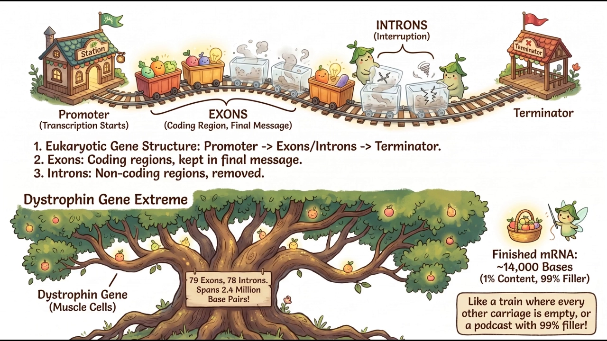

视频把这种结构比作一趟火车：每隔一节车厢坐满乘客（外显子），两节之间那节车厢空空如也（内含子）。人类基因平均有大约 8 个外显子，这个数量级还能接得住 [【跳转到 08:09】](https://www.bilibili.com/video/BV1pXRzBQEYD/?t=489)。

### 1.2 一个极端例子：抗肌萎缩蛋白基因

肌肉细胞靠抗肌萎缩蛋白（dystrophin）抗住自己不撕裂。这个基因上有 **79 个外显子、78 个内含子**，在基因组 DNA 上**横跨 240 万个碱基对**，但最终成品 mRNA 只有**大约 1 万 4000 个碱基长** [【跳转到 08:33】](https://www.bilibili.com/video/BV1pXRzBQEYD/?t=513)。视频的说法是：这个基因 99% 是水、1% 是干货。

这组数字本身就是本节要建立的第一个区分：**基因组区间的长度和成熟转录本的长度不是一回事**。前者包含内含子，后者不包含。第五部分会把这件事算清楚。

### 1.3 剪接的对象是转录本，不是基因

一个每年都有学生栽的说法是「内含子是垃圾 DNA」。这句话四个词里有两个错：内含子被剪的时候已经不是 DNA 了，它们是 RNA——因为剪接是在转录本上做的，不是在基因上做的 [【跳转到 13:01】](https://www.bilibili.com/video/BV1pXRzBQEYD/?t=781)。

还有一层常被误解的时序。学生脑子里的模型是：转录结束，RNA 聚合酶 II 把一整条 pre-mRNA 放出来，然后剪接体才开始审稿。现实里剪接是**跟转录同步进行**的：聚合酶还在基因上往前爬，一边爬一边在身后吐出新生 RNA，剪接体早就加到转录本上，内含子一冒头就被咬掉 [【跳转到 10:20】](https://www.bilibili.com/video/BV1pXRzBQEYD/?t=620)。等聚合酶走到终止子的时候，大部分内含子已经没了。

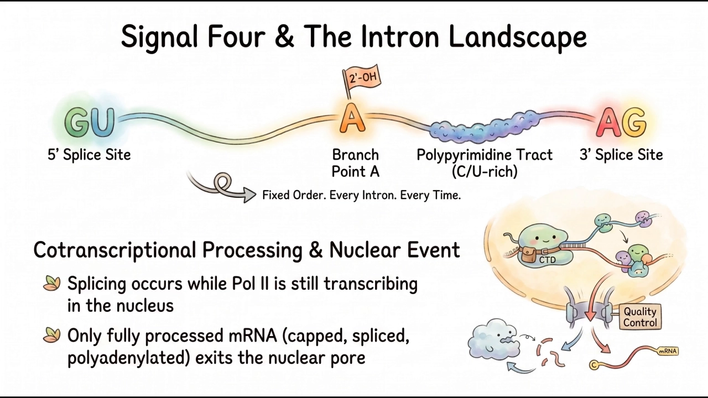

## 二、内含子上的四个信号

剪接体不是瞎剪。地球上每一个内含子都自带四个特定信号，演化把它们摆在固定位置，剪接体像司机看路牌一样读它们 [【跳转到 13:22】](https://www.bilibili.com/video/BV1pXRzBQEYD/?t=802)。

### 2.1 一号信号：5′ 剪接位点，永远是 GU

5′ 剪接位点是上游外显子和紧跟着的内含子之间的边界。内含子最开头的两个核苷酸贴着这条边界，**永远是 GU**——在 RNA 里是 GU，在 DNA 里就是 GT，同一个东西。这是著名的 **GT-AG 法则**的前半段 [【跳转到 14:04】](https://www.bilibili.com/video/BV1pXRzBQEYD/?t=844)。例外当然有，但稀罕到整个本科阶段碰不见。

5′ 剪接位点往内含子方向还会再延伸几个核苷酸，形成共识序列 **GUAAGU**。识别它的是 **U1 snRNP**：U1 自己的 RNA 就是互补的，靠直接的碱基互补配对咬住这个信号 [【跳转到 14:32】](https://www.bilibili.com/video/BV1pXRzBQEYD/?t=872)。

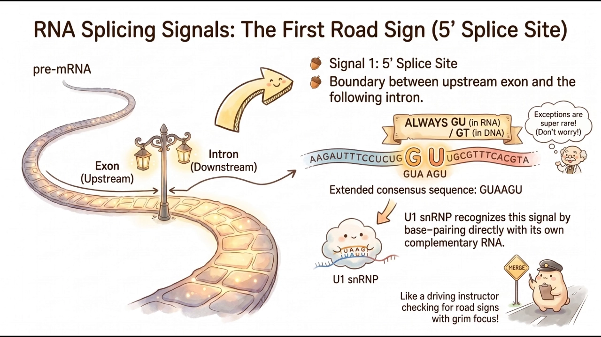

### 2.2 二号信号：分支点，一个被顶出来的腺苷

分支点在内含子深处，通常离末尾 **20 到 50 个核苷酸**。重要的不是「那里有个腺苷」，而是**这一个特定位置上的保守腺苷** [【跳转到 14:56】](https://www.bilibili.com/video/BV1pXRzBQEYD/?t=896)。

为什么它重要？因为 U2 snRNP 和分支点结合的时候，会跟内含子形成一小段双螺旋，这股力道把这个特定的 A 硬挤出双螺旋——像一把卡歪了的钥匙被挤出锁芯。一旦被顶出来，这个腺苷核糖上的 **2′ 羟基**就裸露在外，朝外指着，随时可用 [【跳转到 15:17】](https://www.bilibili.com/video/BV1pXRzBQEYD/?t=917) [【跳转到 15:40】](https://www.bilibili.com/video/BV1pXRzBQEYD/?t=940)。

这个 2′ 羟基就是整个反应机制里发动第一刀的**亲核试剂**。视频把这句话列为必背：「分支点腺苷之所以重要，是因为它的 2′-OH 是亲核试剂」 [【跳转到 16:13】](https://www.bilibili.com/video/BV1pXRzBQEYD/?t=973)。

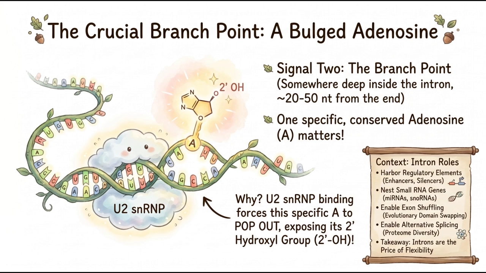

### 2.3 三号信号：多聚嘧啶区，一条停机坪

紧挨着分支点后面有一段全是嘧啶（C 和 U），通常 15 到 20 个核苷酸。这段序列本身不参与化学，它是一个**停靠带**：一个叫 **U2AF**（U2 辅助因子）的蛋白结合在这里，然后把 U2 拖到分支点上去 [【跳转到 16:36】](https://www.bilibili.com/video/BV1pXRzBQEYD/?t=996) [【跳转到 16:57】](https://www.bilibili.com/video/BV1pXRzBQEYD/?t=1017)。视频的比方是「一条带跑道灯的停机坪」。

### 2.4 四号信号：3′ 剪接位点，永远是 AG

3′ 剪接位点是内含子和下游外显子之间的边界，内含子最末尾的两个核苷酸**永远是 AG**，这是 GT-AG 法则的后半段 [【跳转到 17:22】](https://www.bilibili.com/video/BV1pXRzBQEYD/?t=1042)。

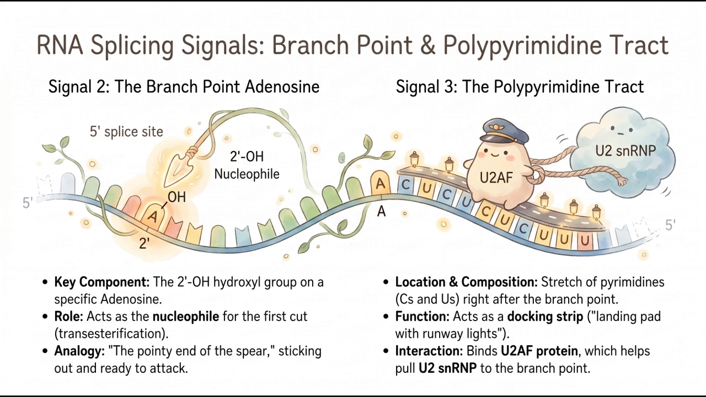

### 2.5 四个信号的固定顺序

把四个地标按顺序摆在一条内含子上：最左端 **GU** → 往右约 45 的位置一个凸起 **分支点 A**（2′-OH 翘在外头）→ 再往右一小段 **C/U 多聚嘧啶区** → 最右端 **AG**。固定顺序，每一个内含子、每一次都一样 [【跳转到 17:42】](https://www.bilibili.com/video/BV1pXRzBQEYD/?t=1062)。

顺带一个尺度感：剪接位点是个很小的靶子，两头各两个核苷酸。5′ 那个 G 变了，或者 3′ 那个 G 变了，剪接体就找不着地标，整个手术就散架。β-地中海贫血里有些患者的问题就是这样——一个剪接位点上一个碱基变了一个字，血红蛋白基因就没法正确剪接 [【跳转到 18:47】](https://www.bilibili.com/video/BV1pXRzBQEYD/?t=1127)。（疾病机制属于 4.2.2，本节不展开。）

## 三、剪接体：五个 snRNP 与 RNA 催化

### 3.1 snRNP 是什么

剪接体是细胞里最大最复杂的分子机器之一，跟核糖体同一段位：大约 **200 个蛋白质**加 **5 个 RNA** [【跳转到 19:29】](https://www.bilibili.com/video/BV1pXRzBQEYD/?t=1169)。核心是五个小核 RNA（snRNA），每条 snRNA 外头裹着一堆蛋白，组成一个**小核核糖核蛋白颗粒（snRNP）** [【跳转到 21:08】](https://www.bilibili.com/video/BV1pXRzBQEYD/?t=1268)。

### 3.2 五个 snRNP 的分工

一共五个：**U1、U2、U4、U5、U6**（U3 不在剪接体里，它改行去做别的了） [【跳转到 21:56】](https://www.bilibili.com/video/BV1pXRzBQEYD/?t=1316)。

| snRNP | 干什么 |
| --- | --- |
| U1 | 结合 5′ 剪接位点，第一个到场，读 GU 那两个字母 [【跳转到 22:28】](https://www.bilibili.com/video/BV1pXRzBQEYD/?t=1348) |
| U2 | 结合分支点，把它顶出双螺旋、让 2′-OH 外露，让化学反应成为可能 [【跳转到 22:28】](https://www.bilibili.com/video/BV1pXRzBQEYD/?t=1348) |
| U4 / U6 | 到场时已经预先配对，和 U5 组成预装好的三 snRNP；U4 随后退出，U6 顶替 U1 的位置 [【跳转到 22:52】](https://www.bilibili.com/video/BV1pXRzBQEYD/?t=1372) |
| U5 | 从物理上握住 5′ 端的外显子，把它挪到靠近 3′ 剪接位点的位置，完成第二刀时防止两端外显子飘走 [【跳转到 22:52】](https://www.bilibili.com/video/BV1pXRzBQEYD/?t=1372) |
| U6 | 催化劳模：U1 被赶走后 U6 顶上去与它配对，U6 也与 U2 配对，两套配对构成活性位点 [【跳转到 23:13】](https://www.bilibili.com/video/BV1pXRzBQEYD/?t=1393) |

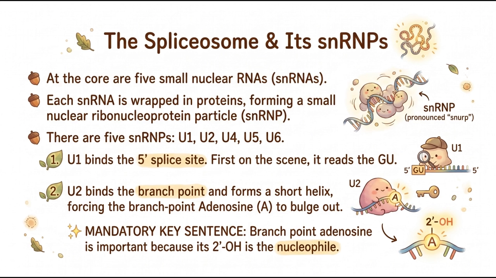

### 3.3 活性位点是 RNA，不是蛋白

跟核糖体一样，剪接体有一个第一次听会以为听错的特点：**催化不是蛋白质干的，是 RNA 干的**。这台机器上挂着大约 200 个蛋白质，没有一个是那个酶；酶是 RNA 自己，这类催化剂叫**核酶**，剪接体就是一个核酶 [【跳转到 19:46】](https://www.bilibili.com/video/BV1pXRzBQEYD/?t=1186) [【跳转到 20:07】](https://www.bilibili.com/video/BV1pXRzBQEYD/?t=1207)。

活性位点是纯 RNA 的，里头配**两个镁离子**帮忙推进化学反应 [【跳转到 23:13】](https://www.bilibili.com/video/BV1pXRzBQEYD/?t=1393)。视频给的解释是演化视角：剪接体可能是 RNA 世界的分子化石，RNA 本来就擅长靠碱基配对识别另一条 RNA，这份活没必要换手给蛋白。

### 3.4 剪接体循环：E → A → B → 激活的 B

装配顺序是本节最该记住的骨架 [【跳转到 23:35】](https://www.bilibili.com/video/BV1pXRzBQEYD/?t=1415) [【跳转到 24:39】](https://www.bilibili.com/video/BV1pXRzBQEYD/?t=1479)：

1. **U1** 结合 5′ 剪接位点 → **E 复合物**；
2. **U2** 结合分支点 → **A 复合物**；
3. **U4/U6/U5 三 snRNP** 加入 → **B 复合物**；
4. 一连串剧烈的 RNA-RNA 重排，U1 和 U4 被踢出去、U6 换进活性位点 → **激活的 B 复合物**；
5. 第一步反应发生；第二次重排把一切重新摆位；第二步发生；
6. 整台机器解体，零件散回核里，下次再用。

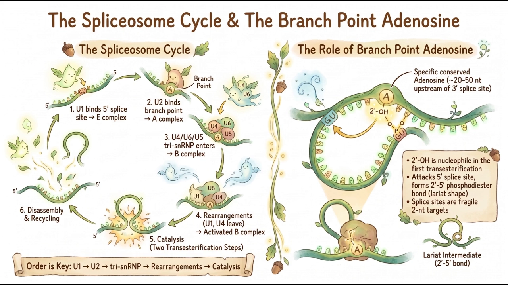

两个容易漏掉的点。第一，剪接体**不是预装好的**：它在每一个内含子上从零开始当场装配，一天之内保守估计要装了又拆、拆了又装几万亿次 [【跳转到 24:39】](https://www.bilibili.com/video/BV1pXRzBQEYD/?t=1479)。第二，重排要烧 **ATP**：好几个依赖 ATP 的解旋酶（Prp5、Prp16 等）一直在驱动这些重排——但烧的是重排的力气，不是化学反应的力气 [【跳转到 24:57】](https://www.bilibili.com/video/BV1pXRzBQEYD/?t=1497)。

## 四、两步酯交换：一个套索，一条干净的信息

### 4.1 场景摆好之后

一条 pre-mRNA 摊在剪接体面前：左边外显子一，中间内含子（开头 GU、约 4/5 处分支点 A、多聚嘧啶区、末尾 AG），右边外显子二。此时 U1 已经被赶下去，U2 死死扣着分支点、把腺苷的 2′-OH 直指 5′ 剪接位点，U5 抓着外显子一的末端，U6 和 U2 搭出活性位点，镁离子就位 [【跳转到 26:42】](https://www.bilibili.com/video/BV1pXRzBQEYD/?t=1602)。

### 4.2 第一步：分支点的 2′-OH 攻击 5′ 剪接位点

分支点腺苷上的 2′-羟基对 5′ 剪接位点的磷酸发起亲核攻击：它把电子对捐给外显子一和内含子第一个核苷酸中间的那个磷原子，外显子一与内含子第一个 G 之间的磷酸二酯键断开 [【跳转到 27:25】](https://www.bilibili.com/video/BV1pXRzBQEYD/?t=1645)。

**同一瞬间**，分支点腺苷的 2′-羟基和内含子的 5′ 端之间形成一个新的磷酸二酯键 [【跳转到 27:50】](https://www.bilibili.com/video/BV1pXRzBQEYD/?t=1670)。这一步略微诡异：正常 RNA 靠 3′ 到 5′ 的磷酸二酯键维持骨架，现在新形成的是 **2′ 到 5′** 的键——整个细胞生物学里就这一个地方会出现这种键 [【跳转到 28:12】](https://www.bilibili.com/video/BV1pXRzBQEYD/?t=1692)。

内含子的形状随之改变：它原来是一条直线，现在 5′ 端弯回去接到自己中段某一点上，变成一个带尾巴的环。生物学 1984 年从牛仔那里借来这个词，管它叫**套索** [【跳转到 28:32】](https://www.bilibili.com/video/BV1pXRzBQEYD/?t=1712)。

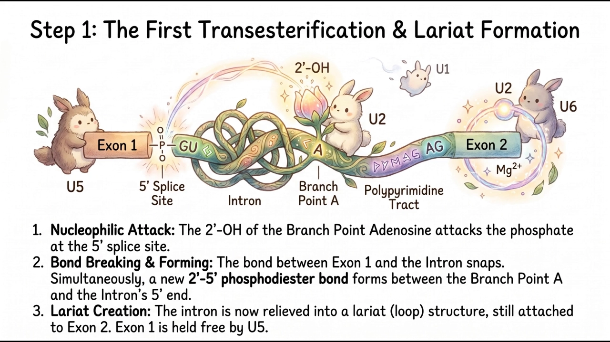

与此同时，外显子一的 3′ 端自由了，它有一个崭新外露的 **3′-羟基**，还被 U5 按着漂不走，化学上处于活跃态，正在找东西结合。

### 4.3 为什么叫酯交换：没有净水解

第一步前后，整个体系里磷酸二酯键的**总数完全一样**：一个键断、一个键形成，没有浪费。这种反应叫**酯交换**——一个酯键换成另一个酯键，净能量代价为零 [【跳转到 29:29】](https://www.bilibili.com/video/BV1pXRzBQEYD/?t=1769)。

所以剪接体虽然烧 ATP，但烧的是 snRNP 重排的力气，真正的化学反应本身是能量中性的 [【跳转到 29:54】](https://www.bilibili.com/video/BV1pXRzBQEYD/?t=1794)。这是一个很好用的判据：看到「没有水解、没有净能量代价」，就该想到酯交换。

### 4.4 第二步：外显子连接与套索释放

外显子一的 3′-羟基对 3′ 剪接位点的磷酸发起亲核攻击，又一次酯交换：内含子 AG 和外显子二第一个核苷酸之间的磷酸二酯键断开，同一瞬间，外显子一的 3′-羟基和外显子二的 5′ 端之间形成一个新的磷酸二酯键 [【跳转到 30:14】](https://www.bilibili.com/video/BV1pXRzBQEYD/?t=1814)。

外显子一和外显子二现在接上了，**直接看上看不到缝**，没有任何证据显示它们中间曾经夹过一段内含子——除非你拿放大镜去看周围序列里一些统计上的微妙指纹 [【跳转到 30:39】](https://www.bilibili.com/video/BV1pXRzBQEYD/?t=1839)。

内含子被释放，它**还是套索**，因为分支点那个 2′-5′ 键还没解开，它像一个带尾巴的环漂离剪接体 [【跳转到 30:39】](https://www.bilibili.com/video/BV1pXRzBQEYD/?t=1839)。

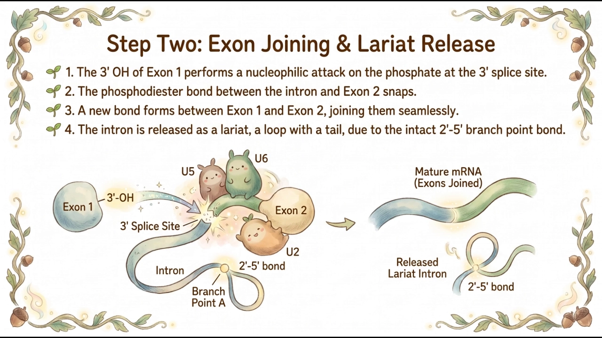

### 4.5 套索的下场：DBR1 去分支与降解

过一会儿，一个叫 **DBR1** 的去分支酶找到这个套索，切开那个 2′-5′ 键，把内含子拉直，然后交给降解机器切碎当零件 [【跳转到 31:00】](https://www.bilibili.com/video/BV1pXRzBQEYD/?t=1860) [【跳转到 31:16】](https://www.bilibili.com/video/BV1pXRzBQEYD/?t=1876)。大多数内含子就这样结束了一生；少数内含子里藏着功能性片段（比如小 RNA 基因），会被留下来。

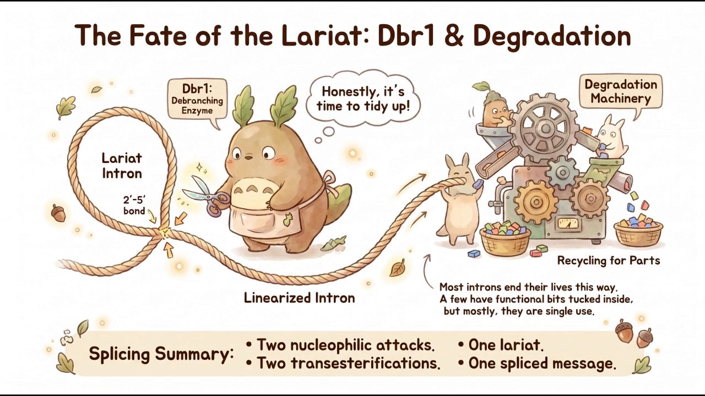

### 4.6 手和绳子的模型

视频最后用两只手把这个机制比了一遍，考前回忆机制时很好用 [【跳转到 33:27】](https://www.bilibili.com/video/BV1pXRzBQEYD/?t=2007)：

- **左手 = 外显子一，右手 = 外显子二，两手之间的绳子 = 内含子**；
- 绳子上某个位置（约 4/5 处）有个**疙瘩 = 分支点 A**；
- 第一步：疙瘩伸手往后抓住绳子的左端，绳子弯了，疙瘩和左端之间形成一个环；与此同时左手完全脱离绳子，只剩末端一小节连接；
- 第二步：左手伸过去握住右手，皮肤贴皮肤直接握住；那根带环带疙瘩的绳子从两只手上掉下去；
- 结果：你握着自己的手（外显子连接），绳子在地上，环还套在疙瘩上（套索）。

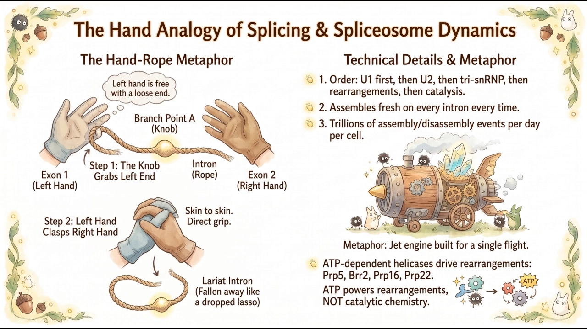

有一个容易被描述错的细节：两步反应**不是两次独立事件**。内含子全程连在剪接体上，分支点 A 把内含子维持在套索形状里，U5 按着外显子一，第二步完成之前没有任何东西是自由飘的。如果你描述成「内含子先被释放、然后又扑回来攻击」，那就错了 [【跳转到 34:31】](https://www.bilibili.com/video/BV1pXRzBQEYD/?t=2071)。

## 五、剪接后的转录本与基因组区间

### 5.1 同一段信息，两套坐标

这是本节学习目标里的第二个要求：**区分转录本结构与基因组区间**。用上面已经建立的机制就能算清楚：

| | 基因组区间 | 成熟转录本 |
| --- | --- | --- |
| 包含什么 | 外显子 + 内含子 + 两侧调控序列 | 只包含外显子（加帽、加尾） |
| 外显子之间的关系 | 被内含子隔开，中间隔着几千到几十万碱基 | 直接相邻，接缝处看不出来 |
| 长度由什么决定 | 从转录起点到终止子的跨度 | 各外显子长度之和（加 UTR） |
| 抗肌萎缩蛋白基因 | 约 240 万碱基对 | 约 1.4 万碱基 |

所以「外显子 1 之后是外显子 2」这句话在两套坐标里含义不同：在基因组上它们是两段被内含子隔开的区间，在转录本上它们是两个直接相连的片段。剪接做的正是把前者变成后者 [【跳转到 30:39】](https://www.bilibili.com/video/BV1pXRzBQEYD/?t=1839)。

### 5.2 长度账本：99% 是水

抗肌萎缩蛋白基因的例子把这件事推到极端：240 万碱基对的基因组区间，最终只留下约 1.4 万碱基的 mRNA [【跳转到 08:33】](https://www.bilibili.com/video/BV1pXRzBQEYD/?t=513)。视频的说法是「99% 是水、1% 是干货」。

这解释了两件实践中的事：一是**基因组区间长度不能用来估计转录本长度**；二是同一段基因组上的两个外显子，在转录本坐标里的距离与在基因组坐标里的距离没有对应关系。坐标约定本身（1-based、半开区间、正负链）见 [B02 §1.2.3 正负链、坐标起点与区间开闭](../../../README.md#b02-1-2-3)，本节只建立「内含子进不进坐标」这一层。

### 5.3 剪接发生在转录本上，所以内含子不是 DNA

回到 1.3 那句判据：内含子被剪的时候已经是 RNA。这句话在坐标层面同样成立——**内含子是转录本上的片段，不是基因组上的缺失**。基因组里那段序列一直在，只是不出现在成熟转录本里 [【跳转到 13:01】](https://www.bilibili.com/video/BV1pXRzBQEYD/?t=781)。

## 六、本节边界

**本节讲什么**：内含子与外显子的结构关系；四个剪接信号（GU、分支点 A、多聚嘧啶区、AG）；五个 snRNP 的分工与剪接体循环；两步酯交换反应、2′-5′ 键与套索；外显子连接；剪接后转录本与基因组区间的对应差异。

**本节不讲什么**：

- **可变剪接的调控与组织特异性**：外显子跳跃、互斥外显子、可变 5′/3′ 位点、内含子保留，以及剪接增强子/沉默子与 NOVA、PTBP 等调节因子，属于 [B02 §2.1.8 可变剪接](../../../README.md#b02-2-1-8)。视频后半段（约 44:07 起）讲了这些内容，本文未纳入。
- **剪接位点变异致病**：β-地中海贫血、SMA 与剪接调节药物（Spinraza 等）在视频里是机制的应用示例，疾病层面的推理见 [B02 §4.2.2 剪接变异](../../../README.md#b02-4-2-2)。
- **RNA 编辑**：碱基化学改写不属于剪接，见 [B02 §2.1.4](../2.1.4_基因、转录本与蛋白产物的一对多关系/同一个基因，不同产物：可变剪接、可变加尾与RNA编辑.md) 的「三、RNA 编辑」。
- **加帽与加尾的化学**：本节只把「加帽、加尾」当作剪接的并行工序提及，细节见 [B01 §2.2.2 RNA 加工](../../../../B01_生命科学基础主干/2_遗传信息流与中心法则/2.2_从基因到产物/2.2.2_RNA%20加工：加帽、剪接与尾部加工/README.md)。
- **I 类/II 类自剪接内含子**：视频只用一句话带过（细菌几乎没有内含子，少数自剪接内含子不需要剪接体），本节不展开其化学。
- **剪接体的结构生物学细节**：各复合物的蛋白组成、冷冻电镜结构不在本节范围。

## 术语表

| 术语 | 含义 |
| --- | --- |
| 外显子（exon） | 会进入成熟转录本的片段 |
| 内含子（intron） | 被剪掉的片段；被剪时已经是 RNA，不是 DNA |
| 5′ 剪接位点 | 上游外显子与内含子的边界，内含子开头为 GU |
| 3′ 剪接位点 | 内含子与下游外显子的边界，内含子末尾为 AG |
| 分支点（branch point） | 内含子内距 3′ 剪接位点约 20–50 nt 的保守腺苷，其 2′-OH 是第一次酯交换的亲核试剂 |
| 多聚嘧啶区 | 分支点之后 15–20 nt 的 C/U 富集段，结合 U2AF 把 U2 拉到分支点 |
| snRNP | 小核 RNA 加一组蛋白组成的颗粒；剪接体有 U1、U2、U4、U5、U6 五个 |
| 酯交换（transesterification） | 一个磷酸二酯键断开、另一个同时形成，无净水解、能量中性 |
| 套索（lariat） | 内含子 5′ 端通过 2′-5′ 磷酸二酯键接回自身分支点形成的带尾环状结构 |
| DBR1 | 去分支酶，切开套索的 2′-5′ 键，把内含子拉直送去降解 |

## 素材来源

- 视频：[细胞生物学解码 45 RNA 剪接到底怎么运作剪接体和套索机制](https://www.bilibili.com/video/BV1pXRzBQEYD/)，B 站 BV1pXRzBQEYD，约 62 分钟，MadSciHub 中文。本文覆盖约 07:24–35:31 的机制部分（基因结构、四个信号、剪接体、两步反应、手绳模型），并取 08:33 的抗肌萎缩蛋白基因数字用于转录本与基因组区间的对照；约 36:29–43:43 的疾病故事、44:07–55:15 的可变剪接与生物电延伸、55:15 之后的考试复习未纳入正文。
- 配图取自该视频的代表帧，位于 `assets/RNA 剪接：四个信号、两次酯交换与外显子连接/`，文件名即视频中的秒数。
- 术语与数字均来自视频字幕；「2′ 到 5′ 键在整个细胞生物学里只此一处」是讲者的表述，属于强调性说法，不宜当作严格排他性结论。