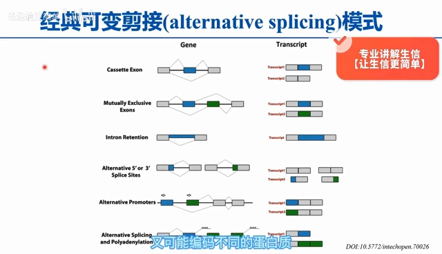

# 可变剪接的六种模式：同一基因如何拼出不同转录本

> 视频来源：[《经典的可变剪接（alternative splicing）模式有哪些类型呢？》](https://www.bilibili.com/video/BV16x4y1M7h4/)（B 站 · 生信知识分享）｜时长约 3 分钟
> 导读：这支短视频只有一张模式图，逐行讲解六种常见的可变剪接模式。它的价值不在机制深度，而在**把“外显子整段去留”和“边界移动”放在同一张图上对照**。本文按这张图逐行整理，并补上每种模式在成熟转录本上留下的痕迹。字幕中的“外弦子／外延吉”“内涵字”“破裂有尾巴”已订正为外显子、内含子、poly(A) 尾巴。

## 本讲要解决的核心问题（SCQA）

**背景**：同一个基因可以产生不同的转录本，不同的转录本还可能编码不同的蛋白质，转录组和蛋白质组的丰富度因此增加。[【跳转到 00:00】](https://www.bilibili.com/video/BV16x4y1M7h4/?t=0)

**冲突**：说“可变剪接”很容易，但“变”的方式并不止一种：有的模式让一整个外显子消失，有的只是把外显子的边界挪几十一百个碱基，有的干脆把内含子留在里面。

**疑问**：常见的可变剪接模式到底有哪几种？它们在成熟转录本上各自留下什么痕迹？

**回答（中心思想）**：**六种常见模式可以按“改了什么”分成四组——外显子的整段去留、外显子边界的移动、内含子的去留、转录起止点的选择。** 前两组是本节的重点，也是“外显子跳过”和“可变剪接位点”最容易混淆的地方。[【跳转到 00:15】](https://www.bilibili.com/video/BV16x4y1M7h4/?t=15)

---

## 一、一张图看全六种模式

图分两栏：左栏是**基因上的剪接方式**（折线表示外显子之间如何连接），右栏是**对应的成熟转录本**。逐行读，就能看出每种模式改变了转录本的哪一段。

| 模式（图中英文） | 被改变的选择 | 成熟转录本上的痕迹 |
| --- | --- | --- |
| 盒式外显子（Cassette Exon） | 中间那个外显子整体留下或跳过 | transcript 1 含中间外显子；transcript 2 少这一段 |
| 互斥外显子（Mutually Exclusive Exons） | 两个外显子只能二选一 | 两条转录本各含一个，不会同时含两个 |
| 内含子保留（Intron Retention） | 某个内含子切不切 | 转录本里多一段内含子 |
| 可变 5′ 或 3′ 剪接位点（Alternative 5′ or 3′ Splice Sites） | 外显子边界切在哪里 | 外显子变长或变短，但不会整段消失 |
| 可变启动子（Alternative Promoters） | 转录从哪里开始 | 两条转录本的 5′ 端起点不同 |
| 可变剪接与加尾（Alternative Splicing and Polyadenylation） | poly(A) 尾巴加在哪个外显子后 | 两条转录本的 3′ 端终点不同 |

## 二、外显子的整段去留：盒式外显子与互斥外显子

**盒式外显子**是视频讲的第一种模式：剪接时内含子被完整去除，三个外显子可以全部连到一起形成 transcript 1；也可以跳过中间那个外显子，把左右两个外显子直接连起来形成 transcript 2。[【跳转到 00:15】](https://www.bilibili.com/video/BV16x4y1M7h4/?t=15)

对照上图第一行：左栏的折线有两条走法，右栏就对应 transcript 1 与 transcript 2 两条产物。

这就是通常说的**外显子跳过**：被跳过的那一段在成熟 mRNA 上完全不存在，而不是“被剪短”。同一个事件，讲“外显子跳过”时强调的是消失的那一段，讲“盒式外显子”时强调的是它可以被整体装入或取出。

**互斥外显子**则不同：两个外显子不会同时出现在一条转录本里。[【跳转到 00:30】](https://www.bilibili.com/video/BV16x4y1M7h4/?t=30)视频用蓝色和绿色两个外显子举例——它们互斥，剪接后形成两个转录本，一个含蓝色外显子（transcript 1），另一个含绿色外显子（transcript 2）。[【跳转到 00:45】](https://www.bilibili.com/video/BV16x4y1M7h4/?t=45)

两者的区别可以这样记：

- 盒式外显子：**“要不要这一段”**，两个产物是“有”与“无”；
- 互斥外显子：**“要这一段还是要那一段”**，两个产物各有一段，但段不同。

## 三、边界移动：可变 5′ 与 3′ 剪接位点

另一种模式是 **alternative 5′ 或 3′ splice site**：剪接时可能对 5′ 端外显子的剪接位点做选择，也可能对 3′ 端外显子的剪接位点做选择，从而形成不同的转录本。[【跳转到 01:15】](https://www.bilibili.com/video/BV16x4y1M7h4/?t=75)

它和前面两种模式的关键差别是：**外显子没有整段消失，只是边界挪了位置**。图上右栏的两条转录本，灰色块的长度不同——一条的外显子更长，另一条更短。换句话说，产物差异是“某个外显子保留了多少”，而不是“这个外显子在不在”。

这也解释了为什么“外显子跳过”和“可变剪接位点”必须分开比较：前者改变的是**外显子集合**，后者改变的是**单个外显子的长度**。

## 四、内含子保留：本该剪掉的留下了

再一种模式是 **intron retention**：可变剪接之后保留了内含子，形成一个含有内含子的成熟转录本。[【跳转到 01:00】](https://www.bilibili.com/video/BV16x4y1M7h4/?t=60)

按上一节 [B02 §2.1.7 RNA 剪接机制](../2.1.7_RNA%20剪接机制：剪接位点、剪接体与内含子切除/RNA%20剪接：四个信号、两次酯交换与外显子连接.md) 的讲法，剪接的本职就是把内含子切除；内含子保留意味着**某个内含子没有被认出或被故意放过**。在成熟转录本上，它的痕迹最直接：多出一整段原本不该出现的序列。

## 五、转录起止点的选择：可变启动子与可变加尾

后两种模式严格说已经越过了“剪接”的边界，但视频把它们放在同一张图里，因为它们同样产生不同的转录本：

- **可变启动子**：同一个基因可能使用不同的启动子，[【跳转到 01:30】](https://www.bilibili.com/video/BV16x4y1M7h4/?t=90)比如从蓝色外显子这里开始转录，或从绿色外显子这里开始转录，形成 transcript 1 与 transcript 2。[【跳转到 01:45】](https://www.bilibili.com/video/BV16x4y1M7h4/?t=105)
- **可变剪接与加尾**：poly(A) 尾巴可以加在不同的外显子上，比如加在蓝色外显子后或绿色外显子后，形成两个不同的转录本。[【跳转到 02:00】](https://www.bilibili.com/video/BV16x4y1M7h4/?t=120)

这两项改变的是**转录的起点与终点**，不是外显子之间的连接方式。可变加尾的机制与实例（包括降钙素基因的两个 poly(A) 位点）已在 [B02 §2.1.4 同一个基因，不同产物](../2.1.4_基因、转录本与蛋白产物的一对多关系/同一个基因，不同产物：可变剪接、可变加尾与RNA编辑.md) 的「1.2」与「二」展开，本节不重复。

## 六、把六种模式放回“产物差异”上看

把六种模式按“产物上到底变了什么”重新排一次，比按名称背更实用：

| 产物差异 | 对应模式 |
| --- | --- |
| 少一个外显子 | 盒式外显子（外显子跳过） |
| 换成另一个外显子 | 互斥外显子 |
| 多一段内含子 | 内含子保留 |
| 某个外显子变长／变短 | 可变 5′／3′ 剪接位点 |
| 5′ 端起点不同 | 可变启动子 |
| 3′ 端终点不同 | 可变加尾 |

这张表也是读注释时的检查清单：看到同一基因的多条转录本，先问“差异属于哪一行”，再去判断它是剪接事件还是起止点事件。[【跳转到 02:15】](https://www.bilibili.com/video/BV16x4y1M7h4/?t=135)

## 小结

- 六种常见模式可以按“改了什么”分成四组：外显子整段去留、外显子边界移动、内含子去留、转录起止点选择。
- **盒式外显子**让一个外显子整体出现或消失；**互斥外显子**让两个外显子二选一。
- **可变 5′／3′ 剪接位点**只移动外显子边界，外显子变长或变短，不会整段消失。
- **内含子保留**在成熟转录本里留下一整段内含子。
- **可变启动子**与**可变加尾**改变的是转录起点与终点，严格说不是剪接，但同样产生不同转录本。
- 读转录本差异时，先判断差异属于“整段去留”“边界移动”“内含子去留”还是“起止点”，再谈机制。

## 关键术语速查

| 术语 | 一句话解释 |
| --- | --- |
| 盒式外显子（cassette exon） | 可以被整体装入或取出的外显子；取出时即外显子跳过 |
| 互斥外显子 | 两个外显子只能有一个进入同一条转录本 |
| 内含子保留 | 某个内含子未被切除，留在成熟转录本中 |
| 可变 5′／3′ 剪接位点 | 外显子边界切在不同位置，外显子因此变长或变短 |
| 可变启动子 | 同一基因使用不同启动子，转录起点不同 |
| 可变加尾 | poly(A) 尾巴加在不同位置，转录本 3′ 端终点不同 |