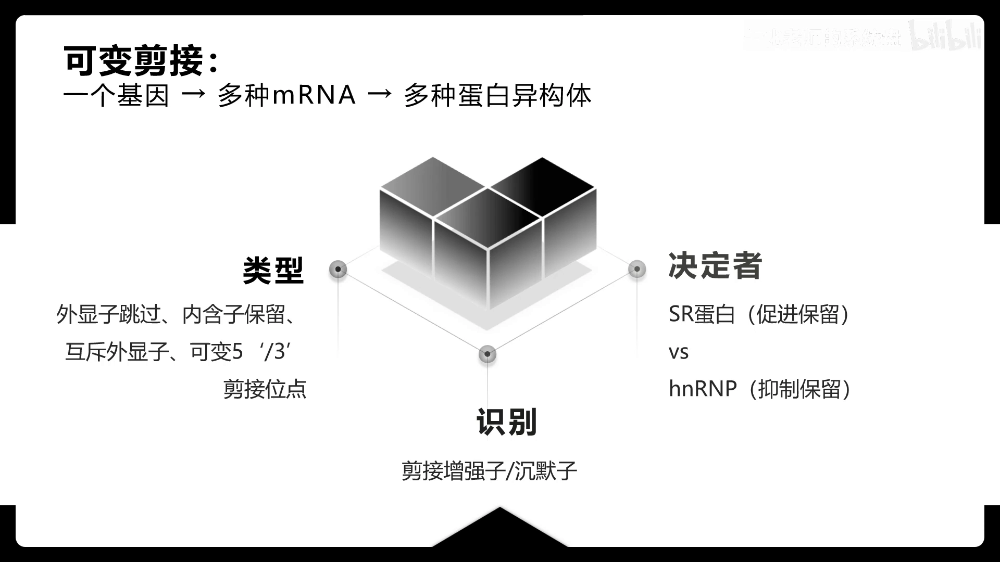
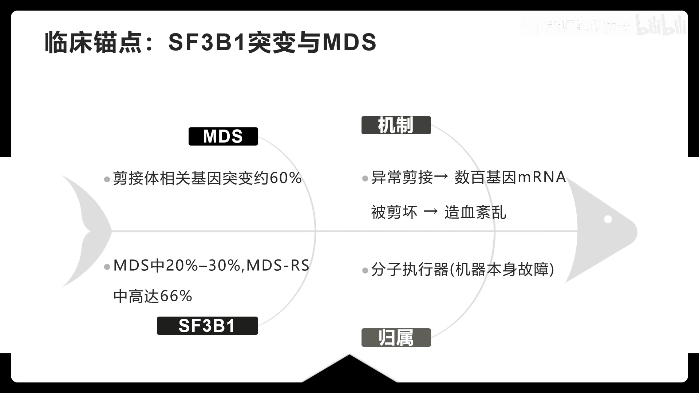
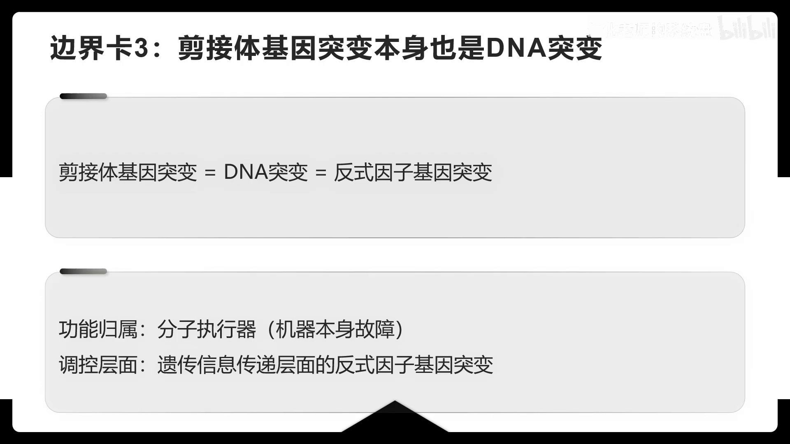

# 可变剪接：SR 蛋白与 hnRNP 的竞争决定外显子去留

> 视频来源：[《基因表达调控——谁决定“何时、何地、表达多少”（5）》](https://www.bilibili.com/video/BV1SNHh6dEqF/)（B 站 · 临床认知系列 · 中国医科大学 王华芹）｜时长约 5 分钟
> 导读：这是一节临床医学背景的基因表达调控课，前半段讲可变剪接，后半段讲 mRNA 出核。本文只取可变剪接部分（约 00:00–03:35）：一个基因如何产出多种 mRNA、常见剪接模式、SR 蛋白与 hnRNP 的竞争、组织与发育阶段的差异，以及剪接体故障导致 MDS 的临床案例。出核部分不属于本节范围，只在边界处点名。字幕中的“剪辑／简接／碱基体”“M2／MIA”“外弦子”“内涵字”已分别订正为剪接、剪接体、mRNA、外显子、内含子。

## 本讲要解决的核心问题（SCQA）

**背景**：人类只有约 2 万个蛋白编码基因，而蛋白质种类估计在数万到 10 万种以上。基因组序列是固定的，转录出来的前体 RNA 也是同一段序列。

**冲突**：如果“一个基因 → 一种 mRNA → 一种蛋白”成立，2 万个基因根本不够用；但同一个基因在不同组织里确实干着不同的活。

**疑问**：同一段前体 RNA，是谁决定哪些外显子留下、哪些被跳过？这种选择又怎样变成组织差异和疾病？

**回答（中心思想）**：**可变剪接在“剪哪里”这一步做选择，而选择由 SR 蛋白与 hnRNP 对外显子剪接增强子／沉默子的竞争决定。** 两类因子的比例随细胞类型、发育阶段和信号刺激而变，于是同一个基因在不同组织里拼出不同的 mRNA 和蛋白异构体；反过来，剪接体本身坏掉，就会让数百个基因同时剪错，例如 MDS 中的 SF3B1 突变。[【跳转到 00:15】](https://www.bilibili.com/video/BV1SNHh6dEqF/?t=15)

---

## 一、一个基因，多种 mRNA，多种蛋白异构体

视频给出的链条很短：**一个基因 → 多种 mRNA → 多种蛋白异构体**。[【跳转到 00:15】](https://www.bilibili.com/video/BV1SNHh6dEqF/?t=15)

这张幻灯片把全节要讲的四件事放在了一张图上，值得先读一遍：

- **类型**：外显子跳过、内含子保留、互斥外显子、可变 5′／3′ 剪接位点；
- **识别**：剪接增强子与剪接沉默子；
- **决定者**：SR 蛋白（促进保留）对 hnRNP（抑制保留）；
- **结果**：一个基因对应多种 mRNA，进而对应多种蛋白异构体。

这里的“异构体（isoform）”指**同一基因座产生的、序列彼此不同的转录本或蛋白版本**。它们不是突变，DNA 没有变，变的是加工时外显子的组合。

需要分清的是：**剪接体怎样完成剪切与连接，是上一节的内容**（见 [B02 §2.1.7 RNA 剪接机制](../2.1.7_RNA%20剪接机制：剪接位点、剪接体与内含子切除/RNA%20剪接：四个信号、两次酯交换与外显子连接.md)）。本节关心的是另一层问题：同样是这台剪接体，为什么在 A 细胞里剪出一种组合、在 B 细胞里剪出另一种组合。

## 二、四种常见模式：改的是“哪一段进成熟 mRNA”

视频点名了五类常见模式（其中可变 5′ 与 3′ 位点分开点名，本文合为一行），它们改变的对象并不相同：[【跳转到 00:35】](https://www.bilibili.com/video/BV1SNHh6dEqF/?t=35)

| 模式 | 被改变的选择 | 成熟 mRNA 上的结果 |
| --- | --- | --- |
| 外显子跳过（exon skipping） | 某个外显子整体留下还是跳过 | 少一整段外显子 |
| 内含子保留（intron retention） | 某个内含子切不切 | 多一段本该被切除的内含子 |
| 互斥外显子（mutually exclusive exons） | 两个外显子二选一 | 两条转录本各含其中一个，不会同时含两个 |
| 可变 5′／3′ 剪接位点 | 外显子边界切在哪里 | 外显子变长或变短，而不是整段消失 |

这四种模式的图示与逐行讲解，见配套博客 [可变剪接的六种模式](可变剪接的六种模式：同一基因如何拼出不同转录本.md)。这里只需先记住一条分界：**外显子跳过是“整段去留”，可变位点是“边界移动”**——前者让成熟 mRNA 少一个外显子，后者让某个外显子保留一部分。两者的产物差异不同，不能混为一谈。

## 三、决定者：SR 蛋白与 hnRNP 的竞争

剪接体并不认识“肌肉”或“肝脏”，它只认序列。真正带细胞背景信息的是两类**剪接调控因子**：[【跳转到 00:55】](https://www.bilibili.com/video/BV1SNHh6dEqF/?t=55)

- **SR 蛋白**：通常识别**外显子剪接增强子**（exon splicing enhancer），**促进外显子保留**；
- **hnRNP**：通常识别**外显子剪接沉默子**或**内含子剪接沉默子**（exon／intron splicing silencer），**抑制外显子保留**。

对照「一」中那张总纲图的右栏：SR 蛋白与 hnRNP 分别对应“促进保留”与“抑制保留”，二者竞争的结果就是剪接位点的选择。

关键在最后两个字：**竞争**。增强子与沉默子是前体 RNA 上的短序列，SR 蛋白和 hnRNP 谁先结合、谁结合得多，就决定了剪接体在这个外显子附近往哪个位点下刀。所以“哪个外显子被保留”不是一个固定的序列属性，而是**两类因子在该细胞中的相对浓度与活性所给出的读数**。

这也解释了一个常见误解：可变剪接不是“剪接体随机剪错”，而是**被调控的、可重复的选择**。同一细胞类型里同一基因的剪接模式通常稳定，正因为 SR／hnRNP 的比例是稳定的。

## 四、同一前体 RNA，不同细胞不同产物

把上面的机制推到细胞层面，就是本节最重要的结论：[【跳转到 01:15】](https://www.bilibili.com/video/BV1SNHh6dEqF/?t=75)

> 同一个 pre-mRNA，在不同细胞、不同发育阶段、不同信号刺激下，可以产生不同的剪接产物。这就是为什么同一个基因可以在不同组织里发挥不同功能。

三个变量要分开记：

1. **细胞类型**：不同组织表达不同的 SR 蛋白与 hnRNP 组合，剪接位点的选择随之改变；
2. **发育阶段**：同一类细胞在分化前后，因子组成变化，产物也跟着换；
3. **信号刺激**：外部信号可以改变调控因子的活性，让剪接在短时间内切换。

已有的两个具体案例可以放在这条机制下读：

- **降钙素基因**：甲状腺与大脑走不同的剪接／加尾路径，分别产出降钙素与 CGRP，见 [B02 §2.1.4 同一个基因，不同产物](../2.1.4_基因、转录本与蛋白产物的一对多关系/同一个基因，不同产物：可变剪接、可变加尾与RNA编辑.md) 的「二、组织特异」；
- **α-辅肌动蛋白基因**：按不同方式剪接得到五种功能各异的蛋白，分别服务于骨骼肌、平滑肌、成纤维细胞与脑，见 [B01 §2.2.1 转录如何发生](../../../../B01_生命科学基础主干/2_遗传信息流与中心法则/2.2_从基因到产物/2.2.1_转录：DNA%20模板与%20RNA%20合成/转录如何发生：从启动子到成熟mRNA的分子流水线.md) 的「5.2 一个基因，五种蛋白质」。

## 五、剪接体坏了：SF3B1 突变与 MDS

前面讲的是“选择哪条路”，这一节讲“修路机器坏了”。可变剪接的正常运行依赖于剪接体的精确组装；剪接体出错，影响的不是一条转录本，而是**数百个基因同时剪错**。[【跳转到 01:39】](https://www.bilibili.com/video/BV1SNHh6dEqF/?t=99)

视频用骨髓增生异常综合征（MDS）做临床锚点：

- MDS 中**剪接体相关基因突变总体发生率约 60%**；
- **SF3B1** 是剪接体的核心组件之一，在 MDS 中突变率约 **20%–30%**，在 MDS 伴环形铁粒幼细胞亚型（MDS-RS）中可高达 **60% 以上**（幻灯片标为 66%）。[【跳转到 01:59】](https://www.bilibili.com/video/BV1SNHh6dEqF/?t=119)

机制链条是：[【跳转到 02:19】](https://www.bilibili.com/video/BV1SNHh6dEqF/?t=139)

1. SF3B1 突变后，剪接体对**分支点和 3′ 剪接位点的选择**发生异常；
2. 数百个基因的 mRNA 被异常剪接；
3. 其中很多是造血调控基因，例如参与红细胞分化、铁代谢的基因；
4. 结果是病态造血、红细胞发育异常，出现**环形铁粒幼细胞**。[【跳转到 02:39】](https://www.bilibili.com/video/BV1SNHh6dEqF/?t=159)

这就是讲者说的“剪刀手坏了”：不是某一条 RNA 出了错，而是**执行剪接的机器本身**出了故障。

### 一个容易混淆的归属问题

视频专门澄清了一个概念混淆：[【跳转到 02:55】](https://www.bilibili.com/video/BV1SNHh6dEqF/?t=175)

- **功能归属**：剪接体是执行剪接的分子机器，它坏了属于“分子执行器的机器故障”；
- **调控层面**：剪接体蛋白组件的基因突变本身也是 **DNA 突变**，属于**反式作用因子基因突变**；
- 两个框架都说得通，但不能因为“故障发生在剪接这一步”就说“DNA 完全正常”。

这条区分对读变异数据很重要：同一个“剪接异常”表型，既可能来自**顺式**的剪接位点变异（前体 RNA 上的序列被改），也可能来自**反式**的剪接体或剪接因子变异（执行机器被改）。本节只保留这个分层，从变异到 RNA 与蛋白后果的完整推理留给 [B02 §4.2.2 剪接变异](../../../README.md#b02-4-2-2)。

## 六、本节边界：mRNA 出核不属于可变剪接

视频 03:35 之后转入 mRNA 出核：茎环结构、核输出信号被转运受体识别，决定出核快慢；热休克 mRNA 平时滞留在核内，热休克时才快速出核；肿瘤中癌基因 mRNA 出核升高、抑癌基因 mRNA 出核受阻。[【跳转到 03:40】](https://www.bilibili.com/video/BV1SNHh6dEqF/?t=220)

这是**转录后调控的另一个环节**，改变的是“成熟 mRNA 能不能出核、出多快”，而不是外显子组合。它属于 B02 §3.3 转录后与翻译调控的范围（最近的落点是 [B02 §3.3.2 mRNA 稳定性](../../../README.md#b02-3-3-2)），本文不展开。

## 小结

- **可变剪接让一个基因产出多种 mRNA 和多种蛋白异构体**，这是约 2 万个蛋白编码基因能对应数万到 10 万种蛋白质的主要机制之一。
- 四种常见模式改变的对象不同：**外显子跳过**是整段去留，**内含子保留**是多留一段，**互斥外显子**是二选一，**可变 5′／3′ 位点**是边界移动。
- 选择由 **SR 蛋白与 hnRNP 的竞争**决定：SR 识别剪接增强子、促进外显子保留；hnRNP 识别剪接沉默子、抑制保留。
- 因为两类因子随**细胞类型、发育阶段、信号刺激**变化，同一前体 RNA 在不同组织里会拼出不同产物。
- 剪接体本身故障会同时影响数百个基因：**SF3B1 突变与 MDS（尤其 MDS-RS）密切相关**；剪接体基因突变本身仍是 DNA 突变，属于反式因子突变。[【跳转到 04:39】](https://www.bilibili.com/video/BV1SNHh6dEqF/?t=279)

## 关键术语速查

| 术语 | 一句话解释 |
| --- | --- |
| 可变剪接（选择性剪接） | 同一前体 RNA 以不同位点剪接，产生外显子组合不同的成熟 mRNA |
| 蛋白异构体 | 同一基因座产生的、序列不同的蛋白版本，不是突变 |
| 外显子跳过 | 某个外显子整体不进入成熟 mRNA |
| 内含子保留 | 某个内含子没有被切除，留在成熟转录本里 |
| 互斥外显子 | 两个外显子只能二选一进入同一条转录本 |
| 可变 5′／3′ 剪接位点 | 外显子边界切在不同位置，外显子因此变长或变短 |
| 剪接增强子／沉默子 | 前体 RNA 上促进或抑制附近剪接位点使用的短序列 |
| SR 蛋白 | 识别剪接增强子、促进外显子保留的剪接调控因子 |
| hnRNP | 识别剪接沉默子、抑制外显子保留的剪接调控因子 |
| SF3B1 | 剪接体核心组件之一，突变与 MDS 特别是 MDS-RS 相关 |
| MDS | 骨髓增生异常综合征，剪接体相关基因突变发生率高的血液病 |