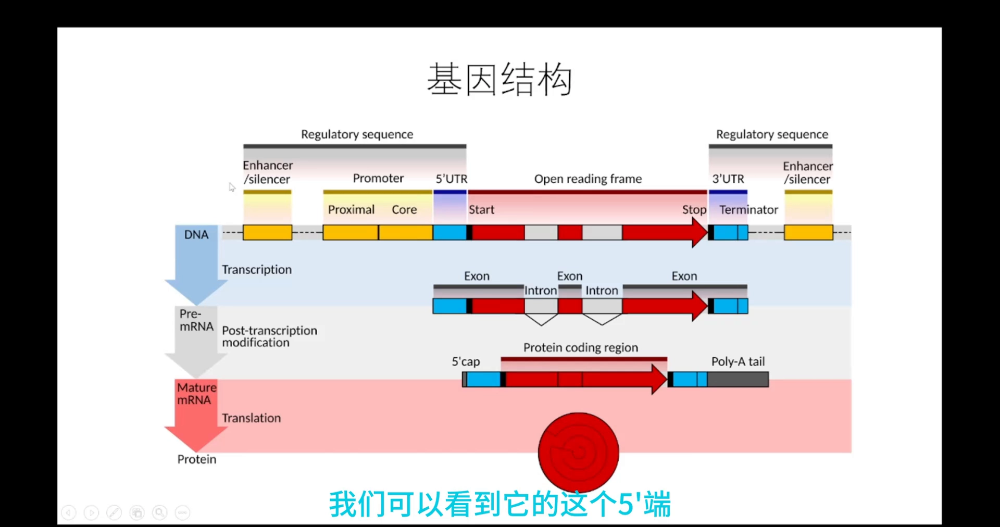

# ORF、CDS 与 UTR：转录本上编码区的边界与命名

> 视频来源：[“基因结构”：启动子、外显子、内含子、UTR、CDS、ORF等之间是什么关系？](https://www.bilibili.com/video/BV1hjzaBuE6Y/)（B 站 · 约 5 分 11 秒）。本文按该讲的逐窗口字幕与幻灯片整理，关键结论均带原片时间戳。
> 导读：这一讲用**一张基因结构图**把启动子、5′/3′ UTR、起始与终止密码子、外显子/内含子、ORF 和 CDS 一次摆到同一条坐标轴上，重点回答“这些名词到底指图上哪一段”。遗传密码的简并性和翻译过程不在这里重讲。

## 本讲要解决的核心问题（SCQA）

**背景**：描述一个基因时，我们会同时用到启动子、UTR、外显子、内含子、ORF、CDS 这一串名词。

**冲突**：这些名词并不在同一个层级上——有的是**调控元件**，有的是**转录本上的区段**，有的是**翻译的起止标记**。把它们当成互斥的“零件”去拼基因结构，就会出现“外显子就是编码区”“ORF 就是 CDS”这类混淆。

**疑问**：一条基因序列上，哪一段是编码区？编码区的两个边界由什么确定？UTR、内含子、调控元件分别落在哪里，又各自起什么作用？

**回答（中心思想）**：**编码区由起始密码子和终止密码子夹出来**；这两个标记之间的序列是 ORF，剪接成熟后真正被翻译的那部分才叫 CDS；UTR 是外显子的一部分但不翻译，内含子会被剪掉，而增强子/沉默子这类调控元件按功能定义、位置可以很灵活——它们不是同一类东西。[【跳转到 02:35】](https://www.bilibili.com/video/BV1hjzaBuE6Y/?t=155)

---

## 一、一张图看清基因结构的四层

讲者用一张自上而下的流程图把基因结构串起来：最上面是 DNA，中间是转录出的 pre-mRNA，下面是加工后的成熟 mRNA，最后是蛋白。[【跳转到 00:05】](https://www.bilibili.com/video/BV1hjzaBuE6Y/?t=5)

从图上从左到右读，可以分出四层东西：

| 层级 | 图上元素 | 判据 |
| --- | --- | --- |
| 调控序列 | 增强子 / 沉默子 | 按**功能**定义，与转录起始位点的距离可以很远 |
| 启动子区 | proximal（近端）、core（核心） | 与 TSS 的位置关系相对固定 |
| 转录单位 | 5′UTR、ORF、3′UTR、终止子 | 会被一起转录成 RNA |
| 加工与翻译 | 外显子、内含子、CDS、5′帽、poly(A) | 决定成熟 mRNA 上留下什么、翻译什么 |

这张表本身就是本节的结论：**“基因里的元件”不是一个平面上的并列项，而是分层的**。后面几节逐个说清每一层的边界怎么定。

## 二、调控元件与启动子：按功能和距离区分

### 2.1 增强子与沉默子可以离得很远

图的最左端标着增强子/沉默子。讲者强调它们和转录起始位点的距离**相对比较远**，可以位于 5′ 端，也可以位于 3′ 端，**甚至有的还可以位于内含子的区域**，作用是调控基因的转录过程。[【跳转到 00:30】](https://www.bilibili.com/video/BV1hjzaBuE6Y/?t=30)

这一句是后面区分“内含子”和“调控元件”的关键：一个增强子如果恰好落在内含子里，它**既是内含子序列、又是调控元件**——两个标签说的是不同的事，一个是“这段序列在加工时会被剪掉”，一个是“这段序列能被转录因子识别”。所以不能拿“它是不是内含子”去否定它的调控功能。

### 2.2 启动子与 TSS 的位置相对固定

再往右是启动子区域。讲者说启动子和 TSS（transcription start site，转录起始位点）的位置**相对比较固定**，一般 100 bp，或者 100 到 2000 bp 都有可能。[【跳转到 00:55】](https://www.bilibili.com/video/BV1hjzaBuE6Y/?t=55)

> 注意“相对固定”是相对于增强子说的：讲者给的是“100 bp 或 100–2000 bp”这样一个量级，而增强子的距离可以远到无法用“离 TSS 多远”来定义。两者在坐标上的可预测性不同，这是后面区分调控元件与启动子区的依据。

## 三、编码区的两个边界：起始密码子与终止密码子

启动子之后进入转录单位。讲者按顺序指出：先是 **5′UTR**，它“是一个非翻译的区域，它不翻译，但是它参与转录的过程”；再往下是**翻译起始位点**，“从这个位置开始正式的翻译”；然后从起始密码子一直到终止密码子，是“一个主体的区域”。[【跳转到 00:55】](https://www.bilibili.com/video/BV1hjzaBuE6Y/?t=55)

把这段话翻成可操作的规则：

1. **起点**：翻译从起始密码子开始，所以编码区的左边界就是起始密码子（AUG 对应的 DNA 上的 ATG）。
2. **终点**：编码区在终止密码子处结束，右边界是终止密码子。
3. **中间**：这段“主体区域”里还夹着外显子和内含子，所以它在 DNA 上并不连续。

讲者用颜色说明外显子与内含子的分工：图中**红色的部分称为外显子，外显子参与蛋白的翻译过程；内含子一般不参与蛋白质的翻译**。[【跳转到 01:45】](https://www.bilibili.com/video/BV1hjzaBuE6Y/?t=105)

> 这里要小心一个常见误读：“外显子参与翻译”不等于“外显子就是编码区”。下一节就会看到，UTR 也属于外显子，却不翻译。

## 四、ORF 与 CDS：一对容易混淆的名字

### 4.1 原核里 ORF 就是那段连续编码区

讲者先给了一个简单情形：对于这个基因，**尤其是原核生物**，中间这一大段区域就称为**开放阅读框（ORF, open reading frame）**。[【跳转到 02:10】](https://www.bilibili.com/video/BV1hjzaBuE6Y/?t=130)

原核基因的编码区是连续的，没有内含子打断，所以“从起始密码子到终止密码子”这一段在 DNA 上就是一段连续序列，ORF 这个名字用起来毫不含糊。

### 4.2 真核里 ORF 指剪接后不含内含子的那段

真核基因有内含子，情况就复杂了。讲者的说法是：目前一般认为，真核的 ORF 是**做基因预测时所说的那个预测 ORF 区域**，这个区域**理论上不包含内含子区，只特指由外显子组成的区域**；因为它的理解是“从起始密码子一直到终止密码子，中间不能有终止密码子”。[【跳转到 02:35】](https://www.bilibili.com/video/BV1hjzaBuE6Y/?t=155)

这句话里有两个判据，值得单独拎出来：

- **起止判据**：以起始密码子开头、以终止密码子结尾；
- **连续性判据**：中间不能出现终止密码子——一旦出现，翻译就会在那里停住，后面那段就不能算同一个 ORF。

把内含子排除在外，正是为了让第二条判据成立：判据要求“一路读下去不遇到终止密码子”，而内含子是不翻译的插入序列，这条要求只能在**剪接后的序列**上检验。所以真核的 ORF 必须**在剪接后的序列上**去读。

### 4.3 CDS 是成熟 mRNA 上真正被翻译的那一段

讲者接着点出混淆的来源：大家常把 **ORF 区域**和成熟 mRNA 上的 **CDS 区域**当成一回事，**这两个区域之间是有区别的**，很多人对这两部分内容存在歧义；而且 ORF 本身的定义“还是比较容易引起歧义的”。[【跳转到 03:00】](https://www.bilibili.com/video/BV1hjzaBuE6Y/?t=180)

在讲完 pre-mRNA 加工之后，他给出了 CDS 的定位：成熟 mRNA 不包含内含子这部分区域，**中间红色这部分参与蛋白质翻译的区域，我们也把它称为 CDS**。[【跳转到 04:15】](https://www.bilibili.com/video/BV1hjzaBuE6Y/?t=255)

于是三者的关系可以整理成：

| 名词 | 落在哪条序列上 | 边界 | 是否含内含子 |
| --- | --- | --- | --- |
| 编码区（口语） | DNA 或 mRNA | 起始密码子 → 终止密码子 | DNA 上含，mRNA 上不含 |
| ORF | 通常指剪接后的序列 | 起始密码子 → 终止密码子，中间无终止密码子 | 不含（真核） |
| CDS | 成熟 mRNA | 起始密码子 → 终止密码子 | 不含 |

> 讲者明确说“两者有区别”，但这一讲没有逐条展开数据库注释里 ORF 与 CDS 的差异。这里只保留视频给出的判据，不替它补结论；下一节用工具实际找 ORF 时，会看到“一条序列上出现很多候选 ORF”的具体样子。

## 五、外显子比 CDS 宽：UTR 也是外显子

讲者在讲 pre-mRNA 时特意停下来提醒“有意思的就来了”：pre-mRNA 的转录是从 5′UTR 一直到 3′UTR，这一大块都一起参与转录；而**从 5′UTR 开始，这部分都叫做外显子区**。[【跳转到 03:25】](https://www.bilibili.com/video/BV1hjzaBuE6Y/?t=205)

所以“外显子”是一个**比 CDS 更宽泛**的定义：它指的是“剪接后保留下来的片段”，而不是“翻译成蛋白的片段”。5′UTR 和 3′UTR 不表达蛋白，但同样属于外显子；只有中间那段才叫 CDS。[【跳转到 03:50】](https://www.bilibili.com/video/BV1hjzaBuE6Y/?t=230)

这条推论在数据里很好用：

- 一个转录本的外显子长度之和 > CDS 长度，差额就是 UTR；
- 反过来，如果看到“外显子”就当成“编码区”去算蛋白长度，会把 UTR 也算进去，长度系统性偏大；
- 3′UTR 之后还有终止子（terminator）和可能的增强子/沉默子，它们不属于转录单位的主体。[【跳转到 02:10】](https://www.bilibili.com/video/BV1hjzaBuE6Y/?t=130)

## 六、从 DNA 到成熟 mRNA：同一段序列的三次变形

讲者最后把加工过程串了一遍：DNA 转录先形成 **pre-mRNA**，转录范围从 5′UTR 一直到 3′UTR；pre-mRNA 发生**可变剪接**，同时加入 **5′加帽**和 **3′加尾（poly(A) 尾巴）**，最后形成**成熟 mRNA**；成熟 mRNA 不再包含内含子。[【跳转到 04:15】](https://www.bilibili.com/video/BV1hjzaBuE6Y/?t=255)

这条链解释了为什么同一个基因会有**三套坐标**：

1. **基因组坐标**：从增强子/启动子到下游调控序列，中间夹着内含子；
2. **pre-mRNA 坐标**：从 5′UTR 到 3′UTR，内含子还在；
3. **成熟 mRNA 坐标**：内含子已切除，5′端有帽、3′端有 poly(A)。

同一个“第 500 个碱基”，在这三套坐标里指向的位置完全不同。讨论“编码区从哪里开始”之前，先确认说的是哪一套坐标——这是本节最实用的一条操作习惯。

## 七、这一讲没有覆盖的部分

- **遗传密码的简并性、摆动配对**：属于 B01 的[遗传密码](../../../../B01_生命科学基础主干/2_遗传信息流与中心法则/2.2_从基因到产物/2.2.4_遗传密码：密码子、简并性与阅读框/【分子生物学】遗传密码（遗传密码的特点）.md)一节，本节不重讲。
- **核糖体如何起始、延伸、终止**：属于 B01 的[翻译如何发生](../../../../B01_生命科学基础主干/2_遗传信息流与中心法则/2.2_从基因到产物/2.2.5_翻译：核糖体、mRNA%20与多肽合成/翻译如何发生：从密码子到多肽链的分子流水线.md)，本节只把起始/终止密码子当作**边界标记**使用。
- **六种阅读框怎么数出来**：本讲只说“从起始密码子读到终止密码子”，没有展开正反链各三框的算法，见同节[六个阅读框](六个阅读框：正反链各三框与ORF的挑选.md)。
- **非编码 RNA 与假基因**：本讲不涉及，见 2.2.2。

## 小结

- 基因结构分四层：调控序列（增强子/沉默子，可远、可在内含子内）→ 启动子（贴 TSS，约 100–2000 bp）→ 转录单位（5′UTR、ORF、3′UTR、终止子）→ 加工与翻译（外显子、内含子、CDS、帽、尾）。
- **编码区的两个边界由起始密码子和终止密码子确定**，中间不允许出现终止密码子。
- **ORF 在真核里指剪接后不含内含子的那段**；**CDS 是成熟 mRNA 上真正被翻译的那段**；两者判据相近但定义来源不同，讲者明确提醒容易混淆。
- **外显子比 CDS 宽**：UTR 也是外显子，但不翻译；用外显子长度当编码长度会偏大。
- 同一个基因有**基因组、pre-mRNA、成熟 mRNA 三套坐标**，谈编码区边界前先确认坐标系统。

## 关键术语速查

| 术语 | 一句话解释 |
| --- | --- |
| 增强子 / 沉默子 | 按功能定义的调控序列，与 TSS 距离可远，位置可在 5′、3′ 甚至内含子内 |
| 启动子 | 位于 TSS 上游、位置相对固定的一段序列，招募 RNA 聚合酶 |
| TSS | 转录起始位点，第一个被转录的碱基所在位置 |
| 5′UTR / 3′UTR | 转录本两端不翻译的区段，属于外显子，参与稳定性与翻译调控 |
| 起始密码子 | 翻译开始的标记，编码区左边界 |
| 终止密码子 | 翻译结束的标记，编码区右边界 |
| ORF | 开放阅读框：起始密码子到终止密码子、中间无终止密码子的一段序列 |
| CDS | 成熟 mRNA 上参与蛋白质翻译的那段序列 |
| 外显子 / 内含子 | 剪接后保留在成熟 mRNA 中的片段 / 被剪接移除的片段 |
| pre-mRNA | 刚转录出来、尚未剪接加帽加尾的前体 RNA |