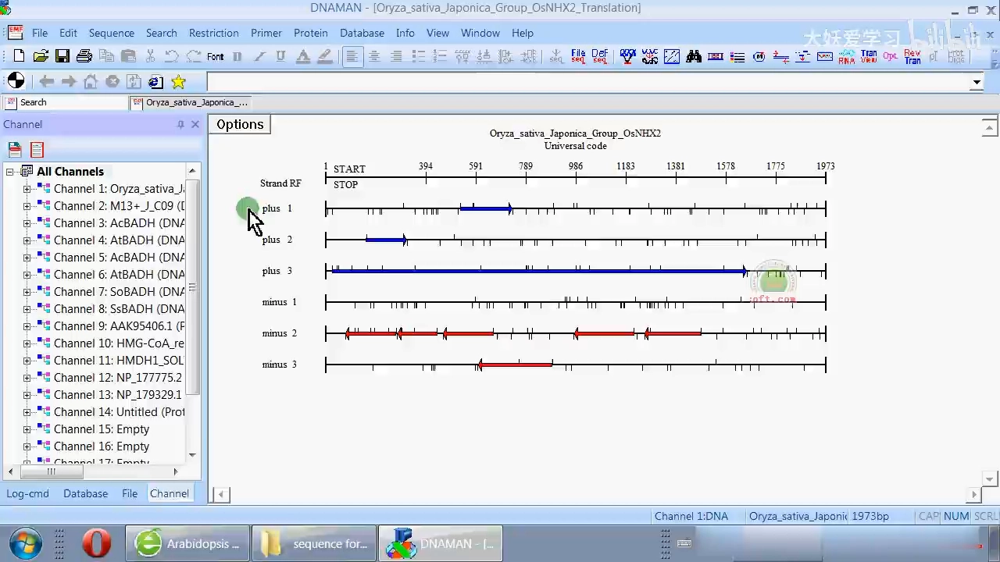
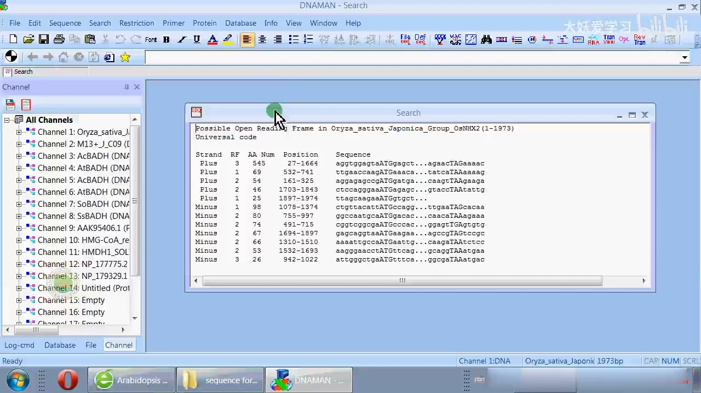
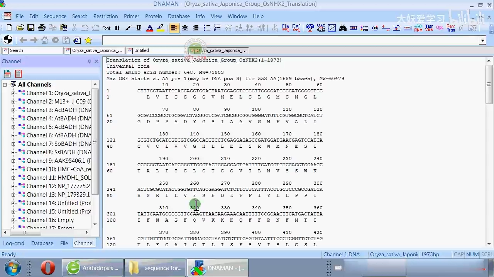

# 六个阅读框：正反链各三框与 ORF 的挑选

> 视频来源：[11 使用 DNAMAN 软件识别 ORF 及翻译核酸序列](https://www.bilibili.com/video/BV1Pq4y157Zu/)（B 站 · 约 5 分 34 秒）。本文按该讲的逐窗口字幕与录屏整理，关键结论均带原片时间戳。
> 导读：这一讲用 DNAMAN 的录屏演示“六框翻译”长什么样：一条核酸序列为什么能读出六种蛋白、终止密码子怎么把序列切成一段段候选 ORF、以及工具最后凭什么挑出那个“最强 ORF”。前半段是操作，后半段是判读，本文按判读的逻辑重排。

## 本讲要解决的核心问题（SCQA）

**背景**：拿到一条核酸序列，想知道它编码什么蛋白，最直接的做法是“翻译”。

**冲突**：可是从第 1 个碱基开始三个一组、从第 2 个碱基开始三个一组、从第 3 个碱基开始三个一组，读出来是三套完全不同的氨基酸序列；DNA 又是双链，反向互补链还能再读三套。**同一段序列，六种读法，结论完全不同**。

**疑问**：这六个阅读框是什么关系？怎么在六种读法里找出真正编码蛋白的那一段？工具给出的“最强 ORF”能不能直接当成编码区？

**回答（中心思想）**：一条双链核酸序列有**六个阅读框**——正向链三框（plus 1/2/3）加反向互补链三框（minus 1/2/3）；在每个框里，**从起始密码子到终止密码子、中间不再出现终止密码子**的一段就是一个 ORF；候选 ORF 往往很多，工具用“最长/最强”来排序，而**最长的那一个只是最可能的编码区，不是证据本身**。[【跳转到 02:40】](https://www.bilibili.com/video/BV1Pq4y157Zu/?t=160)

---

## 一、先定任务：找 ORF 到底在找什么

讲者开宗明义地说明这个功能的用途：查找核酸序列中的开放阅读框，常用于**查找一条完整 mRNA 序列中最强的编码区**，也可以用来**查找原核生物基因组序列中的编码区序列**。[【跳转到 00:00】](https://www.bilibili.com/video/BV1Pq4y157Zu/?t=0)

这句话里藏着两个不同的场景，值得先分开：

| 场景 | 输入序列 | 要找的东西 |
| --- | --- | --- |
| 真核 mRNA / cDNA | 已剪接、无内含子 | 这条转录本上唯一的编码区 |
| 原核基因组片段 | 连续、可能含多个基因 | 片段里所有可能的编码区 |

两种场景的共同点是：**输入里没有内含子**。这正是上一节讲的道理——真核基因的 ORF 必须在剪接后的序列上读，否则内含子里的终止密码子会把所有阅读框打断。

## 二、参数只有一个：最短 ORF 长度

操作上只有一步设置：选中一号通道，点击“设置”的最后一项“寻找开放阅读框”，此处默认值为 **25**，表示**只寻找氨基酸长度超过 25 个的 ORF**。[【跳转到 00:25】](https://www.bilibili.com/video/BV1Pq4y157Zu/?t=25)

这个阈值是个纯粹的过滤器，它决定“多短的片段不值得报出来”。设得太低，六框里会冒出成百上千个偶然的短 ORF；设得太高，真正的短肽会被漏掉。讲者用的是默认值，没有讨论调参——实际使用时这个数字应当跟着“预期的蛋白长度”走。

## 三、六个阅读框：正向三框 + 反向互补三框

### 3.1 为什么是六个

三联体密码的断句方式由“从哪一位开始”决定：从第 1、2、3 位开始分组，得到三套互不重叠的读法。DNA 是双链，反向互补链按 5′→3′ 方向同样能分出三套。3 + 3 = 6。

讲者在打开“翻译概览”后直接点明了这个结构：按照六框翻译，对这一条核酸序列进行翻译；**上面的 plus 1、2、3 是对当前序列按第一框、第二框、第三框翻译的结果；下面的 minus 1、2、3 是对该序列的反向互补序列进行三种翻译得到的结果**。[【跳转到 02:15】](https://www.bilibili.com/video/BV1Pq4y157Zu/?t=135)

这张图是本节的核心：六行横线对应六个阅读框，横线上的刻度是序列位置，向下的短线标出终止密码子所在位置；**从起始密码子到终止密码子就是一个 ORF**，工具用箭头把符合条件的 ORF 画在对应的行上。[【跳转到 02:15】](https://www.bilibili.com/video/BV1Pq4y157Zu/?t=135)

### 3.2 颜色区分方向

箭头颜色编码了链方向：**按正向链翻译得到的 ORF 用蓝色箭头表示**，[【跳转到 02:40】](https://www.bilibili.com/video/BV1Pq4y157Zu/?t=160)**按反向互补链翻译得到的 ORF 用红色箭头表示**。[【跳转到 03:05】](https://www.bilibili.com/video/BV1Pq4y157Zu/?t=185)

> 这一点在判读结果时非常实用：如果一条序列的候选 ORF 全是红色的，说明它的编码方向与提交序列的方向相反。上一节讲过基因有正负链，这里就是它在工具里的样子。

### 3.3 六框视图读出来的信息

把六行放在一起看，能直接读出三件事：

1. **哪一框有长 ORF**：真正的编码区会在某一框里连续很长而不遇到终止密码子；
2. **方向**：蓝色（正向）还是红色（反向）；
3. **候选之间的竞争关系**：同一框里可能有多个 ORF，不同框之间也可能各有一段。

## 四、从候选里挑一个：最强 ORF

### 4.1 工具给出的候选清单

设置确认后，工具弹出结果窗口，把所有符合条件的 ORF 列成一张清单。[【跳转到 00:50】](https://www.bilibili.com/video/BV1Pq4y157Zu/?t=50) 清单每行给出 **Strand（链）、RF（阅读框编号）、AA Num（氨基酸数）、Position（位置区间）、Sequence（首尾序列）**；其中起始密码子和终止密码子被高亮标出。[【跳转到 00:55】](https://www.bilibili.com/video/BV1Pq4y157Zu/?t=55)

从这张清单能看出“候选很多”是常态：同一段序列在正反链、三个框里都能凑出满足长度阈值的 ORF，而它们彼此重叠、方向不同。

### 4.2 最强 ORF 是怎么挑出来的

讲者的判据很直接：在正向链第三框翻译中得到了一个**最强的 ORF**，编码 **545 个氨基酸**，位置在第 **27 到 1664** 位。[【跳转到 00:55】](https://www.bilibili.com/video/BV1Pq4y157Zu/?t=55)

随后他给出了这条经验法则：**一条核酸序列中最强的 ORF，很可能就是一个实际存在的真实的 ORF**。[【跳转到 03:05】](https://www.bilibili.com/video/BV1Pq4y157Zu/?t=185)

> 注意措辞是“很可能”，不是“就是”。长度优势只是一个**先验**：真实的蛋白编码区通常远长于随机序列里偶然凑出的 ORF，所以最长的那个命中率最高。但它仍然是预测——要确认编码区，还需要别的证据（同源序列、表达产物、注释记录等），这一讲没有展开。

### 4.3 点开一个 ORF 看细节

双击该箭头会打开新窗口，显示这条链按正向链第三框翻译的结果：ORF 位置在 **27 到 1662**，**碱基数编码的计算数目是 544**；讲者特别提醒，**这个 544 并没有计算第一个起始密码子编码的氨基酸，如果加上甲硫氨酸应该是 545**，分子量 59723。[【跳转到 03:55】](https://www.bilibili.com/video/BV1Pq4y157Zu/?t=235)

这里有个容易踩的坑，讲者等于替我们踩了一遍：

- **同一个 ORF，两个视图报的区间不完全一样**（列表里是 27–1664，详情窗口是 27–1662），端点的处理方式随视图而变；
- **氨基酸数的 544 与 545 之差，来自起始密码子**：起始密码子本身编码甲硫氨酸，是否把它计入，取决于计数口径。

所以引用“这个 ORF 有多长”时，必须同时说清**用的是哪个视图、算没算起始甲硫氨酸**。这也是为什么不同数据库给出的 CDS 长度偶尔会差几个氨基酸。

## 五、翻译结果长什么样：核酸行 + 蛋白行

最后讲者演示了单框翻译：选中通道、点击“蛋白翻译”，按第三框翻译，并在显示翻译结果时**同时显示 DNA 单链**；结果中**上面一行是核酸序列，下面一行是对应的蛋白质序列**。[【跳转到 05:10】](https://www.bilibili.com/video/BV1Pq4y157Zu/?t=310)

这种“上下对齐”的排布就是阅读框的可视化：每一列三个碱基对应下面一个氨基酸。一旦中间插入或缺失了非 3 整数倍的碱基，上下对齐关系就会整体错位——这正是移码突变在序列视图里的样子（移码的遗传学后果见 B01 的[遗传密码](../../../../B01_生命科学基础主干/2_遗传信息流与中心法则/2.2_从基因到产物/2.2.4_遗传密码：密码子、简并性与阅读框/【分子生物学】遗传密码（遗传密码的特点）.md)）。

## 六、一个容易被忽略的设置：遗传密码表

讲者在翻译前提醒：翻译之前有一个**遗传密码表**；如果序列来自普通的一般的生物基因组，就选择 **universal**；如果序列来自**叶绿体、线粒体等其他基因组**，就要对这个遗传密码表做相应的改变。[【跳转到 01:45】](https://www.bilibili.com/video/BV1Pq4y157Zu/?t=105)

这一条直接决定 ORF 的边界：终止密码子由密码表定义，用错了表，就会在“其实不是终止”的位置停下，把一个完整 ORF 截成两段。**做六框翻译前先确认序列来自哪个基因组**，是比调阈值更重要的前置检查。密码表的具体例外（哪些密码子在线粒体里改了含义）见 B01 的[遗传密码](../../../../B01_生命科学基础主干/2_遗传信息流与中心法则/2.2_从基因到产物/2.2.4_遗传密码：密码子、简并性与阅读框/【分子生物学】遗传密码（遗传密码的特点）.md)。

## 七、这一讲没有覆盖的部分

- **ORF 与 CDS 的定义差别**：本讲只用“起始密码子到终止密码子”这一条判据，没有区分 ORF 与 CDS，见同节 [ORF、CDS 与 UTR](ORF、CDS与UTR：转录本编码区边界.md)。
- **内含子怎么办**：本讲输入的是不含内含子的序列，真核基因组 DNA 直接做六框翻译会得到一堆碎片，原因见上一节。
- **编码区的实验证据**：本讲只做序列层面的预测，不涉及表达验证。
- **遗传密码的简并性与翻译机制**：属于 B01，本节不重讲。

## 小结

- 一条双链核酸序列有**六个阅读框**：正向三框（plus 1/2/3）与反向互补三框（minus 1/2/3）。
- 在每个框里，**起始密码子到终止密码子、中间无终止密码子**的一段是一个 ORF；工具用长度阈值（默认 25 aa）过滤候选。
- **颜色即方向**：蓝色箭头为正向 ORF，红色箭头为反向 ORF。
- **最强 ORF 是最可能的编码区，不是证据**；引用长度时要说清区间端点与是否计入起始甲硫氨酸（544 vs 545）。
- 翻译前先选对**遗传密码表**（universal / 线粒体 / 叶绿体），否则 ORF 边界会被错误截断。

## 关键术语速查

| 术语 | 一句话解释 |
| --- | --- |
| 阅读框（reading frame） | 三联体分组从哪一位开始；同一条序列有三种 |
| 六框翻译 | 正向链三框 + 反向互补链三框，共六种翻译结果 |
| plus 1/2/3 | 以提交序列为正向，从第 1/2/3 位开始分组的三框 |
| minus 1/2/3 | 以反向互补序列为正向的三框 |
| ORF | 起始密码子到终止密码子、中间无终止密码子的一段序列 |
| 最强 ORF | 六框中长度最长、最可能对应真实编码区的候选 |
| 遗传密码表 | 密码子到氨基酸的映射表；核基因组用 universal，线粒体/叶绿体需另选 |
| 概念性翻译 | 直接按密码子表把核酸序列转成氨基酸序列，不考虑表达调控 |