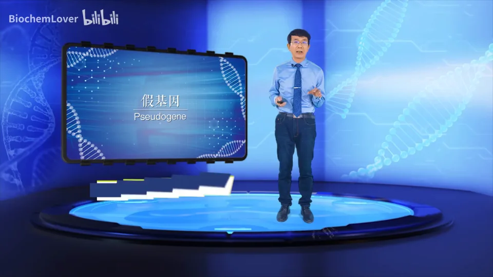
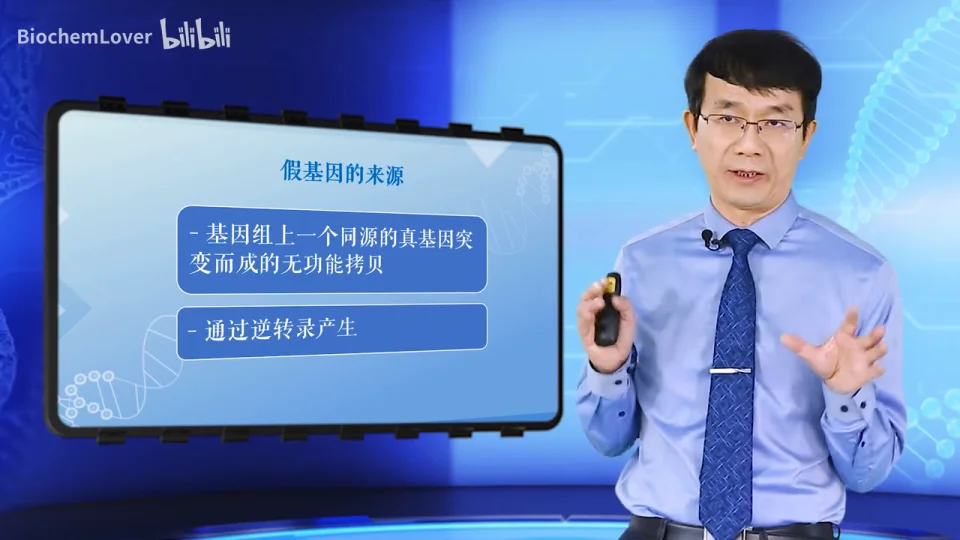
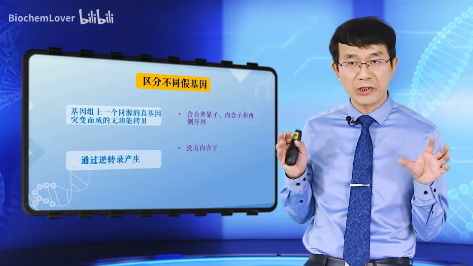
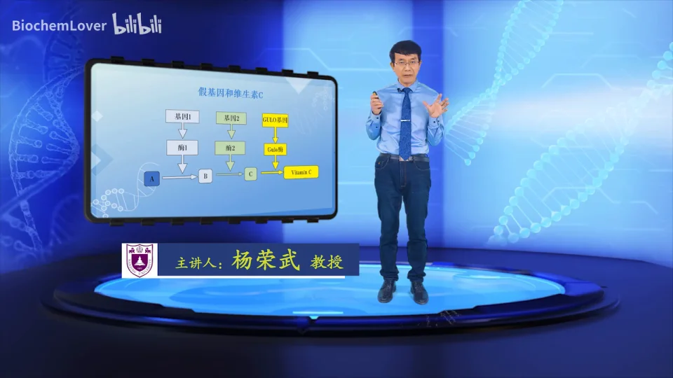
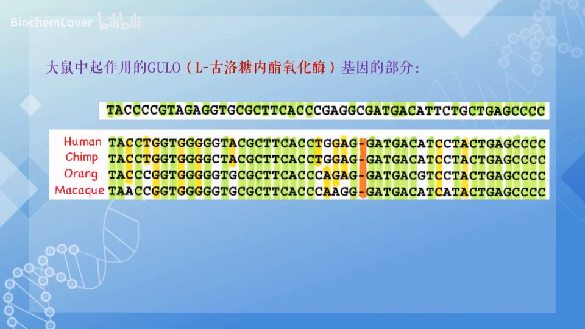

# 假基因的来源与判别：从亲本基因到加工型假基因

> 视频来源：[《假基因》](https://www.bilibili.com/video/BV1DT41137Ub/)（Bilibili · 主讲人 杨荣武 教授，约 8 分钟）。
> 导读：这一讲用"定义—来源—判别—例子"四步讲清假基因：它和真基因像在哪里、两种来源各留下什么序列痕迹、以及尿酸氧化酶和 GULO 两个经典案例。假基因的已知功能与证据难点，见同节的《假基因：加工型与非加工型、已知功能与证据难点》。

## 本讲要解决的核心问题（SCQA）

**背景**：前面讲的基因，都是"有功能的基因"——它们编码蛋白质，或者产生有功能的 RNA。

**冲突**：基因组里还有另一类序列：它们和某个真基因的碱基序列高度相似，有时候能达到 70%，但本身没有功能。这类序列叫假基因（pseudogene）。

**疑问**：假基因和真基因到底像在哪里、差在哪里？它是怎么产生的？拿到基因组上的一个假基因，能不能判断它是哪一种来源？

**回答（中心思想）**：**假基因是"失去功能的基因拷贝"**。它有两个主要来源：一是同源的真基因因突变而失活；二是反转座子的逆转录酶错误地把 mRNA 逆转录成 cDNA，再插回基因组。两种来源留下的序列痕迹不同——**前者保留内含子，后者没有内含子、却可能带 poly(A) 尾巴、缺少 5′ 启动子**，所以可以据此判别。[【跳转到 02:50】](https://www.bilibili.com/video/BV1DT41137Ub/?t=170)

---

## 一、定义：序列像真基因，但已经失去功能

讲者给的定义很直接：假基因就是"一个失去功能的基因转变而成"的、没有功能的基因。[【跳转到 00:30】](https://www.bilibili.com/video/BV1DT41137Ub/?t=30)

它和真基因相似的地方，是**碱基序列有高度的相似性**，有时候可以达到 70%。在一些真核生物体内，假基因占基因组序列的比例也非常高，最高可以达到 20% 到 30%。[【跳转到 00:52】](https://www.bilibili.com/video/BV1DT41137Ub/?t=52)

这里要把两个层面分开：

- **序列层面**：假基因与某个真基因同源，所以能比对得上；
- **功能层面**：假基因不产生原来那个有功能的蛋白。

"序列像"是识别假基因的线索，"功能失活"才是把它和真基因区分开的判据。只看到一段序列与某基因相似，还不能直接下结论——还要确认它是否真的失去了编码功能。

## 二、两个来源：突变失活，或逆转录后插回

讲者把假基因的来源分成两种。[【跳转到 01:31】](https://www.bilibili.com/video/BV1DT41137Ub/?t=91)

### 2.1 来源一：同源真基因因突变而失活

第一种来源是"由同源的真基因因为突变而衍生而成"：本来这个基因是有功能的，但因为突变让它丧失了功能。[【跳转到 01:36】](https://www.bilibili.com/video/BV1DT41137Ub/?t=96)

这种情形在基因组里可以有两种具体场景：

- **基因组里还留着另一份有功能的拷贝**：比如基因复制之后，一份拷贝继续工作，另一份积累突变失活。这一场景由同节的《假基因：加工型与非加工型》补充，本讲没有展开；
- **基因组里没有另一份有功能的拷贝**：原来那个基因本身失活，这个物种就彻底失去了这项功能。后面讲的尿酸氧化酶和 GULO 都属于这种情形。

> 术语说明：有的教材把后一种"没有另一份功能拷贝"的情形单列为 **unitary（单一）假基因**。本讲没有使用这个词，但 GULO 例子对应的就是这种情形；这里标出来，是为了和"加工型/非加工型"的命名对上。

### 2.2 来源二：反转座子把 mRNA 逆转录后插回基因组

第二种来源跟反转座子（也就是"跳跃基因"）有关。反转座子扩增自己的序列，需要通过它的**逆转录酶**：先把转座子序列转录成 RNA，再逆转录成 DNA。而这里的逆转录酶有时候会"认错模板"——它会把细胞里一个蛋白质的 mRNA 当作逆转录的模板，错误地转录成 cDNA，再把这个 cDNA 插到基因组上，于是第二种形式的假基因就产生了。[【跳转到 02:01】](https://www.bilibili.com/video/BV1DT41137Ub/?t=121)

这条路径的关键是：**模板是成熟的 mRNA，不是基因组 DNA**。成熟 mRNA 已经剪接过、加了 poly(A) 尾巴，所以逆转录出来的拷贝天然就缺少内含子、带着 poly(A)，也没有原来的启动子。这正是下一节判别的依据。

## 三、判别：看内含子、poly(A) 尾巴和启动子

讲者说，区分这两种形式的假基因"实际上很容易"，因为它们的序列痕迹不同。[【跳转到 02:50】](https://www.bilibili.com/video/BV1DT41137Ub/?t=170)

| 特征 | 同源真基因突变而来 | 逆转录后插回 |
| --- | --- | --- |
| 内含子 | 有，保留原基因的内含子序列 | 没有 |
| 3′ 端 | 取决于原基因 | 可能带 poly(A) 尾巴序列 |
| 5′ 启动子 | 可能保留 | 通常缺少 |
| 模板 | 基因组 DNA | 成熟 mRNA |

讲者的原话是：如果是同源的真基因经过突变产生的，它会带有原来真基因里所具有的内含子序列；而通过逆转录加工产生的假基因，显然不可能有内含子序列，但它有可能带有真核细胞 mRNA 3′ 端的多聚 A 尾巴——这个尾巴是可以被逆转录的，所以这样的假基因在 3′ 端会带有一个 poly(A) 尾巴序列；另外，它肯定会缺少 5′ 片段的启动子序列。[【跳转到 02:56】](https://www.bilibili.com/video/BV1DT41137Ub/?t=176)

这三条特征合起来，就是一张**判别表**：有内含子、可能有启动子 → 更像"突变失活"；无内含子、有 poly(A)、无启动子 → 更像"逆转录插回"。讲者用"总之，我们可以根据这些特征，来区分基因组上的一个假基因究竟是通过什么方式产生的"来收束这一段。[【跳转到 03:41】](https://www.bilibili.com/video/BV1DT41137Ub/?t=221)

## 四、两个经典例子：尿酸氧化酶与 GULO

### 4.1 尿酸氧化酶：灵长类无法进一步分解尿酸

第一个例子是人类基因组上非常有代表性的假基因——**尿酸氧化酶**。人类和其他灵长类体内，尿酸是嘌呤分解代谢的中间产物；也就是说，灵长类无法把尿酸进一步氧化分解，但其他很多生物可以。要把尿酸进一步氧化分解，需要尿酸氧化酶；而灵长类的尿酸氧化酶基因因为突变变成了假基因，所以人类基因组上的尿酸氧化酶假基因是没有功能的。[【跳转到 04:06】](https://www.bilibili.com/video/BV1DT41137Ub/?t=246)

这个例子的教学价值在于：**假基因不是"多余的副本"，而可能是一个物种失去某项代谢能力的直接原因**。判断它"没有功能"，依据不是"它不被转录"，而是"它不再产生有活性的尿酸氧化酶"。

### 4.2 GULO：维生素 C 合成的最后一步

第二个例子跟维生素 C 合成有关。灵长类自己合成不了维生素 C，只能从食物中获取；但猫、狗、老鼠等动物可以自己合成。讲者解释：跟维生素 C 合成有关的所有酶的基因，在这些动物的基因组上都是真基因、都有功能，所以它们能把葡萄糖转化成维生素 C。[【跳转到 05:10】](https://www.bilibili.com/video/BV1DT41137Ub/?t=310)

其中有一个重要的酶——**古洛糖酸内酯氧化酶（GULO）**，它参与维生素 C 合成的最后一步反应。在人类和其他灵长类基因组上，这个酶因为突变变成了假基因；所以灵长类合成不了维生素 C，仅仅是因为最后一步反应无法完成。[【跳转到 06:10】](https://www.bilibili.com/video/BV1DT41137Ub/?t=370)

讲者接着放了一张序列比较图：最上面是能够合成维生素 C 的大鼠体内的 GULO，基因是完整的；下面四种灵长类——人类、黑猩猩、猕猴、红毛猩猩——在红色标出的位置有一段序列缺失，导致 GULO 这个基因沦落为假基因。[【跳转到 06:45】](https://www.bilibili.com/video/BV1DT41137Ub/?t=405)

这张图把"假基因"从定义落到了具体坐标上：**不是整段基因消失，而是一段关键序列的缺失/突变让阅读框或功能被破坏**。这也解释了为什么假基因还能和亲本基因比对得上——大部分序列还在，坏掉的是关键部分。

## 五、边界：假基因不等于"绝对没有生物学功能"

这一讲为了建立概念，把假基因定义成"没有功能的基因"。但要注意这个"没有功能"指的是**失去了原来那个编码蛋白的功能**，不等于这段 DNA 在细胞里绝对没有任何活性。同节的另一篇博客会看到：假基因可以转录、可以作为非编码 RNA 的来源、可以干扰亲本 mRNA、甚至可以作为 miRNA 海绵。两讲并不矛盾——**"假基因"描述的是它和亲本基因的关系（同源但编码功能失活），不是对它所有可能活性的终审判决**。

## 小结

- 假基因是失去功能的基因拷贝，与某个真基因序列高度相似（有时可达 70%），在一些真核生物中可占基因组的 20–30%。
- 两个来源：同源真基因因突变失活；反转座子的逆转录酶错误地把 mRNA 逆转录成 cDNA 并插回基因组。
- 判别看三条：内含子（有/无）、poly(A) 尾巴（有/无）、5′ 启动子（有/无）。
- 尿酸氧化酶假基因让灵长类无法进一步分解尿酸；GULO 假基因让灵长类无法完成维生素 C 合成的最后一步。
- "没有功能"指失去原来的编码功能，不等于这段序列绝对没有其他活性。

## 关键术语速查

| 术语 | 一句话解释 |
| --- | --- |
| 假基因（pseudogene） | 与真基因同源、但已失去原来编码功能的基因拷贝 |
| 反转座子 | 通过 RNA 中间体逆转录后插入基因组新位置的转座元件 |
| 逆转录酶 | 以 RNA 为模板合成 DNA 的酶；反转座子用它扩增自身 |
| poly(A) 尾巴 | 成熟 mRNA 3′ 端的多聚腺苷酸尾，可作为逆转录来源的痕迹 |
| 加工型假基因 | 由逆转录 mRNA 插回基因组形成，无内含子、常缺启动子 |
| 非加工型假基因 | 由基因复制后积累突变形成，可能保留内含子和启动子 |
| 单一（unitary）假基因 | 亲本基因自身失活、基因组中没有另一份功能拷贝的情形 |
| 尿酸氧化酶 | 把尿酸进一步氧化分解的酶；灵长类中为假基因 |
| GULO | 古洛糖酸内酯氧化酶，维生素 C 合成最后一步的酶；灵长类中为假基因 |