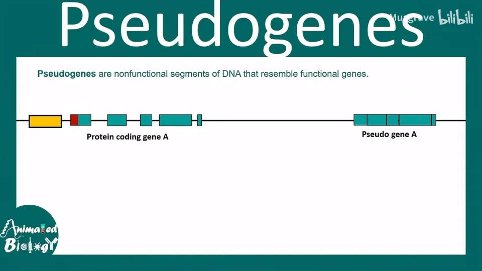
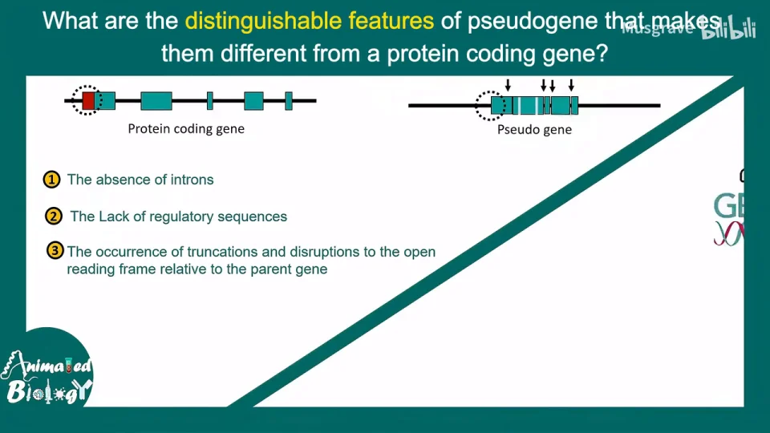
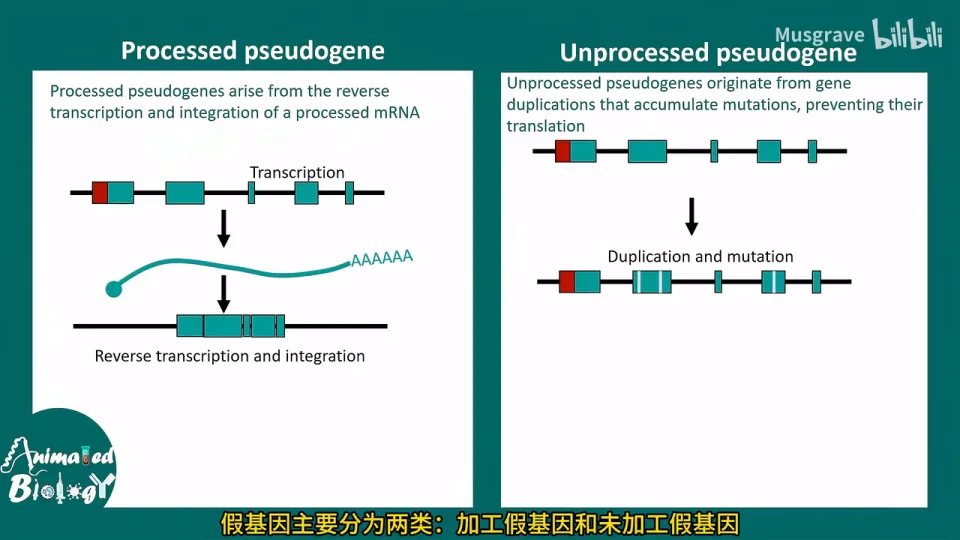
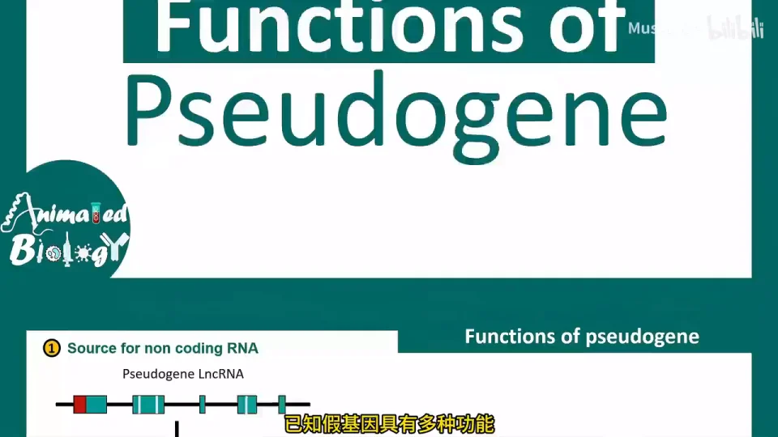
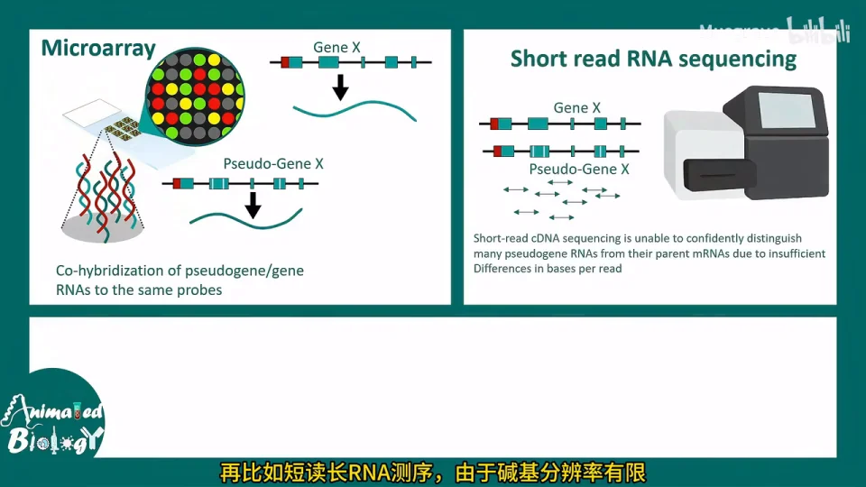

# 假基因：加工型与非加工型、已知功能与证据难点

> 视频来源：[《假基因：基因组中的"基因残片"真的没用吗？》](https://www.bilibili.com/video/BV1RHtz6BEPL/)（Bilibili · Musgrave，约 4 分半）。
> 导读：这支短视频把假基因从"定义与注释"讲到"两类来源""已知功能"和"研究难点"。它和同节的《假基因的来源与判别》互补：前一篇讲来源与判别特征，这一篇讲注释标签、功能清单，以及为什么"假基因有功能"这句话很难验证。

## 本讲要解决的核心问题（SCQA）

**背景**：假基因是一段与功能基因序列相似、但通常不具备功能的 DNA 片段。真核生物基因组里有大量假基因，数量接近功能蛋白编码基因。

**冲突**：既然它们"没有功能"，为什么没有被进化清除？它们是进化遗迹、偶然事件的产物，还是真的有明确功能？

**疑问**：假基因怎么被注释出来、分几类？如果它们真有功能，为什么研究起来这么难？

**回答（中心思想）**：**假基因是一个注释标签，不是功能判决**。按来源它分加工型（逆转录转座产物，无内含子）与非加工型（基因复制产物，可能保留启动子但阅读框坏了）；标签只说明它和亲本基因的关系。已知假基因可以作为非编码 RNA 来源、顺式调控元件、反义干扰物、siRNA 来源和 miRNA 海绵，但这些功能很难验证——因为假基因与亲本基因序列太像，微阵列、短读长测序和 siRNA/CRISPR 扰动都容易把两者混在一起。[【跳转到 03:36】](https://www.bilibili.com/video/BV1RHtz6BEPL/?t=216)

---

## 一、定义与注释：基因样序列，但缺元件或阅读框坏了

视频开篇给的定义是：假基因是一段与功能基因序列相似、但通常不具备功能的 DNA 片段。左边是一个蛋白编码基因 A，右边是基因 A 对应的假基因；两者有很高的序列相似性，但存在一些关键差异。[【跳转到 00:00】](https://www.bilibili.com/video/BV1RHtz6BEPL/?t=0)

假基因通常通过基因组序列分析来鉴定：寻找那些"基因样"序列，但缺少调控元件、或阅读框被破坏的片段。以基因 A 对应的假基因为例，它的序列虽然与基因 A 高度同源，但缺失启动子等调控元件，不具备完整的转录潜能，因此被归类为假基因。[【跳转到 00:25】](https://www.bilibili.com/video/BV1RHtz6BEPL/?t=25)

这段话里有两个判据，值得分开记：

1. **序列同源**：它和某个亲本基因能比对得上；
2. **功能元件缺失**：启动子等调控序列缺失，或者阅读框被截短、打断。

注意，这两个判据都是**序列层面的**。它们能说明"这段序列像某个基因、但不像能正常产出蛋白的样子"，不能说明"这段序列在细胞里绝对没有活性"。这正是后面"已知功能"与"证据难点"两节的起点。

## 二、数量与命名：GENCODE 注释了约 1 万个

假基因最早由 Jacq 等人于 1977 年在非洲爪蟾中发现：非洲爪蟾的 5S 核糖体 RNA 基因存在一个假基因。当时他们还不知道它的功能，所以认为假基因就是结构与正常基因相似、但没有功能的基因，是进化的遗迹。[【跳转到 01:15】](https://www.bilibili.com/video/BV1RHtz6BEPL/?t=75)

今天，GENCODE 联盟已对人类基因组中的假基因进行系统命名和注释；人类基因组约有 1 万个假基因。[【跳转到 01:56】](https://www.bilibili.com/video/BV1RHtz6BEPL/?t=116)

"约 1 万个"这个数字说明：假基因不是边角案例，而是基因组注释里必须处理的一大类。也正因为它数量大，"假基因到底有没有功能"才成为一个需要认真回答的问题，而不是一句"垃圾 DNA"就能带过。

## 三、两类：加工型与非加工型

假基因主要分为两类：**加工型假基因**和**非加工型假基因**。[【跳转到 02:05】](https://www.bilibili.com/video/BV1RHtz6BEPL/?t=125)

| 类型 | 来源 | 结构特征 | 启动子 |
| --- | --- | --- | --- |
| 加工型（processed） | 逆转录转座：mRNA 被逆转录成 cDNA，整合到基因组新位置 | 没有内含子 | 通常缺少 |
| 非加工型（unprocessed） | 基因复制 | 保留外显子-内含子结构 | 可能保留 |

视频还补了一个机制细节：加工型假基因的逆转录过程主要由 **LINE1 元件**提供酶活性，因此它没有内含子，也通常缺少启动子；非加工型假基因来自基因复制，可能保留启动子，但阅读框中积累了突变，无法产生功能蛋白，或蛋白功能发生改变。[【跳转到 02:10】](https://www.bilibili.com/video/BV1RHtz6BEPL/?t=130)

把这张表与同节《假基因的来源与判别》对照，会发现两讲说的是同一件事的两种说法：杨荣武教授用"内含子/poly(A)/启动子"三条特征判别来源，这支视频用"加工型/非加工型"两个名字概括同样的两类。**名字是标签，特征是判据**。

## 四、已知功能：从"垃圾 DNA"到五类作用

视频明确纠正了"假基因就是垃圾 DNA"的旧看法：虽然最初人们认为假基因没有功能，但这并不正确；已知假基因具有多种功能。[【跳转到 02:40】](https://www.bilibili.com/video/BV1RHtz6BEPL/?t=160)

视频列出的功能可以归成五类：

1. **作为长非编码 RNA 的来源**：假基因位点可以转录出 lncRNA；
2. **通过顺式作用元件调控基因表达**：假基因上的序列可以作为调控元件，影响邻近基因；
3. **干扰亲本 mRNA**：如果假基因反向转录产生反义链，正义链和反义链可以相互杂交，隔离正常 mRNA 并阻止翻译；
4. **被加工成小干扰 RNA**：通过 RNA 干扰通路调控基因表达；
5. **作为 microRNA 海绵（ceRNA）**：通过竞争性结合 microRNA，调控亲本基因的表达。

视频最后说："以上只是假基因已被发现的部分功能，更多新功能仍在积极研究中。"[【跳转到 03:17】](https://www.bilibili.com/video/BV1RHtz6BEPL/?t=197)

这五类功能有一个共同点：**它们都不是"假基因编码了一个蛋白"**，而是"假基因作为 DNA 或 RNA，参与了别的基因的调控"。所以"假基因没有功能"和"假基因有调控功能"可以同时成立——前者说的是失去原来的编码功能，后者说的是获得了新的调控角色。

## 五、证据难点：为什么"假基因有功能"很难验证

视频最后一段是本节最值得记住的部分：研究假基因面临很多困难，而这些困难恰好对应三类证据的缺口。[【跳转到 03:36】](https://www.bilibili.com/video/BV1RHtz6BEPL/?t=216)

### 5.1 表达证据：微阵列会"共杂交"

基因和它的假基因序列高度相似。如果探针设计在同源区域，假基因的 RNA 也会被杂交，很难用微阵列准确区分基因和假基因。[【跳转到 03:41】](https://www.bilibili.com/video/BV1RHtz6BEPL/?t=221)

这意味着：**"假基因表达升高"这个读数，可能只是亲本基因表达升高造成的信号串扰**。探针落在同源区，测到的就是两者的总和。

### 5.2 表达证据：短读长测序也分不开

短读长 RNA 测序同样困难：由于碱基分辨率有限，短读长片段中基因和假基因的序列几乎无法区分，差异可能只有几个碱基，因此在 RNA 测序中也很难准确鉴定。[【跳转到 03:54】](https://www.bilibili.com/video/BV1RHtz6BEPL/?t=234)

这和微阵列是同一类问题的不同表现：**读段太短，落在两者共有的序列上，就无法判断它来自基因还是假基因**。要区分，需要能覆盖差异位点的读段，或者用能区分同源序列的定量方法。

### 5.3 扰动证据：siRNA 和 CRISPR 都会脱靶

敲低假基因也很困难：如果用 siRNA 靶向假基因，很可能也会非特异性地靶向对应的功能基因，脱靶效应严重，无法确定假基因的真实功能。CRISPR-Cas9 技术效果稍好一些，但同样面临同源序列导致的脱靶问题。[【跳转到 04:19】](https://www.bilibili.com/video/BV1RHtz6BEPL/?t=259)

这条最要命：**扰动假基因时，亲本基因很可能被一起敲掉**。如果敲低后看到表型，你无法判断是假基因的功能，还是亲本基因被误伤的结果。所以"敲低有表型"在这里不能直接当成"假基因有功能"的证据。

## 六、把三类难点放回证据阶梯

把视频的难点与同节另一篇博客的证据表对照，可以看到假基因的特殊之处：

| 证据类型 | 一般非编码位点 | 假基因的特殊困难 |
| --- | --- | --- |
| 表达 | 低丰度可能是噪音 | 与亲本基因共杂交、短读长分不开 |
| 扰动 | 需要位点特异 | siRNA/CRISPR 容易同时打中亲本基因 |
| 机制 | 研究清楚的只是少数 | 反义链、siRNA、ceRNA 都依赖与亲本序列的互补，难以拆开 |

所以，假基因的功能研究不是"有没有表型"的问题，而是**能不能把假基因的信号与亲本基因的信号分开**的问题。视频没有给出解决方案，但把困难讲清楚了——这本身就是判读证据时最需要知道的部分。

## 小结

- 假基因是与功能基因序列相似、但通常不具备功能的 DNA 片段；人类基因组约有 1 万个，由 GENCODE 系统命名和注释。
- 分两类：加工型（逆转录转座产物，无内含子、常缺启动子）与非加工型（基因复制产物，可能保留启动子但阅读框坏了）。
- 已知功能包括：作为 lncRNA 来源、顺式调控元件、反义干扰物、siRNA 来源、miRNA 海绵。
- "没有功能"指失去原来的编码功能，不等于没有调控活性。
- 研究难点集中在信号分不开：微阵列共杂交、短读长测序分辨率不够、siRNA/CRISPR 脱靶到亲本基因。

## 关键术语速查

| 术语 | 一句话解释 |
| --- | --- |
| 假基因 | 与功能基因同源、但通常不具备原来编码功能的 DNA 片段 |
| 加工型假基因 | 由 mRNA 逆转录成 cDNA 后整合到基因组形成，无内含子 |
| 非加工型假基因 | 由基因复制后积累突变形成，保留外显子-内含子结构 |
| GENCODE | 对人类基因组元件（包括假基因）做系统命名和注释的联盟 |
| 顺式作用元件 | 位于同一 DNA 分子上、调控邻近基因表达的序列 |
| 反义链 | 与正义链互补的 RNA，可与亲本 mRNA 杂交、阻止翻译 |
| ceRNA / miRNA 海绵 | 通过竞争性结合 miRNA 来调控其他转录本的 RNA |
| 共杂交 | 微阵列探针同时结合基因与假基因的同源序列，造成信号混淆 |
| 脱靶效应 | 扰动工具误伤与目标序列相似的其他基因 |