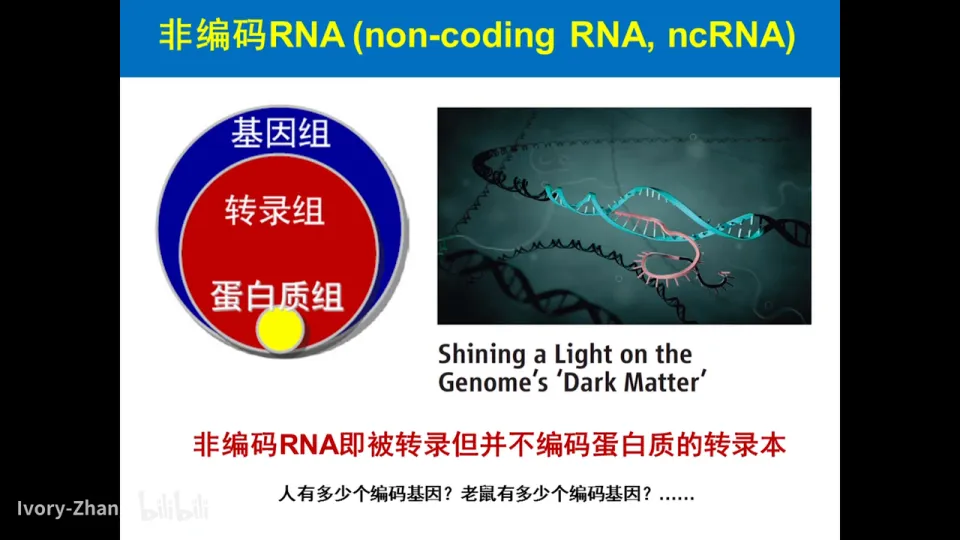
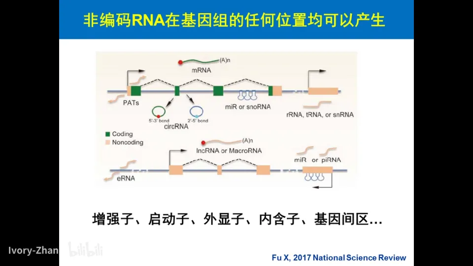
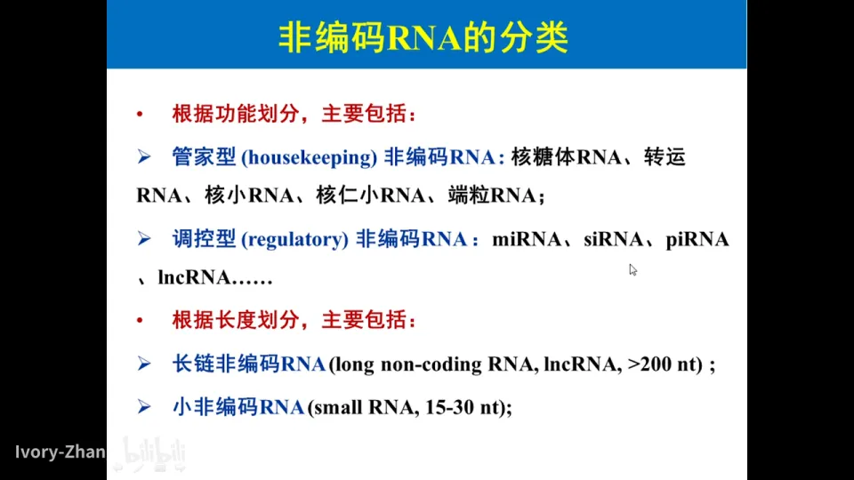
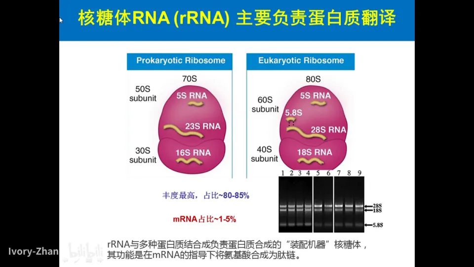
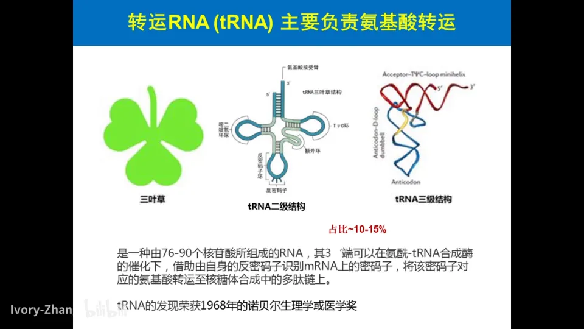
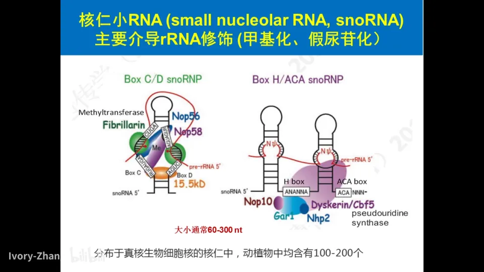
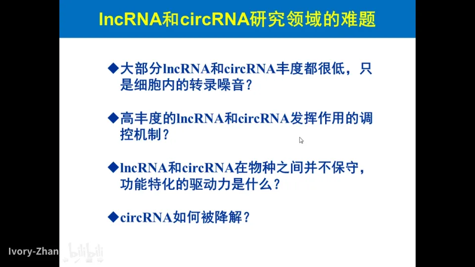

# 非编码 RNA 的注释类别与功能证据：从类型标签到敲除表型

> 视频来源：[《非编码RNA——生命科学研究中的"暗物质"》](https://www.bilibili.com/video/BV1u34y1U7gr/)（Bilibili · 复旦大学 郑丙莲，约 73 分钟）。
> 导读：本文取该讲座中与本小节问题直接相关的两段——非编码 RNA 的分类（约 0–10 分钟）与"类型标签能不能当功能证据"（约 27–29 分钟）。讲座中间的 Xist、ceRNA、环状 RNA 生成等机制例子，以及后半段的数据库与结构预测，不在本节范围：机制见 3.3.1，数据库见 D01，结构建模见 P07。本文按这两段重排，关键结论均带原片时间戳。

## 本讲要解决的核心问题（SCQA）

**背景**：人类基因组大约有 30 亿个碱基对，其中真正编码蛋白质的基因只有 2 万多个。

**冲突**：基因组上 80% 以上的区域都能被转录成 RNA，但绝大多数转录本不编码蛋白质。它们被统称为"非编码 RNA"，也被比作生命科学里的"暗物质"。

**疑问**：这些非编码转录本到底分几类？一个位点被注释成"lncRNA"或"miRNA"，能不能说明它真的有调控功能？

**回答（中心思想）**：**分类是注释标签，不是功能证明**。讲座给了两套分类坐标——按功能分"管家型/调控型"，按长度分"长链/小非编码"；标签只回答"它不属于编码 RNA"，不回答"它在这个细胞里做了什么"。要判断一个非编码位点有没有调控功能，需要把表达、保守性、扰动和机制几类证据分开看，而这几类证据各有自己的缺口。[【跳转到 01:45】](https://www.bilibili.com/video/BV1u34y1U7gr/?t=105)

---

## 一、非编码 RNA 是"被转录、但不编码蛋白质"的转录本

讲者先摆了一组数量关系：人类基因组约 30 亿个碱基对，其中 75%——保守地说 80% 以上——都能被转录；但真正编码蛋白质的基因只有 2 万多个。老鼠的基因组小得多，一棵萝卜菜的基因组也很小，可它们的蛋白编码基因数目同样在 2 万上下。[【跳转到 01:45】](https://www.bilibili.com/video/BV1u34y1U7gr/?t=105)

这组数字推出一个直接的问题：**基因组上八九十% 的区域都被转录，转录出来的 RNA 到底在干什么？** 2002 年有一篇论文把大量"能转录、但不编码蛋白质"的转录本称为"生命科学研究当中的暗物质"。[【跳转到 03:15】](https://www.bilibili.com/video/BV1u34y1U7gr/?t=195)

讲者还强调：非编码 RNA 不是只从"基因间区"来的，它在基因组任何位置都可以产生——启动子、增强子、外显子、内含子、基因间区，都能转录出非编码 RNA。[【跳转到 04:34】](https://www.bilibili.com/video/BV1u34y1U7gr/?t=274)

这张图很重要，因为它说明"非编码 RNA"是一个**按产物性质划分的大筐**，不是按基因组位置划分的。同一个基因座上，可能同时有编码转录本和非编码转录本；一个增强子区域，也可能转录出非编码 RNA。后面判断功能时，必须先确认讨论的是"哪一段序列、哪一种转录本"。

## 二、注释类别：功能与长度是两套坐标

讲者给了两套分类标准，并明确说它们回答的是不同问题。[【跳转到 05:34】](https://www.bilibili.com/video/BV1u34y1U7gr/?t=334)

| 分类坐标 | 类别 | 成员 | 这个标签回答什么 |
| --- | --- | --- | --- |
| 按功能 | 管家型（housekeeping） | rRNA、tRNA、snRNA、snoRNA、端粒 RNA | 任何细胞、任何发育阶段都可能需要 |
| 按功能 | 调控型（regulatory） | miRNA、siRNA、piRNA、lncRNA | 参与对别的基因的调控 |
| 按长度 | 长链非编码 RNA | lncRNA（>200 nt） | 按转录本长度归类 |
| 按长度 | 小非编码 RNA | small RNA（15–30 nt） | 按转录本长度归类 |

这张表本身就是本节的第一条结论：**"管家型/调控型"和"长链/小非编码"不是互斥的两套标签，而是两个不同的切面**。一个 lncRNA 可以同时是"调控型"和"长链"；一个 miRNA 可以同时是"调控型"和"小非编码"。数据库里的 `gene_biotype` 或 `ncRNA_class` 字段，通常只是把其中某一套标签写下来，**它不会自动附带"这个位点有功能"的结论**。

### 2.1 管家型：细胞常备的机器零件

讲者逐一介绍了管家型的几个代表，重点不在名词，而在"它们为什么算管家型"。

**rRNA** 负责蛋白质翻译：它和多种蛋白质结合成核糖体，相当于一台"装配机器"，在 mRNA 的指导下把氨基酸合成肽链。原核核糖体由 50S 和 30S 两个亚基组成，真核核糖体由 60S 和 40S 组成。rRNA 的丰度最高，占全部 RNA 的 80–85%；相比之下，mRNA 只占 1–2%。[【跳转到 06:33】](https://www.bilibili.com/video/BV1u34y1U7gr/?t=393)

**tRNA** 负责氨基酸转运：它由 76–90 个核苷酸组成，二级结构是三叶草，三级结构折叠成倒 L 型；靠反密码子识别 mRNA 上的密码子，把对应氨基酸送到核糖体。tRNA 的丰度大约占 10–15%。[【跳转到 08:39】](https://www.bilibili.com/video/BV1u34y1U7gr/?t=519)

**snoRNA** 负责修饰 rRNA：rRNA 要成熟，需要被甲基化、假尿苷化，snoRNA 就是把这些化学基团"引导"到 rRNA 特定位置上的小 RNA。它分 box C/D 和 box H/ACA 两大类，大小约 60–300 nt，位于核仁中；动物、植物中各有 100–200 个。[【跳转到 10:07】](https://www.bilibili.com/video/BV1u34y1U7gr/?t=607)

把这三类放在一起看，就能理解"管家型"这个标签的含义：**它们的共同点是"每个细胞都要用"，而不是"它们调控了某个基因"**。这也解释了为什么 rRNA 能占到总 RNA 的 80% 以上——它是装配机器的一部分，不是随环境变化的调节器。

## 三、类型标签不是功能证据

讲座的第二个关键段落，讲的是 lncRNA 和环状 RNA 研究领域的难题。讲者把问题拆成四条，正好对应四类证据的缺口。[【跳转到 27:28】](https://www.bilibili.com/video/BV1u34y1U7gr/?t=1648)

### 3.1 低丰度：可能只是转录噪音

有一种观点认为，大部分 lncRNA 其实就是转录的噪音，或者是剪接错误导致的，没有什么意义。讲者的理由是：转录、翻译、剪接这些基本生物学过程都会出错，出错就会产生"副产物"；而大部分 lncRNA 的丰度都不高，正好符合"噪音"的预期。[【跳转到 27:28】](https://www.bilibili.com/video/BV1u34y1U7gr/?t=1648)

这一步的推论很重要：**"检测到一个非编码转录本"本身是很弱的证据**。只要测序足够深，几乎任何一段被转录的序列都能被检测到；低丰度转录本尤其可能来自偶然的转录起始或剪接错误。

### 3.2 高丰度 + 细胞特异 + 敲除表型：较强的证据

讲者接着给了反面情形：高丰度的 lncRNA 肯定不是错误，因为它在一种细胞里有、另一种细胞里没有，而且丰度非常高，**敲掉它也有很重要的功能**。但讲者也补了一句：这些东西的调控机制，现在研究清楚的其实是个位数——在人类、老鼠、植物里，都只是个别例子；还有很多丰度较高的 lncRNA，并没有做出来功能到底是什么。[【跳转到 27:58】](https://www.bilibili.com/video/BV1u34y1U7gr/?t=1678)

这里其实已经给出了一个证据阶梯的雏形：

1. **表达**：有没有转录本、丰度多高；
2. **特异性**：是不是只在某些细胞或条件下表达；
3. **扰动**：敲掉以后有没有表型；
4. **机制**：能不能说清楚它和谁结合、通过什么路径产生表型。

前两条是相关性的，第三条开始接近因果，第四条才是机制。讲者说"研究清楚的是个位数"，正说明**从"有表型"走到"有机制"是一段很长的路**。

### 3.3 保守性差：不能把"保守"当门槛

第三个难题是保守性：非编码 RNA 跟蛋白质编码基因不一样，它在物种间的保守性非常差。负责转录、翻译的蛋白质编码基因从人到植物都很保守，但非编码 RNA 最不保守，最没有序列上的相似性。[【跳转到 28:28】](https://www.bilibili.com/video/BV1u34y1U7gr/?t=1708)

这条对判读很关键：**保守性可以作为"支持功能"的一条线索，但不能反过来用——不保守不等于没有功能**。如果拿"人鼠序列保守"当筛选门槛，会漏掉大量物种特异的非编码 RNA；而如果只看保守性，又无法区分"保守但没有调控功能"和"保守且有调控功能"。

### 3.4 丰度高也可能只是降解慢

第四个难题是环状 RNA 怎么被降解。讲者提醒：线性的 RNA 很容易被降解，细胞内有大量核酸外切酶，能在末端把碱基一个个切掉；但环状 RNA 没有暴露的尾巴，把自己包得好好的，所以它可能因为**降解慢**而积累到高丰度。[【跳转到 28:58】](https://www.bilibili.com/video/BV1u34y1U7gr/?t=1738)

这推翻了"丰度高 = 功能重要"的简单读法：**丰度是合成速率和降解速率的平衡**。一个转录本丰度高，可能是因为转录强，也可能只是因为降解慢。要判断功能，不能只看稳态丰度。

## 四、判断一个非编码位点有没有调控功能：把证据分开看

把讲座的两段内容合起来，可以得到一张判读表。表中"能支持什么"与"常见失败"主要来自讲座给出的例子；"扰动"一行的脱靶问题，来自同节假基因博客对 siRNA/CRISPR 的讨论（见《假基因：加工型与非加工型、已知功能与证据难点》§五）。

| 证据类型 | 具体读数 | 能支持什么 | 常见失败 |
| --- | --- | --- | --- |
| 注释证据 | 转录本类型标签、序列特征、与亲本基因的同源性 | 说明这个位点"像什么"、属于哪个类别 | 标签不说明当前细胞里的功能 |
| 表达证据 | 丰度、细胞/组织特异性 | 说明它被转录，且可能受调控 | 低丰度可能是噪音；高丰度也可能只是降解慢（环状 RNA） |
| 保守性证据 | 物种间序列相似性 | 说明这段序列在演化上被保留 | 非编码 RNA 普遍不保守，不能当门槛 |
| 扰动证据 | 敲除、敲低后的表型 | 说明这个位点对某个表型是必要的 | 需要位点特异；同源序列会造成脱靶 |
| 机制证据 | 与 DNA、RNA、蛋白质的具体互作 | 说明"通过什么路径"产生表型 | 研究清楚的只是少数 |

使用这张表的顺序，讲者其实已经暗示了：**先确认转录本和类别，再看表达与特异性，再做扰动，最后落到机制**。任何一步都不能单独当成"有功能"的证明；反过来，缺少某一步也不等于"没功能"——只说明证据还不够。

## 五、和假基因、B01 类型地图的分工

这一节还要把两个容易混的标签分开：

- **非编码 RNA** 是按"产物不编码蛋白质"给的标签，回答的是"这个转录本属于哪一类"。
- **假基因** 是按"这段序列像某个基因、但已经失活"给的标签，回答的是"这个位点和哪个亲本基因同源、为什么不再产生功能蛋白"。假基因本身也可能转录，甚至可能被加工成非编码 RNA；所以"假基因"和"非编码 RNA"不是互斥的两个筐。

B01 §2.2.3 给的是**类型地图**：用几个代表性 RNA 建立"有哪些类、各自大概做什么"的整体印象。本节补的是**注释类别与证据判读**：类型标签怎么落到一个具体位点上，以及凭什么说这个位点有调控功能。两节的分工可以用一句话概括：**B01 回答"有哪些类型"，本节回答"这个位点的标签能证明什么"**。

## 小结

- 非编码 RNA 是"被转录、但不编码蛋白质"的转录本；人类基因组 80% 以上被转录，蛋白编码基因只有 2 万多个。
- 注释类别有两套坐标：按功能分管家型（rRNA、tRNA、snRNA、snoRNA、端粒 RNA）与调控型（miRNA、siRNA、piRNA、lncRNA）；按长度分 lncRNA（>200 nt）与小非编码 RNA（15–30 nt）。
- 管家型的共同点是"每个细胞都要用"，不是"调控了某个基因"；rRNA 占全部 RNA 的 80–85%，mRNA 只占 1–2%。
- **类型标签不是功能证据**：低丰度 lncRNA 可能只是转录噪音；高丰度也可能只是降解慢；非编码 RNA 在物种间普遍不保守。
- 判断一个非编码位点有没有调控功能，要把注释、表达、保守性、扰动、机制五类证据分开看；任何一类单独都不够。
- 假基因是另一类注释标签（像基因但失活），与"非编码 RNA"不互斥；具体见本节的另外两篇假基因博客。

## 关键术语速查

| 术语 | 一句话解释 |
| --- | --- |
| 非编码 RNA（ncRNA） | 被转录但不编码蛋白质的 RNA |
| 管家型非编码 RNA | 任何细胞、任何发育阶段都需要的非编码 RNA，如 rRNA、tRNA、snRNA、snoRNA |
| 调控型非编码 RNA | 参与调控其他基因表达的非编码 RNA，如 miRNA、siRNA、piRNA、lncRNA |
| lncRNA | 长度大于 200 nt 的非编码 RNA |
| 小非编码 RNA | 长度约 15–30 nt 的非编码 RNA |
| rRNA | 核糖体 RNA，与蛋白质组成核糖体，占全部 RNA 的 80–85% |
| tRNA | 转运 RNA，靠反密码子识别密码子并转运氨基酸 |
| snoRNA | 核仁小 RNA，引导 rRNA 的甲基化与假尿苷化 |
| 转录噪音 | 由转录或剪接出错产生、没有生物学功能的转录本 |
| 保守性 | 序列在物种间被保留的程度；非编码 RNA 普遍不保守 |