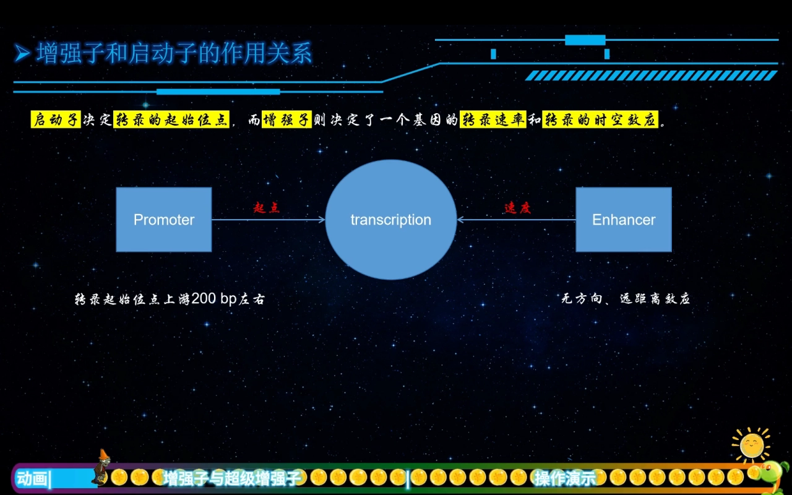
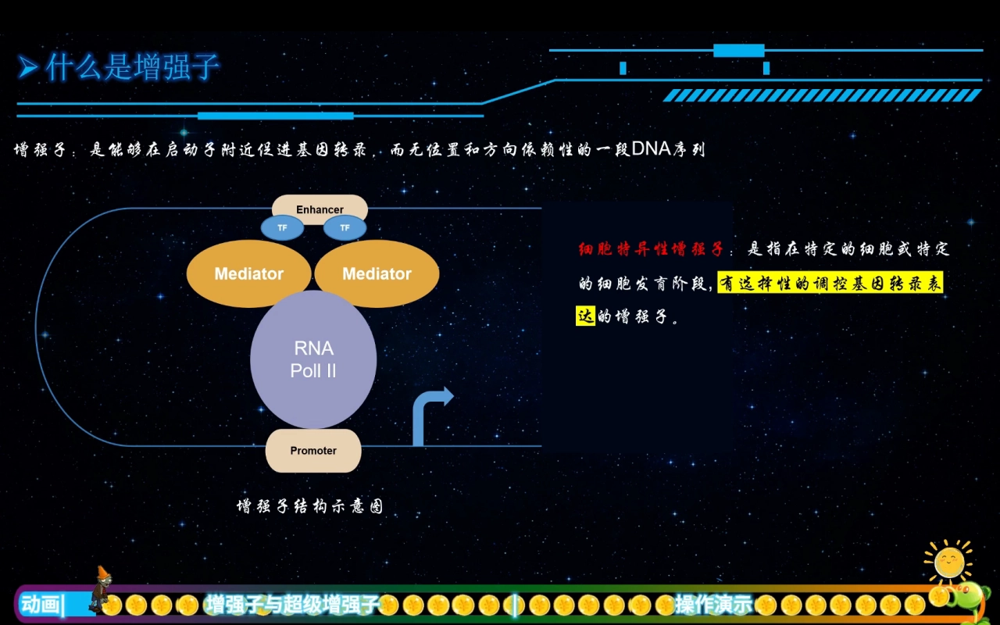
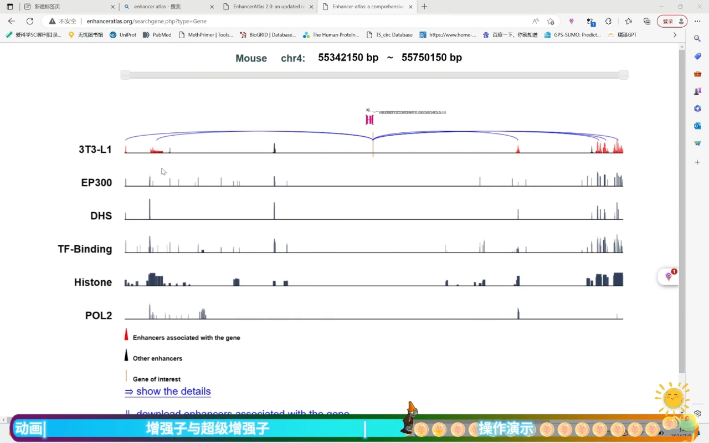
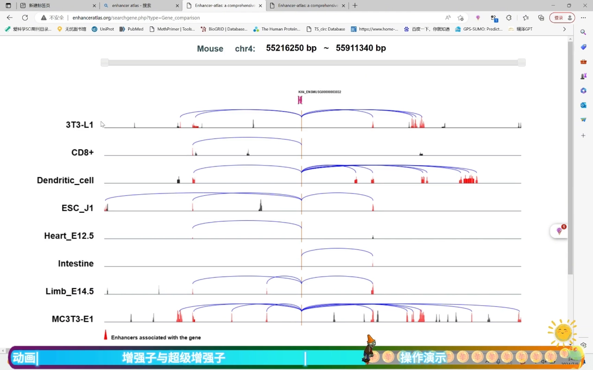
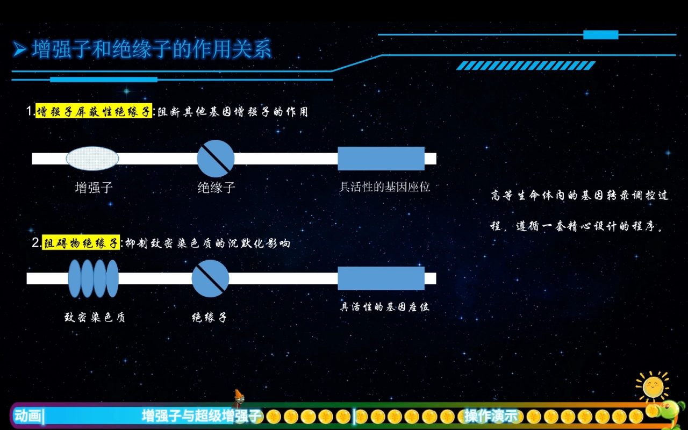
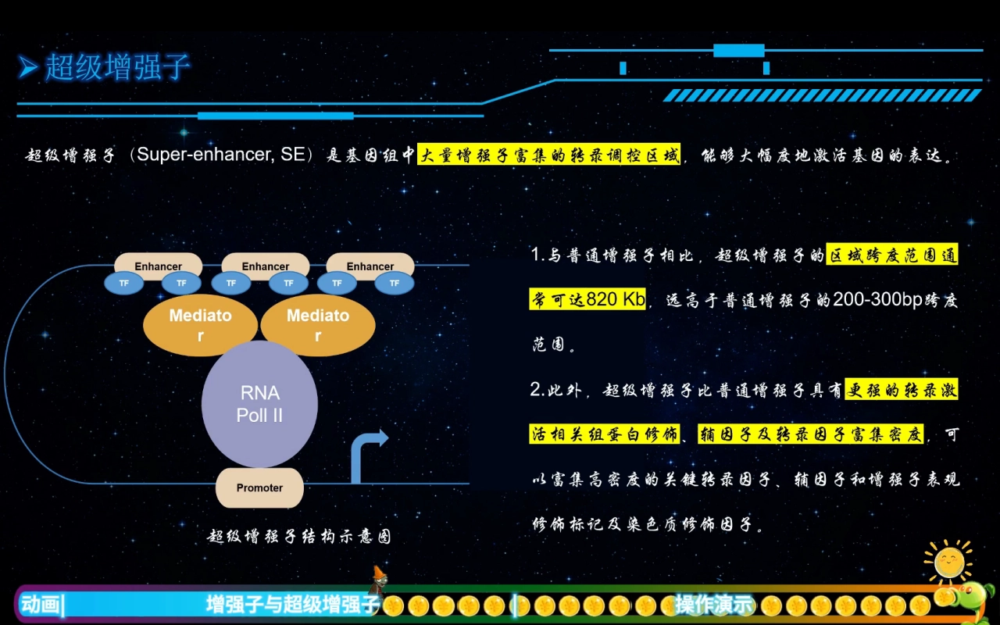
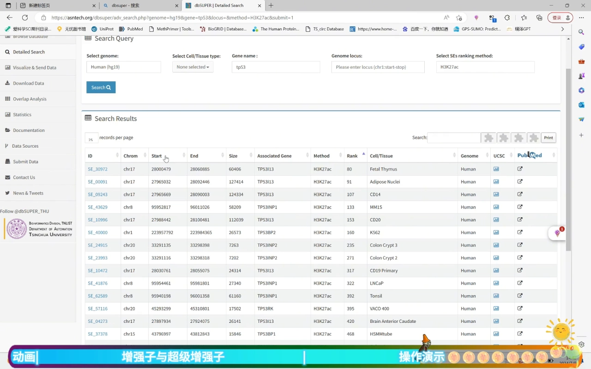
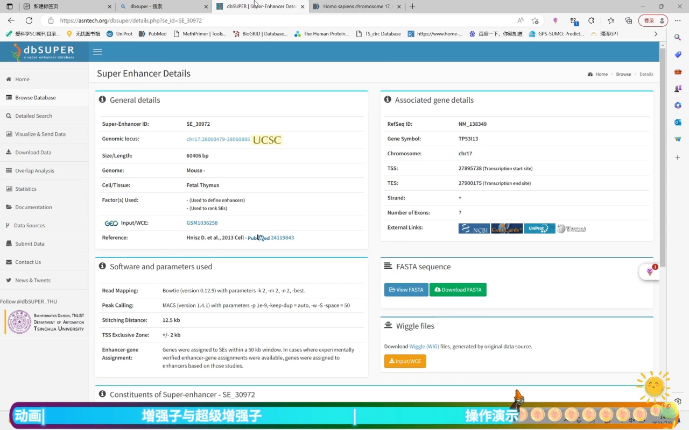
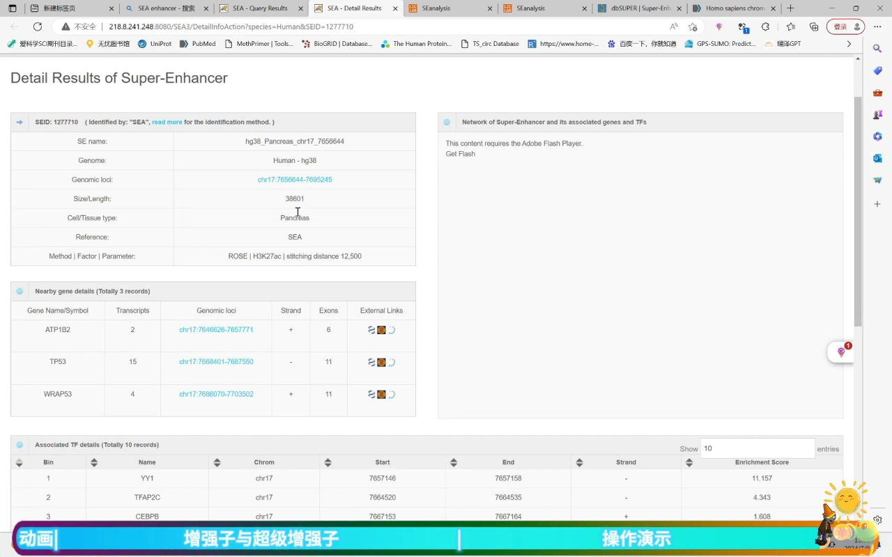

# 增强子与绝缘子：位置、方向、细胞背景与靶基因判读

> 视频来源：[【Up主爆肝输出】全网最全：基因的表达调控之—增强子/超级增强子（理论+在线数据库操作演示）](https://www.bilibili.com/video/BV1cf421q7HN/)（Bilibili · 约 42 分钟）
> 导读（100 字以内）：这支视频分两半：前半讲增强子、绝缘子、超级增强子的定义与判读规则，后半用四个数据库演示「在一个基因座里找元件、看它被算给哪个基因」。本文按「元件分工 → 细胞背景 → 绝缘子 → 组合结构 → 基因座判读」重排，三维接触机制与数据库全貌分别交给 3.2.2 与 D01。

## 本讲要解决的核心问题（SCQA）

**背景**：真核基因的转录由 RNA 聚合酶 II 完成。通用转录因子在启动子上装配成前起始复合体，把聚合酶带到转录起始位点，让基因以本底水平转录。这套机器所有基因共用。

**冲突**：本底水平远远不够。一个细胞要在特定时间、特定地点把特定基因开到很高的水平，而不同细胞里的基因完全相同、表达谱却天差地别。更麻烦的是，负责"加油门"的元件不在基因身边：它们可以位于基因上游、下游甚至基因内部，方向还可以反过来。既然如此，当我们在一段 DNA 上看到一个元件时，凭什么说它管的是旁边那个基因？

**疑问**：顺式调控元件各管什么？它们的位置和方向有什么规律？为什么同一段序列在不同细胞里作用不同？以及最实际的一个问题——拿到一个基因座，怎么判断某个元件调控的到底是哪个基因？

**回答（中心思想）**：顺式元件按"管什么"分工：**启动子定起点，增强子定速率，沉默子反向压制，绝缘子划边界**。位置和方向只对启动子有约束，对增强子和沉默子没有约束；元件的活性取决于该细胞里有没有对应的转录因子，所以同一元件在不同细胞里强弱不同。正因为增强子不认"最近的那个基因"，判读靶基因时**必须把邻近性当作默认假设而不是结论**——绝缘子的存在、数据库的"关联基因"字段、以及跨细胞比较，都是在提醒这一点。

---

## 一、顺式元件是同一 DNA 分子上的开关

### 1.1 三类蛋白、一段 DNA：转录调控的基本接线

真核转录的接线可以拆成三层。第一层是**通用转录因子**：它们从转录起始位点上游开始，识别启动子里的短序列（如 TATA 盒），再互相结合，最终形成一个能捕获 RNA 聚合酶的完整复合物。通用转录因子是转录所必需的，但它们本身不能增加或减少转录速率。

[【跳转到 00:16】](https://www.bilibili.com/video/BV1cf421q7HN/?t=16)

第二层是**辅助因子**，作用是把通用转录因子和激活因子连接起来。第三层是**激活因子**（属于特异转录因子）：它是一种调节蛋白，结合在 DNA 上称为**增强子**的序列上，增强子位于远离启动子的位置。激活蛋白与转录因子亚基相互作用，转录速率就上去了。

[【跳转到 00:41】](https://www.bilibili.com/video/BV1cf421q7HN/?t=41)

反方向的操作来自**抑制因子**：当它与和增强子重叠或相邻的**沉默子**结合时，原本的激活因子就不再能结合到 DNA 上。所以同一个位置"是增强子还是沉默子"，并不完全由序列本身决定，而取决于此刻有哪些蛋白能结合上去。

[【跳转到 01:06】](https://www.bilibili.com/video/BV1cf421q7HN/?t=66)

### 1.2 为什么调控要挂在 DNA 上而不是挂在蛋白上

所有细胞含有相同的基因，但神经细胞和肝脏细胞在形态和功能上天差地别。差异来自每个细胞里那一套蛋白质，而每套蛋白质又由该细胞里相对活跃的基因表达水平决定。再往上追一层：是什么决定了这些基因的活跃程度？是增强子，以及结合在增强子上的激活因子。

[【跳转到 01:36】](https://www.bilibili.com/video/BV1cf421q7HN/?t=96)

这里有一个关键推论：增强子必须与转录激活因子结合才能发挥增强作用，因此**增强子的活性有赖于结合在它上面的组织特异性 DNA 结合蛋白**。同一段增强子序列在所有细胞里都存在，但只有在表达相应转录因子的细胞里才"通电"。这就是后文"细胞背景"的物理基础。

---

## 二、启动子管起点，增强子管速率

### 2.1 两者的分工可以一句话说清

视频给的定义是：增强子是一类**能够在启动子附近促进基因转录、而没有位置和方向依赖性**的 DNA 序列。它可能位于一段 DNA 编码序列的上游，也可能在下游。

[【跳转到 02:36】](https://www.bilibili.com/video/BV1cf421q7HN/?t=156)

把它和启动子放在一起对照，分工就非常清楚：**启动子决定转录的起始位点，增强子决定一个基因的转录速率以及转录的时空效应**。如果说启动子是基因转录起始位置的决定者，那么增强子就是控制转录的时间、地点和速度的那一层。

[【跳转到 03:56】](https://www.bilibili.com/video/BV1cf421q7HN/?t=236)

### 2.2 位置与方向：约束只加在启动子身上

这是本节最该记住的一条不对称规则。

**启动子**的位置一般是确定的：它与基因之间有特定的距离和方向，核心启动子区通常位于转录起始位点上游 200 bp 左右，也可能包含转录起始位点本身。

**增强子**则相反：它可以以**方向无关性和距离无关性**的方式激活启动子，很多增强子与其调节的启动子相距数千 kb，定位在基因的上游和下游都有可能。

[【跳转到 04:45】](https://www.bilibili.com/video/BV1cf421q7HN/?t=285)

换句话说，看到一段序列，如果它紧贴某个转录起始位点上游、方向固定，那它大概率是启动子的一部分；如果它离任何转录起始位点都很远、方向可以倒过来、位置可以在基因内部，那它更可能是增强子。**"位置和方向是否受限"本身就是一条判读线索。**

### 2.3 远距离怎么起作用：机制尚未定论

增强子隔着几千到上百万个碱基还能影响启动子，这件事本身需要解释。视频列了四种假说：一是激活因子结合增强子后通过超螺旋改变 DNA 双链的拓扑结构，使启动子向通用转录因子开放；二是激活因子沿 DNA 滑动直到遇到启动子；三是增强子与启动子之间形成 DNA 环突，把两边结合的蛋白拉到一起；四是结合后在增强子下游产生环突并逐步增大，把激活因子送向启动子。

[【跳转到 05:18】](https://www.bilibili.com/video/BV1cf421q7HN/?t=318)

前两种要求增强子和启动子在同一条 DNA 分子上；后两种（环突假说）只要求两者在空间上足够靠近，不要求同一条 DNA 分子。目前环突假说研究报道最多，但视频明确说：增强子与启动子相互作用的具体机制，仍是转录调控研究中悬而未决的问题。

[【跳转到 09:47】](https://www.bilibili.com/video/BV1cf421q7HN/?t=587)

> 三维接触的测量方法、拓扑域与环的判读属于 3.2.1 与 3.2.2，本节只需要记住"距离远不等于没有关系"这一条结论。

### 2.4 从增强子到启动子的三步接力

不管用哪种假说，最后都要落到同一件事上：让基因特异性的转录因子、通用转录因子和 RNA 聚合酶 II 在空间上凑成一个复合物。视频把它压成三步：

1. 激活因子结合到增强子上；
2. 增强子被激活，通过 **Mediator（中介体蛋白）** 这个蛋白复合体把信号传给启动子；
3. 启动子在 RNA 聚合酶作用下开始转录，同时增强子自身也会被 RNA 聚合酶 II 转录出 **eRNA（增强子 RNA）**。

[【跳转到 12:51】](https://www.bilibili.com/video/BV1cf421q7HN/?t=771)

这里要注意一个容易被忽略的事实：视频在讲环突示意时特别提到，**一个基因的转录不是由某一个单一的转录因子调节的，会有多个转录因子一起作用**。这是后文"组合结构"的伏笔。

[【跳转到 12:01】](https://www.bilibili.com/video/BV1cf421q7HN/?t=721)

---

## 三、细胞背景：同一段元件，不同细胞里强弱不同

### 3.1 增强子按"什么时候有活性"分成两类

视频把增强子分成两大类：

- **细胞特异性增强子**：在特定的细胞或特定的细胞发育阶段，有选择性地调控基因转录表达；
- **诱导性增强子**：只有在特定刺激因子的诱导下，才能发挥增强转录的活性。

[【跳转到 03:31】](https://www.bilibili.com/video/BV1cf421q7HN/?t=211)

这个二分法对判读很有用：如果一个元件只在某个组织里被检出有活性，那是第一类的正常表现；如果它在某种处理前后活性差别很大，那更可能是第二类。**两者都不能脱离细胞背景去谈"这个增强子强不强"。**

### 3.2 数据库里能直接看到这种背景依赖

视频用一个具体基因座演示了这件事。在 EnhancerAtlas 里检索小鼠 *KLF4*，检索范围是目的基因上下游各 20 kb（图上坐标为小鼠 4 号染色体 55,342,150–55,750,150 bp）。页面上每一行是一个 track：第一行是细胞系 3T3-L1，往下依次是 EP300、DHS（DNA 超敏位点）、TF binding（转录因子结合位点）、Histone（组蛋白修饰）和 POL2。

[【跳转到 23:48】](https://www.bilibili.com/video/BV1cf421q7HN/?t=1428)

在这个视图里，*KLF4* 一共检索到六个相关增强子。其中 2 号、3 号和 6 号在几个增强子特征处都被检测到，因此被列为后续重点关注的对象。

[【跳转到 25:03】](https://www.bilibili.com/video/BV1cf421q7HN/?t=1503)

接着做跨细胞比较：把 3T3-L1、CD8+、树突状细胞、ESC-J1、E12.5 心脏、肠、E14.5 肢芽、MC3T3-E1 等细胞或组织放在一起看同一个基因座，会发现 2 号增强子在多个细胞或组织中都相对保守地出现在同一位置，而其他几个增强子的信号强弱则随细胞类型变化。

[【跳转到 27:04】](https://www.bilibili.com/video/BV1cf421q7HN/?t=1624)

这张图是本节"细胞背景"最直观的证据：**同一个坐标上的同一段 DNA，在不同细胞里的"活跃程度"不一样**。所以任何一个元件的位置信息都必须配一个定语——在哪种细胞里。

---

## 四、绝缘子：为什么"离得近"不等于"归它管"

### 4.1 一个必须回答的追问

视频在这里提出了一个非常关键的追问：既然增强子可以对很远的启动子起作用，那么在这么远的范围内，有些增强子可能因为与其他不相关基因靠得足够近，从而去激活了不该激活的基因，细胞怎么阻止这种错误？

[【跳转到 14:11】](https://www.bilibili.com/video/BV1cf421q7HN/?t=851)

答案是一类叫**绝缘子**（insulator）的 DNA 元件。在高等生物中，绝缘子可以阻止附近的增强子对无关基因的转录激活作用。顾名思义，绝缘子就是"相邻元件相互影响的阻碍物"。

[【跳转到 14:31】](https://www.bilibili.com/video/BV1cf421q7HN/?t=871)

视频给出两种功能类型：

- **增强子屏蔽性绝缘子**：阻断其他基因的增强子对本基因座的作用；
- **阻碍物绝缘子**：抑制致密染色质的沉默化影响向活跃基因座扩散。

### 4.2 绝缘子划的是"域"的边界

绝缘子具体如何工作，视频明确说目前还不是很清楚，但已知它能够**定义 DNA 结构域之间的边界**——就像在某个 DNA 的基因区和增强子区之间划出一个结界，使基因感受不到附近增强子的激活作用。延伸一点讲，绝缘子同样可以屏蔽沉默子对基因的转录抑制作用。

[【跳转到 14:56】](https://www.bilibili.com/video/BV1cf421q7HN/?t=896)

这条性质直接支撑本节的核心判读规则：**基因组是一维的坐标串，但调控关系是按"域"划分的。** 两个元件在线性坐标上相邻，不代表它们处在同一个调控域里；反过来，隔着很远的元件也可能在同一个域内。所以"最近的基因"只是一个几何事实，不是调控结论。

---

## 五、超级增强子：多个元件拼成一段组合控制区

### 5.1 定义与规模

2013 年，超级增强子（super-enhancer，SE）的概念在 Cell 杂志上被提出。它是指**基因组中存在大量增强子富集的一段转录调控区域**，能够大幅度地激活基因的转录水平，而且具有较高的组织特异性。

[【跳转到 15:46】](https://www.bilibili.com/video/BV1cf421q7HN/?t=946)

和普通增强子相比，超级增强子的差别是量级上的：区域跨度范围通常可达 820 kb，远高于普通增强子 200～300 bp 的跨度；转录激活作用更强；相关的组蛋白修饰、辅因子、转录因子的富集程度更高，可以富集高密度的关键转录因子、含锌指结构域蛋白、转录辅因子、染色质修饰因子以及组蛋白修饰酶。

[【跳转到 15:58】](https://www.bilibili.com/video/BV1cf421q7HN/?t=958)

这张图把"组合"讲得最清楚：**超级增强子不是一个新的元件类型，而是多个增强子串成一段、共同对一个启动子施加影响。** 单个增强子贡献一点，簇集起来形成远超单个元件的激活能力，并且这种簇集状态本身是细胞类型特异的。

### 5.2 怎么鉴定：单一特征不够

实验上，先用 ChIP-seq 识别目的样本中的增强子序列，再用基因敲除把增强子序列敲掉来研究其功能。增强子区域的常见特征包括四类：辅因子（Mediator、cohesin）、组蛋白修饰标记（H3K27ac、H3K4me1）、染色质修饰分子（p300、BET 家族蛋白如 BRD4）、以及 RNA 聚合酶 II。

[【跳转到 18:03】](https://www.bilibili.com/video/BV1cf421q7HN/?t=1083)

视频特别强调：**要合并多个特征来判断，因为具有单一特征的区域也可能是其他顺式调控元件或者基因的编码区。**

[【跳转到 18:53】](https://www.bilibili.com/video/BV1cf421q7HN/?t=1133)

> 这些标记各自代表什么、怎么测量，属于 3.1.4（染色质可及性）与 3.1.7（组蛋白修饰与染色质状态）。本节只需要记住：**判据要叠加，不能靠一个信号定性。**

---

## 六、用一个基因座读出元件与靶基因

这一节把前面所有规则落到一个具体操作上：拿到一个基因座，怎么列出候选元件、怎么知道它被算给哪个基因。

### 6.1 检索的两种入口

增强子数据库支持两种检索入口：**输入基因名称**，或**输入基因组的特定区域**。前者适合"我想知道某个基因附近有哪些增强子"，后者适合"我在这个坐标上看到一个信号，想知道它是什么"。EnhancerAtlas 收录了 170 种细胞或组织的多于 450 万个人类增强子信息，以及 150 种细胞或组织的多于 280 万个小鼠增强子信息。

[【跳转到 22:18】](https://www.bilibili.com/video/BV1cf421q7HN/?t=1338)

### 6.2 结果表里真正该读的几列

以 dbSUPER 检索人 *TP53* 的结果为例，表格的列依次是：ID、Chrom（染色体）、Start、End、Size、**Associated Gene**、Method、Rank、**Cell/Tissue**、Genome。

[【跳转到 31:20】](https://www.bilibili.com/video/BV1cf421q7HN/?t=1880)

这张表值得逐列读一遍，因为它把本节的三条规则同时摆在了明面上：

- **坐标列**（Chrom/Start/End）给出元件在基因组上的位置，这是唯一的客观信息；
- **Cell/Tissue 列**说明这条记录来自哪种细胞或组织——同一坐标在不同细胞里可能是不同的记录，甚至只有部分细胞里有；
- **Associated Gene 列**给出"关联基因"，这一列最容易被误读成"靶基因"。

### 6.3 "关联基因"是怎么来的：一条 50 kb 的规则

点进任意一条记录，dbSUPER 在参数说明里写明了基因分配方式：**把基因分配给 50 kb 窗口内的超级增强子；如果已有实验验证过的增强子—基因对应关系，则按那些研究来分配。**

[【跳转到 32:48】](https://www.bilibili.com/video/BV1cf421q7HN/?t=1968)

这句话信息量很大。它意味着**默认情况下，"关联基因"是按距离窗口算出来的，不是测出来的**。只有在少数有实验验证的情况下，这个字段才换成实验结论。所以读这类表格时，正确的理解是：

> Associated Gene = 数据库按邻近性给出的候选靶基因（默认假设），不是已验证的调控关系。

### 6.4 一个增强子旁边常常不止一个基因

视频在 SEA 数据库里演示了另一种情况：一个 38,601 bp 的超级增强子（chr17:7,656,644–7,695,245，胰腺组织），页面下方的"Nearby gene details"列出了**三条**记录——*ATP1B2*、*TP53*、*WRAP53*。

[【跳转到 40:46】](https://www.bilibili.com/video/BV1cf421q7HN/?t=2446)

*TP53* 和 *WRAP53* 的转录方向相反，起点彼此靠近，*ATP1B2* 也在同一段窗口内。这时候"最近的是哪个"甚至不是一个有唯一答案的问题——按转录起始位点算、按基因体算、按链方向算，得到的"最近"可能不同。**这就是"不假定最近基因就是靶基因"最具体的形态。**

### 6.5 判读一个基因座的四步

把视频里散落的操作整理成一套可复用的顺序：

1. **定坐标**：先确认元件在哪个基因组版本、哪条染色体、什么起止位置。视频提醒，数据库里给的位置有时并不准确，建议直接跳到 NCBI 或 UCSC 核对坐标。

[【跳转到 32:00】](https://www.bilibili.com/video/BV1cf421q7HN/?t=1920)

2. **定细胞背景**：查这条记录来自哪种细胞或组织，并做一次跨细胞比较，看这个元件在你要研究的细胞里是否本来就有活性。
3. **看元件结构**：如果它是超级增强子，点进去看它由哪些**组分增强子**组成，各自的坐标与长度是多少。一个超级增强子往往由多个组分增强子拼成，这直接对应"多个元件协同"。

[【跳转到 32:48】](https://www.bilibili.com/video/BV1cf421q7HN/?t=1968)

4. **把关联基因降级为候选**：把 Associated Gene 当作待验证的候选，再去找独立证据——绝缘子边界是否隔在中间、是否有实验验证过的对应关系、扰动这个元件后哪个基因的表达真的变了。

### 6.6 数据库结论的可信度：视频自己给的警告

视频对这套流程给了两条明确的限制，值得原样记住：

第一，用这些数据库分析增强子所获得的结果，**能够为实验所证实的概率还不可预测**。不论是增强子还是超级增强子，它们对基因的转录激活水平都具有细胞特异性和条件诱导性，具体功能还是需要放到特定的研究背景中，用具体的实验方法去探讨、去检测。

[【跳转到 20:59】](https://www.bilibili.com/video/BV1cf421q7HN/?t=1259)

第二，这几个数据库普遍都不是很稳定，链接有时点不进去，需要根据实际情况选择运行较流畅的数据库，并且**用多个数据库都预测一遍、综合筛选**。

[【跳转到 41:27】](https://www.bilibili.com/video/BV1cf421q7HN/?t=2487)

视频最后给了一句总结，正好是本节在整章里的位置：**研究基因的转录调控，如果只研究启动子和普通转录因子，那只研究了一半，还有一半在激活因子和增强子上。**

[【跳转到 21:36】](https://www.bilibili.com/video/BV1cf421q7HN/?t=1296)

---

## 小结

- 顺式元件按功能分工：**启动子定起点，增强子定速率，沉默子反向压制，绝缘子划边界**。前两者不是同一层的东西，不能互相替代。
- 位置与方向的约束只加在启动子身上：核心启动子区通常在转录起始位点上游约 200 bp、方向固定；增强子则位置可在上下游甚至基因内部、方向可颠倒、距离可达数千 kb。
- 增强子的活性依赖结合在其上的组织特异性转录因子，所以**任何元件都必须配一个细胞背景**。细胞特异性增强子与诱导性增强子是这个背景的两种典型形态。
- **绝缘子**阻止附近增强子激活无关基因、也阻挡致密染色质的沉默化扩散，它定义的是调控域的边界。因此"坐标相邻"推不出"调控相关"。
- **超级增强子**是多个增强子簇集而成的一段区域，跨度可达 820 kb，靠多元件协同把转录推到高水平，并带有很强的组织特异性。鉴定时单一特征不够，要叠加辅因子、组蛋白修饰、染色质修饰分子与 Pol II 多类证据。
- 数据库里的 **Associated Gene 默认是按邻近性（如 50 kb 窗口）分配的候选**，不是实验验证的靶基因；一个元件旁边常常列着好几个基因。判读顺序是：定坐标 → 定细胞背景 → 看组分结构 → 把关联基因降级为候选再找独立证据。

## 关键术语速查

| 术语 | 一句话解释 |
| --- | --- |
| 顺式调控元件 | 与所调控基因处于同一 DNA 分子上的调控序列，活性只影响这条 DNA 上的基因 |
| 启动子 | 决定转录起始位点与基础转录频率的元件，位置与方向相对固定 |
| 增强子 | 提高转录速率、位置与方向均不受限的元件，需与激活因子结合才有活性 |
| 沉默子 | 结合抑制因子后压制转录的负调控元件，与增强子类似也不受方向限制 |
| 绝缘子 | 阻断附近增强子对无关基因的激活、或阻挡致密染色质扩散的边界元件 |
| 细胞特异性增强子 | 只在特定细胞或特定发育阶段有选择性地调控基因表达的增强子 |
| 诱导性增强子 | 只有在特定刺激因子诱导下才表现活性的增强子 |
| 超级增强子 | 大量增强子富集的一段调控区域，跨度可达 820 kb，激活作用强且组织特异性高 |
| 组分增强子 | 组成一个超级增强子的单个增强子单元，各有自己的坐标与长度 |
| eRNA | 增强子被 RNA 聚合酶 II 转录出的非编码 RNA |
| Mediator（中介体） | 连接增强子上的激活因子与启动子上转录机器的蛋白复合体 |
| 关联基因 | 数据库按邻近窗口或已发表证据分配给元件的候选基因，不等于已验证靶基因 |