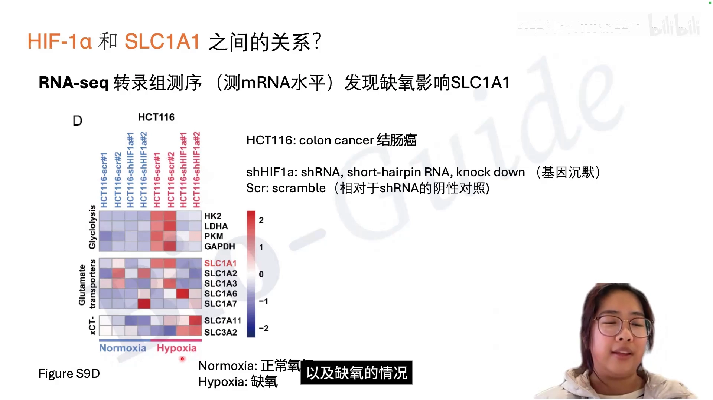
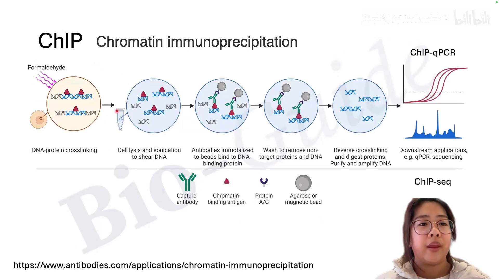
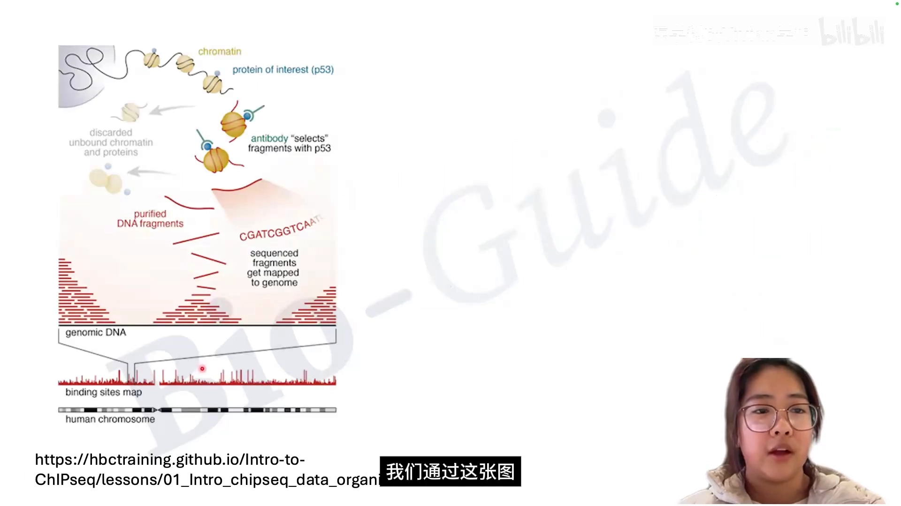
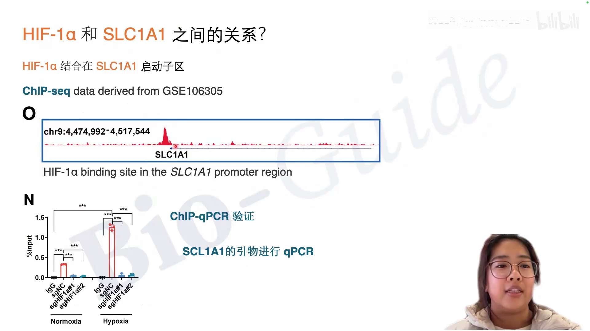
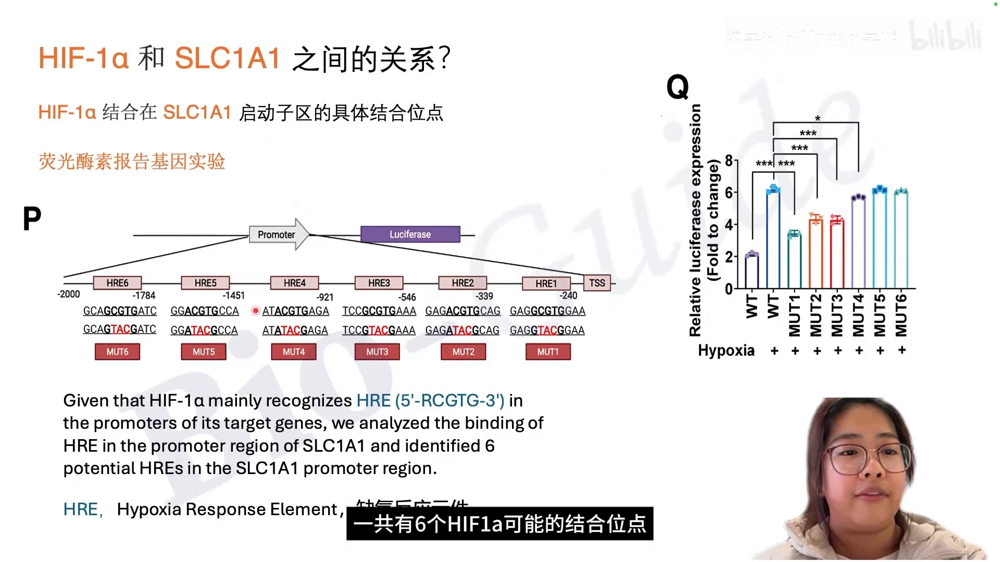
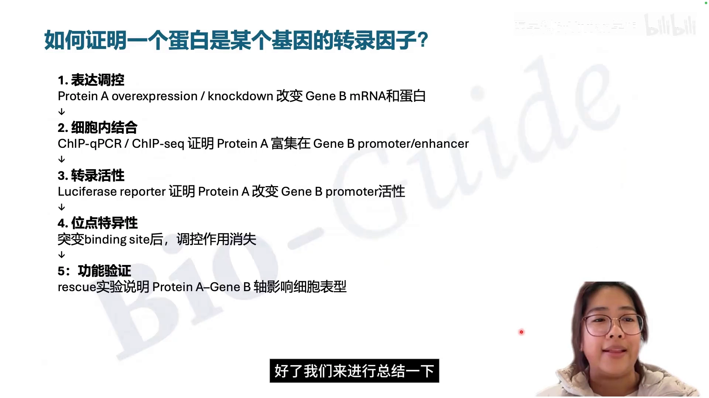

# 从基序命中到功能调控：ChIP 占据、报告基因与位点突变的证据链

> 视频来源：[科研大白读文献：一个视频学会转录因子研究和 ChIP](https://www.bilibili.com/video/BV1SvT16hEuT/)（Bilibili · BellGuide，约 9 分钟）
> 导读（100 字以内）：这支视频用一篇 Cell Reports 论文的 Figure 4，把「证明某蛋白是某基因的转录因子」拆成五步：表达调控、细胞内结合、转录活性、位点特异性、功能验证。本文按这五步重排，重点是每一步分别排除了什么、又不能说明什么。

## 本讲要解决的核心问题（SCQA）

**背景**：转录因子结合基因调控区的一段短序列（motif），影响这个基因的转录。所以只要在数据库里查到「某转录因子结合在某基因启动子区」，似乎就可以说它调控这个基因。

**冲突**：数据库里的那条结合记录，来自别人做的 ChIP-seq 实验，它只是「在这个细胞、这个条件下，这个蛋白在那段 DNA 上有富集」。它既不能说明结合发生在你关心的细胞里，也不能说明结合改变了转录，更不能说明是哪个碱基在起作用。

**疑问**：要证明「蛋白 A 是基因 B 的转录因子」，需要哪些互相独立的证据？每一类证据各自能排除什么、不能排除什么？

**回答（中心思想）**：视频给出一条**五步证据链**——表达调控 → 细胞内结合 → 转录活性 → 位点特异性 → 功能验证。前三步分别回答「相关」「在场」「有活性」，后两步把「在场」收紧到「就是这几个碱基」，最后才谈细胞表型。**每一步都只排除一部分替代解释，缺一步就留下一种可能。**

---

## 一、第一步：先看到表达变化，但相关不等于调控

论文研究的对象是缺氧诱导因子 **HIF-1α**（2019 年诺贝尔生理学或医学奖的氧感知通路核心蛋白）与谷氨酸转运蛋白 **SLC1A1**。作者关注的是：HIF-1α 是否作为转录因子直接促进 SLC1A1 表达。

第一步是最常见的起点：**改变蛋白 A，看基因 B 的 mRNA 和蛋白是否跟着变**。

- 用 **RNA-seq**（转录组测序，测 mRNA 水平）在结肠癌细胞系 HCT116 中比较常氧（normoxia）与缺氧（hypoxia）；
- 用 **shRNA**（小发夹 RNA，在 mRNA 水平降低基因表达）敲低 HIF-1α，对照组是 **scramble**（SCR，阴性对照）；
- 结果：缺氧条件下，所关注的谷氨酸转运蛋白里只有 **SLC1A1** 明显升高；敲低 HIF-1α 后它下降。

[【跳转到 02:41】](https://www.bilibili.com/video/BV1SvT16hEuT/?t=161)

蛋白水平再用两种细胞验证（HT1080 纤维肉瘤、HCT116 结肠癌），这次用 **sgRNA**（CRISPR/Cas9 的向导 RNA）做基因敲除，并同时看下游的谷氨酸盐含量；过表达 HIF-1α（OE，overexpression）则得到相反方向的结果。

这里有一个容易被忽略的细节：**蛋白变多可以来自合成增加，也可以来自降解减少**。所以作者又用 qPCR 看了 SLC1A1 的 mRNA 水平，确认变化发生在转录本层面，与前面的 RNA-seq 一致。

**这一步能说明什么**：HIF-1α 的活性与 SLC1A1 的表达同向变化，而且变化在 mRNA 层面。
**这一步不能说明什么**：不能说明 HIF-1α 直接结合 SLC1A1 的调控区。表达相关可能来自间接效应——HIF-1α 先激活了另一个因子，那个因子再去调控 SLC1A1。

---

## 二、第二步：ChIP 证明「在场」，峰高只是富集强度

要跨过「相关」到「在场」，需要直接测蛋白与 DNA 的结合。视频先解释了 **ChIP**（chromatin immunoprecipitation，染色质免疫沉淀）：

1. 让转录因子与 DNA 交联在一起；
2. 裂解细胞，超声把 DNA 打碎成片段；
3. 用针对这个蛋白的**特异性抗体**把蛋白—DNA 复合物沉淀下来；
4. 洗掉非特异结合的蛋白与 DNA，解交联、纯化 DNA；
5. 下游做 **qPCR**（ChIP-qPCR，看某个已知位点的富集）或**测序**（ChIP-seq，全基因组定位）。

[【跳转到 05:24】](https://www.bilibili.com/video/BV1SvT16hEuT/?t=324)

ChIP-seq 的读法是：沉淀下来的 DNA 是长短不一的片段，比对回基因组后，**某个区域的片段越多，峰越高，提示这个蛋白在那里结合得越多**。

[【跳转到 06:01】](https://www.bilibili.com/video/BV1SvT16hEuT/?t=361)

论文里，作者先引用公开数据（GSE106305）看到 HIF-1α 在 SLC1A1 启动子区有一个峰（chr9:4,474,992–4,517,544），再自己在缺氧条件下做 **ChIP-qPCR** 验证：用 SLC1A1 启动子的引物扩增沉淀下来的 DNA，柱子越高代表结合越多。

[【跳转到 06:26】](https://www.bilibili.com/video/BV1SvT16hEuT/?t=386)

**这一步能说明什么**：在缺氧条件下的这些细胞里，HIF-1α 确实结合在 SLC1A1 启动子区，而且富集随 HIF-1α 减少而下降。
**这一步不能说明什么**：结合不等于调控。一个蛋白可以结合几千个位点而只影响其中一部分（见《[转录因子识别 DNA：短基序、二聚化与组合密码](转录因子识别DNA：短基序、二聚化与组合密码.md)》第四节）。ChIP 也**不告诉你是哪几个碱基在结合**——峰覆盖的是一两百到几百 bp 的区间，里面可能有多个候选位点。

---

## 三、第三步：报告基因证明这段序列有转录活性

要证明「结合这段 DNA 能改变转录」，需要把这段序列从基因组里拿出来，接到一个可读的输出上。视频介绍的是**荧光素酶报告基因实验**（luciferase reporter）：

- 把候选启动子区克隆到带有荧光素酶基因的质粒上；
- 如果这段启动子能被激活，荧光素酶就表达，加底物后发光；
- 光的强弱就是这段序列的**转录活性**读数。

论文里，SLC1A1 启动子区一共有 **6 个** HIF-1α 可能的结合位点（HRE，hypoxia response element，缺氧响应元件；HIF-1α 主要识别 **5'-RCGTG-3'** 这一基序）。

[【跳转到 07:32】](https://www.bilibili.com/video/BV1SvT16hEuT/?t=452)

**这一步能说明什么**：这段启动子片段在缺氧条件下能提高报告基因表达，说明它含有能被缺氧信号激活的元件。
**这一步不能说明什么**：报告基因是游离在细胞里的质粒，不在原来的染色质环境里；它也不能区分是 6 个位点中的哪一个在起作用。

---

## 四、第四步：位点突变把「这段 DNA」收紧到「这几个碱基」

第三步留下的问题，用**位点突变**解决：把 6 个候选 HRE 逐个突变（MUT1–MUT6），再比较缺氧诱导后的荧光素酶活性。

结果：

- 野生型（WT）在缺氧下荧光明显升高；
- 各突变组的荧光有不同程度的下降，其中前几个位点的突变下降更明显，后几个接近野生型。

[【跳转到 07:37】](https://www.bilibili.com/video/BV1SvT16hEuT/?t=457)

**这一步能说明什么**：HIF-1α 是通过这几个具体的 HRE 位点结合并影响转录的——**位点被破坏，调控作用减弱**，这是「位点特异性」的直接证据。
**这一步不能说明什么**：它仍然是在报告基因体系里做的，不能完全代表内源基因座上的染色质环境。

---

## 五、第五步：功能验证，把分子事件接回细胞表型

最后一步是**功能实验**：证明「蛋白 A—基因 B」这条轴确实影响细胞表型。视频的总结页把这一步写成 rescue 实验——在改变 A 或 B 之后，看能否把表型救回来。

[【跳转到 08:15】](https://www.bilibili.com/video/BV1SvT16hEuT/?t=495)

**这一步能说明什么**：这条调控关系在细胞层面有后果，而不只是一个能做出荧光的体外构造。

---

## 六、这条证据链怎么用：每一步排除一种替代解释

把五步放在一起看，它其实是一组**逐层收紧的排除法**：

| 步骤 | 主要证据 | 排除了什么 | 仍然留下的可能 |
| --- | --- | --- | --- |
| 1 表达调控 | RNA-seq、敲低/过表达、qPCR | 「两者毫无关系」 | 间接效应、下游级联 |
| 2 细胞内结合 | ChIP-seq 峰、ChIP-qPCR | 「只是表达相关，蛋白并不在场」 | 结合但无功能；不知道具体碱基 |
| 3 转录活性 | 荧光素酶报告基因 | 「这段序列没有转录活性」 | 不知道 6 个位点里是哪个；质粒非天然染色质 |
| 4 位点特异性 | 逐个位点突变 | 「活性来自这段序列的其他部分」 | 内源基因座上的染色质环境差异 |
| 5 功能验证 | rescue／表型实验 | 「分子事件与细胞表型无关」 | 表型可能由多条通路共同决定 |

这条链也解释了为什么「数据库里查到结合」不能当作结论：它只相当于第 2 步的一部分，而且还是在别人选定的细胞与条件下做的。

还有两个判读细节值得记住：

- **motif 命中是最弱的一层**。序列扫描只能给出「像不像」，HRE 的 5'-RCGTG-3' 在基因组里出现无数次，是否真的被使用要靠 ChIP 与突变实验。
- **ChIP 的峰高是富集强度，不是功能强度**。峰高受抗体效率、交联效率、染色质状态影响；不同抗体的结果不能直接横向比较。

## 七、边界

- ChIP-seq／CUT&Tag 的实验细节、对照与峰 calling 属于《细胞与组学测量基础》的 ChIP-seq 小节，本文只讲它在证据链里的位置。
- 染色质可及性如何影响结合属于 3.1.4；增强子—启动子关联与三维接触属于 3.2.2；本节不展开。
- 调控区变异如何改变表达、如何做功能验证属于 4.2.3。
- 本文只覆盖视频中 Figure 4 这一条证据链，不涉及该论文的铁死亡表型与乳酸通路的完整机制。

## 小结

- 证明「蛋白 A 是基因 B 的转录因子」需要**五步**：表达调控、细胞内结合、转录活性、位点特异性、功能验证。
- **表达相关**可能来自间接效应，所以第一步之后必须做结合实验。
- **ChIP** 用抗体富集蛋白—DNA 复合物，ChIP-qPCR 看已知位点，ChIP-seq 全基因组定位；**峰高是富集强度，不是功能强度**。
- **报告基因**把「这段序列有没有转录活性」变成可读的荧光输出，但它是质粒，不在天然染色质里。
- **位点突变**把结论从「这段 DNA」收紧到「这几个碱基」，是位点特异性的关键一步。
- 每一步只排除一部分替代解释：**motif 命中 < 真实结合 < 功能调控**，证据强度依次递增。

## 关键术语速查

| 术语 | 一句话解释 |
| --- | --- |
| ChIP | 染色质免疫沉淀，用抗体把目标蛋白与它结合的 DNA 一起沉淀下来 |
| ChIP-qPCR | 用 qPCR 检测 ChIP 产物中某个已知位点的富集程度 |
| ChIP-seq | 对 ChIP 产物测序，把全部结合位点定位到基因组上，形成峰 |
| 峰（peak） | ChIP-seq 中片段富集的区域，峰高反映富集强度而非功能强度 |
| motif／HRE | 转录因子偏好的短序列；HRE 是 HIF-1α 识别的缺氧响应元件，共识为 5'-RCGTG-3' |
| 荧光素酶报告基因 | 把候选调控序列接到荧光素酶基因前，用发光强度读出转录活性 |
| 位点突变 | 把候选结合位点的碱基改掉，看调控作用是否消失，用于证明位点特异性 |
| shRNA／sgRNA | 分别用于敲低（mRNA 水平）与敲除（CRISPR/Cas9）的向导 RNA |
| rescue 实验 | 在破坏某环节后重新补回，看表型能否恢复，用于支持因果方向 |