# 转录因子识别 DNA：短基序、二聚化与组合密码

> 视频来源：[细胞生物学解码 53：转录因子、增强子与组合密码](https://www.bilibili.com/video/BV1R8RzBqEW5/)（Bilibili · 细胞生物学解码，约 63 分钟）
> 导读（100 字以内）：这支视频从「一个转录因子认一段短序列」出发，算出短基序在基因组里出现 5 万次，再引出特异性的另外两个来源：染色质可及性与组合共结合。本文只取识别与结合这一段，增强子三维结构与染色质测量只作为边界保留。

## 本讲要解决的核心问题（SCQA）

**背景**：转录因子是一类能识别 DNA 上特定短序列并结合上去的蛋白质。教科书图里，一个转录因子稳稳坐在一个基因的启动子上，决定这个基因开或关。

**冲突**：一个典型的结合位点只有 6~12 个碱基。一段随机的 8 碱基序列，在 30 亿碱基的基因组里靠巧合就会出现约 5 万次。如果转录因子真的只按序列认位点，它就应该绑 5 万个地方；可细胞并没有同时跑 200 套程序，也没有因此崩溃。

**疑问**：既然序列本身远远不够特异，转录因子到底靠什么在基因组里找到该去的地方？找到并绑上之后，又凭什么说它「调控」了这个基因？

**回答（中心思想）**：转录因子识别 DNA 的特异性由三种成分分摊——**短序列基序、染色质可及性、组合共结合**。序列决定「长得像不像」，染色质决定「看不看得见」，组合决定「够不够数」。而「绑上」只是这条链的第一环：绑上之后还要招呼中介体、重塑器、修饰酶，才谈得上转录。

---

## 一、转录因子是两段式蛋白：一段读序列，一段招人

### 1.1 两个结构域分工

转录因子由两个功能半组成：

- **DNA 结合结构域**（DNA-binding domain，DBD）：形状精确，能跟一段特定 DNA 序列契合。它靠化学方式读碱基——不拆双螺旋、不把 DNA 劈开，只是侧着身子挨近**大沟**（DNA 螺旋里较宽的那条沟），读那里暴露出来的字母。序列对上了就咬住，对不上就继续走。
- **激活结构域或抑制结构域**：软塌塌、无固定形状，在抓到搭档之前没有确定构象，一般富含酸性氨基酸、谷氨酰胺或脯氨酸。它的作用是「伸出手」去招募别的蛋白。

[【跳转到 04:09】](https://www.bilibili.com/video/BV1R8RzBqEW5/?t=249)

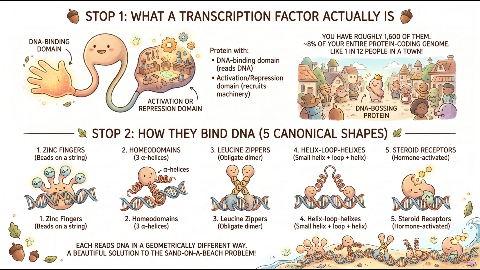

视频给出的规模是：人类大约有 **1600 个转录因子**，引用 Lambert 2018 年综述的精确数字是 1639，约占全部蛋白编码基因的 8%。这个数字后面会反复用到。

### 1.2 结合位点只有 6~12 个碱基

转录因子识别的是一段短序列，通常 6~12 个碱基，视频里叫**结合位点**（binding site），也就是常说的 motif／基序。位点通常落在启动子或增强子这类调控序列里。

短，是后面所有麻烦的根源。视频算了一笔账：

- 一段随机的 8 碱基序列，在 30 亿碱基的基因组里，纯靠巧合会出现约 **5 万次**；
- 如果特异性是完美的，一个转录因子就要绑 5 万个位点；
- 每个转录因子都绑 5 万个位点，细胞就会同时跑 200 个不同的程序，「然后你整个人就爆了」。

[【跳转到 10:04】](https://www.bilibili.com/video/BV1R8RzBqEW5/?t=604)

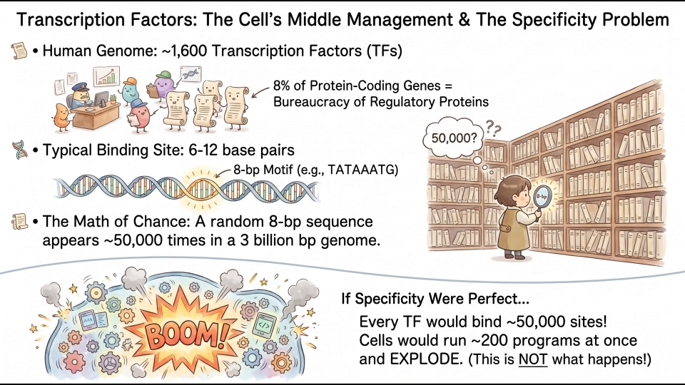

所以特异性一定还从别的地方来。这里有一个容易记混的地方：**基序命中（motif hit）只是「这段 DNA 长得像某个转录因子的位点」**，它既不代表这个转录因子真的结合在那里，也不代表结合之后有功能。这条区分是本节的主线，后面第二节会用 ChIP 与报告基因实验把它拆开。

---

## 二、特异性的三种成分：序列、可及性、组合共结合

视频把答案压成一句话：**真正的特异性来自基因序列，加上染色质可及性，加上组合共结合**，三种成分，不是一种。

[【跳转到 11:13】](https://www.bilibili.com/video/BV1R8RzBqEW5/?t=673)

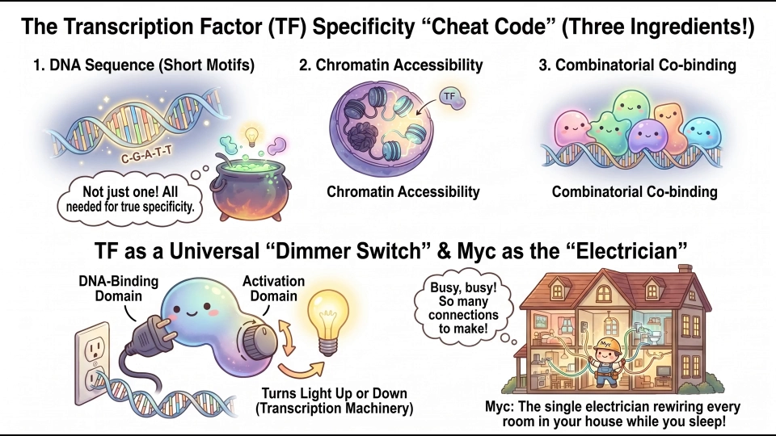

用视频的比喻：一个转录因子单独上场，是个**中等精度的搜索引擎**；一个转录因子加上开放的染色质、加上三个对的搭档，就是**激光制导打击**。

### 2.1 第一层：序列偏好由 DBD 的几何形状决定

DBD 有五种经典形状，每一种用几何上完全不同的方式读 DNA：

| 家族 | 结构要点 | 读序列的方式 | 例子 |
| --- | --- | --- | --- |
| 锌指（zinc finger） | 一圈氨基酸被一个锌离子固定，由 2 个半胱氨酸 + 2 个组氨酸配位（C2H2） | 每根「指」触碰大沟里约 3 个碱基对，多根指串成「珠子」连着读更长的序列 | Sp1，结合管家基因启动子富含 GC 的区域 |
| 同源异形结构域（homeodomain） | 三根 α 螺旋捆在一起，第三根像钥匙插锁一样掉进大沟；由 60 个氨基酸编码，对应 180 bp 的 homeobox | 单根识别螺旋读大沟 | HOX 基因产物 |
| 亮氨酸拉链（bZIP） | 两根 α 螺旋靠每隔 7 个残基伸出的亮氨酸咬合，拉链下方碱性区嵌进大沟 | 必须二聚化后才能读 DNA | AP-1（Jun/Fos 异源二聚体）、CREB |
| 螺旋-环-螺旋（bHLH） | 短螺旋—环—短螺旋，与搭档以同样构造捆在一起，带碱性区 | 必须二聚化后才能读 DNA | MyoD、MYC/MAX |
| 核受体 | 一个类似锌指的 DBD 加一个配体结合结构域 | 配体（脂溶性激素）结合后构象改变，才成为有活性的转录因子 | 糖皮质激素受体、雌激素受体、雄激素受体、甲状腺激素受体 |

[【跳转到 14:56】](https://www.bilibili.com/video/BV1R8RzBqEW5/?t=896)

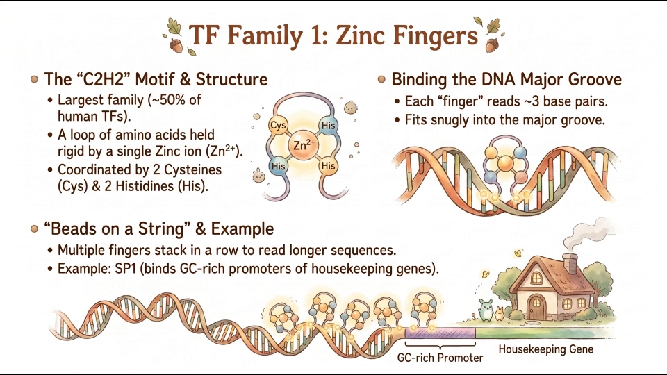

[【跳转到 16:28】](https://www.bilibili.com/video/BV1R8RzBqEW5/?t=988)

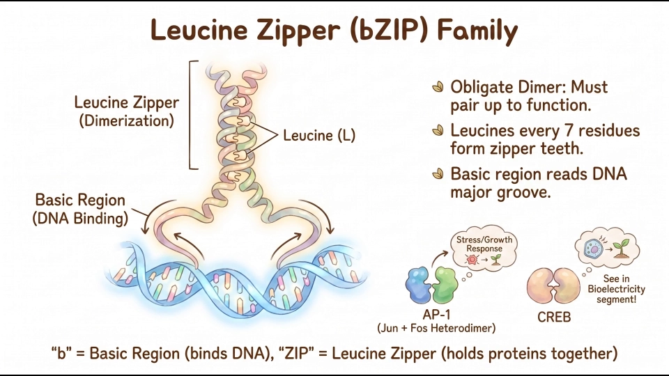

[【跳转到 17:30】](https://www.bilibili.com/video/BV1R8RzBqEW5/?t=1050)

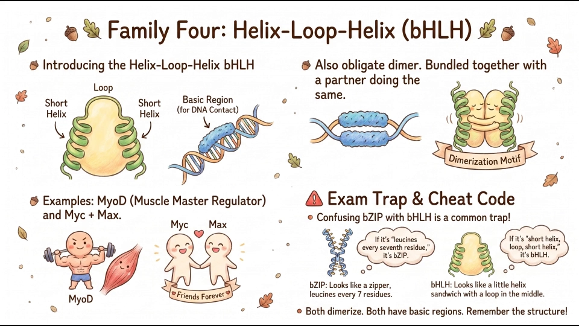

这里已经出现了本节标题里的「协同」的第一种形式：**二聚化是结合的前提**。bZIP 与 bHLH 都是强制二聚体（obligate dimer），单独一个单体绑不住 DNA，必须先找到搭档。核受体则是另一种条件式结合：没有配体时它在细胞质里待着，配体来了才变成能结合 DNA 的转录因子。

### 2.2 第二层：染色质决定位点看不看得见

即使序列完全匹配，位点也可能根本不存在于「可读」的空间里。DNA 一旦绕在组蛋白上，一侧的大沟就压在组蛋白表面，没地方落脚。视频的说法很直接：从转录因子的角度看，这个结合位点跟不存在一样。

[【跳转到 24:05】](https://www.bilibili.com/video/BV1R8RzBqEW5/?t=1445)

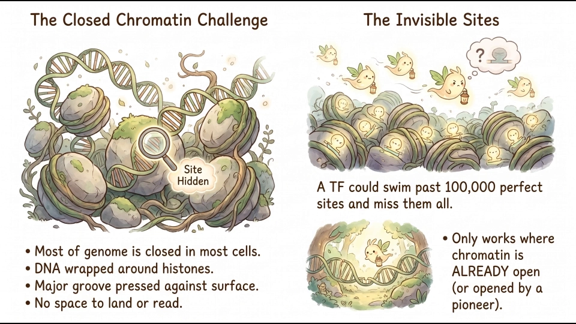

一个转录因子可以在它完美对应序列的 10 万个位点旁边游过去，一个都注意不到，因为它们全都塞进了紧密包装的核小体里。所以「有 motif」和「能结合」之间，还隔着一层可及性。

**先锋转录因子**是这条规则的一个例外，也是它最好的反证。1990 年代初，Kenneth Zaret 实验室在研究白蛋白基因时发现，FOXA1（当时叫 HNF3）已经坐在前肝细胞关闭染色质的启动子上——按当时的规则，这在数学上讲不可能。原因是 FOXA1 的 DBD 形状特殊，即使基因绕在组蛋白上，目标序列在缠绕的一侧仍部分暴露，它能抓住那一小半。绑上之后，FOXA1 招来染色质打开，其他「只开没锁的门」的转录因子才涌进来。

[【跳转到 26:45】](https://www.bilibili.com/video/BV1R8RzBqEW5/?t=1605)

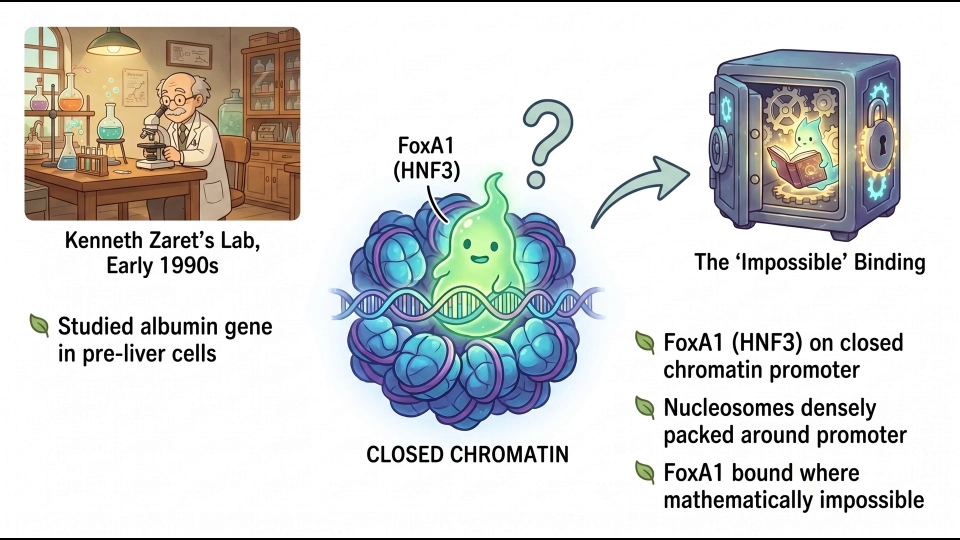

[【跳转到 28:15】](https://www.bilibili.com/video/BV1R8RzBqEW5/?t=1695)

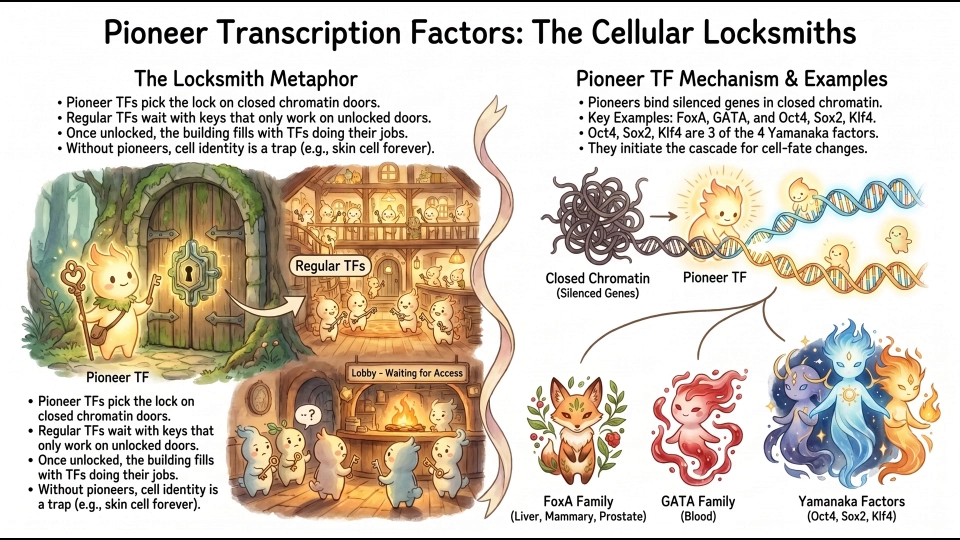

山中四因子里的 OCT4、SOX2、KLF4 就属于这一类，这也是它们能把关闭的多能性基因重新打开的前提。可及性怎么测、核小体怎么定位，属于 [3.1.4 染色质开放性与转录可及性](../../../README.md#b02-3-1-4) 与 3.1.7 的范围，本节只把它当作「结合的前提条件」。

### 2.3 第三层：组合共结合把「像」变成「是」

第三层是组合。一个增强子上通常不是一个转录因子，而是十个、二十个、三十个一起绑上去，互相贴着，全都贴着中介体，同时冲 RNA 聚合酶 II 喊话。

[【跳转到 38:58】](https://www.bilibili.com/video/BV1R8RzBqEW5/?t=2338)

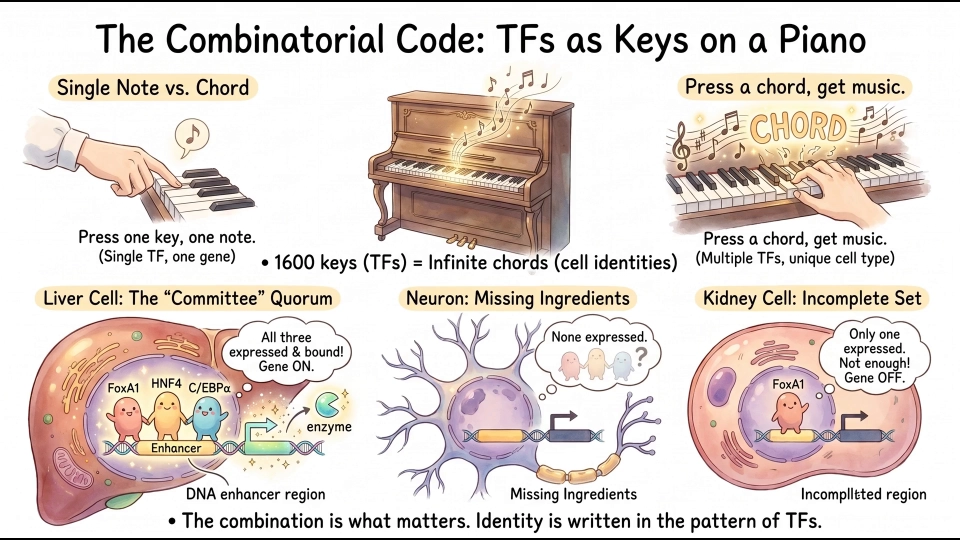

视频给的算术是：10 个转录因子，每个要么绑了要么没绑，就是 $2^{10}=1024$ 种状态；20 个约 100 万种；1600 个的组合空间在实际意义上无限大。

具体例子是一个肝特异性酶的增强子：它要求 FOXA1、HNF4、C/EBPα **同时**绑上。

- 肝细胞里：三个都表达、都绑上，染色质打开，基因打开；
- 神经元里：三个一个都不表达，就算染色质是开的，基因也一点动静没有；
- 肾细胞里：只表达了一个，不够。

这就是「与逻辑」的组合调控：不是任何一个单独的转录因子，是那个组合。

### 2.4 同一个转录因子，换个搭档就换一个方向

组合还有一层含义：**同一个蛋白的效应取决于搭档**。MYC 搭档 MAX 时是几千个生长基因的激活者；MYC 搭档 MAD 或 MXI1 时就是抑制者。同一个蛋白，相反效果。

[【跳转到 40:09】](https://www.bilibili.com/video/BV1R8RzBqEW5/?t=2409)

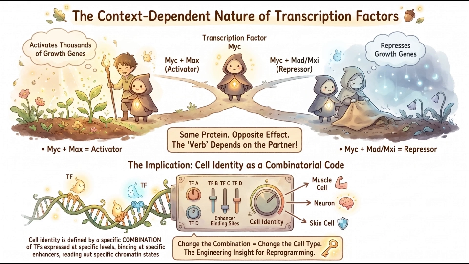

这解释了一件事：**「这个转录因子是激活因子还是抑制因子」不是蛋白的固有属性**，而是「这个蛋白 + 这个搭档 + 这个位点」的属性。看到 ChIP 峰只能说明它在那儿，不能直接推断方向。

---

## 三、绑上之后：转录因子本身不打开基因

视频专门纠正了一个教科书式的简化：转录因子绑到位点，并不等于它亲自打开了基因。它做的是**招呼一帮同伙**：

- **中介体**（Mediator）：26~30 个亚基的巨型复合体，一侧对接转录因子的激活结构域，另一侧对接 RNA 聚合酶 II 与通用转录因子，作用是搭一座物理桥、「翻译」两边的语言。它自己没有聚合酶活性，不做 RNA。
- **染色质重塑器**（如 SWI/SNF）：ATP 驱动，推动核小体。
- **组蛋白乙酰转移酶**（如 p300、CBP）：给附近组蛋白加乙酰基，松开染色质包装。
- 抑制型转录因子则招募 **HDAC**（组蛋白去乙酰化酶），把乙酰基扒下来，染色质收紧，基因被静音。

所以「转录因子结合 → 转录」中间至少还有两步：招募共调控因子，以及这些因子真正改变染色质与聚合酶状态。这也意味着**结合与转录响应可以脱钩**：位点占了，但没有合适的共调控因子、没有可被打开的染色质，转录未必改变。

---

## 四、占据的广度：一个转录因子可以坐在几千个启动子上

教科书图最容易造成的误解是「一个转录因子一个基因」。视频给了一个反例：MYC 在一个正在分裂的细胞里，会坐在**所有活跃启动子的约 10%~15%** 上。

[【跳转到 11:38】](https://www.bilibili.com/video/BV1R8RzBqEW5/?t=698)

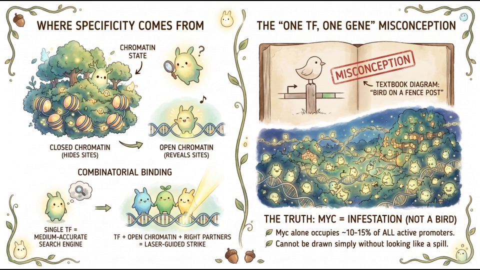

这一条对读数据很关键：

- ChIP-seq 上一个峰，说明这个蛋白在那个位置有富集，**不说明**它调控了最近的基因；
- 一个转录因子有几千个结合位点，**不说明**这几千个基因都被它调控；
- 反过来，一个基因的表达随某个转录因子变化，**也不说明**是直接结合导致的。

这正是本节要建立的判读习惯：**motif 命中、真实结合、功能调控是三件事，证据强度依次递增，需要不同的测量**。下一节会用一套具体的实验链条，把这三层逐一拆开。

---

## 五、这套框架的边界

- **染色质可及性的测量与机制**（ATAC-seq、DNase、核小体定位、重塑复合体）属于 3.1.4 与 3.1.7/3.1.8。本文只用「开放/关闭」这一层结论，不展开测量。
- **增强子的定义、位置与方向、超级增强子与三维接触**属于 3.1.2 与 3.2.1/3.2.2。本文提到增强子只为说明「组合结合发生在哪里」，不讨论 TAD、环与靶基因判定。
- **从表达数据推断调控网络**（共表达、基序富集、网络算法）属于 3.2.3/3.2.4。本文不涉及推断方法。
- 视频后半段关于细胞重编程、iPSC、生物电的内容，属于细胞命运与发育主题，本文只保留与「转录因子组合决定身份」直接相关的结论。

## 小结

- 转录因子是**两段式蛋白**：DBD 读序列，激活/抑制结构域招募共调控因子；人类约 1600 个。
- 结合位点只有 **6~12 bp**，随机 8 bp 序列在 3 Gb 基因组里出现约 **5 万次**，所以序列本身远不足以定位。
- 特异性由**三种成分**分摊：短序列基序、染色质可及性、组合共结合。单靠序列只是中等精度搜索引擎。
- DBD 有五种经典形状（锌指、同源异形结构域、bZIP、bHLH、核受体）。**bZIP 与 bHLH 是强制二聚体**，二聚化是结合的前提；核受体需要配体。
- **先锋转录因子**（FOXA1、OCT4/SOX2/KLF4）能结合关闭染色质里的位点，是「位点被藏起来」规则的例外。
- **组合是与逻辑**：肝增强子需要 FOXA1 + HNF4 + C/EBPα 同时在场；同一个 MYC 换搭档就从激活变抑制。
- 绑上之后还要招募中介体、重塑器、修饰酶才谈得上转录，**结合与转录响应可以脱钩**。
- MYC 占据所有活跃启动子的 10%~15%：**占据是广谱的**，motif 命中、真实结合、功能调控是三件不同强度的事。

## 关键术语速查

| 术语 | 一句话解释 |
| --- | --- |
| 转录因子（TF） | 识别 DNA 短序列并结合、通过招募共调控因子影响转录的一类蛋白 |
| DNA 结合结构域（DBD） | 转录因子上读序列的那一半，靠形状与化学性质识别大沟里的碱基 |
| 激活/抑制结构域 | 转录因子上招募共调控因子的那一半，通常无固定结构 |
| motif／基序 | 转录因子偏好的短序列模式，通常 6~12 bp |
| 大沟（major groove） | DNA 双螺旋较宽的沟，碱基边缘在这里暴露，是多数 DBD 的读取面 |
| 强制二聚体（obligate dimer） | 必须与搭档配对才能结合 DNA 的因子，如 bZIP、bHLH |
| 染色质可及性 | 一段 DNA 是否被核小体包裹、能否被蛋白接触 |
| 先锋转录因子 | 能结合关闭染色质里的位点并招来重塑器的转录因子，如 FOXA1、OCT4 |
| 中介体（Mediator） | 连接转录因子激活结构域与 RNA 聚合酶 II 的巨型共调控复合体 |
| 组合共结合 | 多个转录因子在同一元件上共同占据，只有正确组合才产生调控输出 |