# 染色质可及性：核小体占位时间决定转录因子能否结合

> 视频来源：[MCB 182 Lecture 8.4 - Chromatin accessibility (ATAC-seq)](https://www.youtube.com/watch?v=BzyVK871wqg)（YouTube · Gerald Quon，UC Davis MCB 182 课程，约 18 分钟，英文授课）
> 导读：这一讲把「可及性」当成一个**可量化的物理量**来定义，再顺着它讲清三件事——可及性为什么是连续谱而不是开关、酶切测序读到的究竟是什么、以及可及性与转录因子结合之间为什么是**双向**的。本文只走「可及性 ↔ 转录因子结合 ↔ 转录」这条因果链；ATAC-seq 的建库细节与单细胞数据形态见 [B04 §1.2.4](../../../../B04_细胞与组学测量基础/README.md#b04-1-2-4)，核小体怎么被挪开见 [§3.1.8](../../../README.md#b02-3-1-8)，组蛋白标记见 [§3.1.7](../../../README.md#b02-3-1-7)。

## 本讲要解决的核心问题（SCQA）

**背景**：上一节 [§3.1.3 转录因子识别](../../../README.md#b02-3-1-3) 讲的是转录因子（transcription factor，TF）靠一段十几到二十个碱基的偏好序列（基序，motif）认出 DNA；[§3.1.2 顺式调控元件](../../../README.md#b02-3-1-2) 讲了启动子与增强子这些落点在哪。按这两条，只要基因组里写着一段匹配的基序，TF 就该能结合上去。

**冲突**：可实际上，真核基因组里绝大多数的基序是**结合不上**的。原因很朴素：DNA 不是裸的，它缠在核小体（nucleosome，组蛋白八聚体加绕在上面的约 147 bp DNA）上。核小体占着那一段的时候，基序写得再标准，TF 也够不着。所以「有基序」和「能结合」之间还隔着一道闸。

**疑问**：这道闸怎么描述、怎么量化？它被谁打开、又怎么被关上？测序数据里能不能直接看见「TF 到底占没占住」？

**回答（中心思想）**：这道闸就是**染色质可及性**（chromatin accessibility）——某一段基因组**有多大比例的时间**没有被核小体占着。它有三个关键性质：

1. **它是一个时间比例，不是开关**：从完全关闭到完全开放是一条连续谱，中间还有一段「勉强够得着」的**允许态**（permissive）；
2. **它与 TF 结合互为因果**：可及是 TF 结合的前提，而 TF 结合之后又会招募重塑复合体把这段维持在开放状态——所以「可及性高」既可能是原因，也可能是结果；
3. **测量技术只是把「够不够得着」翻译成 DNA 片段**：ATAC-seq、DNase-seq、MNase-seq 三种酶切法测的都是「酶能不能进去」，而同一份数据里 TF 占据的位置会留下一个**凹陷（足迹）**——这是可及性与 TF 结合在数据上最直接的接口。

## 一、可及性是一个时间比例，所以它必然是连续谱

### 1.1 定义：被核小体占了多少时间

讲者给的正式定义很短：**染色质可及性 = 基因组的某一段被核小体占据的时间百分比** [【跳转到 00:10】](https://www.youtube.com/watch?v=BzyVK871wqg&t=10)。

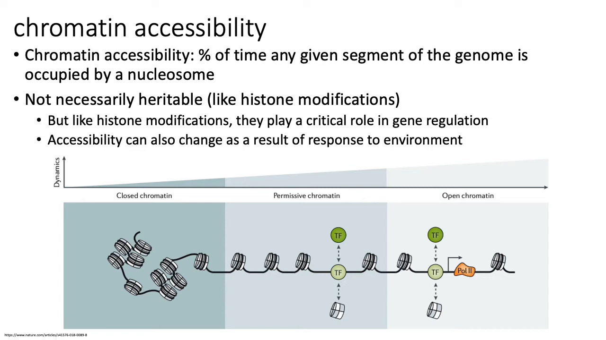

这个定义值得逐字拆开看，因为它决定了后面所有的判读方式。

**第一，「时间百分比」意味着它是一个概率量。** 换成本文常用的说法，可及性是可及时间的占比，也就是核小体占位率的补数：

$$
\text{可及性} \;=\; 1 - \frac{\text{该段被核小体占据的时间}}{\text{总时间}}
$$

注意式子里的分子分母都是**时间**，不是「有没有」。同一段 DNA 在十分钟里可能前六分钟被核小体盖着、后四分钟露出来——它既不是「关闭的」也不是「开放的」，而是「可及性 0.4」。讲者特别强调这一点：可及性**不是**一个 on/off 的东西，不存在「某一时刻染色质要么关要么开」这种说法 [【跳转到 00:35】](https://www.youtube.com/watch?v=BzyVK871wqg&t=35)。

**第二，正因为是比例，实际测到的永远是平均值。** 一次实验测的是成千上万个细胞、每个细胞里成对的两条同源染色体。所谓「这段可及性 0.4」，既可能是每个细胞都有 40% 的时间露着，也可能是 40% 的细胞完全露着、60% 的细胞完全盖着。这两种情况在 bulk 数据里长得一模一样——第五节会用单细胞数据把这件事讲透。

**第三，它不必是可遗传的。** 讲者的原话是：可及性和组蛋白修饰一样，**不一定是可遗传的事件**，但同样在基因调控中起关键作用；而且可及性会随细胞对环境的响应而改变 [【跳转到 00:10】](https://www.youtube.com/watch?v=BzyVK871wqg&t=10)。这一句把可及性和 [§3.1.9 表观遗传继承](../../../README.md#b02-3-1-9) 划清了界限：可及性可以是稳定的细胞状态标志，但不能默认它会像 DNA 甲基化那样跨分裂传递下去。

### 1.2 三段谱：关闭、允许、开放

讲者把这条谱切成三段，并配了一张图（上图下半）[【跳转到 01:00】](https://www.youtube.com/watch?v=BzyVK871wqg&t=60)：

| 状态 | 画面上的样子 | 谁进得去 | 后果 |
| --- | --- | --- | --- |
| **关闭**（closed chromatin） | 核小体紧密堆叠成螺线管状 | 谁也进不去 | 转录机器与 TF 都无法接近 |
| **允许**（permissive chromatin） | 核小体排成一串但留有空隙 | **先锋因子**（pioneer TF）能挤进去 | 招募重塑复合体，把这段进一步打开 |
| **开放**（open chromatin） | 无核小体，DNA 裸露 | TF 与 Pol II 都能结合 | 具备起始转录的条件 |

这张表里最容易被忽略的是中间那一行。**允许态的存在，说明「可及性」不是「TF 能不能结合」的同义词**：允许态下普通 TF 依然进不去，只有一小类特殊的 TF 能。这就把可及性从「一个数」变成了「一个数 + 一类能读这个数的蛋白」。

### 1.3 先锋因子：能在核小体上落脚的例外

讲者接着把允许态的机制说清楚了：在这种状态下，染色质开放得**刚刚好**，如果存在某些关键的 TF 子集——通常叫**先锋因子**（pioneer factors / pioneer TFs）——它们就能结合到**被核小体部分占据**的区域上，然后招募**染色质重塑复合体**（chromatin remodeler）过来，要么把核小体驱逐掉，要么增强自己在这一区域的结合 [【跳转到 01:25】](https://www.youtube.com/watch?v=BzyVK871wqg&t=85)。

这一步是整条因果链的枢纽，值得单独强调：

- 普通 TF 需要**先有可及性**才能结合，所以对它们来说可及性是**原因**；
- 先锋因子能**先结合**再打开，所以对它们来说可及性是**结果**。

同一个「可及性」概念，在不同 TF 身上扮演的角色正好相反。这也解释了为什么「测到某段可及」不能直接推出「哪个 TF 先到」——顺序要靠扰动实验来定，而不是靠一张 ATAC 图谱。重塑复合体具体怎么滑动、驱逐、换变体，见 [§3.1.8](../../../README.md#b02-3-1-8)。

## 二、测可及性的思路：让酶替你去试「进不进得去」

可及性本身不是一种分子，没有可以直接测序的化学结构。所以所有测量方法都走同一条路：**放一种会切 DNA 的酶进去，看它切在哪里**。酶进得去的地方就是可及的地方，酶被挡住的地方就是被占住的地方。

讲者把主流的三类酶切法并排放在同一张幻灯片上，逐个高亮 [【跳转到 02:01】](https://www.youtube.com/watch?v=BzyVK871wqg&t=121)。

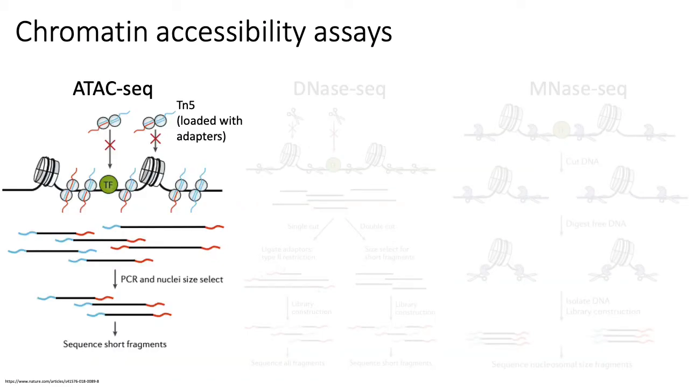

### 2.1 ATAC-seq：转座酶自带接头，一步到位

ATAC-seq 的全名是 assay for transposable accessible chromatin using sequencing（用测序测定转座酶可及染色质）。它的核心是一种**超活跃转座酶**，也就是 Tn5 [【跳转到 02:26】](https://www.youtube.com/watch?v=BzyVK871wqg&t=146)：

1. Tn5 预先**装载了 Illumina 测序接头**；
2. Tn5 进入细胞核，随机切开**开放或可及**的染色质；
3. 切开的同时，把测序接头**直接插进**这些新切开的位点；
4. 于是接头本身成了「这里当时是可及的」的探针——因为 Tn5 偏向于切开放染色质 [【跳转到 02:51】](https://www.youtube.com/watch?v=BzyVK871wqg&t=171)。

讲者给了 ATAC-seq 成为主流的原因，都是工程上的实用理由 [【跳转到 03:16】](https://www.youtube.com/watch?v=BzyVK871wqg&t=196)：比 DNase-seq 更稳健、重复性更好、流程简单；最关键的是**起始细胞量小**——bulk ATAC-seq 少到 500 个细胞就能做，整个实验约 2 小时，而且已有商业化产品可以做到单细胞水平 [【跳转到 03:41】](https://www.youtube.com/watch?v=BzyVK871wqg&t=221)。

### 2.2 DNase-seq：历史上第一个主流方法，但难做

DNase-seq（DNase I hypersensitive site sequencing）用的是核酸内切酶 **DNase I**，它在嘧啶附近切开可及染色质 [【跳转到 04:31】](https://www.youtube.com/watch?v=BzyVK871wqg&t=271)。

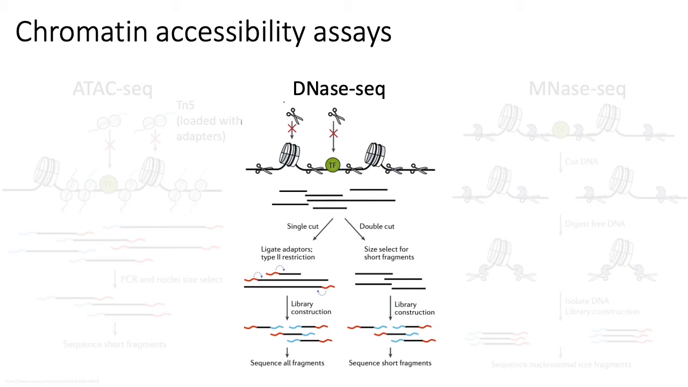

这张图上有一处细节，是本节后面讲足迹的关键：**红叉不只出现在核小体上，也出现在 TF 上**。讲者明确说，DNase I 切不动被蛋白占据的 DNA，「不只是组蛋白，也包括转录因子」——而且**ATAC-seq 的 Tn5 同样如此** [【跳转到 04:56】](https://www.youtube.com/watch?v=BzyVK871wqg&t=296)。

这句话把可及性拆成了两个层次：

- **核小体级别的可及性**：这一段整体上有没有被核小体盖住；
- **蛋白级别的占据**：这一段虽然整体开放，但某个 TF 正坐在上面，酶照样切不进去。

两者的信号形态不同——前者是「有峰／无峰」，后者是「峰中间凹下去一块」。本节讲前者，下一节讲后者。

建库这一步也有讲究：短读长测序需要短片段，而 DNase I 一开始切出来的片段往往偏长，所以有的方案会用 DNase I 再切一轮把片段切短，有的方案改用限制性内切酶；拿到足够短的片段之后，再连接测序接头、建库测序 [【跳转到 05:21】](https://www.youtube.com/watch?v=BzyVK871wqg&t=321)。

DNase-seq 的处境是：它是最早大规模使用的方法之一，ENCODE 联盟用它产出了大量数据，但近年逐渐被 ATAC-seq 取代，原因是实际操作非常难，全世界能稳定做出来的实验室并不多 [【跳转到 05:21】](https://www.youtube.com/watch?v=BzyVK871wqg&t=321)。

### 2.3 MNase-seq：反过来测「被核小体包住的那部分」

MNase-seq 用的是**微球菌核酸酶**（micrococcal nuclease，MNase），它同时具有内切酶和外切酶活性 [【跳转到 06:11】](https://www.youtube.com/watch?v=BzyVK871wqg&t=371)。

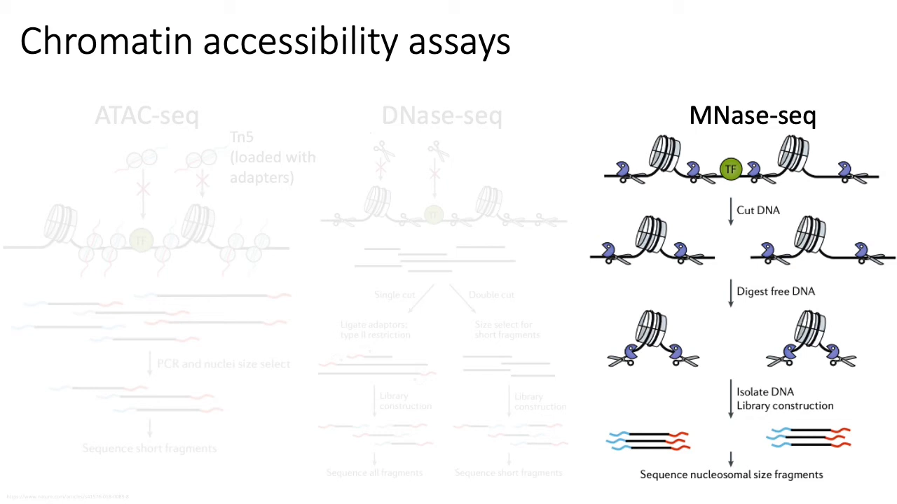

它的工作方式正好和 ATAC/DNase **互补**：

1. MNase 先切**开放区**，留下带着长长基因组尾巴的核小体；
2. 因为 MNase 还是外切酶，它会把核小体上那些游离的尾巴一点点啃掉；
3. 最后只剩下**完全被核小体包裹的**那段 DNA 被拿去测序 [【跳转到 07:01】](https://www.youtube.com/watch?v=BzyVK871wqg&t=421)。

所以三者的分工可以压成一句话：**ATAC-seq 与 DNase-seq 测「开放的地方」，MNase-seq 测「被包住的地方」** [【跳转到 06:36】](https://www.youtube.com/watch?v=BzyVK871wqg&t=396)。

| 方法 | 用的酶 | 测的是 | 起始量／耗时（讲者给的量级） | 现状 |
| --- | --- | --- | --- | --- |
| ATAC-seq | Tn5 转座酶（预载接头） | 开放区，分辨率最高 | 约 500 个细胞／约 2 小时 | 目前最主流，可单细胞化 |
| DNase-seq | DNase I | 开放区（超敏位点） | 数十万个细胞／数天 | ENCODE 留下大量数据，现已少用 |
| MNase-seq | 微球菌核酸酶 | 核小体占据区 | 讲者未给具体数字 | 用于核小体定位 |

### 2.4 一个必须解释的现象：为什么 MNase 的峰和 ATAC 的峰看着重叠

讲者专门花时间处理了一个反直觉的观察 [【跳转到 09:43】](https://www.youtube.com/watch?v=BzyVK871wqg&t=583)：ATAC-seq 和 DNase-seq 都测开放区，所以两者都覆盖图中主要的开放区；ATAC 更灵敏，还能读到核小体之间那些「没那么开放」的缝隙，因此分辨率更高 [【跳转到 10:08】](https://www.youtube.com/watch?v=BzyVK871wqg&t=608)。

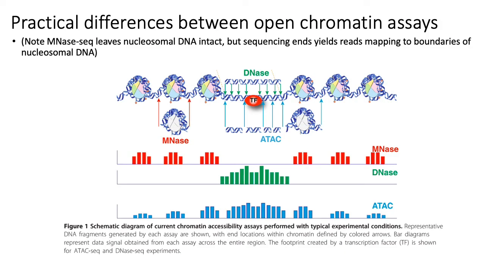

但 MNase-seq 本该测核小体包裹的 DNA，为什么它的峰看起来和 ATAC 峰**重叠**？答案是**双端测序**：MNase-seq 保留下来的片段是整段被核小体包住的 DNA，做双端测序时读到的是这段 DNA 的**两端**，而两端恰好对应核小体之间的连接区 [【跳转到 11:23】](https://www.youtube.com/watch?v=BzyVK871wqg&t=683)。

这解释了一个非常容易搞错的判读点：**MNase-seq 的峰位不是核小体的中心，而是核小体的边界**。把峰位当成核小体中心去算间距，就会系统性偏掉半个核小体。核小体定位的测量细节见 [§3.1.8](../../../README.md#b02-3-1-8)。

> 本节只把三种方法讲到「各自测什么、为什么读数长这样」为止。建库流程、片段长度筛选、单细胞条码化等实验与数据细节，见 [B04 §1.2.4 染色质可及性测量](../../../../B04_细胞与组学测量基础/README.md#b04-1-2-4)。

## 三、足迹：同一份数据里看见「哪个位置被 TF 占住了」

到这里为止，可及性讲的还是「核小体挡不挡路」。但真正的调控事件发生在更细的尺度上：某一段已经开放的 DNA 上，一个 TF 坐了下来。讲者指出，把 ATAC-seq 或 DNase-seq 测到足够深、文库复杂度足够高之后，数据里会出现一个可辨认的图案 [【跳转到 07:33】](https://www.youtube.com/watch?v=BzyVK871wqg&t=453)：

- 开放区整体上读段堆积、形成峰；
- 但在 TF **牢牢结合**的那一小段上，读段出现**明显的凹陷**——因为蛋白挡在那里，Tn5 或 DNase I 切不进去 [【跳转到 08:23】](https://www.youtube.com/watch?v=BzyVK871wqg&t=503)。

识别这些又小又深的凹陷区域，就是所谓的 **Tn5 足迹分析**（Tn5 footprinting）[【跳转到 08:48】](https://www.youtube.com/watch?v=BzyVK871wqg&t=528)。

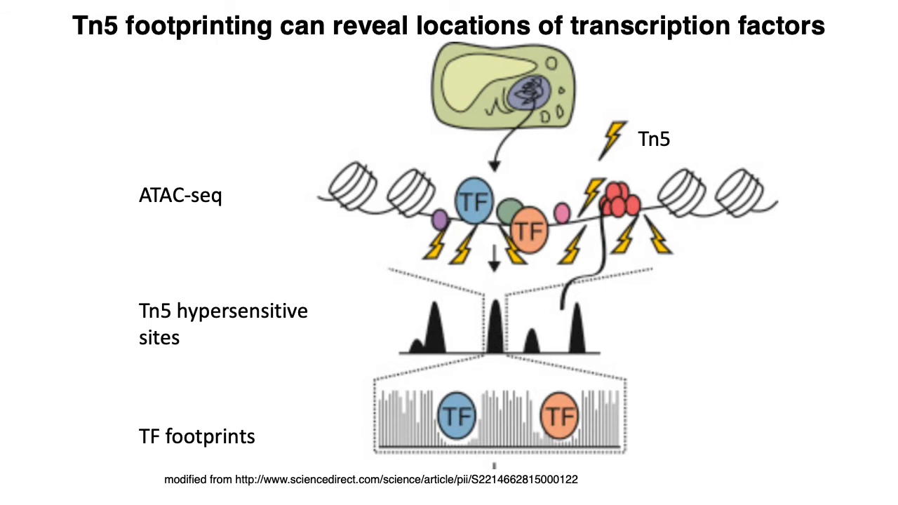

这张图把三个层次叠在了一起，值得从上往下读：

1. **最上面：染色质上的真实状态。** 核小体之间露出的 DNA 上坐着几个 TF（图中的蓝色、橙色、粉色、红色圆块），Tn5（黄色闪电）落在它们旁边的空地上。
2. **中间：Tn5 超敏位点。** 比对回基因组后，读段在开放处堆成峰。
3. **最下面：TF 足迹。** 把峰放大，TF 所在的位置是一段**读段几乎为零**的缺口。

### 3.1 足迹的形状还能反推 TF 的性质

讲者进一步说，读段分布在这个区域的**形状**，反映了 TF 的**大小**和**结合机制**；因此分析这些足迹的形状，可以学到 TF 的生物物理性质以及它如何结合 DNA [【跳转到 09:13】](https://www.youtube.com/watch?v=BzyVK871wqg&t=553)。

这句话的分量在于：它把「可及性数据」从一张「哪里开着的图」升级成了「哪里有什么东西占着的图」——足迹的宽度与深度，对应的就是占位蛋白的大小与结合方式。

### 3.2 但足迹只回答「有蛋白占着」，不回答「是哪个 TF」

这里必须踩一次刹车，因为这是最容易过度解读的地方。足迹能证明的只有一件事：**这一小段被某个蛋白挡住了**。它不告诉你挡住的是哪个 TF，也不告诉你这次结合是激活还是抑制。

要往「是哪个 TF」走，需要另外两类证据，而这两类证据在 [§3.1.3](../../../README.md#b02-3-1-3) 已经展开：

| 想回答的问题 | 需要的证据 | 本讲提供的是 |
| --- | --- | --- |
| 这段 DNA 开放吗 | 酶切信号有峰 | ✓ |
| 这段被蛋白占着吗 | 峰中间有足迹 | ✓ |
| 占着的是哪个 TF | 基序命中 + ChIP/CUT&Tag 占据 + 扰动 | ✗ |
| 结合后真的调控转录吗 | 报告基因、位点突变、表达变化 | ✗ |

换句话说，**足迹是「占据」的证据，不是「身份」和「功能」的证据**。把足迹直接读成「某某 TF 结合在此处并激活了基因」，是跨了三层证据的跳跃。

## 四、可及性怎么被打开：四条路径，全都绕不开 TF

讲者接着把「可及性如何被动态重塑」归纳成四条路径，画在同一张幻灯片的四栏里 [【跳转到 11:54】](https://www.youtube.com/watch?v=BzyVK871wqg&t=714)。这张图是本节最该记住的一张，因为它把「可及性」和「TF 结合」之间的因果关系摆成了四种不同的先后顺序。

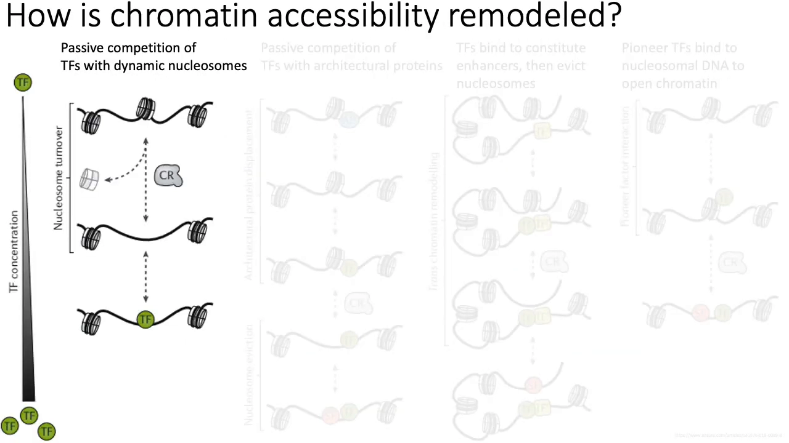

### 4.1 路径一：与动态核小体的被动竞争

第一条路径叫**TF 与动态核小体的被动竞争**（passive competition of TFs with dynamic nucleosomes）[【跳转到 11:54】](https://www.youtube.com/watch?v=BzyVK871wqg&t=714)。

机制很朴素：很多核小体本身就有一定程度的**自然周转**（turnover），重塑复合体（图中标 CR）会时不时把核小体挪来挪去。在核小体进进出出的过程中，一个 TF 可能**碰巧**遇到某段恰好空出来的 DNA，就结合上去，然后启动转录，并把这段维持在开放状态 [【跳转到 12:19】](https://www.youtube.com/watch?v=BzyVK871wqg&t=739)。

上图左侧那根纵轴很关键：**TF 浓度**。核小体空出来的窗口是随机的、短暂的，TF 浓度越高，在这个窗口里抢到位置的概率就越大。所以这条路径给出的预测是：**同一个位点，在不同细胞里是否被占据，取决于该 TF 的浓度**——这也解释了为什么「有基序」不等于「被占据」，浓度不够时基序就是空着的。

### 4.2 路径二：与架构蛋白的被动竞争

第二条是**TF 与非核小体架构蛋白的被动竞争**（passive competition of TFs with architectural proteins）[【跳转到 12:44】](https://www.youtube.com/watch?v=BzyVK871wqg&t=764)。

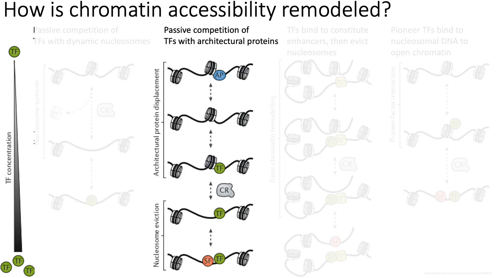

这条路径里的竞争者不是核小体，而是一类**短暂结合在染色质上的架构蛋白**（architectural protein，图中标 AP）。它们通常并不固定，会自行脱落。当 AP 从染色质上**释放**之后，其他 TF 才有机会进来；进来的 TF 再借助重塑复合体，招募所谓的**次级因子**（secondary factor，图中标 SF），一起结合到该区域并启动转录 [【跳转到 13:09】](https://www.youtube.com/watch?v=BzyVK871wqg&t=789)。

这条路径补上了一个常被忽略的事实：**挡住 TF 的不只是核小体**。所以「ATAC 有峰」只说明酶能进去，不能保证 TF 一定进得去——如果那块地方正被一个架构蛋白占着，酶切信号可能照样存在，TF 却结合不上。

### 4.3 路径三：组成型开放的增强子上，先有强 TF 守着

第三条是**TF 结合并识别组成型开放的增强子**（TFs bind to constitutive enhancers, then evict nucleosomes）[【跳转到 13:34】](https://www.youtube.com/watch?v=BzyVK871wqg&t=814)。讲者的描述是：某些**强增强子**上可能已经结合着一个**强转录因子**（图中标 TF prime），正是它把这个增强子维持在开放状态；随后另一个 TF 才能进来结合到这个增强子上，进而招募更多的重塑因子，把这个区域进一步打开，为转录创造条件 [【跳转到 13:59】](https://www.youtube.com/watch?v=BzyVK871wqg&t=839)。

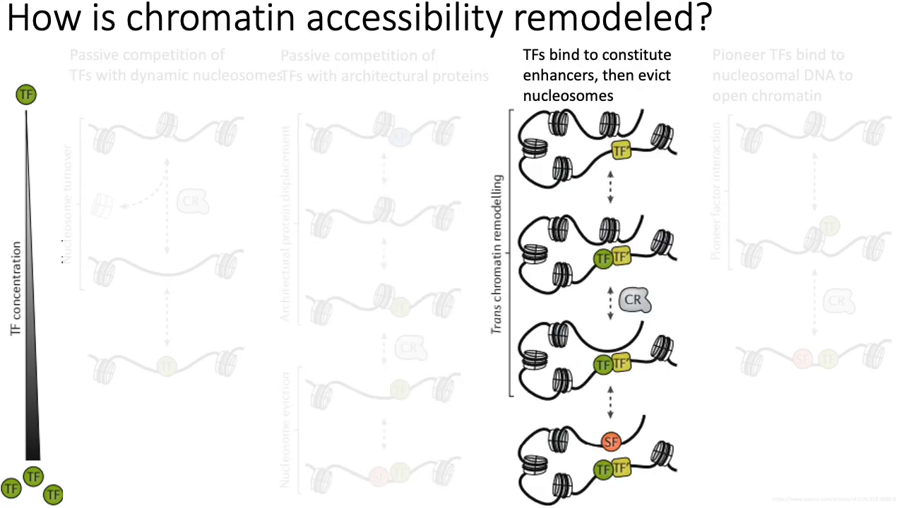

这条路径的要点是**先后顺序固定**：先有一个「常驻」的 TF 维持开放，后来的 TF 才有落点。所以在这一类元件上，可及性是**上游**事件，TF 结合是下游。

### 4.4 路径四：先锋因子主动打开

第四条就是第一节讲过的**先锋因子**：它们能结合到**含有核小体**的区域，主动招募重塑复合体把这段打开，为次级因子和其他非先锋型 TF 腾出落点，让它们进来结合并启动转录 [【跳转到 14:24】](https://www.youtube.com/watch?v=BzyVK871wqg&t=864)。

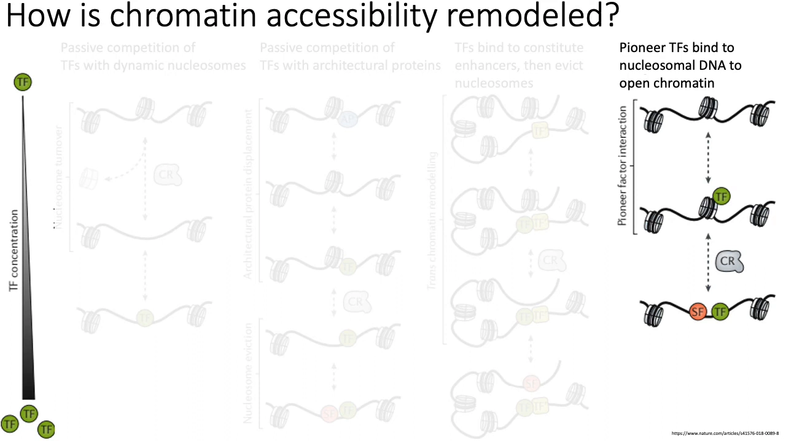

### 4.5 四条路径放在一起看：因果方向是双向的

把四条路径排成一张表，就能看出本节最核心的判断：

| 路径 | 谁先动 | 可及性相对 TF 结合的位置 | 对「有峰」的解释 |
| --- | --- | --- | --- |
| 与动态核小体竞争 | TF（靠浓度抢窗口） | 可及性是**前提** | 峰反映核小体周转留下的空隙 |
| 与架构蛋白竞争 | 架构蛋白先脱落 | 可及性是**前提**（但挡路的是蛋白不是核小体） | 有峰不等于 TF 能结合 |
| 组成型开放增强子 | 常驻强 TF | 可及性是**前提** | 峰由常驻 TF 维持 |
| 先锋因子 | 先锋 TF | 可及性是**结果** | 峰是先锋 TF 打开的产物 |

结论：**「可及性高」与「TF 结合」之间没有固定的因果方向**。在三条路径里可及性在前，在先锋因子这条路径里可及性在后。所以从一张 ATAC 图谱出发，无法判断某段开放是「因为要结合才打开的」还是「打开了才结合的」——这个方向必须靠时间序列或扰动实验来确定。

## 五、可及性是高度动态的：bulk 的峰掩盖了细胞之间的差异

讲者用一张对照图收尾，把「可及性是个时间比例」这件事落到了真实数据上 [【跳转到 14:54】](https://www.youtube.com/watch?v=BzyVK871wqg&t=894)。数据来自外周血单个核细胞（PBMC），看的是一个**管家基因**（housekeeping gene）密集的基因座——这类基因理论上应该在所有细胞里都持续转录。

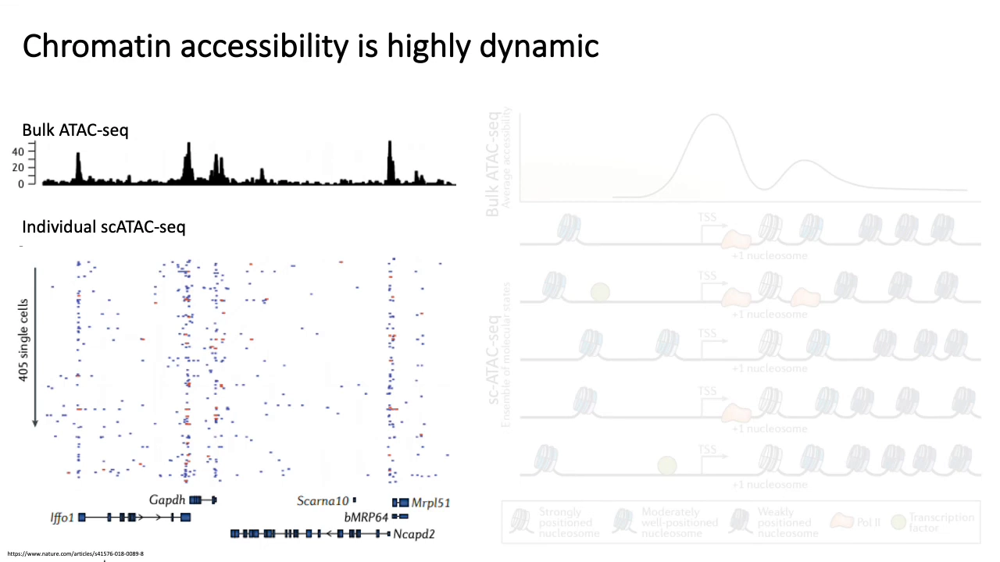

### 5.1 平均轨道上的峰，在单个细胞里是稀疏的点

左半张图分上下两块：

- **上：bulk ATAC-seq**。读段在多个基因的转录起始位点（TSS）上堆成清晰的峰 [【跳转到 14:54】](https://www.youtube.com/watch?v=BzyVK871wqg&t=894)；
- **下：405 个单细胞的 scATAC-seq**。每一行是一个细胞，每一列与 bulk 数据是同一个基因座。

单细胞那半张图给出的信息完全不同：**即使对这些组成型表达的管家基因，同一位点的可及性在细胞之间也有大量差异**——行与行之间明显不一样 [【跳转到 15:44】](https://www.youtube.com/watch?v=BzyVK871wqg&t=944)。

这正好印证了第一节留下的那个伏笔：**bulk 的峰是一个平均值**。峰高不代表「每个细胞都开着」，只代表「平均下来有这么多细胞／这么多时间开着」。把 bulk 峰读成「这个基因在所有细胞里都可及」，是把平均值当成了个体值。

### 5.2 同一个基因座上，不同位置的核小体「性格」不同

右半张图把左半张的观察翻译成了分子状态。上面那条曲线是 bulk ATAC 的平均可及性，下面五行是五个假想的单细胞状态，底部图例区分了**强定位**、**中等定位**、**弱定位**三种核小体，以及 Pol II 与 TF [【跳转到 16:17】](https://www.youtube.com/watch?v=BzyVK871wqg&t=977)。

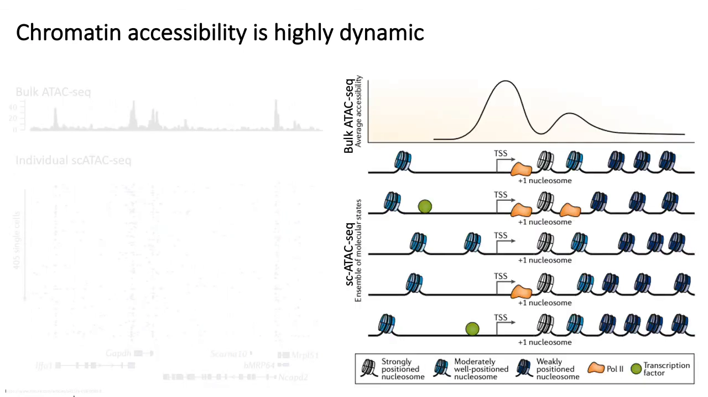

讲者从这张图里读出两条结论：

**第一，TSS 上游的核小体是「中等定位」的，而且比较稀疏。** 所谓中等定位，意思是核小体**没有完全固定在某个位置**，还会来回移动 [【跳转到 17:07】](https://www.youtube.com/watch?v=BzyVK871wqg&t=1027)。这与第一节的「允许态」对得上：上游区域确实有开放区（对应增强子或各种启动子元件），但仍然会有核小体占据那些**没有重要调控元件**的位置——因为这些位置本来就不需要一直露着 [【跳转到 17:32】](https://www.youtube.com/watch?v=BzyVK871wqg&t=1052)。

**第二，基因体内的核小体是「弱定位」的，容易被推开。** 讲者给的理由很直接：如果一个基因正在被活跃转录，RNA 聚合酶 II 就要从基因体上跑过去，核小体必须被推到一边，聚合酶才能通过 [【跳转到 17:57】](https://www.youtube.com/watch?v=BzyVK871wqg&t=1077)。

这一条给出了一个和前面都不同的因果方向：**转录本身也在改变可及性**。前面四条路径讲的都是「可及性怎么被打开、TF 怎么进来」，而这里说的是「转录一旦发生，聚合酶会把核小体挤走」。所以可及性、TF 结合、转录三者构成的是一个**闭环**，而不是一条单向的链：

```
        ┌──────────────────────────────────────────┐
        │                                          │
        ▼                                          │
   染色质可及  ──→  TF 结合  ──→  转录起始  ──→  Pol II 通过基因体
        ▲                                          │
        │                                          ▼
        └──── 重塑复合体被招募 / 核小体被推开 ◄──────┘
```

## 六、这条因果链的边界：可及性不等于转录

把全讲串起来之后，需要明确几条判读边界，否则很容易把「可及」读成「表达」。

**边界一：可及是必要条件，不是充分条件。** 一段 DNA 可及，只说明 TF 和聚合酶**进得去**；进得去之后是否真的结合、结合之后是否真的起始转录，还要看有没有对应的 TF、TF 是否被激活、以及染色质三维上这段增强子是否接触到了它的靶启动子（见 [§3.2.2 增强子—启动子关联](../../../README.md#b02-3-2-2)）。

**边界二：有峰不等于 TF 结合。** 第二节已经说明，ATAC 峰只说明酶能进去。第三节的足迹才是「有蛋白占着」的证据，而足迹本身又不告诉你蛋白的身份。

**边界三：可及性变化不能反推机制。** 看到某段在两种细胞之间可及性不同，无法判断是核小体被滑走了、被驱逐了、换了组蛋白变体，还是某个架构蛋白让出了位置——这几种机制在酶切信号上都表现为「峰变高」。要分辨机制，得看核小体占位（MNase）、特定修饰（ChIP/CUT&Tag）或直接扰动重塑复合体。

**边界四：可及性不必可遗传。** 讲者一开始就点明这一点。所以「某细胞类型的可及性图谱」是**状态描述**，不是「这套状态会被子细胞继承」的证明；跨分裂维持的问题属于 [§3.1.9 表观遗传继承](../../../README.md#b02-3-1-9)。

## 小结

- **可及性的定义是时间比例**：某段基因组有多大比例的时间没被核小体占着。正因为是比例，它必然是连续谱（关闭／允许／开放），也必然在 bulk 数据里表现为平均值。
- **允许态的存在说明「可及」不等于「TF 能结合」**：允许态下只有先锋因子进得去，普通 TF 仍然进不去。
- **三种酶切法测的是同一件事的不同侧面**：ATAC-seq 与 DNase-seq 测开放区（ATAC 更灵敏、起始量更低），MNase-seq 测核小体包裹区；MNase 的峰落在核小体**边界**而非中心，因为双端测序读的是片段两端。
- **足迹是可及性数据与 TF 结合之间最直接的接口**：TF 挡住酶切，在峰中间留下凹陷；足迹形状还能反映 TF 的大小与结合方式。但足迹只证明「有蛋白占着」，不证明「是哪个 TF」和「是否调控转录」。
- **可及性被重塑有四条路径**：与动态核小体竞争、与架构蛋白竞争、组成型开放增强子上的常驻 TF、先锋因子主动打开。前三条里可及性在前，第四条里可及性在后——**因果方向是双向的**。
- **bulk 的峰是平均值**：管家基因的 TSS 在 bulk 上有明显峰，但在 405 个单细胞里每个细胞都不一样。
- **转录本身也改变可及性**：基因体内的核小体是弱定位的，会被路过的 RNA 聚合酶 II 推开。可及性、TF 结合、转录构成闭环。
- **判读边界**：可及是必要条件而非充分条件；有峰不等于 TF 结合；可及性变化不能反推机制；可及性不必可遗传。

## 关键术语速查

| 术语 | 一句话解释 |
| --- | --- |
| 染色质可及性（chromatin accessibility） | 某段基因组未被核小体占据的时间比例，是一个 0 到 1 之间的连续量 |
| 允许态（permissive chromatin） | 介于关闭与开放之间、核小体排布稀疏的状态，只有先锋因子能结合 |
| 先锋因子（pioneer factor） | 能结合到含核小体区域、并招募重塑复合体主动打开染色质的转录因子 |
| 重塑复合体（chromatin remodeler） | 依赖 ATP 水解移动、驱逐核小体或更换组蛋白变体的蛋白机器 |
| 架构蛋白（architectural protein） | 非核小体、短暂结合在染色质上的蛋白，也会挡住转录因子 |
| ATAC-seq | 用预载接头的 Tn5 转座酶标记开放区并测序的方法 |
| DNase-seq | 用 DNase I 切开放区、得到 DNase I 超敏位点的方法 |
| MNase-seq | 用微球菌核酸酶切掉开放区、只测核小体包裹 DNA 的方法 |
| Tn5 足迹（footprinting） | 峰中间因蛋白占位而出现的读段凹陷，是蛋白占据该位点的证据 |
| 强／中等／弱定位核小体 | 核小体在群体中位置固定的程度；基因体内多为弱定位，易被聚合酶推开 |
