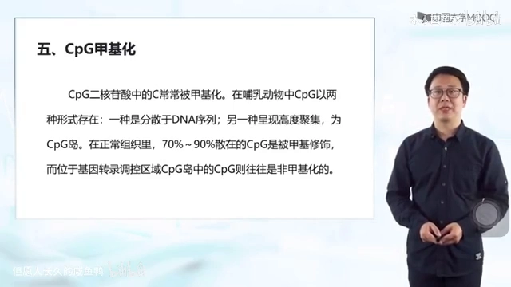
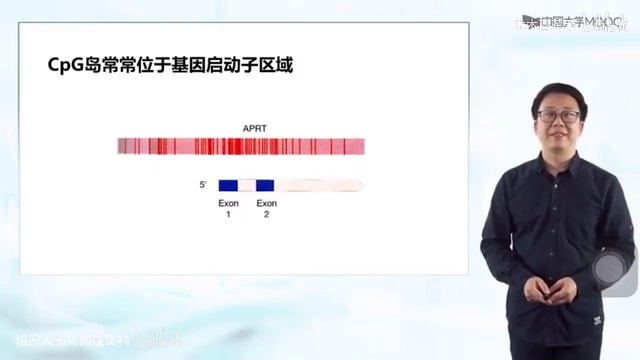
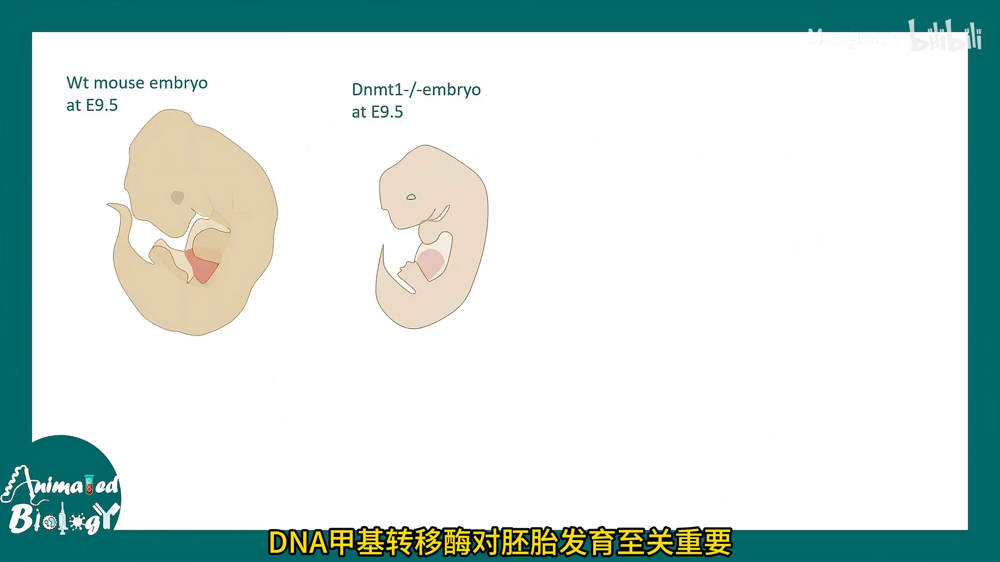
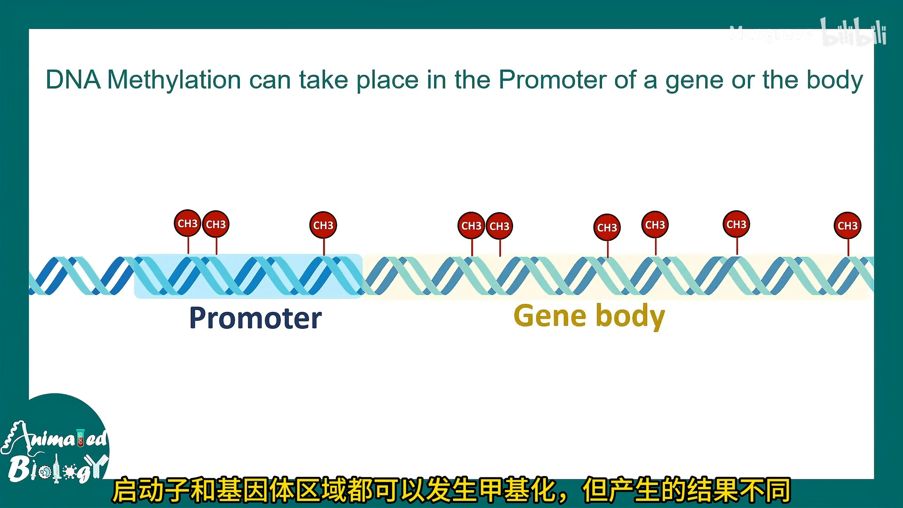
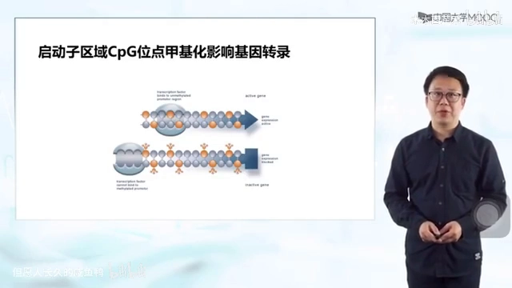
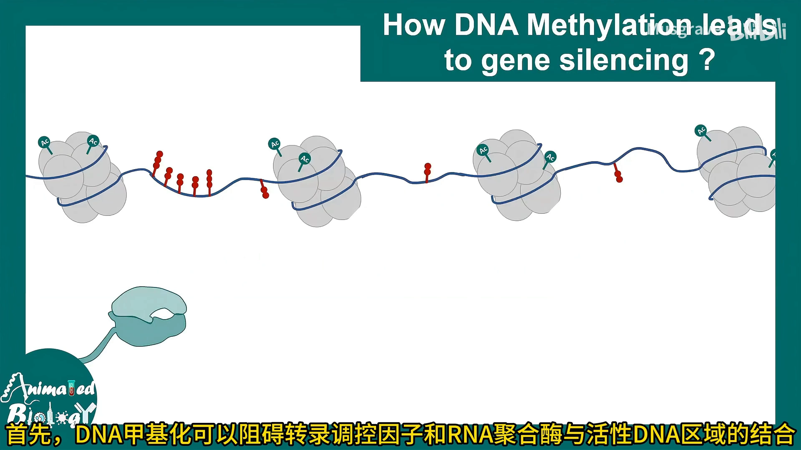
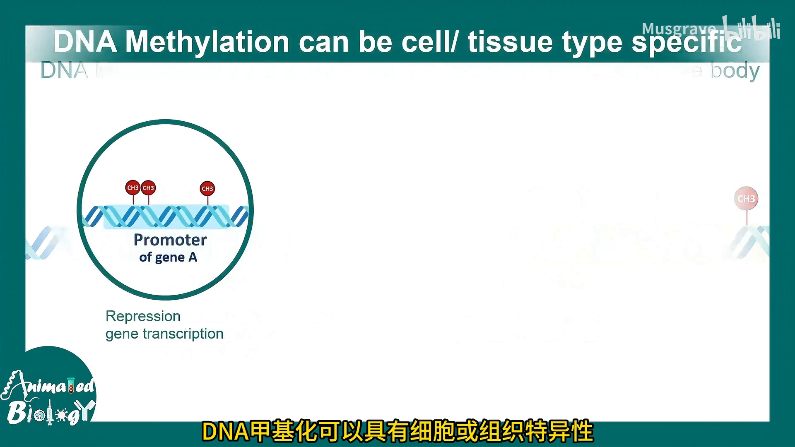
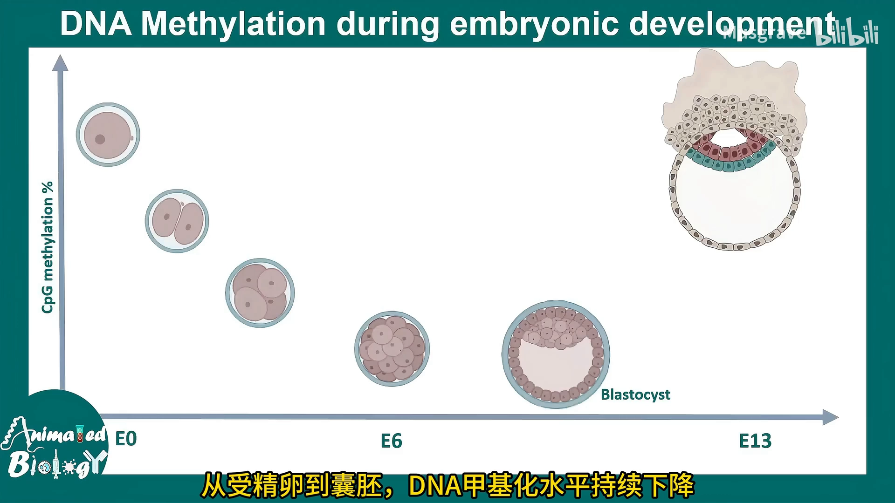
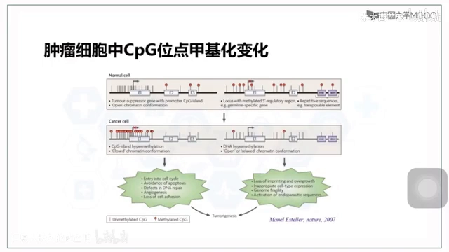

# DNA 甲基化：位置决定它抑制还是伴随转录

> 视频来源：[DNA甲基化](https://www.bilibili.com/video/BV1AbKb6BEoW/)（Bilibili · Musgrave，约 4 分钟）与 [DNA甲基化表观遗传学](https://www.bilibili.com/video/BV1gn4y1X7KP/)（Bilibili · 木木西芷禾，约 12 分钟）
> 导读（100 字以内）：两支视频互补：一支讲启动子与基因体的差别、细胞背景和发育动态；一支讲 CpG 岛分布、启动子抑制机制和肿瘤中的双向变化。本文把它们拼成一条判读原则——先看位置，再看细胞背景。

## 本讲要解决的核心问题（SCQA）

**背景**：DNA 甲基化是研究得最深入的表观遗传修饰之一。它通常发生在 CpG 二核苷酸的胞嘧啶上，形成 5-甲基胞嘧啶（5mC），不改变 DNA 序列，却能影响基因表达。很多入门材料会用一句话概括它：**甲基化让基因关闭**。

**冲突**：同一个 5mC 标记，出现在基因组的不同位置时，含义并不一样。启动子上的甲基化通常与转录抑制相关；基因体上的甲基化却常与**活跃转录**同时出现。同一个基因，在神经元里启动子可能没有甲基化、处于活跃状态，在成纤维细胞里却可能被甲基化而关闭。如果只记住“甲基化 = 关闭”，这些现象就无法解释。

**疑问**：读到一个甲基化位点时，究竟应该怎样判断它在做什么？

**回答（中心思想）**：**甲基化的意义由位置、细胞背景和发育阶段共同决定，不能只看“有没有甲基化”。** 启动子 CpG 岛的甲基化通常抑制转录；基因体甲基化与活跃转录相关；散在 CpG 和重复序列上的甲基化更多与基因组稳定有关。先问“在哪里、在什么细胞里”，再谈“开还是关”。

---

## 一、先看分布：CpG 不是均匀撒在基因组上的

[【跳转到 06:43】](https://www.bilibili.com/video/BV1gn4y1X7KP/?t=403)

哺乳动物的 DNA 甲基化主要发生在 CpG 位点：一个胞嘧啶后面紧跟一个鸟嘌呤，中间的 p 代表两者之间的磷酸基团。甲基加在胞嘧啶的第 5 位碳上，所以常写成 5mC。视频也提到，腺嘌呤和鸟嘌呤在某些情况下也能被甲基化，但本节讨论的主线是 CpG 上的 5mC。

CpG 在基因组里有两种很不一样的存在方式：

- **散在分布**：一个一个分散在序列中。在正常组织细胞里，这类 CpG 含量很多，而且**绝大多数是被甲基化的**；视频幻灯片给出的比例是 70%–90%。
- **高度聚集**：大量 CpG 集中在一小段区域，形成 **CpG 岛**（CpG island）。CpG 岛常出现在基因的启动子、第一外显子附近，长度大约几百个碱基到 1 kb。

[【跳转到 07:08】](https://www.bilibili.com/video/BV1gn4y1X7KP/?t=428)

这张幻灯片把最容易被忽略的对比写清楚了：**正常细胞并不是“到处都甲基化”，也不是“到处都不甲基化”**。散在 CpG 大多带甲基，CpG 岛在活跃基因的调控区反而大多不带甲基。甲基化的“默认状态”本身就随位置而变。

### 1.1 CpG 岛为什么总出现在启动子附近

[【跳转到 07:58】](https://www.bilibili.com/video/BV1gn4y1X7KP/?t=478)

视频用 APRT 基因作例子：把基因组上的 CpG 位点画成红色竖线，可以看到它们非常密集地集中在启动子区、第一外显子和第一内含子，而不是均匀铺满整个基因。

这解释了一个关键前提：**CpG 岛的位置本身就有调控含义**。它落在转录起始附近，所以这里的甲基化会直接碰到转录机器；如果同样的甲基化落在基因中间或重复序列里，遇到的“邻居”就完全不同。

### 1.2 重复序列与转座子：甲基化在这里更像“看门”

[【跳转到 01:35】](https://www.bilibili.com/video/BV1AbKb6BEoW/?t=95)

散在 CpG 的甲基化不只是一种“背景装饰”。视频提到，DNMT1 缺失会导致特定转座子不稳定，进而引发全基因组范围内的问题。也就是说，重复序列和转座子上的甲基化，主要作用之一是**压制这些序列的活动、维持基因组稳定**，而不是精细调节某一个基因的转录水平。

所以，看到“重复序列高度甲基化”时，不应直接翻译成“附近基因被关闭”。它更可能是在说：这段可能到处跳跃或复制的序列被压住了。

---

## 二、位置决定解读：启动子与基因体给出相反信号

[【跳转到 00:31】](https://www.bilibili.com/video/BV1AbKb6BEoW/?t=31)

这是本节最核心的一张图：启动子和基因体都可以发生甲基化，但产生的结果不同。

视频给出的概括是：

- **启动子 DNA 甲基化 → 基因转录抑制**；
- **基因体甲基化 → 与活跃转录相关**。

这两句话并不矛盾，因为它们描述的是两种不同的位置。可以把基因组想成一条街：启动子是 gene 的“门口”，基因体是“店内”。在门口堆东西会挡住顾客进门；在店内堆东西，反而可能说明这家店正在营业、货物很多。这个类比不精确，但能提醒我们：**同一个标记，位置不同，读法就不同。**

### 2.1 启动子上的甲基化怎样挡住转录

[【跳转到 08:23】](https://www.bilibili.com/video/BV1gn4y1X7KP/?t=503)

视频用一张示意图解释：当启动子区的 CpG 位点没有甲基化时，转录因子和辅助转录的蛋白可以顺利结合到转录起始区域，推动下游基因转录；当这些 CpG 被甲基化后，空间结构发生变化，转录因子无法结合，最终造成转录抑制。

[【跳转到 03:03】](https://www.bilibili.com/video/BV1AbKb6BEoW/?t=183)

另一支视频把机制讲得更完整。启动子甲基化导致基因沉默，至少有三种相互配合的方式：

1. **直接阻碍**转录调控因子和 RNA 聚合酶与活性 DNA 区域结合；
2. 招募 **MBD 蛋白**等甲基化 CpG 结合蛋白，再募集**组蛋白去乙酰化酶**，去掉乙酰化修饰，使染色质紧缩；
3. 招募特定的核小体重塑复合体和 **Polycomb 抑制复合体**，进一步压缩染色质，形成异染色质。

这里要注意一个层次关系：**甲基化是“标记”，染色质紧缩是“后果”**。标记本身不直接关掉基因，它通过改变谁能结合、染色质松不松，间接影响转录。这也解释了为什么同样的甲基化在不同位置上效果不同——它们招募到的“读者”不一样。

### 2.2 基因体甲基化为什么常和“正在转录”一起出现

视频只给了一个观察性结论：基因体甲基化与活跃转录相关，没有展开背后的机制。这个结论本身已经足够纠正“甲基化 = 关闭”的直觉：**一个基因正在被转录时，它的基因体反而可能带着更多甲基化。**

这提示我们，甲基化数据不能只按“甲基化水平高 = 表达低”来做全局相关。至少要先把位点分成启动子、基因体、重复序列几类，再分别看趋势。否则，两类方向相反的信号混在一起，很容易得出“甲基化和表达没关系”甚至相反的错误结论。

---

## 三、细胞背景：同一基因在不同细胞里可以不一样

[【跳转到 00:48】](https://www.bilibili.com/video/BV1AbKb6BEoW/?t=48)

视频用“基因 A”举了一个很具体的例子：

- 在**神经元**中，基因 A 的启动子没有被甲基化，基因处于活跃状态；
- 在**成纤维细胞和上皮细胞**中，基因 A 同样存在，但启动子被甲基化，基因因此被抑制。

这就是**组织特异性基因表达**的一种实现方式：不是把不需要的基因从 DNA 里删掉，而是在不同细胞里给同一个启动子写上不同的甲基化状态。所以，甲基化图谱本身就是细胞身份的一部分。

### 3.1 发育阶段：甲基化图谱先清空、再重建

[【跳转到 02:32】](https://www.bilibili.com/video/BV1AbKb6BEoW/?t=152)

视频还给出了一条时间轴：从受精卵到囊胚，DNA 甲基化水平持续下降；这主要是因为早期卵裂阶段维持性甲基转移酶 DNMT1 被排斥在细胞核之外。囊胚着床后，甲基化水平逐渐升高，最终在不同组织中建立起各自特异的甲基化图谱。

这张图把“细胞背景”拆成了两个维度：**空间上的细胞类型**和**时间上的发育阶段**。同一个细胞类型在不同发育阶段，甲基化图谱也可能不同；同一个发育阶段的不同组织，图谱也不一样。因此，比较两个样本的甲基化时，必须同时核对“是什么细胞”和“到什么阶段了”。

### 3.2 对读数据的直接后果

如果一份样本是多种细胞的混合物，那么测到的甲基化比例其实是不同细胞状态的加权平均。一个位点显示“50% 甲基化”，可能是每个细胞里都有一半的 DNA 分子带甲基，也可能是一半细胞全甲基化、一半细胞完全不甲基化。仅凭一个比例，无法区分这两种情况。这个“细胞混合”问题属于 3.1.6 的测量与解释范围，本节只先记住：**细胞背景不清，甲基化比例就不能直接翻译成开关状态。**

---

## 四、把“位置原则”用到真实数据：肿瘤里的双向变化

[【跳转到 09:13】](https://www.bilibili.com/video/BV1gn4y1X7KP/?t=553)

肿瘤是检验“位置决定解读”的最好例子，因为肿瘤细胞里并不是简单地“甲基化整体升高”或“整体降低”，而是**两类位置同时朝相反方向变化**。

视频的对比可以拆成两列：

| 位置 | 正常细胞 | 肿瘤细胞 | 后果 |
| --- | --- | --- | --- |
| 抑癌基因的启动子 CpG 岛 | 多为非甲基化，基因可表达 | 多为甲基化 | 抑癌基因沉默 |
| 散在 CpG 位点 | 多为甲基化 | 多为非甲基化 | 基因组不稳定 |

[【跳转到 10:02】](https://www.bilibili.com/video/BV1gn4y1X7KP/?t=602)

这张图值得反复看：**如果只统计全基因组的平均甲基化水平，这两类变化会互相抵消，甚至得出“肿瘤甲基化降低”的单一结论。** 但真正有功能意义的是位置：启动子 CpG 岛的高甲基化让抑癌基因沉默，散在 CpG 的低甲基化则与基因组不稳定相关。两者共同推动肿瘤发生发展。

这也解释了为什么甲基化生物标志物通常要指定“哪个基因的哪个区域”，而不是笼统报告“全基因组甲基化水平”。位置不是附注，位置就是结论的一部分。

---

## 五、边界：哪些话不能从这一节推出来

把上面的内容收束成几条判读规则，同时也划清这一节不负责的部分：

1. **“启动子甲基化抑制转录”是方向性概括，不是所有位点的定律。** 它主要适用于启动子、尤其是 CpG 岛附近的甲基化；基因体甲基化的关联方向相反，重复序列甲基化更多与稳定有关。
2. **“相关”不等于“因果”。** 视频说基因体甲基化与活跃转录相关，这是观察到的关联。要证明甲基化导致转录变化，需要酶干预、编辑或报告系统等因果实验，这属于 3.1.6 的范围。
3. **甲基化比例要先过测量关。** 亚硫酸氢盐读出、覆盖度、细胞混合、5mC 与 5hmC 的区分，都会影响你看到的数字。本节只讲“怎么解读位置”，不讲“怎么测出来”。
4. **维持机制不在这里展开。** 半甲基化识别、DNMT1 补甲基、DNMT3 从头写入、TET 去甲基化，已在 B01《DNA 甲基化的维持》中讲清；本节只需要知道这些机制决定了甲基化模式能否跨分裂保留。
5. **细胞背景必须一起报告。** 同一个基因在神经元和成纤维细胞里可以有不同的启动子状态；比较甲基化数据时，细胞类型、发育阶段、组织来源都是解读的一部分。

如果要把这一节压缩成一句话：**看到甲基化，先问“在哪里”，再问“在什么细胞里”，最后才问“开还是关”。**

---

## 小结

- 5mC 主要发生在 CpG 位点的胞嘧啶第 5 位碳上，不改变 DNA 序列。
- CpG 在基因组里有两种分布：散在 CpG（正常组织里大多被甲基化）和 CpG 岛（常位于启动子、第一外显子附近，活跃基因的调控区多保持非甲基化）。
- **位置决定解读**：启动子 CpG 岛甲基化通常抑制转录；基因体甲基化与活跃转录相关；重复序列/转座子甲基化更多与基因组稳定有关。
- 启动子甲基化通过阻碍转录因子和 RNA 聚合酶结合、招募 MBD 蛋白与组蛋白去乙酰化酶、压缩染色质等方式导致沉默。
- 甲基化具有细胞和组织特异性：同一基因在神经元与成纤维细胞中可以有不同的启动子状态；胚胎发育中甲基化图谱先下降、着床后重建，最终形成组织特异图谱。
- 肿瘤中同时出现启动子 CpG 岛高甲基化（抑癌基因沉默）与散在 CpG 低甲基化（基因组不稳定），说明不能只看全基因组平均甲基化。
- 边界：基因体甲基化与活跃转录是关联而非因果；测量、细胞混合与因果验证留给 3.1.6，维持机制见 B01。

## 关键术语速查

| 术语 | 一句话解释 |
| --- | --- |
| 5mC | 5-甲基胞嘧啶，胞嘧啶第 5 位碳被加上甲基后的形式，是哺乳动物 DNA 甲基化的主要形式 |
| CpG 位点 | 胞嘧啶后紧跟鸟嘌呤的二核苷酸位置，中间的 p 代表磷酸基团 |
| CpG 岛 | CpG 高度聚集的一段区域，常位于基因启动子、第一外显子附近 |
| 散在 CpG | 分散在基因组中的 CpG，正常组织里大多被甲基化，与基因组稳定有关 |
| 启动子甲基化 | 启动子区 CpG 被甲基化，通常阻碍转录因子结合并导致转录抑制 |
| 基因体甲基化 | 基因主体区域的甲基化，常与活跃转录相关，但机制未在本节展开 |
| MBD 蛋白 | 识别甲基化 CpG 的蛋白，可募集组蛋白去乙酰化酶等，使染色质紧缩 |
| 组蛋白去乙酰化酶 | 去除组蛋白乙酰化修饰的酶，使染色质更紧、转录更受抑制 |
| 组织特异性甲基化 | 同一基因在不同细胞/组织中有不同的甲基化状态，是细胞身份的一部分 |
| 启动子 CpG 岛高甲基化 | 肿瘤中常见的变化，导致抑癌基因沉默 |
| 散在 CpG 低甲基化 | 肿瘤中常见的变化，释放重复序列，导致基因组不稳定 |