# 组蛋白修饰与染色质状态：核小体上的标记、读写机制与因果证据

> 视频来源：[【油管搬运】快速入门表观遗传的绝佳讲座（含字幕）](https://www.bilibili.com/video/BV1GBQWYdEmi/)（B 站 · ZigZag实验室，约 39 分钟，英文讲座配中文字幕）｜[组蛋白修饰的研究策略](https://www.bilibili.com/video/BV1aM4y1m7ap/)（B 站 · 爱基百客，约 39 分钟）
> 导读：前一支把核小体结构、常见修饰、reader 与染色质状态讲成一条链；后一支补上 writer / eraser / reader 的术语、常见标记汇总表和一次阅读器扰动的案例。本文只取后一支的前 12 分钟，它后面的新型酰化修饰与公司介绍不在本节范围。

## 本讲要解决的核心问题（SCQA）

**背景**：真核 DNA 不是裸露的双螺旋，而是缠在组蛋白八聚体上形成核小体。转录因子和 RNA 聚合酶要读到 DNA 上的序列，前提是那段 DNA 露得出来。

**冲突**：同一个核小体上可以同时挂很多种化学修饰。H3K4me3 与 H3K9ac 出现在活跃启动子上，H3K27me3 与 H3K9me3 出现在被抑制的区域；可有些基因的启动子上，激活标记和抑制标记同时存在。更麻烦的是，ChIP-seq 能给出全基因组漂亮的标记图谱，让人很容易从「这个基因上有 H3K27me3」直接跳到「这个基因被 H3K27me3 关掉了」。

**疑问**：这些标记究竟改变了核小体的什么性质？谁把它们写上去、谁擦掉、谁读懂？一张染色质状态图能支持到哪一步结论，哪一步必须靠扰动实验？

**回答（中心思想）**：把三件事拆开看——**标记**是「在哪、有多少」的测量；**writer / eraser / reader** 是「怎么加上、怎么去掉、怎么被解释」的机制；**因果**是「扰动之后转录是否跟着变」的实验。核小体提供的是可及性这道门槛，修饰组合提供的是给不同蛋白准备的落脚点，染色质状态是这两件事在基因组上的分区结果。

## 一、核小体：转录模板的真实形态

### 1.1 146 bp 缠两圈，尾巴伸在外面

一个人类细胞里约有一米半长的基因组 DNA，要折进小小的细胞核，靠的就是**组蛋白**（histone）：DNA 缠在组蛋白上，每个「蛋白 + 缠绕的 DNA」单位叫一个**核小体**（nucleosome）。核小体的核心是组蛋白八聚体，外面缠着 **146 个碱基对的 DNA，绕了将近两圈**。[【跳转到 04:30】](https://www.bilibili.com/video/BV1GBQWYdEmi/?t=270)

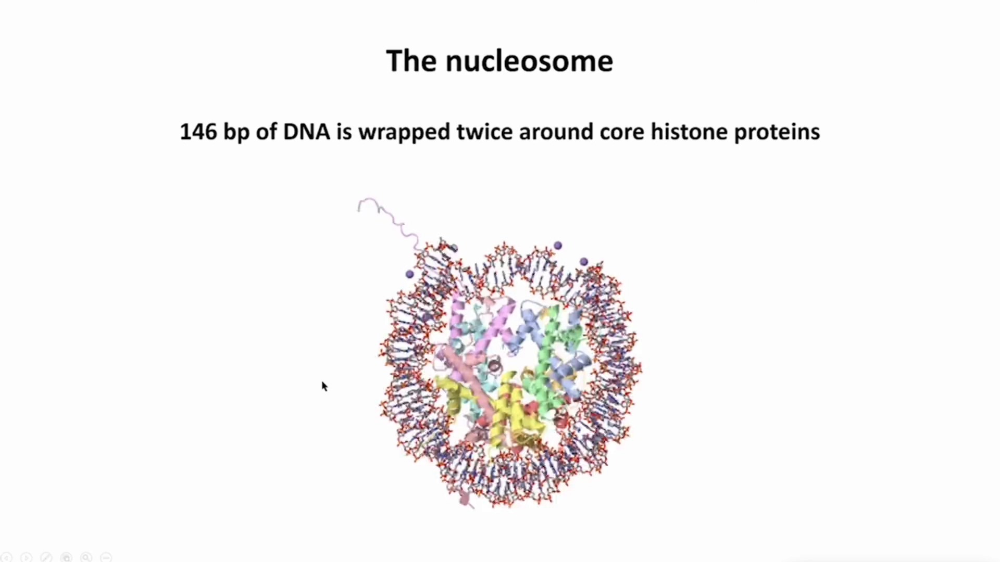

核心组蛋白有四种：**H2A、H2B、H3、H4**，每个核小体里每种各两份，共八个分子。它们都含一个保守的「组蛋白折叠」结构域，以及一条很长、没有固定结构的 **N 端尾巴**（和一条较短的 C 端尾巴）。组装时 H3 与 H4 先配对成二聚体、再形成四聚体，H2A 与 H2B 各自配对成二聚体，在 DNA 和组蛋白伴侣存在时拼成八聚体。[【跳转到 05:06】](https://www.bilibili.com/video/BV1GBQWYdEmi/?t=306)

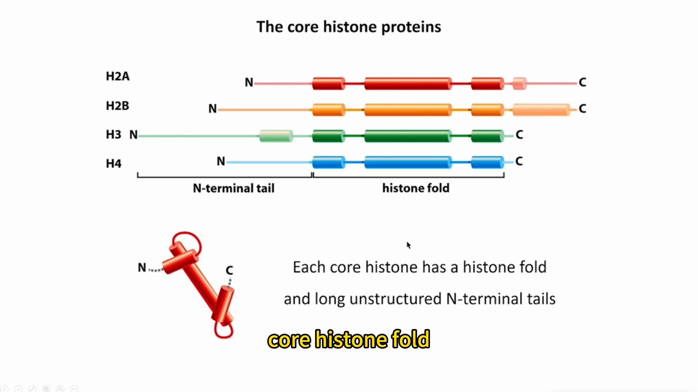

尾巴之所以重要，有两个原因。第一，它在 X 射线晶体结构里看不到，因为它是无序的，可以伸到核小体外面，够得着旁边的核小体。第二，它高度带正电，能和带负电的 DNA 骨架结合，也能贴到相邻核小体表面的酸性斑块上——讲者把它比作从核小体伸出来的**尼龙搭扣带**：既能把自己粘住，让核小体很稳定，也能粘住邻居，帮助染色质折叠。[【跳转到 06:21】](https://www.bilibili.com/video/BV1GBQWYdEmi/?t=381)

### 1.2 包装层级决定「够不够得着」

核小体只是第一层。核小体之间留出连接 DNA，排成「串珠」结构，这大致是正在转录的基因所处的开放状态；再往上，核小体彼此作用形成 30 nm 纤维，甚至更高级的结构，可及性逐级下降。[【跳转到 03:06】](https://www.bilibili.com/video/BV1GBQWYdEmi/?t=186)

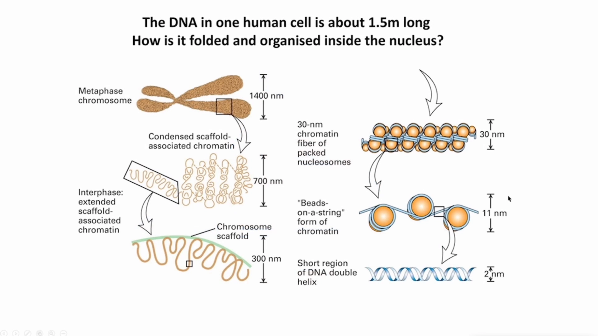

这里要留一个谨慎：**30 nm 纤维及更高级结构的具体构象仍是研究和争论的对象**，讲者展示的示意图是「预期会发生的方案」，不是已经定论的结构。[【跳转到 03:31】](https://www.bilibili.com/video/BV1GBQWYdEmi/?t=211) 对本书的用途来说，只需要记住一个方向：从高级结构走向串珠、甚至局部裸 DNA，可及性升高；反过来则降低。

### 1.3 尾巴是修饰的载体

组蛋白尾巴上可以发生多种**翻译后修饰**（post-translational modification，PTM）。讲座只列了与转录关系比较清楚的几类：**乙酰化（a）、磷酸化（p）、甲基化（m）、泛素化（u）**，并强调还有别的修饰类型和被修饰的残基，构成一套相当复杂的「修饰阵列」。[【跳转到 07:17】](https://www.bilibili.com/video/BV1GBQWYdEmi/?t=437)

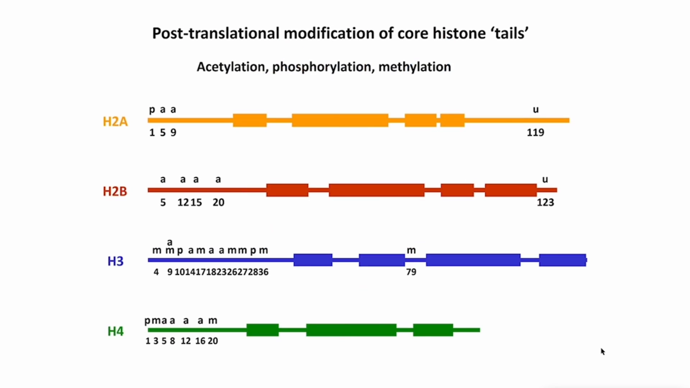

## 二、两类最常见的修饰：乙酰化改电荷，甲基化建位点

### 2.1 乙酰化：把正电荷中和掉

乙酰化发生在赖氨酸（K）残基上。赖氨酸的氨基在生理条件下带正电，一条尾巴上有多个赖氨酸，就有多个正电荷，可以和 DNA 的磷酸骨架、以及相邻核小体的酸性斑块结合。**组蛋白乙酰转移酶（HAT）** 用乙酰辅酶 A 提供乙酰基，加到赖氨酸上；乙酰化之后，这个赖氨酸变成中性，尾巴从「很粘的搭扣带」变成一条普通尾巴，与 DNA、与邻居的结合都被削弱，核小体变得更容易被破坏或移动。[【跳转到 08:02】](https://www.bilibili.com/video/BV1GBQWYdEmi/?t=482) [【跳转到 09:11】](https://www.bilibili.com/video/BV1GBQWYdEmi/?t=551)

**组蛋白去乙酰化酶（HDAC）** 催化相反反应，把乙酰基去掉。[【跳转到 10:01】](https://www.bilibili.com/video/BV1GBQWYdEmi/?t=601)

讲者给了一句很关键的判断：**在所有组蛋白修饰里，乙酰化是唯一直接改变染色质结构的**，因为它改变的是尾巴的电荷；其他修饰主要是通过招募蛋白来间接起作用。[【跳转到 10:10】](https://www.bilibili.com/video/BV1GBQWYdEmi/?t=610) 这句话解释了为什么乙酰化总与染色质开放、核小体不稳定、核小体更新加快联系在一起。[【跳转到 11:50】](https://www.bilibili.com/video/BV1GBQWYdEmi/?t=710)

### 2.2 甲基化：不改电荷，改身份

甲基化同样常发生在赖氨酸上（也可发生在精氨酸上，机制不同）。**组蛋白甲基转移酶（HMT）** 用 S-腺苷甲硫氨酸提供甲基，一个赖氨酸上可以加 **1 到 3 个甲基**，于是有未甲基化、单甲基化、双甲基化、三甲基化四种状态。与乙酰化不同，**加甲基不改变赖氨酸的电荷**。[【跳转到 12:06】](https://www.bilibili.com/video/BV1GBQWYdEmi/?t=726)

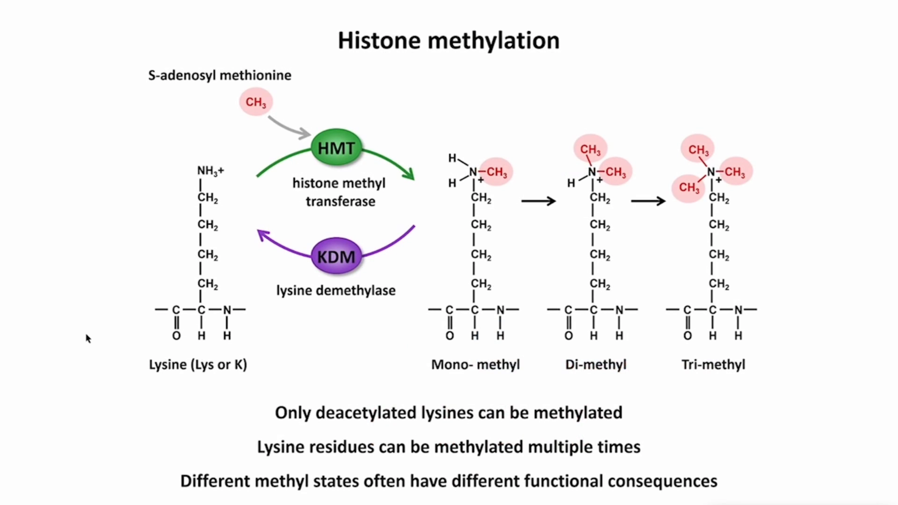

**赖氨酸去甲基化酶（KDM）** 负责去掉甲基。这些酶对「哪条组蛋白、哪个赖氨酸、几个甲基」往往有特异性：有的只做单甲基化，有的只做三甲基化，有的三甲基化酶只认单甲基化的底物。[【跳转到 13:21】](https://www.bilibili.com/video/BV1GBQWYdEmi/?t=801)

### 2.3 命名法：H3K27me3 这串字符怎么读

组蛋白修饰的标准写法是「组蛋白名 + 氨基酸单字母 + 位置数字 + 修饰类型 + 甲基数」。例如 **H3K4me3** = 组蛋白 H3 第 4 位赖氨酸（K）三甲基化；**H3K27ac** = H3 第 27 位赖氨酸乙酰化；**H3K9me3** = H3 第 9 位赖氨酸三甲基化。[【跳转到 09:07】](https://www.bilibili.com/video/BV1aM4y1m7ap/?t=547)

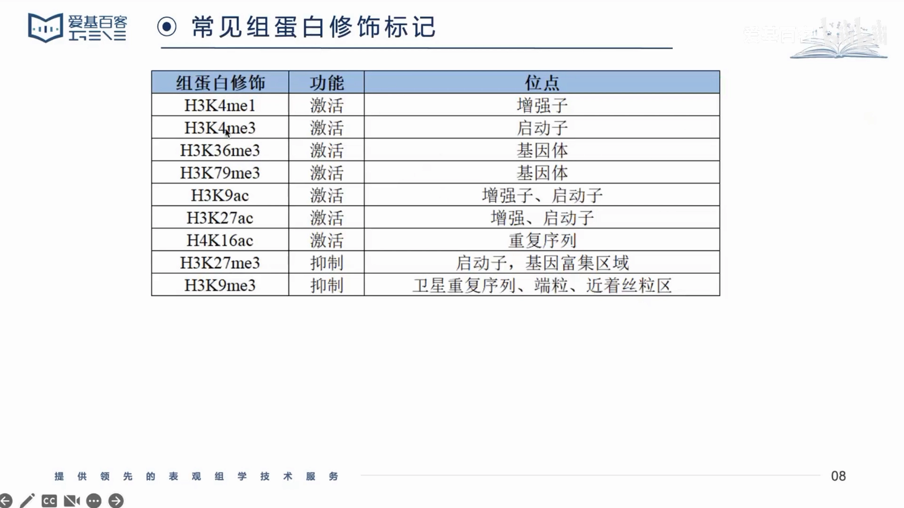

### 2.4 互斥：乙酰化的赖氨酸不能再被甲基化

同一个赖氨酸不能同时被乙酰化和甲基化：**只有去乙酰化的赖氨酸才能被甲基转移酶识别**，如果那里已经挂了乙酰基，甲基转移酶就无法工作。[【跳转到 13:46】](https://www.bilibili.com/video/BV1GBQWYdEmi/?t=826) 这带来一个实用推论：同一残基上的乙酰化与甲基化是竞争关系，读图时看到 H3K27ac 强，往往意味着同一位置的 H3K27me3 不会同时强。

## 三、标记的意义由 reader 决定

### 3.1 溴结构域读乙酰化

乙酰化除了改电荷，还**创造了新的结合位点**。含**溴结构域（bromodomain）** 的蛋白能特异识别乙酰化赖氨酸，而且认得比较细：有的溴结构域结合第 9 位乙酰化赖氨酸，有的结合第 18 位。溴结构域出现在共激活蛋白、组蛋白乙酰转移酶本身，也出现在 SWI/SNF 染色质重塑复合体里。[【跳转到 10:35】](https://www.bilibili.com/video/BV1GBQWYdEmi/?t=635)

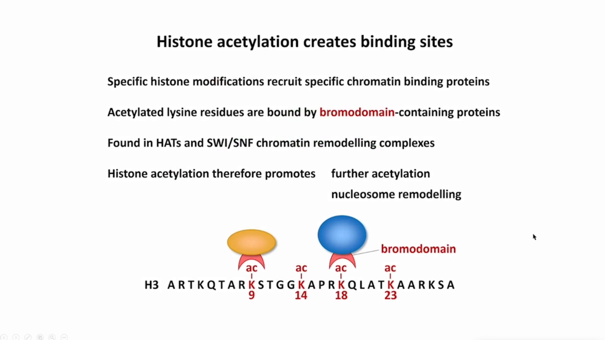

这形成一个正反馈：乙酰化一个残基，会招募带溴结构域的 HAT 来乙酰化下一个残基，逐步形成**超乙酰化**，把整条尾巴的电荷中和掉；同时招募来的重塑复合体可以破坏核小体或在 DNA 上滑动核小体。[【跳转到 11:00】](https://www.bilibili.com/video/BV1GBQWYdEmi/?t=660) [【跳转到 11:25】](https://www.bilibili.com/video/BV1GBQWYdEmi/?t=685)

### 3.2 染色质结构域读甲基化

甲基化不改变电荷，它的作用几乎全靠招募蛋白。识别甲基化赖氨酸的常见模块是**染色质结构域（chromodomain）**，此外还有 PHD 指、Tudor 结构域等。[【跳转到 16:09】](https://www.bilibili.com/video/BV1GBQWYdEmi/?t=969)

**激活方向**：H3K4me3 由 SET1（也叫 KMT2F/G，人类有 12 种酶能甲基化 H3K4）写入；含染色质结构域的 **CHD1** 是转录相关的染色质重塑酶，专门结合三甲基化的 H3K4，被招募到活跃启动子上。含 PHD 指或 Tudor 结构域的共激活因子也走这条路。[【跳转到 16:15】](https://www.bilibili.com/video/BV1GBQWYdEmi/?t=975) [【跳转到 16:40】](https://www.bilibili.com/video/BV1GBQWYdEmi/?t=1000)

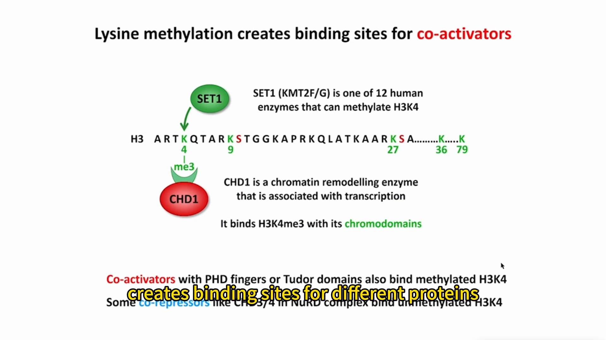

**抑制方向**：H3K9me3 由 KMT1A（旧名 Suv39h，人类有 7 种酶能写这个位点）写入，被 **HP1** 的染色质结构域识别，导向异染色质沉默；H3K27me3 由 **PRC2** 复合体（含 KMT6/EZH2、SUZ12、ESC）写入，被 **PRC1** 复合体里的 PC1 识别，形成 Polycomb 沉默，这是一种可遗传性很强的抑制形式。[【跳转到 18:08】](https://www.bilibili.com/video/BV1GBQWYdEmi/?t=1088) [【跳转到 18:33】](https://www.bilibili.com/video/BV1GBQWYdEmi/?t=1113)

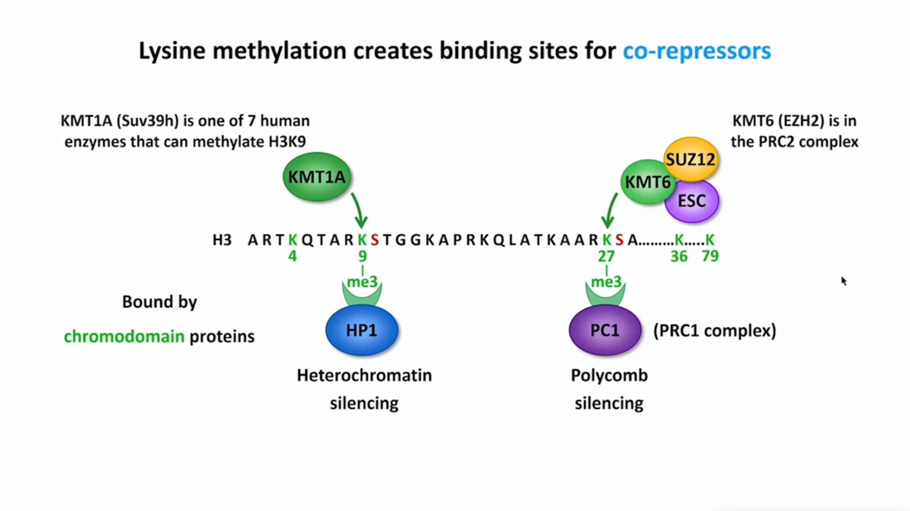

### 3.3 未甲基化本身也是一种「可读」的状态

同一个位点，甲基化程度不同，读出的蛋白就不同，甚至方向相反。H3K4 三甲基化招募 CHD1 这类共激活因子；而 **NuRD 复合体**里的 CHD3、CHD4 只能在 H3K4 **没有甲基化**时结合同一条尾巴，NuRD 是一个很强的共抑制复合体。[【跳转到 17:05】](https://www.bilibili.com/video/BV1GBQWYdEmi/?t=1025)

这解释了讲者反复强调的一句话：**组蛋白甲基化本身不预测会发生什么，重要的是哪个赖氨酸、几个甲基**。[【跳转到 14:11】](https://www.bilibili.com/video/BV1GBQWYdEmi/?t=851) 同样是 H3 上的赖氨酸甲基化，H3K4me3 与 H3K79me2 关联活跃启动子，H3K4me1 更关联增强子，H3K36me3 关联转录延伸（出现在基因体和 3' 端，不在启动子），H3K9me3 与 H3K27me3 则分别对应异染色质与 Polycomb 沉默。[【跳转到 14:29】](https://www.bilibili.com/video/BV1GBQWYdEmi/?t=869) [【跳转到 15:44】](https://www.bilibili.com/video/BV1GBQWYdEmi/?t=944)

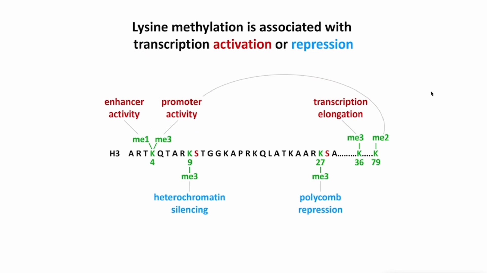

## 四、七个核心标记与染色质状态

### 4.1 七个标记各自对应哪一段转录事件

已知的组蛋白修饰和对应酶多到令人眼花，讲者给初学者的建议是：先只记 **7 个位于 H3 尾部、与全基因组主要转录事件相关的核心修饰**，其余先放一边。[【跳转到 21:41】](https://www.bilibili.com/video/BV1GBQWYdEmi/?t=1301)

| 标记 | 对应的转录事件 | 主要位置 |
| --- | --- | --- |
| H3K9ac | 活跃启动子 | 启动子 |
| H3K4me3 | 活跃启动子 | 启动子 |
| H3K4me1 | 增强子（启动子也有信号） | 增强子 |
| H3K27ac | 增强子（启动子也有信号） | 增强子、启动子 |
| H3K36me3 | 转录延伸 | 基因体 |
| H3K27me3 | Polycomb 沉默 | 被沉默的启动子 |
| H3K9me3 | 异染色质沉默 | 重复序列、着丝粒周围等 |

表的内容来自讲者的总结。[【跳转到 21:57】](https://www.bilibili.com/video/BV1GBQWYdEmi/?t=1317) 这里有一个必须记住的限制：**目前没有很好的增强子特异标记**。H3K4me1 与 H3K27ac 在启动子上也有信号，所以判断一段信号是增强子还是启动子，要把它和基因注释、转录起始位点的注释放在一起比对，而不是只看单个标记。[【跳转到 22:22】](https://www.bilibili.com/video/BV1GBQWYdEmi/?t=1342)

### 4.2 用 ChIP-seq 加隐马尔可夫模型把基因组分区

把上面 7 个标记在全基因组做 **ChIP-seq**（把带某种修饰的 DNA 片段富集出来再测序，得到修饰与序列的对应关系），再用**隐马尔可夫模型（HMM）** 把这些剖面整合起来，就能把基因组的每一段判成一种**染色质状态**。Roadmap Epigenomics 联盟在 **118 种人类细胞类型**（以原代细胞为主，少量常用细胞系）里做了这件事，最多可以分出 **25 种状态**，并做成不同颜色的基因组浏览器轨道。[【跳转到 23:37】](https://www.bilibili.com/video/BV1GBQWYdEmi/?t=1417) [【跳转到 24:02】](https://www.bilibili.com/video/BV1GBQWYdEmi/?t=1442)

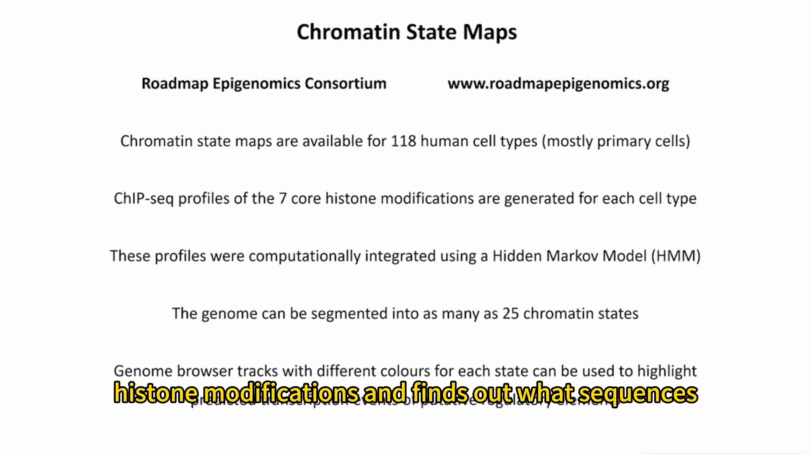

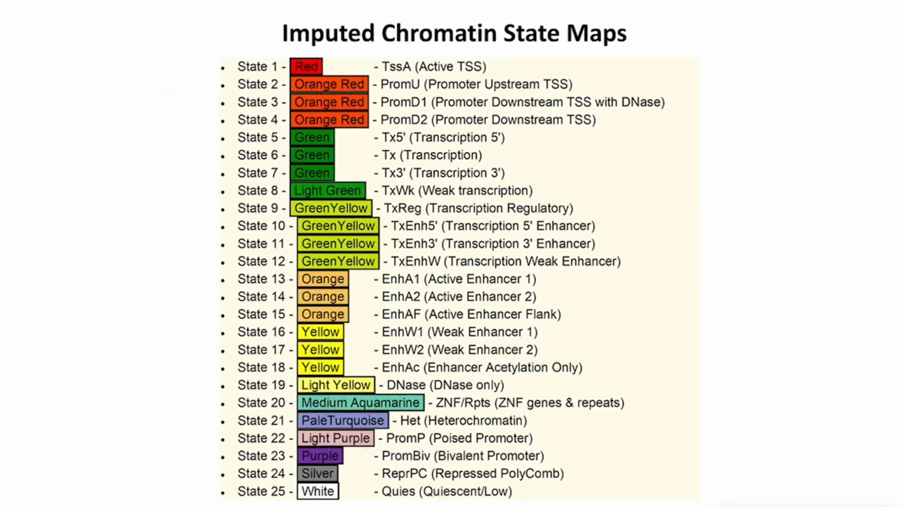

这张表本身就是一份「标记组合 → 状态」的字典：红色系是活跃启动子，绿色系是转录延伸，黄橙色系是增强子，青绿色是异染色质，浅紫是**预备启动子**（上面有聚合酶但还没开始转录），紫色与灰色是 Polycomb 相关状态。[【跳转到 25:03】](https://www.bilibili.com/video/BV1GBQWYdEmi/?t=1503)

### 4.3 二价启动子：同时挂着「开」和「关」

25 种状态里有一个特别值得注意：**二价启动子（bivalent promoter）**，同一段启动子上同时有 Polycomb 的 H3K27me3 和活跃启动子的 H3K4me3。这种状态通常只出现在干细胞里，这些基因当前是活跃的（表达量很低），但它们在「听着、等着」，准备决定是继续活跃还是彻底被 Polycomb 抑制。二价状态是一种预设，让基因对信号高度敏感。[【跳转到 25:28】](https://www.bilibili.com/video/BV1GBQWYdEmi/?t=1528)

这也直接回答了「为什么不能看到一个标记就下结论」：二价启动子上同时有激活标记和抑制标记，单看任何一个都会读错。

## 五、同一套标记在不同细胞里讲不同的故事

### 5.1 HoxB 基因座：干细胞里几乎全是二价

讲者用 **HoxB 簇**（位于 17 号染色体，约 135 kb，包含 HoxB1 到 HoxB9 等基因）做实例。Hox 基因编码强大的转录因子，决定胚胎的体型模式，因此必须在错误的组织里被表观机制沉默。[【跳转到 01:09】](https://www.bilibili.com/video/BV1GBQWYdEmi/?t=69) [【跳转到 26:32】](https://www.bilibili.com/video/BV1GBQWYdEmi/?t=1592)

在胚胎干细胞或 iPS 细胞里，体型模式还没开始决定，这些基因既没被定成「表达」也没被定成「沉默」，所以整个基因座（启动子和调控元件）布满二价标记——图上是大片紫色。这些基因以极低水平表达，在等待信号。[【跳转到 28:10】](https://www.bilibili.com/video/BV1GBQWYdEmi/?t=1690)

到了已经做出决定的体细胞，图谱就分化了：皮肤等外胚层组织里 HoxB 基因座大范围表达；脑里几乎没有表达（也许只有一点 HoxB2）；内胚层组织各有不同程度的表达；骨骼肌只延伸到 HoxB2 和 HoxB3 就停住，之后又回到 Polycomb 抑制的紫色；血液等中胚层组织表达范围更短，集中在基因座一端。[【跳转到 29:00】](https://www.bilibili.com/video/BV1GBQWYdEmi/?t=1740) [【跳转到 30:22】](https://www.bilibili.com/video/BV1GBQWYdEmi/?t=1822)

### 5.2 两个体细胞类型的对照

讲者把 ChIP-seq 原始数据和染色质状态图叠在一起看，选了两个细胞类型：

- **造血干细胞**：RNA 读段清楚显示 HoxB2、HoxB3 表达，HoxB4、HoxB5 低水平，之后逐渐消失；染色质状态图从红、黄、绿（启动子与延伸）一直延伸到 HoxB6，再往后变成紫灰（二价与抑制）。H3K36me3 的信号位置与 RNA 基本一致；H3K27me3 则积累在 HoxB7、HoxB8、HoxB9 上，并向前侵入一段后停住，与转录停止的位置吻合。[【跳转到 30:51】](https://www.bilibili.com/video/BV1GBQWYdEmi/?t=1851) [【跳转到 32:06】](https://www.bilibili.com/video/BV1GBQWYdEmi/?t=1926)
- **乳腺肌上皮细胞**：只看到 HoxB2、HoxB3 的转录；H3K36me3 的 ChIP-seq 质量不算好，但在 B2、B3 区域仍能看到信号；H3K4me3 在 HoxB2 上很好，其他地方很差；而 H3K27me3 与造血干细胞**完全不同**——不再局限于 B7–B9，而是向基因座更远处广泛铺开，与状态图上的大片紫灰一致。[【跳转到 32:56】](https://www.bilibili.com/video/BV1GBQWYdEmi/?t=1976) [【跳转到 33:46】](https://www.bilibili.com/video/BV1GBQWYdEmi/?t=2026)

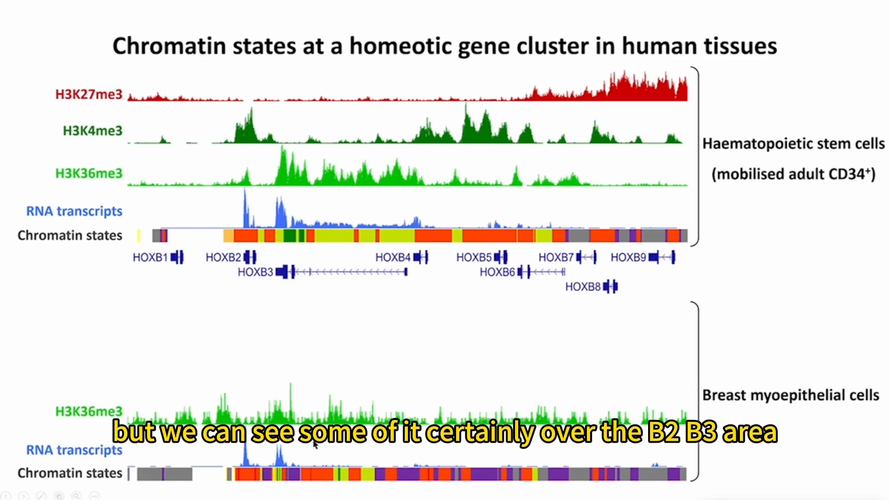

讲者还提醒了一个容易误读的细节：造血干细胞里启动子活性标记的峰比 RNA 多，是因为这个基因座存在**反义转录**，图里没有画出来。[【跳转到 32:31】](https://www.bilibili.com/video/BV1GBQWYdEmi/?t=1951) 也就是说，峰多不等于「这些基因都在正向表达」。

### 5.3 平均基因的三种剖面

把全基因组所有基因对齐取平均，可以得到三类典型剖面。[【跳转到 34:36】](https://www.bilibili.com/video/BV1GBQWYdEmi/?t=2076)

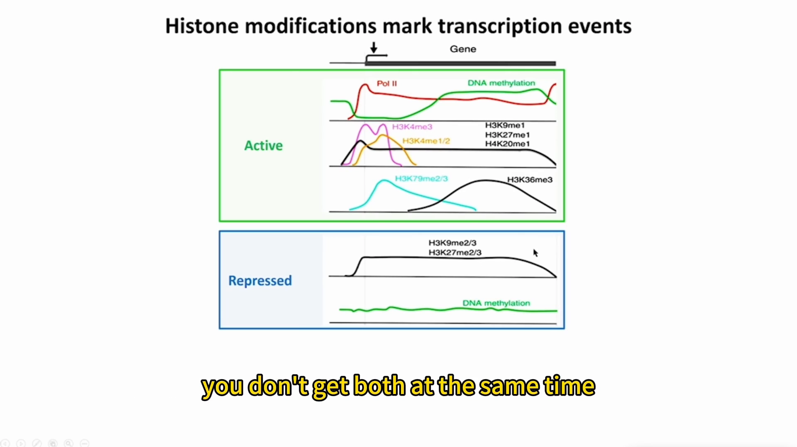

- **活跃基因**：RNA 聚合酶 II 在启动子处积累，延伸时穿过基因体，在 3' 端堆积等待终止；启动子处 DNA 甲基化通常较低（基因 5' 端常去甲基化），基因间区甲基化较高，正在转录的基因体也有 DNA 甲基化；启动子高度富集 H3K4me3，H3K4me1/me2 较低（常是写三甲基化的酶的副产物）；基因体有中等水平的单甲基标记，5' 端附近有 H3K79me2/3，基因体后段富集 H3K36me3。[【跳转到 35:06】](https://www.bilibili.com/video/BV1GBQWYdEmi/?t=2106)
- **抑制基因**：启动子缺少活跃标记，也没有聚合酶；DNA 甲基化整体低而平坦；基因体富集 **H3K9me2/3 或 H3K27me2/3**，而且通常是其中一种，不会两种同时出现。[【跳转到 36:46】](https://www.bilibili.com/video/BV1GBQWYdEmi/?t=2206) [【跳转到 37:11】](https://www.bilibili.com/video/BV1GBQWYdEmi/?t=2231)
- **预备（poised）基因**：看起来有点像活跃基因，启动子上有活跃标记、也有聚合酶，但聚合酶没有被允许延伸，所以看不到延伸标记的富集；很多情况下能找到 H3K27me3，正是它让聚合酶停在那里。这种基因随时可以转录，也可能彻底变成 Polycomb 沉默位点。[【跳转到 37:36】](https://www.bilibili.com/video/BV1GBQWYdEmi/?t=2256)

## 六、writer / eraser / reader：把标记放回机制

### 6.1 三类蛋白的分工

第二支视频把组蛋白修饰的调控蛋白分成三类，这是本节最该记住的框架：[【跳转到 03:33】](https://www.bilibili.com/video/BV1aM4y1m7ap/?t=213)

| 类别 | 中文 | 做什么 | 常见例子 |
| --- | --- | --- | --- |
| writer | 书写器 | 给组蛋白加上修饰基团 | 组蛋白乙酰转移酶（HAT）、组蛋白甲基转移酶（HMT） |
| eraser | 擦除器 | 去掉修饰基团 | 组蛋白去乙酰化酶（HDAC）、赖氨酸去甲基化酶（KDM） |
| reader | 阅读器 | 识别修饰，把信息传到下游，调控转录 | 溴结构域、染色质结构域、PHD 指、Tudor、YEATS 等结构域所在的蛋白 |

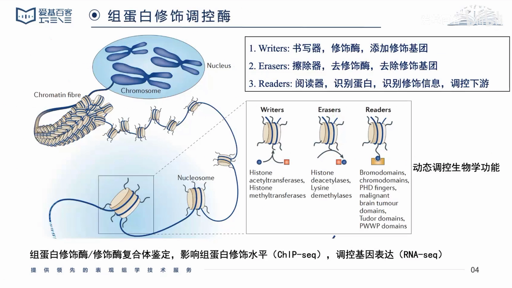

writer 与 eraser 之间的动态加、减，决定了某个位点上标记的水平；reader 决定这个标记被解释成什么。三者合起来，才构成「标记 → 染色质结构 → 转录」的完整通路。讲者把这条通路总结成一句研究思路：**鉴定修饰酶或修饰酶复合体 → 用 ChIP-seq 评估它对修饰水平的影响 → 联合转录组分析它对基因表达的调控**。[【跳转到 04:58】](https://www.bilibili.com/video/BV1aM4y1m7ap/?t=298)

修饰的作用方式可以分直接和间接两种：直接作用是修饰改变染色质结构（乙酰化中和电荷，使紧密的染色质变松散，暴露转录因子结合位点）；间接作用是通过前面提到的 reader 蛋白或染色质重塑因子，去调控其他基因的表达。[【跳转到 05:15】](https://www.bilibili.com/video/BV1aM4y1m7ap/?t=315)

### 6.2 动态可逆，所以是药物靶点

因为 writer 和 eraser 介导的修饰是动态、可逆的，这些修饰和相应蛋白就成了理想的药物靶标。[【跳转到 10:27】](https://www.bilibili.com/video/BV1aM4y1m7ap/?t=627) 这句话是下一节「因果证据」的入口：可逆意味着可以扰动，扰动才谈得上因果。

## 七、标记、机制与因果：三种证据不要混着用

### 7.1 第一层：标记与转录的相关

ChIP-seq 给出的是「某个标记在某段 DNA 上富集多少」，把它和 RNA-seq 的表达量并排看，得到的是**相关**。HoxB 的例子就是标准做法：H3K36me3 的位置与 RNA 读段一致，H3K27me3 的边界与转录停止的位置吻合。[【跳转到 32:06】](https://www.bilibili.com/video/BV1GBQWYdEmi/?t=1926)

相关很有用，但它有两个方向都可能的解释：标记可能**导致**转录，也可能是**转录的结果**。H3K36me3 出现在正在延伸的基因体上，就是典型的「转录进行中的伴随标记」；H3K4me3 在活跃启动子上富集，也不能仅凭共现判断先后。[【跳转到 14:54】](https://www.bilibili.com/video/BV1GBQWYdEmi/?t=894)

### 7.2 第二层：读写机制说明标记「如何」起作用

机制证据回答的是「如果这个标记有作用，它是通过什么起作用的」。这一层的证据是 reader：乙酰化赖氨酸被溴结构域识别，把 HAT 和 SWI/SNF 招募过来；H3K4me3 被 CHD1 识别；H3K9me3 被 HP1 识别；H3K27me3 被 PRC1 识别。[【跳转到 16:40】](https://www.bilibili.com/video/BV1GBQWYdEmi/?t=1000) [【跳转到 18:33】](https://www.bilibili.com/video/BV1GBQWYdEmi/?t=1113)

机制让「标记 → 结果」这条路变得可信，也指出了扰动实验该打哪里（写酶的活性、擦酶的活性、reader 的结合面）。但机制本身仍不是「在这个基因座上，这个标记确实决定了转录」的证据。

### 7.3 第三层：扰动实验才谈因果

要谈因果，至少要动一个环节，并看到下游跟着变。按第二支视频给出的研究链条，一次完整的因果检验包含三步：[【跳转到 04:58】](https://www.bilibili.com/video/BV1aM4y1m7ap/?t=298)

1. **扰动 writer 或 eraser**（改变酶的量或活性）；
2. **测标记**（ChIP-seq 看目标位点的修饰水平是否真的变了）；
3. **测转录**（RNA-seq 看表达是否随之改变）。

三步缺一不可。只做第 1 步和第 3 步，无法排除酶还改了别的标记或别的通路；只做第 2 步，只证明标记变了，没证明转录变了。判读时还要问一句：扰动后标记的变化与表达的变化是否**同向、同一位点**。

### 7.4 一次阅读器扰动：ENL 抑制剂

第二支视频给了一个扰动 reader 的实例。ENL 是急性髓细胞白血病的关键依赖蛋白，它含 **YEATS 结构域**，能识别组蛋白赖氨酸上的酰化（包括乙酰化和巴豆酰化）。研究者做了一个小分子抑制剂 **TDI-11055**，阻断 YEATS 结构域与酰化组蛋白的相互作用，然后用 ChIP-seq、RNA-seq、ChIP-qPCR 读出结果：ENL 从靶基因（包括白血病相关基因 MYC 和 HOXA 簇）上大量转移；同时，**细胞里 ENL 蛋白的整体水平并没有下降**。[【跳转到 11:01】](https://www.bilibili.com/video/BV1aM4y1m7ap/?t=661) [【跳转到 11:26】](https://www.bilibili.com/video/BV1aM4y1m7ap/?t=686) [【跳转到 11:51】](https://www.bilibili.com/video/BV1aM4y1m7ap/?t=711)

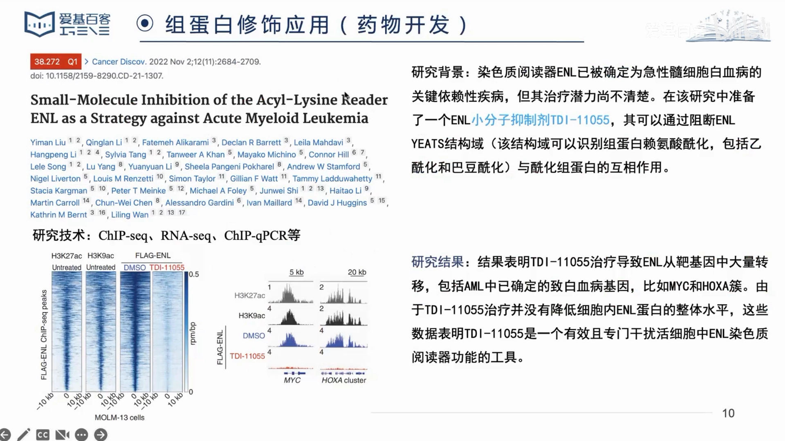

这个案例的教学价值在于对照设计：「蛋白总量没有下降」这一条排除了「ENL 只是被降解了」的替代解释，把效应定位到**阅读器功能**被干扰，而不是蛋白消失。讲者据此判断 TDI-11055 是有效且专门干扰活细胞中 ENL 染色质阅读器功能的工具。[【跳转到 12:16】](https://www.bilibili.com/video/BV1aM4y1m7ap/?t=736)

但要注意它证明的边界：它证明的是**读这一步**在该细胞里是必要的，不等于证明「某个具体标记本身」因果。要主张标记本身因果，还得回到 7.3 的写酶/擦酶扰动，并检查标记水平与表达变化是否对得上。

### 7.5 判读清单

拿到一个「某基因上有某标记」的结论时，按顺序问五个问题：

1. **位置**：这个标记在启动子、增强子、基因体还是重复序列？同一个标记在不同位置含义不同（H3K4me1 偏增强子，H3K4me3 偏启动子，H3K36me3 在基因体）。
2. **细胞背景**：这是哪种细胞、什么状态？HoxB 在干细胞里是二价，在体细胞里已经分化成明确的表达/沉默区。
3. **甲基化程度与家族成员**：是 me1、me2 还是 me3？是 H3K9me3 还是 H3K27me3？同一残基不同甲基数、同一家族不同位点，读出的蛋白完全不同。
4. **有没有 reader 机制**：这个标记在这里能招募什么蛋白？如果找不到合理的 reader，机制解释就是空的。
5. **有没有扰动证据**：动过 writer、eraser 或 reader 吗？扰动后标记和转录是否同向变化？只有相关和机制，就只能说到「与……一致」。

## 八、本节边界

- **染色质重塑复合体**（SWI/SNF 等如何滑动、驱逐、替换核小体）属于 [§3.1.8](../../../README.md#b02-3-1-8)。本文提到 SWI/SNF、CHD1 时只把它们当作「被 reader 招募来的效应器」，不展开重塑机制。
- **DNA 甲基化**的位置解读与证据判读属于 [§3.1.5](../3.1.5_DNA%20甲基化：位置、细胞背景与转录关系/DNA甲基化：位置决定它抑制还是伴随转录.md) 与 [§3.1.6](../../../README.md#b02-3-1-6)。本文只在「平均基因剖面」里用一句带过 DNA 甲基化的分布。
- **表观遗传继承**（印记、X 失活、跨分裂维持）属于 [§3.1.9](../../../README.md#b02-3-1-9)。本文提到 Polycomb 沉默「可遗传性强」时，只作为 H3K27me3 的一个性质，不展开继承机制。
- **三维基因组**（区室、拓扑域、增强子—启动子接触）属于 [§3.2.1](../../../README.md#b02-3-2-1) 与 [§3.2.2](../../../README.md#b02-3-2-2)。
- **ChIP-seq / CUT&Tag 的建库、抗体、peak calling 与归一化**属于 [B04 §1.2.5](../../../../B04_细胞与组学测量基础/1_细胞身份、状态与组学测量/1.2_分子层次/1.2.5_ChIP-seq%20与%20CUT&Tag：蛋白—DNA%20结合与组蛋白修饰测量/CUT&Tag报告解读：峰高、峰长、峰位置与关联基因.md)。本文只把 ChIP-seq 当作「读出标记位置与相对富集」的手段。
- **30 nm 纤维与更高等级结构的具体构象**仍有争论，本文只保留「包装越高级、可及性越低」这个方向性结论。
- 第二支视频后半段的新型酰化修饰（乳酸化、巴豆酰化等）、植物与真菌案例、测序服务介绍，不在本节范围；它们属于「修饰类型的扩展」，不改变本节的三层框架。

## 小结

- 核小体是 **146 bp DNA 缠组蛋白八聚体近两圈** 形成的单位；四种核心组蛋白 H2A、H2B、H3、H4 各两份，N 端尾巴伸出核小体，既参与染色质折叠，也是修饰的载体。
- **乙酰化中和赖氨酸的正电荷**，是唯一直接改变染色质结构的组蛋白修饰，因此总与染色质开放、核小体不稳定相关；**甲基化不改电荷**，靠招募蛋白起作用，同一个赖氨酸可以有 me1/me2/me3 四种状态，功能取决于位点和甲基数。
- 标记的意义由 **reader** 决定：溴结构域读乙酰化，染色质结构域读甲基化；H3K4me3 招募 CHD1，H3K9me3 招募 HP1，H3K27me3 招募 PRC1，未甲基化的 H3K4 才能结合 NuRD。
- **7 个核心标记**足以把基因组分成染色质状态；Roadmap 用 118 种细胞类型的 ChIP-seq 加 HMM 分出最多 25 种状态，其中二价启动子同时挂着激活与抑制标记。
- 同一套标记在不同细胞里讲不同的故事：HoxB 在干细胞里是二价，在体细胞里分化出明确的表达区与沉默区，H3K27me3 的覆盖范围随细胞类型改变。
- **标记、机制、因果是三层证据**：ChIP-seq 与表达给出相关；reader 机制说明标记如何起作用；只有扰动 writer / eraser / reader 并同时测标记与转录，才谈得上因果。ENL 抑制剂案例的「蛋白总量未降」正是排除替代解释的对照。

## 关键术语速查

| 术语 | 一句话解释 |
| --- | --- |
| 核小体 | 146 bp DNA 缠组蛋白八聚体近两圈形成的单位，染色质的基本构件 |
| 组蛋白尾巴 | 核心组蛋白伸出的无序 N 端（和较短的 C 端），带正电，是修饰的主要位点 |
| H3K4me3 | H3 第 4 位赖氨酸三甲基化，富集在活跃启动子，可招募 CHD1 |
| H3K4me1 | H3 第 4 位赖氨酸单甲基化，更关联增强子 |
| H3K27ac | H3 第 27 位赖氨酸乙酰化，活跃增强子与启动子的标记，但没有增强子特异性 |
| H3K36me3 | H3 第 36 位赖氨酸三甲基化，标记正在延伸的基因体 |
| H3K27me3 | H3 第 27 位赖氨酸三甲基化，由 PRC2 写入、PRC1 读取，Polycomb 沉默 |
| H3K9me3 | H3 第 9 位赖氨酸三甲基化，由 KMT1A/Suv39h 写入、HP1 读取，异染色质 |
| writer / eraser / reader | 书写器加修饰、擦除器去修饰、阅读器识别修饰并把信息传下去 |
| 溴结构域 | 识别乙酰化赖氨酸的蛋白模块，见于 HAT、共激活因子与 SWI/SNF |
| 染色质结构域 | 识别甲基化赖氨酸的蛋白模块，见于 HP1、CHD1 等 |
| 二价启动子 | 同时带 H3K4me3 与 H3K27me3 的启动子，多见于干细胞，处于「等待决定」状态 |
| 染色质状态 | 由多个标记组合定义的一段基因组区域的功能类别，如活跃启动子、增强子、Polycomb 抑制 |
| ChIP-seq | 把带某种修饰的 DNA 片段富集出来测序，读出标记在全基因组的位置与相对富集 |