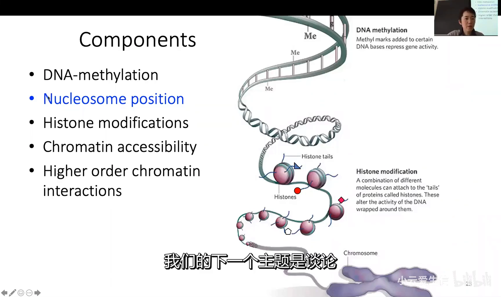
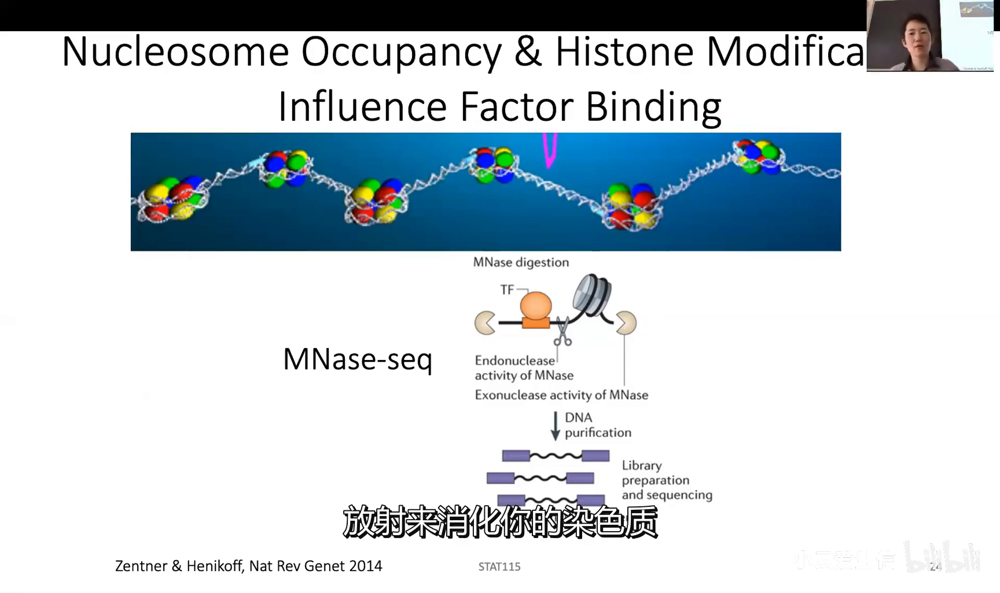
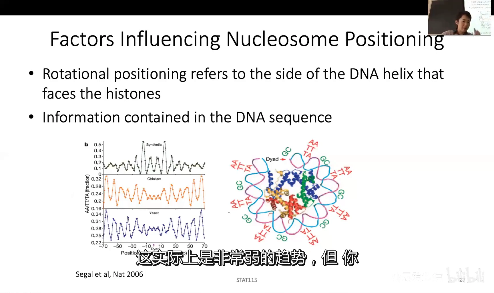
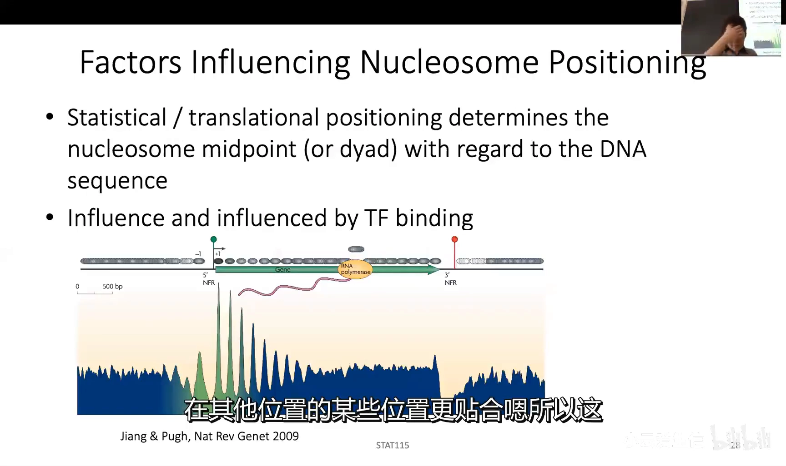
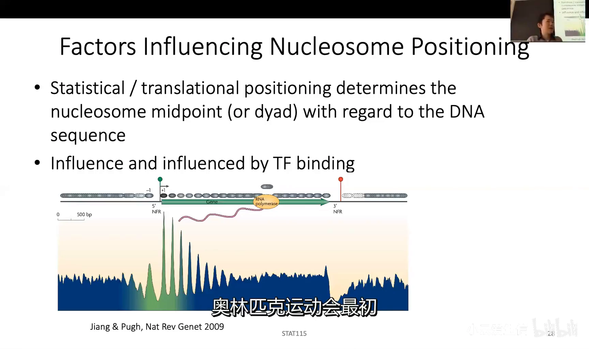

# 核小体定位：占位、MNase 测序与旋转／平移定位

> 视频来源：[表观遗传-核小体定位](https://www.bilibili.com/video/BV1cV4y1R7fY/)（B 站 · 小云爱生育 搬运，原片为 STAT115 课程录屏，画面可见 STAT115 与课程引用文献）｜时长约 13 分钟
> 本文按该片整理。原片为英文授课、中文字幕由语音识别生成，错译较多（「原子核」= 核小体、「云母测序」= MNase-seq、「微型可可」= 微球菌核酸酶），已按画面与上下文订正；幻灯片上的英文标注保留原样。

## 本讲要解决的核心问题（SCQA）

**背景**：染色质的基本单位是核小体——DNA 绕组蛋白八聚体缠两圈，大约 150 bp。上一节 [§3.1.4](../../../README.md#b02-3-1-4) 已经说过，被核小体盖住的序列，转录因子够不着。

**冲突**：但核小体并不是随便乱放的。同一段 DNA 上，有的位置核小体很稳定，有的位置几乎总是空着；而且把很多细胞平均起来看，某些位置的核小体对得整整齐齐，另一些位置则完全对不齐。

**疑问**：「核小体在哪里」这件事由什么决定？它又是怎么被测出来的？

**回答（中心思想）**：核小体定位有两个层次——**旋转定位**决定 DNA 螺旋的哪一面对着组蛋白（由序列的 10 bp 周期性决定），**平移／统计定位**决定核小体中心落在 DNA 的哪一段（由转录因子、聚合酶等占据事件决定）。两者都可以用 **MNase 测序**读出来：MNase 切连接区、啃到组蛋白为止，留下的约 150 bp 保护片段就是核小体的位置。

## 一、先明确核小体是什么：珠子、两圈、八个蛋白

片子接着 DNA 甲基化的话题往下讲，先复习结构 [【跳转到 00:05】](https://www.bilibili.com/video/BV1cV4y1R7fY/?t=5)：

- DNA 是双螺旋，缠在一个核小体上——可以把它想成**一颗珠子**；
- DNA 绕着它绕**两圈**，然后继续前进；
- 这两圈大约 **150 个核苷酸**长。

再往前，又是一个核小体，以此类推。所以「打开染色质」看到的，就是 DNA 加上所有那些蛋白；而**染色质的基本单位是这个核小体**。片子还强调了一句后面一直会用到的话：**珠子可以滑来滑去，也可以被拆下来重新组装** [【跳转到 00:30】](https://www.bilibili.com/video/BV1cV4y1R7fY/?t=30)。

这张开篇幻灯片值得单独看：课程把表观遗传的组成部分列成 **DNA 甲基化 / 核小体位置 / 组蛋白修饰 / 染色质可及性 / 更高级的染色质相互作用** 五项。这正好是本节要守住的分工——**核小体位置**和**组蛋白修饰**是并列的两件事，**可及性**又是另一项读数。

八聚体的组成，片子用「四人份奥利奥」来记 [【跳转到 01:01】](https://www.bilibili.com/video/BV1cV4y1R7fY/?t=61)：两个 H2A、两个 H2B、两个 H3、两个 H4，四种颜色，堆叠在一起。

## 二、无核小体区与核小体 DNA：转录因子的两种处境

片子把染色质分成两段来讲 [【跳转到 01:26】](https://www.bilibili.com/video/BV1cV4y1R7fY/?t=86)：

- **无核小体区**（nucleosome-free region）：裸露的 DNA；
- **核小体 DNA**：缠在组蛋白上的那一段。

这两种底质对转录因子的友好程度完全不同 [【跳转到 01:51】](https://www.bilibili.com/video/BV1cV4y1R7fY/?t=111)：

- **大多数转录因子喜欢结合无核小体 DNA**；
- 如果是核小体 DNA，**只有少数转录因子能真正结合上去**；
- 而那些能在核小体上结合的转录因子，会把组蛋白**挤出去**，让这段打开。

这些能先上去、再把核小体挤开的因子，片子叫它们**「开创性」转录因子**（pioneer transcription factors）[【跳转到 02:16】](https://www.bilibili.com/video/BV1cV4y1R7fY/?t=136)：它们必须先去把区域打开一半、把核小体挤出去，其他转录因子才能结合——因为有些转录因子只能结合无核小体区。

所以这里有一条很干脆的判读规则：**如果这个区域被核小体占住，就等于禁止转录因子进入** [【跳转到 02:16】](https://www.bilibili.com/video/BV1cV4y1R7fY/?t=136)。「占位」（occupancy）与「可及」（accessibility）说的就是同一件事的两面。

## 三、MNase 测序：用酶把「核小体在哪里」切出来

要谈定位，先得能测。片子介绍的经典方法是 **MNase 测序** [【跳转到 02:41】](https://www.bilibili.com/video/BV1cV4y1R7fY/?t=161)。它的原理可以用一句话概括：**微球菌核酸酶（MNase）切的是连接区，不是核小体内部**。

片子把 MNase 的两个活性分开讲，这是理解片段长度谱的关键：

| 活性 | 干什么 | 后果 |
| --- | --- | --- |
| **内切酶活性** | 从 DNA 中间切，不是只从末端开始 | 优先切在无核小体的**连接区** |
| **外切酶活性** | 切开后从末端往里「啃」，直到碰到组蛋白 | 核小体边缘被修齐，留下约 150 bp 的保护片段 |

消化的结果就是：**大部分无核小体区被消化掉，只剩下珠子**——DNA 缠在珠子上的那一段 [【跳转到 03:31】](https://www.bilibili.com/video/BV1cV4y1R7fY/?t=211)。

### 3.1 跑凝胶看到的「梯子」说明消化不完全

把消化产物跑 DNA 凝胶，看到的通常是一条**梯子**：一、二、三、四、五…… [【跳转到 03:56】](https://www.bilibili.com/video/BV1cV4y1R7fY/?t=236)

- 第一条带约 **150 bp**：单个核小体（单核小体）；
- 第二条带：中间没被切断，这段 DNA 含**两个**核小体，中间夹着无核小体 DNA；
- 第三条带：切在三个核小体外面，但只切到两个连接区；
- 依此类推。

也就是说，梯子的存在本身就是「连接区没被切干净」的证据 [【跳转到 04:21】](https://www.bilibili.com/video/BV1cV4y1R7fY/?t=261)。实际操作中，人们通常只把**单核小体**切出来测序，单端或双端都可以 [【跳转到 04:46】](https://www.bilibili.com/video/BV1cV4y1R7fY/?t=286)。

### 3.2 从读段到核小体中心：为什么要挪 75 bp

测序之后怎么定位置？片子的推理是 [【跳转到 05:27】](https://www.bilibili.com/video/BV1cV4y1R7fY/?t=327)：

1. 核小体 DNA 被保护下来，两端连上接头去测序，从左边或右边都可以；
2. 比对回基因组，会看到一堆读段落在**正链**、一堆落在**负链**，核小体在中间；
3. 因为核小体大约 150 bp 长，把每条读段**往中间挪 75 bp**；
4. 挪完之后信号汇聚的位置，就是**核小体的中心**。

片子顺带做了一个类比：这有点像 ChIP-seq，因为本质上都是「一种蛋白结合在 DNA 上」[【跳转到 05:27】](https://www.bilibili.com/video/BV1cV4y1R7fY/?t=327)。区别在于 ChIP-seq 靠抗体抓特定蛋白，MNase-seq 靠酶切留下**所有**被组蛋白保护的 DNA。

片子也承认这个实验「非常简单」，成本主要在测序，消化那部分很容易做 [【跳转到 07:07】](https://www.bilibili.com/video/BV1cV4y1R7fY/?t=427)。

## 四、定位的第一个层次：旋转定位由序列的 10 bp 周期性决定

有了全基因组的核小体位置图，下一个问题就是：**位置由什么决定？** 片子的回答分两层，第一层是**旋转定位**（rotational positioning）[【跳转到 07:41】](https://www.bilibili.com/video/BV1cV4y1R7fY/?t=461)。

观察是这样的：把酵母、鸡、人的基因组放在一起看，DNA 有一条**大约 10 个碱基对的周期性**——某一位点偏 A/T，10 bp 之后偏 GC，再 10 bp 又偏 A/T [【跳转到 08:06】](https://www.bilibili.com/video/BV1cV4y1R7fY/?t=486)。片子强调，这个趋势**非常弱**。

为什么会有 10 bp 这个周期？因为 DNA 双螺旋转一圈大约就是 10 个核苷酸，而它同时还要绕着珠子缠 [【跳转到 09:13】](https://www.bilibili.com/video/BV1cV4y1R7fY/?t=553)：

- 转一圈 10 nt，所以每隔 10 nt，朝向组蛋白的是**同一面**；
- 面向组蛋白的那一面**偏好 GC**，不喜欢 T；
- 演化把序列塑造成这种 10 bp 周期，为的是让 GC 总是朝着里面的组蛋白。

片子用了一个很形象的比喻：当核小体位置不对时，就像每个人都坐在不那么舒服的位置上；只要稍微滑一点，一切就都贴合了 [【跳转到 10:03】](https://www.bilibili.com/video/BV1cV4y1R7fY/?t=603)。**单个 10 bp 周期的偏好很弱，但你要把 150 个碱基对凑在一起**，累积起来就足以让核小体在某些位置比其他位置更贴合——所以可以据此预测核小体会在哪里稳定形成 [【跳转到 10:28】](https://www.bilibili.com/video/BV1cV4y1R7fY/?t=628)。

这就是**旋转定位**：它决定的是「DNA 螺旋的哪一面对着组蛋白」[【跳转到 10:58】](https://www.bilibili.com/video/BV1cV4y1R7fY/?t=658)。

## 五、定位的第二个层次：平移定位由「谁占着这里」决定

第二层是**统计定位／平移定位**（statistical / translational positioning），它决定的是**核小体中心（dyad）落在 DNA 的哪一段** [【跳转到 11:03】](https://www.bilibili.com/video/BV1cV4y1R7fY/?t=663)。

片子的推理很漂亮，值得一步步跟：

1. 如果你对**很多细胞**测序，在什么都没发生的地方，不同细胞里的核小体**根本不在乎自己在哪** [【跳转到 11:08】](https://www.bilibili.com/video/BV1cV4y1R7fY/?t=668)；
2. 因为细胞之间不同步，平均之后信号就被抹平了；
3. 但在某些地方，比如**转录起始位点**，聚合酶需要识别正确的结合位置；一旦它在那里，下一个核小体的位置在所有细胞里几乎都对得整整齐齐，于是能看到**非常强的信号** [【跳转到 11:33】](https://www.bilibili.com/video/BV1cV4y1R7fY/?t=693)；
4. 图上那个**大缺口**就是转录复合体所在的地方——它把东西挡住了；然后 ±1 核小体的位置很稳定，因为它们紧挨着、挪不了多少，再往后就逐渐变差 [【跳转到 11:58】](https://www.bilibili.com/video/BV1cV4y1R7fY/?t=718)。

片子用**长跑比赛**来比喻相位的衰减：一开始大家挤在一起，随着时间推移逐渐拉开、失去同步；在基因的最开始，所有细胞在 +1、+2、+3 核小体上都是对齐的，然后逐渐变弱 [【跳转到 12:23】](https://www.bilibili.com/video/BV1cV4y1R7fY/?t=743)。

同样的逻辑也适用于**增强子**：增强子处也有一个统计定位的无核小体区，转录因子占据的位置把核小体挤到一边；紧挨着的 +1、+2、+3 位置相当好，但最终也会逐渐失去定位 [【跳转到 12:48】](https://www.bilibili.com/video/BV1cV4y1R7fY/?t=768)。

## 六、把三个概念分开：定位、修饰、可及性

片子的收尾只有两句话，但正好是本节要划的界 [【跳转到 13:13】](https://www.bilibili.com/video/BV1cV4y1R7fY/?t=793)：

- **DNA 甲基化和核小体定位只是表观遗传学的不同方面，它们各自创造了地标**；
- **核小体 DNA 通常会阻止转录因子结合，所以要让转录因子结合，你希望那段是自由、开放的**。

把这两句和开篇那张「五个组成部分」的幻灯片合起来，就得到一张分工表：

| 概念 | 它是什么 | 它不是什么 |
| --- | --- | --- |
| **核小体定位** | 核小体在基因组上的**位置分布**（旋转 + 平移两个层次） | 不是组蛋白尾巴上的化学标记 |
| **组蛋白修饰** | 组蛋白上的化学标记，与定位并列的另一类表观信息 | 不是「核小体在不在、在哪」 |
| **染色质可及性** | 一个**读数**：这段 DNA 现在能不能被蛋白碰到 | 不是机制本身；可及性高不等于正在转录 |

而**重塑**（[§3.1.8 另一篇](核小体重塑复合体：滑动、驱逐与组蛋白变体交换.md)）是**改变定位的那台机器**：旋转定位由序列偏好决定，平移定位由占据事件决定，而 ATP 依赖的重塑复合体可以主动把核小体滑走、驱逐或换变体——它是「定位图」被改写的原因之一。

## 小结

- 核小体 = DNA 绕组蛋白八聚体两圈，约 150 bp；珠子可以滑动、拆下、重组。
- 染色质分**无核小体区**与**核小体 DNA**；大多数转录因子只能结合前者，少数「开创性」因子能挤开核小体。
- **MNase 测序**读定位：内切酶切连接区、外切酶啃到组蛋白，留下约 150 bp 保护片段；凝胶上的梯子说明消化不完全；读段向中心挪 75 bp 得到核小体中心。
- **旋转定位**：序列的 10 bp 周期性让 GC 朝向组蛋白；单周期偏好很弱，150 bp 累积起来才有效。
- **平移／统计定位**：核小体中心由占据事件（转录起始位点、增强子）决定；离开这些锚点，相位逐渐衰减。
- 定位、组蛋白修饰、可及性是三个不同层次：前两个是机制，第三个是读数。

## 关键术语速查

| 术语 | 一句话解释 |
| --- | --- |
| 核小体 | DNA 绕组蛋白八聚体（2×H2A/H2B/H3/H4）约两圈、约 150 bp 的基本单位 |
| 无核小体区（NFR） | 没有核小体覆盖的裸露 DNA，转录因子主要在这里结合 |
| 占位（occupancy） | 某段 DNA 被核小体盖住的程度；占位高则转录因子难进 |
| 开创性转录因子 | 能结合在核小体 DNA 上并把组蛋白挤开的少数转录因子 |
| MNase-seq | 用微球菌核酸酶切连接区、测序保护片段，读出全基因组核小体位置 |
| 旋转定位 | 决定 DNA 螺旋哪一面朝向组蛋白，由约 10 bp 的序列周期性决定 |
| 平移／统计定位 | 决定核小体中心（dyad）落在哪一段，由转录因子/聚合酶占据等事件决定 |
| 相位（phasing） | 一群细胞中核小体位置对齐的程度；离锚点越远越模糊 |