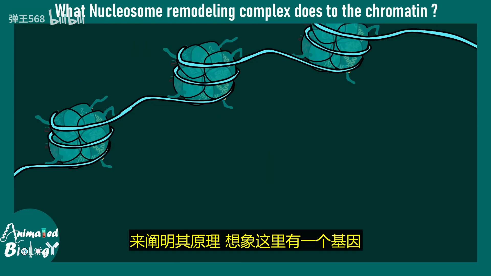
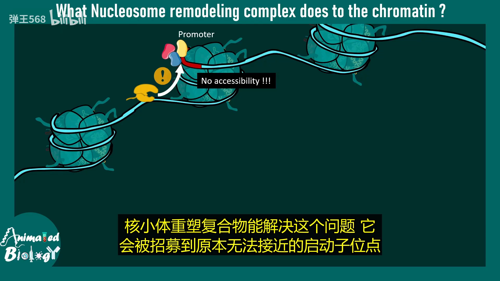
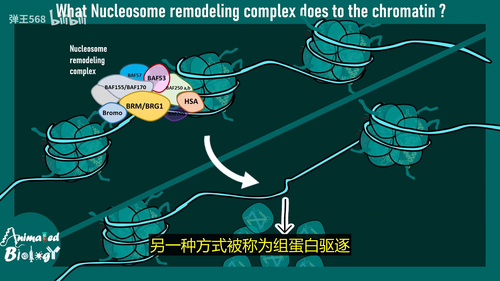
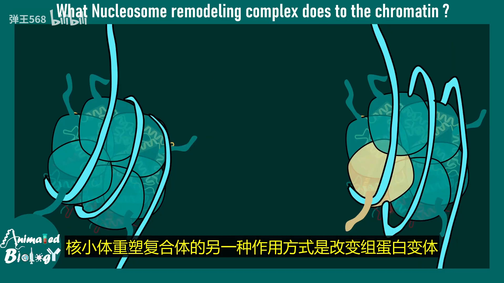
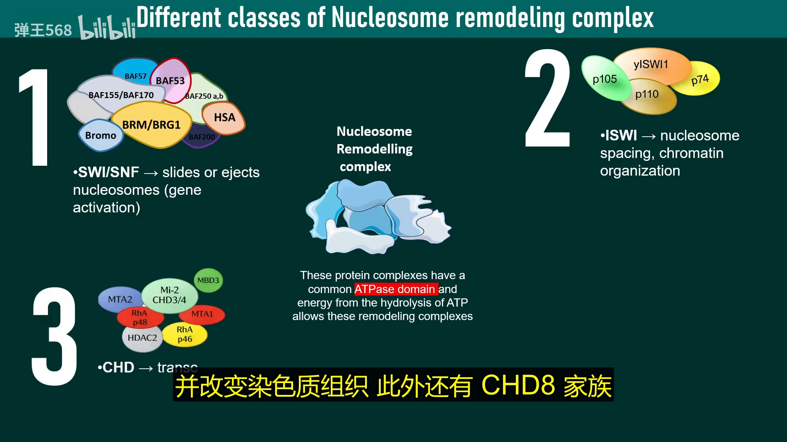
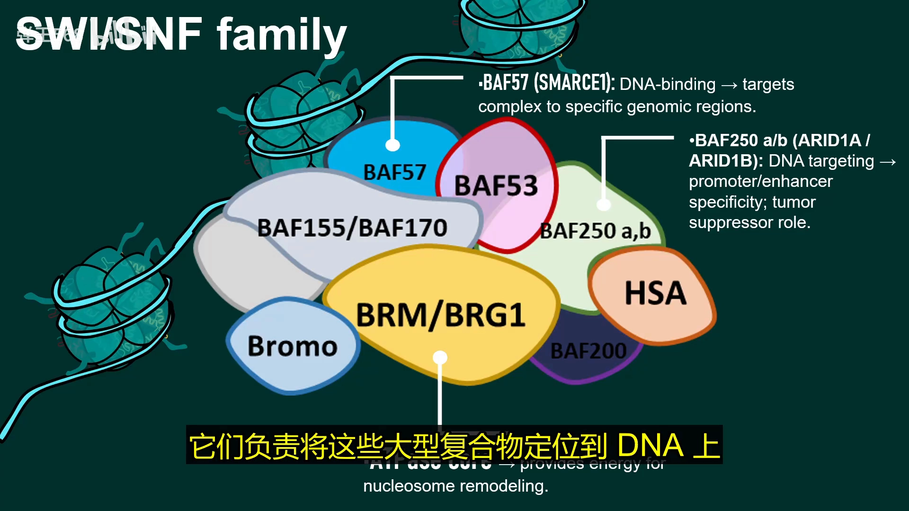
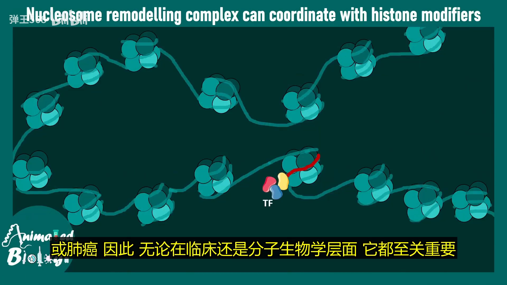
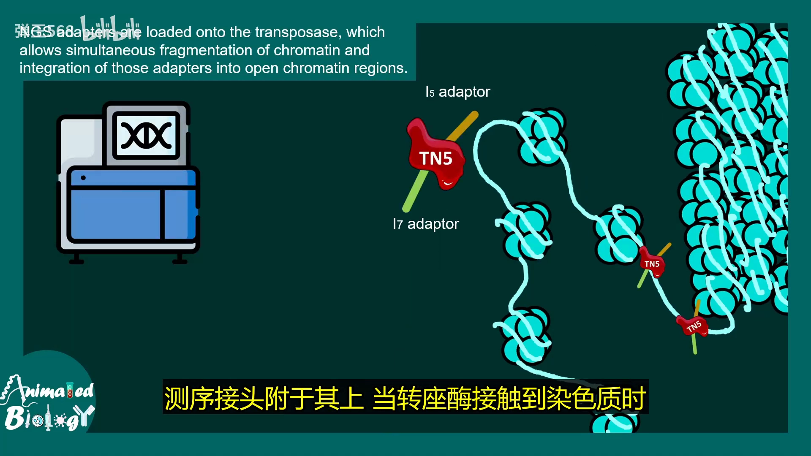

# 核小体重塑复合体：滑动、驱逐与组蛋白变体交换

> 视频来源：[染色质重塑｜核小体重塑复合物｜表观遗传学通俗解读：SWI/SNF、ISWI、CHD、INO80 家族](https://www.bilibili.com/video/BV1gwijBXEHj/)（B 站 · 弹王568 搬运，原片为 Animated Biology 动画讲解）｜时长约 7 分钟
> 本文按该片中文配音版（P1）整理；术语以画面上的英文标注为准，字幕中的「核小體皺物色」「阻蛋白」「ISNF」等为语音识别错误，已订正为「核小体重塑复合体」「组蛋白」「SWI/SNF」。

## 本讲要解决的核心问题（SCQA）

**背景**：DNA 缠在组蛋白八聚体上形成核小体，一段基因的启动子被核小体盖住时，转录因子和 RNA 聚合酶都进不去。这是上一节 [§3.1.4 染色质可及性](../../../README.md#b02-3-1-4) 说的「锁」。

**冲突**：细胞并没有把整条染色质拆掉。它要在**特定的一段**上把锁打开，而且打开之后还能再关上——这需要机器，而且是要花钱的机器。

**疑问**：是什么机器把核小体挪开？它具体做了哪几种改动？这些机器怎么分工？

**回答（中心思想）**：核小体重塑复合体是一类**依赖 ATP 水解**的分子机器，它用三种方式改变核小体——**滑动**（把核小体沿 DNA 推开）、**驱逐**（把组蛋白八聚体整个拿走）、**变体交换**（把普通组蛋白换成 H2A.Z、H3.3 这类变体）。四个家族分工不同（SWI/SNF、ISWI、CHD、INO80），但共用同一个 ATPase 核心；它改变的是**核小体在哪里、还在不在**，而不是组蛋白尾巴上挂了什么化学标记。

## 一、重塑的第一步是花 ATP 把「够不着」变成「够得着」

片子开头就把定义给死了：核小体重塑复合体是**依赖 ATP** 的复合体，它借助 ATP 水解，把染色质从**不可及**状态转成**可及**状态，所以这是一个消耗能量的过程 [【跳转到 00:00】](https://www.bilibili.com/video/BV1gwijBXEHj/?t=0)。

这句话里有两个容易被读漏的点：

- **「ATP 依赖」是这类机器的定义性特征**。后面要讲的组蛋白修饰酶（乙酰转移酶等）写标记时用的不是 ATP 水解提供的机械力；重塑复合体则是拿水解能量去**掰动 DNA 与组蛋白的接触**。
- **改变的是状态，不是序列**。DNA 一个碱基都没变，变的只是「这段 DNA 现在露不露在外面」。

片子用一个具体场景来说明这件事为什么必须发生：一个基因的序列上排着三个核小体，启动子区域被紧紧缠住，转录因子无法接近，RNA 聚合酶也无法进入该区域转录 [【跳转到 00:25】](https://www.bilibili.com/video/BV1gwijBXEHj/?t=25)。

紧接着画面给启动子打上了一个很直白的标签：**No accessibility!!!**——转录因子（画面上那几个彩色小方块）站在旁边，就是够不着 [【跳转到 00:50】](https://www.bilibili.com/video/BV1gwijBXEHj/?t=50)。

## 二、三种改法：滑动、驱逐、变体交换

片子的主体就是把「重塑」这个笼统的词拆成三个可分辨的动作。这三个动作的区别，是本节最该记住的一张表。

### 2.1 滑动：核小体还在，只是换了个位置

第一种办法最省：复合体被招募到原本无法接近的启动子位点，把核小体**沿 DNA 推开**。画面里第二个核小体向左滑动，原本被它盖住的启动子区域可及性大大提高 [【跳转到 00:50】](https://www.bilibili.com/video/BV1gwijBXEHj/?t=50)。这种做法叫**核小体滑动**，也叫**核小体重新定位**（nucleosome sliding / repositioning）[【跳转到 01:06】](https://www.bilibili.com/video/BV1gwijBXEHj/?t=66)。

注意滑动之后发生了什么、没发生什么：核小体总数没变，组蛋白一个没少，只是「谁盖住哪一段」变了。所以滑动是三者中**信息量最小**的一种改动——它只挪位置。

### 2.2 驱逐：把八聚体整个拿走

第二种是**组蛋白驱逐**（histone eviction）：在特定区域，核心组蛋白八聚体里的组蛋白可以被重塑复合体整个移走，从而**提高该局部区域的可及性** [【跳转到 01:28】](https://www.bilibili.com/video/BV1gwijBXEHj/?t=88)。

片子在这里特意补了一句判读上的关键限定：**染色质的其他区域并未改变，改变只发生在特定区域**，所以核小体重塑因子能以**染色质特异**的方式工作 [【跳转到 01:28】](https://www.bilibili.com/video/BV1gwijBXEHj/?t=88)。这句话是后面所有「测到的可及性变化」解释的前提：如果重塑是全局的，那细胞类型之间就不会有差异可及区；正因为它是位点特异的，ATAC 图谱才有细胞类型特异性。

上图同时把复合体的部件画了出来：BAF57、BAF53、BAF155/BAF170、BAF250 a,b、BRM/BRG1、HSA、Bromo、BAF200。这些名字在第四节会逐个对上功能。

### 2.3 变体交换：换掉零件，改变核小体的「性格」

第三种是**改变组蛋白变体**：把一个普通组蛋白换成变体，从而改变核小体组分与 DNA 的相互作用方式 [【跳转到 01:53】](https://www.bilibili.com/video/BV1gwijBXEHj/?t=113)。

片子给了两个具体例子 [【跳转到 02:12】](https://www.bilibili.com/video/BV1gwijBXEHj/?t=132)：

| 位置 | 替换 | 与转录的关系 |
| --- | --- | --- |
| 启动子区域附近 | H2A → **H2A.Z** | 活跃转录基因的特征 |
| 基因体内 | H3 → **H3.3** | 活跃基因转录的标志 |

而执行这类整合的是 **INO80** 家族的复合体，它能把这类组蛋白变体装到特定位置 [【跳转到 02:37】](https://www.bilibili.com/video/BV1gwijBXEHj/?t=157)。

这里要小心一个因果方向：片子的说法是「这是活跃转录基因的特征 / 标志」，并没有说「装上 H2A.Z 就一定开启转录」。变体交换与转录活性是**相关**的，谁因谁果需要另外的扰动实验来判。

## 三、四个家族：同一个 ATPase 核心，不同的活

片子把核小体重塑因子分成几个家族，并给了每个家族一句分工 [【跳转到 02:55】](https://www.bilibili.com/video/BV1gwijBXEHj/?t=175)：

| 家族 | 片中的分工 | 典型亚基（画面标注） |
| --- | --- | --- |
| **SWI/SNF** | 滑动或弹出核小体（基因激活） | BRM/BRG1（ATPase）、BAF57、BAF53、BAF155/BAF170、BAF250 a,b、BAF200、HSA、Bromo |
| **ISWI** | 改变核小体间距、改变染色质组织 | yISWI1、p105、p110、p74 |
| **CHD** | 调控转录过程、调控发育 | Mi-2/CHD3/4、MTA1/2、HDAC2、RbAp46/48、MBD3 |
| **INO80** | 增强 DNA 修复、缓解复制压力 | —（片中未展开亚基） |

这张对照页值得多看两眼，因为它同时说了两件事：

1. **共性**：画面中央写着这些蛋白复合体有一个共同的 **ATPase 结构域**，ATP 水解的能量让它们能重塑核小体 [【跳转到 03:20】](https://www.bilibili.com/video/BV1gwijBXEHj/?t=200)。所以「家族」的划分不是在说能量来源不同，而是在说**同一个马达被装进了不同的底盘**。
2. **差异**：差别在**结果**上——SWI/SNF 让核小体滑走或消失（净效果是可及性上升），ISWI 主要管**间距与组织**（规则排列），CHD 与转录调控、发育相关，INO80 偏向 DNA 修复与复制压力。

顺带一提 CHD 那张小图里出现了 HDAC2、MBD3 这些名字——它们分别与组蛋白去乙酰化和甲基化 DNA 结合有关。这说明重塑复合体常常**不是单干的**，这一点在第五节还会回来。

## 四、拆开 SWI/SNF：马达、定位器、识别器、支架

片子挑 SWI/SNF 做解剖，把一个大复合体拆成四类部件 [【跳转到 03:29】](https://www.bilibili.com/video/BV1gwijBXEHj/?t=209)：

- **马达（ATPase 核心）**：BRM 或 BRG1。这是真正水解 ATP、掰动核小体的那一个。
- **定位亚基**：BAF57（SMARCE1）负责把复合体带到特定基因组区域；BAF250 a/b（ARID1A/ARID1B）负责启动子/增强子的特异性，并具有抑癌作用 [【跳转到 03:54】](https://www.bilibili.com/video/BV1gwijBXEHj/?t=234)。
- **识别器**：**溴结构域**（bromodomain），能识别**乙酰化的组蛋白**。
- **支架与锚定**：稳定复合体结构，并把复合体锚定到肌动蛋白或 ARP 结合蛋白上，从而稳定整个重塑复合体的功能活性。

这里藏着一个很重要的机制连接：**溴结构域识别乙酰化组蛋白**。也就是说，重塑复合体自己虽然不写修饰，但它能**读**组蛋白修饰，靠这个被招募到「已经被标记过」的区域。这就是重塑与组蛋白修饰之间最直接的一座桥。

片子还补了 SWI/SNF 的来历与后果 [【跳转到 04:19】](https://www.bilibili.com/video/BV1gwijBXEHj/?t=259)：

- 它最初是在**酵母**中通过遗传筛选发现的，因此得名 SWI/SNF（交配型转换与蔗糖发酵）。
- BAF 类复合体参与神经前体细胞**增殖与分化的抉择**，还调控树突发生与突触密度 [【跳转到 04:24】](https://www.bilibili.com/video/BV1gwijBXEHj/?t=264)。
- 它与多种癌症高度相关，例如婴幼儿横纹肌样瘤、卵巢透明细胞癌、肺癌 [【跳转到 04:49】](https://www.bilibili.com/video/BV1gwijBXEHj/?t=289)。

## 五、重塑不是孤立的：它和组蛋白修饰因子一起干活

片子明确说：一旦转录因子无法接近启动子，重塑复合体就会与它协同；重塑复合体能产生多方面影响——它还能**招募其他转录因子和组蛋白乙酰转移酶**，改变局部组蛋白修饰，并与组蛋白修饰因子协同作用，这些共同作用提高了染色质的可及性，有助于转录进行 [【跳转到 05:02】](https://www.bilibili.com/video/BV1gwijBXEHj/?t=302)。

这段话给出了本节最需要分清的一组关系：

| 概念 | 它改变什么 | 典型执行者 | 测量上的对应 |
| --- | --- | --- | --- |
| **染色质重塑** | 核小体**在哪里、还在不在、是哪个变体** | SWI/SNF、ISWI、CHD、INO80（ATP 依赖） | 核小体占位图（MNase-seq）、可及性图（ATAC/DNase） |
| **组蛋白修饰** | 组蛋白尾巴上的**化学标记** | 乙酰转移酶、甲基转移酶、去乙酰化酶等 | ChIP-seq / CUT&Tag 测特定修饰 |
| **测得的开放性** | 不是机制，是**读数** | ATAC-seq 的 Tn5、DNase I | 「有峰 = 可及」 |

三者不是同一层的东西：前两个是**机制**，第三个是**观测**。而且机制之间还会互相招募（溴结构域读乙酰化、重塑复合体招募乙酰转移酶），所以看到「可及性升高」时，不能直接推断是哪一个机制造成的。

## 六、可及性是怎么被读出来的：ATAC 峰只说明「够得着」

片子最后用 ATAC 测序收尾，讲法很克制 [【跳转到 05:42】](https://www.bilibili.com/video/BV1gwijBXEHj/?t=342)：

1. ATAC 测序使用带**测序接头**的转座酶；
2. 转座酶接触到染色质时，若该处**可及**，就把接头连上去；
3. 酶切后产生一批带接头的片段——**带接头的是可及区，不可及区没有接头**；
4. 所有片段比对回基因组，转座酶结合过的地方形成**峰**。

片子的结论只有一句：**有峰出现就说明染色质是可及的** [【跳转到 06:22】](https://www.bilibili.com/video/BV1gwijBXEHj/?t=382)。峰可能落在启动子、UTR 或增强子区域 [【跳转到 06:38】](https://www.bilibili.com/video/BV1gwijBXEHj/?t=398)，所以这项技术常被用来比较两种不同细胞中染色质的可及性。

**这里必须停一下**：ATAC 峰是「可及性」的读数，它**不告诉你**这段是可及是因为核小体被滑走了、被驱逐了，还是因为某个阻遏蛋白结合后把 Tn5 挡在外面。要回答「是哪种重塑」，得另做核小体占位（MNase-seq）或扰动重塑复合体的实验。这条判读边界在 [§3.1.4](../../../README.md#b02-3-1-4) 已经展开，本节只把它和「重塑」这个机制对上。

## 小结

- 核小体重塑复合体是**ATP 依赖**的机器：拿水解能量把染色质从不可及变成可及，是耗能过程。
- 它有三种可分辨的动作：**滑动**（换位置）、**驱逐**（整个拿走八聚体）、**变体交换**（换成 H2A.Z / H3.3 等）。
- 四个家族共用同一个 **ATPase 核心**，差别在结果：SWI/SNF 滑动或弹出、ISWI 管间距与组织、CHD 管转录与发育、INO80 管修复与复制压力。
- SWI/SNF 的部件分工是「马达（BRM/BRG1）+ 定位（BAF57、BAF250）+ 识别（溴结构域读乙酰化）+ 支架」。
- 重塑常与组蛋白修饰因子**互相招募**，所以「可及性升高」不能反推是哪一个机制。
- **ATAC 峰是可及性的读数，不是重塑的证据**；要分清机制，需要占位测量或扰动实验。

## 关键术语速查

| 术语 | 一句话解释 |
| --- | --- |
| 核小体重塑复合体 | 依赖 ATP 水解、改变核小体位置/数量/变体组成的蛋白机器 |
| 核小体滑动（重新定位） | 核小体沿 DNA 平移，露出原本被盖住的序列 |
| 组蛋白驱逐 | 把核心组蛋白八聚体整个从 DNA 上移走，局部彻底开放 |
| 组蛋白变体交换 | 用 H2A.Z、H3.3 等变体替换常规组蛋白，改变核小体性质 |
| ATPase 核心 | 各家族共有的马达亚基（如 SWI/SNF 的 BRM/BRG1） |
| 溴结构域（bromodomain） | 识别乙酰化组蛋白的模块，把重塑复合体带到已被标记的区域 |
| ATAC 峰 | 转座酶在可及区插入接头后比对形成的信号峰，是可及性的读数 |