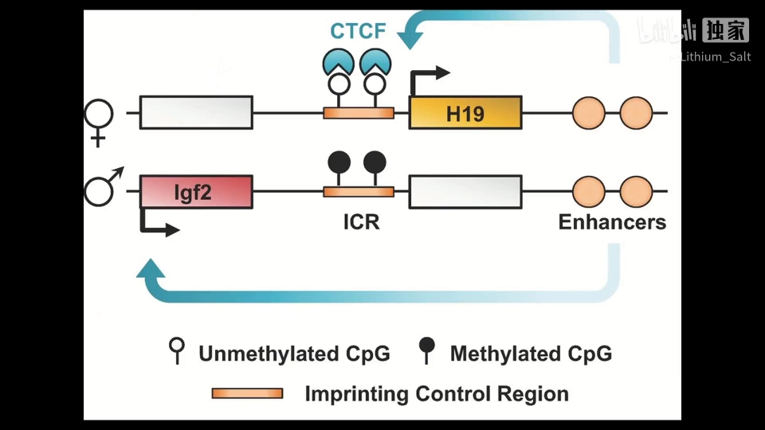
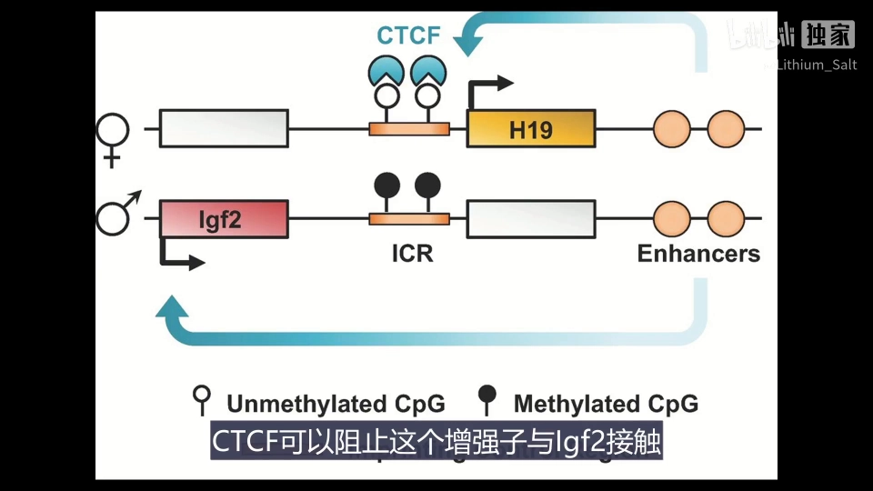
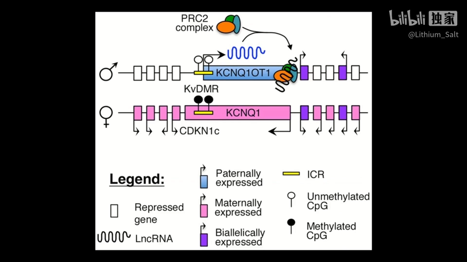
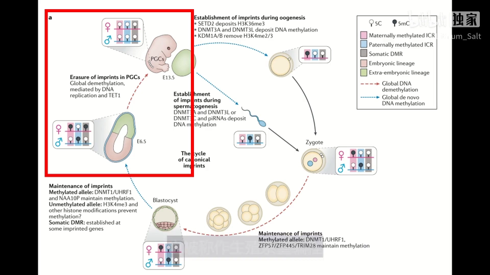
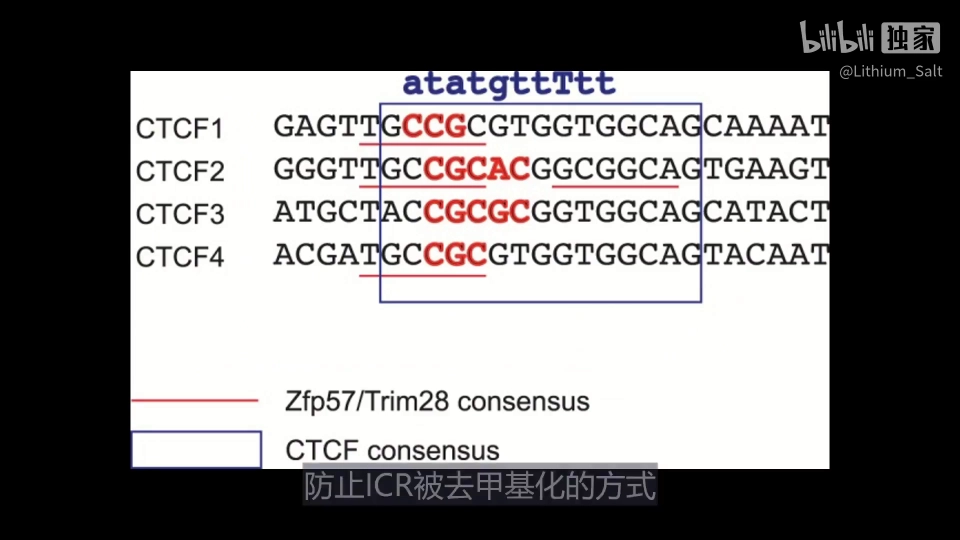
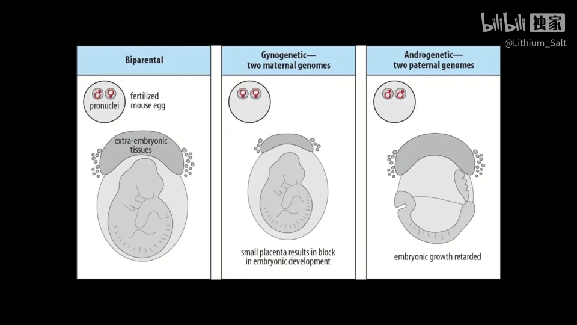

# 印记基因的调控模型：CTCF 绝缘子与长非编码 RNA

> 视频来源：[表观遗传系列-8. 基因印迹：男染色体？女染色体？如何区分染色体的"性别"？](https://www.bilibili.com/video/BV17q4y1a7Ld/)（Bilibili · Lithium_Salt，约 8 分钟）
> 导读（100 字以内）：这支视频只回答一个问题——一个印记调控区（ICR）上的甲基化，怎么变成下游基因"只表达一个拷贝"。它给了绝缘子和长非编码 RNA 两套模型，并交代印记如何被擦除、重建和守住。本文保留机制主线，术语按国内教材习惯写作"印记"。

## 本讲要解决的核心问题（SCQA）

**背景**：上一节已经说明，印记基因按亲本来源只表达一个拷贝，而且这个状态能跨细胞分裂维持。印记的核心元件是印记调控区（ICR），它的甲基化状态与下游基因的表达方向绑定。

**冲突**：但"ICR 被甲基化"本身并不直接让某个基因沉默。甲基化只是加在 DNA 上的化学基团，它必须通过某种方式改变调控元件的可及性，才能影响转录。而且同一个 ICR 常常同时控制好几个基因，其中有的该开、有的该关。

**疑问**：一段几百碱基的 ICR，究竟怎样把"甲基化 / 不甲基化"翻译成"这个基因开、那个基因关"？这套状态又是在什么时候写上去、靠什么在一生中守住？

**回答（中心思想）**：ICR 通过**改变调控元件的可及性**来切换下游基因，目前有两套被总结清楚的模型——**绝缘子模型**（甲基化让 CTCF 失去结合位点，增强子得以接触另一个启动子）和**长非编码 RNA 模型**（未甲基化的启动子转录出 lncRNA，覆盖基因簇并招募抑制性修饰）。印记本身在配子形成时被擦除、按性别重建，此后由 ZFP57–TRIM28–DNMT1 这类"识别—招募—维持"链条守住。

---

## 一、印记基因成簇，一个 ICR 管一组基因

[【跳转到 00:00】](https://www.bilibili.com/video/BV17q4y1a7Ld/?t=0)

视频从上一期讲过的胚胎重编程接上：重编程不只发生在胚胎早期，配子形成时同样发生。生殖系重编程给精子与卵子的染色体打上不同记号，让它们"记得"自己来自父亲还是母亲。

[【跳转到 00:30】](https://www.bilibili.com/video/BV17q4y1a7Ld/?t=30)

这个记号就是基因印记。细胞里有两套染色体组，正常情况下每个基因有两个拷贝。对绝大多数基因来说，两个拷贝要么同时表达，要么同时关闭；对印记基因来说，只有一个拷贝被表达——有些只表达父源拷贝，有些只表达母源拷贝。所以只要看一条染色体上表达了哪些印记基因，就能判断它来自父亲还是母亲。

[【跳转到 00:55】](https://www.bilibili.com/video/BV17q4y1a7Ld/?t=55)

但并不是所有染色体上都有印记基因，因为**印记基因很少单独出现，一般都是成簇分布**。

[【跳转到 01:00】](https://www.bilibili.com/video/BV17q4y1a7Ld/?t=60)

几个印记基因的表达受**一个印记基因调控区域（ICR）**控制。根据 ICR 是否被甲基化，受它控制的印记基因会表现出截然相反的表达模式。

这句话是本节全部机制的入口：**一个开关，多个输出，而且输出方向可以相反**。这正是为什么需要"绝缘子"或"lncRNA 覆盖"这类中介机制——单独的甲基基团没有方向性。

---

## 二、模型一：绝缘子——甲基化决定增强子去找谁

[【跳转到 01:27】](https://www.bilibili.com/video/BV17q4y1a7Ld/?t=87)

典型代表是 **H19/IGF2** 印记。开始前先分清两个说法，它们很容易混：

- **父源表达的印记基因**：指父源染色体上表达的那个基因；
- **父源印记**：指这段 ICR 在**父源染色体上是被甲基化的**。

也就是说，同一个"父源"前缀，一个说的是"哪个拷贝在表达"，另一个说的是"哪个拷贝被加了甲基"。读文献时要看它跟的是"表达"还是"甲基化"。

[【跳转到 01:52】](https://www.bilibili.com/video/BV17q4y1a7Ld/?t=112)

先看母源染色体（图中上方）：

1. H19 和 IGF2 之间有一段序列，如果它**没有被 DNA 甲基化覆盖**，一个叫 **CTCF** 的蛋白就可以特异性地结合上去；
2. H19 和 IGF2 身后有一段**共用的增强子**；
3. CTCF 结合在中间，**阻止这个增强子与 IGF2 接触**，于是 IGF2 关闭；
4. 同时 CTCF 还能开启下游 H19 的表达。

[【跳转到 02:17】](https://www.bilibili.com/video/BV17q4y1a7Ld/?t=137)

再看父源染色体（图中下方）：

1. CTCF 结合位点被 DNA 甲基化覆盖，CTCF 无法结合；
2. 增强子不再被挡住，可以顺利开启 **IGF2** 的表达；
3. 同时，CTCF 位点上的甲基化会**蔓延**到 H19 的启动子区域，把 H19 关闭。

一个 ICR 的甲基化状态，就这样同时决定了两个方向相反的结果：甲基化 → IGF2 开、H19 关；不甲基化 → IGF2 关、H19 开。这也解释了为什么"ICR 甲基化"不能简单等同于"这个位点被沉默"。

**绝缘子**（insulator）这个名字来自它的作用方式：它不直接激活或抑制转录，而是**阻断增强子与启动子之间的接触**。把它想成一段"只能被 CTCF 占住的关卡"就好：关卡有人守着，增强子过不去；关卡被甲基化封住，路就通了。

---

## 三、模型二：长非编码 RNA——覆盖基因簇并招募抑制

[【跳转到 02:40】](https://www.bilibili.com/video/BV17q4y1a7Ld/?t=160)

第二套模型没有那么多弯弯绕绕，逻辑是一条直线：

1. 印记簇里有一个**长非编码 RNA 的启动子**；
2. 如果这个启动子**没有被甲基化**，lncRNA 就会被转录出来；
3. lncRNA 缠绕在印记基因簇上，**招募抑制性的组蛋白修饰**，把父源印记基因一网打尽，阻止它们表达；
4. 当这个启动子被甲基化时，lncRNA 被抑制，这些印记基因就可以自由表达。

图中展示的是 KCNQ1/KCNQ1OT1 位点：父源染色体上 ICR 未甲基化，转录出 lncRNA，招募 PRC2 复合体，把整簇父源基因抑制；母源染色体上 ICR 被甲基化，lncRNA 不表达，基因得以表达。

两套模型的共同点值得单独记住：**ICR 的甲基化状态本身不执行任何事，它只是决定"哪个蛋白能结合"或"哪段 RNA 能被转录"**。真正改变转录的是 CTCF 或 lncRNA 招募来的复合体。这与上一节组蛋白修饰里的 writer/reader 分工是同一种设计思路。

---

## 四、印记怎么写、怎么擦、怎么守

### 4.1 先擦掉，再按性别重写

[【跳转到 03:05】](https://www.bilibili.com/video/BV17q4y1a7Ld/?t=185)

基因印记是在精子与卵子形成时被添加的，但**添加的第一步是把原有的印记抹除**。受精卵的基因组由精子与卵子组合而成，因此体细胞中既有父源印记、又有母源印记。

[【跳转到 03:10】](https://www.bilibili.com/video/BV17q4y1a7Ld/?t=190)

胚胎发育到原肠期时，一小撮细胞脱离大部队，成为**原始生殖细胞**（PGC），也就是将来按性别分化成精子或卵子的细胞。它们会经历第二次重编程——**生殖系重编程**。

[【跳转到 03:35】](https://www.bilibili.com/video/BV17q4y1a7Ld/?t=215)

生殖系重编程时，被动去甲基化与主动去甲基化同时开启：被动去甲基化负责全基因组 DNA 甲基化水平降低，主动去甲基化则瞄准印记基因的 ICR 和生殖系发育所需的基因。

### 4.2 重建：从头甲基化酶按组蛋白修饰的指导写入

[【跳转到 04:00】](https://www.bilibili.com/video/BV17q4y1a7Ld/?t=240)

原有印记被抹除后，精子与卵子分别建立父源和母源印记，依靠的是 **DNMT3A 和 DNMT3L**——负责从头甲基化的酶。它们可以根据**组蛋白修饰的指导**给 DNA 加甲基。

图中把整条循环画全了：原始生殖细胞里全基因组去甲基化（擦除），卵子发生与精子发生中分别沉积 H3K36me3 与 DNA 甲基化（重建），受精后甲基化的等位基因靠 DNMT1/UHRF1 维持、未甲基化的等位基因靠 H3K4me3 等修饰防止被甲基化。

这里出现了一条方向明确的信息流：**组蛋白状态 → DNA 甲基化位置**。印记不是随机撒上去的，而是被上游的染色质状态指定位置。

### 4.3 守住：识别序列 → 招募因子 → 维持酶

[【跳转到 04:20】](https://www.bilibili.com/video/BV17q4y1a7Ld/?t=260)

印记建立后还要经历两次考验：胚胎重编程时的 DNA 去甲基化，以及之后的重新建立。与"一直表达就行"的转录因子不同，**父源 ICR 和母源 ICR 一边有印记、另一边没有**，所以无论是甲基化丢失还是额外出现，都会干扰基因的正常表达。这就要求细胞能精确地"只保住该保的那一边"。

[【跳转到 04:45】](https://www.bilibili.com/video/BV17q4y1a7Ld/?t=285)

防止 ICR 被去甲基化的方式，与抑制转座因子的方式相似，是一条三步链：

1. ICR 中有比较特异的一段序列，可以被锌指蛋白 **ZFP57** 识别；
2. ZFP57 招募 **TRIM28**；
3. TRIM28 把维持 DNA 甲基化的 **DNMT1** 以及其他抑制性表观修饰一起招募过来，维持 ICR 上的甲基化不被擦除。

[【跳转到 05:05】](https://www.bilibili.com/video/BV17q4y1a7Ld/?t=305)

至于**如何不让另一条 ICR 被加上甲基化**，现有了解没那么充分。目前认为 ICR 上的某些组蛋白修饰可以阻止 DNA 甲基化，例如 H3K4me3。这是一个应当如实标注的认识边界：**"维持已有印记"的机制比"防止错误印记"的机制清楚得多**。

---

## 五、证据与演化：这个机制是怎么被发现的

[【跳转到 05:27】](https://www.bilibili.com/video/BV17q4y1a7Ld/?t=327)

基因印记的研究最早可追溯到上世纪 80 年代，当时人们对表观遗传学还没有概念。有人用显微注射技术把两个精子或两个卵子的细胞核同时注入去核卵细胞，观察重组胚胎能否发育，结果所有胚胎都在一定时期后死亡。

这说明来自精子的基因组和来自卵子的基因组**不等价**，各自都有对方没有的东西；胚胎必须同时拥有父源和母源染色体才能正常发育。随着表观遗传学兴起，这个"神秘的东西"被确认为印记基因。

[【跳转到 06:04】](https://www.bilibili.com/video/BV17q4y1a7Ld/?t=364)

为什么会出现印记基因，目前没有定论。最主流的是**父母对抗理论**：父源表达的印记基因倾向于让胚胎吸收更多养分，即使榨干母亲，因为胚胎茁壮成长更利于传递自己的基因；母源表达的印记基因则倾向于限制胚胎成长，为将来的后代保留资源、分散风险。

[【跳转到 06:29】](https://www.bilibili.com/video/BV17q4y1a7Ld/?t=389)

视频作者给了一个支撑证据，也给了自己的保留意见：胎盘是胎儿从母亲那里汲取营养的器官，而**印记基因多在胎盘中表达**，这与父母对抗理论相符。但它在视频里被明确标注为"多少有些异议"的假说，不是定论。

[【跳转到 06:52】](https://www.bilibili.com/video/BV17q4y1a7Ld/?t=412)

另一种观点认为印记可能是**逆转录病毒的残骸**，因为 ICR 的调控方式与转座因子非常相似；印记作为哺乳动物特有的现象，其出现或许与胚胎重编程时全基因组的 DNA 甲基化有关。

[【跳转到 07:09】](https://www.bilibili.com/video/BV17q4y1a7Ld/?t=429)

最后一条是本节的时间边界：自 90 年代印记基因被发现以来，人们一直认为印记全部由 DNA 甲基化控制。直到 2017 年一篇论文，才正式确认了由**组蛋白修饰而非 DNA 甲基化**控制的**非经典印记基因**。它们同样在胎盘发育中重要，动物克隆成功率低也与非经典印记基因表达异常相关。

---

## 六、边界：这套模型能解释到哪里

1. **两套模型不是全部**。视频原话是"不同印记基因的调控方式各不相同，目前尚没有完全弄清，有两种主要的调控方式被总结出来"。所以看到新位点时，先问它属于哪类，而不是套用 H19/IGF2 的图。
2. **"印记"这个词有两种用法**：指"某个拷贝被沉默"，或指"某个 ICR 被甲基化"。本节两种都出现，读图时必须看它修饰的是"表达"还是"甲基化"。
3. **ICR 甲基化 ≠ 该位点沉默**。在 H19/IGF2 里，父源 ICR 甲基化让 IGF2 开、H19 关；甲基化的方向与表达的方向不是一一对应的。
4. **演化解释不是机制**。父母对抗理论解释"为什么方向相反"，不解释"甲基化怎么被写上"；而且作者本人对它持保留态度。
5. **机制清单仍在增长**。非经典印记的发现说明"印记 = DNA 甲基化"这个等式在 2017 年之后已经不成立。

---

## 七、接回"等位基因特异性表达"

把这一节放回顺式与反式调控的主线，可以得到三条可操作的结论：

1. **等位基因特异性表达的机制可以很具体**：同一细胞核内，两条同源染色体上的同一段 ICR 一个带甲基、一个不带，于是 CTCF 只结合其中一条，增强子只接触其中一条的启动子。差异完全写在顺式元件上。
2. **一个开关控制多个基因**：ICR 的状态同时决定簇内多个基因的开关方向，因此一个印记位点的异常往往不是"一个基因表达量变了"，而是"一整簇基因的表达模式翻转"。
3. **状态是维持出来的，不是记录下来的**：ZFP57–TRIM28–DNMT1 这条链每轮分裂都要重新工作；一旦识别序列突变或维持酶缺失，印记就会丢失。所以"印记稳定"是一个需要持续投入的过程，而不是一次写死的标记。

---

## 小结

- 印记基因**成簇分布**，几个基因受**一个 ICR** 控制；ICR 是否甲基化决定簇内基因的表达模式，且不同基因方向可以相反。
- **绝缘子模型**（H19/IGF2）：母源 ICR 未甲基化 → CTCF 结合 → 阻断增强子接触 IGF2、并开启 H19；父源 ICR 甲基化 → CTCF 不能结合 → 增强子开启 IGF2，甲基化蔓延关闭 H19。
- **长非编码 RNA 模型**：未甲基化的 ICR 启动子转录出 lncRNA，覆盖基因簇、招募 PRC2 等抑制性修饰，关闭整簇父源基因；ICR 甲基化则让 lncRNA 沉默、基因得以表达。
- 印记在**配子形成时被擦除**，由 DNMT3A/DNMT3L 按组蛋白修饰的指导**重建**，此后靠 **ZFP57 → TRIM28 → DNMT1** 这条链维持。
- "防止错误甲基化"的机制（如 H3K4me3 的保护作用）目前了解较少，是明确的认识边界。
- 证据来自双雄/双雌原核胚胎不能发育；演化解释以父母对抗理论最主流，但仍是假说；2017 年起的**非经典印记**说明印记不只靠 DNA 甲基化。

## 关键术语速查

| 术语 | 一句话解释 |
| --- | --- |
| 印记调控区（ICR） | 印记簇内一段带差异甲基化的调控序列，决定簇内基因哪个拷贝表达 |
| 绝缘子 | 阻断增强子与启动子接触的调控元件；这里由 CTCF 结合实现 |
| CTCF | 结合未甲基化 ICR 的锌指蛋白，在这里起绝缘子作用 |
| 长非编码 RNA 模型 | 未甲基化启动子转录 lncRNA，覆盖基因簇并招募抑制性修饰 |
| 生殖系重编程 | 原始生殖细胞中擦除旧印记、按性别重建新印记的过程 |
| DNMT3A / DNMT3L | 负责从头甲基化的酶，位置受组蛋白修饰指导 |
| ZFP57 / TRIM28 | 识别 ICR 特异序列并招募维持机器的蛋白组合 |
| 非经典印记 | 由组蛋白修饰（如 H3K27me3）而非 DNA 甲基化携带的印记 |
| 父母对抗理论 | 用双亲对后代资源分配的不同利益解释印记方向的演化假说 |