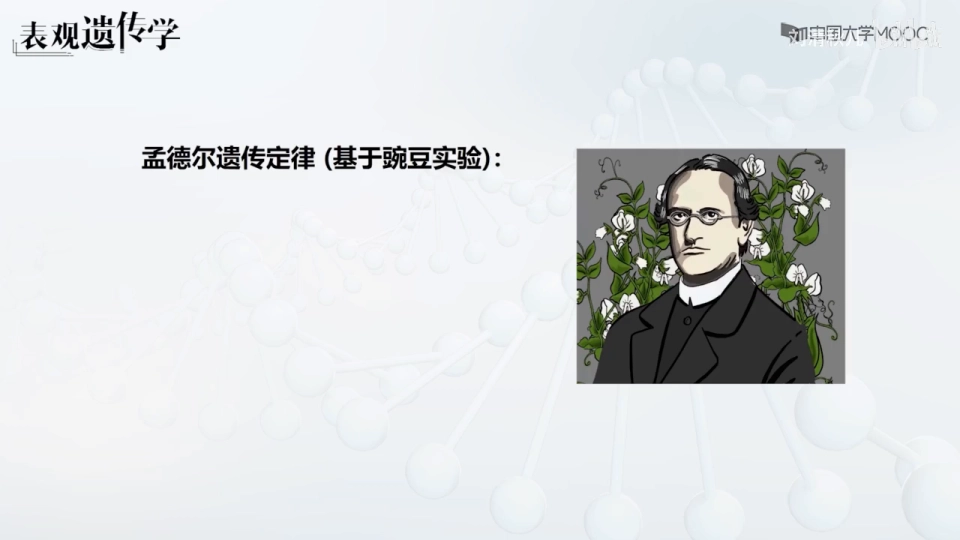
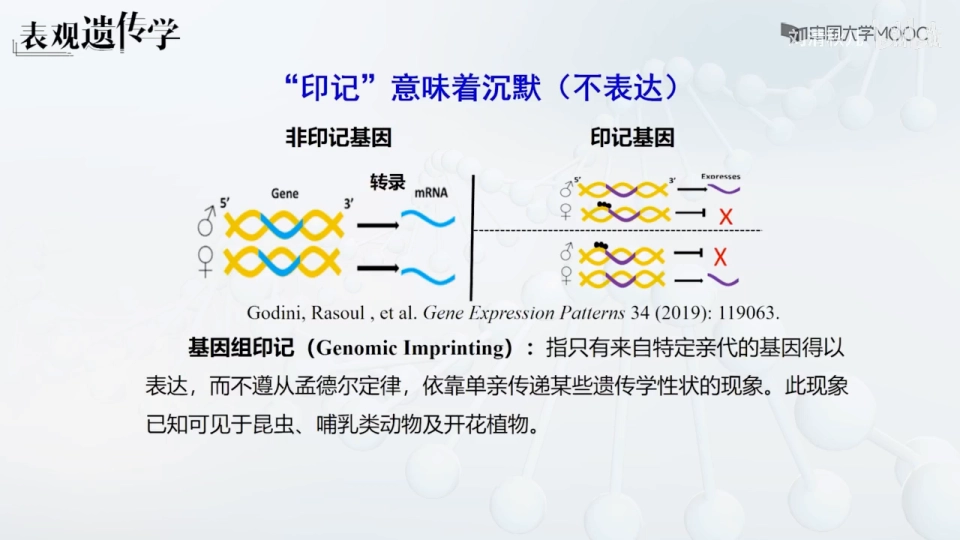
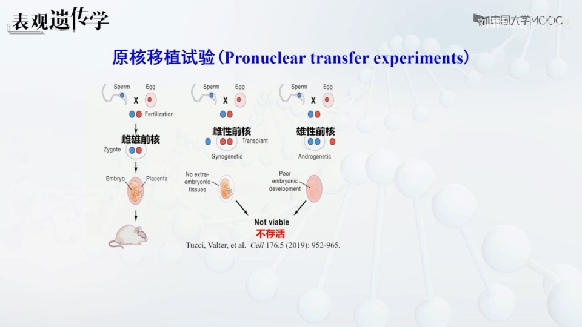
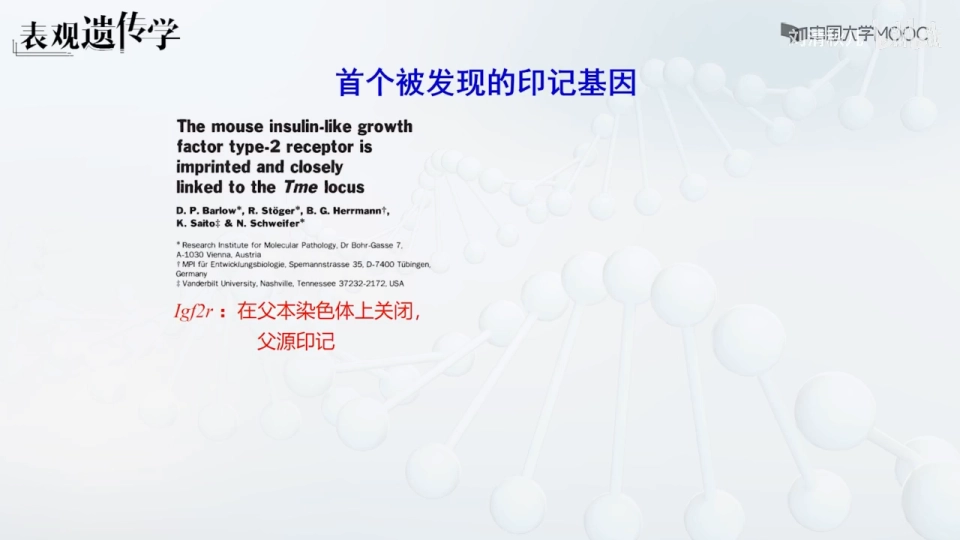
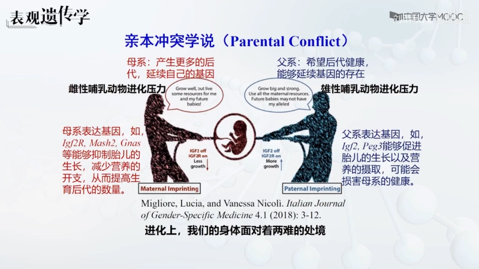
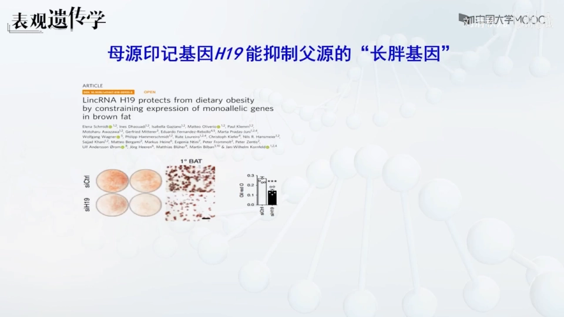
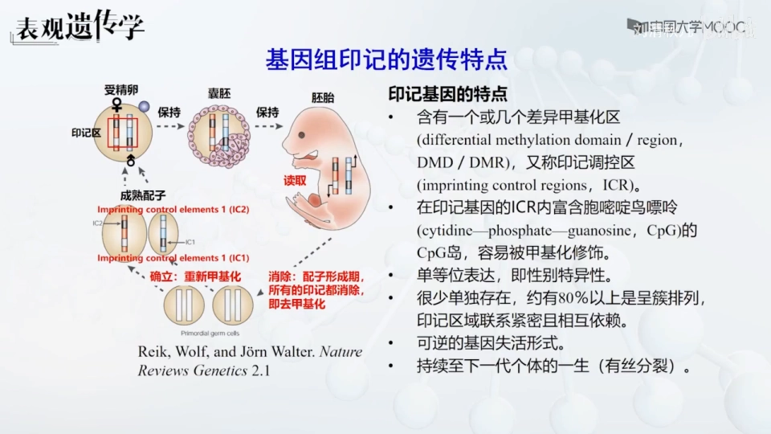
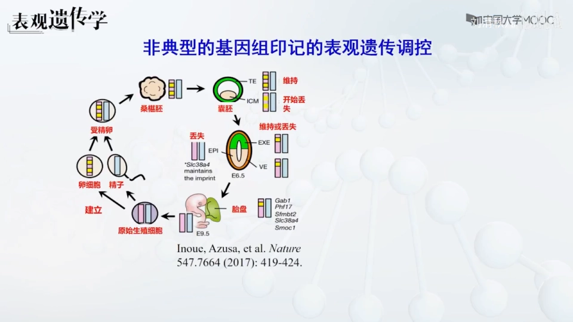

# 基因组印记：亲本来源表达、印记调控区与重编程

> 视频来源：[8.2 基因组印记](https://www.bilibili.com/video/BV1iS421d7Fp/)（Bilibili · 中国大学 MOOC《表观遗传学》，张锌坤，东北师范大学，约 12 分钟）
> 导读（100 字以内）：这支课从"违背孟德尔"讲起，把印记的定义、三个里程碑实验、IGF2/IGF2R 与亲本冲突、印记区的擦除—重建—有丝分裂维持，以及非经典印记串成一条线。本文沿这条线整理，不展开印记相关疾病的临床细节。

## 本讲要解决的核心问题（SCQA）

**背景**：孟德尔遗传定律说，双亲对后代的性状贡献是一致的，一个等位基因表达与否，与它来自父亲还是母亲无关。所以 $Aa$ 和 $aA$ 两种基因型的表型应当相同。

**冲突**：但在许多哺乳动物里，这个等号不成立。同样的等位基因组合，换一个亲本来源，表型就不一样。这说明两条同源染色体并不是等价的——细胞能够"记住"某段 DNA 是父亲给的还是母亲给的。

**疑问**：这个"记住"是怎么实现的？它写在 DNA 序列里吗？如果不在序列里，它凭什么能在一生中所有体细胞分裂里保持，又为什么不会一代代累积下去？

**回答（中心思想）**：基因组印记是**一组按亲本来源单等位表达基因**上的表观标记。标记的核心是印记调控区（ICR）里的差异 DNA 甲基化：它在配子形成时被擦除、按性别重新建立，此后靠有丝分裂维持一生。因此印记是**可逆的基因失活**——序列没变，表达状态变了，而且这个状态既能跨细胞分裂继承，也能跨世代重置。

---

## 一、印记是什么：孟德尔规则的例外

[【跳转到 00:25】](https://www.bilibili.com/video/BV1iS421d7Fp/?t=25)

课程先用孟德尔定律做对照：基于豌豆杂交实验，孟德尔提出双亲对后代的性状贡献一致，等位基因的表达与其来自父源还是母源无关。用今天的写法，就是 $Aa$ 与 $aA$ 的表型可以画等号。

[【跳转到 00:35】](https://www.bilibili.com/video/BV1iS421d7Fp/?t=35)

哺乳动物里出现了反例。取一对同源染色体上的同一个片段来看：如果没有印记，父母本的拷贝在后代中都表达；如果发生印记，子代的同源片段中会有一份来自某一方亲本的拷贝不表达，也就是被沉默。

[【跳转到 01:07】](https://www.bilibili.com/video/BV1iS421d7Fp/?t=67)

这里要固定一个容易混淆的用词：**印记（imprinting）的含义就是沉默（silencing）**。

- 来源于母本的拷贝被沉默 → **母源印记**；
- 来源于父本的拷贝被沉默 → **父源印记**；
- 相应的基因叫母源或父源印记基因。

所以"某基因是父源印记的"这句话，说的是**父源那个拷贝不表达**，不是"父源拷贝被特别标记为要表达"。这个方向感在后面读 ICR 甲基化数据时会反复用到。

[【跳转到 01:32】](https://www.bilibili.com/video/BV1iS421d7Fp/?t=92)

数量上，印记基因在人类基因组中占比不到 1%，但它们在胎儿生长与行为发育中作用关键。这一点决定了它的地位：**不是主流机制，而是少数位点上的特殊规则**，不能拿印记去解释所有基因的表达差异。

---

## 二、怎么证明：三个里程碑实验

印记这个概念不是从测序数据里看出来的，而是从"把基因组来源搞乱"的胚胎实验里逼出来的。

### 2.1 原核移植：父源与母源基因组不等价

[【跳转到 01:57】](https://www.bilibili.com/video/BV1iS421d7Fp/?t=117)

1984 年，科学家做原核移植实验：把两个精子的原核、或两个卵子的原核放进同一个去核卵细胞，观察重组胚胎能否发育。结果两类胚胎都不能成活——只有雌雄原核各一份时才能正常发育。

这张图是本节最重要的一张证据图：它排除了"两套基因组只是剂量不同"的解释，指向**两套基因组携带的信息内容不同**。

### 2.2 染色体易位：不是全基因组效应，而是特定片段

[【跳转到 02:22】](https://www.bilibili.com/video/BV1iS421d7Fp/?t=142)

但原核移植只能说明"父源和母源不等价"，不能说明这种不等价是分布在全基因组，还是集中在少数片段。接下来的染色体易位与非互补分析给出了答案：当某条染色体的特定片段**两份都来自母系或都来自父系**时，生长、行为或存活能力出现异常。

这就把现象定位到了具体的染色体片段上，而不是"整份基因组都带着亲本标签"。

### 2.3 从发育到脑：印记基因不只管胚胎

[【跳转到 02:47】](https://www.bilibili.com/video/BV1iS421d7Fp/?t=167)

后续研究发现，已鉴定的印记基因中有近一半在脑中印记表达。用雌核或雄核细胞与野生型细胞混合形成嵌合体小鼠，可以看到脑部异常，而且雌核细胞与雄核细胞在脑中的分布有偏移，提示印记基因在不同脑区承担不同功能。

这条线索值得记住：**印记不是"胚胎期的一次性事件"**，它在成体组织里仍然在决定哪一个拷贝被读。

---

## 三、经典案例：IGF2、IGF2R 与亲本冲突

### 3.1 第一批被克隆的印记基因

[【跳转到 03:12】](https://www.bilibili.com/video/BV1iS421d7Fp/?t=192)

1991 年，第一个印记基因——小鼠的胰岛素样生长因子 2 受体基因 **IGF2R** 被发现：它在母系来源的 17 号染色体上表达，在父系来源的染色体上不表达。同年，研究者又在小鼠 7 号染色体上鉴定出表达模式相反的 **IGF2** 和 **H19**。

[【跳转到 04:02】](https://www.bilibili.com/video/BV1iS421d7Fp/?t=242)

比对这三个位点，人们发现印记基因位点处**父源与母源等位基因具有不同的、特异的 DNA 甲基化模式**。这是把"印记"落到分子层面的第一步：差异甲基化与差异表达在同一位置同时出现。

### 3.2 亲本冲突：为什么会有方向相反的印记

[【跳转到 04:20】](https://www.bilibili.com/video/BV1iS421d7Fp/?t=260)

目前比较公认的解释是**亲本冲突学说**（parental conflict）。在群居型哺乳动物中，一个雌性有机会与多个雄性结合生育：

- 雄性对每个后代的"期许"是后代足够强壮高大、尽量用尽母方资源——因为它无法确定下一个宝宝是否还携带它的等位基因；
- 雌性则希望孩子长得好，同时为将来的后代保留资源。

[【跳转到 05:10】](https://www.bilibili.com/video/BV1iS421d7Fp/?t=310)

这套期许在基因上确实有对应：IGF2 是促进胎儿生长的生长因子，IGF2R 是它的受体、会抑制 IGF2 的作用。于是**父源的 IGF2R 被印记（沉默），母源的 IGF2 被印记（沉默）**——受抑制的一方与施加抑制的一方各自沉默在"对己方不利"的那个拷贝上。

需要提醒的是：亲本冲突是一个**演化解释**，不是分子机制。它回答"为什么会有方向相反的印记"，不回答"印记怎么被写上去"。

### 3.3 一个人类表型案例：母源 H19 与棕色脂肪

[【跳转到 05:57】](https://www.bilibili.com/video/BV1iS421d7Fp/?t=357)

课程用脂肪组织举了一个较新的例子。人体脂肪分棕色脂肪（消耗能量）与白色脂肪（储存能量）；2009 年三项临床研究证实成人体内也有具生理功能的棕色脂肪，且健康成年人比肥胖患者拥有更多被激活的棕色脂肪。

[【跳转到 06:56】](https://www.bilibili.com/video/BV1iS421d7Fp/?t=416)

2018 年《Nature Communications》的一项研究显示：母源表达的印记基因 **H19** 既促使脂肪前体细胞转化为棕色脂肪，又增强棕色脂肪的能量消耗能力；母方 H19 高表达时，父源的促能量储存基因体系失灵，转向能量消耗模式。后续研究还发现母源 H19 能抑制若干父方表达的促白色脂肪生成基因。

这个案例的教学价值在于：**一个印记基因的剂量变化，会顺着代谢程序放大成表型**，而且方向由亲本来源决定，不由序列决定。

---

## 四、印记的生命周期：擦除、重建、维持

[【跳转到 07:56】](https://www.bilibili.com/video/BV1iS421d7Fp/?t=476)

这是本节最该带走的机制框架。图中的红框是人类基因组内的印记区，黑色是印记基因；所谓印记区，就是含有一个或几个**差异甲基化区**（DMD/DMR）、又称**印记调控区**（ICR）的区域。ICR 内富含 CpG 岛，容易被甲基化修饰。

[【跳转到 08:02】](https://www.bilibili.com/video/BV1iS421d7Fp/?t=482)

这张图把四个阶段一次画全，值得逐段读：

1. **受精卵 → 囊胚 → 胚胎**：印记区被保持（图中"保持""读取"），体细胞里继续按亲本来源表达；
2. **原始生殖细胞**：配子形成时所有印记被消除，即去甲基化（图中"消除"）；
3. **成熟配子**：父源与母源的印记分别被重新确立（图中"确立：重新甲基化"）；
4. 由此形成的印记随配子进入下一代，**通过有丝分裂持续一生**。

[【跳转到 08:27】](https://www.bilibili.com/video/BV1iS421d7Fp/?t=507)

课程把这种遗传方式概括为一句话：**亲代印记是一种可逆的基因失活形式**——先把甲基全部清除，再在特定位置按父母源特性重新加上。这个过程也叫表观遗传重编程。

这句话正是本节要划的"表观 vs 遗传"的边界：

- **像遗传**：标记能随有丝分裂传给所有子细胞，一个细胞在胚胎期的"决定"可以维持一生；
- **不像遗传**：标记在配子形成时被整体擦除再重写，不按孟德尔方式从亲代原样传到子代，也不是 DNA 序列的改变。

因此"印记基因突变致病"与"印记标记写错致病"是两类不同的问题：前者序列变了，后者序列没变、只是表达状态错了。

---

## 五、不止 DNA 甲基化：非经典印记

[【跳转到 09:09】](https://www.bilibili.com/video/BV1iS421d7Fp/?t=549)

长期以来人们认为印记基因全部由 DNA 甲基化控制。2017 年，哈佛大学张毅课题组报道了另一种机制：由 **H3K27me3** 这种组蛋白修饰携带的亲本印记。

[【跳转到 09:15】](https://www.bilibili.com/video/BV1iS421d7Fp/?t=555)

它的生命周期与经典印记明显不同：

- 产生于卵细胞发育早期，能维持到受精后、至少到囊胚阶段；
- 一般是**暂时**的，胚胎着床后消失；
- 但在胚外组织中，一些基因的 H3K27me3 印记能够维持。

而经典印记在胚胎与胚外组织都维持，只在原始生殖细胞中被擦除。两者对照说明：**"印记"是一类现象，不是单一分子机制**；DNA 甲基化是主线，但不是全部。

---

## 六、边界：物种差异与"表观"的分寸

[【跳转到 10:15】](https://www.bilibili.com/video/BV1iS421d7Fp/?t=615)

课程最后给出几条必须写进边界的事实：

- 印记违反孟德尔规则，但**"单等位表达"不等于"另一个拷贝完全沉默"**：不均等表达的程度常随组织、发育阶段变化，甚至在个体之间不同；
- 同一基因座上的印记方向在物种内一致，但**物种之间差异显著**：多数在小鼠中发生的印记在人身上并不发生；
- 印记的系统发育分布有限：明确的情况仅限哺乳动物，植物中仅在被子植物有报道。

[【跳转到 10:57】](https://www.bilibili.com/video/BV1iS421d7Fp/?t=657)

正因为分布有限，印记一定带来了某种可选择的优点来补偿它的代价，于是有了亲本冲突等多种假说。课程只详细讲了亲本冲突，其余假说留给课后文献。

[【跳转到 11:13】](https://www.bilibili.com/video/BV1iS421d7Fp/?t=673)

最后一条边界关于环境：印记参与发育、行为、睡眠与生物钟等过程，而这些过程受环境影响。所以看到"某印记基因与某表型相关"时，要分清是印记状态本身、下游生理过程，还是环境暴露在起作用。

---

## 七、把印记接回"等位基因特异性表达"

这一节的主线是顺式与反式调控，印记正好提供了一个最干净的**顺式**案例：

1. **同一个基因、同一段序列，两个拷贝的表达状态不同**，差别只来自它们所在的染色体被打上了什么标记。这就是等位基因特异性表达（allele-specific expression）的机制来源之一。
2. **标记写在顺式的调控元件上**：ICR 是位于基因座内部的 DNA 元件，它的甲基化状态决定增强子能否接触到启动子。这不是反式因子浓度的差别，而是同一细胞核内两条同源染色体各自的状态差别。
3. **状态既能维持也能重置**：靠有丝分裂维持，靠配子形成时的擦除与重建重置。因此读到一个细胞的等位基因表达比例时，要先问"这是哪个组织、哪个发育阶段"，而不是把它当成固定属性。

---

## 小结

- **基因组印记**指只有来自特定亲本的等位基因被表达、不遵从孟德尔定律的现象；"印记"的含义是**沉默**，父源印记即父源拷贝被沉默。
- 证据链是三步：原核移植证明父源与母源基因组不等价 → 染色体易位/非互补分析把现象定位到特定片段 → 印记基因位点上发现亲本特异的 DNA 甲基化模式。
- 经典案例是 IGF2/IGF2R 与 H19；**亲本冲突学说**解释印记方向为何相反，但它是演化解释，不是分子机制。
- 印记的核心元件是**印记调控区（ICR/DMR）**：配子形成时被擦除，成熟配子中按性别重建，此后通过有丝分裂维持一生。
- 因此印记是**可逆的基因失活**：能跨细胞分裂继承，但不跨世代原样传递，也不改变 DNA 序列。
- 印记不只有 DNA 甲基化：H3K27me3 携带的非经典印记生命周期不同，在胚外组织维持、在胚胎本体着床后消失。
- 边界：单等位表达程度可变、物种间印记谱差异大、印记分布限于哺乳动物与被子植物，且相关生理过程受环境影响。

## 关键术语速查

| 术语 | 一句话解释 |
| --- | --- |
| 基因组印记 | 按亲本来源只表达一个拷贝的遗传现象，不遵从孟德尔定律 |
| 父源印记 / 母源印记 | 父源（或母源）拷贝被沉默；注意说的是"被关闭的那一方" |
| 印记基因 | 受印记调控、呈单等位表达的基因，人类基因组中占比不到 1% |
| 印记调控区（ICR/DMR） | 印记区内含差异甲基化的调控元件，决定下游基因哪个拷贝表达 |
| 原核移植实验 | 把两个精核或两个卵核放入去核卵，胚胎不存活，证明双亲基因组不等价 |
| 亲本冲突学说 | 父源表达促生长、母源表达限生长的演化解释 |
| 表观遗传重编程 | 擦除原有印记并按性别重建新印记的过程 |
| 非经典印记 | 由 H3K27me3 等组蛋白修饰而非 DNA 甲基化携带的亲本印记 |
| 单等位表达 | 两个拷贝中只有一个被表达；程度可变，不一定完全沉默 |