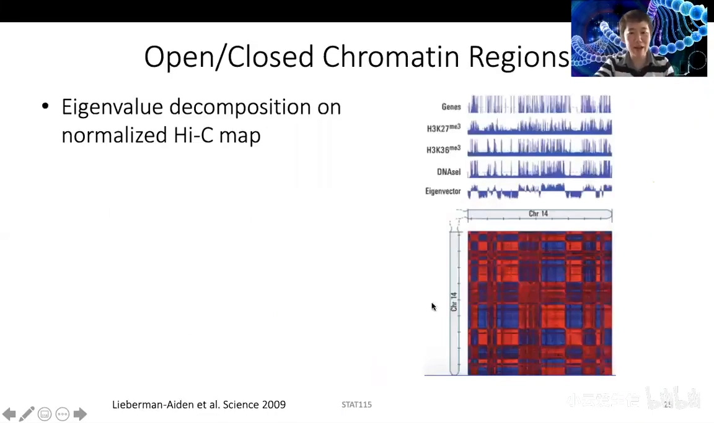
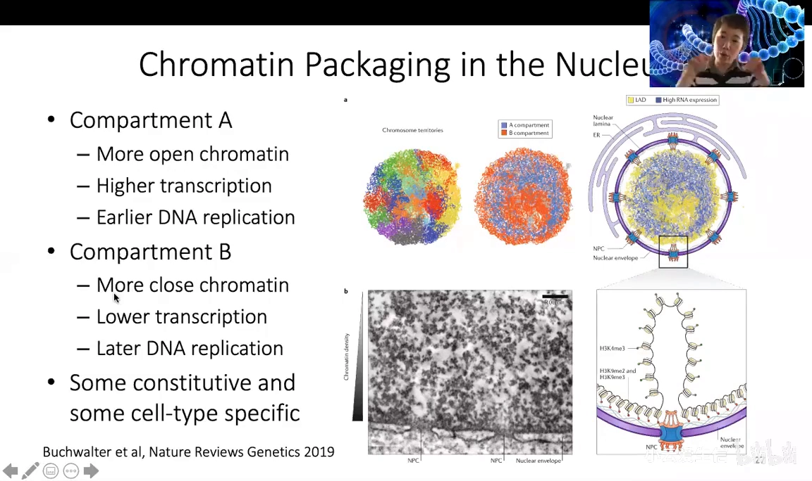
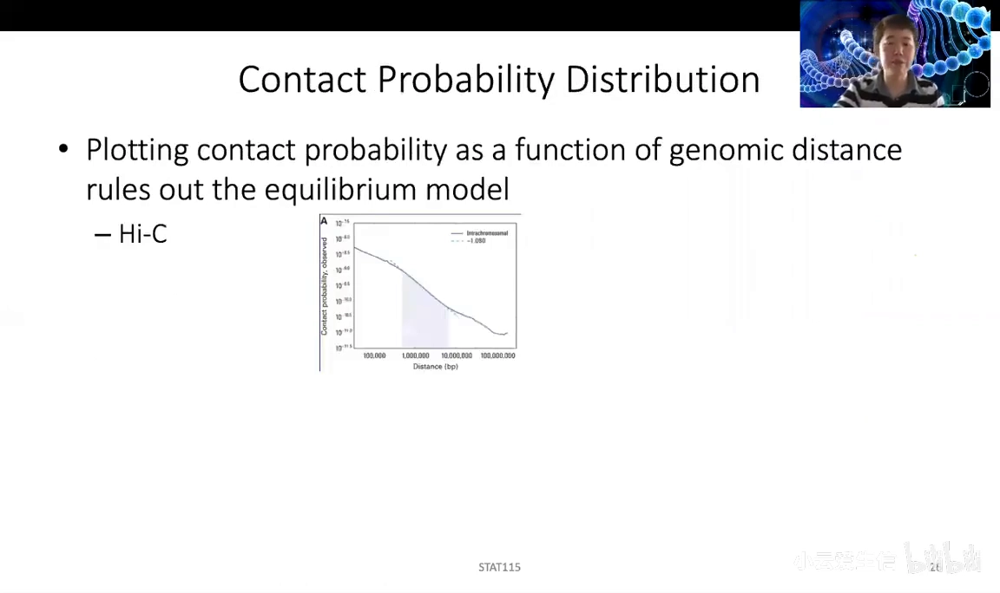
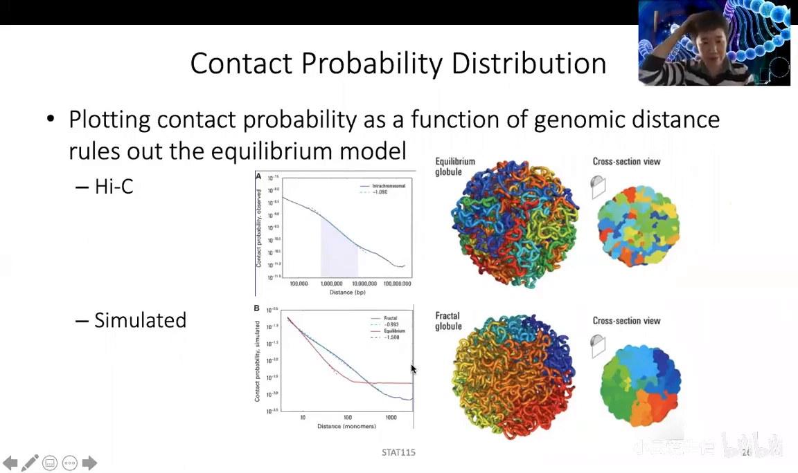
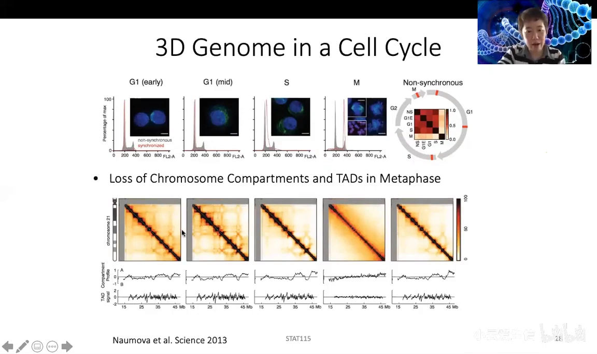
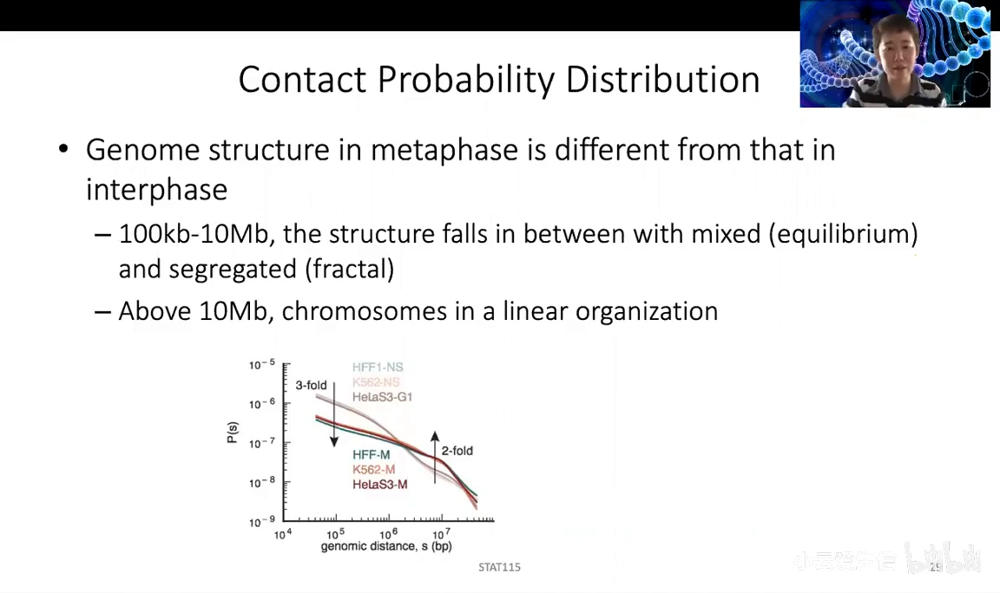

# A／B区室与分形球：接触概率随线性距离衰减说明了什么

> 视频来源：[三维基因组介绍](https://www.bilibili.com/video/BV1WR4y1e7wU/)（B 站搬运 · STAT115 课程片段，约 15 分钟，英文幻灯片配中文字幕）
> 导读：这支课接着上一段讲「缩小看」的那一层——A/B 区室。它用一条接触概率曲线、两个聚合物模型和一次细胞周期观察，回答了「染色质在核里到底是怎么折的」。本文按这条线索重写；后半段是课堂问答，已并入相应小节。

## 本讲要解决的核心问题（SCQA）

**背景**：Hi-C 图放大看是三角形（TAD），缩小看是棋盘格。棋盘格的两色区域分别叫 A 区室和 B 区室，前者转录活跃、后者沉默。

**冲突**：如果染色质只是随机地团在核里，距离近的位点当然更容易接触，可这条「接触概率随距离衰减」的曲线形状对不上随机模型。而且同一段染色质在细胞周期的不同阶段，看起来完全不一样。

**疑问**：区室到底是什么尺度的结构？接触概率的衰减曲线能告诉我们染色质是怎么折叠的吗？这些结构是固定的还是动态的？

**回答（中心思想）**：A/B 区室是 **Mb 尺度**的、与转录活性和核内位置相关的分区；接触概率随距离的衰减曲线**排除了随机平衡球模型**，支持「分形球」这种层级折叠；而细胞周期实验说明这些结构**不是固定的**——有丝分裂中期 TAD 和区室都会消失，进入下一个周期再重建。

## 一、从三角形到棋盘格：区室是更大尺度的一层

在 Hi-C 图上继续缩小，三角形会糊成一片，取而代之的是**棋盘格**：一片偏红、一片偏白交替出现。对归一化后的 Hi-C 矩阵做**本征值分解**（eigenvalue decomposition），取第一特征向量，就能把每条染色体切成两段相互交替的区域。[【跳转到 00:34】](https://www.bilibili.com/video/BV1WR4y1e7wU/?t=34)

关键观察是：**第一特征向量不是随便一条线**。把它和基因密度、组蛋白修饰（H3K27me3、H3K36me3）、DNase I 开放性并排放在一起，会发现它和这些一维基因组特征高度对应。也就是说，二维接触矩阵里最大的那个结构，恰好和「这段染色质是开是关」对得上。[【跳转到 00:34】](https://www.bilibili.com/video/BV1WR4y1e7wU/?t=34)

这一步值得停一下：它说明区室不是「接触数据里凭空冒出来的图案」，而是**接触、修饰、表达、可及性在同一批区域上的一致变化**。这也是后面讨论「相关还是因果」的起点。

## 二、A 与 B 各是什么

讲者给了一张很紧凑的对照图：

| | A 区室 | B 区室 |
| --- | --- | --- |
| 染色质状态 | 更开放 | 更紧密 |
| 转录 | 更高 | 更低 |
| DNA 复制时间 | 更早 | 更晚 |
| 核内位置 | 偏核中心 | 常贴近核膜（LAD） |
| 组蛋白标记 | H3K4me3 等活跃标记 | H3K9me2/3 等抑制标记 |

还有一条重要限定：**有些区室是组成型的，有些是细胞类型特异的**。[【跳转到 00:00】](https://www.bilibili.com/video/BV1WR4y1e7wU/?t=0) [【跳转到 02:19】](https://www.bilibili.com/video/BV1WR4y1e7wU/?t=139)

组成型的部分在所有细胞里都待在 B 区室，比如贴近核膜的**核纤层关联域**（lamina-associated domain，LAD）；细胞类型特异的部分则取决于这个细胞里有哪些转录因子。讲者的说法很形象：一个重要的转录因子被激活后可以通过核孔进入，把某段染色质从 B 区室「拖」到 A 区室，那段区域就开始转录。[【跳转到 11:03】](https://www.bilibili.com/video/BV1WR4y1e7wU/?t=663)

## 三、接触概率随距离衰减：一条能检验模型的曲线

把 Hi-C 数据里所有相距 $s$ 的位点对拿出来，统计它们接触的概率 $P(s)$，就得到一条随距离下降的曲线。近距离时下降快，远距离时趋平；跨过 1 Mb、10 Mb 一直到 100 Mb，接触概率一路走低。[【跳转到 03:04】](https://www.bilibili.com/video/BV1WR4y1e7wU/?t=184)

这条曲线为什么重要？因为它可以**区分模型**。任何模型都能解释「近的比远的更容易接触」，差别在于下降的**快慢**。讲者说，把实测曲线画出来，就排除了最简单的那个模型。[【跳转到 03:29】](https://www.bilibili.com/video/BV1WR4y1e7wU/?t=209)

## 四、两个模型：平衡球与分形球

**平衡球（equilibrium globule）**：把染色质当成一根自由摆动的聚合物，在核里随机平衡。近的位点天然更容易接触，但整体是一团均匀的乱麻。

**分形球（fractal globule）**：一种层级折叠方式——大的块先各自成团，块内部再各自成团，一层套一层。结果是：基因组上相邻的片段在空间上也聚在一起，而且这种聚集是「可解开」的，不会打成死结。

模拟给出的判据很干净：平衡球的接触概率按 $P(s) \propto s^{-1.5}$ 衰减，分形球按 $P(s) \propto s^{-1}$ 衰减。实测 Hi-C 曲线的斜率接近 $-1$（讲者展示的拟合值是 $-0.93$），落在分形球这一边。[【跳转到 05:51】](https://www.bilibili.com/video/BV1WR4y1e7wU/?t=351)

讲者还补了一个尺度上的限定：**在很近的距离上，两个模型差别不大**——那个尺度由环和小结构域主导；差别出现在更远的区室尺度上。[【跳转到 05:01】](https://www.bilibili.com/video/BV1WR4y1e7wU/?t=301)

分形球这个模型好在哪？讲者给了两个直觉：

- **染色体不会互相打结**。基因组在复制、解链、转录时要局部「打开」，如果折叠成死结，打开一处会拖乱全局；分形折叠保证局部打开是局部的。
- **染色体疆域**（chromosome territory）自然出现。每条染色体占据核内一块相对独立的区域，而不是所有染色体自由混在一起；这既避免缠绕，也方便同一染色体上需要协调的基因待在一起。[【跳转到 07:31】](https://www.bilibili.com/video/BV1WR4y1e7wU/?t=451) [【跳转到 06:16】](https://www.bilibili.com/video/BV1WR4y1e7wU/?t=376)

顺带回答课堂上反复出现的那个问题：**为什么有了分形折叠，接触概率还是随距离下降？** 因为基因组上相邻的片段在物理上是连在同一根链上的，一个动了另一个会被拖着走；而离得很远的两个片段之间没有这层连接，可以各自漂。距离仍然重要，只是下降的速度被折叠方式改写了。[【跳转到 08:46】](https://www.bilibili.com/video/BV1WR4y1e7wU/?t=526)

## 五、细胞周期：这些结构不是固定的

讲者展示了一组按细胞周期分选的数据：G1 早期、G1 中期、S 期、M 期，各自的 Hi-C 图并排放在一起。

结论很直接：**有丝分裂中期，区室和 TAD 都消失了**。染色质高度致密，基因基本不转录，图上只剩下对角线；进入下一个细胞周期、染色质松弛、马达重新结合上去之后，TAD 和区室又逐渐重建。[【跳转到 12:14】](https://www.bilibili.com/video/BV1WR4y1e7wU/?t=734) [【跳转到 13:04】](https://www.bilibili.com/video/BV1WR4y1e7wU/?t=784)

接触概率曲线也随周期改变。讲者引用的观察是：M 期的结构介于「混合（平衡）」和「分离（分形）」之间——100 kb 到 10 Mb 这一段两者兼有，10 Mb 以上则更接近线性的组织方式；与间期相比，曲线在不同距离上有约 3 倍和 2 倍的位移。[【跳转到 13:37】](https://www.bilibili.com/video/BV1WR4y1e7wU/?t=817)

这段观察引出了本节最后一个、也是最诚实的一个说法：**结构和转录谁是因、谁是果，讲者明确说这是「鸡和蛋」**。染色质超致密时没有转录；细胞周期之后转录因子结合、马达进去，结构重建，而重建出来的结构又反过来决定哪些基因被激活。所以更稳妥的表述是「两者互为条件、共同维持」，而不是单向因果。[【跳转到 14:21】](https://www.bilibili.com/video/BV1WR4y1e7wU/?t=861)

## 六、读这类图的边界

- **区室是 Mb 尺度的统计分区**，不是一条画在 DNA 上的边界线；它的位置随细胞类型、细胞周期改变。
- **A/B 与转录的对应是相关**。第一特征向量和表达、修饰对得上，只能说明这些特征在同一批区域上共变；要证明某一方驱动另一方，需要扰动（比如把一段区域从 B 拉到 A，看转录是否跟着变）。
- **Hi-C 是群体平均**。棋盘格是几百万个细胞叠出来的平均图案，单个细胞里的区室边界可能更模糊。
- **模型是解释工具**。分形球能对上斜率，说明它抓住了折叠的某些统计特征，不等于细胞里真的按这个算法折；讲者的措辞也是「人们认为更像分形球」。

## 小结

- 缩小 Hi-C 图看到的棋盘格是 A/B 区室，Mb 尺度；第一特征向量与基因密度、组蛋白修饰、可及性高度对应。
- A 区室更开放、转录更高、复制更早、偏核中心；B 区室更紧密、转录更低、复制更晚、常贴近核膜形成 LAD；有组成型也有细胞类型特异的部分。
- 接触概率随基因组距离衰减的曲线形状可以区分聚合物模型：平衡球给 $s^{-1.5}$，分形球给 $s^{-1}$，实测接近 $-1$。
- 分形折叠的好处是不打结、能局部打开，并自然形成染色体疆域。
- 有丝分裂中期 TAD 与区室消失，下一个周期重建；结构与转录互为条件，不宜说成单向因果。
- 区室与转录的对应是相关证据，因果要靠扰动。

## 关键术语速查

| 术语 | 一句话解释 |
| --- | --- |
| A/B 区室 | Mb 尺度上交替出现的活跃（A）与沉默（B）染色质分区 |
| 本征值分解 | 把接触矩阵分解出主要变化方向，第一特征向量常用来划分 A/B |
| 接触概率 $P(s)$ | 基因组上相距 $s$ 的两个位点发生接触的概率，随 $s$ 增大而下降 |
| 平衡球 | 把染色质当自由聚合物随机平衡的模型，接触概率按 $s^{-1.5}$ 衰减 |
| 分形球 | 层级折叠的聚合物模型，接触概率按 $s^{-1}$ 衰减，不打结、可局部打开 |
| 染色体疆域 | 每条染色体在核内占据的相对独立区域 |
| LAD | 核纤层关联域，贴近核膜、通常处于 B 区室的染色质区域 |
| 核孔 | 核膜上的通道，转录因子等可经此进出，与区室转换相关 |