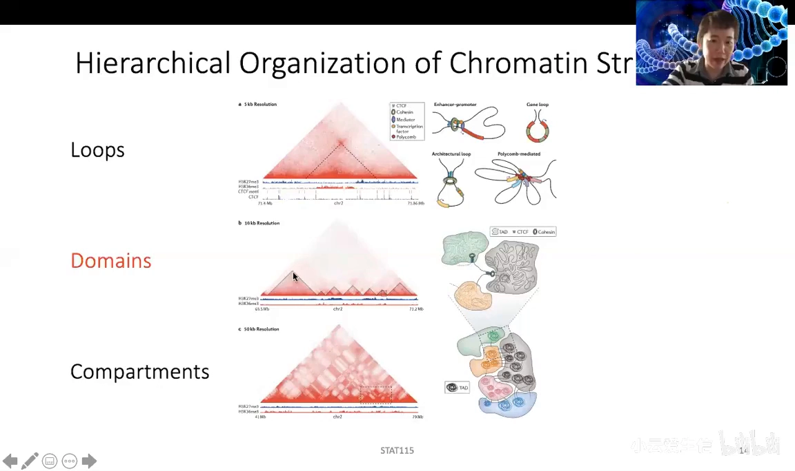
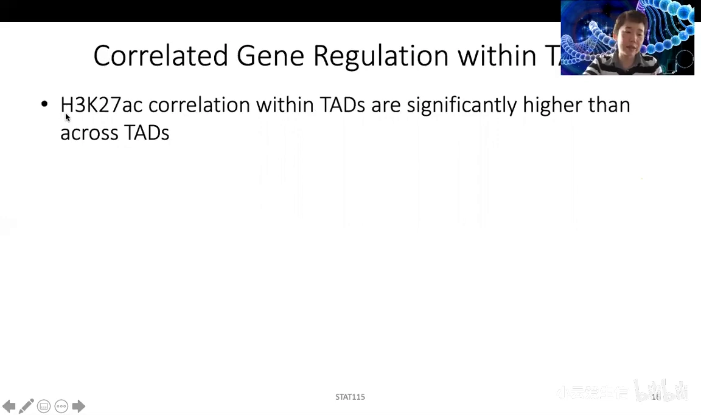
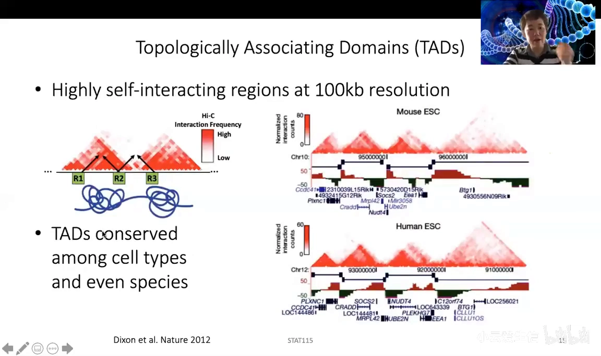
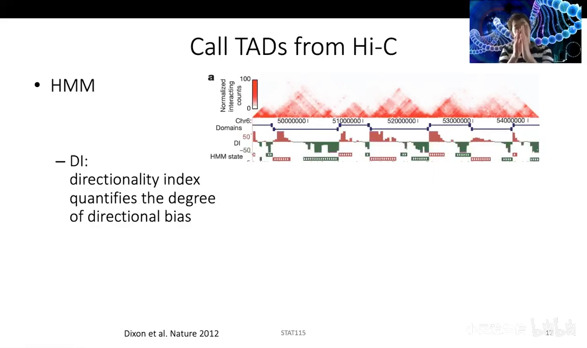
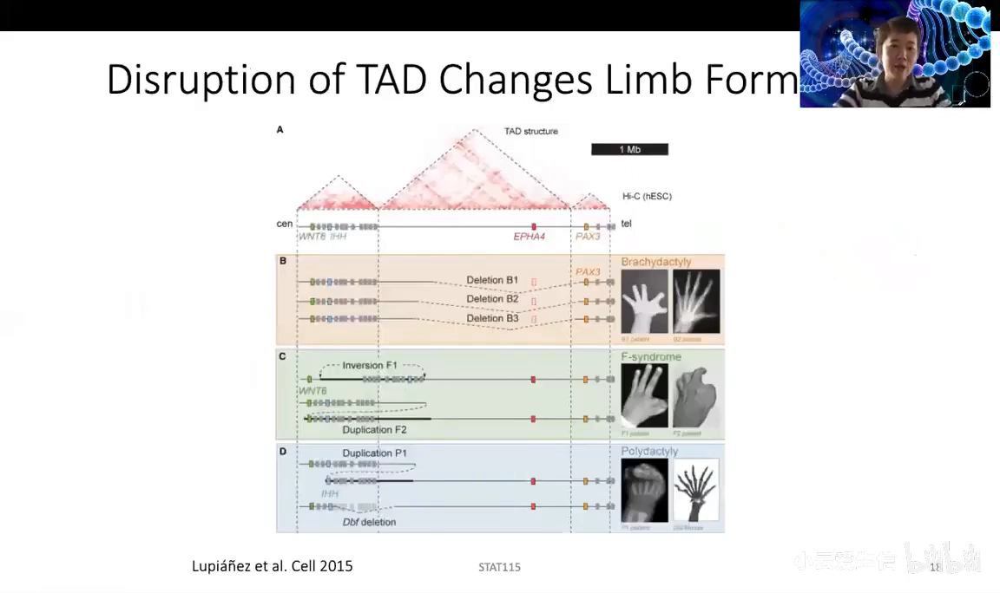
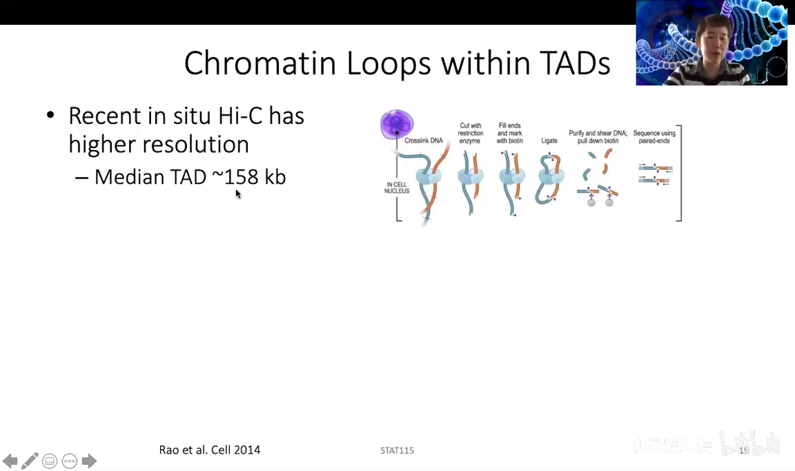
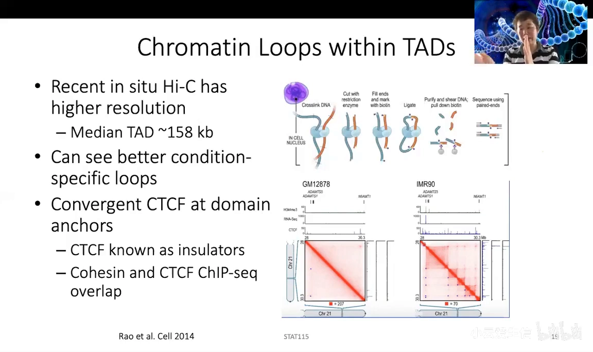
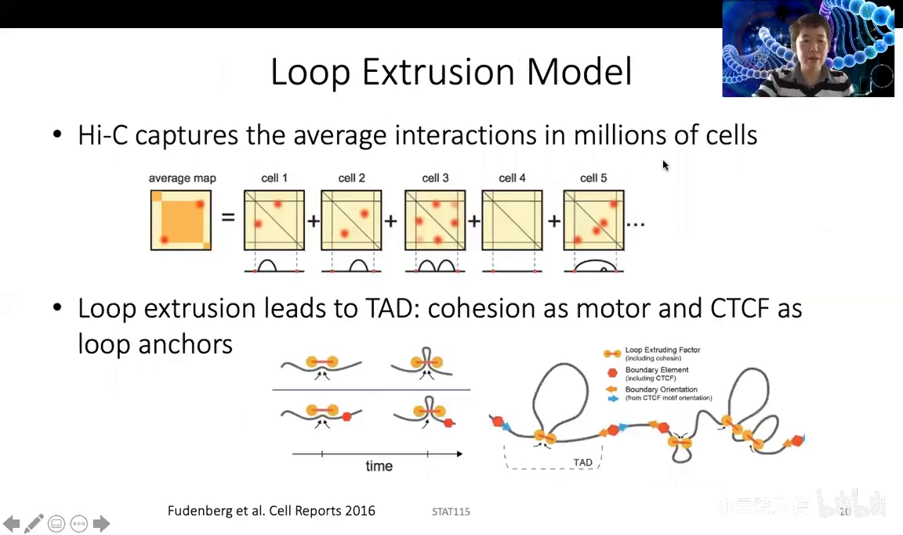
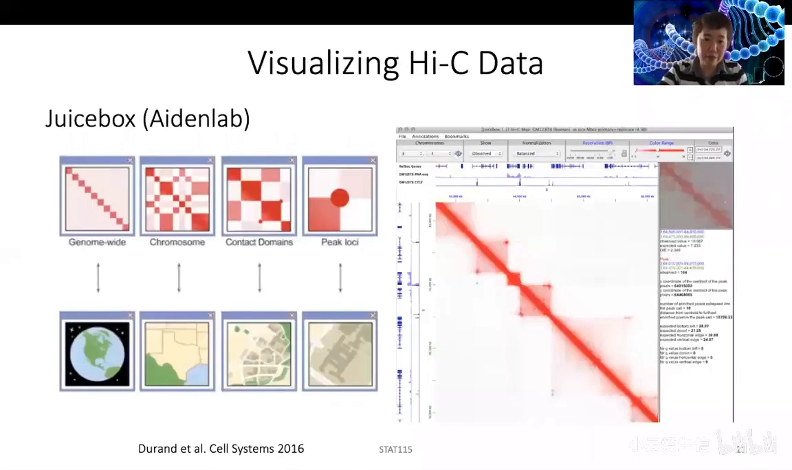

# Hi-C热图上的三种尺度：染色质环、拓扑关联域与区室

> 视频来源：[Hi-C结果中寻找拓扑结构域（TADs）](https://www.bilibili.com/video/BV1D24y1a7L7/)（B 站搬运 · STAT115 课程片段，约 20 分钟，英文幻灯片配中文字幕）
> 导读：这支课把「三维基因组」拆成一张热图上的三种图案——环、结构域、区室，再讲怎么从图上把边界算出来、边界被破坏会怎样、以及环是怎么被挤出来的。本文按这条线索重写，术语按幻灯片核对过；末尾专门留一节讲「接触不等于调控」。

## 本讲要解决的核心问题（SCQA）

**背景**：基因组在数据库里是一串线性坐标：第 12 号染色体 5,000,000 到 5,200,000 这一段。转录因子、增强子、启动子都挂在这串坐标上。

**冲突**：在细胞核里，这段坐标并不是一根拉直的线。线性上隔了 50 Mb 的两个位点可能在空间上贴在一起，线性上相邻的两个位点也可能被隔开。更麻烦的是，把「空间上贴在一起」画成热图之后，图案有环、有三角形、有棋盘格，很容易一股脑都叫成「调控互作」。

**疑问**：这些图案分别是什么尺度上的结构？怎么从热图里把它们的边界算出来？看到两个位点接触频繁，能不能直接说它们之间有调控关系？

**回答（中心思想）**：Hi-C 热图上的图案按尺度分三层——**环（loop）**在 kb 级、**拓扑关联域（TAD）**在 100–200 kb 级、**区室（compartment）**在 Mb 级。三者都是「接触频率」的统计结果，不是「调控关系」的直接读出。要谈调控，得再往前走一步：找到锚点上的蛋白（CTCF、cohesin）、做扰动、看表型。

## 一、Hi-C 把「谁和谁挨着」变成一张矩阵

Hi-C 的实验逻辑是：先把细胞核里空间上挨着的 DNA 用甲醛交联固定住，用限制性内切酶切断，把切口的末端补平并标上生物素，再用连接酶把空间上靠近的末端接起来，最后打断、富集带生物素的连接片段、双端测序。测到的每一对读段，就代表「这两个位点在空间上曾经靠得很近」。[【跳转到 00:00】](https://www.bilibili.com/video/BV1D24y1a7L7/?t=0)

把全基因组按固定长度切成一个个 **bin**（比如 40 kb 一格），统计每两个 bin 之间被抓到的连接数，就得到一张方阵：行和列都是基因组坐标，格子里的数值是接触频率。这张图有三个必须记住的读法：

- **对角线最红**：离得越近的位点越容易接触，这是「线性距离」的基线效应，不是结构。
- **矩阵对称**：A 和 B 的接触等于 B 和 A 的接触，所以论文里常只画一半，看起来就是三角形。
- **颜色要归一化后才能比较**：不同区域测序深度、酶切位点密度不一样，原始计数不能直接比大小。讲者在前一部分专门讲过数据规范化，这里只用结论。[【跳转到 01:00】](https://www.bilibili.com/video/BV1D24y1a7L7/?t=60)

还有一条必须提前记住的限制：**这张矩阵是数百万个细胞的平均**。单个细胞里的接触格局各不相同，叠起来才出现热图上那些干净的图案。这一点在第七节讲环挤压时还会用到。[【跳转到 12:44】](https://www.bilibili.com/video/BV1D24y1a7L7/?t=764)

## 二、三种尺度：同一张图，放大和缩小看到不同的结构

同一段染色体，用不同分辨率去看，图案完全不同。这是本节最重要的一张图：

- **5 kb 分辨率**看到的是**环**：对角线上方一个孤立的红点，表示两个相距较远的位点接触异常频繁。图右侧列出了几种环：增强子—启动子环、基因环（gene loop）、架构环（architectural loop）、Polycomb 介导的环。
- **10 kb 分辨率**看到的是一串**三角形**：每个三角形内部接触多、三角形之间接触少。这就是**拓扑关联域**（topologically associating domain，TAD）。
- **50 kb 分辨率**看到的是**棋盘格**：一大片红、一大片淡交替出现，这是 **A/B 区室**（compartment）。

讲者强调这三层是**层级组织**（hierarchical organization）：环是更小尺度的结构，环和环叠出结构域，结构域再组成区室。[【跳转到 00:05】](https://www.bilibili.com/video/BV1D24y1a7L7/?t=5)

## 三、TAD：高自相互作用的小模块

TAD 的定义很朴素：**在 100 kb 分辨率下高度自我相互作用的区域**。在热图上就是对角线上的一个小方块，转 45 度就是一个三角形。哺乳动物细胞里通常一百到两百 kb 一个，内部互动多，跨出边界互动就少。[【跳转到 01:50】](https://www.bilibili.com/video/BV1D24y1a7L7/?t=110)

TAD 之所以被当成「功能模块」，靠的是两类观察：

**第一，同一个 TAD 里的基因表达更相关。** 讲者给的证据是 H3K27ac（活跃增强子/启动子的标记）：把基因组上任意两处按距离配对，比较它们的 H3K27ac 信号。如果两处在同一个 TAD 内，即使线性距离很远，信号相关性依然更高；如果分属两个 TAD，即使相隔 50 Mb、彼此「同类」，相关性也低得多。[【跳转到 02:40】](https://www.bilibili.com/video/BV1D24y1a7L7/?t=160) [【跳转到 03:30】](https://www.bilibili.com/video/BV1D24y1a7L7/?t=210)

**第二，TAD 很保守。** 不同人体组织的 Hi-C 数据里 TAD 位置大体一致；把人和小鼠的同一区域并排看，三角形的边界仍然对得上。讲者用的例子是 Dixon 等人 2012 年的数据：小鼠胚胎干细胞与人类胚胎干细胞在 Chr10/Chr12 的直系同源区域，TAD 边界落在同一批基因之间。[【跳转到 04:03】](https://www.bilibili.com/video/BV1D24y1a7L7/?t=243)

保守性说明 TAD 不是测序噪声，但它**不**说明 TAD 内部的每一次接触都有功能——这一点留到第八节。

## 四、怎么从图上把边界算出来：方向性指数 + 隐马尔可夫模型

人眼能看出三角形，但要做全基因组分析，得让算法给出坐标。Dixon 等人的做法分两步。

**第一步，算方向性指数（directionality index，DI）。** 把基因组切成 40 kb 的 bin，对每个 bin 问一个问题：和它相互作用的读段，另一端主要落在它**后面**（下游）还是**前面**（上游）？主要落在后面，DI 为正；主要落在前面，DI 为负；两边都有，DI 接近零。沿着染色体走一遍，DI 会呈现「正—零—负—零—正」的锯齿。[【跳转到 05:06】](https://www.bilibili.com/video/BV1D24y1a7L7/?t=306) [【跳转到 06:46】](https://www.bilibili.com/video/BV1D24y1a7L7/?t=406)

**第二步，用隐马尔可夫模型（HMM）把锯齿切成状态。** 模型有三种隐藏状态：上游偏好、下游偏好、无偏好。每当状态从「上游偏好」切到「下游偏好」（或反过来），那里就是 TAD 边界。讲者用抛硬币打比方：HMM 在问的是「这一段属于哪枚硬币」，转移概率决定「多久换一次硬币」，发射概率决定「在这枚硬币下看到正/负数的可能性」。[【跳转到 07:36】](https://www.bilibili.com/video/BV1D24y1a7L7/?t=456) [【跳转到 17:14】](https://www.bilibili.com/video/BV1D24y1a7L7/?t=1034)

这里要留一个谨慎：**边界的位置依赖分辨率和归一化**。同一个区域，bin 取 40 kb 还是 10 kb、数据规范化用哪种方法，画出来的边界会略有出入；数据浅的时候锯齿里也有噪声。所以「TAD 边界」是一套算法给出的坐标，不是一条物理上看得见的线。

## 五、边界被破坏会怎样：肢体发育的增强子劫持

TAD 边界不只是统计特征。讲者用 Lupiáñez 等人 2015 年发在 Cell 上的工作说明：**删掉边界，接触格局变了，表型也跟着变**。

这段区域里有三个相邻的 TAD：左边是 WNT6 和 IHH，中间一大块没有基因但含一个重要的增强子，右边是 EPHA4 和 PAX3。研究者构造了三种结构变异：

- **缺失边界（Deletion B1–B3）**：两个 TAD 融合，原本不该被这个增强子管的基因被带上，出现短指（brachydactyly）。
- **倒位（Inversion F1/F2）**：边界位置被搬走，出现 F 综合征。
- **重复（Duplication P1）**：多出一份增强子—基因组合，出现多指（polydactyly）。

讲者的结论是：相互作用发生在各个 TAD 内部，边界一变，附近基因被激活的程度就变，于是手指的数目和形态也变。[【跳转到 08:36】](https://www.bilibili.com/video/BV1D24y1a7L7/?t=516) [【跳转到 09:51】](https://www.bilibili.com/video/BV1D24y1a7L7/?t=591)

这个案例的价值在于它是**扰动证据**：不是「观察到接触」，而是「改掉结构，接触和表型一起变」。至于「这个增强子到底调控哪个基因」的因果验证方法（报告基因、CRISPR 删除、单细胞成像等），属于下一小节 [§3.2.2](../../../README.md#b02-3-2-2)，这里只把它当作 TAD 边界有功能的证据。

## 六、环的锚点：CTCF 与 cohesin

分辨率提高之后，环才看得清楚。讲者提到 **in situ Hi-C**（原位 Hi-C）：流程和传统 Hi-C 大致相同，只是技术上更好一点，分辨率更高。用它可以测到 TAD 的中位数约 **158 kb**，也能看到条件特异的环。[【跳转到 10:39】](https://www.bilibili.com/video/BV1D24y1a7L7/?t=639)

环的锚点上富集两个蛋白：

- **CTCF**：被报道为**相互作用的绝缘子**——如果一个 CTCF 结合位点在基因和增强子之间，它可以阻止这个增强子去调控这个基因。[【跳转到 11:54】](https://www.bilibili.com/video/BV1D24y1a7L7/?t=714)
- **cohesin**：一个环状的蛋白复合体。做 ChIP-seq 会发现，cohesin 的结合位点和 CTCF 的结合位点在基因组上显著重叠。[【跳转到 12:19】](https://www.bilibili.com/video/BV1D24y1a7L7/?t=739)

还有一个方向性细节：CTCF 结合位点是有朝向的，环的两个锚点上，CTCF 基序往往呈**汇聚**（convergent）方向——两个基序面对面。这正好是下一节模型需要的零件。[【跳转到 19:19】](https://www.bilibili.com/video/BV1D24y1a7L7/?t=1159)

## 七、环挤压模型：cohesin 当马达，CTCF 当刹车

为什么会有环？目前最主流的解释是**环挤压模型**（loop extrusion）。讲者先给了一个前提：**Hi-C 图是数百万个细胞的平均**。单个细胞里，环的位置和大小各不相同；把它们加起来，才出现热图上那个平均的三角形。[【跳转到 12:44】](https://www.bilibili.com/video/BV1D24y1a7L7/?t=764)

模型有三个零件：

1. **马达**：cohesin 结合到染色质上，像一对环一样把 DNA 往自己身上拉，形成越来越大的环。
2. **刹车**：CTCF 结合位点把马达卡住。
3. **朝向**：只有两个 CTCF 面对面（汇聚方向）时，马达才会被两边同时挡住，形成一个稳定的环；如果两个 CTCF 背对背，马达会一路滑过去，看不到稳定的环。[【跳转到 13:34】](https://www.bilibili.com/video/BV1D24y1a7L7/?t=814) [【跳转到 13:59】](https://www.bilibili.com/video/BV1D24y1a7L7/?t=839)

这样一来，TAD 就不是「先画好格子再把基因放进去」，而是**环挤压 + CTCF 刹车**在群体上留下的统计结果：两个汇聚的 CTCF 之间，环被反复挤出又解掉，平均下来就是一个三角形。[【跳转到 14:49】](https://www.bilibili.com/video/BV1D24y1a7L7/?t=889)

讲者说明这个模型有模拟和实验两方面的支持，但措辞是「被认为是一个非常好的模型」，不是已经盖棺定论。读文献时要注意区分：**环挤压是被大量证据支持的机制模型，不是从一张 Hi-C 图直接读出来的事实**。

## 八、看图工具，以及读图的边界

要把这些数据看出来，常用的可视化工具是 **Juicebox**（Aiden 实验室，Hi-C 的发明实验室）和 **HiGlass**（哈佛团队）。它们支持像地图一样缩放：全基因组 → 单条染色体 → 接触结构域 → 单个环。Juicebox 那张幻灯片把四级缩放并排比作地球仪、国家、城市、街道。[【跳转到 15:33】](https://www.bilibili.com/video/BV1D24y1a7L7/?t=933)

最后是本节最需要记住的边界：**接触 ≠ 调控**。这条边界有三层理由，都来自这支课本身：

- **接触是群体平均**。Hi-C 图上的三角形是几百万个细胞叠出来的；单个细胞里这个环可能根本没形成。所以「图上很红」不等于「这个细胞里这两个位点一直在一起」。[【跳转到 12:44】](https://www.bilibili.com/video/BV1D24y1a7L7/?t=764)
- **相关不是因果**。TAD 内 H3K27ac 相关性更高，说明它们**倾向于**一起被调控，不说明谁调控谁，也不说明每一次接触都产生调控。[【跳转到 03:30】](https://www.bilibili.com/video/BV1D24y1a7L7/?t=210)
- **因果要靠扰动**。真正支持「边界有功能」的是第五节那类实验：删掉边界、看到接触格局改变、同时看到表型改变。只有接触数据时，最稳妥的说法是「这是一个候选互作」。

所以读一张 Hi-C 图，可以按这个顺序问自己：这段区域的分辨率是多少？边界是用什么算法、什么 bin 定的？这个环的锚点上有 CTCF/cohesin 吗？有没有扰动实验把结构和表型连起来？四问都过，才轮到谈「调控」。

## 小结

- Hi-C 把空间接触变成矩阵：对角线是线性距离的基线，格子是接触频率，比较前必须归一化。
- 同一张图按尺度看是三种结构：kb 级的环、100–200 kb 的 TAD、Mb 级的 A/B 区室。
- TAD 是「高自相互作用」的统计区域，边界可以用方向性指数加 HMM 算出来；位置依赖分辨率和算法。
- TAD 内部基因表达更相关、TAD 在物种间保守，这两条支持「TAD 是调控模块」，但都只是相关证据。
- 边界被删除、倒位、重复会改变接触格局并产生肢体畸形，这是结构变异层面的扰动证据。
- 环的锚点富集 CTCF 与 cohesin，CTCF 有朝向；环挤压模型用「cohesin 当马达、CTCF 当刹车」解释 TAD 与环的由来。
- 接触是群体平均的结构证据，不等于调控；要谈调控必须有扰动与表型。

## 关键术语速查

| 术语 | 一句话解释 |
| --- | --- |
| Hi-C | 用交联、酶切、连接、测序把空间上靠近的 DNA 片段成对抓出来，得到全基因组接触频率 |
| bin | 把基因组切成固定长度的小格（如 40 kb），接触矩阵的行列单位 |
| 接触频率 / 接触概率 | 两个 bin 之间被抓到的连接数；归一化后可跨区域比较 |
| 环（loop） | 热图上对角线上方的一个孤立强信号点，表示两个位点异常频繁接触 |
| TAD（拓扑关联域） | 100–200 kb 尺度上高度自我相互作用的区域，热图上是一个三角形 |
| 方向性指数（DI） | 每个 bin 的相互作用偏向哪一侧的量化指标，正负交替处提示边界 |
| HMM | 隐马尔可夫模型，把 DI 的锯齿切成「上游偏好/下游偏好/无偏好」三种状态 |
| CTCF | 结合在环锚点上的锌指蛋白，常被称为绝缘子，基序有朝向 |
| cohesin | 环状蛋白复合体，环挤压模型里的「马达」 |
| 环挤压（loop extrusion） | cohesin 把 DNA 挤成环、被汇聚方向的 CTCF 卡住，从而形成 TAD 与环的模型 |
| 绝缘子（insulator） | 放在增强子和基因之间可以阻断调控关系的元件，CTCF 位点是典型代表 |
| in situ Hi-C | 原位 Hi-C，流程改良后分辨率更高，可测到中位约 158 kb 的 TAD |