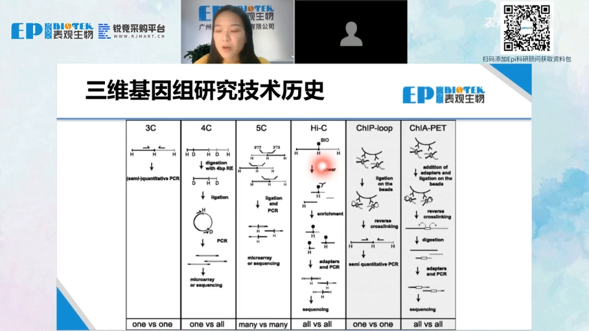
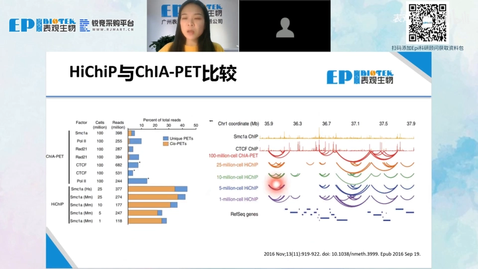
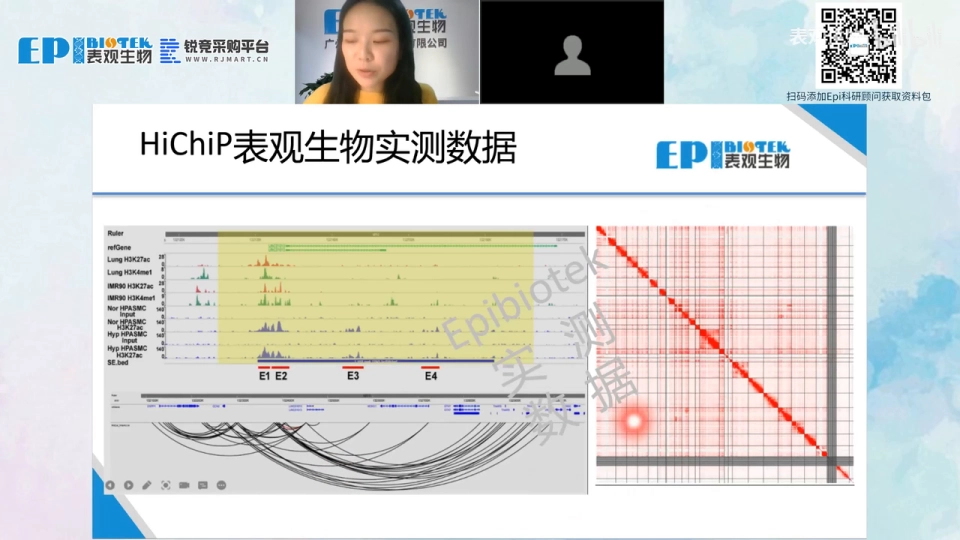
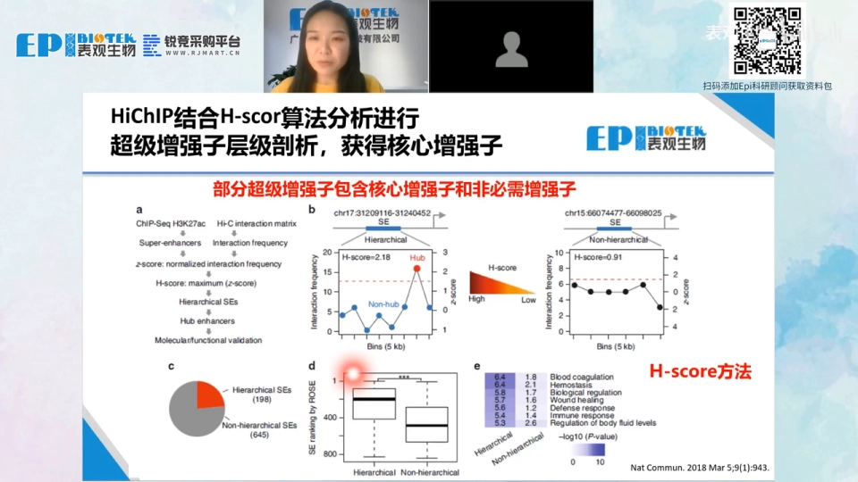
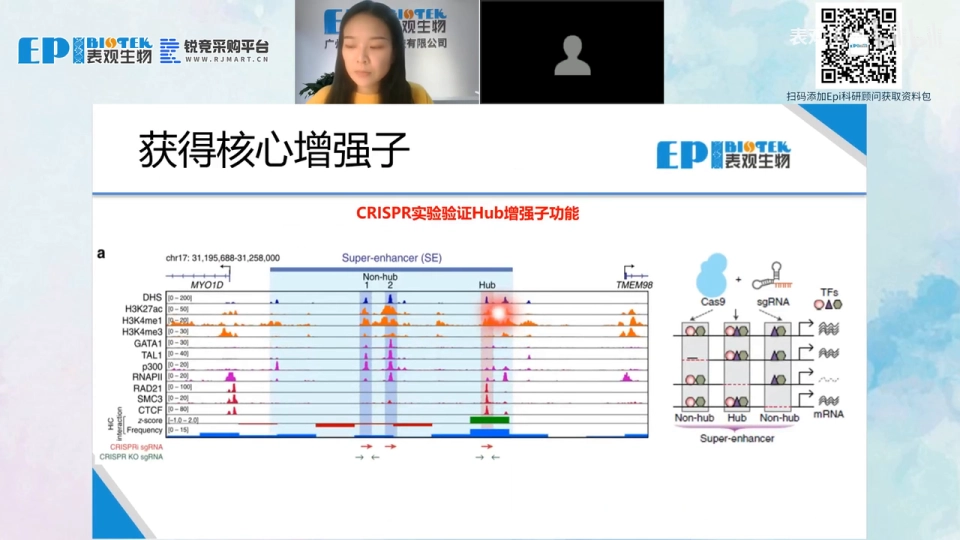
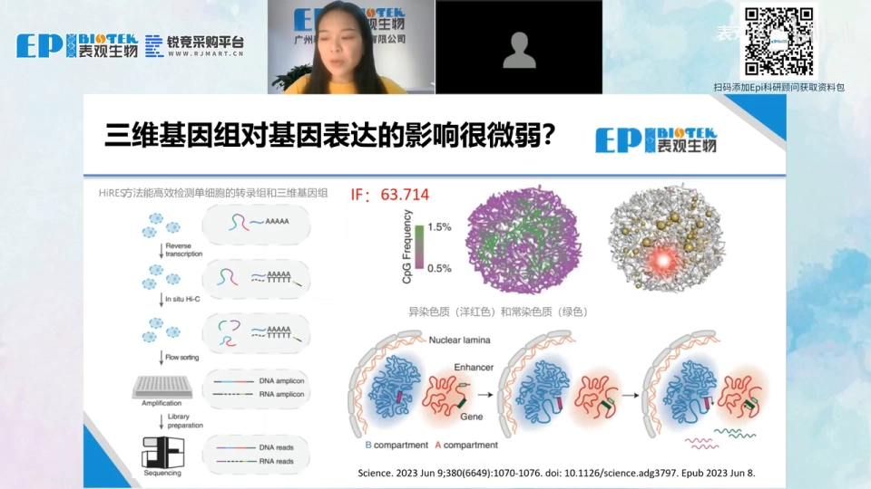
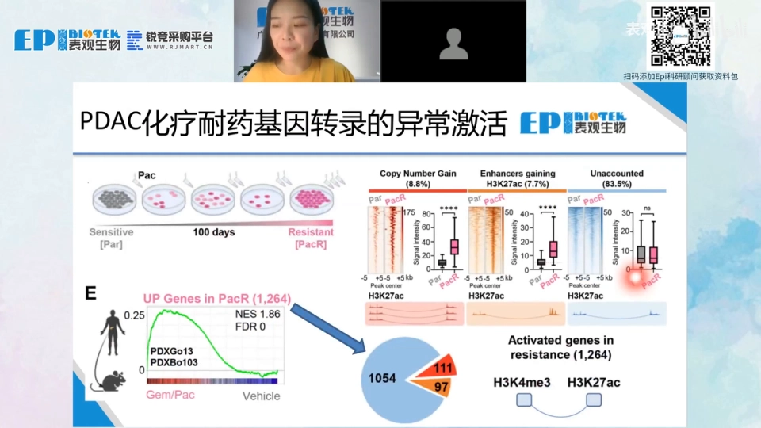
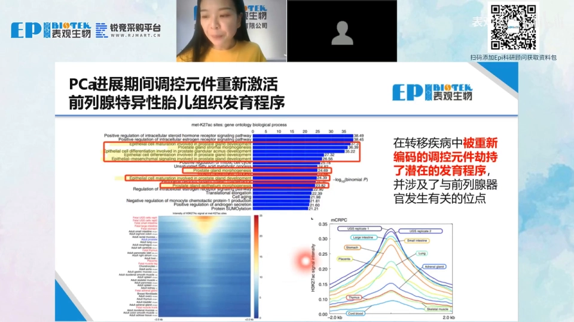
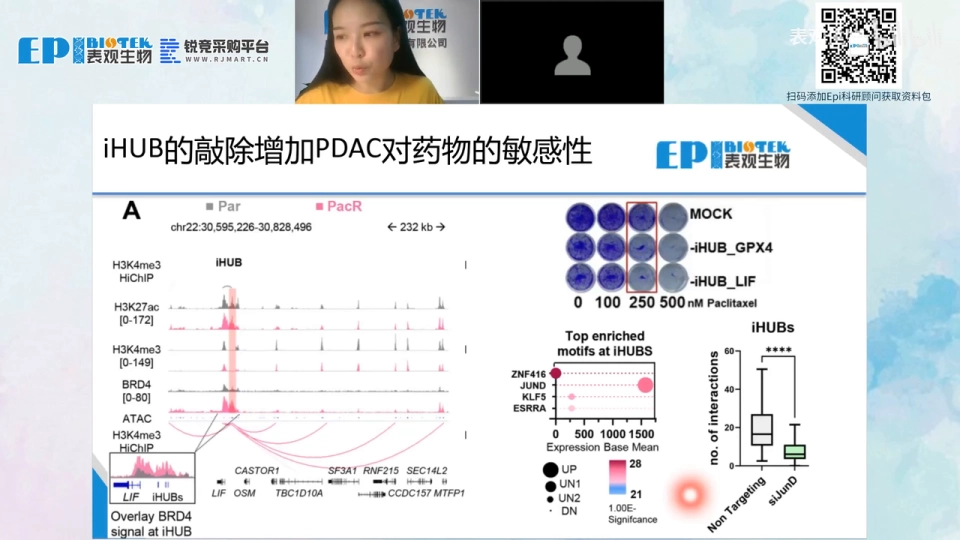
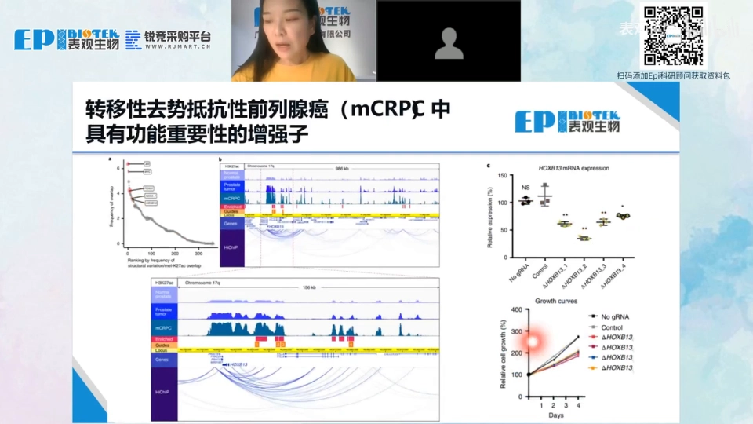

# 增强子—启动子关联：接触、候选靶基因与扰动验证

一个增强子可以在距离基因几百 kb 甚至更远的地方起作用。ChIP-seq 或 ATAC-seq 能告诉你「这段染色质很活跃」，却不能直接告诉你它调控哪个基因。实践中最省事的做法是把元件分配给最近的基因，但增强子可以跳过近邻，去调控更远的目标。于是问题变成：怎样从一个候选元件走到一个可信的靶基因？

本文整理自表观生物技术讲座《超级增强子的光芒（下）：三维基因组的空间结构》中与增强子—靶基因关联相关的部分（约 21:00–47:00、1:03–1:26）。三维基因组的基本结构（区室、TAD、环挤压）属于 [§3.2.1](../3.2.1_三维基因组组织：区室、拓扑域与染色质环/A／B区室与分形球：接触概率随线性距离衰减说明了什么.md)，本文不重复；调控网络的有向作用与推断属于 §3.2.3、§3.2.4。

## 先给结论：三类证据回答三个不同问题

| 证据类型 | 常见方法 | 能回答的问题 | 不能单独回答的问题 |
| --- | --- | --- | --- |
| 空间接触 | 3C、4C、5C、Hi-C、ChIA-PET、HiChIP | 两个位点在空间上是否靠近；一个元件可能与哪些启动子相连 | 靠近是否导致表达改变；哪个连接是功能性的 |
| 活性与相关 | H3K27ac、eRNA、ATAC、单细胞 Hi-C + RNA | 元件活性、接触频率是否与目标基因表达同向变化 | 谁因谁果；表达变化是否由这个元件引起 |
| 扰动与复核 | CRISPRi、CRISPR 敲除、转录抑制；4C 复核连接 | 改变元件后，目标基因或细胞表型是否随之改变 | 是否唯一靶基因；是否存在冗余与补偿 |

一句话：**接触给出候选，相关给出优先级，扰动才把候选变成因果**。三者不是互相替代，而是接力。

## 1. 最近基因只是默认值

ChIP-seq 能鉴定出一段超级增强子区域，但靶基因预测往往按「就近原则」：谁离得近，就把谁当成靶基因。讲者明确点出这个局限：增强子的靶基因不局限在附近，它可能跑到更远的一端（[【跳转到 23:37】](https://www.bilibili.com/video/BV1N14y1m7hD/?t=1417)）。HiChIP 的价值就在于把这些远距离连接抓下来（[【跳转到 23:56】](https://www.bilibili.com/video/BV1N14y1m7hD/?t=1436)）。

「最近基因」至少会在三种情况下出错：

1. **元件跳过近邻**。增强子与远端的启动子形成环，近邻基因反而没有接触。
2. **一个元件对应多个基因**。超级增强子可以由多个组分增强子拼成；HiChIP 也能看到多个增强子连到同一个启动子、一个区域连到多个启动子（[【跳转到 41:51】](https://www.bilibili.com/video/BV1N14y1m7hD/?t=2511)）。因此一个元件对应的靶基因往往不止一个。
3. **不是每个组分都重要**。一个由三个增强子组成的超级增强子，敲除左右两个对下游影响不明显，敲除中间的 hub 增强子才出现显著影响（[【跳转到 43:56】](https://www.bilibili.com/video/BV1N14y1m7hD/?t=2636)–[【跳转到 44:33】](https://www.bilibili.com/video/BV1N14y1m7hD/?t=2673)）。

因此，拿到一个候选元件后，合理的工作顺序是：先用接触数据列出「可能连接的启动子」，再用活性/表达数据排序，最后用扰动逐个排除。直接把最近基因写进结论，等于跳过了前两步。

## 2. 接触怎么测：从 3C 到 HiChIP

三维基因组技术的历史可以按「谁和谁比」来记（[【跳转到 21:26】](https://www.bilibili.com/video/BV1N14y1m7hD/?t=1286)–[【跳转到 23:01】](https://www.bilibili.com/video/BV1N14y1m7hD/?t=1381)）：

- **3C**：一个点对一个点。用两个位点的特异性引物做 PCR，能扩出产物就说明有互作；每验证一对位点都要重新设计引物。
- **4C**：一个点对多个点。通过环化，只用一对引物就能检测一个位点与全基因组其他位点的连接。
- **5C**：many-to-many。在 4C 基础上加标签，一次检测大量位点之间的互作。
- **Hi-C**：all-to-all。甲醛交联、限制酶切、末端补平并加生物素标记、连接、超声破碎，再富集带标记的片段测序，得到全基因组接触矩阵。
- **ChIA-PET**：相当于 Hi-C 的一个子集，用特异性抗体捕获特定蛋白介导的互作，「哪里重要测哪里」。
- **HiChIP**：把 Hi-C 与 ChIP 结合，用抗体富集特定染色质区域，再测这些区域的连接。

*图 1：3C 是 one vs one，4C 是 one vs all，5C 是 many vs many，Hi-C 是 all vs all；ChIA-PET 用抗体把互作富集到特定蛋白上。*

HiChIP 之所以在增强子—启动子研究中常用，是因为它把测序量花在「有抗体标记的调控区域」上。讲者给了一个成本对比：Hi-C 要做到 loop 级别，人的样本通常需要 1T 数据，一个样本不止几万元；HiChIP 可以把数据量降到 100G 左右，得到 10 kb 分辨率，足以鉴定目标区域的 loop（[【跳转到 37:42】](https://www.bilibili.com/video/BV1N14y1m7hD/?t=2262)–[【跳转到 38:07】](https://www.bilibili.com/video/BV1N14y1m7hD/?t=2287)）。

*图 2：2016 年 Nature 论文比较 HiChIP 与 ChIA-PET。HiChIP 用更少的细胞数和更低的测序深度，仍能捕获更小、更精确的 loop；右侧弧线是不同方法检出的连接。*

HiChIP 的结果不只是「一条线」。它可以显示：超级增强子「跳跃」到远端、多个增强子连到同一个启动子、启动子与启动子互作，以及增强子—启动子在不同细胞中的特异性互作（[【跳转到 41:51】](https://www.bilibili.com/video/BV1N14y1m7hD/?t=2511)）。这些连接类型提醒我们：**一个启动子可以同时接收多个增强子的输入，一个增强子也可以同时连接多个启动子**，所以「一对一」的靶基因假设本身就不稳。

*图 3：左侧是基因组浏览器中的增强子标记与 HiChIP loop 弧线，右侧是对应的接触热图。loop 是「测到的连接」，不是「已证明的调控」。*

## 3. 接触图的读法：强度是优先级，不是因果

有了 HiChIP，一个超级增强子内部往往有很多 5 kb 区间，每个区间都有接触频率。H-score 的做法是：把超级增强子切成 5 kb 区间，把每个区间的接触频率标准化成 z 评分，再按超级增强子的层级找出 z 评分最高的区间，也就是 hub 增强子（[【跳转到 42:41】](https://www.bilibili.com/video/BV1N14y1m7hD/?t=2561)–[【跳转到 43:31】](https://www.bilibili.com/video/BV1N14y1m7hD/?t=2611)）。

*图 4：H-score 把「哪个区间的接触最强」变成可排序的指标；右侧曲线显示 hierarchical 超级增强子有一个明显的 hub 峰，non-hierarchical 则没有。*

H-score 能帮你从几百个超级增强子里挑出更值得做实验的那些，但它仍然是**基于接触强度的优先级排序**。真正说明 hub 有功能的，是后面的敲除实验：敲掉左右两个非 hub 增强子，下游影响不明显；敲掉中间 hub，下游影响显著（[【跳转到 43:56】](https://www.bilibili.com/video/BV1N14y1m7hD/?t=2636)–[【跳转到 44:33】](https://www.bilibili.com/video/BV1N14y1m7hD/?t=2673)）。

*图 5：同一个超级增强子内，非 hub 与 hub 区域分别设计 CRISPRi 和 CRISPR 敲除 sgRNA；视频中敲除 hub 对下游影响显著，敲除两侧非 hub 影响不明显。*

这也解释了一个常见困惑：为什么「接触很强」的元件，敲掉后却没反应？可能因为它只是结构上的靠近，或者功能被其他元件补偿。接触强度只能告诉你「这里值得优先试」，不能告诉你「试了一定会有效」。

## 4. 接触与表达相关，但相关不是因果

支持「三维结构参与表达调控」的证据不少。比如 HiRES 方法在单细胞里同时检测 Hi-C 和 RNA，发现基因组结构变化与表达调控存在非常密切的关系；一部分处在抑制性染色质环境里的基因，在转录激活前需要异染色质结构先松弛（[【跳转到 23:51】](https://www.bilibili.com/video/BV1N14y1m7hD/?t=1431)–[【跳转到 24:41】](https://www.bilibili.com/video/BV1N14y1m7hD/?t=1481)）。

*图 6：HiRES 把单细胞转录组与三维基因组放在同一个细胞里读；右侧示意 B 区室（抑制）与 A 区室（活跃）中增强子—基因的空间关系。*

但这类结果仍然属于「结构—表达对应」。真正容易让人误判的，是下面这个胰腺癌耐药案例。

作者用紫杉醇处理敏感胰腺癌细胞 100 天，建立耐药模型，发现耐药组有 1264 个基因显著上调（[【跳转到 1:08:25】](https://www.bilibili.com/video/BV1N14y1m7hD/?t=4105)–[【跳转到 1:09:01】](https://www.bilibili.com/video/BV1N14y1m7hD/?t=4141)）。按直觉，上调基因应该对应增强子活性增强；但把差异基因与 H3K27ac 变化对照后，结果并不是这样：只有约 7.7% 的上调基因伴随增强子获得 H3K27ac，8.8% 可用拷贝数增加解释，**83.5% 的上调基因没有找到对应的增强子活性变化**（[【跳转到 1:09:21】](https://www.bilibili.com/video/BV1N14y1m7hD/?t=4161)）。

*图 7：耐药组 1264 个上调基因中，8.8% 伴随拷贝数增加，7.7% 伴随增强子获得 H3K27ac，83.5% 未被这两类机制解释。*

讲者的解释是：这些转录异常激活主要不是依赖新的增强子，可能跟染色质重构关系更密切（[【跳转到 1:09:46】](https://www.bilibili.com/video/BV1N14y1m7hD/?t=4186)）。这提醒我们：**「增强子活性变化」与「基因表达变化」并不是一一对应**。如果你只挑一个与表达同向变化的增强子来讲故事，很容易忽略大多数没有对应关系的基因。

还有一层限制来自扰动本身：如果某个增强子在 DNA 水平被敲除，不一定能检测到相邻基因转录的改变；这可能是冗余功能，也就是存在其他功能的补偿（[【跳转到 1:03:16】](https://www.bilibili.com/video/BV1N14y1m7hD/?t=3796)–[【跳转到 1:03:48】](https://www.bilibili.com/video/BV1N14y1m7hD/?t=3828)）。所以「敲了没反应」不等于「这个增强子没用」，也可能是「还有别的元件在兜底」。

## 5. 细胞背景：同一个连接换一个细胞就未必成立

增强子—启动子的连接是细胞状态依赖的。讲者用两个肿瘤案例说明这一点。

**胰腺癌耐药**：敏感细胞与耐药细胞的增强子活性、BRD4 结合和 loop 频率都不同。耐药组中 BRD4 修饰程度更高，说明发生了较多染色质重构（[【跳转到 1:10:11】](https://www.bilibili.com/video/BV1N14y1m7hD/?t=4211)–[【跳转到 1:10:36】](https://www.bilibili.com/video/BV1N14y1m7hD/?t=4236)）。产生 eRNA 的增强子，其相互作用频率比不产生 eRNA 的增强子高 5.7 倍（[【跳转到 1:11:01】](https://www.bilibili.com/video/BV1N14y1m7hD/?t=4261)）。这些 iHUB 在耐药状态下更活跃，与部分超级增强子重叠（[【跳转到 1:11:51】](https://www.bilibili.com/video/BV1N14y1m7hD/?t=4311)–[【跳转到 1:12:41】](https://www.bilibili.com/video/BV1N14y1m7hD/?t=4361)）。

**前列腺癌进展**：从正常前列腺上皮、局部前列腺癌到转移性前列腺癌，AR 结合模式、H3K27ac 分布和增强子—启动子连接都在变。作者发现 17000 多个 ARBS 在转换过程中有持续结合（[【跳转到 1:19:49】](https://www.bilibili.com/video/BV1N14y1m7hD/?t=4789)）；H3K27ac 位点的 TSS 与基因表达水平显著相关（[【跳转到 1:20:19】](https://www.bilibili.com/video/BV1N14y1m7hD/?t=4819)–[【跳转到 1:20:58】](https://www.bilibili.com/video/BV1N14y1m7hD/?t=4858)）；FOXA1 和 HOXB13 先标记「前哨」位点，AR 后来才结合上去（[【跳转到 1:21:23】](https://www.bilibili.com/video/BV1N14y1m7hD/?t=4883)–[【跳转到 1:22:13】](https://www.bilibili.com/video/BV1N14y1m7hD/?t=4933)）。这些调控元件重新激活了胎儿前列腺发育程序（[【跳转到 1:23:03】](https://www.bilibili.com/video/BV1N14y1m7hD/?t=4983)–[【跳转到 1:23:28】](https://www.bilibili.com/video/BV1N14y1m7hD/?t=5008)）。

*图 8：转移性前列腺癌中，H3K27ac 标记的调控元件富集到前列腺/泌尿生殖系统发育相关通路；右侧是 mCRPC 中的 H3K27ac 信号与胎儿/成人组织的对应关系。*

这意味着：**在一个细胞系里建立的增强子—靶基因连接，不能直接搬到另一个细胞类型或疾病状态**。至少要先确认该元件在目标细胞里是否有活性、是否仍与同一启动子接触。

## 6. 扰动：把候选变成因果

讲者展示了从「接触候选」到「功能验证」的完整链条。

**第一步，用接触数据选候选。** 胰腺癌案例中，作者在 iHUB 区域选了 LIF 和 GPX4 两个代表性基因做展示（[【跳转到 1:13:31】](https://www.bilibili.com/video/BV1N14y1m7hD/?t=4411)）。这一步仍然是「候选」，因为一个 iHUB 可能连接多个基因。

**第二步，扰动元件，读目标基因和表型。** 敲除 iHUB 区域中 LIF、GPX4 两个代表位点后，细胞增殖显著被抑制；作者据此验证 iHUB 敲除可以增加胰腺癌细胞对药物的敏感性（[【跳转到 1:13:56】](https://www.bilibili.com/video/BV1N14y1m7hD/?t=4436)）。

*图 9：左侧是 LIF 位点的 H3K27ac、BRD4、ATAC 与 HiChIP loop；右侧是 iHUB_GPX4、iHUB_LIF 敲除后的克隆形成，以及 JUND 敲低后 iHUB 互作频率下降。*

**第三步，用 4C 复核连接是否随扰动改变。** 作者用 CDK9 抑制剂降低 LIF 和 eRNA 表达，再用 4C 检测以 LIF 为中心的互作频率：耐药组的 LIF 互作明显更高，加抑制剂后降低（[【跳转到 1:15:36】](https://www.bilibili.com/video/BV1N14y1m7hD/?t=4536)–[【跳转到 1:16:01】](https://www.bilibili.com/video/BV1N14y1m7hD/?t=4561)）。这说明抑制 iHUB 转录可以降低 iHUB 的互作频率，并逆转耐药性（[【跳转到 1:16:31】](https://www.bilibili.com/video/BV1N14y1m7hD/?t=4591)）。

**第四步，找上游调控因子。** motif 分析发现 JUND 在 iHUB 中富集且表达最高；敲除 JUND 后，iHUB 互作频率显著降低，耐药组中 Mediator 的富集明显下降，RNA 聚合酶 II 在耐药组的富集也更多（[【跳转到 1:14:46】](https://www.bilibili.com/video/BV1N14y1m7hD/?t=4486)–[【跳转到 1:15:36】](https://www.bilibili.com/video/BV1N14y1m7hD/?t=4536)）。这把「元件—靶基因」放回了「转录因子—辅因子—聚合酶」的机制链里。

**前列腺癌案例**也用了类似逻辑：HiChIP 找到 HOXB13 区域的增强子—启动子连接，再用 CRISPR 干扰候选增强子；在转移性前列腺癌细胞中干扰 HOXB13 表达后，增殖显著降低（[【跳转到 1:24:13】](https://www.bilibili.com/video/BV1N14y1m7hD/?t=5053)）。

*图 10：在转移性去势抵抗性前列腺癌（mCRPC）中，CRISPR 干扰候选增强子后 HOXB13 mRNA 下降，细胞生长曲线也随之下移。*

这里要把「扰动」的类型分清楚：

- **CRISPRi（CRISPR 干扰）**：不切断 DNA，用失活 Cas9 抑制元件或基因的转录，适合看「降低剂量」的后果。
- **CRISPR 敲除**：切断 DNA，产生插入缺失，适合看「元件缺失」的后果，但可能触发补偿。
- **转录抑制/药物抑制**：例如 CDK9 抑制剂降低 eRNA 与互作频率，适合看「动态抑制」的后果。
- **报告基因**：把候选增强子接到荧光素酶等报告基因上游，检验这段序列本身有没有增强子活性。它回答的是「序列是否有活性」，不直接回答「它调控哪个内源基因」；本视频没有展开报告基因实验，这里只作为边界提示。

## 7. 拿到一个远程元件时的判读清单

1. **细胞背景是什么？** 这个元件在目标细胞里有没有 H3K27ac、ATAC、eRNA 等活性信号？换一个细胞系是否仍然成立？
2. **接触证据是什么方法、什么分辨率？** 3C/4C 是候选位点验证，Hi-C 是全基因组扫描，HiChIP/ChIA-PET 是抗体富集后的 loop；分辨率不够时，看到的可能只是 TAD 级别的倾向。
3. **候选靶基因是按距离还是按接触/活性列的？** 如果只有「最近基因」，先不要下结论。
4. **有没有扰动？扰动的是元件还是基因？** 敲元件后看基因，和敲基因后看表型，回答的是不同问题。
5. **扰动后测了什么？** 只测表达，还是也测了接触频率、蛋白/磷酸化、细胞表型？多读出一个层面，因果链更完整。
6. **有没有冗余与补偿？** 敲一个元件没反应，不代表它没用；可能是其他增强子或 RNA 介导的补偿。

## 8. 边界与下一步

- **三维基因组的基本结构**（A/B 区室、TAD、环挤压、CTCF/cohesin）见 [§3.2.1](../3.2.1_三维基因组组织：区室、拓扑域与染色质环/A／B区室与分形球：接触概率随线性距离衰减说明了什么.md)，本文只把环当作「接触证据」使用。
- **基因调控网络的有向作用、反馈与网络推断**见 §3.2.3、§3.2.4；本文不讨论如何从共表达或先验推断有向边。
- **顺式元件的分类、位置/方向约束、超级增强子的组合结构**见 [§3.1.2](../../3.1_顺式与反式调控/3.1.2_顺式调控元件：启动子、增强子与组合结构/增强子与绝缘子：位置、方向、细胞背景与靶基因判读.md)。
- **调控区变异如何改变表达、如何做功能验证**见 §4.2.3；本文的变异案例只用于说明细胞背景与证据链。
- **报告基因、3C 建库、HiChIP 实验操作**属于实验方法细节，本文只讲判读所需的最小必要信息。

## 原始视频

- [超级增强子的光芒（下）：三维基因组的空间结构](https://www.bilibili.com/video/BV1N14y1m7hD/)（表观生物技术讲座，约 96 分钟）。本文使用其中约 21:00–47:00 的接触技术与 loop 判读、1:03–1:26 的扰动与肿瘤案例；视频开头的三维基因组结构基础与中段 RNA—RNA 互作技术不在本文范围。