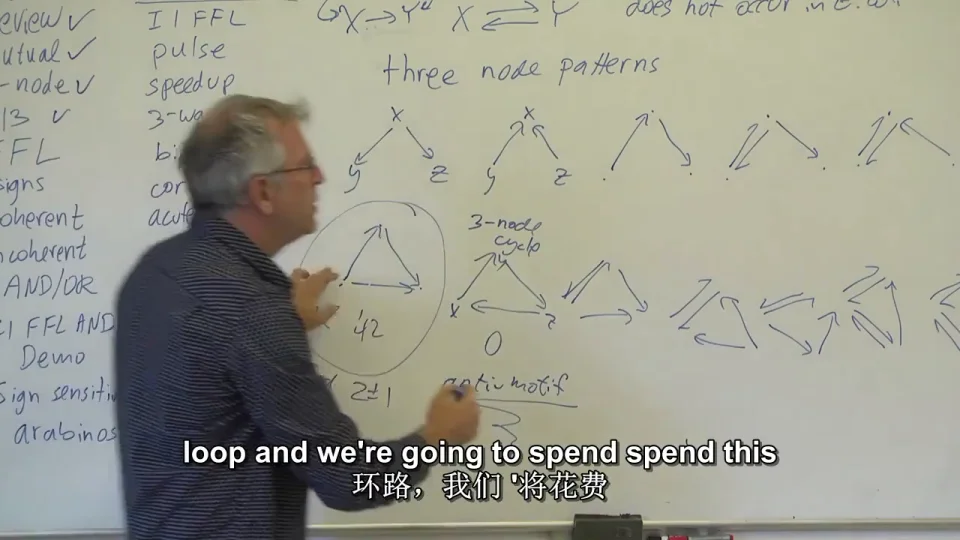
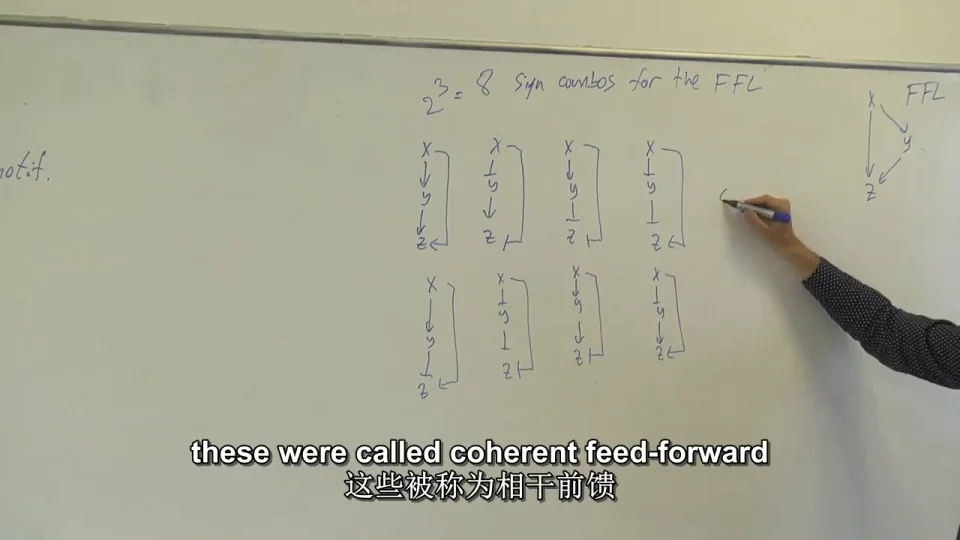
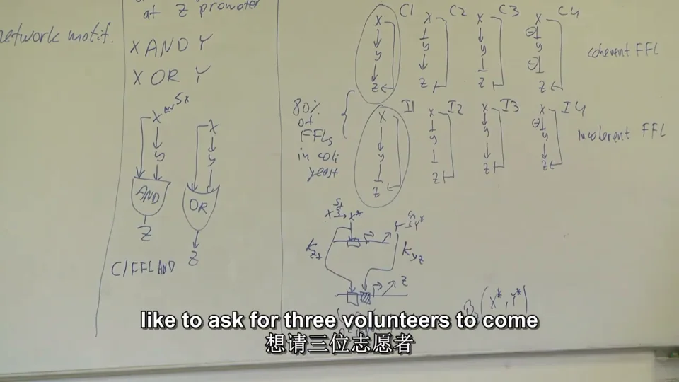
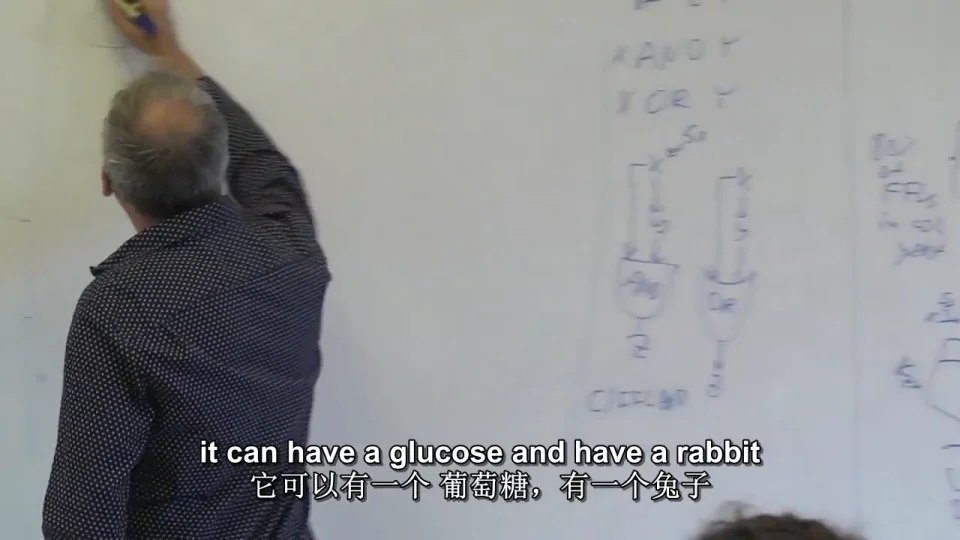
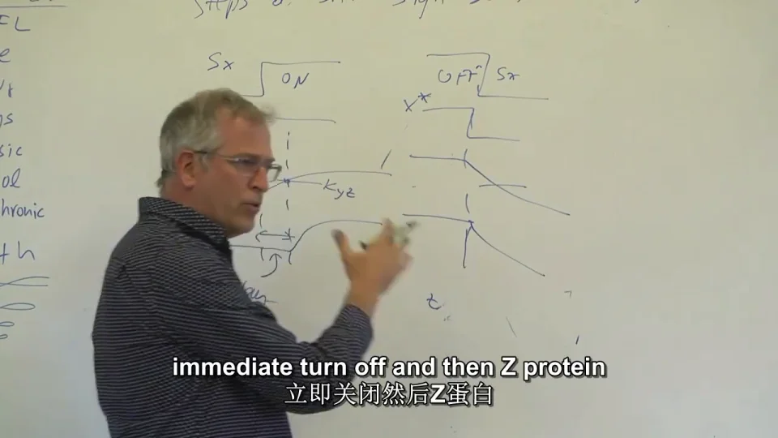
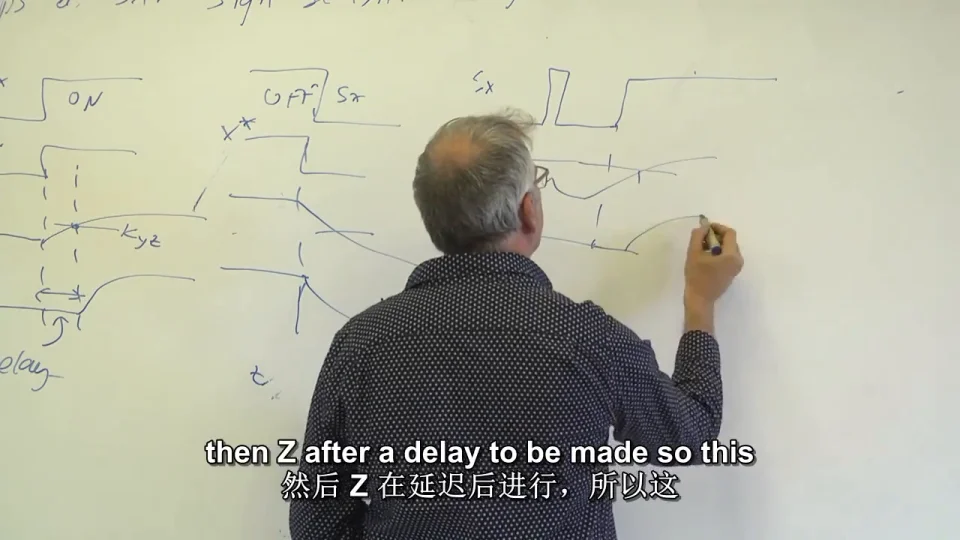
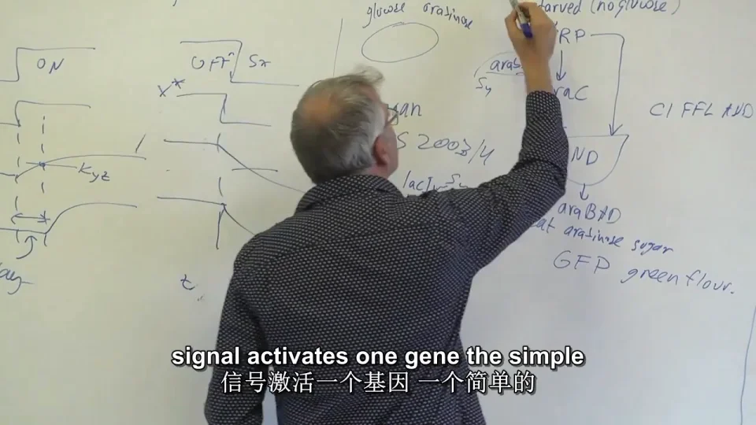
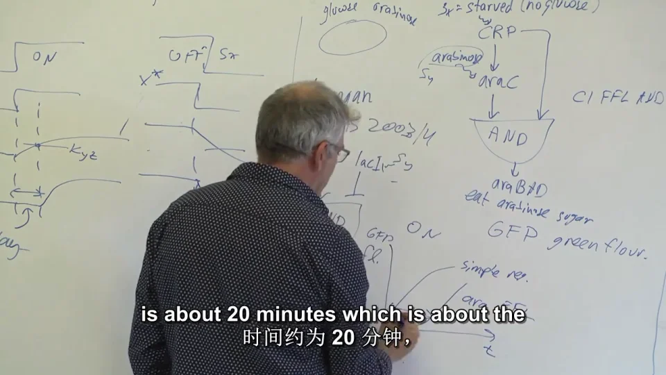

# 前馈环：两条臂、一个与门与符号敏感延迟

> 视频来源：[【AI双语翻译】系统生物学 Systems Biology 2018 ／ Uri Alon p03 Lecture 3a - 前馈环 Feed Forward Loops](https://www.bilibili.com/video/BV1YT411c7Y9/?p=3)（B 站 · 不是牛奶都是叫特仑苏搬运，约 50 分钟；英文板书配 AI 翻译中文字幕，术语按板书核对后重写）
> 导读：这一讲把「三个节点能画出多少种回路」变成一道可以数的题，然后只留下一种——前馈环。它用两条臂（一条直接、一条间接）加一个与门，做出一件很具体的事：把短暂的信号波动挡在门外，只在信号持续足够久时才打开目标基因。本文按「数模式 → 分符号 → 选两种 → 合逻辑门 → 看动态 → 落到阿拉伯糖系统」重排。

## 本讲要解决的核心问题（SCQA）

**背景**：上一讲处理的是一个基因调控自己（自调节）。但网络里更多的是两三个基因组成的小回路，它们决定了细胞对外界信号的响应形状。

**冲突**：三个节点之间可以连出的有向图案并不多，但也不少（13 种）。如果每一种都重要，那「理解网络」就又变成背诵。更重要的是，细胞面对的环境信号常常是**一闪而过**的噪声：糖偶尔飘过、温度短暂波动。如果每来一个脉冲就启动一整套代谢酶，细胞会白白浪费资源。

**疑问**：这些三节点图案里，哪些是真正被进化反复使用的？它们各自执行什么计算任务？一个只有三个节点的回路，怎么可能分辨「短暂波动」和「持续信号」？

**回答（中心思想）**：三节点图案里只有**前馈环**（feed-forward loop，FFL）显著过量。FFL 由 X 直接调控 Z、同时通过 Y 间接调控 Z 构成；按三条边的符号可分 8 种，其中只有 **C1（相干 1 型）** 和 **I1（不相干 1 型）** 大量出现。C1 配上**与门**就是一个**符号敏感延迟**：信号上升时延迟开启，信号下降时立刻关闭，于是它成了一个**持久性检测器**。

## 一、把三个节点能画出的图案数一遍

讲者的做法很手工：先不考虑自调节，只画三个基因 X、Y、Z 之间所有可能的有向连接。可以是一个级联（X→Y→Z），可以是共同调控（X 同时调控 Y 和 Z），可以是互相调控，也可以是三角形环路。[【跳转到 14:00】](https://www.bilibili.com/video/BV1YT411c7Y9/?p=3&t=840)

数下来一共 **13 种**（不考虑自边）。[【跳转到 15:19】](https://www.bilibili.com/video/BV1YT411c7Y9/?p=3&t=919) 接下来还是上一讲那套判据：把每种图案在真实网络里数一遍，再和节点数、边数相同的随机网络比。结果只有一种图案**显著过量**：真实网络里出现 **42 次**，随机网络里期望只有 **2±1 次**。[【跳转到 21:55】](https://www.bilibili.com/video/BV1YT411c7Y9/?p=3&t=1315)

反过来也值得注意：**三节点环路**（X→Y→Z→X）在真实网络里出现得**比随机期望还少**，是一个**反模体**（anti-motif）。[【跳转到 22:26】](https://www.bilibili.com/video/BV1YT411c7Y9/?p=3&t=1346) 这说明「显著过量」不是网络密度的副产品——如果是，所有三角形都该过量。

## 二、前馈环的两条臂与 8 种符号组合

前馈环的定义是：X 调控 Z，同时 X 调控 Y，Y 也调控 Z。[【跳转到 23:00】](https://www.bilibili.com/video/BV1YT411c7Y9/?p=3&t=1380)

- **直接臂**：X → Z；
- **间接臂**：X → Y → Z。

三条边各可以是正号或负号，所以有 $2^3 = 8$ 种组合。[【跳转到 24:28】](https://www.bilibili.com/video/BV1YT411c7Y9/?p=3&t=1468)

分类只看一件事：**两条臂的净效果是否同向**。

- **相干**（coherent）：把间接臂的两个符号相乘，结果与直接臂同号。例如 X 激活 Z，同时 X 激活 Y、Y 激活 Z——两条臂都在激活 Z。或者 X 抑制 Z，同时 X 抑制 Y、Y 抑制 Z——「抑制一个抑制者」等于激活，间接臂净效果仍是抑制 Z。
- **不相干**（incoherent）：两条臂净效果相反。例如 X 激活 Z，但 X 激活的 Y 反而抑制 Z。[【跳转到 25:56】](https://www.bilibili.com/video/BV1YT411c7Y9/?p=3&t=1556)

8 种里，相干 4 种、不相干 4 种。

## 三、8 种里只有 2 种常见

如果只看拓扑，8 种出现的概率应该差不多。但真实网络不是这样：**约 80% 的 FFL 是 C1 和 I1 两种**。[【跳转到 27:34】](https://www.bilibili.com/video/BV1YT411c7Y9/?p=3&t=1654)

- **C1**：三条边全是正号（X→Y、X→Z、Y→Z 都是激活）；
- **I1**：X 激活 Z，X 激活 Y，但 Y 抑制 Z。

讲者说，其他六种在细菌、酵母、人类里也真实存在，只是频率低得多。[【跳转到 28:01】](https://www.bilibili.com/video/BV1YT411c7Y9/?p=3&t=1681) 所以问题变成：C1 和 I1 有什么特别的功能，值得被反复使用？

## 四、两条臂怎么合并：与门和或门

要回答功能，先得知道 Z 的启动子上两个输入怎么整合。讲者又回到上一讲的二维输入函数：X 和 Y 可能竞争同一个位点、可能互相帮助、也可能互不理睬。[【跳转到 28:26】](https://www.bilibili.com/video/BV1YT411c7Y9/?p=3&t=1706)

作为一阶近似，只用两种逻辑门：

- **与门（AND）**：X 和 Y 都在，Z 才开；
- **或门（OR）**：X 或 Y 任一个在，Z 就开。[【跳转到 30:31】](https://www.bilibili.com/video/BV1YT411c7Y9/?p=3&t=1831)

讲者特别强调：**每条箭头并不等价**。每条边都有自己的 K（达到半激活所需的浓度），由化学亲和力决定；有的边几十个分子就饱和，有的要几千个。[【跳转到 31:42】](https://www.bilibili.com/video/BV1YT411c7Y9/?p=3&t=1902) 所以「与门」不是抽象的布尔运算，而是两个不同阈值的比较。

## 五、C1 + 与门 = 符号敏感延迟

现在可以看动态了。讲者用一个思想实验：给系统一个**阶跃信号**（信号突然出现并保持），再把它撤掉，观察 Z 怎么变。[【跳转到 33:00】](https://www.bilibili.com/video/BV1YT411c7Y9/?p=3&t=1980)

在 C1-FFL 加与门的回路里：

- **信号上升**：X 立刻被激活，直接臂马上到位；但间接臂要先转录、翻译出 Y，Y 再积累到超过它的阈值 K_yz。这段时间里，与门只有一个输入，Z 不开。等 Y 越过阈值，Z 才打开。**这就是延迟。**
- **信号下降**：X 立刻失活，直接臂归零；与门只要一条臂归零就关闭，所以 Z 立刻停止生产。Y 虽然还在慢慢降解，但已经不影响 Z 了。[【跳转到 38:49】](https://www.bilibili.com/video/BV1YT411c7Y9/?p=3&t=2329)

这种「**开启延迟、关闭不延迟**」的行为叫**符号敏感延迟**（sign-sensitive delay）：延迟只出现在信号变号的一个方向上。[【跳转到 37:28】](https://www.bilibili.com/video/BV1YT411c7Y9/?p=3&t=2248)

它带来一个直接后果：**短暂脉冲被过滤掉**。如果信号只亮一下，Y 还没来得及积累到阈值就消失了，Z 根本不会开。只有持续足够久的信号才能让 Z 打开。[【跳转到 39:12】](https://www.bilibili.com/video/BV1YT411c7Y9/?p=3&t=2352)

讲者用电梯门打比方：手挡住光，门保持打开；手拿开一小会儿，门不会立刻关；但手一放回去，门马上重新打开。**开与关的成本不对称**，所以延迟只放在便宜的那一侧。[【跳转到 40:11】](https://www.bilibili.com/video/BV1YT411c7Y9/?p=3&t=2411)

## 六、落到真实系统：阿拉伯糖的 20 分钟

讲者用大肠杆菌的阿拉伯糖系统做例子。大肠杆菌优先吃葡萄糖；葡萄糖不够时，它才去启动其他糖的代谢系统。阿拉伯糖系统需要两个条件同时满足：

- **饥饿信号**（没有葡萄糖）→ CRP 激活；
- **阿拉伯糖存在** → AraC 激活。

两个信号在 araBAD 启动子上做**与门**，再叠加一个 C1-FFL，就得到一个「确认阿拉伯糖真的在、而且持续存在」的回路。[【跳转到 43:28】](https://www.bilibili.com/video/BV1YT411c7Y9/?p=3&t=2608)

实验设计很干净：把目标基因接到绿色荧光蛋白上，做一个带 FFL 的版本，再做一个只有简单调控的版本（用乳糖系统作对照），给同样的信号，比较荧光曲线。[【跳转到 44:05】](https://www.bilibili.com/video/BV1YT411c7Y9/?p=3&t=2645)

结果是：带 FFL 的版本在信号上升后延迟约 **20 分钟**才亮，而简单调控几乎立刻亮；信号下降时两者都很快关闭。[【跳转到 45:42】](https://www.bilibili.com/video/BV1YT411c7Y9/?p=3&t=2742)

20 分钟不是随便定的：它大致等于大肠杆菌在两种糖之间切换时那些「假脉冲」的持续时间。**延迟的时间尺度被调到了要过滤的噪声尺度上。** 想过滤更长或更短的波动，只要改启动子强度或阈值，就能把延迟调成 20 分钟、一小时或两小时。[【跳转到 46:49】](https://www.bilibili.com/video/BV1YT411c7Y9/?p=3&t=2809)

所以讲者把它叫**持久性检测器**（persistence detector）：等一等，确认信号不是一闪而过，再开始造那些昂贵的蛋白。[【跳转到 47:09】](https://www.bilibili.com/video/BV1YT411c7Y9/?p=3&t=2829)

## 七、边界：这一讲没有回答的问题

- **或门会怎样？** 讲者在结尾把问题留给学生：如果把与门换成或门，延迟会出现在上升沿还是下降沿？这一讲没有给出答案，下一半（Lecture 3b）才展开。[【跳转到 49:34】](https://www.bilibili.com/video/BV1YT411c7Y9/?p=3&t=2974)
- **不相干 FFL（I1）做什么？** 这一讲只说明它存在且常见，没有分析它的动态。它的功能（脉冲生成、加速响应）属于后续内容，本节不展开。
- **两节点回路**：讲者提到两个基因互相调控也能做出开关和振荡器，但明确说这一讲不讨论。[【跳转到 12:20】](https://www.bilibili.com/video/BV1YT411c7Y9/?p=3&t=740) 开关的机制在反馈那一篇里讲。
- **逻辑门本身仍是未知**：与门／或门只是一阶近似。讲者说，目前还没有高通量方法能系统测出每个启动子上两个输入到底怎么合并，只能一个一个实验做。[【跳转到 31:51】](https://www.bilibili.com/video/BV1YT411c7Y9/?p=3&t=1911)
- **模型边界**：这一讲的分析假设时间尺度分离（结合快、生产慢）、参数在细胞间相同、且只跟踪 X、Y、Z 三个变量。真实网络里还有更多输入、转录后调控和细胞间差异。

## 小结

- 三个节点（不计自边）共有 13 种有向图案；只有前馈环显著过量（真实 42 次 vs 随机 2±1 次），三节点环路反而是反模体。
- 前馈环 = 直接臂（X→Z）+ 间接臂（X→Y→Z）；三条边各带符号，共 8 种，按两臂净效果分为相干 4 种、不相干 4 种。
- 真实网络里约 80% 的 FFL 是 C1（全正）和 I1（X 激活 Y、Y 抑制 Z）。
- 两条臂在 Z 启动子上按与门或或门合并；每条边的阈值 K 不同，所以「与门」是两个阈值的比较。
- C1 + 与门 = 符号敏感延迟：上升沿延迟（等 Y 越过阈值），下降沿立即关闭；于是短暂脉冲被过滤，只有持续信号才打开目标基因。
- 阿拉伯糖系统把这个延迟调到约 20 分钟，正好对应需要过滤的噪声时间尺度——它是一个持久性检测器。

## 关键术语速查

| 术语 | 一句话解释 |
| --- | --- |
| 前馈环（FFL） | X 直接调控 Z，同时通过 Y 间接调控 Z 的三节点回路 |
| 直接臂／间接臂 | X→Z／X→Y→Z 两条路径 |
| 相干 FFL | 两条臂净效果同向 |
| 不相干 FFL | 两条臂净效果相反 |
| C1／I1 | 最常见的两种 FFL：全正／X 激活 Y 而 Y 抑制 Z |
| 与门／或门 | 两个输入都必需／任一个足够 |
| 符号敏感延迟 | 延迟只出现在信号变化的一个方向上 |
| 持久性检测器 | 只有信号持续足够久才响应的回路 |
| 反模体 | 在真实网络中比随机期望更少的图案 |