# 反馈回路：负自调节加速响应，正反馈锁定状态

> 视频来源：[【AI双语翻译】系统生物学 Systems Biology 2018 ／ Uri Alon p02 Lecture 2 - 自调节，一种网络模体](https://www.bilibili.com/video/BV1YT411c7Y9/?p=2)（约 59 分钟）与 [p06 Lecture 4 - 时间顺序、全局结构与记忆](https://www.bilibili.com/video/BV1YT411c7Y9/?p=6)（约 46 分钟）；B 站 · 不是牛奶都是叫特仑苏搬运，英文板书配 AI 翻译中文字幕，术语按板书核对后重写
> 导读：这两讲回答同一个问题的两面——一个基因调控自己，会得到什么？负号给自己，得到更快的响应和更稳的水平；正号给自己，得到两个稳定状态和一段记忆。本文把两讲合成一条线：先讲怎么判定一个回路是「模体」，再分别拆负反馈与正反馈，最后落到噬菌体 λ 的命运决定和血细胞分化。

## 本讲要解决的核心问题（SCQA）

**背景**：上一讲算出一条边的基本动力学：稳态是 β/α，响应时间是 ln2/α。多数蛋白很稳定，去除只靠生长稀释，于是响应时间约等于一个细胞世代——对细菌来说太慢了。

**冲突**：细胞不可能靠「把所有蛋白都做成快速降解」来提速，因为合成又降解要烧掉大量能量。那么进化给出的解法是什么？另一个方向的问题同样棘手：一个已经分化的细胞，凭什么在信号消失之后还记得自己是谁？

**疑问**：一个基因调控自己（自调节）能实现什么？负号与正号分别带来什么后果？这些回路凭什么被称为「网络模体」，而不是随手画出来的图案？

**回答（中心思想）**：**负自调节**（negative autoregulation，NAR）用「强启动子 + 自我刹车」把响应时间从「一个细胞世代」压到「生产速率决定的时间」，同时让稳态对生产与去除参数的波动不敏感；**正自调节**（positive autoregulation，PAR）在输入函数足够陡时造出两个稳定状态，于是同一套回路既能当开关，也能当记忆。

## 一、先问一句：这个回路凭什么特别

讲者没有直接讲反馈，而是先讲方法：在大肠杆菌的调控图里，找出**反复出现的小型节点—箭头模式**，再和随机网络比较——如果某个模式在真实网络里出现的次数远高于随机期望，它才叫**网络模体**（network motif）。[【跳转到 12:03】](https://www.bilibili.com/video/BV1YT411c7Y9/?p=2&t=723)

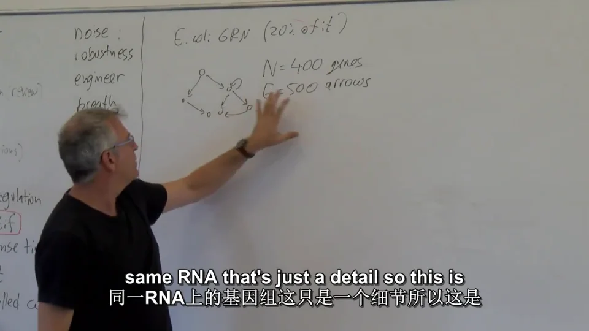

随机网络的构造方式很讲究：节点数和箭头数都与真实网络相同，甚至可以让每个节点的入度、出度也保持一致，只把「谁连谁」打乱。这样比较，才能排除「因为网络很密，所以三角形自然多」这类平凡解释。[【跳转到 15:38】](https://www.bilibili.com/video/BV1YT411c7Y9/?p=2&t=938)

最干净的例子是**自边**（一个基因调控自己）。在 400 个节点、500 条箭头的随机网络里，期望的自边数只有 **1.2 条**（正负一根号）；真实网络里有 **40 条**。[【跳转到 17:37】](https://www.bilibili.com/video/BV1YT411c7Y9/?p=2&t=1057) 这个差距不是统计涨落能解释的。

讲者给了两条直觉，说明为什么「多出来的模式」值得研究：

- **每条箭头都是珍贵的**：在生物学里看到一条边，已经是值得研究的东西；随机网络里多出来的模式，更可能是被选择保留的功能单元。[【跳转到 18:40】](https://www.bilibili.com/video/BV1YT411c7Y9/?p=2&t=1120)
- **箭头可以被丢掉**：生活在白蚁肠道里的细菌从宿主那里获得全部氨基酸，于是丢掉了几乎所有转录因子，基因以恒定速率生产。没有选择压力，箭头就会消失。[【跳转到 20:40】](https://www.bilibili.com/video/BV1YT411c7Y9/?p=2&t=1240)

所以「模体」不是「长得好看的模式」，而是**在随机对照下显著过量、且被进化保留的模式**。这个判据后面还会用到：前馈环也是用同一套办法找出来的。

## 二、负自调节：自己给自己踩刹车

负自调节的定义只有一句话：基因 X 的蛋白结合自己的启动子，**降低自己的生产速率**。[【跳转到 22:05】](https://www.bilibili.com/video/BV1YT411c7Y9/?p=2&t=1325)

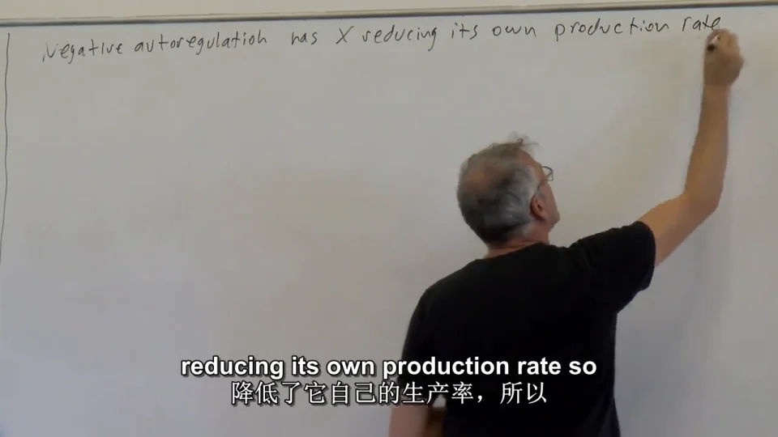

它有多常见？讲者估计大肠杆菌里近一半的转录因子是自调节的，而且不限于转录水平——剪接因子可以由剪接调控，翻译因子可以调控翻译。[【跳转到 22:54】](https://www.bilibili.com/video/BV1YT411c7Y9/?p=2&t=1374)

把这条回路写成方程，和上一讲只差一处：生产项不再是常数 β，而是 X 的**递减函数** f(X)：

$$
\frac{dX}{dt} = f(X) - \alpha X
$$

这里用到了**时间尺度分离**：转录因子找结合位点只要几秒，而生产出新蛋白要几分钟到一小时。所以可以先假设结合瞬间达到平衡，把 f(X) 当成当前 X 浓度下的生产速率，只用一个微分方程描述慢变量。[【跳转到 24:43】](https://www.bilibili.com/video/BV1YT411c7Y9/?p=2&t=1483)

## 三、负反馈为什么快：把两条速率线拉开

讲者介绍了一个不用解方程的图形方法：**速率图**（rate plot）。横轴是 X 的浓度，画两条线——生产速率 f(X) 和去除速率 αX。两条线的交点就是稳态（生产 = 去除，浓度不再变化）。[【跳转到 35:19】](https://www.bilibili.com/video/BV1YT411c7Y9/?p=2&t=2119)

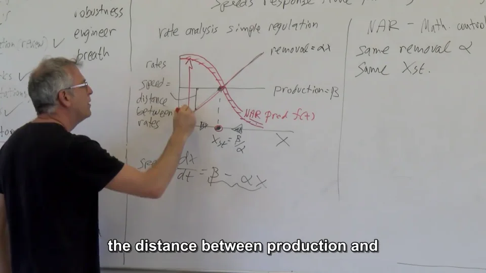

关键洞察是：**两条线之间的垂直距离 = 净变化速率**。距离越大，X 变化越快。

现在做一个公平比较（讲者称之为「数学控制比较」）：让两个回路有**相同的去除速率 α**、**相同的稳态 X_st**，唯一的差别是生产曲线——简单调控是一条水平线，负自调节是一条下降的线。[【跳转到 37:41】](https://www.bilibili.com/video/BV1YT411c7Y9/?p=2&t=2261)

因为两条曲线必须在同一点相交，负自调节的生产线只能从上方穿过来。于是在稳态两侧，**负自调节的生产线与去除线之间的距离都比简单调控更大**——无论 X 现在在哪，它都跑得更快。[【跳转到 39:55】](https://www.bilibili.com/video/BV1YT411c7Y9/?p=2&t=2395)

讲者用开车打比方：简单调控是「小马达 + 弱刹车」，负自调节是「大马达 + 强刹车」。强刹车不是为了停下来，而是为了能装更大的马达。[【跳转到 30:42】](https://www.bilibili.com/video/BV1YT411c7Y9/?p=2&t=1842)

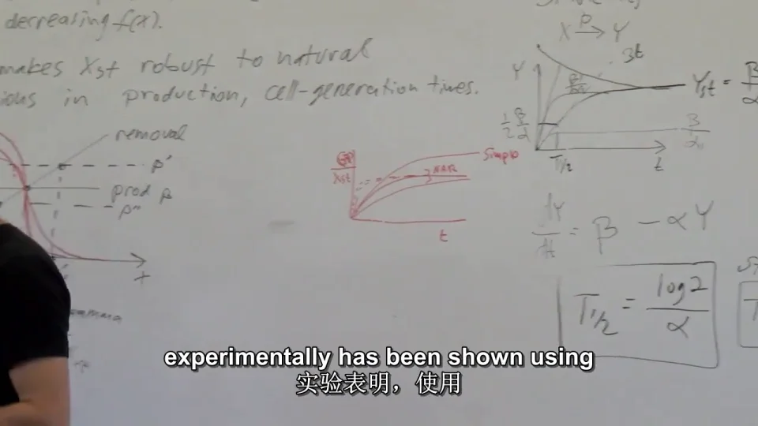

结果可以这样记：**简单调控的响应时间由去除速率决定，负自调节的响应时间由生产速率决定**。前者被「蛋白有多稳定」锁死，后者可以通过强化启动子来调。[【跳转到 29:02】](https://www.bilibili.com/video/BV1YT411c7Y9/?p=2&t=1742) 实验里的量级大约是**快 7 倍**：从一小时缩短到十分钟左右。[【跳转到 57:43】](https://www.bilibili.com/video/BV1YT411c7Y9/?p=2&t=3463)

## 四、负反馈为什么稳：稳态被「焊死」在 K 上

负自调节还有第二个好处，而且更微妙。

在简单调控里，稳态 = β/α。生产速率和去除速率都由细胞的生理状态决定，会随生长条件、基因拷贝数、资源多少而波动，于是稳态也跟着漂。负自调节不一样：当生产曲线陡到接近阶跃时，交点落在**半抑制浓度 K** 上——而 K 由蛋白与 DNA 位点的化学亲和力决定，是每个细胞都一样、不随生长条件变化的「硬连线」数字。[【跳转到 28:24】](https://www.bilibili.com/video/BV1YT411c7Y9/?p=2&t=1704)

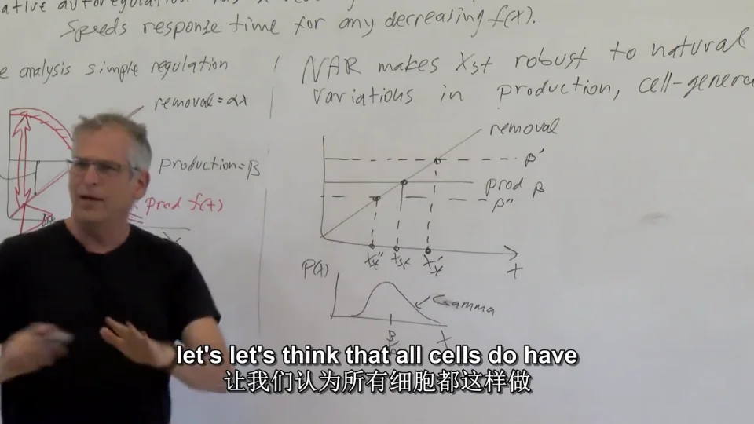

讲者给了一个具体场景：同一个基因在不同细菌里可能有一百个拷贝，也可能只有几个；细胞的生长速度也会波动。简单调控下，这些差异直接变成蛋白水平的差异——实验里细胞间的变异典型值是 **30%**。加了负自调节之后，分布明显收窄。[【跳转到 50:12】](https://www.bilibili.com/video/BV1YT411c7Y9/?p=2&t=3012)

实验验证的方式很直接：把目标基因和绿色荧光蛋白融合，做一个能自我抑制的版本，再做一个结合位点被突变、无法自我抑制的版本，在显微镜下比较不同细胞的荧光分布。[【跳转到 51:11】](https://www.bilibili.com/video/BV1YT411c7Y9/?p=2&t=3071)

这也解释了合成生物学里为什么爱用它：你往细胞里转入的 DNA 拷贝数往往控制不住，但只要你给目标基因加一个负自调节，产量就对拷贝数不敏感了。[【跳转到 53:00】](https://www.bilibili.com/video/BV1YT411c7Y9/?p=2&t=3180)

不过噪声压不到零：一部分来自生产与去除参数本身的波动，一部分来自小分子数目的随机性。讲者说能压到 10% 甚至 5%，但再低就要付出别的代价。[【跳转到 58:02】](https://www.bilibili.com/video/BV1YT411c7Y9/?p=2&t=3482)

## 五、正反馈：自己打开自己，出现两个稳定状态

把负号换成正号，回路的行为完全变了。正自调节是：X 的蛋白结合自己的启动子，**提高自己的生产速率**。[【跳转到 12:22】](https://www.bilibili.com/video/BV1YT411c7Y9/?p=6&t=742)

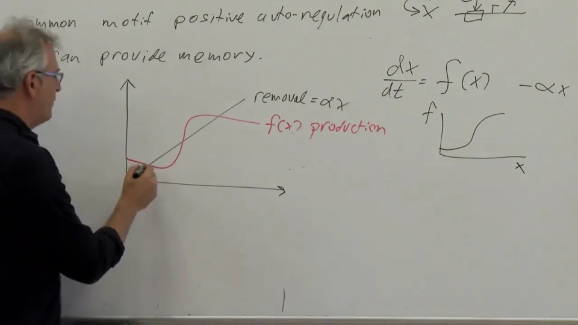

还是用速率图。生产曲线现在是**上升**的（S 形），去除线仍是直线 αX。两条线可以交**三次**：低交点、中间交点、高交点。[【跳转到 14:22】](https://www.bilibili.com/video/BV1YT411c7Y9/?p=6&t=862)

三个交点的稳定性不同：

- **低交点稳定**：X 稍微升高，去除大于生产，被拉回来；
- **高交点稳定**：X 稍微降低，生产大于去除，被推回去；
- **中间交点不稳定**：X 稍高一点就一路涨到高态，稍低一点就一路掉到低态。

于是 X 的浓度轴被中间那个不稳定点分成两个**吸引域**（basin of attraction）：起点在下面就去低态，起点在上面就去高态。[【跳转到 16:38】](https://www.bilibili.com/video/BV1YT411c7Y9/?p=6&t=998)

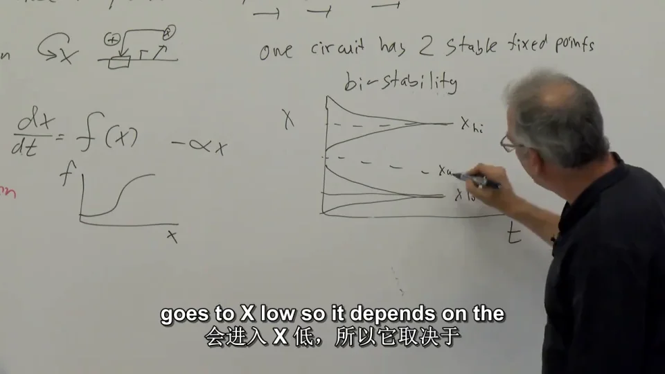

这就是**双稳态**（bistability）：同一个回路、同一组参数，可以停在两个不同的稳定水平上。

## 六、双稳态就是记忆：开关与细胞命运

双稳态最直接的用途是**记忆**。讲者给了一个思想实验：细胞本来停在低态，这时来一个信号，短时间内大量生产 X，把浓度推过中间的不稳定点；信号撤掉之后，普通回路会掉回低态，但正自调节回路会**停在高态**——因为它现在足够激活自己了。[【跳转到 18:07】](https://www.bilibili.com/video/BV1YT411c7Y9/?p=6&t=1087)

生物学例子是肌肉分化：胚胎时期的细胞接收到信号，启动一个正自调节的转录因子；信号消失后，这个因子仍然维持自己的表达，细胞于是「记住」自己已经走上了肌肉这条路。[【跳转到 19:10】](https://www.bilibili.com/video/BV1YT411c7Y9/?p=6&t=1150)

记忆也可以反向擦除：如果人为破坏 X 的 RNA，让浓度掉到低态以下，系统就回到低态并停在那里。讲者顺带提到，把四个特定基因导入成体细胞、把它拉回胚胎状态的重编程，逻辑上就是这类「从高态回到低态」的操作。[【跳转到 21:00】](https://www.bilibili.com/video/BV1YT411c7Y9/?p=6&t=1260)

不过正反馈不保证双稳态。讲者强调：**取决于输入函数 f 的形状**。大肠杆菌里的正自调节常常不够协同（曲线不够陡），于是只有一个稳定点，只是「单稳态」。[【跳转到 19:57】](https://www.bilibili.com/video/BV1YT411c7Y9/?p=6&t=1197) 所以「正反馈 = 开关」是一个常见但不总成立的推论。

## 七、两个基因互相抑制：拨动开关

把正反馈做成两个节点，就得到最经典的开关。讲者列了一张对照表：

- **双正**（X 激活 Y，Y 激活 X）：要么两个都高，要么两个都低；
- **双负**（X 抑制 Y，Y 抑制 X）：要么 X 高 Y 低，要么 X 低 Y 高。[【跳转到 32:27】](https://www.bilibili.com/video/BV1YT411c7Y9/?p=6&t=1947)

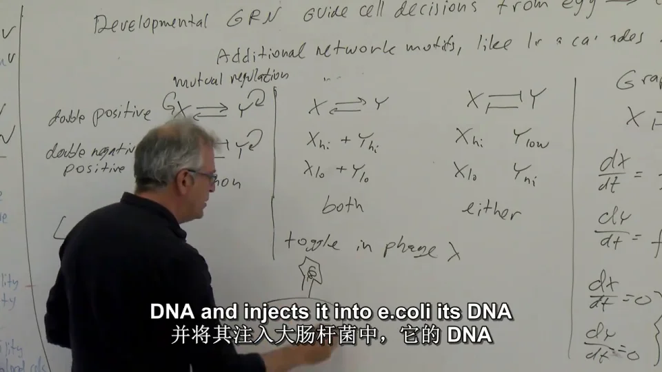

分析两个变量的系统，用**零线**（nullcline）：分别令 dX/dt = 0 和 dY/dt = 0，在 X–Y 平面上画出两条曲线，交点就是不动点。[【跳转到 33:21】](https://www.bilibili.com/video/BV1YT411c7Y9/?p=6&t=2001)

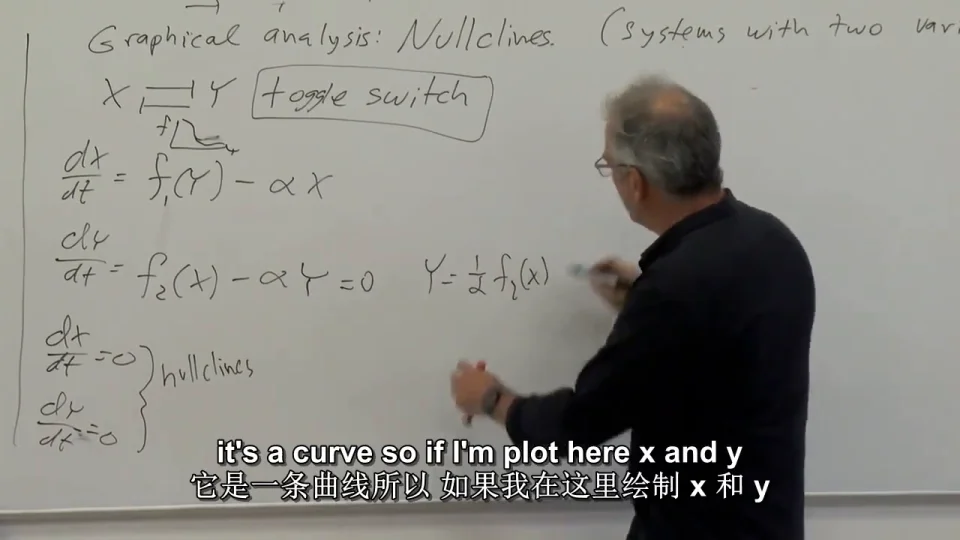

对称的双负回路里，两条零线交三次：左下（X 低 Y 高）、右上（X 高 Y 低）稳定，中间不稳定。细胞一旦落到其中一个角，就会锁在那里；要换状态，需要一个足够大的信号把它推过中间。[【跳转到 36:40】](https://www.bilibili.com/video/BV1YT411c7Y9/?p=6&t=2200)

### 7.1 噬菌体 λ：一个开关，两种命运

讲者说，第一个被研究清楚的开关在噬菌体 λ 里。[【跳转到 39:37】](https://www.bilibili.com/video/BV1YT411c7Y9/?p=6&t=2377)

λ 感染大肠杆菌后有两个选择：

- **裂解**（lytic）：在宿主里大量复制，制造上百个新病毒，撑破细胞去感染别人；
- **溶原**（lysogenic）：把自己的 DNA 整合进宿主基因组，安静地随宿主分裂而复制，等时机成熟再切出来。

决定权在两个互相抑制、又各自正自调节的转录因子手里：**CI**（λ 抑制因子）和 **Cro**。[【跳转到 41:15】](https://www.bilibili.com/video/BV1YT411c7Y9/?p=6&t=2475)

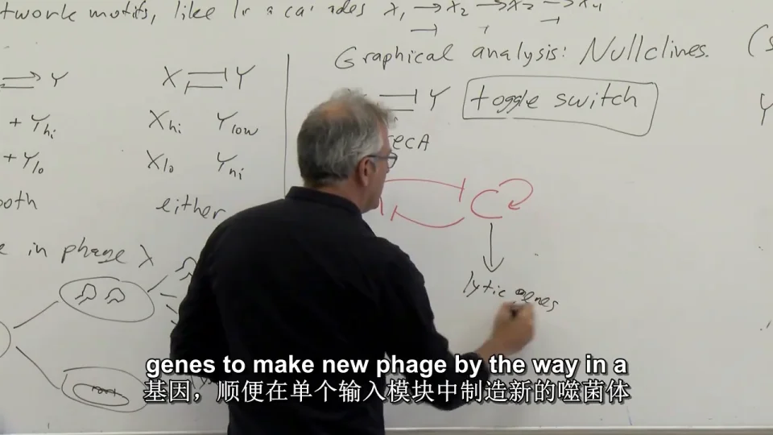

逻辑很干净：

- 宿主健康 → CI 占上风 → 维持溶原；
- 宿主 DNA 受损 → 受损信号激活一种蛋白酶，把 CI 切掉 → CI 水平下降，Cro 占上风 → 打开裂解基因，制造新病毒。[【跳转到 41:39】](https://www.bilibili.com/video/BV1YT411c7Y9/?p=6&t=2499)

这里可以看到「细胞背景」的第二层含义：**同一个回路，输出取决于细胞当前的状态**。不是 DNA 序列变了，而是宿主是否受损这个背景信号，把系统从一个吸引域推到了另一个。

### 7.2 血细胞分化：同一个开关，不同的出口

讲者最后把镜头拉到人体：骨髓里的多能祖细胞可以分化成红细胞，也可以分化成中性粒细胞、巨噬细胞等白细胞。细胞里有两个转录因子，互相抑制、各自正自调节——又是双负开关。[【跳转到 43:56】](https://www.bilibili.com/video/BV1YT411c7Y9/?p=6&t=2636)

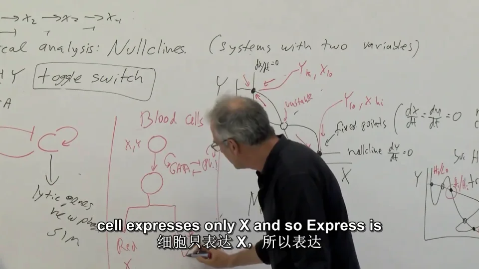

- 只表达 X → 走一条路（例如红细胞）；
- 只表达 Y → 走另一条路（例如白细胞）；
- 两个都表达 → 中间状态，还没有决定。

信号的作用不是「教会」细胞一个新状态，而是把它推向其中一个已有的稳定点。讲者还提到，近年发现某些正反馈的零线可以交五次，于是出现「两个都表达」的混合稳定态——这在人体细胞里确实被观察到，例如造血。[【跳转到 42:56】](https://www.bilibili.com/video/BV1YT411c7Y9/?p=6&t=2576)

## 八、边界：这些结论依赖什么

- **参数与形状**：正反馈是否给出双稳态，取决于输入函数够不够陡、生产与去除的比值落在哪。同一拓扑可以单稳态，也可以双稳态。[【跳转到 38:38】](https://www.bilibili.com/video/BV1YT411c7Y9/?p=6&t=2318)
- **噪声**：两个稳定点之间的势垒不是无限的，噪声可能让细胞偶尔从一个状态翻到另一个状态；好的设计会把两个点拉得更开。[【跳转到 22:20】](https://www.bilibili.com/video/BV1YT411c7Y9/?p=6&t=1340)
- **多目标**：不是所有基因都需要又快又稳。有些基因需要快速响应，有些需要精确，有些反而需要细小的变异。讲者说生物学是「多任务」的，所以同一张网络里会同时存在简单调控、负自调节和其他结构。[【跳转到 57:00】](https://www.bilibili.com/video/BV1YT411c7Y9/?p=2&t=3420)
- **模型边界**：速率图与零线分析假设时间尺度分离、空间均匀（不区分细胞里哪个位置）、且只跟踪少数几个变量。真实细胞里还有转录后调控、细胞间差异等，本文没有展开。

## 小结

- **网络模体**不是「看起来特别的图案」，而是在节点数、边数（甚至入度出度）相同的随机网络中显著过量的子图；自边在真实网络里 40 条，随机期望只有约 1.2 条。
- **负自调节**用「强生产 + 自我抑制」把响应时间从去除速率手里拿回来，交给生产速率；代价是要造更多蛋白。
- 负自调节还让稳态落在半抑制浓度 K 上，从而对生产速率、拷贝数、生长速度的波动不敏感，细胞间分布变窄。
- **正自调节**在输入函数足够陡时给出三个不动点：两个稳定、一个不稳定，于是有双稳态和记忆。
- **双负互抑**是拨动开关：λ 的 CI／Cro 决定裂解还是溶原，血细胞里的因子决定红细胞还是白细胞。
- 同一个回路在不同细胞背景、不同信号下可以落到不同稳定点——这就是「细胞背景依赖」的机制版本。

## 关键术语速查

| 术语 | 一句话解释 |
| --- | --- |
| 网络模体 | 在随机网络对照下显著过量的子图模式 |
| 自调节 | 基因的产物调控自己的启动子 |
| 负自调节（NAR） | 自己抑制自己，加快响应、稳定稳态 |
| 正自调节（PAR） | 自己激活自己，可产生双稳态 |
| 速率图 | 把生产速率与去除速率画在同一张图上，交点即稳态，间距即速度 |
| 双稳态 | 同一回路有两个稳定状态，取决于初始条件 |
| 吸引域 | 最终会流向某个稳定点的初始状态集合 |
| 零线 | 令某个变量的变化率为零得到的曲线，交点即不动点 |
| 拨动开关 | 两个互相抑制的因子组成的双稳态开关 |
| 裂解／溶原 | 噬菌体 λ 的两条生活史：复制并裂解宿主／整合进宿主基因组潜伏 |
| 数学控制比较 | 固定去除速率与稳态，只比较生产曲线形状的公平比较方法 |