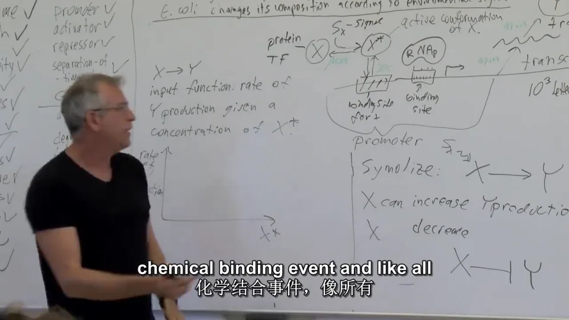
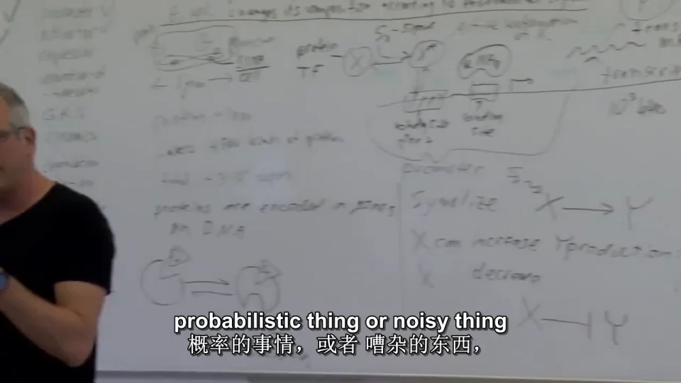
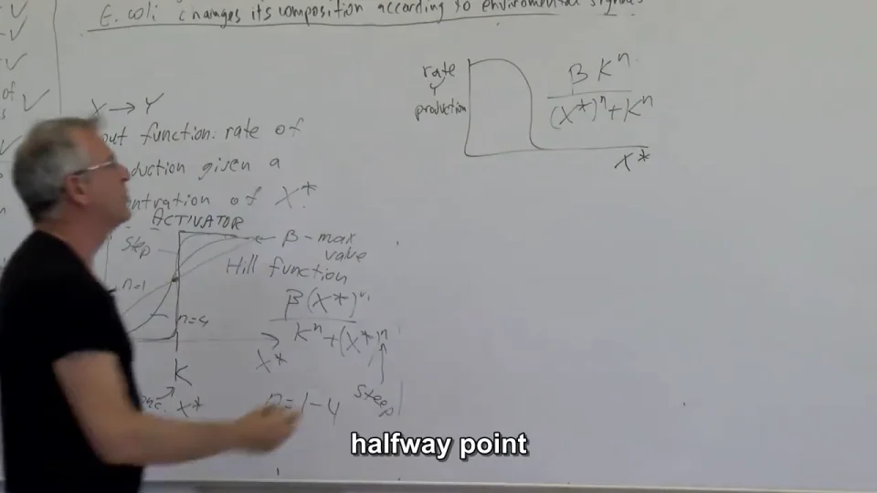
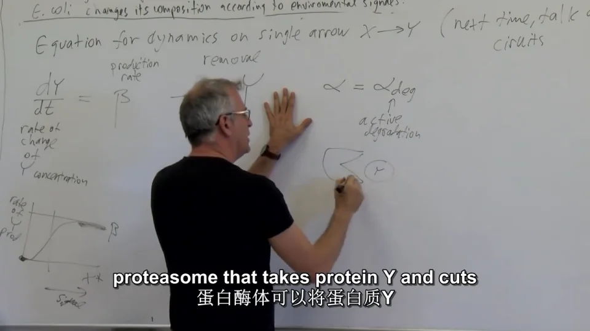
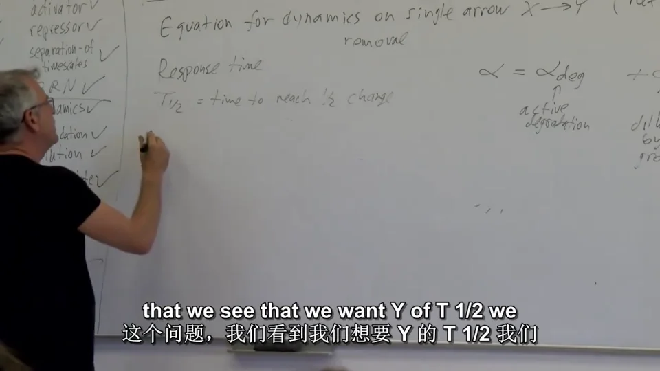
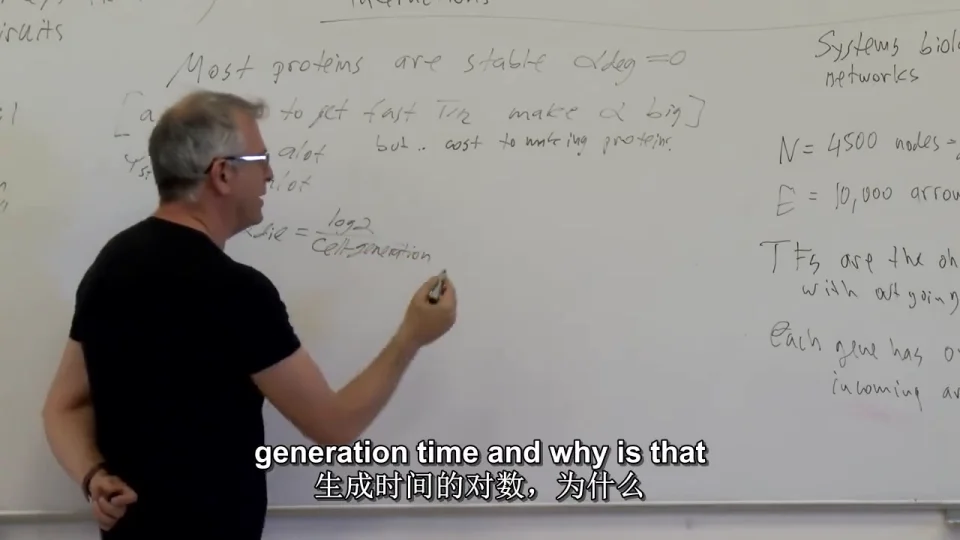

# 调控回路：节点、有向边与证据标准

> 视频来源：[【AI双语翻译】系统生物学 Systems Biology 2018 ／ Uri Alon p01 Lecture 1 - 基本概念](https://www.bilibili.com/video/BV1YT411c7Y9/?p=1)（B 站 · 不是牛奶都是叫特仑苏搬运，Uri Alon 2018 课程第一讲，约 72 分钟；英文板书配 AI 翻译中文字幕，术语按板书核对后重写）
> 导读：这一讲只做一件事——把「基因调控网络」从一句口号变成一张可以画、可以算的图：节点是基因，箭头是转录因子对靶基因的作用，每条箭头有方向、有符号、有强度，而且必须由实验确立。本文按「图 → 符号 → 证据 → 强度 → 动力学 → 边界」重排；反馈与前馈留给同一系列的后两讲。

## 本讲要解决的核心问题（SCQA）

**背景**：一个转录因子可以同时控制很多基因，一个基因又受好几个转录因子控制。把这些关系一条条画出来，就得到一张有向图，也就是基因调控网络（gene regulatory network，GRN）。

**冲突**：图谁都会画，难的是每条线凭什么算数。表达量一起升高只是相关；数据库里有条目也不等于在你关心的细胞里成立。更麻烦的是，同样一条「X 调控 Y」的箭头，在不同基因上强度完全不同：有的开关很陡，有的几乎没反应。

**疑问**：一条调控边到底由哪些要素构成？它需要什么证据才能画上去？画上去之后，用什么量描述它的强弱和快慢？

**回答（中心思想）**：一条调控回路 = **节点（基因）+ 有向边（转录因子 → 靶基因）+ 符号（激活／抑制）+ 输入函数（阈值与陡度）**。边不是相关性，而是「直接结合 + 扰动后靶基因表达改变」这两类实验共同确立的事实；而这条边的强弱和快慢，由结合亲和力、生产速率与去除速率三个量决定。

## 一、节点与箭头：把细胞画成一张图

讲者先给了一个非常朴素的建模动作：把每个基因画成一个点，把「这个基因编码的蛋白结合到另一个基因的启动子上、改变它的生产率」画成一条带方向的箭头。[【跳转到 33:56】](https://www.bilibili.com/video/BV1YT411c7Y9/?p=1&t=2036)

这张图的几个数字值得记住，它们决定了后面所有讨论的尺度：

- **节点数 N ≈ 4500**，就是大肠杆菌的基因数；
- **箭头数 E ≈ 10,000**，比节点数多一倍多；
- **只有转录因子（TF）有输出箭头**，因为只有它能结合 DNA 调控别人；大多数基因只是「被调控」的靶；
- **每个基因有 0–6 条输入箭头**，平均约 2 条——也就是说，一个基因的开关通常由少数几个信号共同决定。[【跳转到 37:40】](https://www.bilibili.com/video/BV1YT411c7Y9/?p=1&t=2260)

这里要区分两个容易混的东西：**节点是基因，边是「基因产物（蛋白）对另一个基因的作用」**。所以一条边天然跨了两个层次——蛋白是执行者，基因是被调节的对象。这也是为什么同一个转录因子在不同基因上可以当激活剂、在另一些基因上当抑制剂：取决于它结合的位置和它招募的共因子，而不取决于它叫什么名字。

## 二、箭头的符号：激活与抑制

画完方向，还要标符号。讲者用两种箭头区分：

- **X → Y**：X 增加 Y 的生产率，X 是**激活剂**（activator）；
- **X ⊣ Y**：X 降低 Y 的生产率，X 是**抑制剂**（repressor）。

符号不是装饰。它决定了回路的功能：两条正号边串起来是级联放大，一正一负串起来是「抑制一个抑制者＝激活」，而正负组合成的环路就是后面两讲要讲的反馈与前馈。讲者在第三讲回顾时给过一个经验比例：大肠杆菌的调控边大约**正负各半**，人类基因组里约 **80% 激活、20% 抑制**。[【跳转到 05:05】](https://www.bilibili.com/video/BV1YT411c7Y9/?p=3&t=305)

## 三、一条箭头凭什么算数：证据标准

这是本讲最该带走的一段。讲者明确说：**「每个箭头不是一个概率事件，也不是一个噪声事件，而是一个明确的实验事实。」**[【跳转到 38:00】](https://www.bilibili.com/video/BV1YT411c7Y9/?p=1&t=2280)

他给出的证据链包含两类实验，缺一不可：

1. **扰动**：把 X 敲掉或过表达，看 Y 的表达是升还是降。升说明 X 原本在抑制 Y，降说明 X 原本在激活 Y。
2. **物理结合**：证明 X 的蛋白真的结合在 Y 启动子附近的位点上（例如用抗体把 X 拉下来，再看它带着哪段 DNA）。

只有扰动、没有结合，不能排除「X 是通过中间基因间接影响 Y」；只有结合、没有扰动，不能说明这次结合真的改变了转录。第三讲把这条标准讲得更直白：**「仅仅删除是不够的」**，因为影响可能是通过一系列事件传过去的。[【跳转到 19:34】](https://www.bilibili.com/video/BV1YT411c7Y9/?p=3&t=1174)

用这条标准，可以把三种常被混为一谈的东西分开：

| 你看到的东西 | 它是什么 | 能推出什么 |
| --- | --- | --- |
| **调控边**（本文的箭头） | 直接结合 + 扰动后靶基因表达改变 | 谁调控谁、正还是负 |
| **共表达** | 两个基因的表达量在不同样本里同步升降 | 它们可能被同一个因子调控，也可能只是同一状态的伴随现象；不能定方向，也不能定直接性 |
| **数据库里的知识关联** | 某篇文献或某次实验报告过的一条关系 | 一条待核对的线索；要问它用的是结合证据还是扰动证据、在哪个物种／细胞类型、什么条件下 |

讲者在同一段里还提到：单细胞技术让人可以「看到所有的相关性」。[【跳转到 48:44】](https://www.bilibili.com/video/BV1YT411c7Y9/?p=1&t=2924) 但相关性只是这张表的第三行，不是第一行。视频没有逐条讨论数据库，这里只是把它的证据标准拿来当尺子：**数据库条目的强弱，取决于它背后是哪一类证据。**

## 四、箭头的强度：输入函数、阈值与陡度

方向与符号只说明「往哪边调」，不说明「调多少」。描述强弱的是一个函数：**输入函数**（input function）——给定活性转录因子 X* 的浓度，靶基因 Y 的生产速率是多少。[【跳转到 40:12】](https://www.bilibili.com/video/BV1YT411c7Y9/?p=1&t=2412)

对激活剂，这条曲线通常写成 Hill 函数：

$$
\beta(X^*) = \beta_{\max}\,\frac{(X^*)^n}{K^n + (X^*)^n}
$$

三个参数各有生物学含义：

- **K**：一半结合位点被占据时的 X* 浓度，也就是「半激活点」。它由蛋白与 DNA 位点的化学亲和力决定，突变可以改变它。
- **n**：曲线的陡度。n = 1 时是平缓的饱和曲线；n 越大越像开关。真实回路里 n 通常在 1–4 之间，多个结合位点协同工作时会变陡。
- **β_max**：饱和时的最大生产速率，由启动子强度决定。

抑制剂用同一条曲线镜像过来：生产速率随 X* 升高而下降，K 仍是半抑制点。[【跳转到 45:23】](https://www.bilibili.com/video/BV1YT411c7Y9/?p=1&t=2723)

当两个转录因子同时调控一个基因时，就需要一个二维输入函数。讲者说，很多情况下可以近似成 **AND 门**（两个都到才开）或 **OR 门**（任一个到就开），但**「多输入如何整合，是未知的部分」**：网络本身是已知的，逻辑门却不是。[【跳转到 47:00】](https://www.bilibili.com/video/BV1YT411c7Y9/?p=1&t=2820) 这句话很关键——它说明「有边」和「知道这条边怎么算」是两件事。

## 五、一条箭头的动力学：生产、去除、稳态与响应时间

把一条箭头写成方程，只需要两项：生产与去除。

$$
\frac{dY}{dt} = \beta - \alpha Y
$$

- **β**：单位时间生产的蛋白浓度；
- **α**：单位时间被去除的比例，包含**主动降解**（蛋白酶把蛋白切掉）和**生长稀释**（细胞体积变大，浓度被动下降）。[【跳转到 55:00】](https://www.bilibili.com/video/BV1YT411c7Y9/?p=1&t=3300)

令 dY/dt = 0，得到稳态：

$$
Y_{st} = \frac{\beta}{\alpha}
$$

稳态是「这个蛋白在细胞里该有多少」的功能水平：转录因子可能每个细胞一百份，主要的结构蛋白可能十几万份。[【跳转到 1:01:25】](https://www.bilibili.com/video/BV1YT411c7Y9/?p=1&t=3685)

但细胞更关心的是「多快能到」。从零开始生产，达到稳态一半所需的时间是：

$$
T_{1/2} = \frac{\ln 2}{\alpha}
$$

这个结果有点反直觉：**响应时间只取决于去除速率 α，与生产速率 β 无关**。β 决定最终停在多高，α 决定爬得多快。想快，就得让蛋白不稳定、被快速降解。[【跳转到 1:04:00】](https://www.bilibili.com/video/BV1YT411c7Y9/?p=1&t=3840)

问题是，大多数蛋白并不快。讲者说大肠杆菌里绝大多数蛋白是稳定的，α_deg ≈ 0，去除几乎只剩生长稀释，于是 T₁/₂ 约等于一个细胞世代的时间——「你是在为你的孩子和孙子工作」。[【跳转到 1:09:30】](https://www.bilibili.com/video/BV1YT411c7Y9/?p=1&t=4170)

那为什么不让所有蛋白都不稳定、换取快速响应？因为**制造蛋白本身消耗资源**：不断合成又不断降解，等于白白烧掉氨基酸和能量。[【跳转到 1:08:43】](https://www.bilibili.com/video/BV1YT411c7Y9/?p=1&t=4123) 这个「速度 vs 成本」的取舍，正是下一讲负反馈自调节要解决的问题：不用加快降解，也能让响应变快。

## 六、这张图的边界：逻辑门未知、箭头可重连、结论依赖细胞背景

讲者在收尾处给了三条限定，读任何调控网络图时都该带上。

**第一，图是已知的，逻辑门不是。** 我们知道 X 结合 Y 的启动子，但两个输入怎么合并成输出，还缺少系统性的测量方法。[【跳转到 47:00】](https://www.bilibili.com/video/BV1YT411c7Y9/?p=1&t=2820)

**第二，箭头是可塑的。** 在给定的一代里网络是固定的，但经过几百代，一个碱基突变就能让某个结合位点消失或变弱，箭头随之重连。讲者在下一讲用白蚁肠道里的细菌举例：它们从宿主那里拿到所有氨基酸，于是丢掉了几乎全部转录因子，基因以恒定速率生产。[【跳转到 20:40】](https://www.bilibili.com/video/BV1YT411c7Y9/?p=2&t=1240) 换句话说，**一条边存在，说明它在这套环境里被选择保留下来，不说明它在所有条件下都重要。**

**第三，同一套原理，不同的基因与因子。** 从大肠杆菌到海胆、小鼠、大象，调控的逻辑相同，但具体哪些基因、哪些转录因子响应哪些信号完全不同。[【跳转到 35:11】](https://www.bilibili.com/video/BV1YT411c7Y9/?p=1&t=2111) 这就是「细胞背景」的第一层含义：**同一张网络图，在不同细胞类型里被使用的部分不一样。**

## 小结

- 基因调控网络 = 节点（基因）+ 有向边（转录因子 → 靶基因）；只有转录因子有输出箭头，每个基因通常只有少数几条输入。
- 每条边有符号：→ 激活、⊣ 抑制。符号组合决定了回路能做什么。
- 一条边要同时有**扰动证据**和**物理结合证据**才算数；共表达只是相关，数据库条目只是待核对的线索。
- 边的强弱由输入函数描述：K（半激活点）、n（陡度）、β_max（最大生产速率）；多输入如何合并（AND／OR）仍是未知部分。
- 单条边的动力学由 β 与 α 决定：稳态 = β/α，响应时间 = ln2/α。响应快慢只取决于去除速率，而加快去除要付出能量代价。
- 图是已知的，逻辑门未知；箭头可重连；同一张图在不同细胞背景里被使用的部分不同。

## 关键术语速查

| 术语 | 一句话解释 |
| --- | --- |
| 基因调控网络（GRN） | 以基因为节点、以转录因子对靶基因的作用为有向边的图 |
| 转录因子（TF） | 能结合 DNA 调控序列、改变靶基因转录速率的蛋白 |
| 激活剂／抑制剂 | 提高／降低靶基因生产速率的转录因子 |
| 输入函数 | 给定活性转录因子浓度时，靶基因生产速率是多少 |
| Hill 函数 | 描述饱和型输入的函数，K 是半饱和点，n 是陡度 |
| 稳态 | 生产等于去除时的蛋白浓度，等于 β/α |
| 响应时间 T₁/₂ | 达到稳态一半所需时间，等于 ln2/α |
| 生长稀释 | 细胞体积变大导致蛋白浓度被动下降，是去除项的一部分 |
| 调控边 | 由直接结合与扰动实验共同确立的「谁调控谁」 |
| 共表达 | 两个基因表达量同步变化，只是相关，不能定方向或直接性 |