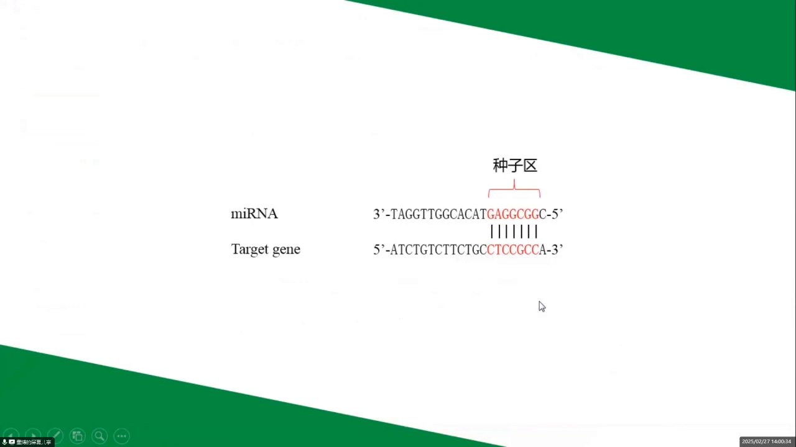
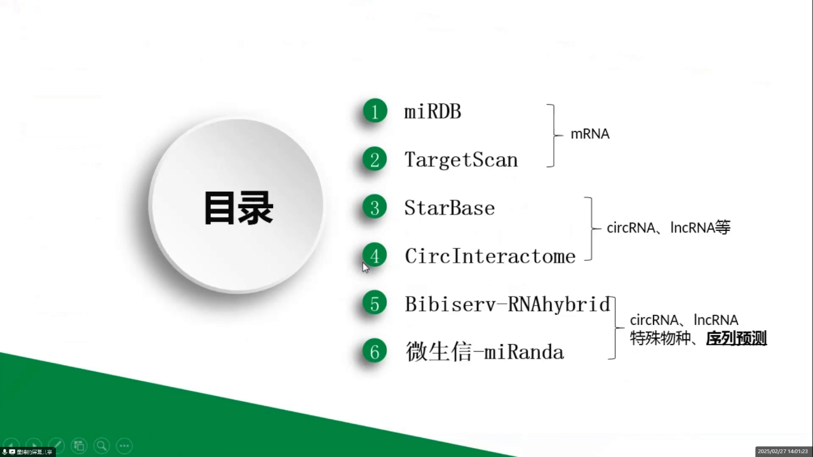
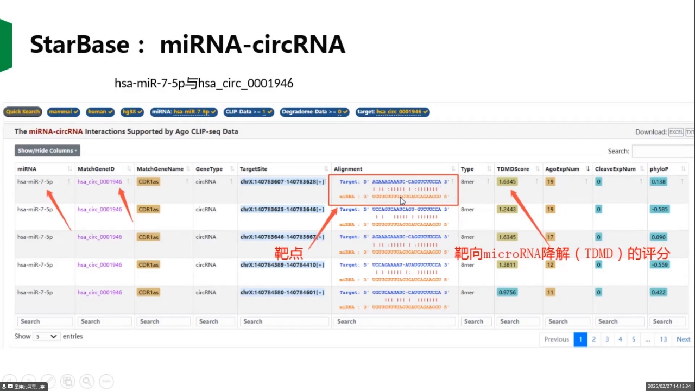
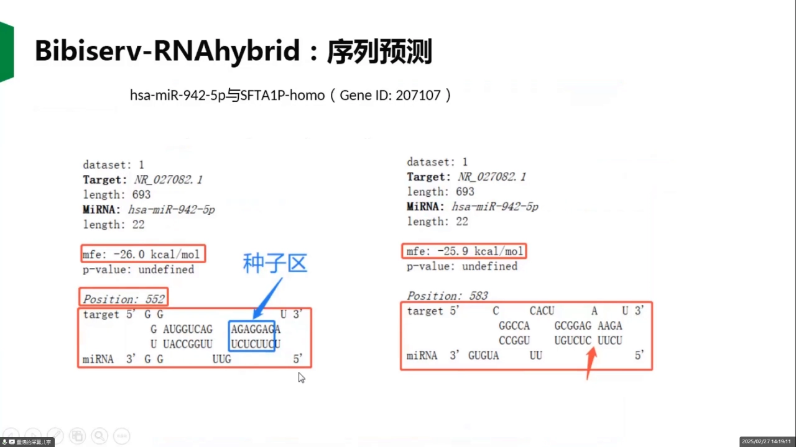
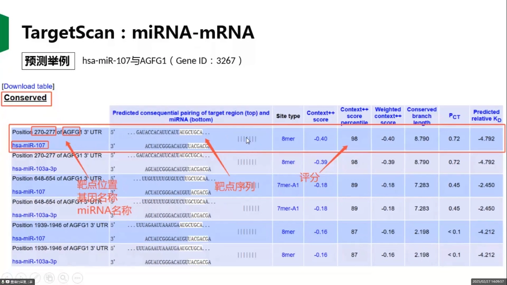
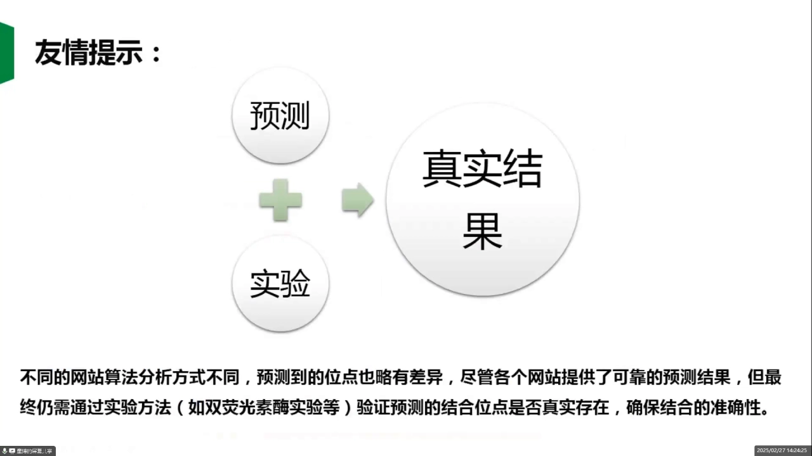

# miRNA 靶标预测：种子区配对、评分与预测的边界

> 视频来源：[吉玛讲堂——miRNA 与靶基因的结合位点预测方法](https://www.bilibili.com/video/BV1So9cYwEZL/)（Bilibili · 吉玛基因，约 36 分钟）
> 导读（100 字以内）：这支讲座逐个演示 miRDB、TargetScan、starBase、CircInteractome、Bibiserv-RNAhybrid 与微生信六个预测工具。本文不照抄点击步骤，而是抽出它们共同的判据——种子区配对、保守性、结合自由能与综合评分——并说明为什么预测结果只能算候选，最后必须回到实验验证。

## 本讲要解决的核心问题（SCQA）

**背景**：一个 miRNA 只有约 22 个碱基，却可能同时作用于许多靶基因；反过来，一个 mRNA 的 3'UTR 上也可能有多个 miRNA 的结合位点。要在实验里逐个验证这些配对，成本高得做不过来。

**冲突**：于是大家先用计算机预测：输入一个 miRNA 和一个候选靶基因，网站就能返回一串“可能结合”的位点，还带分数。但这些分数是怎么来的？分数高的位点就一定是真靶标吗？同一个 miRNA 与同一个基因，在不同网站给出的位点甚至不一样。

**疑问**：预测工具到底在算什么？我们该怎样读它的结果，又该在什么时候停止相信它？

**回答（中心思想）**：主流预测的共同核心是**种子区配对**——miRNA 5'端第 2 到第 8 位这 7 个碱基与靶 RNA 互补。在此之上，各工具再叠加**进化保守性、配对强弱与数量、双链结合自由能**等判据，压成一个评分。评分只表示“这个位点值得优先验证”，**预测给出的是候选，不是真实靶标**；不同算法结果有差异，最终仍要靠双荧光素酶等实验确认位点是否真的被结合。

---

## 一、靶标识别的物理基础：种子区

### 1.1 种子区是 miRNA 5'端的第 2–8 位

讲座开篇就把规则说清楚了：miRNA 与靶基因的结合，主要看 miRNA **从 5'端往 3'端数第 2 位到第 8 位**这几个碱基，这一段被称为**种子区**（seed region）。

[【跳转到 00:31】](https://www.bilibili.com/video/BV1So9cYwEZL/?t=31)

这张幻灯片值得逐字看：上面一行是 miRNA（3'→5' 书写），下面一行是靶基因（5'→3'），红色框出的 7 个碱基正好一一配对。**miRNA 与靶标之间不需要整条分子完全互补**，只要这 7 个碱基对得上，就足以形成一次有意义的识别。

讲座没有展开“为什么偏偏是 7 个碱基”的进化原因，但明确补充：**种子区是人为定义的**，只是目前研究得最多、证据最集中的区域，并不是说 miRNA 只能在种子区结合。

[【跳转到 25:56】](https://www.bilibili.com/video/BV1So9cYwEZL/?t=1556)

配对之后会发生什么？讲座用一句话概括：这几个碱基与靶基因互补结合，miRNA 就能影响靶基因功能的行使。这也是研究 miRNA 功能时，先要找靶标的原因。

### 1.2 结合位点不限于 3'UTR

讲座介绍的 miRDB 和 TargetScan 把搜索范围限定在靶基因的 **3'UTR**（编码区下游的非翻译区），因为这是这类工具默认关注的区域。但讲座在问答里明确提醒：也有研究表明 miRNA 可以结合在 **CDS 区（编码区）** 或 **5'UTR**，所以“位点一定在 3'UTR”并不是绝对规则，只是研究惯例和工具默认设置。

[【跳转到 28:01】](https://www.bilibili.com/video/BV1So9cYwEZL/?t=1681)

对初学者来说，这一点很重要：**工具没有返回位点，不等于这个 miRNA 一定不调控这个基因**，可能只是位点不在工具默认搜索的区域内。

---

## 二、预测工具在算什么：四类判据

讲座一共介绍了六个网站，但它们的底层判据可以归成四类。理解这四类判据，比记住六个网址更有用。

[【跳转到 01:20】](https://www.bilibili.com/video/BV1So9cYwEZL/?t=80)

### 2.1 序列配对：种子区对上了几个碱基

最基础的判据就是种子区配对。讲座反复强调两个细节：

- **配上的碱基数越多，可信度越高**。常规情况是种子区 7 个碱基都能配上；如果只有部分配上，或者中间出现缺口（靶序列多出一个碱基、miRNA 对应位置没有），这个位点就应当往后排。
- **配对有强弱之分**。讲座以 G-C 这类标准配对为强配对，以 G-U 这类配对为弱结合；弱结合在界面里也会被标出来，并计入评分。挑选位点时，应优先选种子区强配对多、连续配对的位点。

[【跳转到 13:31】](https://www.bilibili.com/video/BV1So9cYwEZL/?t=811)

### 2.2 进化保守性：保守位点更可能是真位点

第二个判据是**保守性**：这个结合位点在相近物种的同一基因里是否也保留着。讲座的说法很直接——**保守的序列比不保守的序列置信度更高**。

背后的逻辑不难理解：如果一个位点只是偶然出现的序列巧合，它在进化中容易被突变破坏；如果它在多个物种里都被保留下来，说明维持这段配对可能对生物体有用，因而更可能是真实的调控位点。

### 2.3 结合自由能：双链本身稳不稳

第三个判据来自热力学。Bibiserv-RNAhybrid 这类工具不预设“必须种子区配对”，而是直接计算 miRNA 与靶序列形成双链时的**最小自由能（mfe）**：自由能越负，说明这条双链越稳定，结合越有可能。

[【跳转到 18:43】](https://www.bilibili.com/video/BV1So9cYwEZL/?t=1123)

这张图正好展示了热力学判据的盲点：右侧位点的自由能也不差，但它的**种子区有一个缺口**（靶序列多出一个 A），按种子区规则应当降级。讲座因此提醒，用这类工具时**必须人工再看一眼种子区**，不能只挑自由能最低的那个。

### 2.4 综合评分：把多个判据压成一个数

实际网站通常把上述判据综合成一个评分。以 TargetScan 为例，结果表里会同时列出位点位置、位点类型、Context++ score、percentile、保守分支长度等列；讲座没有逐项解释每一列的计算方式，只强调评分越高、置信度越高。

[【跳转到 08:15】](https://www.bilibili.com/video/BV1So9cYwEZL/?t=495)

讲座的读法是：**先看评分，再看种子区配了几个碱基**。评分越高，置信度越高；但评分不是唯一标准——如果某个位点评分只是中等，种子区却连续配上了 7 到 8 个碱基，也值得拿去做实验验证。反过来，评分高但种子区有缺口的位点要谨慎。

[【跳转到 09:54】](https://www.bilibili.com/video/BV1So9cYwEZL/?t=594)

[【跳转到 32:16】](https://www.bilibili.com/video/BV1So9cYwEZL/?t=1936)

后一个时间点里，讲座举了一个具体分数作参照：在这个工具里 162 分算比较高，140 分偏低，150–160 分置信度更好一些；但即便只有 140 分，如果种子区连续配上了 7 到 8 个碱基，也仍值得验证。

需要注意的是，不同网站的评分体系并不统一：讲座举的例子中，有的工具用 0–100 的分数、越接近 100 越可信（他给出的例子是 98、89、87，非保守位点只有 28），有的用负值、绝对值越大越可信（如自由能），所以**跨网站比较分数没有意义**，只能在同一个工具内部排序。

---

## 三、选工具：先看对象，再看物种

六个工具并不是互相替代的关系，而是各有适用范围。讲座的分工可以整理成一张表：

| 你要预测的对象 | 推荐工具 | 前提与限制 |
| --- | --- | --- |
| miRNA–mRNA（3'UTR） | miRDB、TargetScan | 只收录少数模式物种（人、小鼠、大鼠、鸡等），物种不在列表里就用不了 |
| miRNA–circRNA / lncRNA | starBase、CircInteractome | 收录范围更广，能处理线性 RNA 之外的靶标 |
| 特殊物种、非模式生物、指定转录本 | Bibiserv-RNAhybrid、微生信 | 需要自己准备 miRNA 与靶序列的 FASTA 格式，结果需人工甄别 |

几个容易踩的坑：

- **物种收录**：输入基因名就能出结果的工具，前提是它已经收录了这个物种的 miRNA 和靶基因。研究昆虫、家禽、鱼类或植物时，常常只能用“给序列”的方式预测。
- **多个转录本**：一个基因可能有多个转录本，3'UTR 长度和序列都不同，结合位点也可能不同。用基因名预测时，工具通常只取一个默认转录本；要针对特定转录本，就得自己取 3'UTR 序列做序列预测。
- **算法差异**：同一对 miRNA 与靶基因，在不同网站得到的位点可能不同。讲座明确说，这是因为各网站的算法和分析方式不同，**结果有差异是正常的**，不能把某一个网站的输出当成标准答案。

[【跳转到 12:41】](https://www.bilibili.com/video/BV1So9cYwEZL/?t=761)

讲座用 starBase 与前面两个工具对比：miRDB 和 TargetScan 主要围绕种子区给分，而 starBase 会把种子区之外能互补的碱基也算进来。好处是可能找到更多可配对的位点，坏处是弱配对（如 G-U）也会进入评分，所以它的分数只能作参考，仍要回到种子区看配对数量和强弱。

---

## 四、从候选到真实靶标：预测只是第一步

### 4.1 预测结果的含义：可能结合，不是一定结合

讲座最后给出一句关键的“友情提示”：预测到的结果**只是一个可能结合的位点**。

[【跳转到 24:21】](https://www.bilibili.com/video/BV1So9cYwEZL/?t=1461)

这句话可以拆成三层意思：

1. **预测是必要条件，不是充分条件**。种子区配对是真实结合的必要条件之一，但细胞内的实际情况比序列配对复杂，序列上能配对不代表细胞内真的能配上。
2. **不同算法给出不同候选**。所以“某个网站预测到了”本身不构成证据；多个工具、多个判据同时支持，才值得优先验证。
3. **真实靶标需要实验证据**。讲座提到的验证方法是双荧光素酶实验，用来检验预测的结合位点是否真实存在；视频没有展开这个实验的操作细节。

### 4.2 一条实用的判读顺序

把讲座的零散建议整理成一条可操作的顺序：

1. **先限定对象**：是 mRNA 还是 circRNA/lncRNA？物种是否被工具收录？要预测哪个转录本？
2. **看种子区**：2–8 位是否连续、强配对？有缺口或弱配对就降级。
3. **看支持证据**：位点是否保守？评分在工具内部是否靠前？是否有多于一个位点？
4. **交叉验证**：换一个算法不同的工具再看一遍，取交集或取共同支持的位点。
5. **实验确认**：对排名最靠前的 1–2 个位点做报告基因实验，而不是对几十个候选一视同仁。

这套顺序的核心是：**预测的作用是缩小实验范围，不是替代实验**。

---

## 小结

- miRNA 识别靶标的核心是**种子区**：miRNA 5'端第 2–8 位与靶 RNA 互补配对；种子区是人为定义，但它是目前证据最集中的区域。
- 结合位点**不限于 3'UTR**，CDS 和 5'UTR 也有报道；工具默认只搜 3'UTR，所以“没预测到”不等于“不调控”。
- 预测工具的四类判据：**种子区配对数量与强弱、进化保守性、双链结合自由能、综合评分**。
- 工具选择取决于**对象类型和物种收录**：mRNA 用 miRDB/TargetScan，circRNA/lncRNA 用 starBase/CircInteractome，特殊物种或指定转录本用序列预测工具。
- 同一对 miRNA–靶基因在不同网站结果可能不同，**跨网站比较分数没有意义**。
- **预测给出的是候选，真实靶标需要实验验证**（如双荧光素酶报告实验）；预测的价值在于缩小验证范围。

## 关键术语速查

| 术语 | 一句话解释 |
| --- | --- |
| 种子区（seed region） | miRNA 5'端第 2–8 位共 7 个碱基，是与靶 RNA 配对、决定靶标特异性的核心区域 |
| 3'UTR | mRNA 编码区下游的非翻译区，miRNA 结合位点最富集的区域 |
| 保守性 | 同一结合位点在相近物种中是否保留；保守位点更可能是真实调控位点 |
| 最小自由能（mfe） | miRNA 与靶序列形成双链时的自由能变化，越负表示双链越稳定 |
| Context++ score | TargetScan 给出的综合评分，综合了位点类型、位置、周围序列环境等判据 |
| 双荧光素酶实验 | 讲座提到的验证手段：用报告基因活性检验预测的结合位点是否真实存在；具体操作不在本节范围 |
| miRDB / TargetScan | 面向 miRNA–mRNA 3'UTR 的预测数据库，只收录少数模式物种 |
| starBase / CircInteractome | 支持 miRNA 与 circRNA、lncRNA 等非编码 RNA 互作预测的工具 |