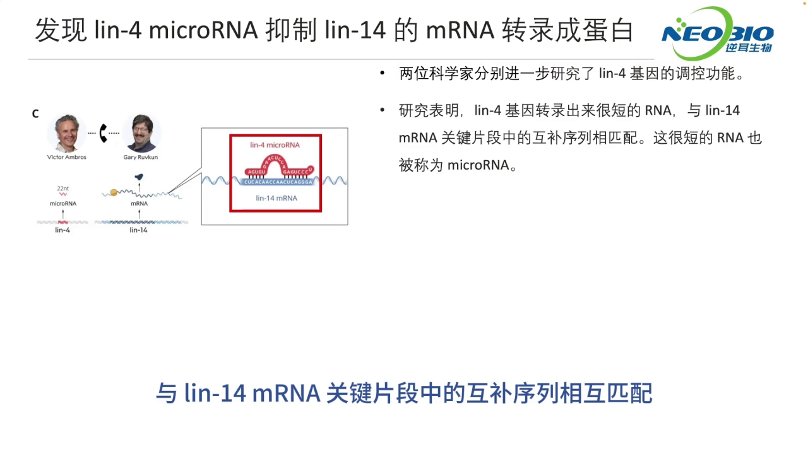
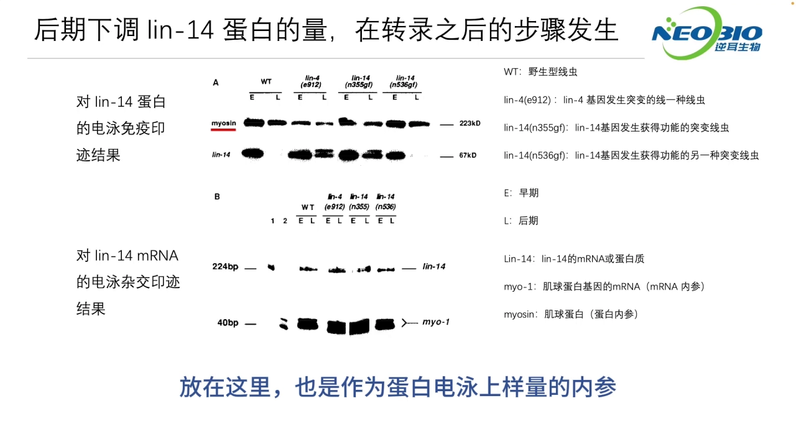
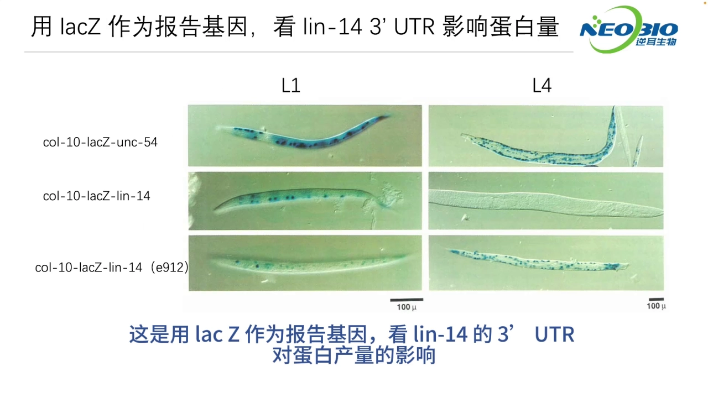
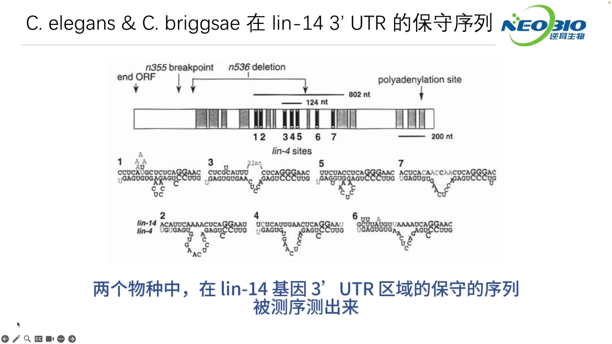
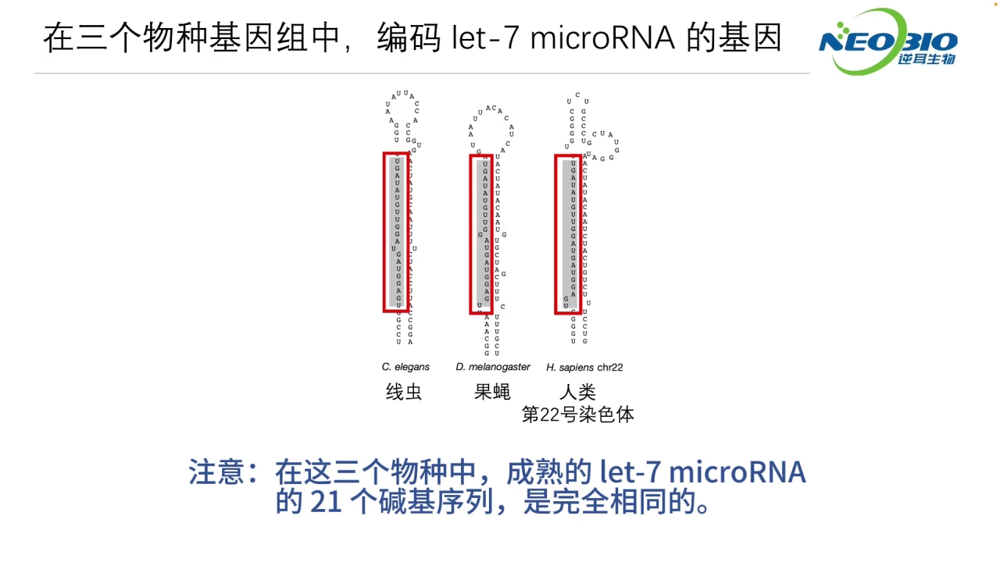
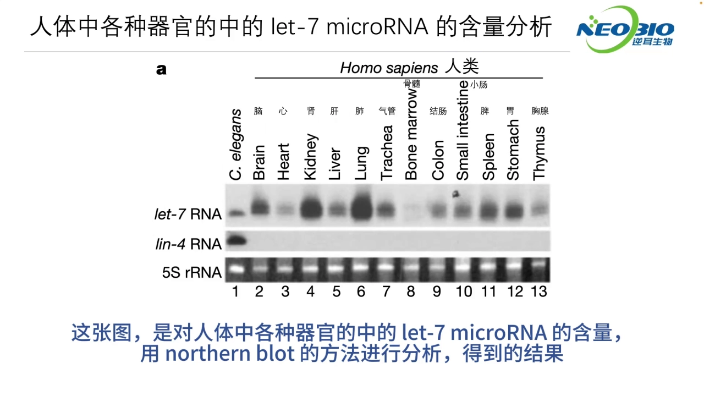
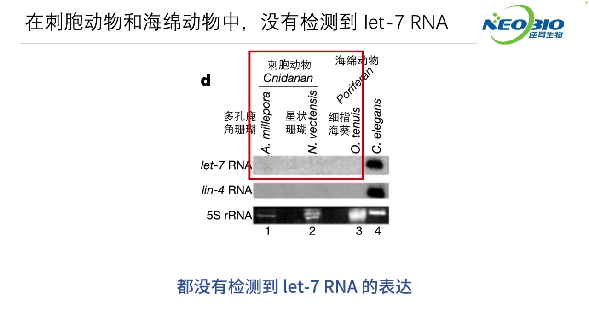

# 怎样证明 miRNA 真的抑制了靶基因：从 lin-4 到 let-7 的证据链

> 视频来源：[【陈巍学基因】132：深度解读 2024 年诺贝尔生理学奖——发现并确认 microRNA 的调控作用](https://www.bilibili.com/video/BV1uG1pYPEVJ/)（Bilibili · 陈巍学基因，约 34 分钟）
> 导读（100 字以内）：这支视频按三篇原始论文逐图讲解 lin-4、lin-14 与 let-7 的实验。本文把它重排成一条“怎样证明一个 miRNA 真的调控了某个靶基因”的证据链：排除编码蛋白、测出成熟体、把抑制定位到 3'UTR、用遗传学剂量关系确认位点，最后看表达背景。

## 本讲要解决的核心问题（SCQA）

**背景**：1993 年，Ambros 和 Ruvkun 在研究线虫发育时发现，`lin-4` 基因不编码蛋白质，而是产生一个很短的 RNA；这个 RNA 与 `lin-14` mRNA 的 3'UTR 有互补序列，`lin-4` 突变会让 `lin-14` 蛋白变多。

**冲突**：序列互补只是一个漂亮的猜想。一个 22 nt 的 RNA 凭什么让另一个基因的蛋白减少？怎么排除“其实是别的原因”？又怎么证明起作用的正是这段 3'UTR、正是这几个互补位点？

**疑问**：从“发现一段小 RNA”到“确认它真的抑制了靶基因”，中间需要哪些证据？

**回答（中心思想）**：这条证据链有四步。**第一，排除 lin-4 通过编码蛋白起作用**（破坏所有可能阅读框都不影响功能）；**第二，测出并定位 22 nt 的成熟小 RNA**；**第三，把抑制效应定位到靶基因的 3'UTR**（mRNA 量不变、蛋白量下降，且 3'UTR 足以让报告基因受同样调控）；**第四，用遗传学剂量关系确认结合位点**（丢失的位点越多，去抑制越强）。let-7 的研究再把这条链扩展到物种保守性与组织、时间表达背景。

---

## 一、起点：两个基因的遗传学关系

故事从线虫的时间发育开始。有两种突变线虫表现出发育时序缺陷，突变分别落在 `lin-4` 和 `lin-14` 两个基因上；进一步研究发现，`lin-4` 似乎是 `lin-14` 的**负调节因子**。

[【跳转到 01:37】](https://www.bilibili.com/video/BV1uG1pYPEVJ/?t=97)

两位科学家分别分析 `lin-4` 突变体，都发现 `lin-4` 产生的是很短的 RNA，而且**不编码蛋白**。这在当时很反常：一个不编码蛋白的基因，怎么能抑制另一个基因？

[【跳转到 01:55】](https://www.bilibili.com/video/BV1uG1pYPEVJ/?t=115)

这里先记住一个方法上的关键：**“相关”不等于“因果”**。`lin-4` 突变与 `lin-14` 蛋白升高同时出现，只能说明两者有关联；要证明是 `lin-4` 的 RNA 直接作用，需要一层层排除其他解释。

---

## 二、第一步：排除“lin-4 编码蛋白”的可能

第一个要排除的解释是：`lin-4` 其实编码了一个很小的蛋白，是这个蛋白在抑制 `lin-14`。

研究者的做法是**系统地破坏所有可能的蛋白翻译框**，再看 `lin-4` 的功能是否还在。他们把 `lin-4` 所在的一段约 700 碱基的序列切出来，先做拯救实验确认这段序列确实能恢复突变线虫的正常表型，然后在这段序列里逐个制造“让蛋白翻译中断”的突变：

- 在第 90 位插入一段 82 碱基的序列；
- 在第 259 位插入一个碱基；
- 在第 53 位和第 111 位分别把密码子替换成终止密码子；
- 把第 546 位天然的起始密码子 ATG 突变成 ACG。

[【跳转到 07:46】](https://www.bilibili.com/video/BV1uG1pYPEVJ/?t=466)

这些突变分别破坏了不同阅读框，或直接去掉了起始/终止信号，但**没有一个影响拯救活性**。结论是：`lin-4` 的功能不太可能通过翻译出一个蛋白质来实现。既然不是蛋白，那起调控作用的就可能是转录出来的 RNA 本身。

这一步的推理形式值得记住：**要证明“不是 A”，就去破坏 A 所需的条件，看功能是否消失**。功能不受影响，A 就被排除了。

---

## 三、第二步：把 22 nt 的成熟小 RNA 测出来

接下来要把“起作用的 RNA”具体化：它有多长？从哪里开始、到哪里结束？

研究者先用 Northern blot 检测被拯救的线虫总 RNA，看到两个小转录本：长的命名为 `lin-4L`（61 个碱基），短的命名为 `lin-4S`（22 个碱基）。随后用两种方法确定它们的起止位置：

- **引物延伸法**：用同位素标记的 DNA 引物与目标 RNA 杂交，逆转录延伸到 RNA 的 5'端，再跑电泳、放射自显影，根据比引物延长了多少碱基推算转录起始位点。
- **S1 核酸酶保护法**：S1 核酸酶只消化单链、不消化双链；用标记探针与样本 RNA 杂交后消化，保留下来的探针长度就对应互补序列的长度，条带深浅则反映目标 RNA 的量。

[【跳转到 11:25】](https://www.bilibili.com/video/BV1uG1pYPEVJ/?t=685)

最终确定：`lin-4S` 的长度约为 **20 ± 2 个碱基**，与 `lin-4L` 共享同一个起始位点。这个 22 nt 左右的短 RNA，就是后来所说的 **microRNA**。

[【跳转到 09:26】](https://www.bilibili.com/video/BV1uG1pYPEVJ/?t=566)

这里的方法论是：**先看到条带，再确定长度，再定位到基因组序列**。只有把分子实体确定下来，后面的“序列互补”才有对象。

---

## 四、第三步：把抑制效应定位到靶基因的 3'UTR

### 4.1 蛋白变少，mRNA 没变

研究者比较了野生型和几种突变线虫在早期（E）与后期（L）的 `lin-14` mRNA 和蛋白量。

[【跳转到 17:23】](https://www.bilibili.com/video/BV1uG1pYPEVJ/?t=1043)

关键读数：

- 野生型：早期和后期 `lin-14` 的 **mRNA 量没有大变化**，但后期蛋白量只有早期的约 **1/10**。
- `lin-4(e912)` 突变体：后期蛋白量是前期的约 **1/2.3**，去抑制明显。
- `lin-14(n355gf)`：后期蛋白量是前期的约 **1/1.3**。
- `lin-14(n536gf)`：后期蛋白量是前期的约 **1/2.3**。

mRNA 不变而蛋白下降，说明调控发生在**转录之后**，作用在翻译或蛋白产出环节。这是“转录后调控”这个判断的直接证据。

[【跳转到 19:03】](https://www.bilibili.com/video/BV1uG1pYPEVJ/?t=1143)

### 4.2 3'UTR 足以让报告基因受同样的调控

但“转录后”还不够精确：是 `lin-14` 的哪一段序列在起作用？研究者做了一个报告基因实验：把 `lacZ`（β-半乳糖苷酶基因）放在 `lin-14` 自己的启动子下游，再在 `lacZ` 后面接上 `lin-14` 的 3'UTR；对照则接看家基因 `unc-54` 的 3'UTR。`lacZ` 表达出的酶能切开 X-gal，产生蓝色沉淀，因此蓝色深浅就代表报告基因的蛋白产量。

[【跳转到 21:33】](https://www.bilibili.com/video/BV1uG1pYPEVJ/?t=1293)

结果非常干净：

- 对照（`unc-54` 3'UTR）：L1 和 L4 都有蓝色，说明报告基因本身不受发育阶段限制。
- 野生型 `lin-14` 3'UTR：L1 有蓝色，L4 几乎没有蓝色——3'UTR 把抑制“带”给了报告基因。
- 突变型 `lin-14(e912)` 3'UTR：L4 仍有蓝色——突变破坏了 3'UTR 上的调控元件。

同时，S1 核酸酶保护实验显示：内源 `lin-14` mRNA 和报告基因 mRNA 在 L1 与 L4 的量都差不多。**mRNA 量一样、蛋白产量不同**，再一次把效应锁定在 3'UTR 介导的翻译抑制上。

这一步的逻辑是：**把候选调控序列挪到一个无关的报告基因上，如果它能复制同样的调控，就说明这段序列足以介导调控**。

---

## 五、第四步：用遗传学剂量关系确认结合位点

到这一步，已经知道 3'UTR 上有调控元件，但还不知道具体是哪些碱基。研究者把线虫和近缘种秀丽短体线虫（`C. briggsae`）的 `lin-14` 3'UTR 拿来比较，发现两者有保守区域；其中 **7 个既保守、又与 `lin-4` RNA 互补的位点**被逐个标了出来。

[【跳转到 26:21】](https://www.bilibili.com/video/BV1uG1pYPEVJ/?t=1581)

两个获得功能突变正好提供了剂量关系：

- `n536`：缺失 7 个位点中的 **5 个**，后期 `lin-14` 蛋白量比野生型多约 **4 倍**。
- `n355`：倒位导致 3'UTR 断裂，**7 个位点全部丢失**，后期蛋白量比野生型多约 **7 倍**。

这是一个很漂亮的证据：**位点丢得越多，去抑制越强**。如果这些位点与抑制无关，丢失它们不应该产生这种阶梯式效应。再加上前面 `ma161` 突变正好落在 `lin-4` 与 `lin-14` 的互补序列里、并导致 `lin-4` 失活，因果链就闭合了：

[【跳转到 15:40】](https://www.bilibili.com/video/BV1uG1pYPEVJ/?t=940)

[【跳转到 26:46】](https://www.bilibili.com/video/BV1uG1pYPEVJ/?t=1606)

> `lin-4` 的 22 nt RNA → 与 `lin-14` 3'UTR 的 7 个位点互补 → 抑制 `lin-14` 翻译 → `lin-14` 蛋白减少 → 发育时序正常推进。

---

## 六、let-7：把结论扩展到保守性与表达背景

`lin-4` 的故事有一个隐忧：它会不会只是线虫里的特例？2000 年的 `let-7` 研究回答了这个问题。

### 6.1 序列和长度在两侧对称动物中高度保守

`let-7` 的成熟体是 **21 个碱基**。在线虫、果蝇、人类三个物种里，编码 `let-7` 的基因转录出的前体都能折叠成茎环结构，而成熟 `let-7` 的那 21 个碱基**完全相同**。

[【跳转到 28:52】](https://www.bilibili.com/video/BV1uG1pYPEVJ/?t=1732)

在人类基因组上，第 9、11、22 号染色体各有 1 处完全匹配这 21 个碱基的序列，另外第 9、21 号染色体还有 2 处匹配其中 20 个碱基的序列。讲座据此指出：**21 个碱基的长度高度保守，说明这个长度对功能至关重要**。

### 6.2 表达有组织差异：不是所有细胞里都一样多

更值得注意的是 `let-7` 的表达背景。用 Northern blot 检测人体多种器官，`let-7` 的含量并不均匀：脑、心、肾、肝、肺等器官都有表达，而**骨髓中特别低**。

[【跳转到 29:42】](https://www.bilibili.com/video/BV1uG1pYPEVJ/?t=1782)

讲座的解释是：骨髓主要由**未成熟的细胞**组成，而 `let-7` 主要在发育后期、成熟组织中表达。这与 `let-7` 调控时间发育的角色一致。

[【跳转到 29:47】](https://www.bilibili.com/video/BV1uG1pYPEVJ/?t=1787)

同样的模式出现在其他动物里：果蝇直到三龄晚期幼虫才出现 `let-7`，蛹早期表达量增加至少 10 倍；斑马鱼在 48 小时之后才有明显表达；多毛环节动物和软体动物都是幼虫期不表达、成熟期表达。

### 6.3 保守性有边界：不是所有动物都有 let-7

`let-7` 的分布也有清楚的边界。在刺胞动物（多孔鹿角珊瑚、星状珊瑚）和海绵动物（细指海葵）中，用 Northern blot **检测不到 `let-7` RNA**，而同样处理的线虫对照有明确条带。

[【跳转到 31:47】](https://www.bilibili.com/video/BV1uG1pYPEVJ/?t=1907)

结合两侧对称动物普遍表达、非动物物种不表达的结果，作者提出：`let-7` 这个基因可能是在双胚层动物与两侧对称动物分化之后才进化出来的。

这一节给我们的启发是：**miRNA 的调控不是无处不在的**。一个 miRNA 在某个细胞里有没有、有多少，决定了它能不能调控那里的靶基因；讨论“某 miRNA 调控某基因”时，必须先确认两者在同一个细胞、同一时间是否同时存在。

---

## 七、这条证据链对今天判读 miRNA 靶标的含义

把 1993 年和 2000 年的实验翻译成今天的语言，可以提炼出四条判读原则。

### 7.1 序列互补只是候选，不是结论

`lin-4` 与 `lin-14` 3'UTR 有 7 处互补，这只是提出假设。真正让它成为结论的，是后面“破坏位点→去抑制”的遗传学实验。今天用软件预测到种子区配对，地位和当年的“序列互补”一样：**它是候选，不是证据**。

### 7.2 mRNA 不变，不等于没有调控

`lin-14` 的 mRNA 量在早期和后期几乎一样，蛋白量却差了 10 倍。如果只做 RNA 测序，这个调控完全看不见。这提醒我们：**用转录组判断 miRNA 的效应会漏掉翻译抑制**，需要蛋白层面的读出。

### 7.3 位点数量决定抑制强度

7 个位点丢 5 个，蛋白回升 4 倍；7 个全丢，回升 7 倍。**一个基因受多个位点、多个 miRNA 共同调控**，效应是可以叠加的。这解释了为什么有些靶基因对单个位点的突变不敏感，也解释了为什么预测工具会为一个基因列出多个位点。

### 7.4 表达背景决定调控是否发生

`let-7` 在骨髓里很低、在成熟组织里高；在刺胞动物和海绵里干脆没有。**miRNA 与靶基因必须在同一细胞、同一时间共存，调控才可能发生**。所以“某 miRNA 靶向某基因”这句话，只有在给定的细胞类型和发育阶段里才有意义。

---

## 小结

- 证明一个 miRNA 真的调控靶基因，需要一条**多层证据链**，不能只靠序列互补。
- **排除编码蛋白**：破坏所有可能阅读框、起始/终止密码子，`lin-4` 的拯救活性不受影响。
- **确定分子实体**：Northern blot 看到 61 nt 与 22 nt 两个转录本，引物延伸与 S1 核酸酶保护确定起止位点。
- **定位调控序列**：`lin-14` mRNA 不变、蛋白降到 1/10；把 3'UTR 接到 `lacZ` 报告基因上，足以复制同样的抑制。
- **确认结合位点**：3'UTR 上有 7 个保守的 `lin-4` 互补位点；丢 5 个蛋白回升 4 倍，全丢回升 7 倍，呈剂量关系。
- **let-7 扩展了结论**：21 nt 成熟体在两侧对称动物中完全保守；表达有组织和时间差异；刺胞动物、海绵动物中检测不到。
- 对今天的启示：预测只是候选；mRNA 不变不等于没调控；位点数量影响强度；表达背景决定调控能否发生。

## 关键术语速查

| 术语 | 一句话解释 |
| --- | --- |
| `lin-4` / `lin-14` | 线虫中最早发现的 miRNA 基因与其靶基因；`lin-4` 产生 22 nt RNA，负调控 `lin-14` |
| `let-7` | 第二个被发现的 miRNA，21 nt，在两侧对称动物中高度保守，调控发育时序 |
| 拯救实验 | 把候选 DNA 片段转入突变体，看能否恢复野生型表型，用来确认片段是否含功能基因 |
| 引物延伸法 | 用标记引物从 RNA 模板逆转录延伸，根据延长长度推算 RNA 的 5'端位置 |
| S1 核酸酶保护法 | 利用 S1 只消化单链的特性，用探针杂交后消化，根据保留下来的探针长度和条带深浅判断目标 RNA 的长度与丰度 |
| 报告基因 | 接在候选调控序列后面的易检测基因（如 `lacZ`），用其产物活性反映调控序列的作用 |
| 3'UTR | mRNA 编码区下游的非翻译区，miRNA 结合位点所在区域 |
| 获得功能突变（gf） | 使基因功能增强或摆脱原有抑制的突变；本文中 `n355`、`n536` 是 3'UTR 位点丢失导致的去抑制突变 |
| 转录后调控 | 转录完成之后发生的调控，包括翻译抑制和 mRNA 降解，不改变转录速率 |