# 翻译起始的三个调控点：eIF2α、4E-BP 与 uORF 如何让蛋白产量脱离 mRNA 丰度

> 视频来源：MITx 7.28.3x《分子生物学Ⅲ——RNA 加工与翻译》第 54–57 讲节选（Bilibili · 常青藤名校课中配版）：[p54 起始装载](https://www.bilibili.com/video/BV1FU4H6PEEV/?p=54)、[p55 帽与 4E-BP](https://www.bilibili.com/video/BV1FU4H6PEEV/?p=55)、[p56 上游 AUG 与 uORF](https://www.bilibili.com/video/BV1FU4H6PEEV/?p=56)、[p57 GCN4 例子](https://www.bilibili.com/video/BV1FU4H6PEEV/?p=57)，合计约 20 分钟。
> 导读：本文把四段课拼成一条主线——真核翻译起始有三个可调节点，前两个是全局油门，第三个是基因特异开关；uORF、5′UTR 结构、IRES、3′UTR 位点与 poly(A) 尾都在这个框架里改变蛋白产量。核糖体结构与延伸步骤不在这里重讲。

## 本讲要解决的核心问题（SCQA）

**背景**：我们常用 mRNA 丰度代表基因表达——转录组测序数的是 RNA，qPCR 量的也是 RNA。按最简单的理解，RNA 越多，翻译出来的蛋白应该越多。

**冲突**：实际测量经常对不上。同一细胞里，两条 mRNA 的拷贝数可以很接近，蛋白产量却差很多；更极端的是，mRNA 量几乎不变，蛋白量却能随营养、胁迫或发育阶段大幅升降。只数 RNA，无法解释这些差异。

**疑问**：蛋白产量是在哪一步被改写的？如果 mRNA 没有变多或变少，细胞凭什么让某一条 mRNA 多翻译或少翻译？

**回答（中心思想）**：真核翻译起始有三个可调节点——**eIF2–GTP–起始 tRNA 三元复合物的装载**、**eIF4E–4E-BP–eIF4G 的帽依赖招募**、以及**40S 扫描时对 AUG/uORF 的选择**。前两个是全局油门，决定细胞整体翻译水平；第三个是基因特异开关，决定某一条 mRNA 的起始位点被用多少次。UTR 上的二级结构、uORF、IRES、miRNA 位点和 poly(A) 尾，都是在这三个点上做局部改写。于是“RNA 丰度”只是模板数量，**蛋白产出还取决于每条模板被起始多少次**。

## 一、先建立框架：起始是限速节点，也是调控最集中的地方

真核翻译起始比细菌复杂得多，原因不只是“步骤多”，而是**每一步都留下了调控接口**。[【跳转到 00:00】](https://www.bilibili.com/video/BV1FU4H6PEEV/?p=54&t=0)

> 如果对 5′ 帽、eIF4、eIF2 带起始 tRNA、40S 扫描这些基础装配还不熟，先读 [B01 §4.1 起始](../../../../B01_生命科学基础主干/2_遗传信息流与中心法则/2.2_从基因到产物/2.2.5_翻译：核糖体、mRNA%20与多肽合成/翻译如何发生：从密码子到多肽链的分子流水线.md)；核糖体结构、延伸与终止也在那一篇，本文不重复。

细菌主要靠核糖体结合位点的序列和附近二级结构来调节起始；真核则把起始拆成一条长长的装配线：帽结合、支架蛋白招募、三元复合物装载、40S 扫描、AUG 识别、60S 加入。装配线越长，能“卡”的地方越多。

本讲只抓三个卡点，它们对应三类完全不同的调控逻辑：

1. **装载层**：eIF2 能不能把起始 tRNA 送到 40S 的 P 位。这决定细胞还有多少“起跑器”。
2. **招募层**：eIF4E 能不能把 eIF4G 和 40S 拉到 5′ 帽上。这决定帽依赖 mRNA 的整体入口开多大。
3. **扫描层**：40S 沿着 5′UTR 往前滑时，先遇到哪个 AUG、要不要在 uORF 上停下来。这决定同一条 mRNA 上哪个开放阅读框被翻译。

前两个是**全局**的：油门一踩，几乎所有帽依赖 mRNA 一起变。第三个是**基因特异**的：同一套起始机器，在不同 UTR 上读出不同产量。把这三层分开，后面所有 UTR 元件的效果都能找到落点。

## 二、第一个全局油门：eIF2 三元复合物与 eIF2α 磷酸化

### 2.1 起始 tRNA 不是自己走上去的，它要坐“三元复合物”这辆车

起始的第一步，是把起始 tRNA 送到 40S 小亚基的 P 位。真核里负责递送的是一个三件套，叫**三元复合物（ternary complex）**：**eIF2–GTP** 加上**起始 tRNA（Met-tRNAi）**。[【跳转到 00:25】](https://www.bilibili.com/video/BV1FU4H6PEEV/?p=54&t=25)

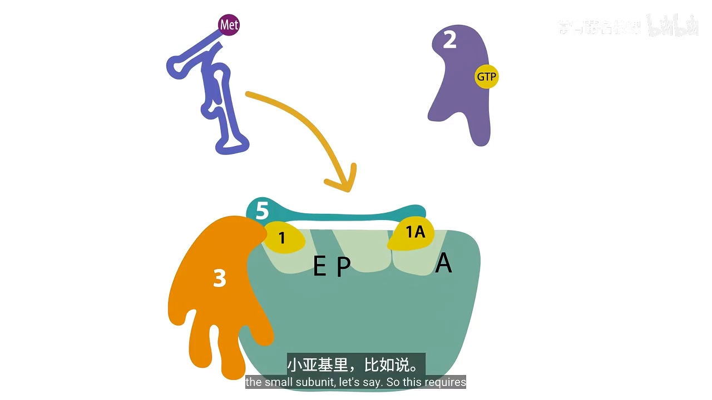

eIF2 必须先结合 **GTP** 才能抓住起始 tRNA。起始完成后，GTP 水解成 GDP，eIF2 以 GDP 形式离开，下一次要重新“充值”才能再用。负责充值的是 **eIF2B**，它是 eIF2 的 GDP/GTP 交换因子：把 eIF2 上的 GDP 换成 GTP，三元复合物才能继续组装。[【跳转到 01:00】](https://www.bilibili.com/video/BV1FU4H6PEEV/?p=54&t=60)

所以细胞里三元复合物的数量，取决于两件事：eIF2 有多少处于 GTP 结合状态，以及 eIF2B 的交换速度有多快。**这两个量就是全局翻译的油门**。

### 2.2 胁迫激酶磷酸化 eIF2α，把油门踩下去

eIF2 是一个三聚体，其中 **α 亚基**是多种胁迫激酶的共同靶点。这些激酶响应的情况很广：氨基酸不足、病毒感染、内质网应激、缺氧、渗透胁迫、热休克。[【跳转到 01:22】](https://www.bilibili.com/video/BV1FU4H6PEEV/?p=54&t=82)

这些情况看起来五花八门，但共同点是：**此刻大量合成新蛋白对细胞未必有利**。比如热休克时，核糖体还在不停产出蛋白，但这些蛋白在高温下容易错误折叠；温度恢复后，细胞还得花力气把它们清除掉。与其制造一堆废品，不如先把全局翻译降下来。

磷酸化的 eIF2α 会**抑制 eIF2B 的交换活性**，GDP 换不成 GTP，GTP 结合态的 eIF2 就积累不起来，三元复合物越来越少，40S 拿不到起始 tRNA，全局起始速率下降。[【跳转到 02:40】](https://www.bilibili.com/video/BV1FU4H6PEEV/?p=54&t=160)

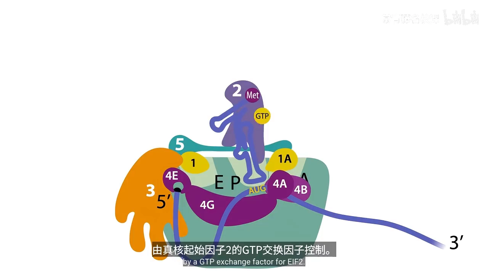

注意这里的逻辑：**eIF2α 磷酸化不是把某一条 mRNA 关掉，而是把整个细胞的三元复合物供应调低**。哪些 mRNA 先受影响，取决于它们对三元复合物的依赖程度和 UTR 结构——这就给下一层的基因特异调控留下了空间。

## 三、第二个全局油门：4E-BP、mTOR 与帽依赖起始

### 3.1 帽依赖起始的入口：eIF4E 认帽，eIF4G 招人

真核 mRNA 的 5′ 端有一个**帽（cap）**。认帽的是 **eIF4E**；eIF4E 结合帽之后，再结合 **eIF4G**。eIF4G 是支架蛋白，它把 40S、eIF2 三元复合物、解旋酶 eIF4A 等一串组件拉到 mRNA 的 5′ 端，起始才能往下走。[【跳转到 00:10】](https://www.bilibili.com/video/BV1FU4H6PEEV/?p=55&t=10)

可以把 eIF4E 想成“停车场入口的读卡器”：帽是卡，eIF4E 是读卡器，eIF4G 是读卡器后面那根把车引进车位的杆。**读卡器被挡住，后面的杆就抬不起来**。

### 3.2 4E-BP 挡住 eIF4E，mTOR 把挡板拿开

细胞里有一类蛋白叫 **4E 结合蛋白（4E-BP）**，它能结合 eIF4E，把 eIF4E 和 eIF4G 隔开。4E-BP 占着 eIF4E 时，eIF4G 招募不上来，帽依赖起始被抑制。[【跳转到 00:40】](https://www.bilibili.com/video/BV1FU4H6PEEV/?p=55&t=40)

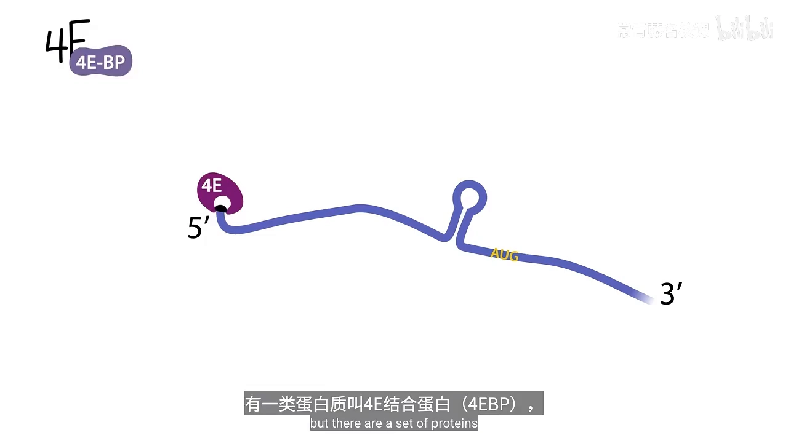

4E-BP 的开关是**磷酸化**。当生长相关激酶（如 **mTOR**）把 4E-BP 磷酸化后，4E-BP 就不能再结合 eIF4E，eIF4E 空出来，eIF4G 可以结合，翻译恢复。[【跳转到 01:38】](https://www.bilibili.com/video/BV1FU4H6PEEV/?p=55&t=98)

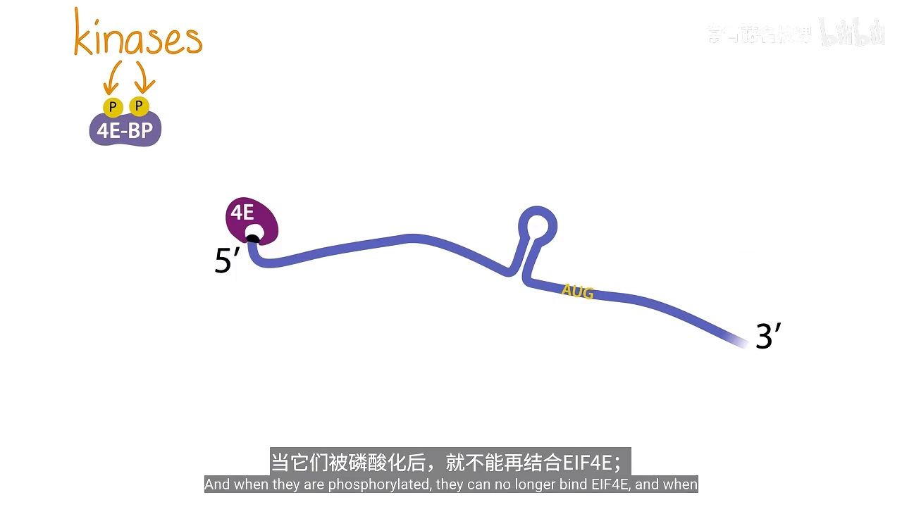

这条通路的意义在于**把细胞生长状态和翻译能力绑在一起**。细胞要快速分裂，就需要大量新蛋白，包括组蛋白等走完细胞周期所必需的蛋白；mTOR 活跃时，4E-BP 被磷酸化，帽依赖翻译整体上调。[【跳转到 02:01】](https://www.bilibili.com/video/BV1FU4H6PEEV/?p=55&t=121)

和 eIF2α 一样，4E-BP 也是**全局**的：它不针对某一条 mRNA，而是让所有帽依赖 mRNA 的入口一起变宽或变窄。

### 3.3 同一个 4E-BP，也能被“拴”在某一条 mRNA 上做局部抑制

全局调控和基因特异调控并不是两套零件。果蝇早期胚胎里的 **Bruno** 蛋白给出了一个漂亮的例子：Bruno 结合 **oskar** mRNA 3′ 端的一段特定序列，同时招募一个叫 **cup** 的蛋白；cup 本身就是一种 4E-BP。[【跳转到 02:36】](https://www.bilibili.com/video/BV1FU4H6PEEV/?p=55&t=156)

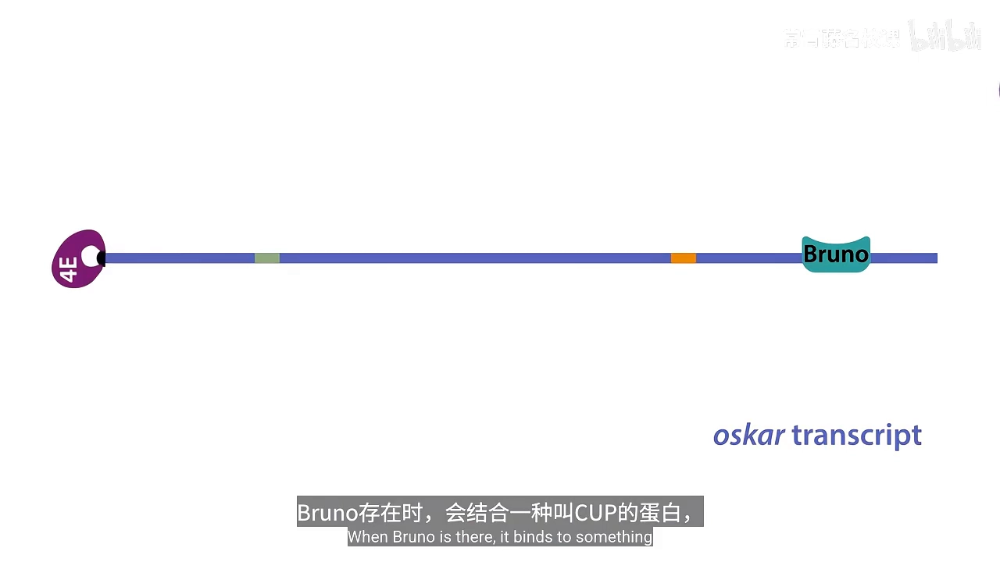

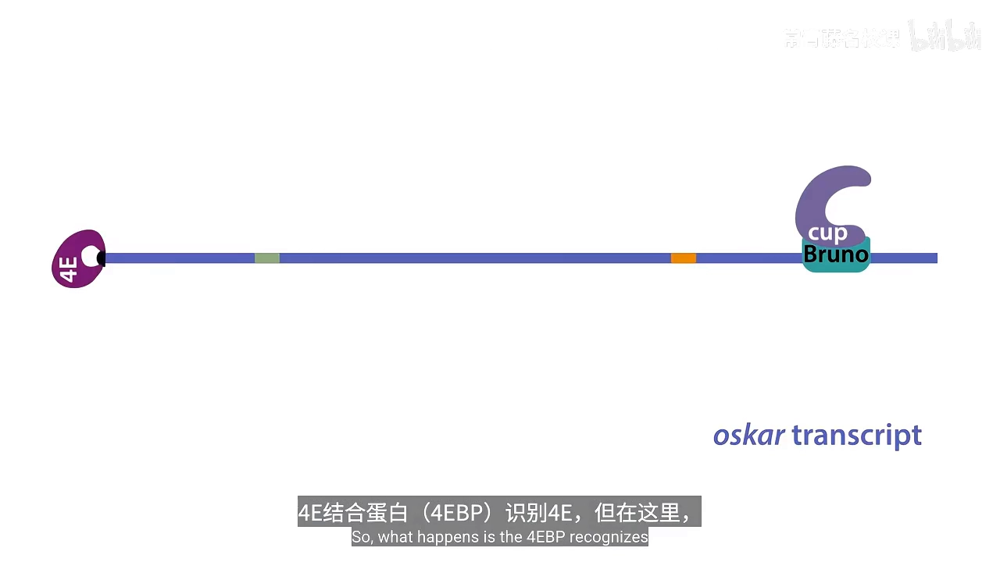

为什么 cup 只关掉 oskar，而不把整个细胞的翻译都关掉？因为这类被 RNA 拴住的 4E-BP 对 eIF4E 的亲和力通常较低；只有当它被固定在同一条 mRNA 上、局部浓度足够高时，才能有效竞争 eIF4E。**位置把“弱抑制”变成了“局部强抑制”**。

这给出一条重要原则：**同一个调控蛋白，游离时是全局油门，被 RNA 结合蛋白拴住时就是基因特异开关**。判断它是哪一种，不能只看蛋白名字，要看它有没有被带到特定转录本上。

### 3.4 帽依赖不是唯一入口：IRES 从内部启动

帽依赖起始被全局关闭时，细胞并不是所有 mRNA 都翻译不了。有一类 mRNA 用 **IRES（内部核糖体进入位点）** 从内部招募核糖体，绕过帽和 eIF4E。第二类 IRES 直接结合 eIF4G，等于跳过“读卡器”只保留“杆”；第一类 IRES 甚至折成 tRNA 的样子，直接占住 P 位。[IRES：把 5′ 端折成 tRNA 形状，从 mRNA 内部启动翻译](../../../../B01_生命科学基础主干/3_从分子结构到生物功能/3.1_结构与功能的联系/3.1.2_RNA%20结构与调控作用/IRES：把%205′%20端折成%20tRNA%20形状，从%20mRNA%20内部启动翻译.md) 已完整讲过这条路径，这里只把它放进框架：**帽依赖是默认入口，IRES 是备用入口**。当 eIF2α 磷酸化或 4E-BP 去磷酸化把默认入口关小，IRES 路径至少不受这一层抑制。

## 四、第三个调控点：uORF 与扫描中的 AUG 选择

### 4.1 40S 先遇到的不一定是“正主”AUG

帽依赖起始里，40S 结合到 5′ 端后，会沿着 5′UTR 向 3′ 方向**扫描**，碰到第一个 AUG 就停下来起始。问题在于：**第一个 AUG 不一定是编码目标蛋白的那个 AUG**。很多真核转录本在 5′UTR 里就放了 AUG，甚至放了完整的“小开放阅读框”。[【跳转到 00:00】](https://www.bilibili.com/video/BV1FU4H6PEEV/?p=56&t=0)

两类情况要分开：

- **上游 AUG（uAUG）**：5′UTR 里有一个 AUG，但它后面不一定有终止密码子。它可能与主 ORF 同阅读框，也可能不同阅读框；不同阅读框只会读出乱码，同阅读框则会让蛋白 N 端多出一段。
- **上游开放阅读框（uORF）**：5′UTR 里有一个 AUG，后面还有一个终止密码子，构成一个完整的小 ORF。40S 可以先在这里起始、翻译一小段、终止，再决定要不要继续往下走。[【跳转到 00:44】](https://www.bilibili.com/video/BV1FU4H6PEEV/?p=56&t=44)

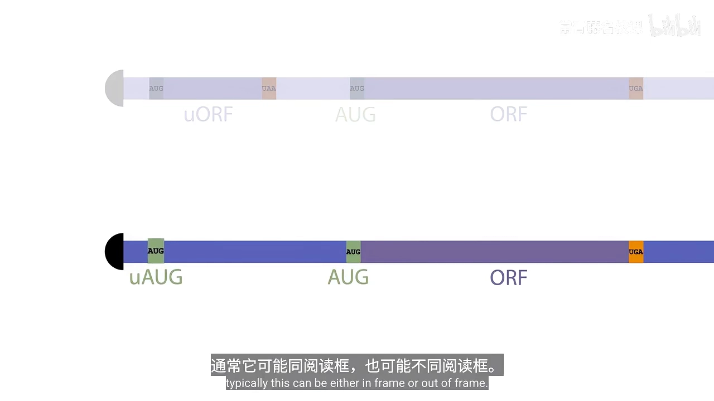

### 4.2 uORF 不是简单的“关掉”，而是把产量调成可变的

如果每个 uORF 都 100% 被识别，而且识别后就再也不起始下游，那主 ORF 几乎得不到翻译。实际不是这样，原因至少有三类：

1. **uAUG 的 Kozak 序列强弱不同**。Kozak 序列是 AUG 周围的共有序列，越接近共有序列，40S 越容易在这里停下起始；序列弱，40S 有时会直接滑过去。[【跳转到 01:43】](https://www.bilibili.com/video/BV1FU4H6PEEV/?p=56&t=103)
2. **翻译完 uORF 后，40S 不一定立刻离开 mRNA**。它可能保留在 mRNA 上，继续扫描并**重新起始（reinitiation）**下游的 AUG。能不能重新起始，取决于 uORF 的长度、位置和细胞里三元复合物的供应。
3. **5′UTR 的二级结构会改变扫描速度与 AUG 的可达性**。结构放在什么位置、有多稳定，会让 40S 更容易或更难到达某个 AUG；效果取决于结构相对于 uAUG 和主 AUG 的位置，不能一概说“有结构就抑制翻译”。[【跳转到 02:32】](https://www.bilibili.com/video/BV1FU4H6PEEV/?p=56&t=152)

所以 uORF 的调控效果是**连续的**：它可以很强，让主 ORF 只剩很少翻译；也可以很弱，只把产量压低一点；还可以随细胞状态变化，因为重新起始需要的三元复合物数量会变。

### 4.3 GCN4：一个 uORF 电路如何把“氨基酸够不够”变成“翻译多不多”

酵母 **GCN4** 是研究得最清楚的 uORF 例子。GCN4 是一个转录激活因子，开启许多氨基酸合成酶的基因；细胞缺氨基酸时，GCN4 蛋白应该多，细胞不缺时应该少。[【跳转到 00:00】](https://www.bilibili.com/video/BV1FU4H6PEEV/?p=57&t=0)

GCN4 的 5′UTR 有两个不寻常之处：主 AUG 上游有**四个 uORF**；最后一个 uORF 的终止密码子到主 AUG 之间还有**近 800 个碱基**。[【跳转到 00:41】](https://www.bilibili.com/video/BV1FU4H6PEEV/?p=57&t=41)

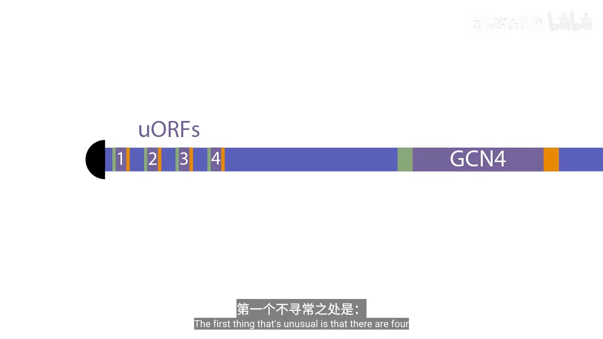

这套电路的关键是 **uORF1 很特殊**：40S 翻译完 uORF1 后，并不一定掉下来，而是保留在 mRNA 上，继续扫描，等下一个三元复合物来了再重新起始。uORF2、3、4 则更像“陷阱”：它们一旦被识别，就会让 40S 在那里起始并终止，之后很难再到达 GCN4 的主 AUG。

于是细胞用**三元复合物的浓度**来投票：

- **氨基酸充足**：GCN2 激酶关闭，eIF2α 不被磷酸化，eIF2B 正常工作，三元复合物很多。40S 翻译完 uORF1 后，很快就能拿到新的三元复合物，于是迅速在 uORF2、3 或 4 上重新起始；这些 uORF 是陷阱，40S 到不了 GCN4 的主 AUG。**GCN4 翻译少**。[【跳转到 02:44】](https://www.bilibili.com/video/BV1FU4H6PEEV/?p=57&t=164)
- **氨基酸不足**：GCN2 被激活，磷酸化 eIF2α，抑制 eIF2B，三元复合物变少。40S 翻译完 uORF1 后，迟迟拿不到新的三元复合物，只好继续往前扫；它更容易越过 uORF4 的 AUG，一直扫到 GCN4 的主 AUG，在那里起始。**GCN4 翻译多**。[【跳转到 03:54】](https://www.bilibili.com/video/BV1FU4H6PEEV/?p=57&t=234)

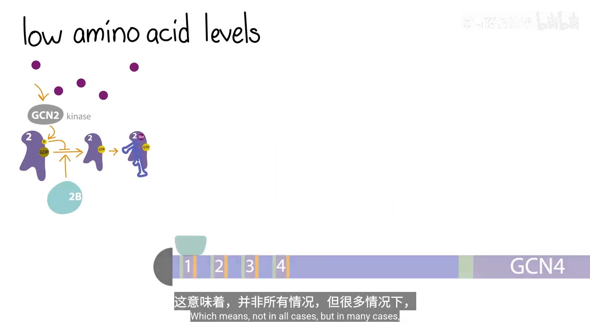

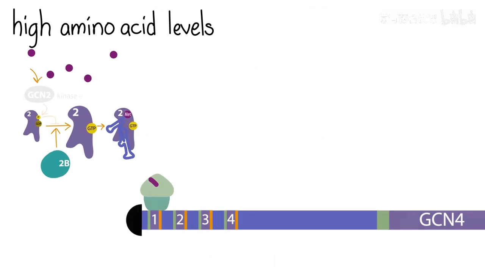

这个例子里，GCN4 的 mRNA 没有被改写，变的只是“40S 在 5′UTR 上走到哪、在哪里重新起始”。这就是“RNA 丰度相近但蛋白产量不同”的最干净证据。

### 4.4 突变实验说明：真正起作用的是 RNA 序列与位置，不是 uORF 编码的小肽

研究者把四个 uORF 逐个突变，结果很能说明问题：[【跳转到 06:53】](https://www.bilibili.com/video/BV1FU4H6PEEV/?p=57&t=413)

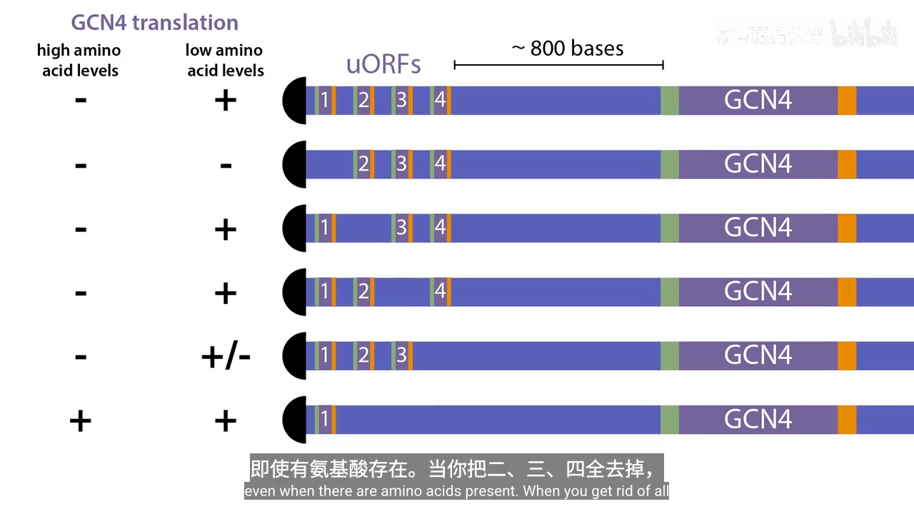

- 去掉 **uORF1**：无论氨基酸高低，GCN4 都不翻译。因为 uORF1 是“让 40S 留在 mRNA 上”的那个特殊元件，没有它，后面的重新起始无从谈起。
- 去掉 **uORF2** 或 **uORF3**：几乎没有影响。因为只要 uORF4 还在，它仍然能捕获 40S。
- 去掉 **uORF2、3、4**：GCN4 变成组成型表达，氨基酸高时也翻译。因为再也没有陷阱捕获 40S，40S 每次都能走到主 AUG。
- 把 uORF4 到主 AUG 的距离缩短：GCN4 几乎一直关闭。因为 40S 越过 uORF4 后，没有足够的“赶路时间”去结合新的三元复合物，还没到主 AUG 就先失败了。

还有一个容易被忽略的点：这些 uORF 编码的肽通常只有 5–8 个氨基酸，**肽本身基本不参与调控**；起作用的是 RNA 序列、uORF 的位置和它与核糖体的相互作用。[【跳转到 08:28】](https://www.bilibili.com/video/BV1FU4H6PEEV/?p=57&t=508)

这也解释了为什么 uORF 不能只看“有没有”来判断强弱：同样是 uORF，放在 transcript 起点附近和放在 5′UTR 深处，效果完全不同；前者更容易保留起始因子、支持重新起始，后者更容易变成一次性陷阱。

## 五、把 UTR 元件放回框架：一张表看清各自改的是哪一层

| UTR 元件 | 主要作用点 | 对蛋白产出的影响 | 是否改变 mRNA 丰度 |
| --- | --- | --- | --- |
| 5′ 帽 | eIF4E 认帽，招募 eIF4G | 帽依赖起始的入口；没有帽或帽被绕过，起始效率大降 | 通常不直接改变 |
| 5′UTR 二级结构 | 40S 扫描速度与 AUG 可达性 | 结构位置合适时抑制或改变起始位点选择 | 通常不直接改变 |
| uAUG / uORF | 扫描时 AUG 的选择与重新起始 | 把主 ORF 的翻译调低、调成可变，甚至完全关闭 | 通常不直接改变 |
| IRES | 不依赖帽和 eIF4E 的内部入口 | 在帽依赖起始被抑制时维持或增强翻译 | 通常不直接改变 |
| 3′UTR miRNA 位点 | miRNA–RISC 配对 | 抑制翻译和/或促进降解；蛋白可先于 mRNA 下降 | 可能不变，也可能下降 |
| 3′ poly(A) 尾 | PABP 覆盖，维持稳定性与起始效率 | 尾的存在与长度影响 mRNA 被翻译的机会 | 主要影响稳定性 |

这张表只列“主要作用点”，不是说每个元件只干一件事。比如 3′UTR 既能被 miRNA 识别，也能被 RNA 结合蛋白识别；同一个 4E-BP 既能全局作用，也能被拴到特定 mRNA 上。**判断一个元件的作用，要看它把哪一步的哪个蛋白招来或挡住**。

### 5.1 5′UTR 二级结构与铁蛋白：一个“结构 + 蛋白”的开关

铁是细胞必需元素，但游离铁很危险，细胞通常把大部分铁存进**铁蛋白（ferritin）**。铁蛋白的 mRNA 5′UTR 里有一段能形成发夹的**铁反应元件（IRE）**；当细胞内铁不足时，**铁调控蛋白（IRP）** 会结合这段 IRE。[【跳转到 05:01】](https://www.bilibili.com/video/BV1FU4H6PEEV/?p=55&t=301)

IRP 结合上去后，不只是挡住 40S 的初始结合，还会阻止 40S 沿着 5′UTR 移动，于是 40S 无法到达铁蛋白的 AUG，铁蛋白翻译被关掉。当细胞内铁充足时，IRP 不再结合 IRE，40S 可以正常扫描，铁蛋白被翻译出来，把多余的铁储存起来。[【跳转到 05:46】](https://www.bilibili.com/video/BV1FU4H6PEEV/?p=55&t=346)

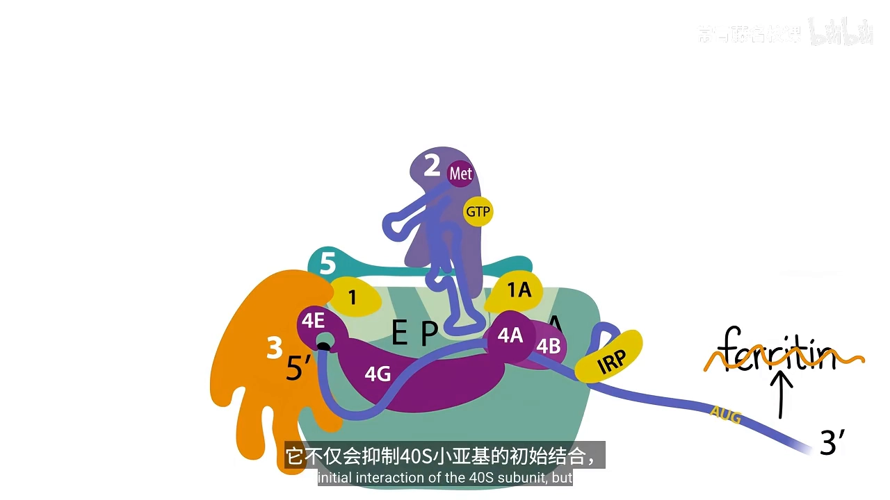

这个例子把“5′UTR 二级结构”讲清楚了：**结构本身不是开关，结构加上能识别它的蛋白才是开关**。没有 IRP，IRE 只是一个发夹；有了 IRP，它才变成可逆的翻译抑制器。

### 5.2 3′UTR 与 poly(A) 尾：别只盯着 5′ 端

翻译起始虽然发生在 5′ 端，但 3′ 端也能反过来影响它。3′UTR 上的 **miRNA 位点** 通过 miRNA–RISC 配对，可以抑制翻译，也可以促进 mRNA 降解；因此蛋白下降不一定伴随 mRNA 下降。[miRNA 调控：靶标识别、RNA 沉默与背景依赖](../3.3.1_miRNA%20调控：靶标识别、RNA%20沉默与背景依赖/miRNA靶标预测：种子区配对、评分与预测的边界.md) 已讲过这条路径，这里只强调它对“RNA 与蛋白脱钩”的贡献。

3′ **poly(A) 尾** 被 **PABP** 覆盖，参与维持 mRNA 稳定性和翻译起始效率；加尾、尾长控制与 PABP 的结合在 [B01 §2.2.2 RNA 加工](../../../../B01_生命科学基础主干/2_遗传信息流与中心法则/2.2_从基因到产物/2.2.2_RNA%20加工：加帽、剪接与尾部加工/README.md) 和 [B02 §2.1.6 转录终止](../../../2_转录与转录本加工/2.1_转录与加工/2.1.6_转录延伸与终止：聚合酶运行、暂停与转录结束/转录终止：多聚腺苷酸化信号、鱼雷模型与变构模型.md) 里展开。本节只把它列为 3′ 端的顺式条件：**尾在，mRNA 更稳、更容易被起始；尾被缩短或去除，翻译机会随之下降**。

## 六、怎么判断你看到的是翻译调控，而不是转录调控

只看 mRNA 和蛋白两个数，很容易把原因归错。比较稳妥的做法是至少补一类“翻译层”的测量：

- **同时测 mRNA 与蛋白**：如果 mRNA 不变而蛋白变，优先怀疑翻译起始、翻译延伸或蛋白降解；本节讲的是起始。
- **看核糖体占据**：多聚核糖体图谱或核糖体印迹（Ribo-seq）能读出每条 mRNA 上结合了多少核糖体。mRNA 量相同但核糖体占据不同，说明翻译效率不同。
- **扰动关键节点**：敲低/抑制 4E-BP、改变 eIF2α 磷酸化、突变 uORF 或 IRE，看蛋白产出是否随之改变；这比相关性更接近因果。
- **报告基因验证 UTR**：把候选 5′UTR 或 3′UTR 接到报告基因后面，比较不同条件下的读出，能判断元件是否足以改变翻译。

这些方法在课程后段还会展开；本节只需要记住一个判读原则：**mRNA 丰度回答“有多少模板”，核糖体占据和起始因子状态回答“每条模板被用得多频繁”，蛋白丰度才是两者与降解共同作用的结果**。

## 小结

- 真核翻译起始有三个可调节点：**eIF2 三元复合物装载**、**eIF4E–4E-BP–eIF4G 帽依赖招募**、**40S 扫描时的 AUG/uORF 选择**。
- **eIF2α 磷酸化** 通过抑制 eIF2B、减少三元复合物来全局调低翻译；它响应氨基酸、病毒、内质网应激、缺氧、渗透胁迫和热休克。
- **4E-BP** 结合 eIF4E、挡住 eIF4G；mTOR 等生长相关激酶磷酸化 4E-BP 后解除抑制，全局上调帽依赖翻译。被 RNA 结合蛋白拴到特定 mRNA 上时，同一个 4E-BP 可以只关掉一条转录本。
- **uORF** 让 40S 在主 ORF 之前起始、终止、再重新起始；Kozak 强弱、uORF 位置、间距和三元复合物浓度共同决定主 ORF 的翻译量。
- **GCN4** 是“同一 mRNA、蛋白产出随氨基酸水平变”的干净例子：氨基酸充足时 40S 被 uORF2–4 捕获，GCN4 翻译少；氨基酸不足时三元复合物减少，40S 越过 uORF4 到达主 AUG，GCN4 翻译多。
- **5′UTR 二级结构 + 识别蛋白**（如 IRE–IRP）可以可逆地关闭一条 mRNA 的翻译；**3′UTR miRNA 位点** 与 **poly(A) 尾** 则从 3′ 端影响翻译机会与稳定性。
- 判断翻译调控不能只看 mRNA：要同时看蛋白、核糖体占据和关键起始因子的状态。

## 关键术语速查

| 术语 | 一句话解释 |
| --- | --- |
| 三元复合物 | eIF2–GTP 与起始 tRNA 组成的三件套，把起始 tRNA 送到 40S 的 P 位 |
| eIF2B | eIF2 的 GDP/GTP 交换因子；被磷酸化 eIF2α 抑制后，三元复合物供应下降 |
| eIF2α 磷酸化 | 多种胁迫激酶对 eIF2 的抑制性修饰，全局调低翻译起始 |
| 4E-BP | 结合 eIF4E、挡住 eIF4G 的抑制蛋白；磷酸化后释放 eIF4E |
| mTOR | 生长相关激酶，磷酸化 4E-BP，促进帽依赖翻译 |
| 帽依赖起始 | 由 5′ 帽、eIF4E、eIF4G 驱动的常规真核起始路径 |
| IRES | 内部核糖体进入位点，不依赖帽和 eIF4E 从 mRNA 内部启动翻译 |
| uAUG | 5′UTR 里的上游 AUG，不一定有下游终止密码子 |
| uORF | 5′UTR 里带起始和终止密码子的小开放阅读框 |
| 重新起始 | 翻译完一个 uORF 后，40S 保留在 mRNA 上并再次起始下游 AUG |
| Kozak 序列 | AUG 周围的共有序列，影响 40S 在该 AUG 起始的强弱 |
| IRE / IRP | 铁反应元件 / 铁调控蛋白；低铁时 IRP 结合 IRE，阻断铁蛋白翻译 |
| 翻译效率 | 每条 mRNA 被核糖体翻译的速率，不能由 mRNA 丰度单独推出 |