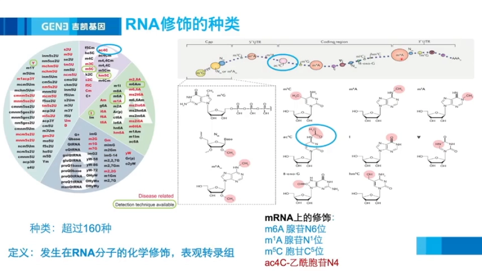
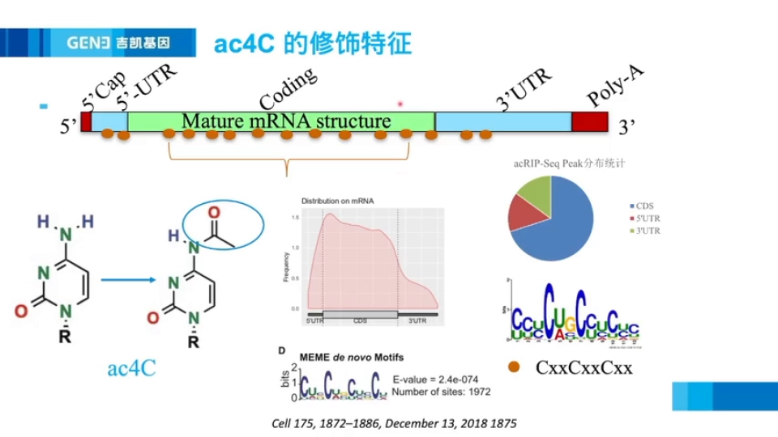
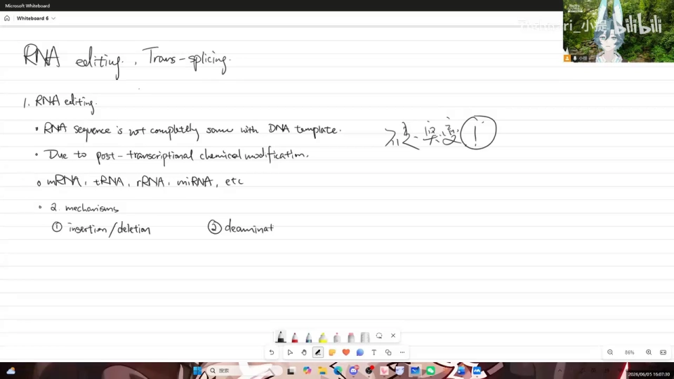
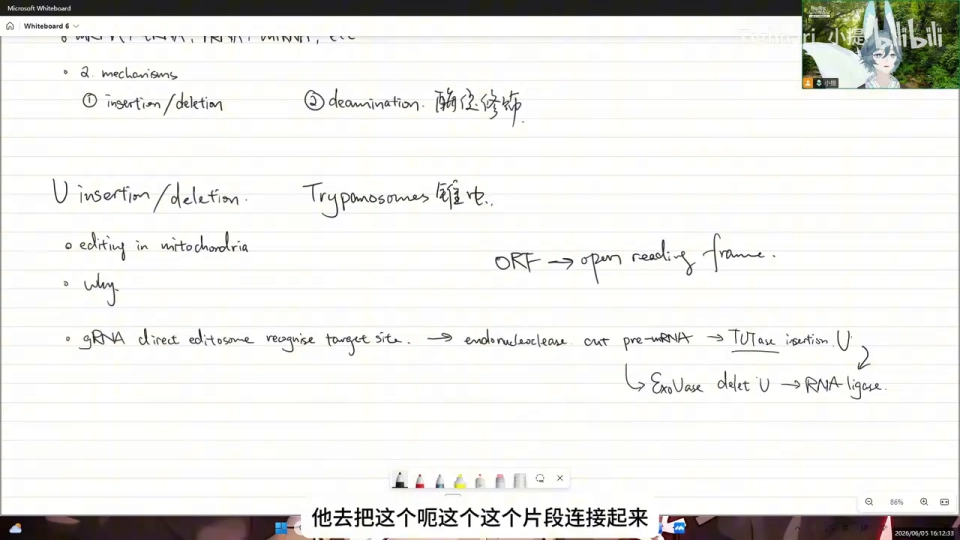
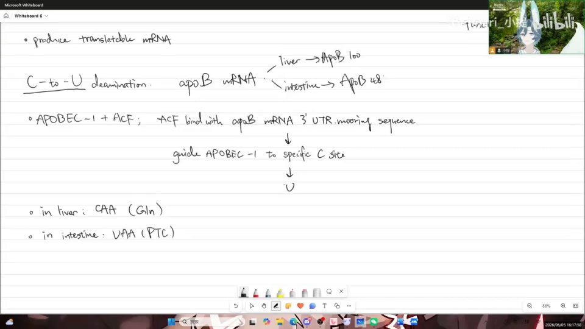
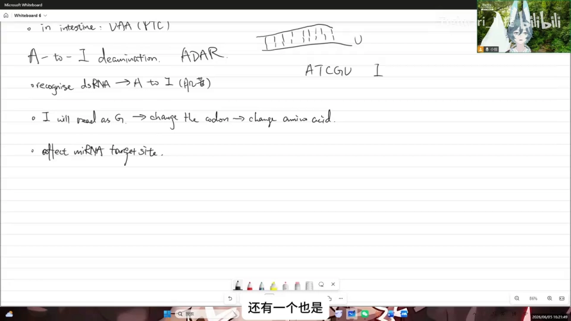
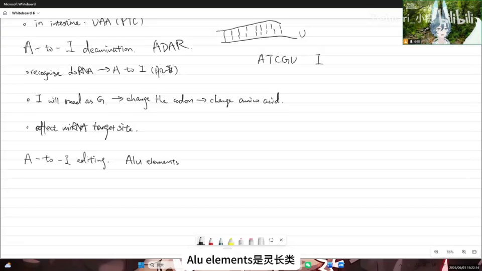

# RNA 修饰与 RNA 编辑：加一个化学标记，还是改一个字母

> 视频来源：[RNA修饰入门知识及数据库分享](https://www.bilibili.com/video/BV1aPJVzdE4F/)（B 站 · 超眼困阿咻，约 13 分钟）、[ac4C RNA乙酰化——解密m6A热点之后RNA修饰的新方向](https://www.bilibili.com/video/BV1sY4y1f79m/)（B 站 · 吉凯基因，约 50 分钟，本文只取开头讲 m6A 背景的部分）、[真核基因表达 Lecture 7 · RNA编辑、Titin与Trans-splicing](https://www.bilibili.com/video/BV1a9726eESc/)（B 站 · 小提，约 28 分钟）
> 导读：三支视频分工明确：第一支给 m6A 的"写入—擦除—识别"框架，第二支补 m6A 的丰度、分布和 motif，第三支系统讲 RNA 编辑的三条路线。本文只取与本节目标相关的段落；检测技术、数据库、疾病与治疗、titin 与 trans-splicing 不在本文范围。字幕中的 METTL3、ALKBH5、APOBEC-1、ADAR、Alu 等术语已按上下文订正。

## 本讲要解决的核心问题（SCQA）

**背景**：转录本从 DNA 抄下来之后并不是"成品"。前面几节已经看到，剪接会改变外显子的组合，加帽加尾决定了两端的样子。

**冲突**：还有两类事件在转录之后继续改写 RNA：一类是在某个碱基上挂一个化学基团（RNA 修饰），一类是把一个碱基换成另一个碱基（RNA 编辑）。两者都发生在 RNA 上、DNA 序列都没变，初学时极易混为一谈。

**疑问**：这两类事件到底改了什么？它们分别通过什么机制影响稳定性、翻译和序列解读？

**回答（中心思想）**：**RNA 修饰是"加标记"，RNA 编辑是"改字母"。** 修饰不改变碱基身份，后果必须由 reader 蛋白来落地，因此同一个 m6A 标记可以走向降解、也可以走向翻译增强；编辑直接改变碱基身份，后果写在序列本身——密码子变了、剪接位点变了、miRNA 靶点也变了。

## 一、先分清两类事件：一个是标记，一个是字母

RNA 修饰指的是**发生在 RNA 分子上的化学修饰**。已知的 RNA 修饰超过 160 种，最常见、研究最多的是 m6A（腺苷 N6 位上的甲基化），此外还有 m5C、m7G、m6Am、假尿苷、ac4C 等等 [【跳转到 04:37】](https://www.bilibili.com/video/BV1sY4y1f79m/?t=277)[【跳转到 05:46】](https://www.bilibili.com/video/BV1sY4y1f79m/?t=346)。

RNA 编辑则是另一种事：**RNA 序列与对应的 DNA 模板序列不完全相同**，原因是转录后发生了化学修饰，所以它**不是突变**，DNA 序列始终没有变 [【跳转到 01:15】](https://www.bilibili.com/video/BV1a9726eESc/?t=75)[【跳转到 02:05】](https://www.bilibili.com/video/BV1a9726eESc/?t=125)。编辑不只发生在 mRNA 上，tRNA、rRNA、miRNA 上都有 [【跳转到 02:30】](https://www.bilibili.com/video/BV1a9726eESc/?t=150)。

一句话对照：

| | RNA 修饰 | RNA 编辑 |
| --- | --- | --- |
| 改了什么 | 在碱基上加化学基团（如 m6A 加甲基） | 把一种碱基换成另一种（C→U、A→I）或增删 U |
| 碱基身份 | 不变，仍是 A | 变了 |
| 后果由谁决定 | 由识别标记的 reader 蛋白决定 | 由新序列本身决定（密码子、剪接位点、配对能力） |
| 典型例子 | m6A 的 writer/eraser/reader | ApoB 的 C→U、谷氨酸受体的 A→I |

## 二、m6A：一个可逆的标记，靠三类蛋白运转

### 2.1 m6A 有多少、分布在哪里

m6A 是目前已知丰度最高的 RNA 修饰，大约在**千分之三到千分之五**的量级，几乎是 ac4C 的十倍——这也是它被研究得最多的现实原因之一 [【跳转到 06:16】](https://www.bilibili.com/video/BV1sY4y1f79m/?t=376)。

在一条成熟 mRNA 上，m6A 的分布有明显偏好：**主要落在 CDS 区和 3′UTR 区，5′UTR 基本很少、可能几乎没有** [【跳转到 07:36】](https://www.bilibili.com/video/BV1sY4y1f79m/?t=456)。它也不是随机落在任意 A 上，而是有明确的序列偏好：讲座展示的 m6A motif 第一位就是 GGAC，特征非常明确，一般稳居 motif 排名第一 [【跳转到 07:36】](https://www.bilibili.com/video/BV1sY4y1f79m/?t=456)。

### 2.2 writer、eraser、reader：标记的写入、擦除与读取

m6A 不是一次性写死的。围绕这个标记有一套蛋白，习惯上分成三类，简称 **WER** [【跳转到 01:50】](https://www.bilibili.com/video/BV1aPJVzdE4F/?t=110)[【跳转到 02:23】](https://www.bilibili.com/video/BV1aPJVzdE4F/?t=143)：

- **writer（写入体）**：把甲基加到 RNA 上。m6A 里最耳熟能详的是 METTL3 与 METTL14，它们作为一个复合物起作用，此外还有别的成员。
- **eraser（擦除器）**：把甲基去掉。常见的是 FTO 和 ALKBH5 [【跳转到 03:07】](https://www.bilibili.com/video/BV1aPJVzdE4F/?t=187)。
- **reader（识别器）**：识别这个标记并把信号传到下游。YTH 家族是代表：YTHDC1、YTHDC2 在核里，YTHDF1 到 3 在胞质里；此外还有 FMR1、HNRNPA1 等，readers 的数量远多于 erasers [【跳转到 02:43】](https://www.bilibili.com/video/BV1aPJVzdE4F/?t=163)[【跳转到 02:49】](https://www.bilibili.com/video/BV1aPJVzdE4F/?t=169)。

有 writer 也有 eraser，意味着这个标记是**动态、可逆**的：同一个位点可以在不同条件下被写上、被擦掉。这一点决定了 m6A 不是一个"永久标签"，而是一个可以被调控的状态。

### 2.3 reader 决定后果：剪接、出核、降解、翻译

m6A 最关键的一步不在写入，而在读取。讲者用一句话概括了整条链路：mRNA 上被打了一个标记，随后有专门识别它的蛋白来判断"这个 RNA 对这个细胞很重要"，于是把它安排到更重要的位置 [【跳转到 01:09】](https://www.bilibili.com/video/BV1aPJVzdE4F/?t=69)。

reader 把标记导向的下游至少有四条 [【跳转到 01:25】](https://www.bilibili.com/video/BV1aPJVzdE4F/?t=85)[【跳转到 01:37】](https://www.bilibili.com/video/BV1aPJVzdE4F/?t=97)：

1. **剪接**：影响这个转录本怎么被剪；
2. **转运**：影响它出核、去哪里；
3. **降解**：影响它的寿命；
4. **翻译效率**：促进或抑制它被翻译。

注意这四条的方向并不统一：同一个标记，被不同的 reader 读到，可能让表达上调，也可能让表达下调 [【跳转到 01:37】](https://www.bilibili.com/video/BV1aPJVzdE4F/?t=97)。这正是"修饰"与"编辑"最大的不同——**标记本身不携带结论，结论由 reader 给出**。

## 三、RNA 编辑：序列本身就变了

### 3.1 两类机制

RNA 编辑有两大机制：**插入/删除（insertion/deletion）** 和 **脱氨（deamination）**。脱氨是酶促的化学修饰 [【跳转到 03:20】](https://www.bilibili.com/video/BV1a9726eESc/?t=200)[【跳转到 03:45】](https://www.bilibili.com/video/BV1a9726eESc/?t=225)。

### 3.2 U 的插入与删除：锥虫线粒体里的 gRNA 指导

第一个例子是锥虫（trypanosomes）——一种单细胞寄生虫，它的编辑发生在线粒体里 [【跳转到 04:35】](https://www.bilibili.com/video/BV1a9726eESc/?t=275)[【跳转到 05:00】](https://www.bilibili.com/video/BV1a9726eESc/?t=300)。

为什么要在那里编辑？因为锥虫寄生于不同宿主，需要动态调整线粒体的代谢；而它大部分线粒体 mRNA 转录之后**不含功能性的 ORF（开放阅读框）**，不编辑就没法翻译 [【跳转到 05:25】](https://www.bilibili.com/video/BV1a9726eESc/?t=325)。

执行顺序是：

1. **gRNA 指导编辑体（editosome）** 识别目标位点；
2. **核酸内切酶**切开 pre-mRNA；
3. 插入 U，或删除 U；
4. **RNA 连接酶**把片段接回去。

结果是一条**可翻译的 mRNA**，让锥虫在不同宿主中调整线粒体功能以适应代谢需求 [【跳转到 06:15】](https://www.bilibili.com/video/BV1a9726eESc/?t=375)[【跳转到 08:45】](https://www.bilibili.com/video/BV1a9726eESc/?t=525)。

### 3.3 C-to-U：ApoB 如何"凭空"造出一个终止密码子

第二个例子是人类 ApoB 的 mRNA，机制是 **C-to-U 脱氨**。执行者是 **APOBEC-1**，它需要搭档 **ACF**：ACF 结合 ApoB mRNA 3′UTR 上的 mooring sequence，把 APOBEC-1 引导到特定的 C 位点，把 C 变成 U [【跳转到 09:35】](https://www.bilibili.com/video/BV1a9726eESc/?t=575)[【跳转到 10:25】](https://www.bilibili.com/video/BV1a9726eESc/?t=625)。

后果取决于组织：

- **肝脏**：不发生编辑，密码子保持 CAA，翻译出谷氨酰胺，得到全长蛋白 **ApoB100**，负责脂蛋白转运 [【跳转到 11:40】](https://www.bilibili.com/video/BV1a9726eESc/?t=700)[【跳转到 12:05】](https://www.bilibili.com/video/BV1a9726eESc/?t=725)。
- **小肠**：CAA 变成 **UAA**，成为提前终止密码子（PTC），得到截短蛋白 **ApoB48**，负责乳糜微粒组装和膳食脂质吸收 [【跳转到 12:55】](https://www.bilibili.com/video/BV1a9726eESc/?t=775)[【跳转到 13:20】](https://www.bilibili.com/video/BV1a9726eESc/?t=800)。

讲者特意强调：**截短不一定是坏事**，它也可以是另一种功能。同一个基因、同一段序列，一个碱基的改写就把"全长蛋白"换成了"截短蛋白"。

### 3.4 A-to-I：ADAR 把 A 改写成"读作 G"的碱基

第三个例子是 **A-to-I 脱氨**，执行者是 **ADAR**（adenosine deaminase acting on RNA，作用于 RNA 的腺苷脱氨酶）[【跳转到 13:45】](https://www.bilibili.com/video/BV1a9726eESc/?t=825)。

ADAR 识别的是**双链 RNA**。这里常有一个疑问：RNA 不是单链吗？讲者的回答是：RNA 自己可以折叠配对，也可以再结合一段 RNA，两者配在一起就是双链；而且 RNA 里有 U、DNA 里没有 U，所以它确实是 RNA 双链 [【跳转到 14:35】](https://www.bilibili.com/video/BV1a9726eESc/?t=875)。

ADAR 把 A 变成次黄嘌呤（inosine，I）。I 不在经典碱基 A/T/C/G/U 里，**翻译时会被读作 G**，于是密码子变了、氨基酸也变了 [【跳转到 15:25】](https://www.bilibili.com/video/BV1a9726eESc/?t=925)[【跳转到 15:50】](https://www.bilibili.com/video/BV1a9726eESc/?t=950)。

它的影响不止于氨基酸：

- **改变密码子**，从而改变蛋白序列；
- **影响剪接**：序列变了，可能产生新的剪接位点 [【跳转到 16:15】](https://www.bilibili.com/video/BV1a9726eESc/?t=975)；
- **改变 miRNA 的靶标位点**：配对关系随之改变 [【跳转到 16:40】](https://www.bilibili.com/video/BV1a9726eESc/?t=1000)。

### 3.5 Alu 元件：编辑如何造出新的剪接位点

A-to-I 编辑在灵长类里有一个规模极大的底物：**Alu 元件**。它是灵长类特异性的逆转座子，约有 100 万个拷贝，占人类基因组的 10% [【跳转到 17:30】](https://www.bilibili.com/video/BV1a9726eESc/?t=1050)。

两个方向相反的 Alu 元件可以形成**分子内双链 RNA**——也就是前面说的"自己跟自己配对"。ADAR 识别后进行 A-to-I 编辑，产生可替代的剪接位点，于是同一个转录本可以产出多种 mRNA 亚型 [【跳转到 17:55】](https://www.bilibili.com/video/BV1a9726eESc/?t=1075)。

这个例子把编辑的两条后果串在了一起：**先改字母，再改剪接**。它不是"标记被读取"，而是序列本身被重写，下游的剪接机器读到的已经是另一段序列。

## 四、把两者放在一起：稳定性、翻译与序列解读

回到本节的主线，两类事件对三个层面的影响可以这样对齐：

**稳定性**。m6A 通过 reader 影响降解，因此同一个标记可以让转录本更易被降解、也可以让它更稳定；编辑则通过改变序列间接影响稳定性——比如造出提前终止密码子，而 PTC 的识别与降解属于 mRNA 监视的范畴（见 [B01 mRNA 监视](../../../../B01_生命科学基础主干/2_遗传信息流与中心法则/2.2_从基因到产物/2.2.5_翻译：核糖体、mRNA%20与多肽合成/mRNA%20监视：提前终止密码子、无义介导降解与核糖体足迹的读框证据.md)）。

**翻译**。m6A 的 reader 可以直接促进或抑制翻译效率；编辑改变的是密码子本身，ApoB48 的例子说明它能把一条 mRNA 的产物从全长换成截短。

**序列解读**。这是两者最本质的分界：修饰不改变碱基身份，所以"这条 mRNA 会翻译成什么"在序列层面没有变，变的是它被谁读、被怎么处理；编辑改变了碱基身份，所以"这条 mRNA 会翻译成什么"在序列层面就已经变了——密码子、剪接位点、miRNA 靶点都可能跟着变。

一个实用的判据：**看到"某个位点被修饰"时，接着问"谁在读它"；看到"某个位点被编辑"时，接着问"密码子和剪接位点变成什么了"。**

## 小结

- RNA 修饰是在碱基上加化学基团，RNA 编辑是把一个碱基换成另一个；两者都在转录后发生，DNA 序列都不变。
- m6A 是丰度最高的 RNA 修饰（约千分之三到千分之五），主要分布在 CDS 与 3′UTR，5′UTR 很少，motif 特征明确（GGAC 居首）。
- m6A 由 writer（METTL3/METTL14 复合物）写入、eraser（FTO、ALKBH5）擦除、reader（YTH 家族、FMR1、HNRNPA1 等）读取，因此是动态可逆的。
- 标记的后果由 reader 决定：剪接、转运、降解、翻译效率四条路都可能走，方向可上可下。
- RNA 编辑有两大类机制：插入/删除与脱氨；脱氨又分 C-to-U（APOBEC-1 + ACF，ApoB 的 CAA→UAA）与 A-to-I（ADAR，I 读作 G）。
- 编辑直接改写序列：改变密码子、产生新剪接位点、改变 miRNA 靶点；Alu 元件是灵长类 A-to-I 编辑的大规模底物。
- 判断两类事件的关键问题不同：修饰问"谁在读"，编辑问"序列变成了什么"。

## 关键术语速查

| 术语 | 一句话解释 |
| --- | --- |
| RNA 修饰 | 发生在 RNA 分子上的化学修饰，已知超过 160 种，m6A 最常见 |
| m6A | 腺苷 N6 位上的甲基化，丰度最高，主要位于 CDS 与 3′UTR |
| writer | 写入修饰的酶，m6A 中是 METTL3/METTL14 复合物 |
| eraser | 擦除修饰的酶，m6A 中是 FTO、ALKBH5，使修饰可逆 |
| reader | 识别修饰并把信号导向下游的蛋白，如 YTH 家族 |
| RNA 编辑 | RNA 序列与 DNA 模板不一致的转录后改变，不是突变 |
| C-to-U 脱氨 | 胞苷脱氨变尿苷，ApoB 中由 APOBEC-1 与 ACF 完成 |
| A-to-I 脱氨 | 腺苷脱氨变次黄嘌呤，由 ADAR 识别双链 RNA 后完成，I 翻译时读作 G |
| Alu 元件 | 灵长类特异逆转座子，约 100 万拷贝，可形成分子内双链 RNA 供 ADAR 编辑 |