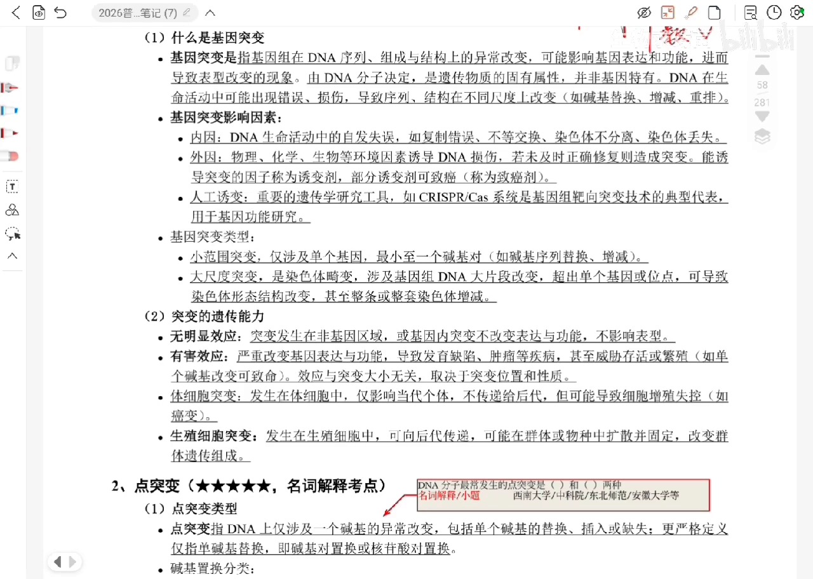
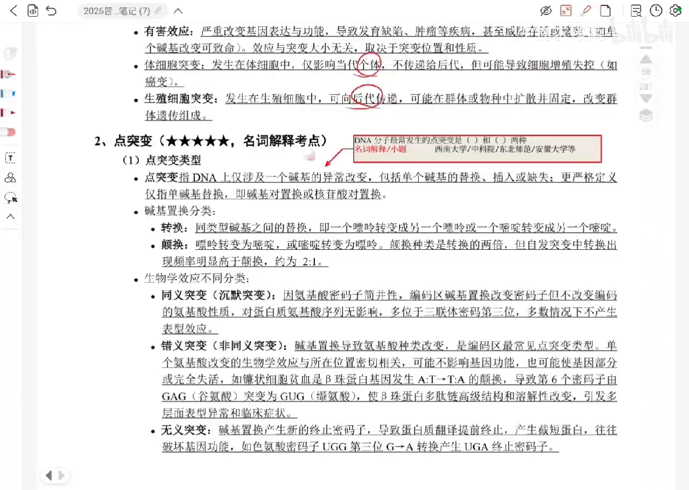
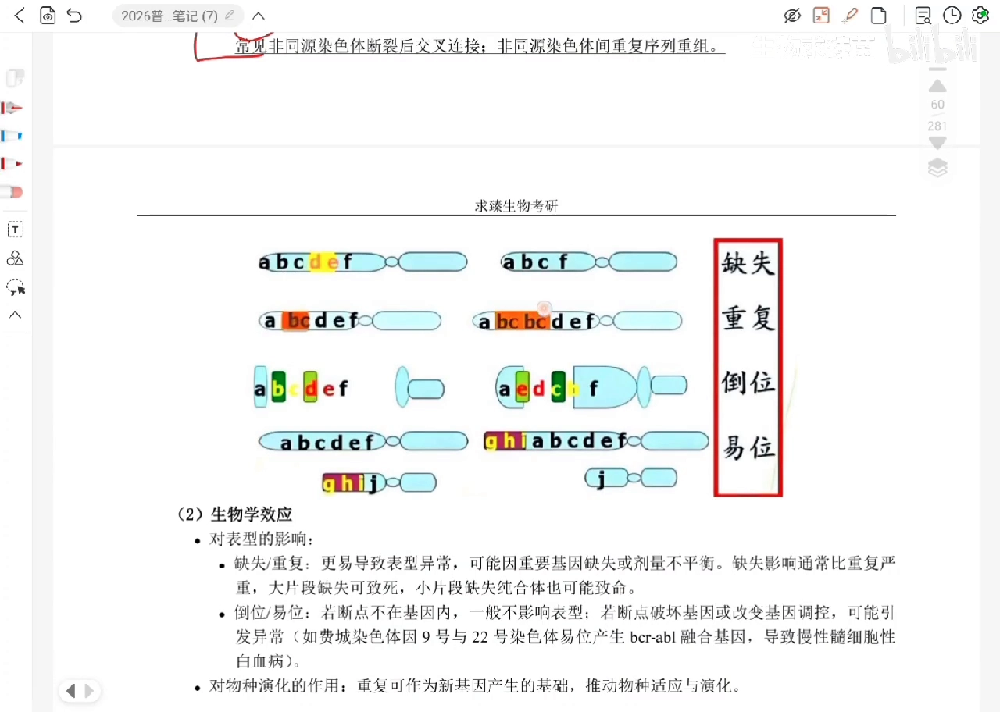
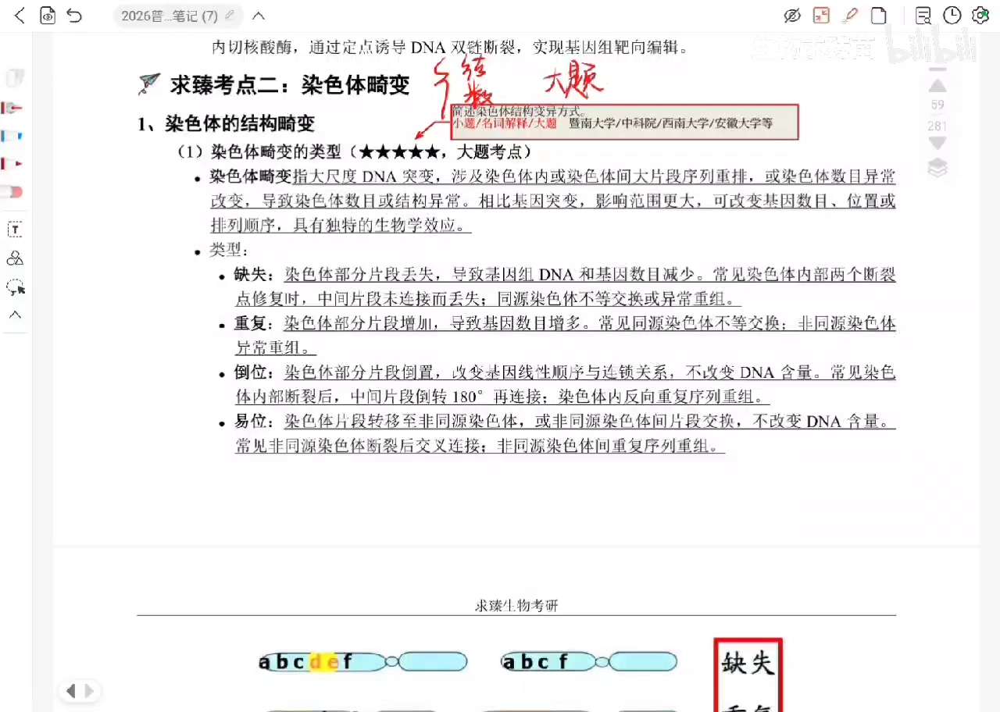
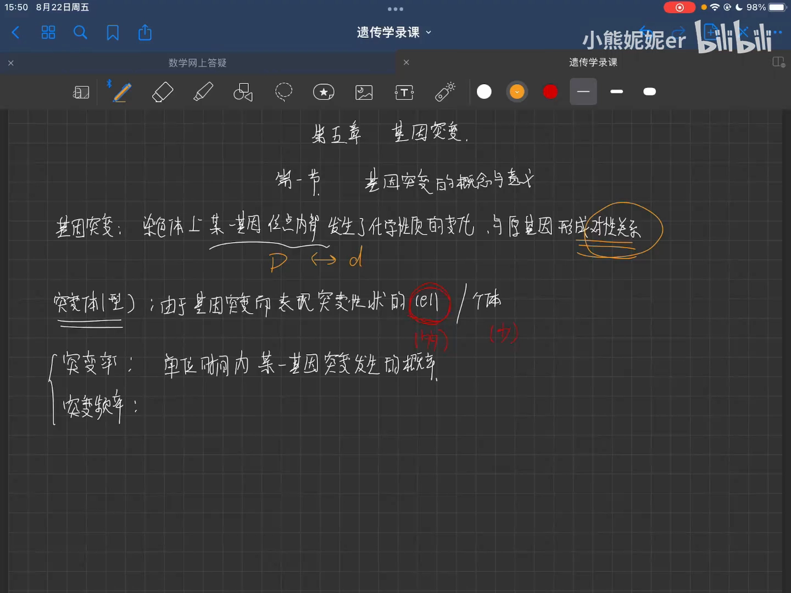
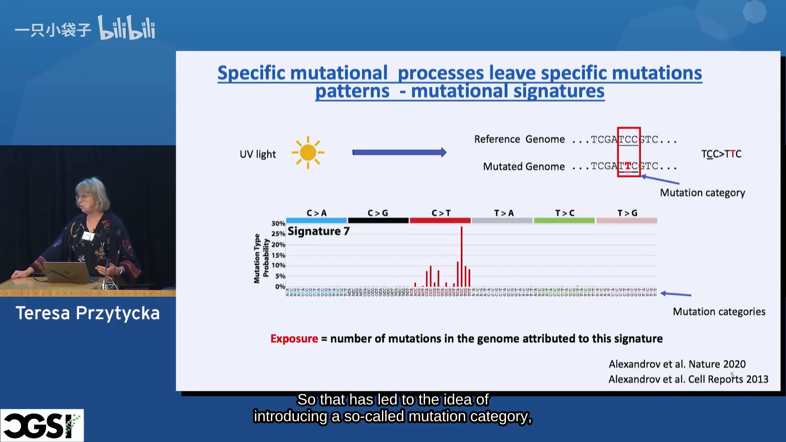
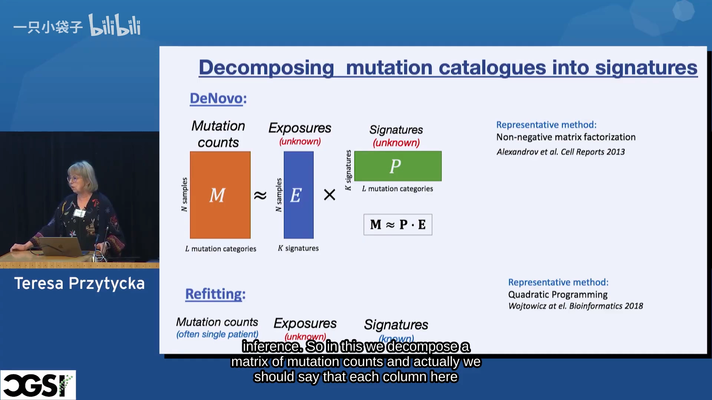
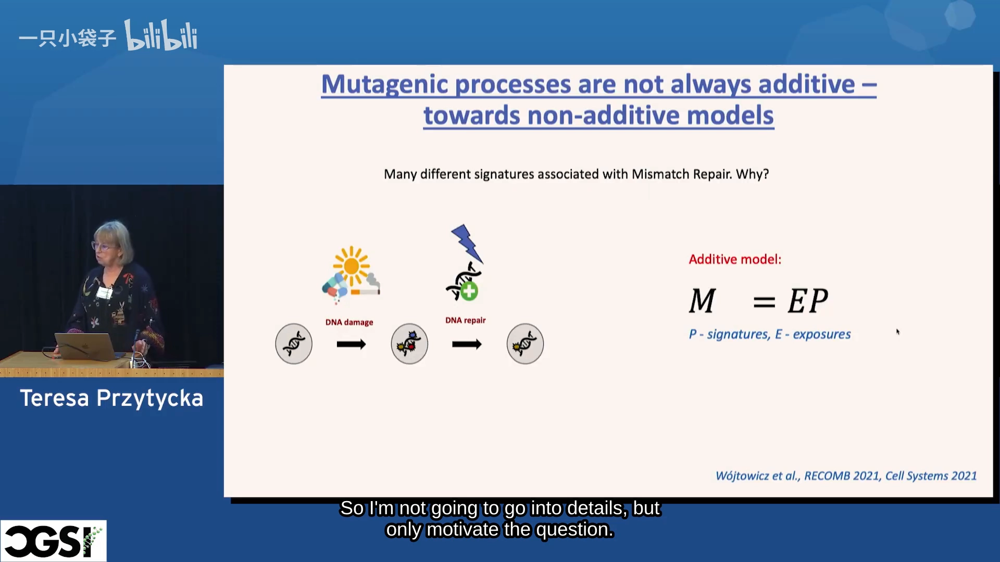

# 变异来源：生殖系与体细胞、突变率与突变特征

> 视频来源：[普通生物学划重点｜第8章 遗传物质的突变](https://www.bilibili.com/video/BV1Vqho6PESn/)（B 站 · 求臻生物考研）｜[遗传学 第五章 基因突变 第一节和第二节](https://www.bilibili.com/video/BV1kuetzSEUg/)（B 站 · 刘庆昌遗传学录课）｜[癌症中的突变特征：DNA 损伤与修复](https://www.bilibili.com/video/BV1XTVQ6iEcG/)（B 站 · Teresa Przytycka 报告，中配）
>
> 导读：本文只取三支视频中与本节目标相关的部分。第一支讲变异发生在谁身上、发生在多长的尺度上；第二支讲突变率与突变频率的区别；第三支讲如何把许多突变还原成“损伤—修复”的过程。染色体数目变异、突变的一般特性、突变特征的矩阵分解与网络推断不在本节范围。

## 本讲要解决的核心问题（SCQA）

**背景**：每个人的基因组都和参考序列有大量差异，肿瘤基因组的差异更多。我们已经知道变异是序列、结构或拷贝数的改变。

**冲突**：但“有差异”本身不说明来源。同样一个 C→T，可能是父母传下来的生殖系变异，可能是体细胞复制时漏掉的错误，可能是紫外线造成的损伤，也可能是 DNA 修复缺陷留下的印记。只看变异本身，无法回答“它会不会传给孩子”“它为什么会出现”。

**疑问**：怎样把变异来源讲清楚，并在解释一个变异时选对证据？

**回答（中心思想）**：按四个问题拆开。**来源**决定遗传后果：生殖系变异可传给后代，体细胞变异只影响个体。**尺度**决定发生过程：点突变与插入缺失来自复制错误或损伤，结构变异来自断裂后的错误重接或异常重组。**速率**要区分突变率与突变频率：前者是发生概率，后者是群体中突变体的比例。**特征**把许多突变放在一起，读成特定损伤与修复过程留下的概率分布。解释变异时，先问“要回答哪个问题”，再选对应的来源证据。

## 一、先分来源：生殖系变异可遗传，体细胞变异只影响个体

基因突变可以发生在体细胞中，也可以发生在生殖细胞中，两者的遗传后果完全不同。[【跳转到 02:01】](https://www.bilibili.com/video/BV1Vqho6PESn/?t=121)

- **体细胞突变**：发生在体细胞中，只影响这个个体本身，不会传递给后代。它可能导致细胞增殖失控，例如癌变。
- **生殖细胞突变**：发生在生殖细胞中，可以向后代传递，并可能在群体或物种中扩散、固定，改变群体的遗传组成。

这条区分是后面所有解释的起点。一个变异“在不在所有细胞里”“能不能在父母或子女身上找到”，首先取决于它发生在哪条细胞谱系，而不是取决于它改变了几个碱基。

## 二、再分尺度：点突变、插入缺失与结构变异

### 2.1 点突变是单个碱基的改变

点突变是 DNA 上涉及一个碱基的变化：这个碱基可能丢了、可能加了一个，也可能被替换。[【跳转到 02:26】](https://www.bilibili.com/video/BV1Vqho6PESn/?t=146)

替换又分两类：

- **转换**：嘌呤变嘌呤，或嘧啶变嘧啶。
- **颠换**：嘌呤变嘧啶，或嘧啶变嘌呤。

视频里的幻灯片给了一个值得记住的比例：颠换的种类是转换的两倍，但自发突变中转换出现的频率明显高于颠换，约为 2∶1。[【跳转到 02:51】](https://www.bilibili.com/video/BV1Vqho6PESn/?t=171)

同一个点突变，落在编码区不同位置，后果可以差很远。[【跳转到 03:41】](https://www.bilibili.com/video/BV1Vqho6PESn/?t=221)

- **同义突变（沉默突变）**：密码子变了，但因为有简并性，氨基酸不变，蛋白质序列不受影响。
- **错义突变**：氨基酸种类改变。镰状细胞贫血就是 β 珠蛋白基因发生 A·T→T·A 颠换，第 6 个密码子由 GAG（谷氨酸）变成 GUG（缬氨酸）。
- **无义突变**：密码子变成终止密码子，翻译提前结束，产生截短蛋白。
- **移码突变**：插入或缺失的碱基数不是 3 的倍数，突变位点之后的阅读框整体改变，后续氨基酸都变，效应通常最严重。

### 2.2 插入缺失按是否改变阅读框分两种

插入或缺失突变，就是某一个位点上碱基多了或少了。[【跳转到 06:16】](https://www.bilibili.com/video/BV1Vqho6PESn/?t=376)

- 插入或缺失的碱基数**不是 3 的倍数**：阅读框改变，造成移码突变。
- 插入或缺失的碱基数是 **3 的倍数**：相当于整个密码子插入或缺失，阅读框不变，称为非移码突变，效应通常比移码轻一些。[【跳转到 07:06】](https://www.bilibili.com/video/BV1Vqho6PESn/?t=426)

这里的“3 的倍数”不是巧合，而是遗传密码三联体的直接后果：读码框一旦错位，后面整段都按错误的三个一组来读。

### 2.3 结构变异是较大片段的缺失、重复、倒位与易位

结构变异是在较大范围上的 DNA 改变，影响范围比点突变大，可能改变基因的数目、位置或排列顺序。[【跳转到 07:38】](https://www.bilibili.com/video/BV1Vqho6PESn/?t=458)

四类基本类型是：

- **缺失**：染色体部分片段丢失，基因数目减少。
- **重复**：染色体部分片段增加，基因数目增多。
- **倒位**：染色体部分片段倒置，改变基因的线性顺序与连锁关系，但不改变 DNA 含量。
- **易位**：染色体片段转移到非同源染色体上，或非同源染色体之间交换片段，不改变 DNA 含量。

视频的幻灯片进一步给出了这四类变异的发生过程，关键都落在“断裂之后怎样重接”上：[【跳转到 08:03】](https://www.bilibili.com/video/BV1Vqho6PESn/?t=483)

- **缺失**：染色体内部两个断裂点修复时，中间片段没有接回去而丢失；或者同源染色体发生不等交换、异常重组。
- **重复**：同源染色体不等交换，或非同源染色体之间的异常重组，使一段序列多出一份。
- **倒位**：染色体内部断裂后，中间片段旋转 180° 再连接；或者染色体内反向重复序列之间发生重组。
- **易位**：非同源染色体断裂后交叉连接；或者非同源染色体之间的重复序列发生重组。

这与双链断裂修复直接相关。突变特征报告里也提到：双链断裂修复本身会导致染色体上的各种变化，它并不是一个产生单个碱基替换的过程。[【跳转到 17:52】](https://www.bilibili.com/video/BV1XTVQ6iEcG/?t=1072) 断裂修复的分子机制在 §1.3.5 展开，这里只需记住：**结构变异的“发生过程”本质上是断裂与错误重接，而不是一个碱基一个碱基地改**。

### 2.4 发生过程可以归成三类

把点突变、插入缺失和结构变异放在一起，发生过程可以归成三类：

1. **复制错误**：DNA 复制过程中聚合酶自己发生错误，这是内因。[【跳转到 00:46】](https://www.bilibili.com/video/BV1Vqho6PESn/?t=46)
2. **损伤**：外因中的物理、化学、生物因素诱导 DNA 损伤；如果损伤没有被正确修复，就会变成固定突变。[【跳转到 01:11】](https://www.bilibili.com/video/BV1Vqho6PESn/?t=71)
3. **重组与断裂重接**：双链断裂后的错误连接、不等交换、重复序列重组，主要产生结构变异。

这三类不是互斥的：一次双链断裂既可能被正确修复，也可能留下缺失、倒位或易位；一次复制错误既可能被错配修复纠正，也可能固定成点突变。

## 三、突变率与突变频率不是一回事

这两个词经常被混用，但它们描述的对象不同。

- **突变率**：单位时间内某一个基因突变发生的概率。它是一个随机事件的理论值，不易直接测量。[【跳转到 02:30】](https://www.bilibili.com/video/BV1kuetzSEUg/?t=150)
- **突变频率**：突变体，也就是已经突变好的个体，在一个世代群体中所占的比例。这个比例可以人为检测。[【跳转到 03:20】](https://www.bilibili.com/video/BV1kuetzSEUg/?t=200)

可以用一个类比理解：突变率像“每掷一次骰子掷出六点的概率”，突变频率像“这一批掷完以后，实际出现了多少个六点”。前者是机制参数，后者是这一次实验或这一代群体的观测结果。

按来源，突变还可以分成两类：[【跳转到 04:10】](https://www.bilibili.com/video/BV1kuetzSEUg/?t=250)

- **自发突变**：自然发生，频率通常较低。
- **诱发突变**：人为用物理或化学因素处理而诱发，频率通常更高，有些处理甚至可以让特定基因的突变频率接近百分之百。

要注意，突变频率不等于群体中的等位基因频率。前者数的是“突变体个体占多少”，后者数的是“某个等位基因在群体基因库里占多少”，后者在 §4.1.4 展开。

## 四、突变特征：把许多突变读成损伤与修复的印记

### 4.1 每个细胞都暴露在致突变过程中

每个细胞中的 DNA 都不断受到致突变过程的影响。这些过程可以是外源性的，与环境相关，比如吸烟、紫外线，可能还有某些药物；也可以来自内源性的、细胞中自然发生但并不精确的过程。[【跳转到 01:11】](https://www.bilibili.com/video/BV1XTVQ6iEcG/?t=71)

在癌症中，常常还有 DNA 修复机制的缺陷。修复缺陷会损害修复潜在 DNA 损伤的过程，通常引入大量突变。[【跳转到 01:50】](https://www.bilibili.com/video/BV1XTVQ6iEcG/?t=110)

### 4.2 突变特征是一个概率分布

突变特征分析的基石，是观察到许多致突变过程在 DNA 上留下非常独特的印记。[【跳转到 02:15】](https://www.bilibili.com/video/BV1XTVQ6iEcG/?t=135)

例如，紫外线会使 C 突变为 T，但这些突变依赖于上下文：同样是 C→T，两侧碱基不同，发生的概率也不同。[【跳转到 02:40】](https://www.bilibili.com/video/BV1XTVQ6iEcG/?t=160)

于是可以把所有突变按“中心突变 + 上下文”分成不同类别。最常用的是**三碱基类别**：中心是突变碱基，两侧各一个碱基提供上下文。[【跳转到 03:05】](https://www.bilibili.com/video/BV1XTVQ6iEcG/?t=185) 6 类替换乘以两侧各 4 种可能，就得到 96 个类别。

在这个类别体系上：

- **突变特征（signature）**：与特定致突变过程相关的突变类别的概率分布。
- **暴露度（exposure）**：一个基因组中，由某个特征引起的突变数量。[【跳转到 03:30】](https://www.bilibili.com/video/BV1XTVQ6iEcG/?t=210)

报告里给了几个直观例子：APOBEC 酶会给基因组带来突变，吸烟会留下吸烟相关的特征，接触抗癌药物也会留下特定特征。[【跳转到 03:55】](https://www.bilibili.com/video/BV1XTVQ6iEcG/?t=235) 后面还具体提到，SBS4 是与吸烟相关的签名。[【跳转到 27:32】](https://www.bilibili.com/video/BV1XTVQ6iEcG/?t=1652)

### 4.3 特征可以从头推断，也可以拿已知库去拟合

推断突变特征有两种主要思路。[【跳转到 04:20】](https://www.bilibili.com/video/BV1XTVQ6iEcG/?t=260)

- **从头推断（de novo）**：没有特征签名的先验知识，把突变计数矩阵分解成“特征签名矩阵”和“暴露度矩阵”，典型方法是非负矩阵分解。[【跳转到 05:00】](https://www.bilibili.com/video/BV1XTVQ6iEcG/?t=300)
- **拟合（refitting）**：假设已经知道特征签名，目标只是求出每个样本的暴露度，典型方法是二次规划。[【跳转到 05:35】](https://www.bilibili.com/video/BV1XTVQ6iEcG/?t=335)

这两种思路的区别，类似于“我不知道有哪些细胞类型，先从表达矩阵里拆”——和“我已经有细胞类型签名，只算每个样本的比例”。方法很多，挑战也很多，新方法还在不断涌现。[【跳转到 06:00】](https://www.bilibili.com/video/BV1XTVQ6iEcG/?t=360)

### 4.4 特征能反过来提示哪条修复通路参与了

研究突变特征的一个直接动机，是了解哪些致突变过程在癌症基因组上留下了印记；这能帮助指导诊断和预防，也可能预测治疗效果。[【跳转到 06:49】](https://www.bilibili.com/video/BV1XTVQ6iEcG/?t=409)

几个报告里明确讲到的对应关系：

- **signature 3** 与同源重组缺陷相关。有这种缺陷的患者对 PARP 抑制剂反应很好：抑制剂抑制替代途径，让同源重组缺陷的细胞无法继续绕过缺陷分裂。[【跳转到 08:07】](https://www.bilibili.com/video/BV1XTVQ6iEcG/?t=487)
- **signature 5** 是一个时钟样特征，报告中的分析显示 NER 通路参与了该特征的修复。[【跳转到 07:34】](https://www.bilibili.com/video/BV1XTVQ6iEcG/?t=454)
- **signature 8** 与 NER 通路的下调有关。[【跳转到 17:02】](https://www.bilibili.com/video/BV1XTVQ6iEcG/?t=1022)
- 错配修复缺陷会对应多个特征。报告推测数据库里大约有六种或更多的错配修复特征。[【跳转到 30:27】](https://www.bilibili.com/video/BV1XTVQ6iEcG/?t=1827)

为什么一个修复缺陷会对应多个特征？报告给出的解释是：突变特征其实包含两个步骤，**先发生某种 DNA 损伤，然后这个损伤被 DNA 修复通路修复**。如果修复这一步有缺陷，不同的 DNA 损伤就会产生不同的最终特征。[【跳转到 20:47】](https://www.bilibili.com/video/BV1XTVQ6iEcG/?t=1247) [【跳转到 30:02】](https://www.bilibili.com/video/BV1XTVQ6iEcG/?t=1802)

这也解释了为什么不能把特征当成“一个变异的原因”。特征是许多突变汇总后的分布；单个变异只能说明“这里变了一个碱基”，不能单独定义某个 signature。报告也提醒，基于特征推断修复机制仍然可能有假阳性，需要其他证据核对。[【跳转到 29:12】](https://www.bilibili.com/video/BV1XTVQ6iEcG/?t=1752)

## 五、解释一个变异时，先问要回答哪个问题

把上面的概念收成一张选择表：

| 要回答的问题 | 应优先看的来源证据 | 理由 |
| --- | --- | --- |
| 这个变异会不会传给后代 | 生殖系证据：个体正常组织、父母或家系 | 体细胞变异不进入生殖细胞，不能传给后代 |
| 这个变异在人群中常不常见 | 群体频率，且应针对生殖系变异 | 体细胞变异只存在于个体或病灶，不进入群体基因库 |
| 这个变异由什么过程产生 | 突变特征与暴露度，需要足够多的突变 | 特征是突变类别的分布，单个变异无法构成分布 |
| 这个变异影响多大范围 | 先分点突变、插入缺失、结构变异 | 尺度不同，发生机制与后果不同 |
| 这个变异是否导致疾病 | 需要人群、家系、功能等多类证据 | 本节不展开，见 §4.2.6 |

这张表的核心是：**不要用一个层面的证据回答另一个层面的问题**。用肿瘤组织的突变去回答“会不会遗传”，或者用单个变异去回答“是哪种突变过程”，都会把来源搞混。

## 小结

- 生殖系变异可传给后代并改变群体遗传组成；体细胞变异只影响个体，可能导致细胞增殖失控。
- 点突变是单个碱基的替换、插入或缺失；转换与颠换是替换的两种方向。
- 插入缺失是否改变阅读框，取决于长度是不是 3 的倍数。
- 结构变异分缺失、重复、倒位、易位，发生过程核心是断裂后的错误重接、不等交换与重复序列重组。
- 突变率是单位时间内某一基因突变发生的概率，是理论值；突变频率是突变体在世代群体中的比例，可测。
- 突变特征是三碱基类别上的概率分布，暴露度是该特征贡献的突变数；它把许多突变还原为“损伤—修复”两步过程。
- 解释变异时按问题选证据：遗传性看生殖系，群体性看群体频率，过程看突变特征，范围看变异尺度。

## 关键术语速查

| 术语 | 一句话解释 |
| --- | --- |
| 生殖系变异 | 发生在生殖细胞中、可传给后代的变异 |
| 体细胞变异 | 发生在体细胞中、只影响个体、不传给后代的变异 |
| 转换 | 嘌呤变嘌呤或嘧啶变嘧啶的碱基替换 |
| 颠换 | 嘌呤与嘧啶之间互换的碱基替换 |
| 移码突变 | 插入或缺失非 3 倍数个碱基，导致阅读框改变 |
| 结构变异 | 较大片段的缺失、重复、倒位或易位 |
| 突变率 | 单位时间内某一基因突变发生的概率，理论值 |
| 突变频率 | 突变体在一个世代群体中所占的比例，可测 |
| 突变特征 | 特定致突变过程对应的突变类别概率分布 |
| 暴露度 | 一个基因组中由某个特征引起的突变数量 |