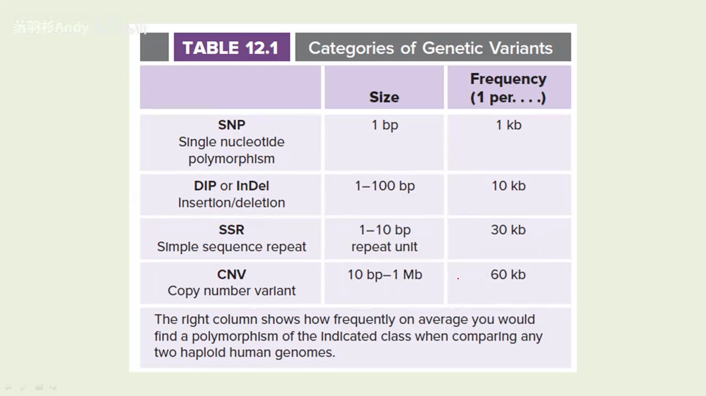
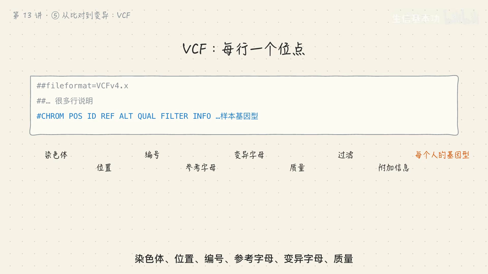
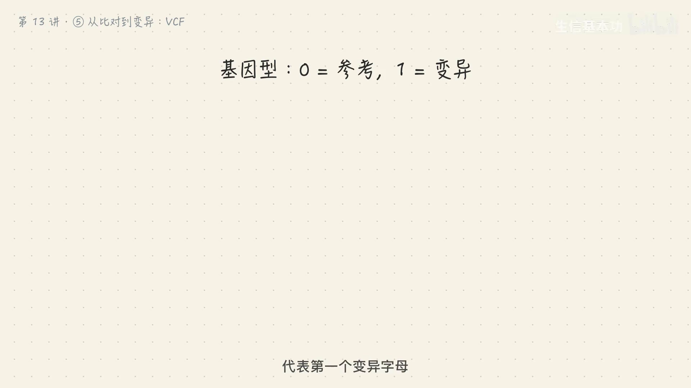
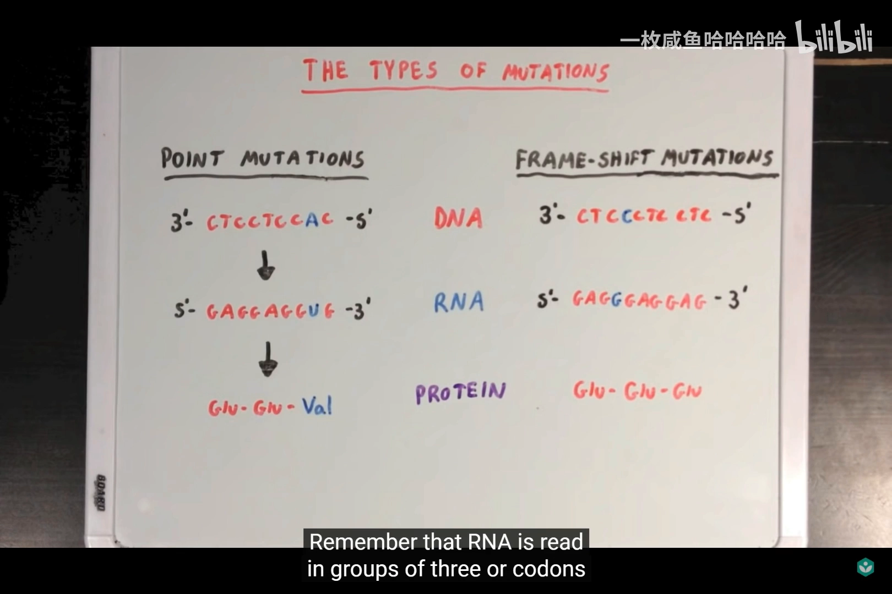
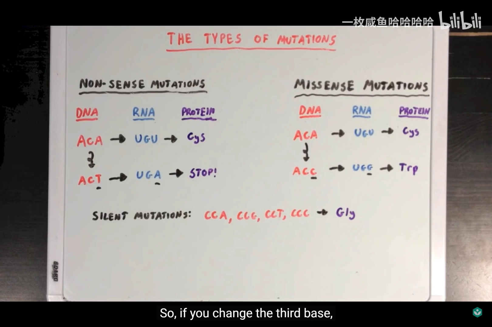

# 短序列变异：SNV、SNP 与插入缺失的读法

> 视频来源：[【遗传学讨论】16.1 遗传位点-SNP和SSR 基本原理和检测方法](https://www.bilibili.com/video/BV1t4V5zMEuf/)（B 站 · 落羽杉W）｜[生信入门 第13讲：BAM与VCF](https://www.bilibili.com/video/BV1monQ6mEtk/)（B 站 · 生信基本功）｜[错义突变 无义突变 点突变 移码突变傻傻分不清？](https://www.bilibili.com/video/BV1mSgXe1Eud/)（B 站 · 洗牙佬）
>
> 导读：本文只取三支视频中与本节目标相关的部分。第一支给短变异的尺寸谱系与 SNP/InDel 定义，第二支逐列读一行真实 VCF，第三支用白板画点突变与移码的区别。SNP 的群体频率计算、基因型分布统计和检测方法不在本节展开。

## 本讲要解决的核心问题（SCQA）

**背景**：我们已经知道变异有来源和尺度之分：一个碱基的替换、一小段碱基的增减、整段染色体的重排，发生过程和遗传后果都不一样。

**冲突**：但真正拿到一条记录时，信息被压成“染色体、位置、参考字母、变异字母”几项。插入缺失让参考和变异两列长度不同；重复序列让同一个缺失有不止一种写法；参考版本一换，坐标就全变。而“短”与“结构”之间也没有一条天然的分界线。

**疑问**：怎样把一条短变异记录读成“发生了什么变化、发生在哪里、会不会改变阅读框”？

**回答（中心思想）**：按三层读。**第一层看变化类型**：参考与变异等长是单碱基替换（SNV，群体中常见的位点叫 SNP），长度不同是插入缺失。**第二层核对位置**：染色体、坐标、参考版本三者缺一不可。**第三层看后果**：是否落在编码区、长度是否是 3 的倍数，决定它只换一个密码子，还是让下游密码子整体移码。

## 一、短变异是什么：一个碱基的替换，或一小段碱基的增减

### 1.1 SNV 与 SNP：同一种变化，两种说法

**SNV**（single nucleotide variant，单核苷酸变异）指参考序列上的一个碱基被另一个碱基替换。**SNP**（single nucleotide polymorphism，单核苷酸多态性）是这类变化中最常用的一种遗传位点：它描述的不是某一个人的一次改变，而是“这个位置在群体里经常有两种碱基”这件事。[【跳转到 08:03】](https://www.bilibili.com/video/BV1t4V5zMEuf/?t=483)

视频里给 SNP 下了三个限定，正好是读记录时的三个判断点：

- **一个碱基的替换**：不是两个、三个碱基一起变，长度不变。
- **通常是二元的**：同一个位点一般只有两种等位形式。原因是单个位点的突变概率很低，突变一次已经是罕见事件，再在同一个位置独立突变出第三种碱基就更少见。[【跳转到 09:24】](https://www.bilibili.com/video/BV1t4V5zMEuf/?t=564)
- **在群体里是多态的**：如果所有人在这个位置都是同一种碱基，那它就不叫 SNP，可能只是测序误差或非多态位点。[【跳转到 11:54】](https://www.bilibili.com/video/BV1t4V5zMEuf/?t=714)

数量上，人类基因组大约有 30 亿个碱基对，已记录的 SNP 超过 1 亿个，平均下来大约每 30 个碱基就有一个 SNP 位点。[【跳转到 09:49】](https://www.bilibili.com/video/BV1t4V5zMEuf/?t=589) 这些位点大多是继承来的，所以带有很强的追溯性——这也是后面[连锁与单倍型](../../../README.md#b02-4-1-6)分析的基础。[【跳转到 10:14】](https://www.bilibili.com/video/BV1t4V5zMEuf/?t=614)

把两个词分开用：**SNV 说的是“一个碱基和参考不同”这件事**，任何频率的单碱基替换都可以叫 SNV；**SNP 说的是“这个位点在群体中常见、通常只有两种等位”的位点**。所以每个 SNP 都是一个 SNV，但只在个别人身上出现的单碱基变化，通常只作为变异记录，不称为多态位点。

### 1.2 插入缺失：长度变化，通常只有一两个碱基

**插入缺失**（insertion/deletion，常缩写为 InDel 或 indel）就是某个位置上多了一个碱基、少了一个碱基，或者多了两个、少了两个。[【跳转到 13:39】](https://www.bilibili.com/video/BV1t4V5zMEuf/?t=819)

视频里有一个很实用的经验：**碱基数目越多，这个位点发生变化的概率越低**。所以绝大多数插入缺失只是多一个或少一个碱基，长一点的已经少见，再长就更罕见。[【跳转到 13:39】](https://www.bilibili.com/video/BV1t4V5zMEuf/?t=819)

它们从哪来？视频给了两条常见路径：DNA 复制时局部滑动，多掺入或少掺入了一两个碱基；DNA 损伤修复时，同源重组的末端没有对准，接上时多一点或少一点。[【跳转到 14:04】](https://www.bilibili.com/video/BV1t4V5zMEuf/?t=844) 这两条路径都指向同一件事：插入缺失是**长度**出了偏差，而不是某个字母被换掉。

### 1.3 尺寸谱系：短变异到结构变异是一条连续谱

把 SNP、插入缺失、简单重复和拷贝数变化放在同一张表里，长度差别一目了然：

表里的四行分别是：[【跳转到 08:03】](https://www.bilibili.com/video/BV1t4V5zMEuf/?t=483)

| 类型 | 长度 | 平均多久遇到一个 |
| --- | --- | --- |
| SNP，单核苷酸多态性 | 1 bp | 每 1 kb |
| DIP / InDel，插入缺失 | 1–100 bp | 每 10 kb |
| SSR，简单序列重复 | 重复单元 1–10 bp | 每 30 kb |
| CNV，拷贝数变异 | 10 bp–1 Mb | 每 60 kb |

右列不是“每个人有多少”，而是比较两个单倍体人类基因组时，平均每隔多长序列能遇到一个该类多态位点。它说明的是：**越短的变化越密集，越长的变化越稀疏**。

这张表也提前暴露了边界问题：InDel 的上限是 100 bp，CNV 的下限是 10 bp，两者在 10–100 bp 之间是重叠的。也就是说，“短变异”和“结构变异”不是两套互斥的生物学机制，而是按长度和表示方式划出的两个档位。这一点在第五节展开。

## 二、位置怎么读：染色体、坐标、版本

### 2.1 一行 VCF 的固定顺序

常见的短变异记录格式是 **VCF**（Variant Call Format）。文件开头是许多以 `##` 开头的说明行，之后一行一个变异位点。列的顺序是固定的：

视频把每一列对应的含义讲得很直白：染色体、位置、编号、参考字母、变异字母、质量、过滤结果、附加信息，再往后是每一个人的基因型。[【跳转到 06:15】](https://www.bilibili.com/video/BV1monQ6mEtk/?t=375)

本节只要求读懂前五列和基因型列；`QUAL`、`FILTER`、`INFO` 的具体字段不在范围内。读一条记录时先问四个问题：

1. 哪条染色体？（`CHROM`）
2. 从第几个碱基开始？（`POS`）
3. 参考序列在这里是什么？（`REF`）
4. 这个人在这里变成了什么？（`ALT`，以及后面的基因型）

### 2.2 基因型：0 是参考，1 是第一个变异字母

视频给了一行真实记录：**TCF7L2** 位点，位于 10 号染色体，参考字母是 C，变异字母是 T，编号是 `rs` 开头的一串。[【跳转到 06:40】](https://www.bilibili.com/video/BV1monQ6mEtk/?t=400)

基因型用数字写：**0 代表和参考一样，1 代表第一个变异字母**。[【跳转到 06:40】](https://www.bilibili.com/video/BV1monQ6mEtk/?t=400)

人是二倍体，所以基因型有两个数字：

- `0|0` 或 `0/0`：两份都是参考碱基 C。
- `1|0` 或 `0/1`：一份是 T，一份是 C，杂合。
- `1|1`：两份都是 T，纯合变异。

中间用**竖线** `|` 表示已经分清了哪一份在父亲那条染色体、哪一份在母亲那条上，叫**已定向**（phased）；用**斜线** `/` 表示还没分清，叫**未定向**。[【跳转到 07:05】](https://www.bilibili.com/video/BV1monQ6mEtk/?t=425)

在千人基因组计划的 2504 个人里，这个位点有两份都是 C 的 1534 人、一份 T 一份 C 的 799 人、两份都是 T 的 171 人。[【跳转到 07:30】](https://www.bilibili.com/video/BV1monQ6mEtk/?t=450) 这就是群体频率在真实文件里的样子；频率怎么算、基因型比例说明什么，留给 [4.1.4 基因型与等位基因](../../../README.md#b02-4-1-4)。

### 2.3 位置不是绝对的：先问参考版本

同一个变异在不同参考基因组版本里，坐标可能差上百万。[【跳转到 08:45】](https://www.bilibili.com/video/BV1monQ6mEtk/?t=525) 所以一条记录的位置必须连同**参考版本**一起读，否则“某号染色体第几位”这句话本身是不完整的。参考组装与坐标系统的约定见 [1.2.1 参考基因组：组装版本与坐标系统](../../../README.md#b02-1-2-1)，正负链与区间开闭见 [1.2.3 正负链、坐标起点与区间开闭](../../../README.md#b02-1-2-3)。

## 三、变化怎么读：REF/ALT 的长度差决定是替换还是增减

### 3.1 等长是替换，不等长是插入或缺失

VCF 用参考字母和变异字母两列描述一个位点。按这个约定，比较两列的长度就能判断变化类型：

- **REF 与 ALT 等长**（通常都只有一个字母）：单碱基替换。例如 `REF=C`、`ALT=T`。
- **ALT 比 REF 长**：插入。例如 `REF=A`、`ALT=ATC`，意思是参考在这里只有一个 A，这个人多出了 TC。
- **REF 比 ALT 长**：缺失。例如 `REF=ATC`、`ALT=A`，意思是参考在这里是 ATC，这个人少了 TC。

视频只讲了“参考字母/变异字母”这两列和“插入缺失的写法不唯一”，上面三个例子是按这个约定做的读法练习，不是视频里的原例。真正读文件时，长度差就是最直接的线索：**先看两列差了几个字母，再看差的是哪几个字母**。

### 3.2 写法不唯一：重复序列里的缺失可以写在好几个位置

插入缺失最容易踩的坑是**写法不唯一**。视频举的例子是：在一串重复的字母里少了一个，你可以说少的是第一个，也可以说是最后一个，两种写法位置差了好几位；两个文件写法不一样，一对就对不上，所以比较之前要先统一写法。[【跳转到 08:20】](https://www.bilibili.com/video/BV1monQ6mEtk/?t=500)

这不是谁写错了，而是重复序列本身让“少的是哪一个”没有唯一答案。把同一个变异规范到同一个表示，是后续比较、注释和合并的前提；具体工具与算法不在本节展开。

### 3.3 多等位与链方向

还有两个会影响读法的细节：

- **一个位置可能不止一种变异字母**。视频提到，TCF7L2 这个位置除了 T 还记录了一个很少见的 G；一行里出现多个变异字母时，很多下游工具处理不好，常常要先拆开。[【跳转到 08:20】](https://www.bilibili.com/video/BV1monQ6mEtk/?t=500)
- **VCF 里的字母一律按参考基因组的正链写**。按基因写是 A 变 T，在 VCF 里却可能是 T 变 A；和别的资料对照时，先想想是哪条链。[【跳转到 07:55】](https://www.bilibili.com/video/BV1monQ6mEtk/?t=475)

第二点要和 [1.2.3 正负链、坐标起点与区间开闭](../../../README.md#b02-1-2-3) 的链方向约定连起来读：同一个变化，换一条链来看，字母就互补了。

### 3.4 没出现 ≠ 和参考一样

读 VCF 时最容易犯的默认假设是：文件里没写这个位置，说明这个人和参考一样。视频明确说不是：**VCF 里没出现的位置不一定和参考一样，也可能是那里根本没测到**。要分清是哪一种，得回头看 BAM 里那个位置盖了多少条读段；有一种扩展的 VCF 会把“测到了、且和参考一样”的区域也记下来，专门解决这个问题。[【跳转到 07:30】](https://www.bilibili.com/video/BV1monQ6mEtk/?t=450)

这条对“读懂位置”很关键：**记录的有无是检出结果，不是生物学结论**。

## 四、后果怎么读：插入缺失是否改变阅读框

### 4.1 点突变：只换一个密码子

白板上先写了一段重复序列：DNA 是 `3'-CTCCTCCTC-5'`，转录出的 RNA 是 `5'-GAGGAGGAG-3'`，按三个一组读，翻译成三个谷氨酸（Glu-Glu-Glu）。[【跳转到 00:52】](https://www.bilibili.com/video/BV1mSgXe1Eud/?t=52)

点突变是**一个 DNA 碱基被另一个替换**。[【跳转到 01:09】](https://www.bilibili.com/video/BV1mSgXe1Eud/?t=69) 把其中一个 C 换成 A，只有一个密码子从 GAG 变成 GUG，蛋白从 Glu-Glu-Glu 变成 Glu-Glu-Val。**变化被限制在一个密码子里**，这是点突变和移码最重要的区别。

### 4.2 移码：插入一个碱基，下游密码子整体重排

移码（frameshift）的做法不是换字母，而是**在序列里加一个字母**。视频在同样的序列里插入了一个 C，DNA 变成 `3'-CTCCCTCCTC-5'`，RNA 变成 `5'-GAGGGAGAG-3'`。[【跳转到 01:33】](https://www.bilibili.com/video/BV1mSgXe1Eud/?t=93)

关键在于读法：RNA 是以三个为一组（密码子）读的。插入一个碱基后，**从这个位置往后，每三个一组的起点都错了一位**，下游序列被重新分成 GAG、GGA、GAG，原本的谷氨酸被读成甘氨酸。[【跳转到 01:58】](https://www.bilibili.com/video/BV1mSgXe1Eud/?t=118)

所以视频的结论是：移码突变通常比点突变对最终蛋白的影响更显著。[【跳转到 02:23】](https://www.bilibili.com/video/BV1mSgXe1Eud/?t=143) 真正可怕的不是“多了一个碱基”，而是它让下游所有密码子的分组起点错位。

### 4.3 3 的倍数与非移码

如果插入或缺失的长度是 **3 的倍数**，相当于整个密码子被插入或删掉，阅读框不变，下游氨基酸不会整体错位，称为非移码突变。这一点在 [4.1.1 变异来源](../../../README.md#b02-4-1-1) 里已经展开，这里只留结论：**判断移码，先看长度差是不是 3 的倍数**。

编码区里的单碱基替换则按蛋白后果分三类：**沉默突变**（密码子变了，但简并性让氨基酸不变）、**错义突变**（换一个氨基酸）、**无义突变**（变成终止密码子，蛋白提前截断）。[【跳转到 02:52】](https://www.bilibili.com/video/BV1mSgXe1Eud/?t=172) [【跳转到 03:35】](https://www.bilibili.com/video/BV1mSgXe1Eud/?t=215)

这三类的功能后果、以及如何结合蛋白结构判断影响，属于 [4.2.1 编码区变异](../../../README.md#b02-4-2-1) 的范围。本节只要求看到一条编码区记录时，能说出它属于哪一类。

## 五、边界：短变异与结构变异

### 5.1 尺寸上的重叠

回到 1.3 的表：InDel 是 1–100 bp，CNV 是 10 bp–1 Mb，两者在 10–100 bp 之间重叠。这不是表格画错了，而是两类变异的定义本来就不是按同一把尺子切的。

视频对 CNV 的描述是：一般指几百 bp 到 1 Mb 的大片段拷贝数变化；人类基因组上大约有 50 万个 CNV，两个人之间大约有 5 万个 CNV 的差异；来源是减数分裂时的不等价交换，以及转座子介导的非同源重组。[【跳转到 16:59】](https://www.bilibili.com/video/BV1t4V5zMEuf/?t=1019) [【跳转到 17:22】](https://www.bilibili.com/video/BV1t4V5zMEuf/?t=1042)

所以“短”通常指 **100 bp 以内、能用一条小变异记录表示**的变化；“结构”指更大的缺失、重复、倒位、易位。两者在 10–100 bp 有交集，边界是一条约定线，不是机制上的突变。

### 5.2 边界是表示方式的边界

读记录时的实用判断是：**看 REF 和 ALT 的长度**。两列都只有几个字母，是典型的短变异；两列很长、或者长度差很大，就要意识到它可能已经落在结构变异的地界，应该去看结构变异的表示方式（断点、拷贝数），而不是硬当成一条 indel 来读。结构变异的具体类型与读法见 [4.1.3 结构变异、拷贝数变化与基因组重排](../../../README.md#b02-4-1-3)。

## 小结

- **SNV 是变化，SNP 是位点**：单碱基替换叫 SNV；当这个位点在群体里常见、通常只有两种等位时，叫 SNP。
- **插入缺失是长度变化**：多数只多一个或少一个碱基；长度越长越少见，来源是复制滑动和修复不精确。
- **读位置要三件套**：染色体、坐标、参考版本。少了版本，坐标没有意义。
- **基因型 0/1**：0 是参考，1 是第一个变异字母；`|` 已定向，`/` 未定向。
- **REF/ALT 长度差决定类型**：等长是替换，ALT 长是插入，REF 长是缺失。
- **四个常见坑**：没出现不等于和参考一样；字母按正链写；一个位置可能有多个变异字母；重复序列里 indel 写法不唯一。
- **移码看长度**：插入缺失不是 3 的倍数，下游密码子整体错位；是 3 的倍数则不改变阅读框。
- **短与结构是连续谱**：InDel 1–100 bp、CNV 10 bp–1 Mb，在 10–100 bp 重叠；边界是表示方式的边界。

## 关键术语速查

| 术语 | 一句话解释 |
| --- | --- |
| SNV | 单核苷酸变异：参考序列上一个碱基被另一个替换 |
| SNP | 单核苷酸多态性：群体中常见、通常二元的单碱基位点 |
| InDel / indel | 插入缺失：一小段碱基的增减，多数为 1–2 bp |
| VCF | 变异记录文本格式，一行一个位点，列为染色体、位置、参考、变异、基因型等 |
| REF / ALT | 参考字母 / 变异字母；两者长度差决定是替换、插入还是缺失 |
| 基因型 0/1 | 0 表示参考碱基，1 表示第一个变异字母；两个数字对应两条同源染色体 |
| 已定向 / 未定向 | 竖线表示已分清两条染色体来源，斜线表示未分清 |
| 移码 | 插入缺失长度不是 3 的倍数，下游密码子分组整体错位 |
| 非移码 | 插入缺失长度是 3 的倍数，相当于整个密码子增减，阅读框不变 |
| CNV | 拷贝数变异：一般几百 bp 到 1 Mb 的大片段拷贝数变化 |