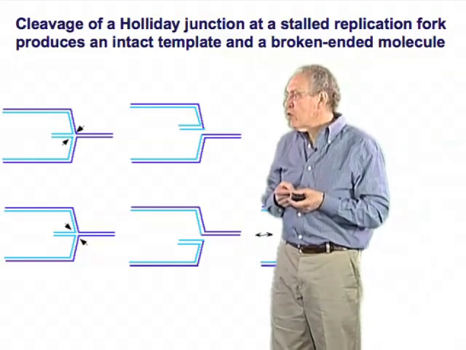
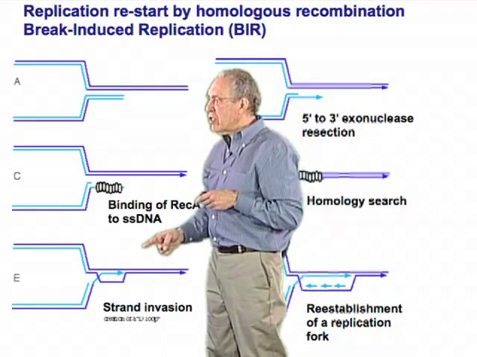
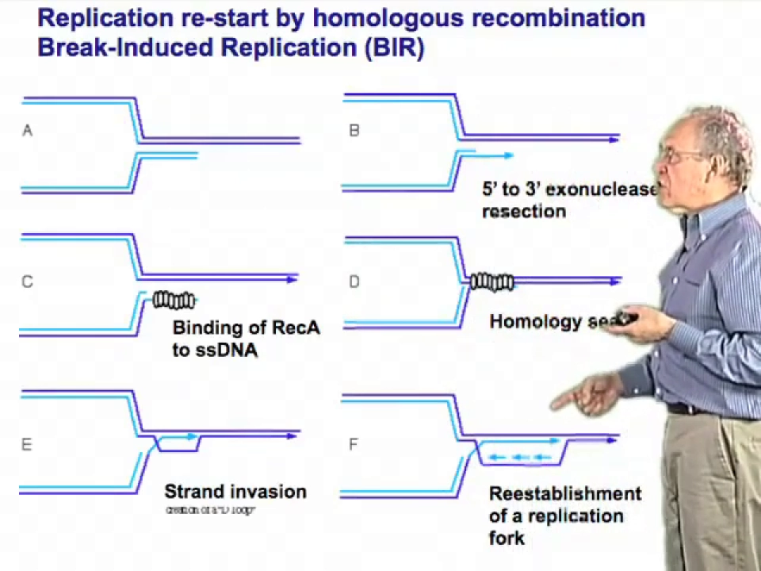

# 复制叉停滞与断裂诱导复制：重排的另一种来源

> 视频来源：[Break-Induced Replication - Jim Haber](https://www.youtube.com/watch?v=IDwWHfB3qo0)（YouTube · Jim Haber，Brandeis University）｜约 4 分钟节选
>
> 导读：这是一段从“停滞复制叉”讲起的节选，前半段假设读者已经知道复制叉的基本结构。本文先补一句复制叉的背景，再按“回退 → 切开 → BIR 重启”三步讲清楚：复制叉停下之后，怎样变成一个断裂端，又怎样靠同源重组重新启动复制。

## 本讲要解决的核心问题（SCQA）

**背景**：DNA 复制叉在延伸时可能遇到损伤或障碍，停下来。停下来的复制叉并不等于立刻断裂，它可以先回退、形成 Holliday 连接体。

**冲突**：如果这个回退结构被切开，就会产生一个断裂端。复制叉已经停了，细胞怎样把这个断裂端重新变成一条能继续复制的叉？

**疑问**：复制叉停滞怎样变成 DNA 断裂？断裂之后又靠什么机制重新启动复制？

**回答（中心思想）**：**停滞的复制叉可以先回退成 Holliday 连接体；连接体被切开后，一条分子保持完整，另一条变成断裂端。断裂端通过断裂诱导复制（break-induced replication, BIR）重新启动：先切除一条链露出单链，Rad51 包成核蛋白丝，寻找同源序列并入侵，形成 D-loop，再装上完整的复制机器继续延伸。** BIR 让“停下的叉”变成“重新出发的叉”，但它依赖同源重组，也把断裂端带进了重组修复的风险范围。

## 一、停滞的复制叉先回退，形成 Holliday 连接体

课程从“停滞的复制叉”讲起：复制叉前进到某个位置后停下来，回退（regression），形成一个 Holliday 连接体。[【跳转到 00:05】](https://www.youtube.com/watch?v=IDwWHfB3qo0&t=5)

这里的“回退”可以理解成：复制叉不再往前走，而是把新合成的链往回退，重新配对，形成一个十字形的连接结构。这个结构就是 Holliday 连接体。

回退本身不是终点。课程说，回退的复制叉随后会被 Holliday 连接体 resolvase 切开。[【跳转到 00:10】](https://www.youtube.com/watch?v=IDwWHfB3qo0&t=10)

## 二、切开之后：一条完整，一条断裂

关键的一步在这里：不管 resolvase 从哪个平面切，结果都是**一条完整的 DNA 分子，加一条断裂的分子**。[【跳转到 00:26】](https://www.youtube.com/watch?v=IDwWHfB3qo0&t=26)

课程用一张图把过程串起来：复制叉从左边过来，到达损伤位置后停住、回退，形成回退复制叉，然后在损伤发生的位置断开，给细胞一个机会用另一种方式修复这个断裂。[【跳转到 00:48】](https://www.youtube.com/watch?v=IDwWHfB3qo0&t=48)

这一步是“复制叉停滞”与“结构变异”之间的桥：停滞本身只是复制暂停，切开之后才出现真正的 DNA 断裂端。断裂端如果被错误连接，就可能成为缺失、重复、倒位或易位的起点；断端连接的通路细节见 [§1.3.5 DNA 双链断裂修复](<../../../1_基因组组织、坐标与维护/1.3_DNA%20复制与基因组维护/1.3.5_DNA%20双链断裂修复：同源重组与末端连接/双链断裂修复：NHEJ快速封口与同源重组保真重建.md>)。

## 三、BIR：用同源重组把断裂端重新变成复制叉

课程把 BIR 的步骤拆得很清楚：

1. **切除一条链**：断裂端被外切酶处理，切掉 5′ 端那条链，露出一大段单链 DNA，末端停在 3′ 端。[【跳转到 01:13】](https://www.youtube.com/watch?v=IDwWHfB3qo0&t=73)
2. **Rad51 包成核蛋白丝**：单链 DNA 吸引重组酶 RecA（细菌名），也就是真核生物中的 Rad51，Rad51 结合单链并形成核蛋白丝。[【跳转到 02:07】](https://www.youtube.com/watch?v=IDwWHfB3qo0&t=127)
3. **寻找同源序列**：这条核蛋白丝能在整个基因组里搜索与单链同源的序列；在姐妹染色单体同时复制的情况下，同源序列往往就在旁边。[【跳转到 02:28】](https://www.youtube.com/watch?v=IDwWHfB3qo0&t=148)
4. **链入侵与 D-loop**：核蛋白丝不仅结合单链，还侵入双链模板，完成碱基配对交换，把单链配对到模板上，挤出一段 D-loop。[【跳转到 02:50】](https://www.youtube.com/watch?v=IDwWHfB3qo0&t=170)
5. **重新装上复制机器**：链入侵为整个 DNA 复制机器的组装争取了时间，随后前导链和后随链的聚合都能开始。[【跳转到 03:25】](https://www.youtube.com/watch?v=IDwWHfB3qo0&t=205)

课程用一句话总结这一步：原来是一个停滞复制叉的产物，现在被重新启动了复制，复制可以继续下去。[【跳转到 03:37】](https://www.youtube.com/watch?v=IDwWHfB3qo0&t=217)

## 四、BIR 能走多远：到染色体末端，或遇到下一个复制叉

课程给了一个范围感：在简单生物里，BIR 可以一直走到相对较短的染色体末端，也就是几十万碱基对；在更大的细胞里，可以想象它走到与另一个复制叉相遇，然后像正常复制那样把整条分子复制完。[【跳转到 03:47】](https://www.youtube.com/watch?v=IDwWHfB3qo0&t=227)

这说明 BIR 不是“修一下断口就结束”的小修补，而是一种**重新建立整条复制叉**的机制。它可以从一个断裂端出发，沿着模板一直复制下去。

## 五、把 BIR 放回结构变异的框架里

这一节的内容可以压成一条因果链：

**复制叉遇到障碍 → 停下并回退 → 形成 Holliday 连接体 → resolvase 切开 → 一条完整、一条断裂 → BIR 用同源重组重新启动复制。**

这条链补上了前面几节没有展开的一种来源：结构变异不一定从“外源损伤造成的双链断裂”开始，也可以从**复制叉停滞**开始。复制叉停滞产生断裂端之后，细胞面临的选择仍然是“怎么把这个断端接回去”；接得对，复制重启；接错对象，就可能留下重排。

课程本身讲的是 BIR 的分子步骤，没有展开“BIR 怎样造成具体疾病”。本节只把这条机制线索接到结构变异的概念框架里：**复制叉停滞是断裂端的一个来源，BIR 是处理这个断裂端的一条同源重组路线。** 至于断端连接、模板选择错误和重复序列之间的错误配对，属于 §1.3.5 的双链断裂修复与同源重组内容。

## 小结

- 复制叉遇到障碍会停下，并可能回退形成 Holliday 连接体。
- Holliday 连接体被 resolvase 切开后，一条 DNA 分子保持完整，另一条留下断裂端。
- BIR 用同源重组重启复制：5′→3′ 切除、Rad51 包丝、同源搜索、链入侵、D-loop、重新组装复制机器。
- BIR 可以从断裂端一直复制到染色体末端，或与另一个复制叉相遇。
- 复制叉停滞因此是结构变异的一个潜在起点：停滞 → 断裂端 → 重组修复；接错对象就可能留下重排。

## 关键术语速查

| 术语 | 一句话解释 |
| --- | --- |
| 复制叉停滞 | 复制叉遇到损伤或障碍后停止前进 |
| 复制叉回退 | 停滞的复制叉把新合成链往回退，重新配对 |
| Holliday 连接体 | 两条 DNA 分子交叉连接形成的十字形结构 |
| resolvase | 切开 Holliday 连接体的酶 |
| BIR | 断裂诱导复制，用同源重组从断裂端重新启动复制 |
| 5′→3′ 切除 | 外切酶切掉断裂端的一条链，露出单链 DNA |
| Rad51 | 真核生物的重组酶，结合单链 DNA 形成核蛋白丝 |
| 链入侵 | 核蛋白丝带着单链侵入同源双链模板 |
| D-loop | 链入侵后把模板的一条链挤出的环状结构 |