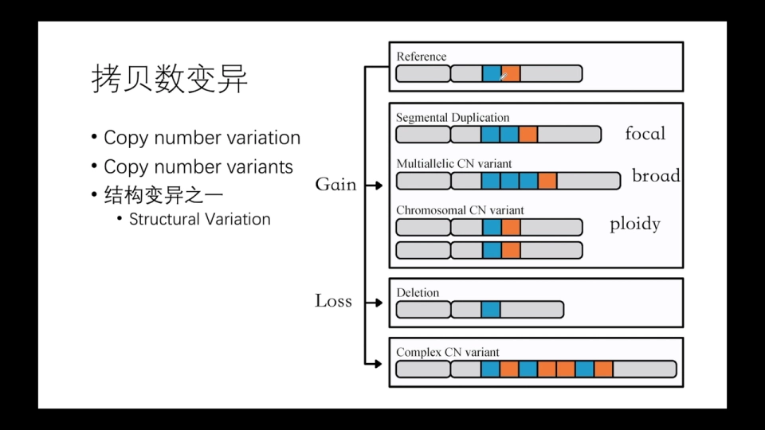
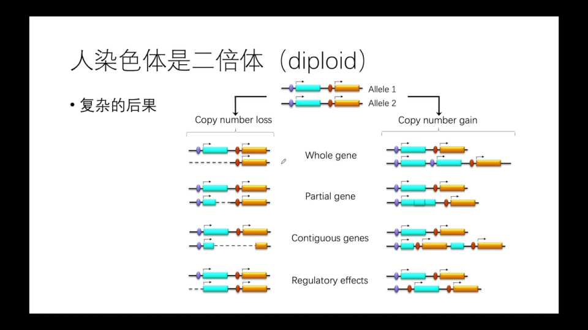
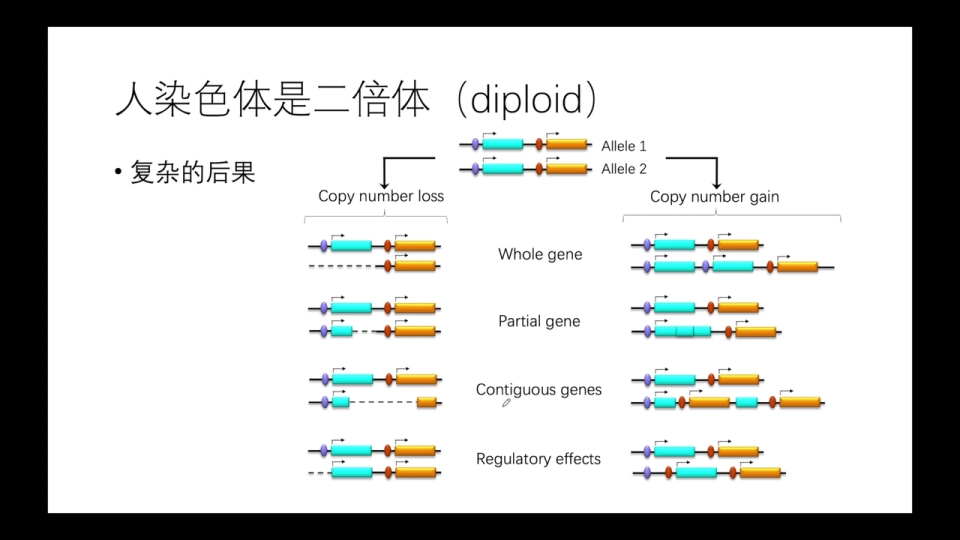

# 拷贝数变异：缺失与重复如何改变基因剂量

> 视频来源：[二代测序之拷贝数变异基础知识](https://www.bilibili.com/video/BV1CV411d7Ct/)（B 站 · 二代测序课程）｜全长约 53 分钟，本文只取开头约 7 分钟的概念部分
>
> 导读：这支课后面大部分时间在讲 CMA、LOH 和检测流程，那些不在本节范围。本文只保留“CNV 是什么、focal 与 broad 怎么分、缺失和重复怎样改变基因剂量”这一段，用幻灯片把抽象定义落到具体基因上。

## 本讲要解决的核心问题（SCQA）

**背景**：结构变异里最常见的一类是“某一段 DNA 的份数变了”：原来两份，变成一份或三份。

**冲突**：同样是“份数变了”，有的只影响一个基因，有的影响整条染色体；有的让蛋白变少，有的让蛋白变多，有的干脆改变了基因前面的调控片段。只说“拷贝数增加/减少”，不足以判断后果。

**疑问**：拷贝数变异应该怎样读？读到“增加”或“缺失”之后，下一步要看什么？

**回答（中心思想）**：**拷贝数变异（CNV）是相对于参考基因组比较“某一段有几份”。** 先看变化片段的宽窄：只包含几个基因的叫 focal，覆盖较大区域甚至整条染色体的叫 broad。再看变化落在基因的哪个位置：整个基因、基因的一部分、连续几个基因，还是基因前面的调控区。份数变化通过**基因剂量**和**调控连接**两条路径影响表型。

## 一、CNV 是结构变异的一种：比较“这一段有几份”

课程开头把拷贝数变异（copy number variation）归入结构变异（structural variation），并强调它是基因组上比较大的一种变化。[【跳转到 00:06】](https://www.bilibili.com/video/BV1CV411d7Ct/?t=6)

理解 CNV 的关键是“相对于参考基因组数份数”。假设参考基因组上有一段蓝色、一段橙色；如果蓝色这一段从一份变成两份，那么这一段包含的基因数目全都变成两份，而橙色部分没有变。[【跳转到 00:31】](https://www.bilibili.com/video/BV1CV411d7Ct/?t=31)

反过来，如果橙色这一段从基因组上缺失了，就是拷贝数缺失（copy number loss），也就是 deletion。[【跳转到 02:11】](https://www.bilibili.com/video/BV1CV411d7Ct/?t=131)

所以 CNV 有两个方向：

- **copy number gain**：某一段的份数比参考多。
- **copy number loss**：某一段的份数比参考少。

这里的“份数”不是绝对数字，而是相对于参考基因组的比较结果。参考是两份，个体是一份，就是缺失；参考是两份，个体是三份，就是增加。

## 二、先看宽度：focal、broad 与整条染色体

课程用“片段有多宽”把 CNV 分成几个层次：

- **focal segment**：比较短、比较聚焦的片段，从染色体上看只包含几个基因。[【跳转到 00:56】](https://www.bilibili.com/video/BV1CV411d7Ct/?t=56)
- **broad region / broad segment**：比较宽的片段，覆盖较大区域。[【跳转到 01:21】](https://www.bilibili.com/video/BV1CV411d7Ct/?t=81)
- **整条染色体层面的变化**：整个染色体由一条变成两条，导致整条染色体上所有基因都变成原来的两倍。[【跳转到 01:46】](https://www.bilibili.com/video/BV1CV411d7Ct/?t=106)

这个层次很重要，因为它决定了“影响范围”。focal 变化可能只动一个或几个基因，适合逐个基因去解释；broad 变化往往同时影响许多基因，后果更难归因到单个基因；整条染色体的份数变化则是另一类问题，通常不叫 focal CNV。

课程也提醒：复杂情况下，一个片段可能发生多个重复，或者多种变化组合在一起，形成复杂的拷贝数变异。[【跳转到 01:56】](https://www.bilibili.com/video/BV1CV411d7Ct/?t=116)

## 三、再看落点：整个基因、部分基因、连续基因、调控区

人染色体是二倍体，每个基因通常有两个拷贝，一个来自父亲，一个来自母亲。课程把 CNV 的后果按“变化落在哪里”拆成几种情形。[【跳转到 02:53】](https://www.bilibili.com/video/BV1CV411d7Ct/?t=173)

### 3.1 整个基因的份数变化

如果整个蓝色基因发生缺失，这个基因在 DNA 分子里只剩下一份；橙色部分没有变化。反过来，如果整个基因由两份变成三份，就是整个基因的拷贝数增加。[【跳转到 03:43】](https://www.bilibili.com/video/BV1CV411d7Ct/?t=223)

这是最容易理解的一种：基因还在，只是份数变了。后果主要看这个基因对剂量是否敏感。

### 3.2 基因的一部分发生缺失

如果缺失只发生在基因体的一部分，转录出来的 RNA、翻译出来的蛋白可能只有一部分。[【跳转到 04:33】](https://www.bilibili.com/video/BV1CV411d7Ct/?t=273)

这类变化不能简单按“少了一份基因”来算。它可能产生截短的蛋白，也可能破坏结构域，后果取决于断点落在基因的哪个位置。

### 3.3 连续几个基因一起变化

CNV 并不是有针对性地识别某个基因。一个片段发生缺失或增加，可能同时影响相邻的几个基因。[【跳转到 04:58】](https://www.bilibili.com/video/BV1CV411d7Ct/?t=298)

课程给了一个很具体的后果：如果中间一段发生缺失，两侧的基因体在 DNA 里连了起来，形成一个融合的连接；如果这段缺失同时改变了调控位点的位置，两个基因的表达关系也会跟着变。[【跳转到 05:23】](https://www.bilibili.com/video/BV1CV411d7Ct/?t=323)

这就是“连续基因”情形：不是单个基因的剂量问题，而是几个基因被一起搬动、连接或截断。

### 3.4 调控区变化：基因没坏，表达变了

还有一种情形：CNV 没有改变基因体本身，但改变了基因前面的调控片段，比如 promoter 或 enhancer 区域。[【跳转到 06:13】](https://www.bilibili.com/video/BV1CV411d7Ct/?t=373)

- 如果调控片段缺失，这个基因表达的可能性会降低。
- 如果是拷贝数增加，前面的片段可能被导入另一个基因的 promoter 区域，导致整个前面的表达增加。[【跳转到 06:38】](https://www.bilibili.com/video/BV1CV411d7Ct/?t=398)

这一类最容易被忽略：基因序列看起来没变，但它的“开关”被换了位置或换了拷贝数，表达量仍然会变。

## 四、基因剂量：份数变化为什么会变成表型

课程反复用“剂量”来解释 CNV 的后果：拷贝数增加时，下游转录表达的量可能比较高；拷贝数缺失时，表达量可能降低。[【跳转到 04:08】](https://www.bilibili.com/video/BV1CV411d7Ct/?t=248)

“剂量”可以理解成“细胞里这份基因产物够不够、会不会太多”。有些基因对份数很敏感：少一份就不够用，多一份就过量；有些基因则比较耐受。CNV 的后果，很大程度上取决于受影响的基因是不是剂量敏感基因。

课程也明确说：拷贝数变异导致的后果是各种各样的，非常复杂；它与肿瘤关系密切，在肿瘤研究和许多其他遗传性疾病中发挥重要作用。[【跳转到 07:03】](https://www.bilibili.com/video/BV1CV411d7Ct/?t=423)

本节只建立“份数—剂量—表型”的概念链，不展开肿瘤中的具体 CNV 案例，也不展开 LOH、二次打击和检测流程。

还有一个并列的类型需要在这里交代边界：**插入（novel insertion）**指参考序列中没有对应片段的新增序列。它和缺失、重复一样改变了片段的份数或内容，但断点结构和形成机制与本节讲的 CNV 不同；本节只把它作为结构变异的一个并列类型记下，不展开其机制。

## 五、边界：读到 CNV 之后，先别急着下结论

这支课后面讲了杂合性缺失（LOH）、二次打击和 CMA/测序检测。这些内容不属于本节目标，但提醒我们一件事：**“某段增加/缺失”只是第一层读数，不是最终结论。**

在概念层面，读到 CNV 至少要继续问：

1. 变化是 focal 还是 broad？影响一个基因还是许多基因？
2. 变化落在基因体、基因的一部分，还是调控区？
3. 受影响的基因是否剂量敏感？
4. 这个变化是生殖系还是体细胞？在哪些细胞里存在？

检测方法、断点解析和临床判读分别属于后续小节与 D01/P07，不在这里展开。

## 小结

- CNV 是结构变异的一种，核心是“某一段相对于参考基因组有几份”。
- copy number gain 是份数增加，copy number loss 是份数减少（deletion）。
- 按宽度分：focal 只涉及几个基因，broad 覆盖较大区域，整条染色体的变化影响全部基因。
- 按落点分：整个基因、基因的一部分、连续几个基因、基因前面的调控区。
- 后果通过基因剂量和调控连接两条路径产生；是否严重取决于受影响的基因是否剂量敏感。
- “增加/缺失”只是第一层读数；片段宽度、落点、细胞来源和剂量敏感性决定下一步怎么解释。

## 关键术语速查

| 术语 | 一句话解释 |
| --- | --- |
| 拷贝数变异（CNV） | 相对于参考基因组，某一段 DNA 的份数发生变化 |
| copy number gain | 某一段的份数比参考多 |
| copy number loss | 某一段的份数比参考少 |
| deletion | 一段 DNA 从基因组上缺失 |
| focal segment | 只包含几个基因的较短 CNV 片段 |
| broad region | 覆盖较大区域的 CNV 片段 |
| 基因剂量 | 细胞里某个基因产物的份数；份数变化可能改变表达量 |
| 剂量敏感基因 | 份数多一点或少一点就会影响表型的基因 |
| 调控区 | 基因前面的 promoter、enhancer 等控制表达的片段 |