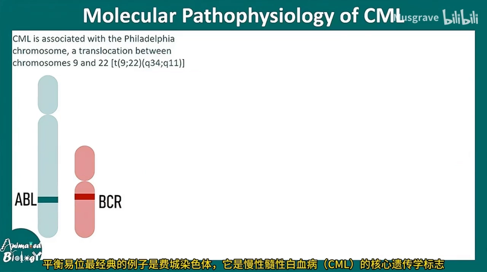
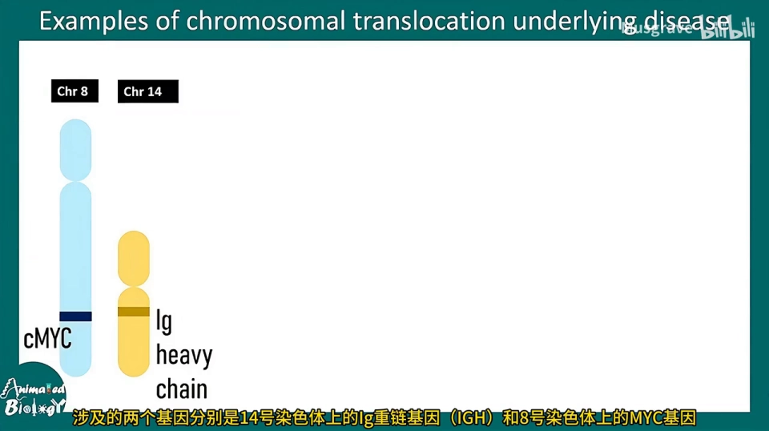
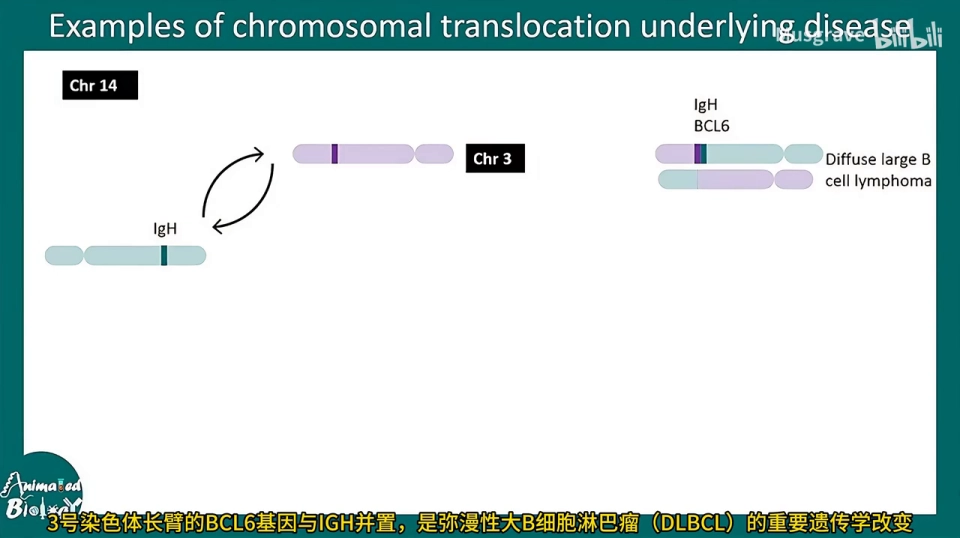

# 易位如何产生融合基因：从费城染色体到伯基特淋巴瘤

> 视频来源：[染色体易位：重排的基因组与疾病](https://www.bilibili.com/video/BV1tsY36hEzv/)（B 站 · 生物医学动画课程）｜约 5 分钟
>
> 导读：这支短片用两个经典例子说明“平衡易位为什么能致病”：一个是 9 号与 22 号易位形成的 BCR-ABL 融合基因，一个是 IGH 增强子被搬到 MYC 前面导致的过表达。本文按“易位类型 → 融合基因 → 增强子劫持”组织，不展开检测与治疗。

## 本讲要解决的核心问题（SCQA）

**背景**：上一节已经知道，易位是染色体断片接到另一条非同源染色体上；平衡易位没有明显的遗传物质增减，携带者可以外表正常。

**冲突**：既然没有“多一段”或“少一段”，为什么平衡易位仍然是多种白血病和淋巴瘤的核心驱动事件？

**疑问**：一个“位置换了”的易位，怎样变成“基因坏了”或“基因过表达”？

**回答（中心思想）**：**易位致病不一定要丢基因，它可以改变基因的“连接方式”和“控制方式”。** 断点落在两个基因中间，可能拼出一个新的融合基因，产生组成型激活的融合蛋白；断点把强增强子搬到某个基因旁边，可能让这个基因持续过表达。费城染色体是前者的典型，伯基特淋巴瘤的 IGH-MYC 易位是后者的典型。

## 一、先分型：相互易位与罗伯逊易位，平衡与不平衡

课程把染色体易位大致分为两类：**相互易位**和**罗伯逊易位**。相互易位是两条染色体的断片彼此交换，形成两条衍生染色体；罗伯逊易位是两条近端着丝粒染色体在着丝粒处融合。两种易位都伴随染色体的断裂与重接。[【跳转到 00:05】](https://www.bilibili.com/video/BV1tsY36hEzv/?t=5) 课程在分类处也明确点出这两个名称。[【跳转到 00:20】](https://www.bilibili.com/video/BV1tsY36hEzv/?t=20)

相互易位又分两个亚型：

- **平衡易位**：遗传物质没有净增减，携带者通常表型正常。
- **不平衡易位**：染色体片段发生缺失或重复，导致部分单体或部分三体。[【跳转到 00:49】](https://www.bilibili.com/video/BV1tsY36hEzv/?t=49)

课程在进入亚型之前先给了这个二分框架。[【跳转到 00:44】](https://www.bilibili.com/video/BV1tsY36hEzv/?t=44)

这一节的重点是平衡易位。它没有明显的“多一段/少一段”，所以后果不能只用剂量解释，而要看断点把哪些序列接在了一起。

## 二、费城染色体：两个基因拼成一个持续激活的激酶

平衡易位最经典的例子是**费城染色体**，它是慢性髓性白血病（CML）的核心遗传学标志。[【跳转到 01:11】](https://www.bilibili.com/video/BV1tsY36hEzv/?t=71)

费城染色体由 9 号染色体长臂三区四带与 22 号染色体长臂一区一带之间的易位形成。9 号染色体上的 **ABL1** 基因与 22 号染色体上的 **BCR** 基因融合，产生 **BCR-ABL** 融合基因。[【跳转到 01:11】](https://www.bilibili.com/video/BV1tsY36hEzv/?t=71)

正常情况下，ABL1 编码一种非受体酪氨酸激酶，调控细胞的分裂与增殖。BCR-ABL 融合蛋白具有**组成型酪氨酸激酶活性**，脱离了正常调控，使髓系细胞增殖失控、分化受阻，最终导致白血病。[【跳转到 01:36】](https://www.bilibili.com/video/BV1tsY36hEzv/?t=96)

这里的关键不是“少了一个基因”，而是“拼出了一个新基因”。融合蛋白把 BCR 的部分和 ABL1 的激酶结构域接在一起，激酶不再需要正常的上游信号就能持续工作。课程把它称为 CML 的始动驱动突变。[【跳转到 02:20】](https://www.bilibili.com/video/BV1tsY36hEzv/?t=140)

## 三、伯基特淋巴瘤：把强增强子搬到 MYC 旁边

第二个经典例子是伯基特淋巴瘤。它的特征性易位发生在 8 号和 14 号染色体之间，涉及 14 号染色体上的免疫球蛋白重链基因 **IGH** 和 8 号染色体上的 **MYC** 基因。[【跳转到 02:49】](https://www.bilibili.com/video/BV1tsY36hEzv/?t=169)

课程在进入这个例子前先点明了 8 号与 14 号这一对染色体。[【跳转到 02:36】](https://www.bilibili.com/video/BV1tsY36hEzv/?t=156)

易位使 MYC 基因被置于 IGH 基因的增强子调控之下。在 B 细胞中，IGH 的增强子原本就处于持续活化状态，因为 B 细胞需要大量合成抗体；这导致 MYC 基因持续过表达，水平远超正常 B 细胞。[【跳转到 02:49】](https://www.bilibili.com/video/BV1tsY36hEzv/?t=169)

MYC 是广谱转录因子，可调控细胞内数千个靶基因。过表达后，促进生长、存活和增殖的基因大量异常激活，细胞周期完全失控，B 淋巴细胞不受控地增殖，最终形成伯基特淋巴瘤。[【跳转到 03:14】](https://www.bilibili.com/video/BV1tsY36hEzv/?t=194)

这个例子的逻辑和费城染色体不同：这里没有拼出一个新的融合蛋白，而是**把原来的基因搬到了一个新的调控环境里**。基因还是 MYC，但它的“开关”被换成了 B 细胞里最强的增强子之一。

## 四、IGH 像一个开关枢纽：一组 B 细胞淋巴瘤的共同模式

课程进一步把 IGH 相关易位总结成一种反复出现的致病模式：14 号染色体长臂上的 IGH 基因就像一个开关枢纽，易位时不同的基因与 IGH 并置，被 IGH 增强子驱使而持续活化。[【跳转到 03:37】](https://www.bilibili.com/video/BV1tsY36hEzv/?t=217)

课程列出的例子包括：

- **8 号与 14 号易位**：MYC 与 IGH 并置，伯基特淋巴瘤的标志性改变。
- **11 号与 14 号易位**：CCND1（细胞周期蛋白 D1）与 IGH 并置，套细胞淋巴瘤中过表达，驱动细胞周期持续运转。
- **14 号与 18 号易位**：抗凋亡基因 BCL2 与 IGH 并置，滤泡性淋巴瘤的标志性改变。
- **3 号与 14 号易位**：BCL6 与 IGH 并置，弥漫性大 B 细胞淋巴瘤（DLBCL）的重要遗传学改变。
- **11 号与 18 号易位**：API2-MALT1 融合基因使 NF-κB 持续活化，见于 MALT 型边缘区淋巴瘤。

这些例子的共同点是：**断点把一段强调控序列接到一个生长/存活基因旁边**，或者把两个基因拼成一个持续激活的融合基因。易位本身可能没有明显的遗传物质增减，但它改变了基因的表达程序。课程在回顾部分把这一组例子压缩成一句“IGH 相关易位是多种 B 细胞淋巴瘤的核心驱动机制”。[【跳转到 04:27】](https://www.bilibili.com/video/BV1tsY36hEzv/?t=267)

## 五、把逻辑收拢：易位致病的两条路径

这一节可以压成两条路径：

| 路径 | 断点做了什么 | 例子 | 后果 |
| --- | --- | --- | --- |
| 融合基因 | 两个基因的编码区拼在一起 | 9;22 的 BCR-ABL | 产生组成型激活的融合激酶 |
| 增强子劫持 | 强增强子被搬到某个基因旁边 | 8;14 的 IGH-MYC | 原基因持续过表达 |

两条路径都不要求“丢一个基因”或“多一个基因”。它们要求的是**断点落在什么位置**：落在两个基因之间，可能拼出融合基因；落在基因和增强子之间，可能把调控关系重新接线。

这也解释了为什么“平衡易位携带者表型正常”和“平衡易位导致白血病”可以同时成立：前者说的是遗传物质总量，后者说的是断点造成的基因连接和表达改变。两者不是同一个层面。

## 小结

- 易位是断片接到非同源染色体上；相互易位交换断片，罗伯逊易位在着丝粒处融合。
- 平衡易位没有明显的遗传物质净增减，但可以致病。
- 第一条路径是融合基因：9;22 易位把 ABL1 与 BCR 拼成 BCR-ABL，产生组成型激活的酪氨酸激酶。
- 第二条路径是增强子劫持：8;14 易位把 MYC 放到 IGH 增强子旁边，导致 MYC 持续过表达。
- IGH 相关易位是多种 B 细胞淋巴瘤的共同模式：不同伙伴基因被搬到 IGH 增强子旁边而持续活化。
- 读易位时，除了看“有没有丢片段”，还要看“断点把哪些序列接在了一起”。

## 关键术语速查

| 术语 | 一句话解释 |
| --- | --- |
| 相互易位 | 两条非同源染色体交换断片 |
| 罗伯逊易位 | 两条近端着丝粒染色体在着丝粒处融合 |
| 平衡易位 | 易位后遗传物质没有明显净增减 |
| 不平衡易位 | 易位伴随片段的缺失或重复 |
| 费城染色体 | 9 号与 22 号易位形成的衍生染色体，产生 BCR-ABL |
| 融合基因 | 两个基因的序列拼在一起形成的新基因 |
| 组成型激活 | 不需要正常上游信号就持续处于活性状态 |
| 增强子劫持 | 强增强子被易位搬到某个基因旁边，使该基因持续表达 |
| IGH | 免疫球蛋白重链基因，B 细胞中增强子持续活跃 |