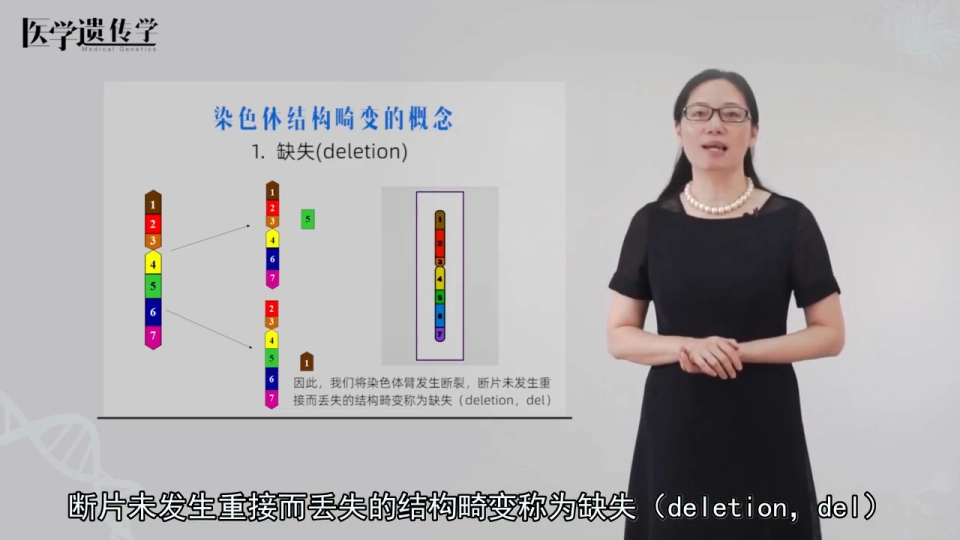
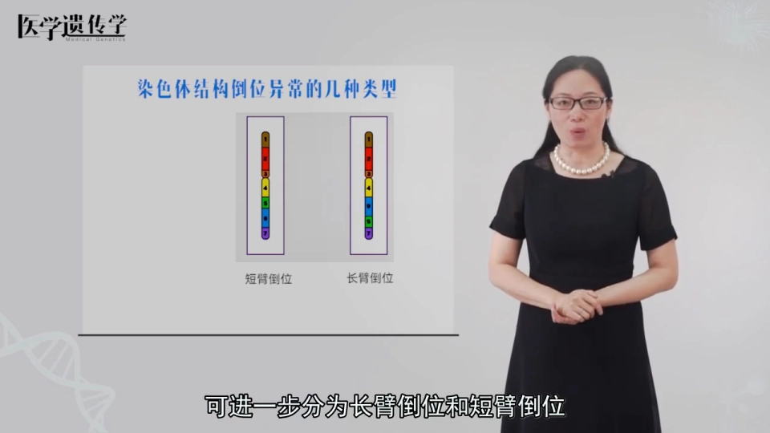
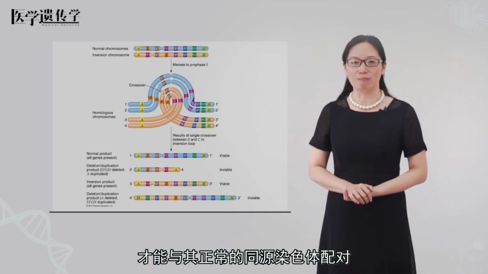
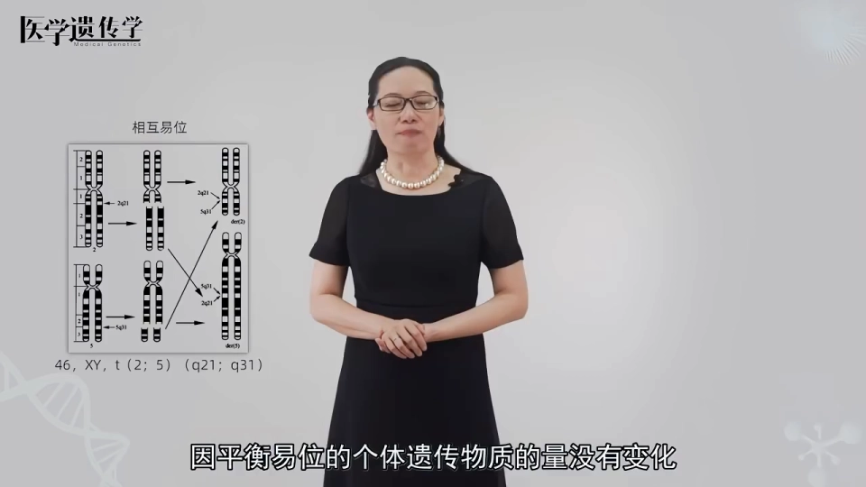
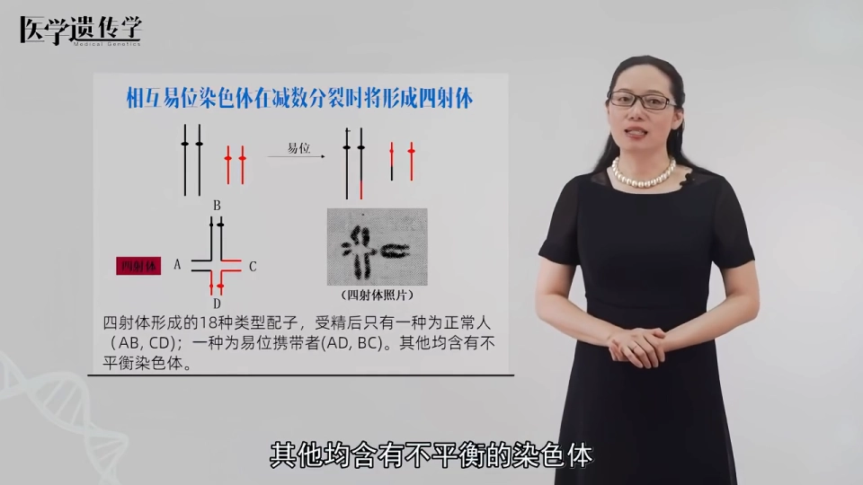
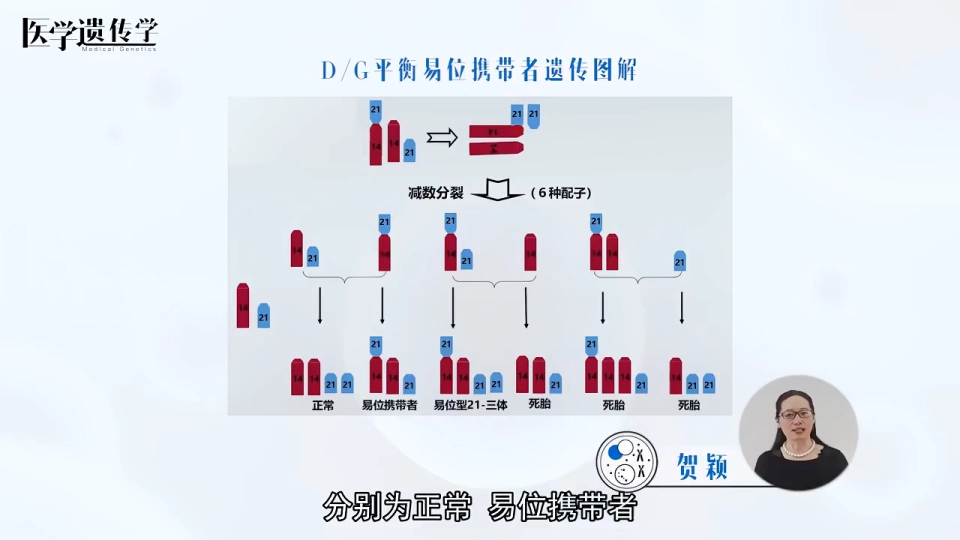
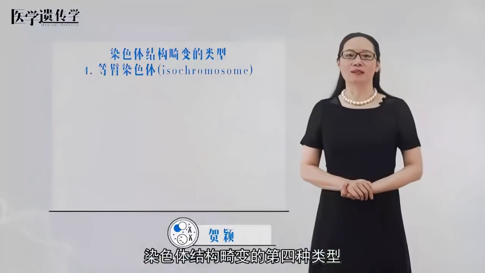
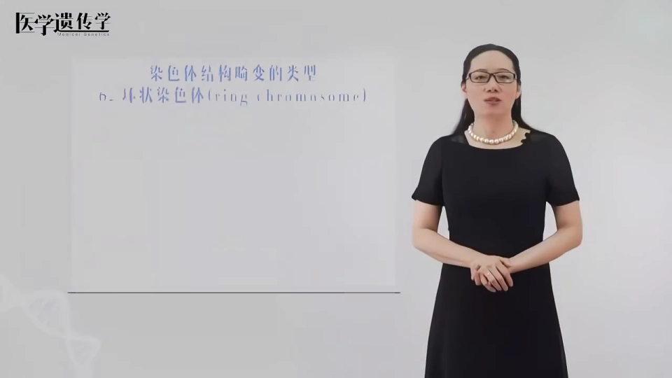

# 染色体结构畸变：断裂重接如何产生缺失、倒位与易位

> 视频来源：[染色体结构畸变及其产生机制（1）](https://www.bilibili.com/video/BV1GT41167NP/) 与 [染色体结构畸变及其产生机制（2）](https://www.bilibili.com/video/BV1qV4y197UP/)（B 站 · 医学遗传学课程）｜两讲合计约 17 分钟
>
> 导读：这两讲用同一套“断裂—重接”的语言，依次讲缺失、倒位、易位，以及等臂染色体、双着丝粒染色体和环状染色体。本文按“共同机制 → 四种基本类型 → 携带者后果”重新组织；分子层面的 NHEJ/MMEJ 细节不在视频里，放在 §1.3.5 的导读中衔接。

## 本讲要解决的核心问题（SCQA）

**背景**：我们已经知道基因组变异有单碱基替换、小插入缺失，也有大片段的丢失、重复和位置改变。后一类常被统称为结构变异。

**冲突**：同样是“丢了一段”“转了个方向”“换了个位置”，为什么有的携带者外表完全正常，有的却反复流产，有的会得白血病？只看“变了多少碱基”回答不了这个问题。

**疑问**：这些结构畸变有没有共同的产生方式？不同类型的区别到底在哪里？

**回答（中心思想）**：**染色体结构畸变的共同起点是断裂，以及断裂后的异常重接。** 断片没接回去而丢失，就是缺失；两处断裂之间的片段转 180° 再接，就是倒位；断片接到另一条非同源染色体上，就是易位。类型由“断在哪里、断了几次、接回哪里”决定；后果则由“有没有遗传物质净增减”和“减数分裂时怎样配对分离”决定。平衡的携带者可以外表正常，却仍然会把不平衡的染色体传给后代。

## 一、先抓住共同点：结构畸变 = 断裂 + 异常重接

课程给结构畸变的定义很直接：染色体或染色单体发生断裂，并以异常的方式重接，形成各种类型的结构改变；**断裂和变位重接是各种结构畸变的基础**。[【跳转到 00:15】](https://www.bilibili.com/video/BV1GT41167NP/?t=15)

这句话把后面所有类型串在了一条线上。判断一个结构畸变，先问三个问题：

1. **断了几次？** 一次断裂往往只涉及一个断端；两次断裂才能丢中间片段、转中间片段。
2. **断在哪里？** 断在臂内还是跨越着丝粒，决定了倒位是臂内还是臂间。
3. **断片接到哪里？** 接回原位是修复；没接回是缺失；接到非同源染色体就是易位。

视频没有展开“断端为什么会被接错”的分子通路。这部分在 [§1.3.5 DNA 双链断裂修复](<../../../1_基因组组织、坐标与维护/1.3_DNA%20复制与基因组维护/1.3.5_DNA%20双链断裂修复：同源重组与末端连接/双链断裂修复：NHEJ快速封口与同源重组保真重建.md>) 里已经讲过：经典 NHEJ 直接封口，MMEJ 靠 2–10 bp 微同源配对，二者都可能把不该连的断端连在一起。本节只把“断裂—重接”当作结构变异的共同框架，不重复修复通路的细节。

## 二、缺失：断片没有接回去

缺失的定义是：染色体臂发生断裂，断片未发生重接而丢失。[【跳转到 02:18】](https://www.bilibili.com/video/BV1GT41167NP/?t=138)

按断裂次数，缺失分两种：

- **末端缺失**：只发生一次断裂，断片丢失，染色体末端少了一截。
- **中间缺失**：同一染色体发生两次断裂，两个断点之间的片段丢失，两端再接起来。

所以“断一次还是断两次”就是区分这两种缺失的判据。[【跳转到 02:43】](https://www.bilibili.com/video/BV1GT41167NP/?t=163)

缺失的后果来自“少了一份遗传物质”。课程举的例子是猫叫综合征：5 号染色体短臂缺失，患者出现相应的异常表型。[【跳转到 04:19】](https://www.bilibili.com/video/BV1GT41167NP/?t=259)

这里要建立一个直觉：缺失不是“少了一个碱基”，而是少了一段可能包含多个基因的 DNA。丢掉的片段越大、包含的剂量敏感基因越多，后果通常越明显。

## 三、倒位：两处断裂，中间片段转 180°

倒位的定义是：一条染色体同时发生两处断裂，中间的断片倒转 180° 后重新连接。[【跳转到 05:07】](https://www.bilibili.com/video/BV1GT41167NP/?t=307)

按两个断点是否跨越着丝粒，倒位分两种：

- **臂内倒位**：两个断点在同一臂上，倒位片段不包含着丝粒。
- **臂间倒位**：两个断点分别位于长臂和短臂，倒位片段包含着丝粒。

课程给的判据就是“倒位片段是否包含着丝粒”。[【跳转到 05:57】](https://www.bilibili.com/video/BV1GT41167NP/?t=357)

倒位的一个重要特点是：**一般没有遗传物质的丢失**，个体可以没有明显的异常表型。[【跳转到 06:22】](https://www.bilibili.com/video/BV1GT41167NP/?t=382) 但“没有丢东西”不等于“没有影响”。倒位改变了基因的线性顺序，也会在减数分裂时改变同源染色体的配对方式。

### 3.1 倒位携带者为什么会影响后代

倒位携带者本身基因没丢，但减数分裂时，倒位染色体只有形成**倒位环**，才能与正常同源染色体逐段配对。[【跳转到 07:52】](https://www.bilibili.com/video/BV1GT41167NP/?t=472)

如果交换发生在倒位环内，就会产生四种生殖细胞：一种正常、一种带倒位、两种分别带部分重复和部分缺失。后两种受精后，往往导致受精卵或胚胎致死、致畸，表现为反复流产或死胎。[【跳转到 08:17】](https://www.bilibili.com/video/BV1GT41167NP/?t=497)

这解释了本节开头那个临床案例：女方是倒位携带者，外表正常，但减数分裂会产生不平衡配子，所以反复流产。

## 四、易位：断片接到另一条非同源染色体上

易位的定义是：一条染色体的断片连接到另一条非同源染色体的臂上。[【跳转到 00:15】](https://www.bilibili.com/video/BV1qV4y197UP/?t=15)

### 4.1 相互易位：两条染色体交换断片

**相互易位**是两条非同源染色体各发生一处断裂，断片相互交换后重接，形成两条结构重排的染色体。[【跳转到 00:40】](https://www.bilibili.com/video/BV1qV4y197UP/?t=40)

如果两个互换的片段都不包含着丝粒，易位后遗传物质的总量没有变化，个体表型一般无严重影响，称为**平衡易位**。[【跳转到 01:05】](https://www.bilibili.com/video/BV1qV4y197UP/?t=65)

但平衡易位携带者在减数分裂时，四条相关染色体要形成**四射体**才能配对。四射体理论上可形成 18 种配子，其中只有一种正常、一种为平衡易位型，其余都含不平衡染色体。[【跳转到 01:53】](https://www.bilibili.com/video/BV1qV4y197UP/?t=113)

所以平衡易位携带者与正常人婚配，生出完全正常后代的概率只有 1/18，生出表型正常的易位携带者的概率也是 1/18，其余 16/18 的胚胎含不平衡染色体，常表现为不明原因流产或死胎。[【跳转到 02:18】](https://www.bilibili.com/video/BV1qV4y197UP/?t=138)

### 4.2 罗伯逊易位：两条近端着丝粒染色体在着丝粒处融合

**罗伯逊易位**只发生在近端着丝粒染色体之间：两条染色体在着丝粒处断裂，长臂在着丝粒处相接，形成一条大的亚中或中央着丝粒染色体；两个短臂可以融合成一个小染色体，也可以不融合而逐渐丢失。[【跳转到 03:23】](https://www.bilibili.com/video/BV1qV4y197UP/?t=203)

它保留了两条染色体的整个长臂，缺少两条短臂。由于短臂几乎全是异染色质、含基因不多，携带者虽然只有 45 条染色体，表型一般正常，但形成配子时会出现异常，造成胚胎死亡、流产或先天畸形患儿。[【跳转到 04:13】](https://www.bilibili.com/video/BV1qV4y197UP/?t=253)

课程用 14 号与 21 号染色体的罗伯逊易位解释了“易位型 21 三体”：携带者形成六种配子，与正常配子结合后形成六种胚胎，只有正常、携带者、易位型 21 三体三种可以存活；在后代成活的胚胎中，有 1/3 是 21 三体。[【跳转到 04:50】](https://www.bilibili.com/video/BV1qV4y197UP/?t=290)

## 五、还有几种“接错方式”：等臂、双着丝粒与环状染色体

课程在缺失、倒位、易位之外，还列了几种结构畸变，它们的共同点仍然是“断裂后接错”：

- **等臂染色体**：着丝粒不是纵裂而是横裂，姐妹染色单体的两条长臂或两条短臂形成一条中央着丝粒染色体。[【跳转到 05:45】](https://www.bilibili.com/video/BV1qV4y197UP/?t=345)
- **双着丝粒染色体**：两条染色体同时断裂，两个有着丝粒的断片相互连接，形成一条带两个着丝粒的染色体。[【跳转到 06:15】](https://www.bilibili.com/video/BV1qV4y197UP/?t=375)
- **环状染色体**：染色体长臂和短臂两个末端断裂，两个断端互相连接，形成环状。[【跳转到 07:00】](https://www.bilibili.com/video/BV1qV4y197UP/?t=420)

这些类型说明：结构畸变并不只有“缺失、重复、倒位、易位”四种教科书标签；只要断裂点和重接方式不同，就能形成不同形状的异常染色体。但它们都可以放回同一个判断框架：断了几次、断在哪里、断片接到了哪里。

## 六、把后果分成两层：有没有净增减，能不能正常分离

这一节最重要的结论可以压成一张两层表：

| 层次 | 问题 | 典型结果 |
| --- | --- | --- |
| 遗传物质总量 | 有没有片段的净增减？ | 缺失/重复有净增减；平衡倒位、平衡易位通常没有 |
| 减数分裂 | 能不能正常配对和分离？ | 倒位形成倒位环，易位形成四射体；交换后产生不平衡配子 |

第一层解释“携带者为什么外表正常”：平衡倒位、平衡易位没有明显丢失或增加遗传物质。第二层解释“携带者为什么还会反复流产或生出异常患儿”：减数分裂时的配对方式会把平衡重排变成不平衡配子。

所以，看到“平衡”两个字，不能直接理解成“对后代没有影响”。平衡指的是**遗传物质总量**，不是**减数分裂的产物**。

## 小结

- 结构畸变的共同起点是染色体断裂和异常重接；类型由断裂次数、断裂位置和重接对象决定。
- 缺失是断片没接回而丢失；一次断裂造成末端缺失，两次断裂造成中间缺失。
- 倒位是两处断裂之间的片段转 180° 再接；臂内倒位不跨着丝粒，臂间倒位跨着丝粒。
- 易位是断片接到非同源染色体上；相互易位交换断片，罗伯逊易位在着丝粒处融合。
- 平衡重排可以没有遗传物质净增减，但减数分裂时的倒位环、四射体会产生不平衡配子，表现为流产、死胎或先天异常。
- 等臂、双着丝粒、环状染色体也都是“断裂—重接”框架下的不同接法。

## 关键术语速查

| 术语 | 一句话解释 |
| --- | --- |
| 结构畸变 | 染色体断裂后以异常方式重接形成的结构改变 |
| 缺失 | 染色体片段断裂后未接回而丢失 |
| 末端缺失 | 一次断裂造成的染色体末端丢失 |
| 中间缺失 | 两次断裂造成中间片段丢失 |
| 倒位 | 两处断裂之间的片段旋转 180° 后重接 |
| 臂内倒位 | 两个断点在同一臂上，倒位片段不包含着丝粒 |
| 臂间倒位 | 两个断点分别在长臂和短臂，倒位片段包含着丝粒 |
| 倒位环 | 倒位携带者减数分裂时，倒位染色体与正常同源染色体配对形成的环状结构 |
| 易位 | 一条染色体的断片接到另一条非同源染色体上 |
| 相互易位 | 两条非同源染色体交换断片 |
| 罗伯逊易位 | 两条近端着丝粒染色体在着丝粒处融合 |
| 平衡易位 | 易位后遗传物质总量没有明显增减 |
| 四射体 | 相互易位携带者减数分裂时四条相关染色体形成的配对结构 |
| 等臂染色体 | 着丝粒横裂后由两条同侧臂组成的染色体 |
| 双着丝粒染色体 | 含有两个着丝粒的异常染色体 |
| 环状染色体 | 染色体两端断裂后断端互相连接形成的环状染色体 |