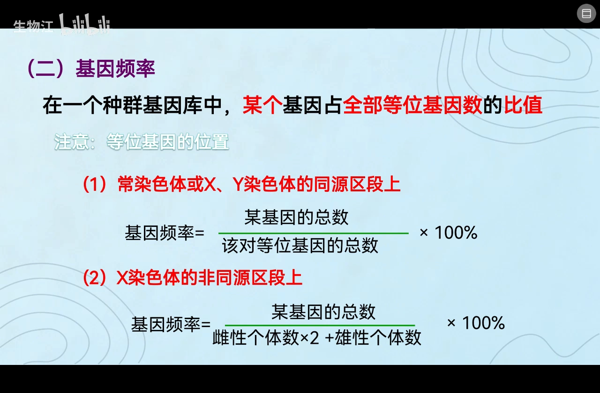
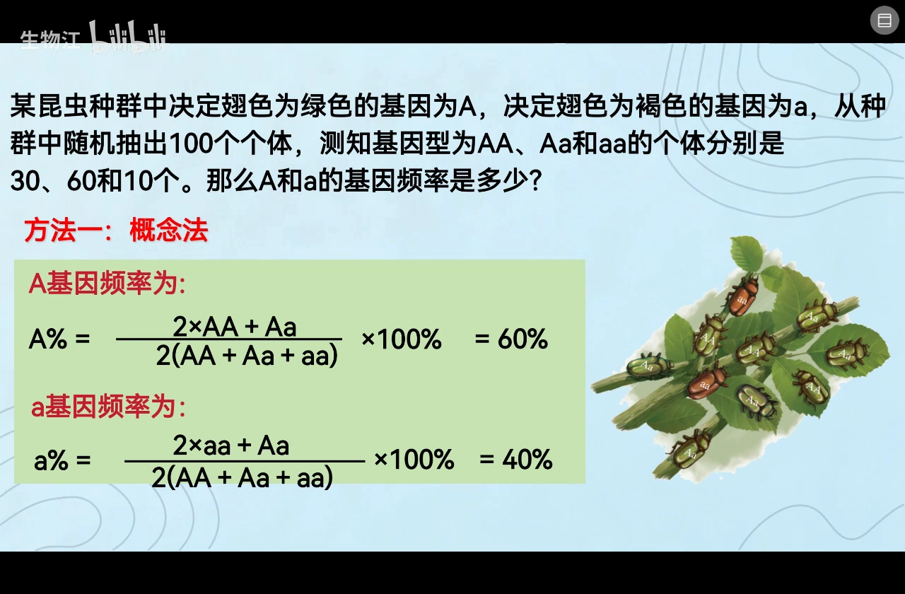
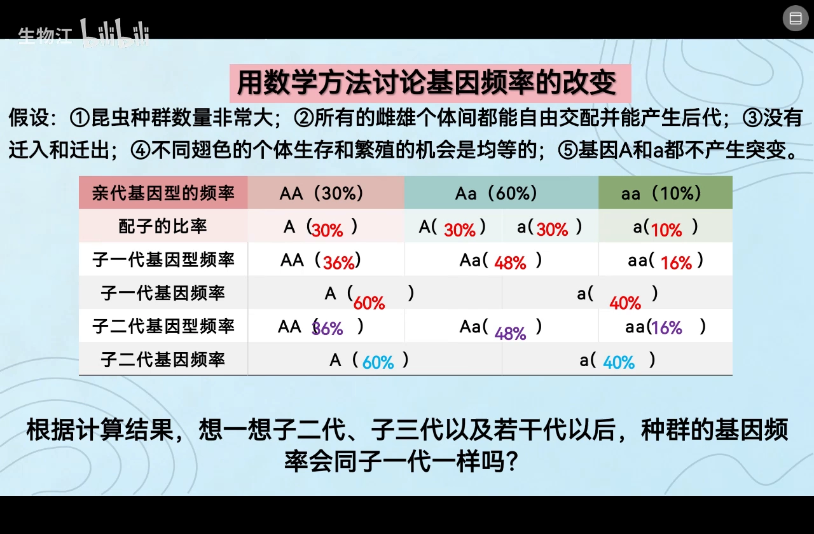
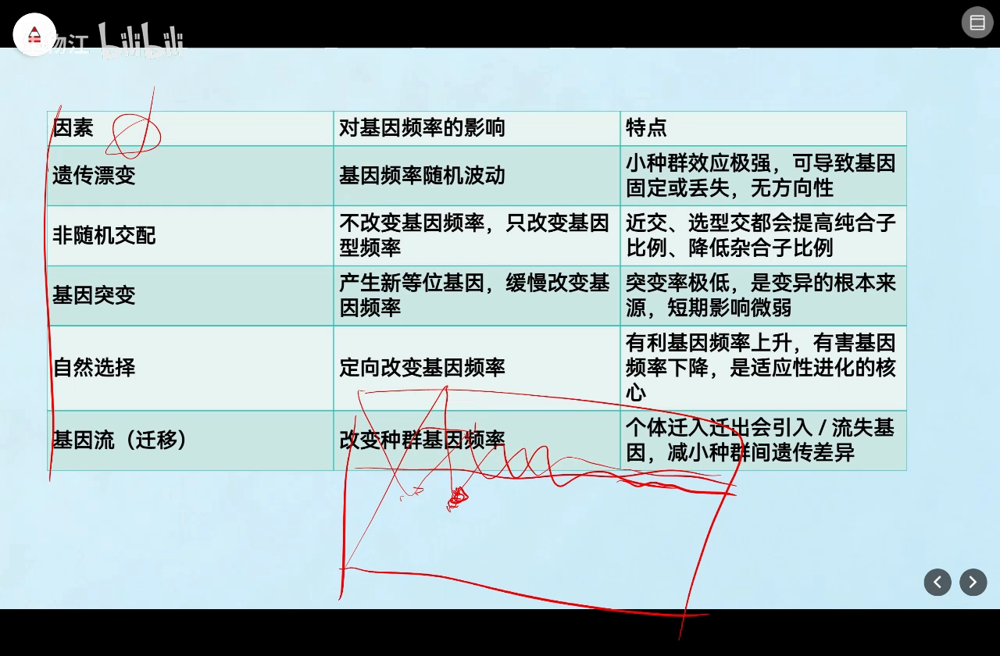
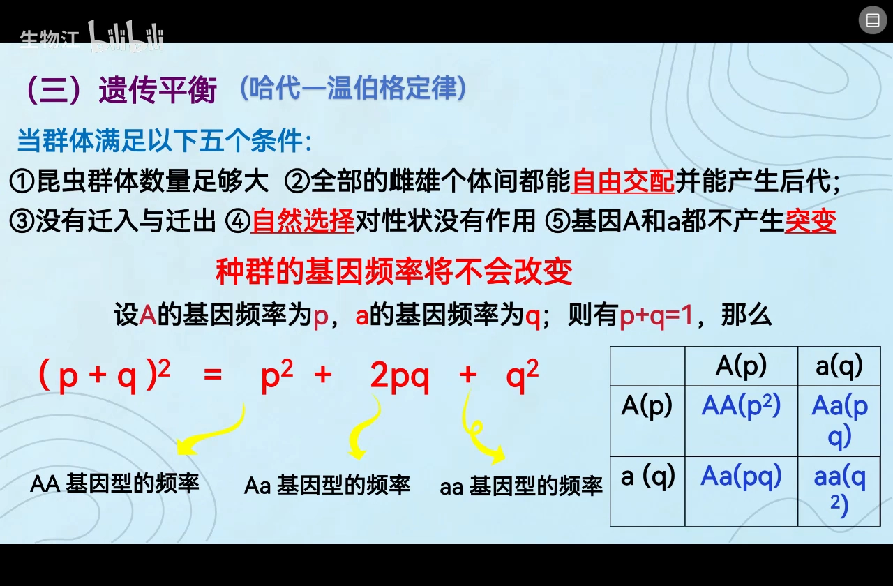

# 基因频率与基因型频率：基因库、X染色体与遗传平衡的算法

> 视频来源：[遗传学—从入门到进阶 第十四课时 群体遗传入门](https://www.bilibili.com/video/BV1N23K6xEUU/)（Bilibili · 生物书院）｜时长约 33 分钟
> 这支视频是面向高中生物的群体遗传入门，前半段（约 0–19 分钟）系统讲了基因库、基因频率的两种算法、基因型频率和哈代-温伯格平衡；后半段转向遗传漂变、瓶颈效应与选择，属于 [§4.1.7](../../../README.md#b02-4-1-7) 与 [§5.1.1](../../../README.md#b02-5-1-1) 的范围，本文不展开。

## 本讲要解决的核心问题（SCQA）

**背景**：在一个基因座上，个体可以是 AA、Aa 或 aa 三种基因型之一；我们已经会读单个个体的基因型。

**冲突**：同一个群体，"基因型的比例"和"等位基因的比例"是两个不同的数；到了 X 染色体上，男性和女性携带的份数还不一样，直接套常染色体公式就会算错。

**疑问**：一个群体的等位基因频率该怎么数？它和基因型频率是什么关系？什么时候会变？

**回答（中心思想）**：等位基因频率是**份数之比**，基因型频率是**个体数之比**，两者通过"每个基因型贡献几份等位基因"换算。只要群体满足哈代-温伯格的五个条件，基因型会在每一代重新组合，但等位基因频率保持不变；反过来，**只改变交配方式（如近交）会改变基因型频率，却不改变等位基因频率**。

## 一、基因库与基因频率：先确定分母

**基因库**（gene pool）是一个种群中全部个体含有的全部基因。它的"大"看的是基因总数，而不是基因的种类数。[【跳转到 00:59】](https://www.bilibili.com/video/BV1N23K6xEUU/?t=59)

**基因频率**是"在一个群体内、相同基因座上不同基因所占的比例"，也就是某个基因占全部等位基因数的比值。[【跳转到 01:54】](https://www.bilibili.com/video/BV1N23K6xEUU/?t=114)

关键在于分母怎么数，而这取决于基因座在染色体上的位置：

- **常染色体或 X、Y 的同源区段**：每个个体都有两份，分母是该对等位基因的总数，也就是 2 × 个体数。
- **X 染色体的非同源区段**：女性有两条 X，男性只有一条 X，所以分母是"女性个体数 × 2 + 男性个体数"。[【跳转到 02:19】](https://www.bilibili.com/video/BV1N23K6xEUU/?t=139)

这个分母的差别，正好对应三个描述个体基因型的词：

| 术语 | 含义 | 例子 |
| --- | --- | --- |
| 纯合子 | 两份等位基因相同 | AA、aa |
| 杂合子 | 两份等位基因不同 | Aa |
| 半合子 | 该基因座只有一份拷贝，谈不上"两份相同或不同" | 男性的 X 非同源区段基因、男性的 Y 染色体基因 |

所以"男性只有一条 X"不是记公式的技巧，而是**半合子**这个状态的直接后果：在 X 非同源区段上，男性只有一份等位基因，分母自然只能算 1。[【跳转到 02:44】](https://www.bilibili.com/video/BV1N23K6xEUU/?t=164)

## 二、两种算法：数份数，或者用基因型频率加权

视频用同一个例子演示了两条路：某昆虫种群中，AA、Aa、aa 的个体分别是 30、60、10 个，求 A 和 a 的基因频率。[【跳转到 03:14】](https://www.bilibili.com/video/BV1N23K6xEUU/?t=194)

**方法一：概念法（直接数份数）**。AA 贡献 2 份 A，Aa 贡献 1 份 A，aa 贡献 0 份：

$$
p_A = \frac{2 \times 30 + 60}{2 \times (30 + 60 + 10)} \times 100\% = 60\%
$$

同理 $p_a = \dfrac{2 \times 10 + 60}{200} = 40\%$。注意分子里的"2 ×"和分母里的"2 ×"是同一个来源：二倍体每个个体两份。[【跳转到 04:29】](https://www.bilibili.com/video/BV1N23K6xEUU/?t=269)

**方法二：基因型频率法（加权平均）**。先把个体数换成基因型频率（30%、60%、10%），再按"每种基因型提供几份"加权：

$$
p_A = 30\% \times 1 + 60\% \times \tfrac{1}{2} = 60\%
$$

两种算法结果一致，因为方法二只是把方法一的分子分母同时除以总个体数。视频还提醒：如果基因座上不止两个等位基因（如 A、a1、a2），那么**所有等位基因频率之和仍为 1**，但"用 1 减去另一个"这种简便算法只在两个等位基因时成立。[【跳转到 05:31】](https://www.bilibili.com/video/BV1N23K6xEUU/?t=331)

## 三、为什么等位基因频率不变：配子法看一代

有了 p 和 q，就可以问：这个群体繁殖若干代以后，频率会不会变？

视频把 30 : 60 : 10 的群体当作亲代，先算它产生的配子比例：AA 全部给 A（30%），Aa 一半给 A（30%），所以配子中 A 占 60%、a 占 40%。然后用雌雄配子随机结合，得到子一代的基因型频率：$0.6^2 = 36\%$、$2 \times 0.6 \times 0.4 = 48\%$、$0.4^2 = 16\%$。[【跳转到 06:40】](https://www.bilibili.com/video/BV1N23K6xEUU/?t=400)

把子一代再算一遍，基因频率仍然是 A 60%、a 40%，子二代也一样。视频对这件事的说法很形象：**基因只是换了个位置**——原来在 AA 里的 A 可能跑到 Aa 里去了，但 A 的总份数没变。[【跳转到 07:30】](https://www.bilibili.com/video/BV1N23K6xEUU/?t=450)

这就是平衡的含义：**基因型频率被"洗"成一个由 p、q 决定的固定比例，之后不再变化；等位基因频率从头到尾不动。**

## 四、基因型频率：另一个分母，另一套变化规律

**基因型频率**是"一个群体内、相同基因座上的不同基因型所占的频率"，分母是**个体数**而不是等位基因份数。[【跳转到 08:15】](https://www.bilibili.com/video/BV1N23K6xEUU/?t=495)

把两个频率放在一起看，就能理解一个容易混淆的现象：**非随机交配会改变基因型频率，却不改变等位基因频率**。因为等位基因还是那么多，只是它们配对的方式变了；近交、选型交配都会**提高纯合子的比例、降低杂合子的比例**。[【跳转到 18:15】](https://www.bilibili.com/video/BV1N23K6xEUU/?t=1095)

这张表把本节要区分的几件事一次摆清楚了：

| 因素 | 对等位基因频率 | 对基因型频率 |
| --- | --- | --- |
| 非随机交配（近交、选型交配） | 不变 | 改变（纯合↑、杂合↓） |
| 突变 | 产生新等位基因，缓慢改变 | 随之改变 |
| 自然选择 | 定向改变 | 随之改变 |
| 基因流（迁移） | 改变 | 随之改变 |
| 遗传漂变 | 随机波动 | 随之波动 |

所以看到"杂合子变少了"不能直接推断"某个等位基因变少了"——这正是本节要建立的区分。

## 五、哈代-温伯格：五个条件与一行推导

视频给出高中阶段使用的五个条件 [【跳转到 08:29】](https://www.bilibili.com/video/BV1N23K6xEUU/?t=509)：

1. 群体数量足够大；
2. 全部雌雄个体间都能自由交配并产生后代；
3. 没有迁入与迁出；
4. 自然选择对性状没有作用；
5. 基因不发生突变。

满足这五条时，种群的基因频率将不会改变。设 A 的频率为 p、a 的频率为 q，则 $p + q = 1$，且 [【跳转到 09:19】](https://www.bilibili.com/video/BV1N23K6xEUU/?t=559)：

$$
(p + q)^2 = p^2 + 2pq + q^2
$$

推导只用两步：两个 p 凑在一起的概率是 $p^2$（AA）；一 p 一 q 有两种顺序，所以是 $2pq$（Aa）；两个 q 凑在一起是 $q^2$（aa）。三者相加为 1。[【跳转到 11:24】](https://www.bilibili.com/video/BV1N23K6xEUU/?t=684)

视频还补了一个常被跳过的前提：这个公式是**二项式的平方**，所以它默认"每个个体在这个基因座上只有两份等位基因"，也就是**二倍体**。如果是三倍体，展开就变成三项的立方，形式完全不同。[【跳转到 09:44】](https://www.bilibili.com/video/BV1N23K6xEUU/?t=584)

## 六、边界：平衡被打破之后

视频后半段（约 19 分钟起）讨论的是打破平衡的因素：遗传漂变（抽样误差）、瓶颈效应与奠基者效应、突变、基因流、自然选择，以及稳定选择、定向选择、分裂选择三种模式。[【跳转到 21:39】](https://www.bilibili.com/video/BV1N23K6xEUU/?t=1299)

这些内容回答的是"频率为什么会变"，属于演化与数量遗传的范围，本文只保留"平衡会被打破"这一句结论：

- 群体小 → 抽样误差放大，频率随机波动（遗传漂变）；
- 有选择 → 频率定向改变；
- 有迁移 → 群体间频率趋同。

具体机制见 [§4.1.7 遗传力与数量遗传基础](../../../README.md#b02-4-1-7) 与 [§5.1.1 遗传变异与自然选择](../../../README.md#b02-5-1-1)。

## 小结

- **基因库**是群体全部基因的总和；**基因频率**数份数，**基因型频率**数个体。
- 分母随基因座位置变化：常染色体是 2 × 个体数；X 非同源区段是女性 × 2 + 男性，因为男性是**半合子**，只有一份。
- 两种算法等价：直接数份数，或用基因型频率加权（纯合贡献 1、杂合贡献 1/2）。
- 平衡状态下，基因型频率被洗成 $p^2 : 2pq : q^2$，等位基因频率保持不变。
- **非随机交配只改基因型频率（纯合↑、杂合↓），不改等位基因频率**；突变、选择、迁移、漂变才会改变等位基因频率。
- 哈代-温伯格公式是二项式平方，隐含"二倍体、每个个体两份等位基因"的前提。

## 关键术语速查

| 术语 | 一句话解释 |
| --- | --- |
| 基因库 | 一个种群中全部个体含有的全部基因 |
| 基因座（locus） | 基因组上某个特定位置；同一基因座上的不同版本叫等位基因 |
| 基因频率 | 某个等位基因的份数占该基因座全部等位基因份数的比例 |
| 基因型频率 | 某种基因型的个体数占群体个体数的比例 |
| 纯合子 / 杂合子 | 两份等位基因相同 / 不同 |
| 半合子 | 该基因座只有一份拷贝（如男性 X 非同源区段），无法构成"两份" |
| 哈代-温伯格平衡 | 五个理想条件下，等位基因频率与基因型频率世代不变的理想状态 |
| 遗传漂变 | 小群体中由抽样误差造成的等位基因频率随机波动 |