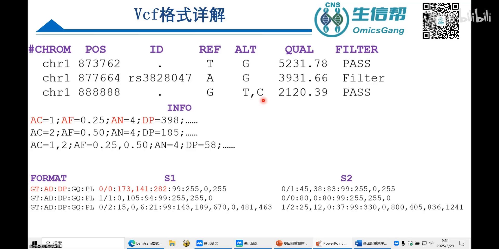
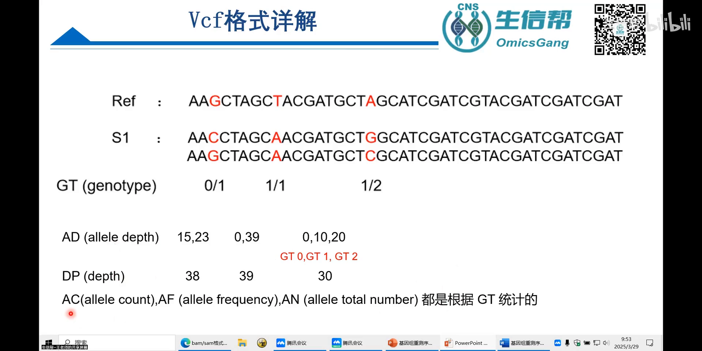

# 测序reads怎么变成基因型：VCF里的AD、DP与0-1、1-1

> 视频来源：[基因组重测序课程系列 Day10：解读VCF文件中的基因突变信息](https://www.bilibili.com/video/BV1JdbJzmE2s/)（Bilibili · 生信帮-OmicsGang）｜时长约 7 分钟
> 这支视频用同一张 VCF 截图讲清了 GT、AD、DP、AC、AF、AN 六个字段的关系。本文只取前 3 分 45 秒的"基因型与深度"部分；后面的 SnpEff 注释、同义/错义/无义分类属于 [§4.2.1](../../../README.md#b02-4-2-1) 的范围，不在本节展开。

## 本讲要解决的核心问题（SCQA）

**背景**：VCF 的一行里既有 REF/ALT，也有每个样本的 `GT:AD:DP`；报告上写的基因型是 `0/1` 或 `1/1`。

**冲突**：测序仪直接产出的是**一条条 reads**，不是"基因型"；而 INFO 里的 `AF` 有时是 0.25、有时是 0.5，看起来像"突变比例"，却又和 reads 数对不上。

**疑问**：reads 是怎么被判定成 `0/1` 或 `1/1` 的？VCF 里的 `AF` 到底是谁的频率？

**回答（中心思想）**：基因型 `GT` 是从**支持参考和支持变异的 reads 条数（AD）**判出来的：两条单倍型不同就是 `0/1`，两条都带变异就是 `1/1`。而 INFO 里的 `AC`、`AF`、`AN` 是**从 GT 统计出来的样本层面计数**，不是 reads 比例。三者分母不同，不能互相替代。

## 一、VCF 一行里的两层信息

VCF 分成两半：前半行是位点层面的信息（CHROM、POS、REF、ALT、QUAL、FILTER、INFO），后半行是样本层面的信息（FORMAT 定义字段顺序，后面每个样本一列）。[【跳转到 00:00】](https://www.bilibili.com/video/BV1JdbJzmE2s/?t=0)

以图中第一行为例：

| 字段 | 例子 | 含义 |
| --- | --- | --- |
| REF / ALT | T / G | 参考碱基是 T，变异碱基是 G |
| INFO 的 AC | 1 | 变异等位基因的份数（allele count） |
| INFO 的 AN | 4 | 该位点所有等位基因的总份数（allele number） |
| INFO 的 AF | 0.25 | AC / AN，即样本层面的等位基因频率 |
| INFO 的 DP | 398 | 该位点的测序深度 |
| FORMAT | GT:AD:DP:GQ:PL | 后面每个样本按这个顺序给值 |
| 样本 S1 | 0/0:173,141:282:… | 基因型 0/0，参考 reads 173、变异 reads 141，总深度 282 |

`DP` 的定义是“这个位置一共有多少条 reads 看过”，按定义应等于 AD 各项之和。不过视频也提醒：这张截图来自真实文件，个别列可能标错，遇到 AD 之和与 DP 对不上时要回头核对，不要直接照抄。[【跳转到 00:25】](https://www.bilibili.com/video/BV1JdbJzmE2s/?t=25)

注意 `AN = 4`：这是因为该行有 2 个样本，每个二倍体样本贡献 2 份等位基因。所以 `AF = AC / AN = 1/4 = 0.25` 是**两个样本合起来的等位基因频率**，不是某个样本的 reads 比例。

## 二、把 GT 读成两条序列：0/1、1/1、1/2

`GT` 里的数字是 ALT 等位基因的编号：`0` 表示参考，`1` 表示第一个 ALT，`2` 表示第二个 ALT。二倍体有两个数字，正好对应**两条单倍型**。[【跳转到 01:15】](https://www.bilibili.com/video/BV1JdbJzmE2s/?t=75)

`1/2` 这种写法只出现在**多等位**位点：同一个位置有两个不同的 ALT，一个样本各带一个。视频在开头就用 `AC=1`、`AC=2` 和 `AC=1,2` 三种 INFO 写法提示了这一点——第三个数字位对应第二个 ALT。[【跳转到 00:50】](https://www.bilibili.com/video/BV1JdbJzmE2s/?t=50)

| GT | 两条单倍型 | 对应的个体状态 |
| --- | --- | --- |
| `0/0` | 参考 + 参考 | 纯合参考 |
| `0/1` | 参考 + 变异 | **杂合**（两条单倍型不同） |
| `1/1` | 变异 + 变异 | **纯合变异** |
| `1/2` | 变异 1 + 变异 2 | 两个不同的变异各占一条（多等位） |

图中 S1 的第一处变异，两条序列分别是 `…C…` 和 `…G…`，所以是 `0/1`；第二处两条都是 `A`（相对参考的 T 都是突变），所以是 `1/1`；第三处两条分别是 `G` 和 `C`，对应两个不同的 ALT，所以是 `1/2`。[【跳转到 01:40】](https://www.bilibili.com/video/BV1JdbJzmE2s/?t=100)

这里"两条单倍型"就是**单倍型**（haplotype）这个词的原始含义：一条染色体上相邻变异的组合。相位（哪几个变异在同一条染色体上）的判定与重组见 [§4.1.6](../../../README.md#b02-4-1-6)，单倍型与替代序列的概念见 [§1.2.2](../../../README.md#b02-1-2-2)。

## 三、AD 与 DP：reads 比例如何支持基因型判定

`AD`（allele depth）是**分别支持每个等位基因的 reads 条数**，顺序是“参考、ALT1、ALT2…”。`DP`（depth）是覆盖该位点的总 reads 数，等于 AD 各项相加。[【跳转到 02:05】](https://www.bilibili.com/video/BV1JdbJzmE2s/?t=125) 换句话说，AD 是“分子”，DP 是“分母”，两者相除才是这个位点的 reads 比例。[【跳转到 02:55】](https://www.bilibili.com/video/BV1JdbJzmE2s/?t=175)

视频用三处变异对照，正好把“reads 比例 → 基因型”这条链条走了一遍 [【跳转到 02:30】](https://www.bilibili.com/video/BV1JdbJzmE2s/?t=150)：

| 位点 | AD | DP | reads 比例 | GT | 读法 |
| --- | --- | --- | --- | --- | --- |
| 第一处 | 15, 23 | 38 | 变异占 23/38 ≈ 61% | `0/1` | 参考与变异各占一半左右 → 杂合 |
| 第二处 | 0, 39 | 39 | 变异占 39/39 = 100% | `1/1` | 完全没有参考 reads → 纯合变异 |
| 第三处 | 0, 10, 20 | 30 | 两个 ALT 分别占 33%、67% | `1/2` | 没有参考 reads，两个 ALT 各占一部分 → 两个不同变异 |

视频还顺手指出一个易错点：AD 的两项在真正的杂合位点上应该大致相等（它举的例子是 173 和 141），如果看到“一半支持参考、一半支持突变”却被标成别的基因型，那多半是表格或标注有问题，要回头核对。[【跳转到 02:05】](https://www.bilibili.com/video/BV1JdbJzmE2s/?t=125)

**这个"支持变异的 reads 数 / 总 reads 数"的比例，在变异检测里通常叫 VAF（variant allele fraction，变异等位基因分数）**。它和 GT 的关系是：

- 胚系杂合位点：VAF 理论上是 50%，实测会因测序深度、比对偏差、拷贝数变化而在 50% 附近波动；
- 胚系纯合变异：VAF 接近 100%；
- 肿瘤等体细胞样本：VAF 可以很低（比如 5%），因为只有一部分细胞携带这个变异。

所以"VAF 低"不等于"基因型是杂合"，"VAF 是 50%"也不等于"一定是胚系杂合"——它首先是一个**测量量**，基因型是**判定结果**。

## 四、三种"频率"必须分开

到这里可以把本节要区分的东西并排放在一起：

| 名称 | 分子 / 分母 | 层次 | 会不会随测序深度变化 |
| --- | --- | --- | --- |
| reads 比例（VAF） | 支持变异的 reads / 覆盖该位点的总 reads | 单个样本、单个位点的测量 | 会（深度、偏差、细胞比例都影响） |
| 样本基因型频率 | 某基因型的个体数 / 样本个体数 | 一批样本 | 不会 |
| 群体等位基因频率（如 INFO 的 AF） | AC / AN，由各样本 GT 统计 | 群体或队列 | 不会（但受抽样影响） |

视频对最后一行的表述很明确：`AC`、`AF`、`AN` **都是根据 GT 统计的**，`AC` 是突变的 allele 数量，`AN` 是所有能检测到的位点的 allele 数量，`AC` 除以 `AN` 就是频率。[【跳转到 03:20】](https://www.bilibili.com/video/BV1JdbJzmE2s/?t=200)

这句话是本节最重要的一条分界线：**VCF 的 AF 不是 reads 比例**。它是先把每个样本的 reads 判成 GT，再在样本/队列层面数等位基因得到的。所以同一个位点上，`AF` 可能正好是 0.25（2 个样本里 1 份 ALT），而某个样本内部的 VAF 可能是 60%——两个数字都对，只是分母不同。

## 五、边界：注释部分不在这里展开

视频后 4 分钟转向"拿到 VCF 之后怎么注释"：需要参考基因组的 GFF/GTF 注释文件，按非编码区（UTR、内含子、upstream、downstream、基因间区）和编码区（CDS、splice 区域）分类，再区分同义、错义（missense）、无义（nonsense）。[【跳转到 04:10】](https://www.bilibili.com/video/BV1JdbJzmE2s/?t=250)

这部分回答的是"这个变异改变了蛋白的什么"，属于编码区变异的功能后果，见 [§4.2.1](../../../README.md#b02-4-2-1)；变异致病性判读见 [§4.2.6](../../../README.md#b02-4-2-6)。本节只保留"GT 由 reads 判定、AF 由 GT 统计"这一条链。

## 小结

- VCF 一行分两层：位点层的 INFO（AC、AF、AN、DP）和样本层的 FORMAT（GT:AD:DP:GQ:PL）。
- `GT` 的两个数字对应**两条单倍型**：`0/1` 是杂合，`1/1` 是纯合变异，`1/2` 是两个不同变异各占一条。
- `AD` 是支持各等位基因的 reads 条数，`DP` 是总深度；**reads 比例（VAF）是测量量，GT 是判定结果**。
- VCF 的 `AF = AC / AN` 是**由 GT 统计出来的等位基因频率**，不是 reads 比例；两者分母不同，不能互换。
- 注释与功能后果（同义/错义/无义）不在本节范围。

## 关键术语速查

| 术语 | 一句话解释 |
| --- | --- |
| GT（genotype） | 样本在该位点的基因型，用 ALT 编号表示，如 0/1、1/1、1/2 |
| AD（allele depth） | 分别支持参考和各 ALT 的 reads 条数 |
| DP（depth） | 覆盖该位点的总 reads 条数，等于 AD 各项之和 |
| VAF（variant allele fraction） | 支持变异的 reads 数除以总 reads 数，是测量出来的比例 |
| AC / AN / AF | 变异等位基因份数 / 全部等位基因份数 / 两者之比，均由 GT 统计 |
| 单倍型（haplotype） | 一条染色体上若干相邻变异的组合；二倍体的 GT 两个数字就是两条单倍型 |
| 杂合 / 纯合变异 | 两条单倍型不同（0/1）/ 两条都带同一变异（1/1） |