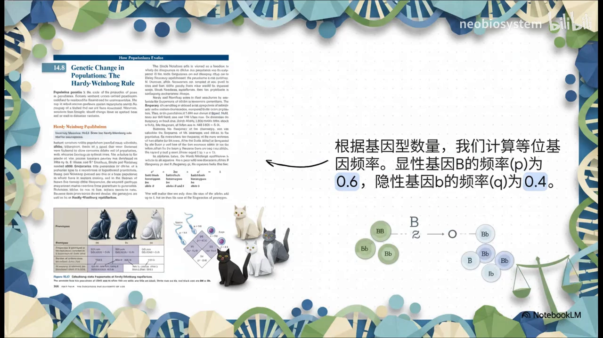
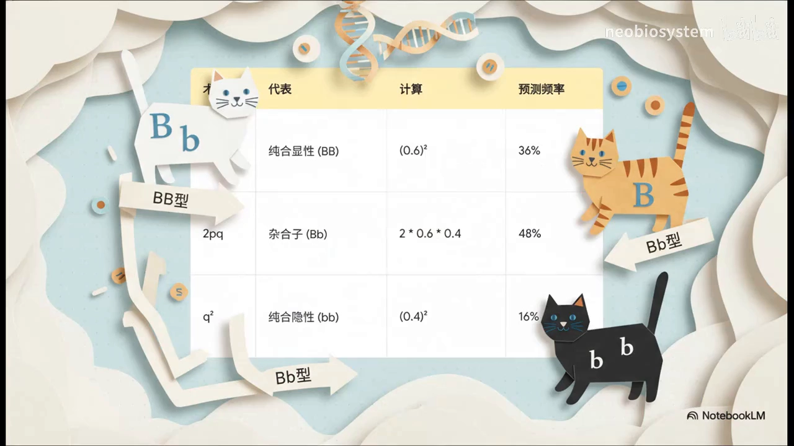
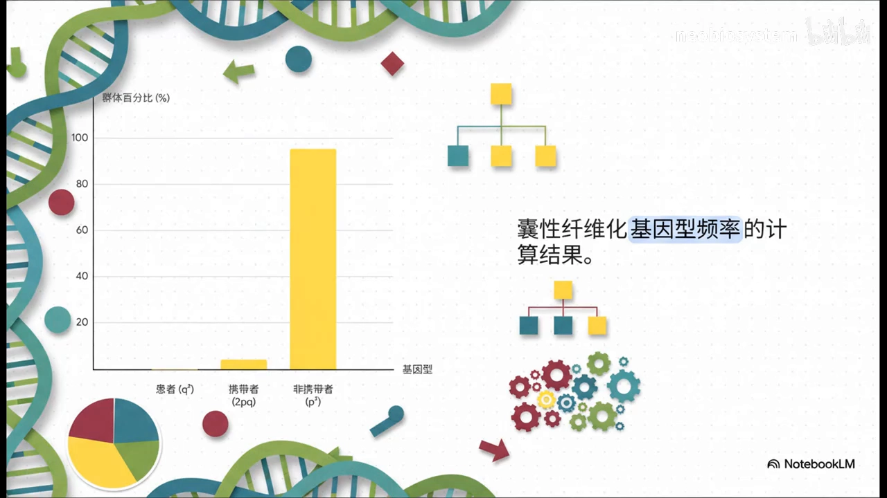
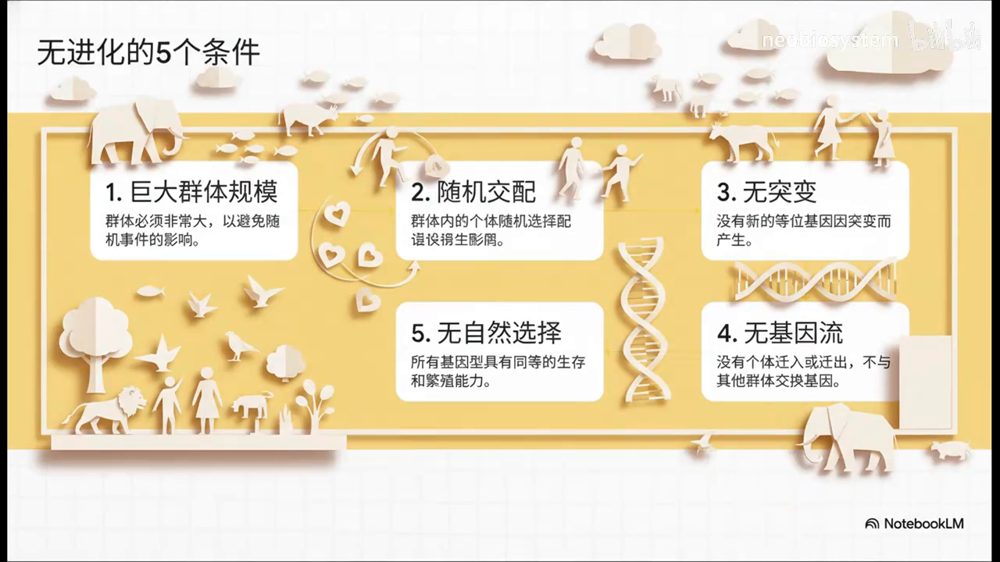
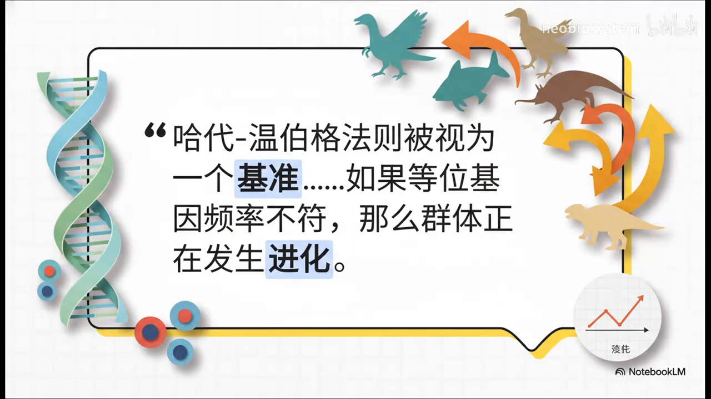

# 隐性性状为什么没被显性挤掉：哈代-温伯格平衡的直觉与五个条件

> 视频来源：[哈代-温伯格法则：群体的遗传平衡](https://www.bilibili.com/video/BV1bKFHzZEdr/)（Bilibili · neobiosystem）｜时长约 11 分钟
> 这支视频用"黑猫白猫"和"囊性纤维化"两个算例，把等位基因频率、基因型频率和哈代-温伯格公式串起来，适合第一次建立群体层面的直觉。本文只取群体频率与平衡这一条线；显性/隐性的个体层面机制见 [§4.1.5](../../../README.md#b02-4-1-5)。

## 本讲要解决的核心问题（SCQA）

**背景**：黑毛由显性基因 B 决定，白毛由隐性基因 b 决定；白猫的基因型只能是 bb，黑猫可以是 BB 或 Bb。

**冲突**：如果显性基因"更强大"，那黑猫应该越来越多、白猫应该被逐渐挤掉；但现实里白猫、以及人类的许多隐性性状都还在。

**疑问**：隐性等位基因靠什么在群体里存活下来？

**回答（中心思想）**：因为**显性讲的是个体身上哪个性状表现出来，而群体里留存多少，看的是等位基因的计数**。杂合子 Bb 表型是黑猫，却照样携带一份 b；只要交配随机、没有选择，b 在基因库里的比例就可以一代代保持不变。哈代-温伯格平衡就是描述这种"基因型在重排、等位基因频率却不动"的状态。

## 一、先换一个观察单位：从个体换到基因库

孟德尔遗传关心的是"一个个体怎么把基因传下去"。群体遗传学换了一个单位：把一片森林里所有的兔子、或者一个城市里所有的人看作一个整体，想象成一个巨大的**基因库**（gene pool）——所有个体的所有等位基因倒在一起的那个池子。它最关心的是池子里各种基因的**比例**，也就是频率，怎么随世代变化。[【跳转到 01:08】](https://www.bilibili.com/video/BV1bKFHzZEdr/?t=68)

这个"罐子抓球"的图像很关键：下一代不是把父母的基因型整体复制过去，而是从池子里各抓一个等位基因、重新配成一对。所以**基因型可以每一代都重新组合，等位基因的总账却可以不变**。

这里要区分两个频率，它们的分母不同：

| 名称 | 分子 | 分母 | 回答的问题 |
| --- | --- | --- | --- |
| 等位基因频率（p、q） | 某一种等位基因的份数 | 该基因座上所有等位基因的总份数 | 池子里 B 和 b 各占多少 |
| 基因型频率 | 某一种基因型的个体数 | 个体总数 | 群体里 BB、Bb、bb 各占多少 |

在二倍体常染色体上，每个个体贡献两份等位基因，所以"个体数"和"等位基因份数"差一个因子 2。这个差别是后面所有计算的来源。

## 二、哈代-温伯格公式：两组数字，一条恒等式

法则的数学表达只有两行 [【跳转到 02:21】](https://www.bilibili.com/video/BV1bKFHzZEdr/?t=141)：

$$
p + q = 1
$$

$$
p^2 + 2pq + q^2 = 1
$$

第一行说的是**等位基因频率**：设 p 是显性等位基因的频率、q 是隐性等位基因的频率，两者加起来必然是 100%，也就是 1。

第二行说的是**基因型频率**：把 p、q 当成"抓球时抓到 B 或 b 的概率"，两次独立抓球就会出现三种组合 [【跳转到 02:26】](https://www.bilibili.com/video/BV1bKFHzZEdr/?t=146)：

- $p^2$：两次都抓到 B → 纯合显性，比如 BB；
- $2pq$：一次 B 一次 b → 杂合子，比如 Bb（"先 B 后 b"和"先 b 后 B"两种顺序都要算）；
- $q^2$：两次都抓到 b → 纯合隐性，比如 bb。

注意第二行不是新的生物学定律，它就是 $(p+q)^2$ 展开。所以只要"随机抓两个球"这个前提成立，基因型频率就被等位基因频率完全决定了。

## 三、猫的例子：从基因型数回算等位基因频率

视频给了一个 1000 只猫的群体：360 只纯黑（BB）、480 只带隐性基因的黑猫（Bb）、160 只白猫（bb）。[【跳转到 03:56】](https://www.bilibili.com/video/BV1bKFHzZEdr/?t=236)

第一步是**数等位基因**，而不是数个体。1000 只猫共有 2000 个等位基因：

- B 的份数 = 360 只 BB × 2 + 480 只 Bb × 1 = 720 + 480 = 1200；
- 所以 $p = 1200 / 2000 = 0.6$；
- b 的份数就是剩下的 800，$q = 0.4$，且 $0.6 + 0.4 = 1$。[【跳转到 04:20】](https://www.bilibili.com/video/BV1bKFHzZEdr/?t=260)

第二步是**用 p、q 预测下一代**。把 0.6 和 0.4 代进公式 [【跳转到 04:55】](https://www.bilibili.com/video/BV1bKFHzZEdr/?t=295)：

| 基因型 | 公式 | 计算 | 预测频率 |
| --- | --- | --- | --- |
| 纯合显性 BB | $p^2$ | $0.6 \times 0.6$ | 36% |
| 杂合子 Bb | $2pq$ | $2 \times 0.6 \times 0.4$ | 48% |
| 纯合隐性 bb | $q^2$ | $0.4 \times 0.4$ | 16% |

预测结果和一开始观察到的 360 : 480 : 160（也就是 36% : 48% : 16%）完全一致——这说明这个猫群正好处在平衡状态。**"平衡"不等于"没有变化"，而是基因型比例已经稳定在一个由 p、q 决定的不动点上**。[【跳转到 05:45】](https://www.bilibili.com/video/BV1bKFHzZEdr/?t=345)

## 四、最有用的推论：隐性致病基因的携带者有多少

哈代-温伯格在医学里最常见的用法，是估算"看不见的携带者"。以囊性纤维化为例：它是隐性遗传病，患者是纯合隐性，症状明显，所以患者数量容易统计；难的是**表型正常但携带一份致病等位基因的人有多少**。[【跳转到 06:29】](https://www.bilibili.com/video/BV1bKFHzZEdr/?t=389)

视频给出北美白人群体中该隐性等位基因的频率 $q \approx 0.022$，于是 [【跳转到 07:00】](https://www.bilibili.com/video/BV1bKFHzZEdr/?t=420)：

- 患者频率 $q^2 = 0.022^2 \approx 0.00048$，约 0.048%；
- 携带者频率 $2pq$：因为 $p \approx 0.978$，所以 $2 \times 0.978 \times 0.022 \approx 0.043$，约 4.3%。

换算成人数就是：大约每 2083 人里有一个患者，但每 23 人里就有一个携带者。[【跳转到 07:54】](https://www.bilibili.com/video/BV1bKFHzZEdr/?t=474)

这张图正好回答了开头的疑问：**隐性等位基因主要藏在杂合子里**。只要杂合子不被选择掉，隐性等位基因就不会因为"隐性"而消失。也正因为 $2pq$ 远大于 $q^2$，携带者筛查的信息量比只数患者大得多。

## 五、五个条件与"基准线"的用法

要让群体一直停在这个平衡里，需要五个条件 [【跳转到 09:10】](https://www.bilibili.com/video/BV1bKFHzZEdr/?t=550)：

1. 群体足够大，避免运气造成的随机波动；
2. 交配完全随机；
3. 没有新的突变产生；
4. 没有迁入迁出，也就是没有基因交流；
5. 没有自然选择，各基因型的生存与繁殖能力相同。

现实里这五条几乎不可能同时满足：种群大小有限、交配会挑对象、突变一直在发生、迁徙是常态、选择无处不在。所以这个法则真正的用法不是"证明群体没进化"，而是把它当**基准线**：[【跳转到 08:25】](https://www.bilibili.com/video/BV1bKFHzZEdr/?t=505)

测一个真实群体的等位基因频率，用公式预测下一代，如果实测值和预测值对不上，就说明有某个条件被打破了——而群体等位基因频率的世代改变，正是进化的定义。[【跳转到 08:46】](https://www.bilibili.com/video/BV1bKFHzZEdr/?t=526)

## 小结

- 群体遗传学把观察单位从个体换成**基因库**，关心的是池子里各种等位基因的比例。
- **等位基因频率**数的是等位基因份数，**基因型频率**数的是个体；二倍体常染色体上每个个体贡献两份等位基因。
- 哈代-温伯格公式 $p^2 + 2pq + q^2 = 1$ 就是 $(p+q)^2$ 的展开，前提是随机抓两个等位基因配成一对。
- 隐性等位基因藏在杂合子里，所以 $2pq$ 通常远大于 $q^2$，隐性病携带者远多于患者。
- 五个条件（大群体、随机交配、无突变、无基因流、无自然选择）在现实中很难同时成立，因此这个法则是**基准线**而不是现实描述。

## 关键术语速查

| 术语 | 一句话解释 |
| --- | --- |
| 基因库（gene pool） | 一个群体中所有个体携带的全部等位基因的总和 |
| 等位基因频率（p、q） | 某个等位基因的份数占该基因座全部等位基因份数的比例 |
| 基因型频率 | 某种基因型（如 BB、Bb、bb）的个体占群体个体的比例 |
| 纯合子 | 同一基因座上两份等位基因相同（BB 或 bb） |
| 杂合子 | 同一基因座上两份等位基因不同（Bb） |
| 携带者 | 表型正常但带有一份隐性致病等位基因的杂合子 |
| 哈代-温伯格平衡 | 在五个理想条件下，等位基因频率与基因型频率世代不变的理想状态 |