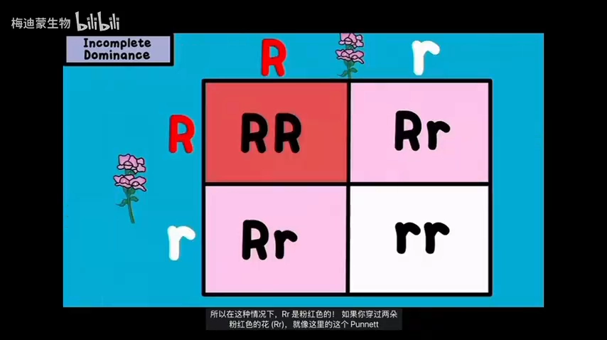
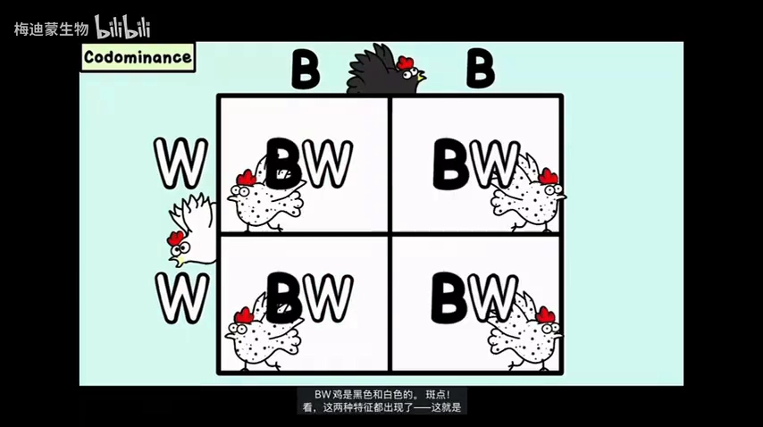
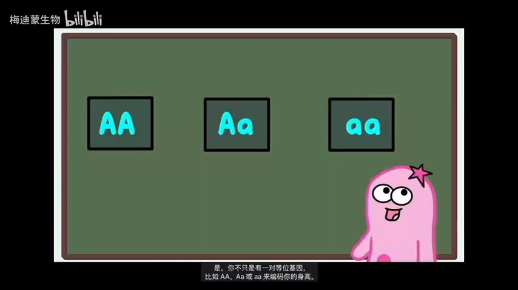
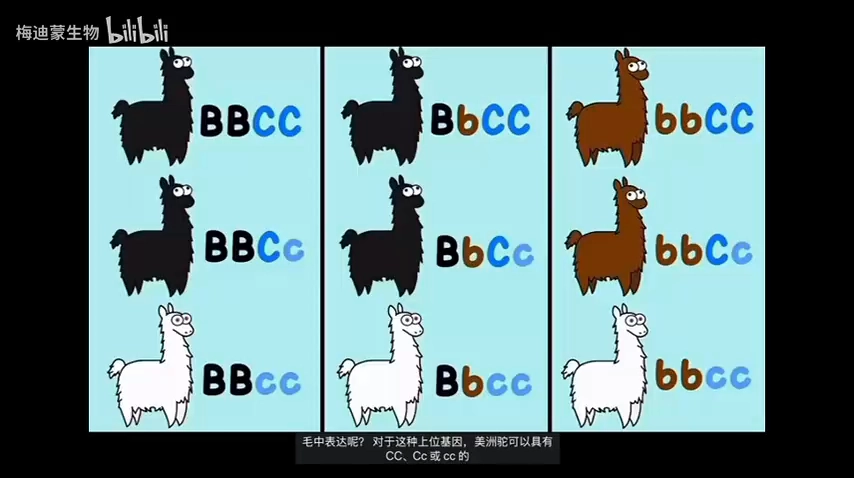

# 不完全显性、共显性与多基因性状：孟德尔规则之外的三种情形

> 视频来源：[不完全显性、共显性、多基因性状和上位性](https://www.bilibili.com/video/BV1XJQqBRE8g/)（B 站 · 梅迪蒙生物）｜时长约 7 分钟
>
> 导读：本文把「一个基因、两个版本、显性盖隐性」这条最简单的规则往前推一步：有时杂合子落在两个纯合子中间（不完全显性），有时两个版本同时表达（共显性），有时一个性状由许多基因共同决定（多基因性状），还有时一个基因能不能表达要看另一个基因（上位性）。本文只讲这四种情形与「不要默认孟德尔模式」的判读边界；连锁与单倍型、遗传力不在本文范围。

## 本讲要解决的核心问题（SCQA）

**背景**：孟德尔式的性状很好算：一个大写显性等位基因在场，显性性状就显现；两个都是隐性版本，隐性性状才显现。

**冲突**：但龙胆花有红、白、粉三种颜色，斑点鸡的羽毛黑白相间，人的身高和肤色既不像「高/矮」两档，也不像由一对基因决定。这些性状都不按「显性盖隐性」出牌。

**疑问**：孟德尔规则之外，到底有哪几种常见的遗传方式？遇到一个不按两档分布的性状，该怎么判断？

**回答（中心思想）**：至少有四条岔路。**不完全显性**让杂合子呈现中间表型；**共显性**让两个等位基因的产物同时出现；**多基因性状**由许多基因累加决定，并受环境影响；**上位性**让一个基因的表达依赖另一个基因。看到性状不按 3∶1 或 1∶2∶1 的简单比例分布时，先别套孟德尔模式，先问「是不是这四条之一」。

## 一、不完全显性：杂合子落在两个纯合子中间

先复习孟德尔式的对照。以仓鼠毛为例，显性等位基因用大写 H 表示，有 H 就有毛；两个都是隐性版本 hh 时才无毛。这是标准的孟德尔性状。[【跳转到 00:15】](https://www.bilibili.com/video/BV1XJQqBRE8g/?t=15)

龙胆花不是这样。它的花色可以出现三种表型：红色、白色，以及介于两者之间的粉色。[【跳转到 00:59】](https://www.bilibili.com/video/BV1XJQqBRE8g/?t=59)

- 红色纯合子记为 RR，白色纯合子记为 rr。
- 两者杂交，后代是 Rr。
- 如果按孟德尔式完全显性，Rr 应该和 RR 一样是红色。
- 实际却是**粉色**：显性等位基因没有完全表达，当隐性等位基因存在时，没有明显的显性效应。[【跳转到 01:20】](https://www.bilibili.com/video/BV1XJQqBRE8g/?t=80)

这就是**不完全显性**（incomplete dominance）：杂合子的表型是两个纯合子的中间态。

把两株粉色花（Rr × Rr）杂交，棋盘图会给出三种结果：RR 红色、Rr 粉色、rr 白色。[【跳转到 01:43】](https://www.bilibili.com/video/BV1XJQqBRE8g/?t=103)

注意这里的比例：表型比例是 1 红∶2 粉∶1 白，**和基因型比例一致**。这正是「不完全显性」最好用的判据——表型不再把两种基因型合并成一种，杂合子自己成了一个可观察的类别。

## 二、共显性：两个等位基因的产物同时出现

共显性（codominance）常和不完全显性混在一起。视频给了一个好记的词根：前缀 co- 就是「共同」，两个等位基因共同发挥作用。[【跳转到 01:53】](https://www.bilibili.com/video/BV1XJQqBRE8g/?t=113)

鸡的羽毛颜色是共显性的例子。用 BB 表示黑色母鸡、WW 表示白色母鸡，两者杂交的后代是 BW，羽毛呈现黑白相间的斑驳，两种颜色都看得见。[【跳转到 02:18】](https://www.bilibili.com/video/BV1XJQqBRE8g/?t=138)

两者的区别可以压成一句话：

| 情形 | 杂合子表现 | 直观判断 |
| --- | --- | --- |
| 不完全显性 | 两个纯合子的**中间态**（红 + 白 → 粉） | 颜色被「调」出了一个新档位 |
| 共显性 | 两个等位基因的产物**同时出现**（黑 + 白 → 黑白斑驳） | 两种颜色都在，只是分布在不同区域 |

视频还提醒：不同课堂对这两种情形使用不同的字母格式——有人给不完全显性用完全不同的字母，有人给共显性用上标。格式不重要，核心概念只有两条：**不完全显性是「一个等位基因不完全支配另一个」，共显性是「所有等位基因都表达」。**[【跳转到 02:45】](https://www.bilibili.com/video/BV1XJQqBRE8g/?t=165)

## 三、多基因性状：身高和肤色由许多基因共同决定

身高不是由单一基因决定的。视频用家族里的身高差异说明：身高由许多基因共同决定，每个基因从父母各继承一个等位基因，所有基因共同作用，才得到最终的身高。[【跳转到 03:26】](https://www.bilibili.com/video/BV1XJQqBRE8g/?t=206)

一个简化的基因型可以写成 AaBbCc……：不是「大 A 一个等位基因决定身高」，而是许多对基因各贡献一点，再累加起来。[【跳转到 03:36】](https://www.bilibili.com/video/BV1XJQqBRE8g/?t=216)

肤色同样由多个基因决定。这类「许多基因编码单一性状」的情形就叫**多基因性状**（polygenic trait）。[【跳转到 04:01】](https://www.bilibili.com/video/BV1XJQqBRE8g/?t=241)

多基因性状还有一个孟德尔式性状没有的维度：**环境**。成长期的营养会影响身高，长时间暴露在阳光下会影响肤色。[【跳转到 04:15】](https://www.bilibili.com/video/BV1XJQqBRE8g/?t=255) 但视频强调，环境改变的是这个性状的表现，并不改变它的遗传基础。[【跳转到 04:25】](https://www.bilibili.com/video/BV1XJQqBRE8g/?t=265)

这带来一个判读上的后果：多基因性状在人群里通常呈连续分布，而不是「有病/没病」两档。看到连续变化的数量性状，就不该拿一对基因的 3∶1 比例去套。

## 四、上位性：一个基因能不能表达，取决于另一个基因

最后一种情形是**上位性**（epistasis）：一个基因完全依赖另一个基因才能表达。[【跳转到 04:35】](https://www.bilibili.com/video/BV1XJQqBRE8g/?t=275)

视频用羊驼毛色举例：

- B 基因决定颜色：BB 或 Bb 是黑色毛发，bb 是棕色毛发。
- C 基因决定色素**是否产生**：CC 或 Cc 可以产生色素，cc 则完全不能产生色素。
- 如果一只羊驼是 cc，那么无论它的 B 基因是 BB、Bb 还是 bb，毛色基因都无法表达，个体表现为白化——完全不产生色素。[【跳转到 05:14】](https://www.bilibili.com/video/BV1XJQqBRE8g/?t=314)

因为涉及两个基因，这类杂交要用 16 格的双因子棋盘来分析。16 格的读法建立在**自由组合**上：每一对基因在形成配子时各自分离，两对基因再相互独立地组合，于是双杂合个体能产生四种配子，棋盘才有 4 × 4 格。结果不是简单的「黑∶棕 = 3∶1」，而是「有色的黑、有色的棕、以及无色白化」三组，比例取决于两个基因如何组合。[【跳转到 05:48】](https://www.bilibili.com/video/BV1XJQqBRE8g/?t=348)

需要说明的是，自由组合只适用于两个基因座位于不同染色体、或同一染色体上相距很远的情形；如果两个基因座靠得很近，配子组合会被连锁打破，这部分留到 [§4.1.6 连锁与单倍型](../../../README.md#b02-4-1-6)。

上位性与前面几种情形的区别在于：不完全显性和共显性讲的是**同一个基因座上两个版本**如何共同表现；上位性讲的是**两个不同基因座**之间的依赖——一个基因的效应被另一个基因「关掉」了。

## 五、判读边界：不要默认孟德尔模式

视频最后给了一条很实用的提醒：在遗传学问题里，**不要一上来就假设是孟德尔遗传模式**，除非题目提供了相应信息或线索。[【跳转到 06:28】](https://www.bilibili.com/video/BV1XJQqBRE8g/?t=388)

把这条提醒展开成三个检查动作：

1. **看表型档位**：只有两档、且杂合子与显性纯合子无法区分 → 先按完全显性；出现稳定的中间档 → 考虑不完全显性；两种表型同时出现 → 考虑共显性。
2. **看比例**：1∶2∶1 的表型比例提示杂合子可辨认；16 格出现「某类完全消失」提示上位性；连续分布提示多基因性状。
3. **看环境**：同一基因型在不同环境下表型不同，说明这个性状有环境成分，不能只用基因型推断表型。

## 小结

- **不完全显性**：杂合子表现为两个纯合子的中间态，表型比例与基因型比例一致（1∶2∶1）。
- **共显性**：两个等位基因的产物同时表达，杂合子身上两种性状都看得见。
- **多基因性状**：许多基因各贡献一点、累加决定一个性状，常呈连续分布，并受环境影响。
- **上位性**：一个基因的效应依赖另一个基因，后者可以把前者「关掉」，双因子杂交出现非 3∶1 的组合。
- 遇到不按简单比例分布的性状，先怀疑这四种情形，再决定用哪套规则。

## 关键术语速查

| 术语 | 一句话解释 |
| --- | --- |
| 不完全显性 | 杂合子表型介于两个纯合子之间，显性等位基因没有完全表达 |
| 共显性 | 两个等位基因的产物同时表现，谁也不盖住谁 |
| 多基因性状 | 由许多基因共同决定、每个基因贡献较小的性状 |
| 上位性 | 一个基因的表达或效应依赖另一个基因 |
| 白化 | 色素基因被上位基因关闭、完全不产生色素的表现 |

## 边界与下一步

- 本文只讲单基因座的显性关系、多基因性状与上位性。**两个基因座在染色体上的位置关系**（自由组合、连锁、重组率）见 [§4.1.6 连锁与单倍型](../../../README.md#b02-4-1-6)。
- **遗传力、加性效应与遗传相关**——也就是「一个性状有多少变异能被遗传解释」——见 [§4.1.7 遗传力与数量遗传基础](../../../README.md#b02-4-1-7)，本文不展开。
- 单基因性状的显性、隐性与家系判读，见本节[《显性、隐性与分离》](显性、隐性与分离：从王室血友病读懂孟德尔的成对因子.md)。
- 「有致病基因型却不一定发病」与「同一基因型症状轻重不同」，见本节[《外显率与表现度》](外显率与表现度：同一基因型为什么有人发病有人很轻.md)。