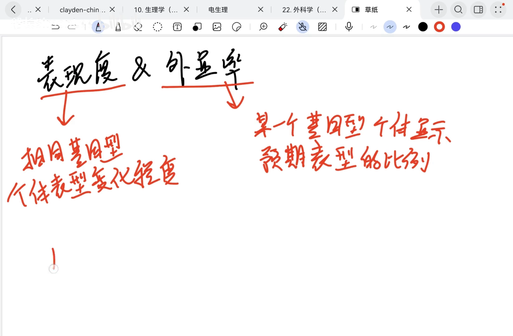
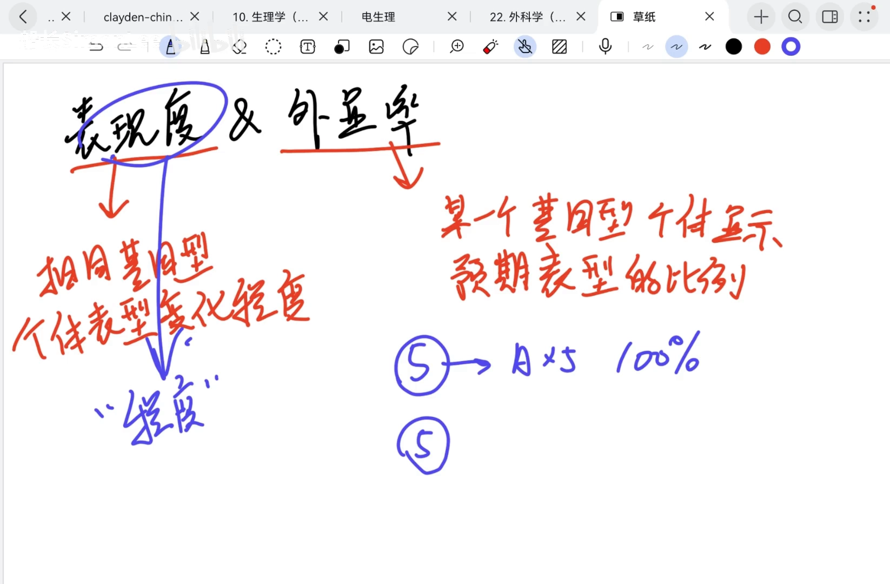

# 外显率与表现度：同一基因型为什么有人发病、有人很轻

> 视频来源：[（遗传学）表现度和外显率](https://www.bilibili.com/video/BV1PLPLeXEZP/)（B 站 · 遗传学速成）｜时长约 3 分钟
>
> 导读：本文只做一件事：把「外显率」和「表现度」这两个容易混的词分开。前者回答「携带这个基因型的人里，有多少真的表现出预期表型」，后者回答「表现出来的人里，症状有多重」。两者都不改变基因型本身，但会改变我们读家系和读基因型的方式。

## 本讲要解决的核心问题（SCQA）

**背景**：在单基因遗传里，我们习惯用「有致病基因型 → 发病」来推家系：两个携带者生出患儿，患者的孩子有一半风险。

**冲突**：现实里常出现两种对不上的情况。第一，同样携带一个致病突变，五个人里只有三个人出现症状；第二，同样携带这个突变并且都出现了症状，有人只是轻度视力下降，有人却严重到影响生活。前者让「携带者」不再等于「一定发病」，后者让「发病」不再是一个非黑即白的档位。

**疑问**：这两种「基因型相同、表型不同」的情形，该怎么分别描述和计算？

**回答（中心思想）**：用两个不同的量。**外显率**（penetrance）是「某一基因型的个体中，显示出预期表型的比例」——它是一个**多少**的问题。**表现度**（expressivity）是「相同基因型的个体之间，表型变化的程度」——它是一个**轻重**的问题。两者可以同时存在：一个突变可能外显率只有 60%，而外显的那 60% 里表现度又从轻到重不等。

## 一、表现度：相同基因型下，表型变化的程度

视频给的定义是：**表现度指相同基因型个体之间，表型变化的程度。**[【跳转到 00:00】](https://www.bilibili.com/video/BV1PLPLeXEZP/?t=0)

它举的例子是一个能引起视力问题的基因突变。携带同一个突变的人，视力问题可以是轻度的，也可以是重度的。[【跳转到 00:50】](https://www.bilibili.com/video/BV1PLPLeXEZP/?t=50)

这里要抓住的词是**程度**。表现度描述的不是「有没有病」，而是「病到什么程度」：[【跳转到 01:15】](https://www.bilibili.com/video/BV1PLPLeXEZP/?t=75)

- 轻度视力问题 → 表现度较轻。
- 重度视力问题 → 表现度较重。
- 两者基因型相同，差别在表型的表现程度。

## 二、外显率：携带该基因型的人里，出现预期表型的比例

外显率的定义是：**某一个基因、某一个基因型的个体，显示出预期表型的比例。**[【跳转到 00:25】](https://www.bilibili.com/video/BV1PLPLeXEZP/?t=25)

视频用一个具体数字把它算出来：

- 假设有五个人都发生了同一种基因突变。
- 如果五个人全都显示出预期性状，外显率就是 **100%**。
- 如果五个人里只有三个人显示出该性状，外显率就是 **3 ÷ 5 = 60%**。[【跳转到 01:40】](https://www.bilibili.com/video/BV1PLPLeXEZP/?t=100)

这里要抓住的词是**多少**。外显率不关心症状轻重，只关心「有没有达到预期的表型门槛」。没表现出来的携带者，按定义就不计入分子。

## 三、把两个词放在一起：一个管「有没有」，一个管「有多重」

视频把两者的区别压成一句话：**表现度关注性状的程度，外显率强调有多少携带者会表现出这样的性状。**[【跳转到 02:05】](https://www.bilibili.com/video/BV1PLPLeXEZP/?t=125) 视频在结尾再次收束到这一点。[【跳转到 02:30】](https://www.bilibili.com/video/BV1PLPLeXEZP/?t=150)

| 概念 | 回答的问题 | 分母是什么 | 例子 |
| --- | --- | --- | --- |
| 外显率 | 有多少人表现出预期表型 | 携带该基因型的全部个体 | 5 个携带者中 3 人出现症状 → 60% |
| 表现度 | 表现出来的人症状有多重 | 已经表现出表型的那部分个体 | 同样出现视力问题，有人轻度、有人重度 |

用视频里的两个场景对照：

- **外显率不足**：五个人都带突变，只有三个人有症状。此时「带突变」不等于「一定发病」，家系里就可能出现「父母都没病、孩子却有病」的错觉——不是遗传方式变了，而是携带者没有外显。
- **表现度不同**：三个人都有症状，但轻重不一。此时「有症状」是一个范围，不能用一个统一的严重程度去描述所有携带者。

按定义推一步：外显率是**基因型层面**的比例，表现度是**个体层面**的程度。看到「同一基因型、不同表型」时，先问是「有人根本没表现」还是「表现的人轻重不同」——这决定了该用外显率还是表现度来描述。

## 小结

- **表现度**：相同基因型个体之间，表型变化的**程度**；关注「有多重」。
- **外显率**：某一基因型的个体中，显示预期表型的**比例**；关注「有多少人」。
- 外显率可以算成一个百分数（如 3/5 = 60%），表现度通常是一个从轻到重的范围。
- 两者都会让「基因型 → 表型」的简单对应失效：外显率不足让携带者不发病，表现度差异让同一基因型的症状不可互推。
- 读家系时，遇到「携带者父母生出患儿」或「同一家族症状轻重悬殊」，先分别检查这两个量，再判断遗传模式。

## 关键术语速查

| 术语 | 一句话解释 |
| --- | --- |
| 外显率 | 携带某一基因型的个体中，表现出预期表型的比例 |
| 表现度 | 相同基因型的个体之间，表型变化的程度 |
| 不完全外显 | 外显率小于 100%，携带者可以完全没有预期表型 |
| 可变表现度 | 同一基因型的不同个体，症状轻重不同 |

## 边界与下一步

- 本文只区分外显率与表现度这两个描述量，不展开它们背后的分子机制（修饰基因、环境、随机因素），也不涉及遗传力估计。
- 单基因性状的显性、隐性与家系判读，见本节[《显性、隐性与分离》](显性、隐性与分离：从王室血友病读懂孟德尔的成对因子.md)。
- 由许多基因共同决定、并受环境影响的性状，见本节[《不完全显性、共显性与多基因性状》](不完全显性、共显性与多基因性状：孟德尔规则之外的三种情形.md)。
- 「一个性状有多少变异能被遗传解释」属于遗传力，见 [§4.1.7 遗传力与数量遗传基础](../../../README.md#b02-4-1-7)。