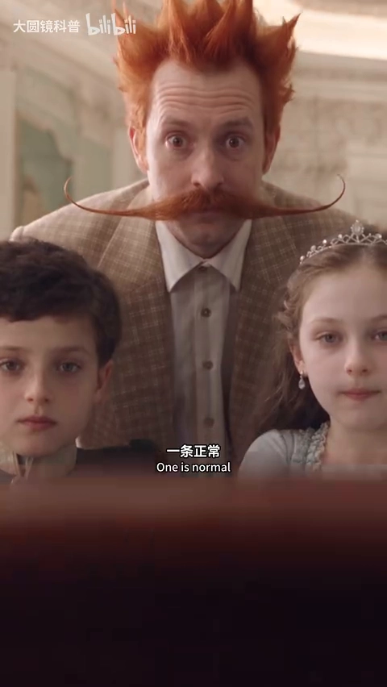

# 显性、隐性与分离：从王室血友病读懂孟德尔的成对因子

> 视频来源：[遗传定律：一种疾病，为什么能在家族中潜伏数代？](https://www.bilibili.com/video/BV1XupR6NEeo/)（B 站 · 大圆镜科普）｜时长约 8 分钟
>
> 导读：本文用一支科普视频串起单基因遗传的三件事：遗传因子成对存在而不融合、显性掩盖隐性、成对因子在传代时各分一半。视频以欧洲王室血友病为案例，把「隔代遗传」「只传男不传女」还原成携带者与 X 染色体的推理。自由组合、连锁、外显率与多基因性状不在本文范围，分别见本节另外两篇与 §4.1.6。

## 本讲要解决的核心问题（SCQA）

**背景**：我们都知道孩子会像父母，也知道某些疾病会在家族里出现。

**冲突**：19 世纪的主流看法是「遗传像液体混合」——父母的特征交融后无法拆开，后代身上看不到的特征就等于被稀释掉了。可现实里有一种出血病：母亲完全健康，儿子却一碰就大出血；疾病隔代出现，而且几乎只落在男孩身上。按「混合稀释」的逻辑，这根本不该发生。

**疑问**：遗传信息到底以什么形式传递，才能让一个特征消失一代后又原样出现？又为什么有的病只挑男性？

**回答（中心思想）**：遗传不是液体混合，而是**成对的独立因子**在传代。成对因子同时存在时，显性因子决定表现出来的性状，隐性因子只是被掩盖、并未消失；形成配子时，成对的两个因子各有一半机会进入配子。把这套规则放到性染色体上，就能解释「母亲携带、儿子发病、隔代出现」的家系现象。

## 一、遗传不是液体混合：矮茎消失一代又原样出现

19 世纪中叶，人们相信遗传像两种液体倒在一起：父母的特征交融、稀释，一旦某个特征在后代身上看不到，就意味着它已经被彻底稀释、不复存在。[【跳转到 00:30】](https://www.bilibili.com/video/BV1XupR6NEeo/?t=30)

孟德尔的豌豆实验直接推翻了这条直觉。[【跳转到 01:00】](https://www.bilibili.com/video/BV1XupR6NEeo/?t=60)

1. 把纯种高茎豌豆和矮茎豌豆杂交，第一代（F1）全部是高个子。
2. 如果遗传真的会互相稀释，矮茎特征此时应该已经彻底消失。
3. 让这批 F1 高个子自花授粉，矮茎豌豆却又冒了出来。[【跳转到 01:25】](https://www.bilibili.com/video/BV1XupR6NEeo/?t=85)

矮茎既没有被毁掉，也没有被稀释，它只是**暂时没有表现出来**。孟德尔由此提出：遗传物质是一颗颗成对存在的独立因子，一株豌豆体内可以同时拥有两个不同版本的因子。[【跳转到 01:40】](https://www.bilibili.com/video/BV1XupR6NEeo/?t=100)

两个版本同时存在时：

- **显性因子**：能表现出对应性状的那个版本，例如控制高茎的因子。
- **隐性因子**：暂时没有表现出来的那个版本，例如控制矮茎的因子。

关键的一句是：**隐性并不等于消失**。它仍然在基因组里，只是被显性因子盖住了。[【跳转到 01:50】](https://www.bilibili.com/video/BV1XupR6NEeo/?t=110)

## 二、分离定律：成对因子在传代时各分一半

把「成对」与「各分一半」连起来，就是分离定律的日常版本：一个个体有两个版本，形成配子时只能放进去其中一个，两个版本被选中的机会各占一半。[【跳转到 05:05】](https://www.bilibili.com/video/BV1XupR6NEeo/?t=305)

这条规则有两个常被忽略的推论。

**第一，携带者可以完全无症状。** 外表健康的母亲可能同时拥有一个正常因子和一个致病因子；显性因子打掩护，她自己毫无症状，致病的隐性因子却一直潜伏在体内，可以在母女之间无声传递数代。[【跳转到 02:15】](https://www.bilibili.com/video/BV1XupR6NEeo/?t=135) 一旦后代只拿到隐性因子、身边没有显性因子兜底，疾病才会显现。[【跳转到 02:30】](https://www.bilibili.com/video/BV1XupR6NEeo/?t=150)

**第二，每一次孕育都是独立的随机事件。** 上一个孩子的健康状况不会改变下一个孩子面临的概率。[【跳转到 05:45】](https://www.bilibili.com/video/BV1XupR6NEeo/?t=345) 这一点在家系咨询里尤其重要：连续两个患儿并不说明「下一次一定正常」，连续两个健康孩子也不说明「携带者身份被排除」。

## 三、家系判读：为什么只挑男孩、还能隔代出现

如果致病因子在常染色体上，男女得病的概率应该差不多。但王室家系里发病的几乎全是男孩，说明问题出在决定性别的染色体上。[【跳转到 02:40】](https://www.bilibili.com/video/BV1XupR6NEeo/?t=160)

人体的性染色体组合是：

- 女孩：两条完整的 X 染色体，记为 XX。
- 男孩：一条 X 加一条明显短小的 Y，记为 XY。[【跳转到 03:10】](https://www.bilibili.com/video/BV1XupR6NEeo/?t=190)

视频给出的关键事实是：人体止血系统中两种极其关键的凝血因子，其基因都写在 X 染色体上，而 Y 染色体上没有对应的基因。[【跳转到 03:25】](https://www.bilibili.com/video/BV1XupR6NEeo/?t=205)

这造成男女处境完全不同：

| 个体 | X 染色体上的致病因子 | 结果 |
| --- | --- | --- |
| 女孩 | 一条 X 有缺陷，另一条正常 | 正常 X 仍能生产凝血因子，表面健康，是携带者 |
| 男孩 | 唯一的 X 有缺陷，Y 上没有备份 | 完全丧失合成正常凝血因子的能力，发病 |

这也解释了为什么疾病会「隔代」：致病因子在女性携带者身上不表现，却可以通过她的 X 染色体传给儿子；儿子只有一条 X，拿到缺陷版本就直接发病。[【跳转到 03:55】](https://www.bilibili.com/video/BV1XupR6NEeo/?t=235)

女孩也不是绝对不会发病。女儿的两条 X 一条来自父亲、一条来自母亲；如果患病的父亲与携带者母亲碰巧把两条带缺陷的 X 同时传给女儿，女儿就会发病。只是在当时的医疗条件下，患病的王子大多早夭、极少留下后代，所以王室里的女性几乎都是带着致病基因却毫无症状的传递者。[【跳转到 04:15】](https://www.bilibili.com/video/BV1XupR6NEeo/?t=255)

### 3.1 携带者母亲把致病因子的概率算清楚

母亲有两条 X，一条正常、一条带缺陷，传给下一代时两者机会各占 50%。[【跳转到 05:05】](https://www.bilibili.com/video/BV1XupR6NEeo/?t=305)

- **儿子**：从父亲拿到 Y，从母亲拿到一条 X。拿到缺陷 X 就发病，拿到正常 X 就完全健康，概率各 50%。[【跳转到 05:15】](https://www.bilibili.com/video/BV1XupR6NEeo/?t=315)
- **女儿**：从健康父亲拿到一条正常 X，从母亲拿到一条 X。拿到缺陷 X 就是不发病的携带者，拿到正常 X 就摆脱致病因子，概率同样各 50%。[【跳转到 05:30】](https://www.bilibili.com/video/BV1XupR6NEeo/?t=330)

把家系读成一句话：**患者几乎全是男性、疾病隔代出现、母亲健康但反复生出患儿——这三条同时出现时，优先考虑 X 染色体上的隐性致病因子。** 这正是家系判读的用法：不是背结论，而是用「谁发病、谁不发病、性别比例如何」反推因子在哪条染色体上、是显性还是隐性。

## 四、隐性缺陷为什么没有被演化清除

一个自然的疑问是：既然隐性缺陷会导致严重出血，演化为什么没有把它彻底清除？[【跳转到 06:50】](https://www.bilibili.com/video/BV1XupR6NEeo/?t=410)

答案恰恰在于「隐性」本身。当缺陷隐藏在携带者体内时，它完全是隐形的，既不致命也不影响生存，自然选择根本抓不住它。[【跳转到 07:00】](https://www.bilibili.com/video/BV1XupR6NEeo/?t=420) 视频进一步把这一点引向更一般的结论：生命演化需要容错，也需要多样性；那些没有显现出来的突变并非多余的累赘，而是生命在漫长传递中不得不保留的冗余代价。[【跳转到 07:10】](https://www.bilibili.com/video/BV1XupR6NEeo/?t=430)

## 小结

- 遗传因子**成对存在、不互相融合**；隐性因子被显性因子掩盖，但不会消失。
- 形成配子时，成对的两个因子**各有一半机会**进入配子；每一次孕育都是独立事件。
- 显性/隐性描述的是**同一基因座上两个版本谁决定表型**，不是「强/弱」或「好/坏」。
- 家系里「患者几乎全是男性 + 隔代出现 + 母亲健康」提示 **X 染色体隐性**：男性只有一条 X，没有备份；女性有两条 X，可以成为无症状携带者。
- 隐性缺陷能在群体里保留，是因为它在携带者身上不被选择看见。

## 关键术语速查

| 术语 | 一句话解释 |
| --- | --- |
| 显性因子 | 与另一个版本同时存在时，决定实际表现性状的那个版本 |
| 隐性因子 | 被显性因子掩盖、暂时不表现，但仍然存在的版本 |
| 携带者 | 带有一个致病版本却不表现症状的个体 |
| 分离定律 | 成对的两个因子在形成配子时各分一半，机会均等 |
| X 连锁隐性 | 致病因子在 X 染色体上；男性只有一条 X，因而更易发病 |
| 隔代遗传 | 致病因子在携带者身上不表现，隔一代或数代后在后代身上显现 |

## 边界与下一步

- 本文只讲单基因性状的显性、隐性与分离，以及一个 X 连锁家系的判读。**两个基因座之间如何组合**（自由组合、连锁与重组）见 [§4.1.6 连锁与单倍型](../../../README.md#b02-4-1-6)。
- 「有致病基因型却不一定发病」「同一基因型症状轻重不同」属于外显率与表现度，见本节[《外显率与表现度》](外显率与表现度：同一基因型为什么有人发病有人很轻.md)。
- 身高、肤色这类由许多基因共同决定的性状，以及不完全显性、共显性，见本节[《不完全显性、共显性与多基因性状》](不完全显性、共显性与多基因性状：孟德尔规则之外的三种情形.md)。
- 减数分裂中同源染色体配对、交换与两次分裂的完整过程，见 [B01 §4.3.3 减数分裂](../../../../B01_生命科学基础主干/4_细胞、个体与变化/4.3_细胞增殖、生殖与命运调控/4.3.3_减数分裂、有性生殖与遗传重组/减数分裂：同源染色体配对交换与两次分裂的减半记账.md)。