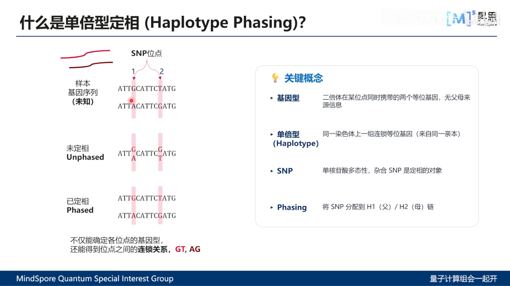
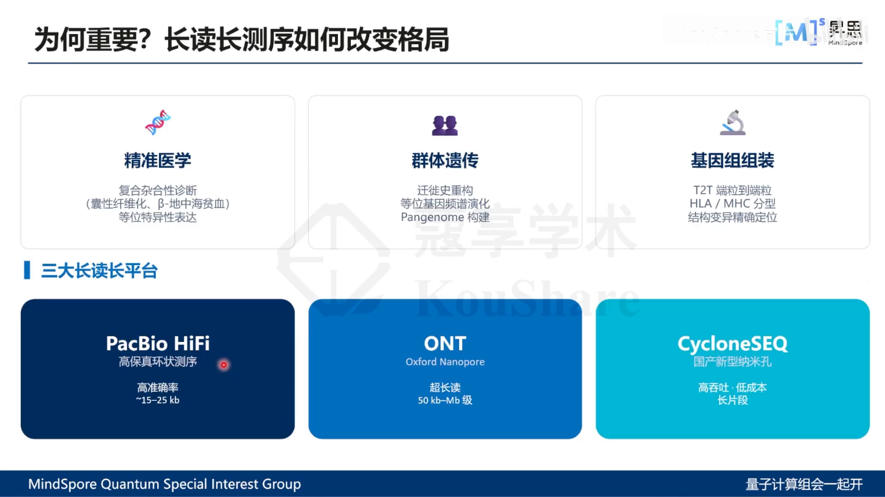

# 相位：同一个位点的两个字母，分别在哪条染色体上

> 视频来源：[2026.7.13 张锐（中国科学院大学）：基于量子启发式算法的单倍型定相方法研究](https://www.bilibili.com/video/BV1B24b6mE2S/)（B 站 · 报告录屏，34 分 13 秒）。本文只取报告开头约 4 分钟的生物学背景部分（单倍型定相是什么、为什么重要），报告后半段的图割建模、量子启发求解器与实验结果属于算法内容，不在本节范围；时间戳指向原片。
> 导读：上一篇讲 LD 时，单倍型是「一条染色体上挨在一起的一串字母」。这一篇补上前提：我们测到的基因型只告诉你每个位点有哪两个字母，却不告诉你它们分别在哪条染色体上。这个丢失的搭配关系就是相位；把它补回来，叫定相。[【跳转到 00:00】](https://www.bilibili.com/video/BV1B24b6mE2S/?t=0)

## 本讲要解决的核心问题（SCQA）

**背景**：人类是二倍体生物，每条染色体都有两份拷贝，一份来自父亲、一份来自母亲。所以基因组上每个位点都应该有两个碱基，分别来自这两条链；同一个位点上两个碱基互不相同时，就叫**杂合位点**。[【跳转到 01:38】](https://www.bilibili.com/video/BV1B24b6mE2S/?t=98)
**冲突**：常规的现代测序有一个根本的局限：它只能读出每个位点是哪两个碱基，却读不出它们各自来自哪条链。比如位点一是 G 和 A，位点二是 T 和 G；这个 G 到底应该和 T 在同一条链上，还是应该和另一个 G 在同一条链上？[【跳转到 02:03】](https://www.bilibili.com/video/BV1B24b6mE2S/?t=123)

**疑问**：丢失的到底是什么信息？为什么它重要？又靠什么把它补回来？

**回答（中心思想）**：丢失的是**相位**（phase）：哪几个等位基因位于同一条同源染色体上。一条链上这一连串连锁的碱基组合就是一个**单倍型**；**定相**（phasing）要做的，就是把每个杂合位点正确地分配到父源和母源两条链上（H1 和 H2）。相位在精准医学、群体遗传和基因组组装里都是关键环节；长读长测序的片段能跨越多个变异位点，同一片段上的等位基因天然连锁，因此可以直接从测序数据里恢复这种搭配关系。[【跳转到 03:39】](https://www.bilibili.com/video/BV1B24b6mE2S/?t=219)

---

## 一、基因型只说「有哪两个字母」，不说「各在哪条链上」

### 1.1 二倍体与杂合位点

人类每条染色体有两份拷贝，所以每个位点上有两个碱基。两个碱基不同时叫杂合位点；相同则是纯合。杂合位点正是定相要处理的位点——纯合位点上两条链的字母一样，分不分都无所谓。[【跳转到 01:38】](https://www.bilibili.com/video/BV1B24b6mE2S/?t=98)
### 1.2 测序的根本局限：读得出字母，读不出链

常规测序读出的结果是**基因型**：某个位点同时携带的两个等位基因，**不带父母来源信息**。也就是说，测序告诉我们「这个位点是 G 和 A」，却不告诉我们「G 在父源链上还是母源链上」。[【跳转到 02:03】](https://www.bilibili.com/video/BV1B24b6mE2S/?t=123)

---

## 二、丢失的搭配关系就是相位

### 2.1 两种可能的搭配：顺式与反式

把两个杂合位点放在一起看，就有两种可能的搭配：

- 位点一的 G 和位点二的 T 在**同一条**染色体上，另一条上则是 A 和 G；
- 或者位点一的 G 和位点二的 G 在同一条上，另一条上是 A 和 T。

报告把这两种情形描述为「哪些变量倾向于取**相同**或**相反**的状态」。[【跳转到 03:39】](https://www.bilibili.com/video/BV1B24b6mE2S/?t=219) 在遗传学里，同一染色体上的两个变异通常叫**顺式**（cis），分处两条同源染色体上则叫**反式**（trans）。报告没有使用这两个词，本文按通行术语补上名称，含义与报告的描述一致。

这个区别不是文字游戏：顺式时两个变异会一起传下去，反式时它们各自独立分离；如果两个变异分别影响同一个基因的两个拷贝，顺式和反式的功能后果可以完全不同。

### 2.2 单倍型与定相

一条链上这一连串连锁的碱基组合，就是一个**单倍型**。定相要做的，就是恢复这种组合：把每个杂合位点正确地分配到父源和母源两条链上，也就是报告里的 H1 和 H2。[【跳转到 02:28】](https://www.bilibili.com/video/BV1B24b6mE2S/?t=148)

### 2.3 计算上，它是一个二值分配问题

从计算的角度看，每个位点只有两种分法，所以定相本质上是一个**二值分配问题**：每个变量取两种状态之一，目标是恢复位点之间的连锁关系。报告指出，这种二值变量的结构正好适合量子优化——这也是报告后半段把定相表述成 max-cut 问题的出发点（算法部分不在本节范围）。[【跳转到 02:53】](https://www.bilibili.com/video/BV1B24b6mE2S/?t=173)

不过定相并不简单：测序错误、比对错误会在杂合位点引入噪音，所以需要在一个指数级的空间里寻找全局最优的划分。[【跳转到 04:38】](https://www.bilibili.com/video/BV1B24b6mE2S/?t=278)

---

## 三、相位为什么重要

报告把定相的需求归到三个方向：[【跳转到 03:14】](https://www.bilibili.com/video/BV1B24b6mE2S/?t=194)

**精准医学**：复合杂合性诊断（幻灯片举的例子是囊性纤维化、β-地中海贫血）、等位基因特异性表达。

**群体遗传**：迁徙史重构、等位基因频谱演化、泛基因组构建。

**基因组组装**：端粒到端粒（T2T）组装、HLA/MHC 分型、结构变异的精确定位。

---

## 四、长读长为什么能补回相位

### 4.1 三种长读长平台

报告列出三类长读长平台：PacBio HiFi（高保真环状测序，准确率高，读长约 15–25 kb）、ONT（Oxford Nanopore，超长读长，50 kb 到兆碱基级）、CycloneSEQ（国产新型纳米孔，高吞吐、低成本的长片段）。[【跳转到 03:14】](https://www.bilibili.com/video/BV1B24b6mE2S/?t=194)

### 4.2 一条片段跨越多个位点，就自带连锁约束

定相之所以会变成大规模的优化问题，正是因为这种数据形态：单条测序片段能达到几十 kb，甚至兆级别，一条片段能跨越多个变异位点。**这意味着同一个片段上的等位基因天然连锁**，它直接提供了「哪些变量倾向于取相同或相反状态」的成对约束。这样就不必依赖外部参考或家系，而是直接从测序数据里抽出一张带权图，把定相变成图上的一个优化问题。[【跳转到 04:04】](https://www.bilibili.com/video/BV1B24b6mE2S/?t=244)

---

## 五、边界：本节讲到哪、不讲什么

- **不讲定相算法**：报告后半段的最小错误纠正（MEC）形式化、max-cut 与伊辛模型的等价、BSB 求解器、GPU 实现与实验，属于计算方法，不在本节范围。[【跳转到 04:13】](https://www.bilibili.com/video/BV1B24b6mE2S/?t=253)
- **不展开长读长测序原理**：HiFi、ONT、CycloneSEQ 的化学与信号只作为「片段能跨多个位点」的例子；测序技术细节不在本节。
- **不展开关联与功能后果**：相位如何影响关联信号、如何用于精细定位，见 [§4.2.5](../../../README.md#b02-4-2-5)；顺式/反式调控与等位基因特异性表达见 [§3.1.9 表观遗传继承](../../../README.md#b02-3-1-9)。
- **单倍型的群体层面**：单倍型作为共遗传片段、重组如何把它切短，见 [§1.2.2 基因组多样性：单倍型与替代序列](../../../README.md#b02-1-2-2) 与 [连锁不平衡：相邻位点为什么一起遗传](./连锁不平衡：相邻位点为什么一起遗传，最显著的位点为什么常常不是原因.md)。

## 小结

1. **基因型**只记录每个位点有哪两个字母，不带父母来源；**相位**是这些字母分别位于哪条同源染色体上。
2. 两个杂合位点的搭配有两种：同一条链上（**顺式**）或分处两条链（**反式**），功能后果可能完全不同。
3. **单倍型**是一条链上共连锁的一组等位基因；**定相**就是把杂合位点分配到 H1/H2。
4. 定相在精准医学（复合杂合诊断）、群体遗传（迁徙史、泛基因组）和基因组组装（T2T、HLA 分型）中都是关键环节。
5. 长读长片段跨越多个变异位点，同一片段上的等位基因天然连锁，因此可以直接从数据中恢复相位，而不必依赖参考或家系。

## 关键术语速查

| 术语 | 一句话解释 |
| --- | --- |
| 基因型（genotype） | 二倍体在某位点同时携带的两个等位基因，不带父母来源。 |
| 杂合位点 | 同一位点两个碱基不同的位置，是定相的处理对象。 |
| 相位（phase） | 哪些等位基因位于同一条同源染色体上。 |
| 顺式 / 反式（cis / trans） | 两个变异在同一条染色体上 / 分处两条同源染色体上。 |
| 单倍型（haplotype） | 同一条染色体上一组连锁的等位基因。 |
| 定相（phasing） | 把杂合位点的等位基因分配到父源（H1）与母源（H2）两条链。 |
| 长读长（long read） | 单条读段可达几十 kb 至兆碱基级，能跨越多个变异位点。 |