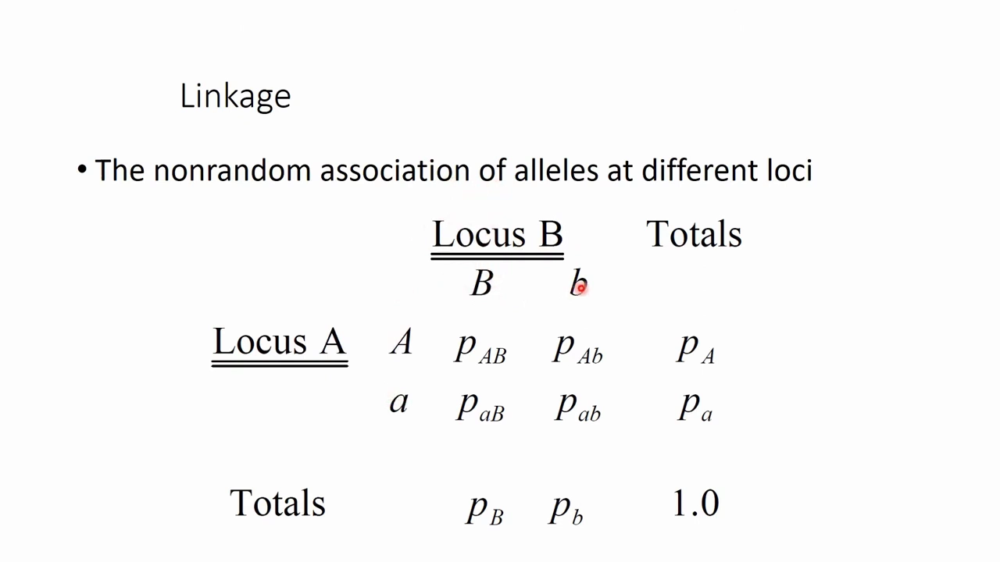
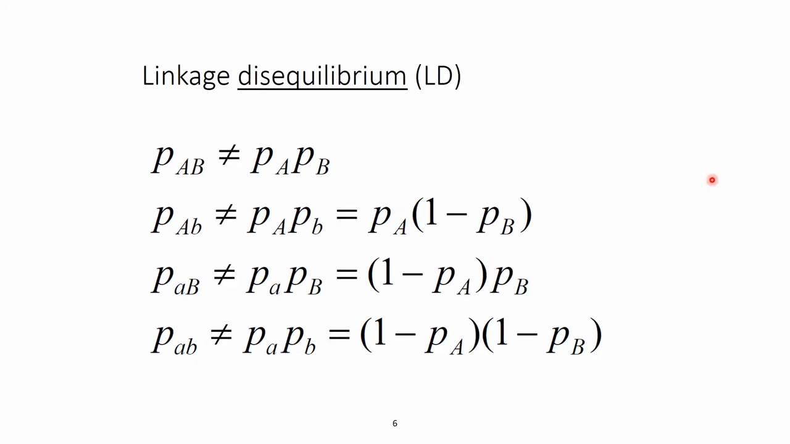
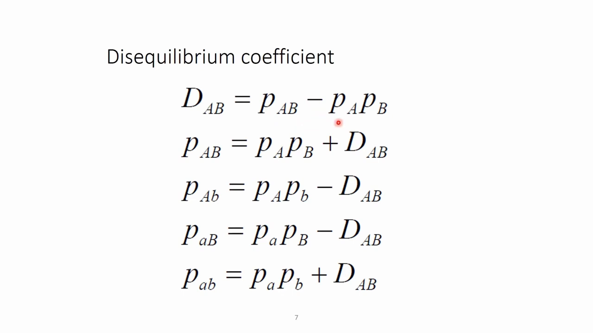
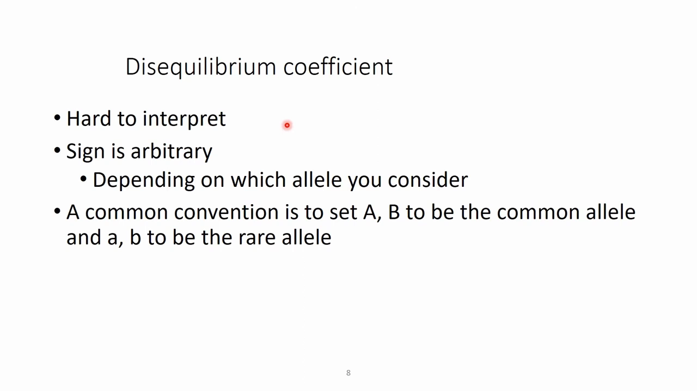
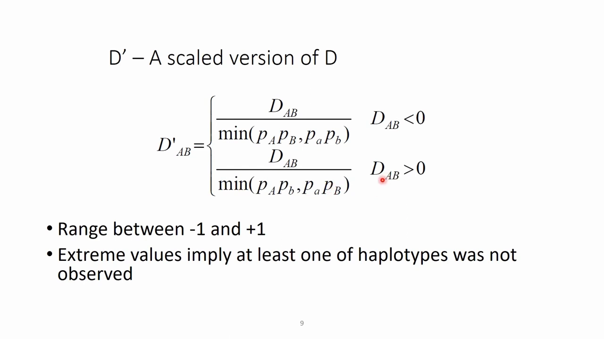
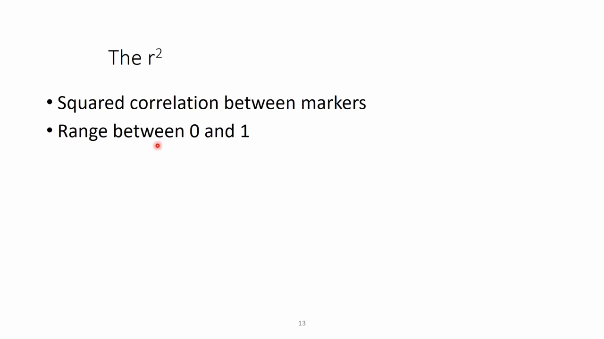
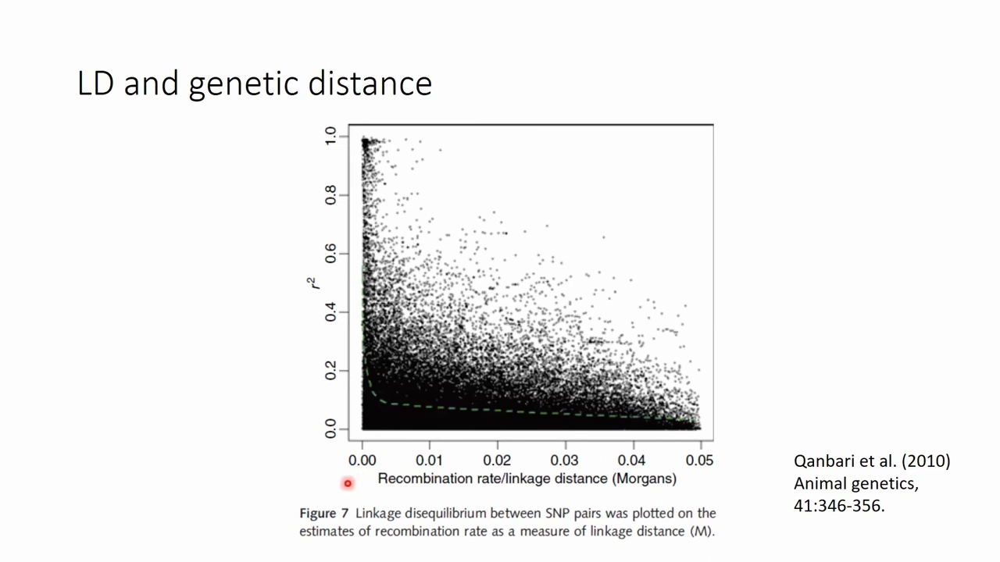

# 连锁不平衡怎么度量：D、D′ 与 r² 各回答什么

> 视频来源：[How to measure Linkage disequilibrium (LD)? | Genomics](https://www.youtube.com/watch?v=vJZUnflN7kk)（YouTube · Genomics Boot Camp，11 分 32 秒）。本文依据该视频的英文字幕与幻灯片整理，时间戳指向原片；字幕为自动生成，术语已按幻灯片订正，正文引用的公式均取自画面。
> 导读：上一篇把 LD 讲成「相邻位点字母的非随机搭配」，这一篇回答下一步：非随机到什么程度、用什么数写下来。视频依次给出 $D$、$D'$、$r^2$ 三个指标，说明各自的范围、优缺点和适用场景，最后把 $r^2$ 画到距离上，得到 LD 衰减曲线。

## 本讲要解决的核心问题（SCQA）

**背景**：连锁不平衡衡量的是不同位点等位基因之间的非随机关联；在基因组学里应用很广，SNP 是主要的标记类型。[【跳转到 00:50】](https://www.youtube.com/watch?v=vJZUnflN7kk&t=50)

**冲突**：「非随机」只说了方向，没给出大小。要把两个位点的关系写下来，得先有一张 2×2 的搭配表；可一旦离开「完全独立」这个理想情形，等位基因频率就乘不出组合频率了，差出来的那一块需要一个数来表示。这个数（$D$）又不好解释、符号还任意。[【跳转到 04:10】](https://www.youtube.com/watch?v=vJZUnflN7kk&t=250)

**疑问**：用什么数来度量 LD？$D$、$D'$、$r^2$ 分别在问什么？什么时候该用哪一个？

**回答（中心思想）**：三个指标层层递进。$D$ 是组合频率偏离「独立相乘」的原始差值；$D'$ 是把 $D$ 按理论最大值缩放后的版本，范围 $-1$ 到 $+1$，极值意味着两个位点没有被重组分开、处于完全连锁不平衡；$r^2$ 是两个标记等位基因计数的相关系数平方，范围 0 到 1，衡量**用一个标记替代另一个会损失多少信息**。日常关联研究多用 $r^2$，看重组历史和 LD 块时常用 $D'$；两者都会受样本量和稀有等位基因影响。[【跳转到 10:26】](https://www.youtube.com/watch?v=vJZUnflN7kk&t=626)

---

## 一、先把「非随机」写成一个数：2×2 表与 $D$

### 1.1 连锁平衡时，组合比例可以由等位基因频率乘出来

不同位点某些等位基因之间的非随机关联，可以用一张 2×2 表表示：一边是位点 A（等位基因 A、a），上面是位点 B（等位基因 B、b），每一格是四种组合的比例，例如 $p_{AB}$ 就是 A 和 B 一起出现的比例。右侧和下方分别是各等位基因的合计比例。[【跳转到 01:15】](https://www.youtube.com/watch?v=vJZUnflN7kk&t=75)

双等位基因系统有一条规则：一对等位基因的比例加起来等于 1，所以 $p_b = 1 - p_B$。这样未知数从四个减到两个，只需要处理 $p_A$ 和 $p_B$。[【跳转到 02:05】](https://www.youtube.com/watch?v=vJZUnflN7kk&t=125)

在**连锁平衡**时（A 和 B 不连锁），组合比例可以直接由等位基因频率相乘得到：

$$
p_{AB} = p_A p_B,\quad p_{Ab} = p_A p_b,\quad p_{aB} = p_a p_B,\quad p_{ab} = p_a p_b
$$

### 1.2 连锁不平衡时，差出来的那一块就是 $D$

在**连锁不平衡**时，这些等式不再成立：从等位基因的比例，算不出组合的比例。差出来的那一块，就是**不平衡系数** $D$：[【跳转到 03:20】](https://www.youtube.com/watch?v=vJZUnflN7kk&t=200)

$$
D_{AB} = p_{AB} - p_A p_B
$$

把这个 $D$ 加回等式，四种组合的比例就都能写出来：[【跳转到 03:45】](https://www.youtube.com/watch?v=vJZUnflN7kk&t=225)

$$
p_{AB} = p_A p_B + D_{AB},\quad p_{Ab} = p_A p_b - D_{AB},\quad p_{aB} = p_a p_B - D_{AB},\quad p_{ab} = p_a p_b + D_{AB}
$$

**$D=0$ 就是连锁平衡**：搭配完全随机；$D$ 不为 0 就是连锁不平衡，偏离独立期望越远，$D$ 的绝对值越大。$D$ 是另两个指标的基础，但它本身还不是一个可以直接横向比较的量——下一节说明为什么。[【跳转到 03:20】](https://www.youtube.com/watch?v=vJZUnflN7kk&t=200)

---

## 二、$D$ 的两个毛病，引出 $D'$

### 2.1 符号任意、数值难解释

$D$ 有两个问题：**不好解释**，而且**符号是任意的**——取决于你先看哪个等位基因。当然有个常见约定：把大写 A、大写 B 定为常见等位基因，小写 a、小写 b 定为稀有等位基因；但等位基因的稀有程度会随人群变化，哪怕同一物种内部也会变，所以这个约定并没有真正解决问题。[【跳转到 04:35】](https://www.youtube.com/watch?v=vJZUnflN7kk&t=275)

### 2.2 $D'$：缩放到 $-1$ 到 $+1$

$D$ 还有一个更好的版本，叫 **$D'$**（D prime），是经过缩放的形式：把 $D$ 除以它在这个方向上可能取到的最大值，也就是相应两个组合频率中较小的那个。[【跳转到 05:00】](https://www.youtube.com/watch?v=vJZUnflN7kk&t=300)

$$
D'_{AB} =
\begin{cases}
\dfrac{D_{AB}}{\min(p_A p_B,\ p_a p_b)}, & D_{AB} < 0 \\[6pt]
\dfrac{D_{AB}}{\min(p_A p_b,\ p_a p_B)}, & D_{AB} > 0
\end{cases}
$$

这样得到的系数范围是 $-1$ 到 $+1$。取极端值时，意味着**至少有一种单倍型没有被观察到**。它有几个优点：$D'$ 等于 $1$ 或 $-1$ 意味着两个 SNP 之间没有被重组分开，也就是处于**完全连锁不平衡**；如果两个位点的等位基因频率比较接近，那么高 $D'$ 说明这两个标记可以很好地互相代表。[【跳转到 05:25】](https://www.youtube.com/watch?v=vJZUnflN7kk&t=325)

### 2.3 $D'$ 的偏差：小样本与稀有等位基因会把它抬高

$D'$ 也有缺点：**样本量小时，$D'$ 的估计会被高估；当其中一个等位基因很稀有时，$D'$ 的估计也可能被高估。** 这两点在读 LD 热图时很实际：一块区域里如果全是稀有变异，$D'$ 看起来很高，并不一定说明它们绑得很紧。[【跳转到 05:50】](https://www.youtube.com/watch?v=vJZUnflN7kk&t=350)

---

## 三、$r^2$：一个标记能替代另一个多少

### 3.1 从相关系数到 $r^2$

更直观的度量是相关系数：统计学里的相关系数写作小写 $r$，范围 $-1$ 到 $+1$，描述两个变量如何相对变化——$x$ 增大时 $y$ 减小是负相关，$x$ 增大时 $y$ 也增大是正相关；极端值表示关系强，等于 0 表示不相关。[【跳转到 06:15】](https://www.youtube.com/watch?v=vJZUnflN7kk&t=375)

在连锁不平衡里，用的是相关系数的平方，也就是 **$r^2$**，所以它取值在 0 到 1 之间。[【跳转到 07:05】](https://www.youtube.com/watch?v=vJZUnflN7kk&t=425)

- $r^2 = 1$：两个标记提供**完全相同的信息**；
- $r^2 = 0$：两个标记毫无关联、彼此独立。

换句话说，**$r^2$ 衡量的是用一个标记 B 替代标记 A 时损失了多少效率**。[【跳转到 07:30】](https://www.youtube.com/watch?v=vJZUnflN7kk&t=450)

### 3.2 只需要三个频率就能算

$r^2$ 可以直接由等位基因频率算出来，需要的只有三个值：A 和 B 同时出现的比例 $p_{AB}$、大 A 的比例 $p_A$、大 B 的比例 $p_B$。把它们代进公式就能得到 $r^2$；视频把推导放在同系列的 advanced 一支里，本文不展开。[【跳转到 07:55】](https://www.youtube.com/watch?v=vJZUnflN7kk&t=475)

> 为什么关联研究偏爱 $r^2$：它回答的正是「我测了这一个 SNP，能不能代表没测到的那个」。$D'$ 回答的是「这两个位点之间有没有发生过重组」，更适合描述重组历史和划分 LD 块。

---

## 四、把 $r^2$ 画到距离上：LD 衰减

### 4.1 衰减曲线长什么样

有了度量，就可以计算标记两两之间的 LD。视频引用 Qanbari 等人 2010 年的例子：纵轴是 $r^2$，横轴是标记之间的距离（摩尔，可换算成兆碱基），图上每一个点都是一对标记的 LD 值。[【跳转到 08:40】](https://www.youtube.com/watch?v=vJZUnflN7kk&t=520)

两个位点离得很近时，LD 可以很高、接近 1；但随后这个值很快下降，随着距离增大降到更低。标记之间平均 LD 的这种陡降用一条虚线表示，形状对所有生物都很典型，被称为**连锁不平衡衰减**（LD decay）。[【跳转到 09:30】](https://www.youtube.com/watch?v=vJZUnflN7kk&t=570)

### 4.2 形状相似，起点和走势可以不同

LD 衰减的形状在不同生物之间大体相似，但起始值和后续走势可以不同；视频提到，哪怕是瘤牛和印度瘤牛这两个品种之间也可能不同（Perez O'Brien 2014）。当 LD 被用于后续的基因组分析时，这一点当然有影响。[【跳转到 10:01】](https://www.youtube.com/watch?v=vJZUnflN7kk&t=601)

---

## 五、怎么选：$D'$ 还是 $r^2$

| 指标 | 范围 | 回答的问题 | 优点 | 注意 |
| --- | --- | --- | --- | --- |
| $D$ | 取决于频率 | 组合频率比独立相乘差了多少 | 定义直接，是另两个指标的基础 | 符号任意、数值难解释，随等位基因频率变化 |
| $D'$ | $-1$ 到 $+1$ | 两个位点之间有没有被重组分开 | 极值对应完全 LD；适合描述重组历史、划分 LD 块 | 小样本、稀有等位基因会高估 |
| $r^2$ | 0 到 1 | 一个标记能替代另一个多少 | 直观、稳健；关联研究和标签 SNP 的常用指标 | 受等位基因频率影响，稀有变异即使完全 LD 也难有高 $r^2$ |

## 小结

1. **$D$**：组合频率减去等位基因频率的乘积，是最原始的偏离量；$D=0$ 即连锁平衡。
2. **$D'$**：把 $D$ 按理论最大值缩放，范围 $-1$ 到 $+1$；$\vert D'\vert=1$ 表示两个位点没有被重组分开、至少一种单倍型没被观察到。
3. **$r^2$**：两个标记的相关系数平方，范围 0 到 1；衡量互相替代时损失多少信息。
4. **$D'$ 的坑**：小样本和稀有等位基因会把 $D'$ 抬高。
5. **把 $r^2$ 对距离作图**得到 LD 衰减曲线；形状跨物种相似，起点和走势因物种、品种历史而异。

## 关键术语速查

| 术语 | 一句话解释 |
| --- | --- |
| 连锁平衡（linkage equilibrium） | 不同位点等位基因独立随机组合，$D=0$，$p_{AB}=p_A p_B$。 |
| 不平衡系数 $D$ | $p_{AB}-p_A p_B$，组合频率偏离独立期望的差值。 |
| $D'$ | $D$ 的缩放版本，范围 $-1$ 到 $+1$；$\vert D'\vert=1$ 为完全 LD。 |
| $r^2$ | 两个标记等位基因计数的相关系数平方，0 到 1；衡量替代效率。 |
| 完全连锁不平衡 | 两个位点之间从未发生过重组，$\vert D'\vert=1$。 |
| LD 衰减（LD decay） | 平均 $r^2$ 随标记间距离增大而下降的曲线。 |