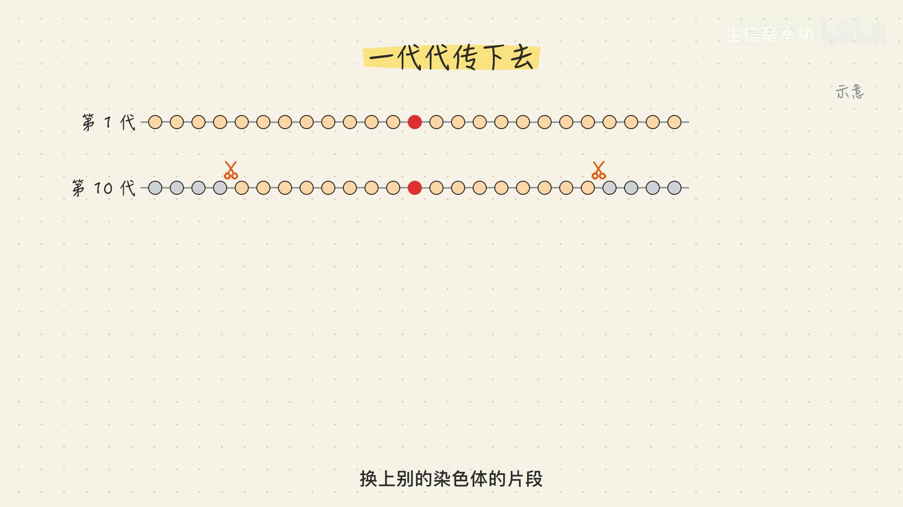
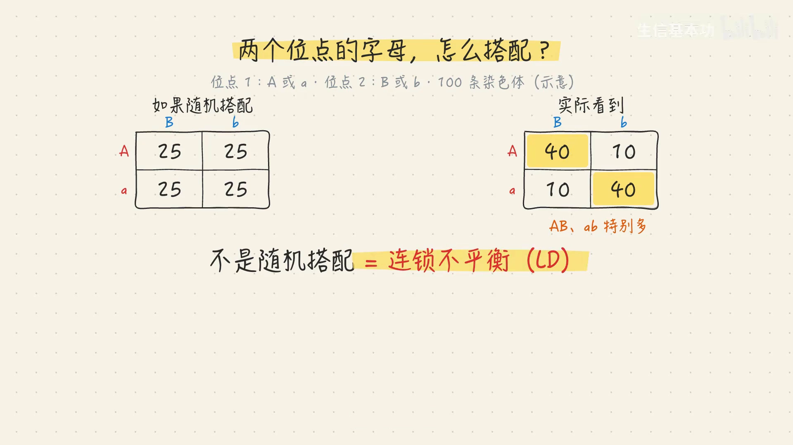
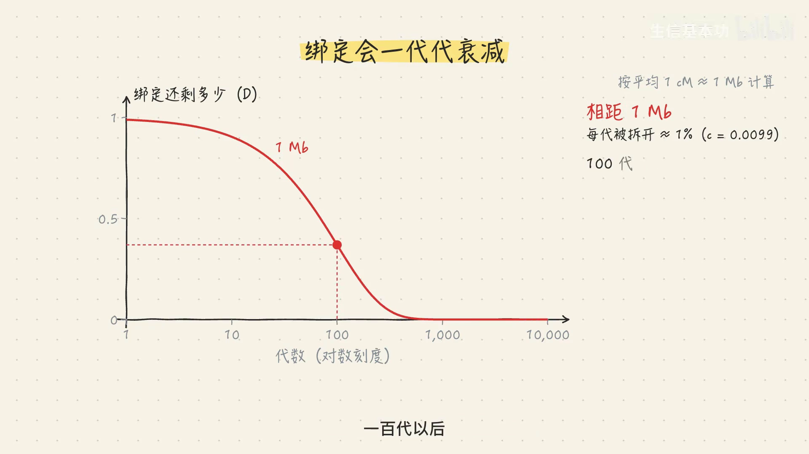
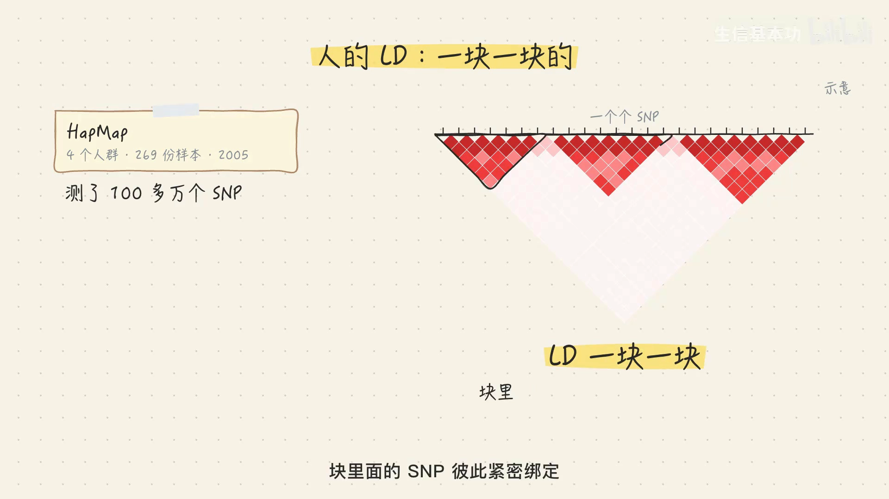
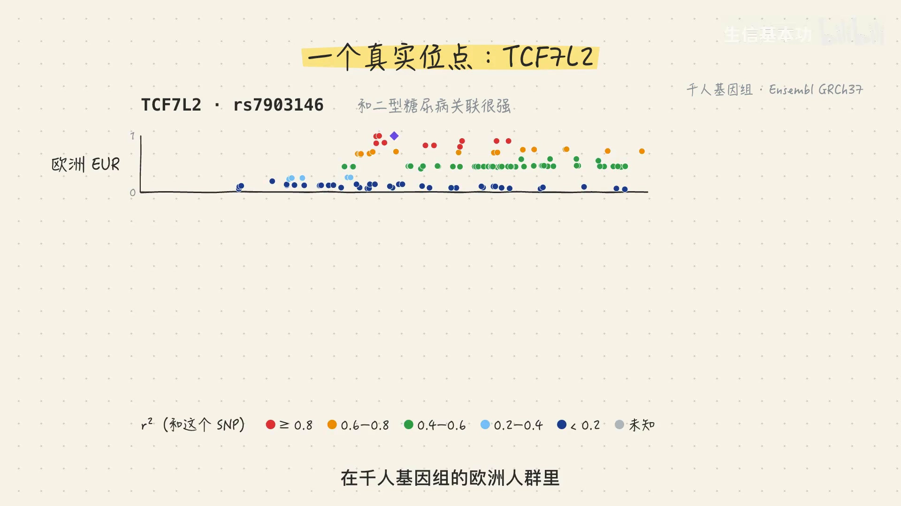
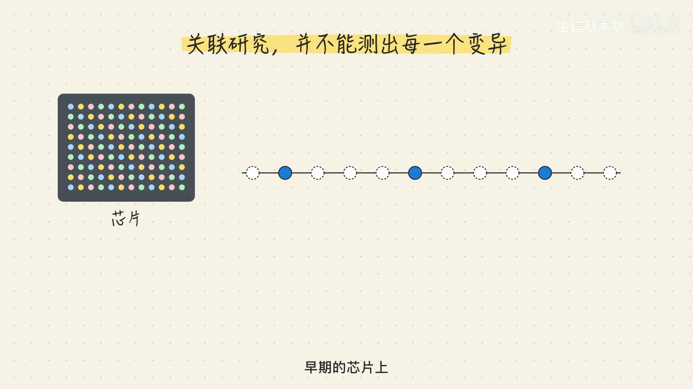
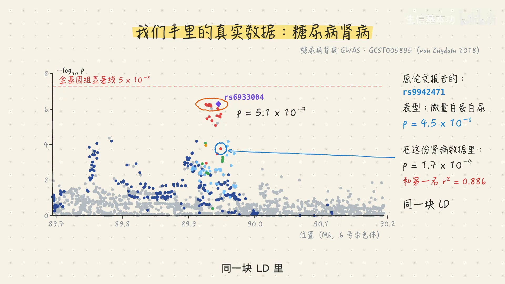
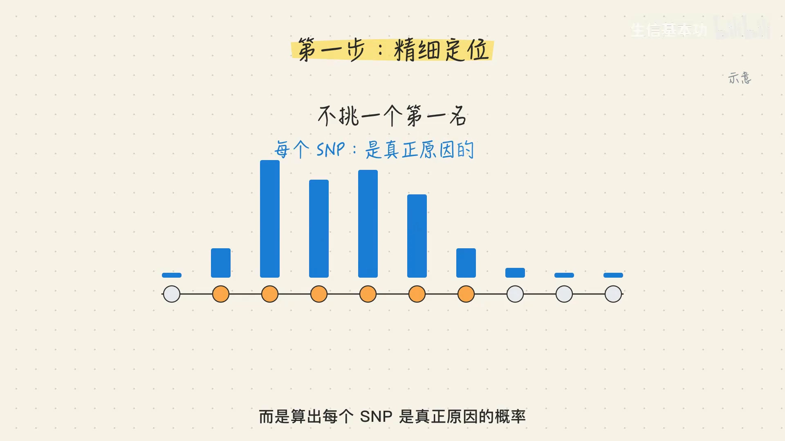
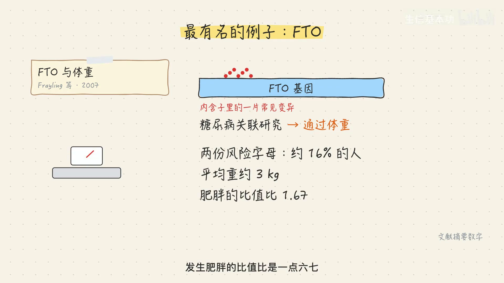
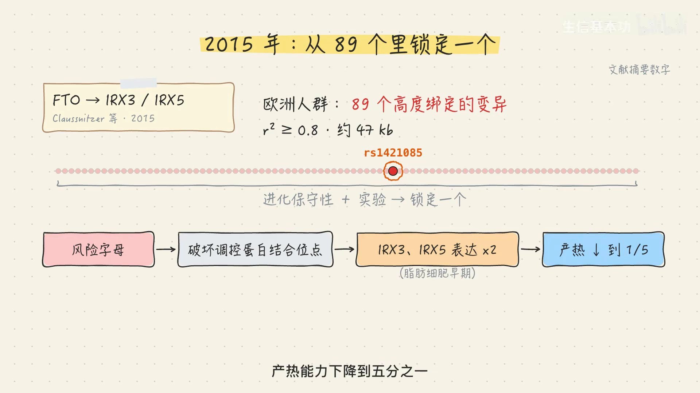

# 连锁不平衡：相邻位点为什么一起遗传，最显著的位点为什么常常不是原因

> 视频来源：[生信入门 第36讲：连锁不平衡｜零基础公开课](https://www.bilibili.com/video/BV1xBWx61EB7/)（B 站 · 生信入门，18 分 0 秒）。本文依据该视频的 AI 字幕与画面整理，时间戳指向原片；字幕中的术语错拼（如「half map」「黎摩」「阿方」「TCF7L二」）已按画面与通行写法订正。
> 导读：这一讲把「连锁」从家系里的一次次传代，推到整个人群几百几千代的历史尺度：相邻位点为什么总是一起出现、这种绑定为什么会随距离衰减、为什么关联研究里最显著的那个位点常常只是真正原因的邻居。相位（顺式/反式）与 D′、r² 的具体算法分别见本节另两篇。

## 本讲要解决的核心问题（SCQA）

**背景**：读基因研究时，变异是一个位点一个位点记录的。全基因组关联研究（GWAS）找来很多病人和很多健康人，在几十万甚至上千万个单核苷酸多态性（SNP）上，一个一个比较两组的字母频率，哪个位置差得最明显，就画得最高。[【跳转到 00:50】](https://www.bilibili.com/video/BV1xBWx61EB7/?t=50)

**冲突**：很多人会自然地以为，最高的那个就是致病的位点，可事实常常不是这样。2007 年，人们在一个叫 FTO 的基因里找到了一片和肥胖明确相关的位点；8 年后的研究发现，这片位点真正影响的是离它很远的另外两个基因。[【跳转到 01:21】](https://www.bilibili.com/video/BV1xBWx61EB7/?t=81) 更麻烦的是，同一片区域里排在前几名的位点，信号几乎一样高，谁排第一往往只是随机波动。

**疑问**：为什么相邻的位点会一起遗传？这种「一起」在人群里留下什么痕迹、能持续多久？既然信号是一整片，研究者又凭什么说某一个是原因、其余只是邻居？

**回答（中心思想）**：同一条染色体上的位点像串在一根绳子上的珠子，靠得越近，越不容易被重组拆开，于是**一起传下去**——这叫连锁。把时间拉长到几百几千代，新突变和它身边的老搭档在人群里形成**非随机的字母搭配**，这就是**连锁不平衡**（LD），常用 $r^2$ 衡量；LD 的长度由人群和物种的历史决定。正因为 LD，关联研究才能用少数标记代表一大片区域，也正因为 LD，**最显著的位点常常只是真正原因的邻居**：从信号到原因，要靠精细定位、多人群和功能实验。[【跳转到 16:31】](https://www.bilibili.com/video/BV1xBWx61EB7/?t=991)

---

## 一、连锁：同一条染色体上的位点为什么会一起传下去

### 1.1 每次传下去的染色体，都是两条拼起来的

我们每个人的染色体都是成对的：每一对里一条来自妈妈、一条来自爸爸，每一条染色体都是一长串连在一起的 DNA。同一条染色体上的位点，就像串在同一根绳子上的珠子。[【跳转到 01:46】](https://www.bilibili.com/video/BV1xBWx61EB7/?t=106)

当身体产生精子和卵子的时候，每对染色体只能传下去一条；但在传下去之前，成对的两条染色体会靠在一起互相交换一段，这叫**交换**，也叫**重组**。于是爸爸传给孩子的那一条，往往是爸爸自己那两条拼起来的：一段来自爷爷，一段来自奶奶。[【跳转到 02:11】](https://www.bilibili.com/video/BV1xBWx61EB7/?t=131)

关键在于：两个位点**离得越远**，中间发生交换把它们拆开的机会就越大；**离得越近**，中间几乎不发生交换，它们就几乎总是一起传下去。这种一起遗传的现象叫**连锁**。[【跳转到 02:36】](https://www.bilibili.com/video/BV1xBWx61EB7/?t=156)

### 1.2 用交换频率量距离：厘摩与遗传图

这个想法来自 100 多年前的果蝇实验室。1911 年，摩尔根提出：两个基因一起遗传得越紧，说明它们在染色体上靠得越近。1913 年，他实验室里的一位年轻学生斯特蒂文特，用交换发生的频率当作距离，把六个基因排成了一条线，这就是历史上第一张遗传图。[【跳转到 03:01】](https://www.bilibili.com/video/BV1xBWx61EB7/?t=181)

后来遗传距离的单位就以摩尔根的名字命名，叫**厘摩**（centiMorgan，cM）：**一厘摩大约相当于每次传代两个位点之间发生交换的概率是 1%**。在人身上，平均来说一厘摩大约对应 100 万个碱基。[【跳转到 03:26】](https://www.bilibili.com/video/BV1xBWx61EB7/?t=206)

但这只是平均：有的地方是重组的热点，交换特别频繁；有的地方很少交换；而且男性和女性的遗传图也不一样。[【跳转到 03:26】](https://www.bilibili.com/video/BV1xBWx61EB7/?t=206)

> 小结：同一条染色体上的位点像串珠，每次传代交换会把远的位点拆开，近的位点则一起遗传，这叫连锁遗传；距离的单位是厘摩。**连锁说的是一个家庭里的一次次传代**——下一节把时间拉长到整个人群。[【跳转到 03:51】](https://www.bilibili.com/video/BV1xBWx61EB7/?t=231)

---

## 二、从家庭到群体：单倍型与连锁不平衡

### 2.1 单倍型：一条染色体上挨在一起的一串字母

想象很久很久以前，某个人的一条染色体上出现了一个新的突变。这个突变一出生就落在一条具体的染色体上，周围是那条染色体原有的一串字母。**同一条染色体上这样一串挨在一起的字母组合，就叫单倍型**（haplotype）。[【跳转到 04:16】](https://www.bilibili.com/video/BV1xBWx61EB7/?t=256)

这个突变一代代传下去，每一代交换都会从它周围切下一点，换上别的染色体的片段：离它远的字母很快就被换掉了，离它近的字母要经过非常多代才会被换掉。所以过了很多代以后，在整个人群里，这个突变仍然和它身边的一小段「老搭档」绑在一起。[【跳转到 04:41】](https://www.bilibili.com/video/BV1xBWx61EB7/?t=281)

### 2.2 连锁不平衡：搭配偏离了随机

在人群里，两个位点上的字母并不是随机搭配的，而是倾向于成对出现，这就叫**连锁不平衡**（linkage disequilibrium，LD）。这里的不平衡不是说出了什么毛病，而是说**字母的搭配偏离了完全随机时应有的比例**。[【跳转到 05:06】](https://www.bilibili.com/video/BV1xBWx61EB7/?t=306)

用一张 2×2 表就能看清：位点 1 有 A/a，位点 2 有 B/b。如果两个位点完全独立，四种组合各占 25%；实际看到的却是 AB 和 ab 特别多、Ab 和 aB 特别少——这就是 LD。[【跳转到 05:06】](https://www.bilibili.com/video/BV1xBWx61EB7/?t=306)

这个名字通常追溯到 1960 年的一篇群体遗传学论文，而「搭配会一代代衰减」这个想法比名字更早。[【跳转到 05:06】](https://www.bilibili.com/video/BV1xBWx61EB7/?t=306)

### 2.3 $r^2$：知道一个位点，能在多大程度上猜出另一个

最常用的衡量指标叫 **$r^2$**（R 方）。你可以把它理解成：在人群里知道了一个位点上的字母，能在多大程度上猜出另一个位点上的字母。$r^2$ 等于 1，就是两个位点完全绑定，知道一个就知道另一个；等于 0，就是互不相干。[【跳转到 05:31】](https://www.bilibili.com/video/BV1xBWx61EB7/?t=331)

$r^2$ 的严格定义（两个标记等位基因计数的相关系数平方）、它与 $D$、$D'$ 的分工，见 [连锁不平衡怎么度量：D、D′ 与 r² 各回答什么](./连锁不平衡怎么度量：D、D prime 与 r square 各回答什么.md)。

---

## 三、LD 会衰减，衰减速度记录群体历史

### 3.1 衰减的算术：距离越远，绑得越松

这种绑定会一代代衰减。按平均一厘摩对应 100 万个碱基来算：

- 两个位点相距 **100 万个碱基**，每一代被拆开的概率大约是 1%。100 代以后，衡量绑定的那个量只剩下原来的 37%，$r^2$ 只剩下 14%；1000 代以后几乎完全消失。[【跳转到 05:56】](https://www.bilibili.com/video/BV1xBWx61EB7/?t=356)
- 可如果只相距 **1 万个碱基**，1000 代以后还剩下 90%。[【跳转到 06:21】](https://www.bilibili.com/video/BV1xBWx61EB7/?t=381)

换一种说法，绑定减到一半所需的时间：相距 100 万个碱基大约 70 代，相距 10 万个大约 700 代，相距 1 万个大约 7000 代。人类一代大约 25 到 30 年，所以 70 代大约是 2000 年。[【跳转到 06:21】](https://www.bilibili.com/video/BV1xBWx61EB7/?t=381)

### 3.2 人群和物种的历史，决定了 LD 有多长

既然 LD 是历史留下的痕迹，那么不同的人群、不同的物种，历史不同，痕迹也会不一样长。[【跳转到 06:46】](https://www.bilibili.com/video/BV1xBWx61EB7/?t=406)

**人的 LD 是一块一块的。** 2005 年，一个叫 HapMap 的国际项目在四个人群、269 份样本里测了 100 多万个 SNP，让人们看清楚：块里面的 SNP 彼此紧密绑定，块和块之间往往隔着重组的热点。[【跳转到 07:11】](https://www.bilibili.com/video/BV1xBWx61EB7/?t=431)

2015 年，千人基因组计划又测了 26 个人群、2504 个人，找到了 8800 多万个变异。来看一个真实的位点：TCF7L2 这个基因里有一个和二型糖尿病关联很强的 SNP（rs7903146）。在千人基因组的欧洲人群里，和它的 $r^2$ 达到 0.8 以上的邻居有 10 个，分布在 3 万 1000 多个碱基的范围里；在东亚人群里只有 4 个，范围 4300 个碱基；在非洲人群里一个也没有，最接近的 $r^2$ 也只有 0.79。[【跳转到 07:36】](https://www.bilibili.com/video/BV1xBWx61EB7/?t=456)

为什么差这么多？**非洲人群的历史更古老，祖先群体也更大，经历过更多代的重组**，老搭档被切得更碎，LD 也就更短。所以把不同祖先的人群放在一起研究，可以把信号的范围缩得更小——后面会看到，这正是找到真正原因的一个办法。[【跳转到 08:01】](https://www.bilibili.com/video/BV1xBWx61EB7/?t=481)

在别的物种里差别更夸张：

| 物种 / 群体 | 历史特点 | LD 的大致长度 |
| --- | --- | --- |
| 狗（金毛、拉布拉多） | 近几百年由少数祖先反复繁育 | 绑定要到 40 万–70 万个碱基外才降到一半 |
| 狗（伯恩山犬、北京犬） | 同上，瓶颈更强 | 约 300 万个碱基 |
| 水稻（温带粳稻 / 热带粳稻 / 籼稻） | 多自花授粉，经历驯化瓶颈 | 可能超过 50 万 / 约 15 万 / 约 7.5 万个碱基 |
| 普通野生稻（水稻祖先） | 未经历驯化瓶颈 | 不到 4 万个碱基 |
| 玉米 | 风传粉、历史群体很大 | $r^2$ 在 1500 个碱基以内就降到 0.1 以下 |

数据分别来自视频引用的 2004 年狗品种研究、2007 年水稻研究和 2001 年玉米研究；这几项研究用的指标不完全一样，只能比较大致的数量级，但道理是一致的。[【跳转到 08:26】](https://www.bilibili.com/video/BV1xBWx61EB7/?t=506) [【跳转到 09:16】](https://www.bilibili.com/video/BV1xBWx61EB7/?t=556)

**LD 长，用很少的标记就能找到相关的区域，可是区域很宽，很难定位到具体的原因；LD 短，需要非常多的标记，可一旦找到信号，它离真正的原因就很近。**[【跳转到 09:16】](https://www.bilibili.com/video/BV1xBWx61EB7/?t=556)

### 3.3 标签 SNP：用少数标记代表一大片

关联研究并不能测出每一个变异。早期的芯片上只放了几十万到 100 万个左右的 SNP。那没测到的变异怎么办？**靠 LD**：一个被测到的 SNP 可以代表和它紧密绑定的那些邻居，这叫**标签 SNP**（tag SNP）。所以关联研究能够成功，本身就是靠 LD。[【跳转到 10:17】](https://www.bilibili.com/video/BV1xBWx61EB7/?t=617)

但这也带来一个后果：如果真正的致病变异和它的几个邻居绑在一起，那么这几个位点在病人和健康人之间的差别几乎一样大，**谁排第一往往只是取决于随机的波动**，而真正的原因甚至可能根本不在芯片上。[【跳转到 10:42】](https://www.bilibili.com/video/BV1xBWx61EB7/?t=642)

---

## 四、共遗传不等于因果：最显著的位点为什么常常只是邻居

### 4.1 同一块 LD 里的信号几乎一样

2005 年，一项老年性黄斑变性的研究常被称为第一个成功的全基因组关联研究：研究者只用了 96 个病人、50 个对照，测了 11 万多个 SNP，发现最强的信号落在一个叫 CFH 的基因里。可这个最显著的 SNP 位于基因的内含子里，不改变蛋白质；研究者再去把这一片测序，才找到一个真正改变蛋白质的变异，它和那个最显著的 SNP 绑定在一起——**最显著的那个更可能只是邻居**。[【跳转到 11:07】](https://www.bilibili.com/video/BV1xBWx61EB7/?t=667)

再看一个视频作者手里的真实数据：二型糖尿病患者的肾病关联研究。6 号染色体上的一个位点，最显著的 SNP（rs6933004）的 $P$ 值是 $5.1\times10^{-7}$；要注意它还没有达到全基因组显著的标准（$5\times10^{-8}$），只能算提示性的信号。排在前八名的 SNP，$P$ 值从 5.1 到 $5.8\times10^{-7}$，几乎一样，它们都挤在 1 万 9000 个碱基以内，和第一名的 $r^2$ 都在 0.9 以上。[【跳转到 11:32】](https://www.bilibili.com/video/BV1xBWx61EB7/?t=692)

原论文在这个位置报告的是另一个 SNP（rs9942471），它用的是另一种表型定义——微量白蛋白。在这份肾病数据里，它的 $P$ 值是万分之 1.7，和第一名的 $r^2$ 是 0.89。**同一块 LD 里换一个表型定义，第一名就换了人。**[【跳转到 11:57】](https://www.bilibili.com/video/BV1xBWx61EB7/?t=717)

视频还用模拟把这件事量化了：120 个 SNP 分成几个 LD 块，其中只有一个是真正的原因；4000 个人重复 1000 次，最显著的那个 SNP 恰好就是真正原因的比例只有 **47%**，不到一半。[【跳转到 12:22】](https://www.bilibili.com/video/BV1xBWx61EB7/?t=742)

> 小结：关联研究靠 LD，用少数 SNP 代表一大片；同一块 LD 里的位点信号几乎一样，谁排第一常常是运气，最显著的常常只是原因的邻居。[【跳转到 12:47】](https://www.bilibili.com/video/BV1xBWx61EB7/?t=767)

### 4.2 从一片邻居到原因：三条互补的路

**第一步：精细定位。** 它不去挑一个第一名，而是算出每个 SNP 是真正原因的概率，然后给出一个**可信集合**：这个集合里的 SNP 加起来有 95% 的把握包含了真正的原因。对刚才那个肾病位点，95% 的可信集合里有 28 个 SNP，分布在 2 万 2000 多个碱基里，其中概率最高的一个也只有 5%——数据本身没有办法告诉我们哪一个才是原因。[【跳转到 13:12】](https://www.bilibili.com/video/BV1xBWx61EB7/?t=792)

**第二步：多人群。** 在模拟里只用一个人群时，可信集合的中位数是 5 个 SNP；再加上一个 LD 更短的人群，中位数缩到了 1 个。不同人群的连锁不平衡长度不同，所以把几个人群的数据放在一起做精细定位，常常能把可信区间缩得更小。[【跳转到 13:36】](https://www.bilibili.com/video/BV1xBWx61EB7/?t=816)

**第三步：功能证据。** 看候选位点在不在调控基因的区域里、会不会改变基因的表达。前面的 TCF7L2 在 2006 年的冰岛人群里被发现，后来的研究发现，那个最显著的 SNP 正好位于胰岛细胞里一段开放的调控区域，它的两种字母让这段区域的开放程度不一样，也会改变增强子的活性，所以它很可能就是致病位点。[【跳转到 14:26】](https://www.bilibili.com/video/BV1xBWx61EB7/?t=866)

最有名的例子是 FTO。2007 年，研究者在糖尿病的关联研究里发现，这个基因的一片位点通过体重影响糖尿病：两份风险字母都有的人大约占 16%，平均重 3 kg 左右，发生肥胖的比值比是 1.67。[【跳转到 14:26】](https://www.bilibili.com/video/BV1xBWx61EB7/?t=866)

人们很自然地以为 FTO 就是肥胖基因。可是 2014 年的研究发现，这片位点在三维空间里和很远的另一个基因 IRX3 接触在一起；在人脑里，这些风险位点关联的是 IRX3 的表达，而不是 FTO 的。敲除 IRX3 的小鼠，体重轻了 25% 到 30%。[【跳转到 14:51】](https://www.bilibili.com/video/BV1xBWx61EB7/?t=891)

2015 年，另一项研究面对的是在欧洲人群里 89 个高度绑定的常见变异（$r^2\ge0.8$，分布在大约 4 万 7000 个碱基里）。他们结合进化保守性和实验，锁定了其中一个（rs1421085）：这个位点上的风险字母破坏了一个调控蛋白的结合位点，使 IRX3、IRX5 的表达在脂肪细胞早期翻了一倍，产热能力下降到 1/5；用基因编辑把这一个字母改回来，产热能力提高了七倍。[【跳转到 15:16】](https://www.bilibili.com/video/BV1xBWx61EB7/?t=916)

这个故事告诉我们两件事：**最显著的位点不一定是原因，而位点所在的基因也不一定是它起作用的基因。**[【跳转到 15:41】](https://www.bilibili.com/video/BV1xBWx61EB7/?t=941)

在狗身上，研究者也用 LD 找到了体型的原因：在一段 1500 万个碱基的区域里，小型犬和巨型犬之间的差别，最终集中到一个基因 IGF1——有一种单倍型，所有小型犬都有，巨型犬却几乎没有。[【跳转到 16:06】](https://www.bilibili.com/video/BV1xBWx61EB7/?t=966)

---

## 五、边界：本节讲到哪、不讲什么

- **不展开关联统计与 GWAS 实操**：$P$ 值、显著性阈值、效应量与精细定位的统计模型，见 [§4.2.5 遗传关联分析](../../../README.md#b02-4-2-5)；本文出现的 $P$ 值和可信集合只用于说明「信号是一片、第一名会换人」。
- **不展开群体遗传漂变与选择的机制**：非洲人群 LD 更短、狗和水稻 LD 更长，本文只作为「群体历史决定 LD 长度」的证据；漂变、瓶颈、选择的机制见 [§5.1.1](../../../README.md#b02-5-1-1) 与 B01 相关小节。
- **不重复单倍型的定义背景**：单倍型与替代序列、泛基因组的关系见 [§1.2.2 基因组多样性：单倍型与替代序列](../../../README.md#b02-1-2-2)；家系层面的连锁与交换、相引组/相斥组见 [B01 §4.3.3 连锁与交换](../../../../B01_生命科学基础主干/README.md#b01-4-3-3)。
- **相位与 D′ 的细节另篇处理**：同一个位点的两个字母分别在哪条染色体上（顺式/反式）见 [相位：同一个位点的两个字母分别在哪条染色体上](./相位：同一个位点的两个字母分别在哪条染色体上.md)；$D$、$D'$、$r^2$ 的公式与适用场景见 [连锁不平衡怎么度量](./连锁不平衡怎么度量：D、D prime 与 r square 各回答什么.md)。

## 小结

1. **连锁**：同一条染色体上的位点靠得越近，越不容易被重组拆开，越倾向于一起传下去；一厘摩约等于每次传代 1% 的交换概率，人身上平均约 100 万个碱基。
2. **单倍型**：一条染色体上挨在一起的一串字母；新突变带着身边的老搭档一起传，重组一代代把远处切掉。
3. **连锁不平衡**：人群里两个位点字母的搭配偏离随机；常用 $r^2$ 衡量「知道一个能猜出另一个多少」。
4. **LD 会衰减**：相距越远衰减越快；100 代、1000 代这些时间尺度可以直接算出来。
5. **LD 长度记录历史**：非洲人群更短，欧洲和东亚更长；狗和水稻很长，玉米很短。LD 长好找区域、难找原因；LD 短难找区域、一旦找到离原因近。
6. **共遗传不等于因果**：同一块 LD 里信号几乎一样，最显著的常常只是邻居；从信号到原因要靠精细定位、多人群和功能实验，而且位点所在的基因不一定是起作用的基因。

## 关键术语速查

| 术语 | 一句话解释 |
| --- | --- |
| 连锁（linkage） | 同一条染色体上的位点倾向于一起遗传；距离越近越紧。 |
| 重组 / 交换（recombination / crossing over） | 减数分裂时同源染色体互换片段，把连锁的位点拆开。 |
| 厘摩（cM） | 遗传距离单位，1 cM 约等于每次传代 1% 的交换概率。 |
| 单倍型（haplotype） | 一条染色体上挨在一起、倾向共传的一组等位基因。 |
| 连锁不平衡（LD） | 群体中两个位点等位基因的非随机搭配；由突变、重组和群体历史共同塑造。 |
| $r^2$ | 两个位点等位基因计数的相关系数平方，0–1；衡量互相代表的能力。 |
| 标签 SNP（tag SNP） | 与一片邻居高度 LD、可代表它们被基因分型的标记。 |
| LD 块（LD block） | 块内 SNP 彼此高度 LD、块间被重组热点隔开的区域。 |
| 精细定位（fine-mapping） | 不挑第一名，而是给每个变异「是原因」的概率并给出可信集合。 |
| 可信集合（credible set） | 以一定把握（如 95%）包含真正因果变异的一组变异。 |