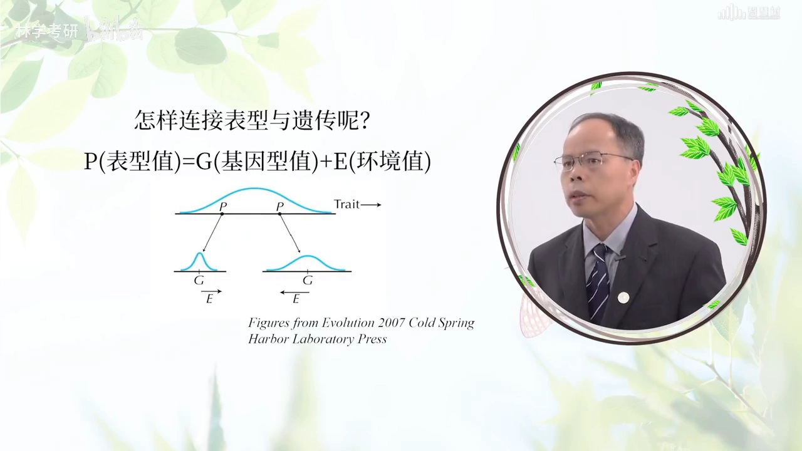
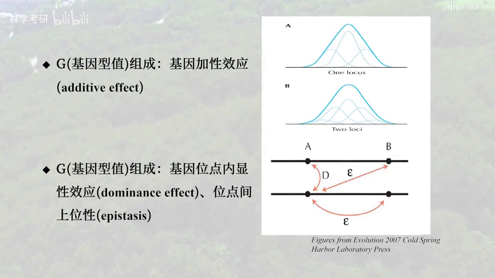
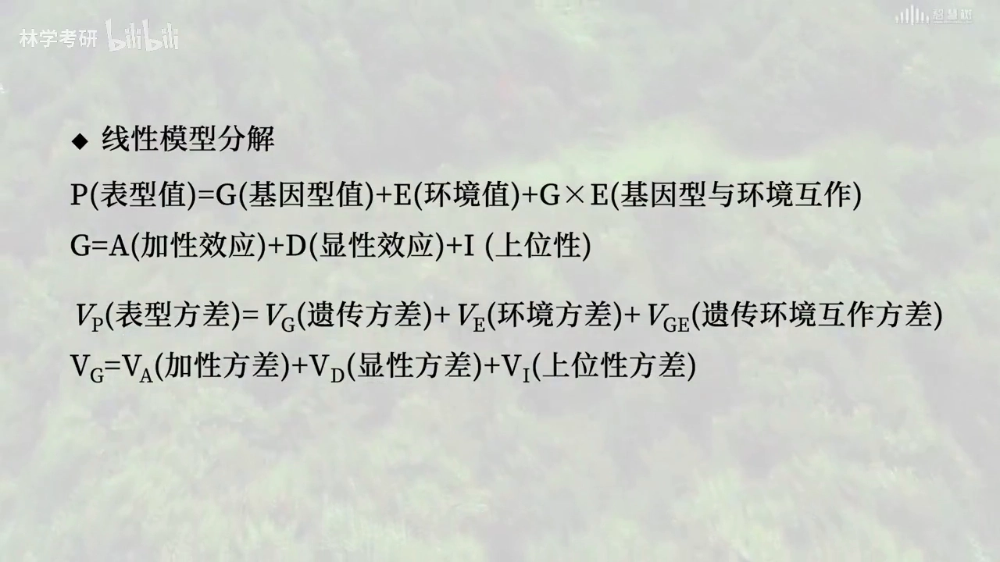
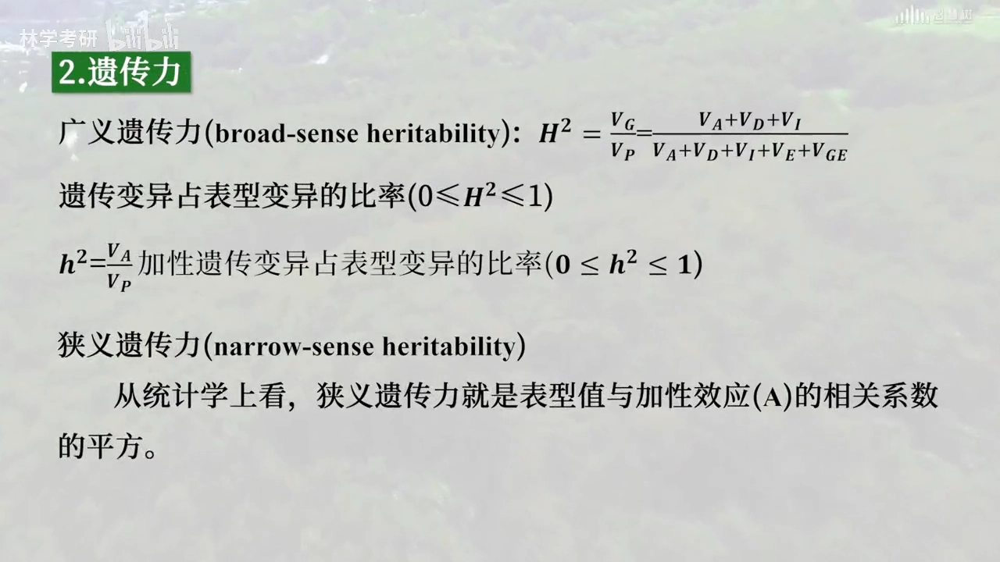
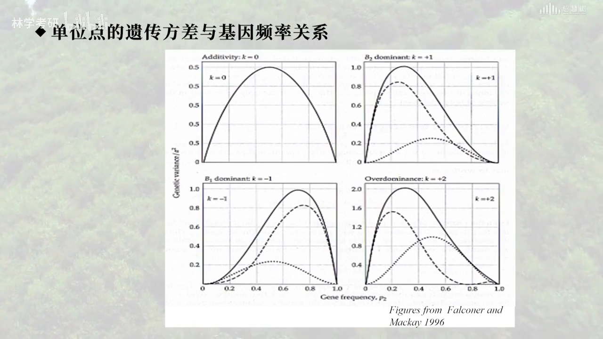
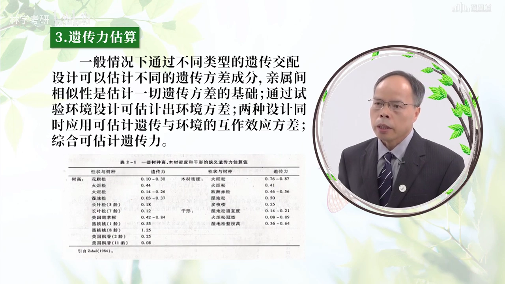
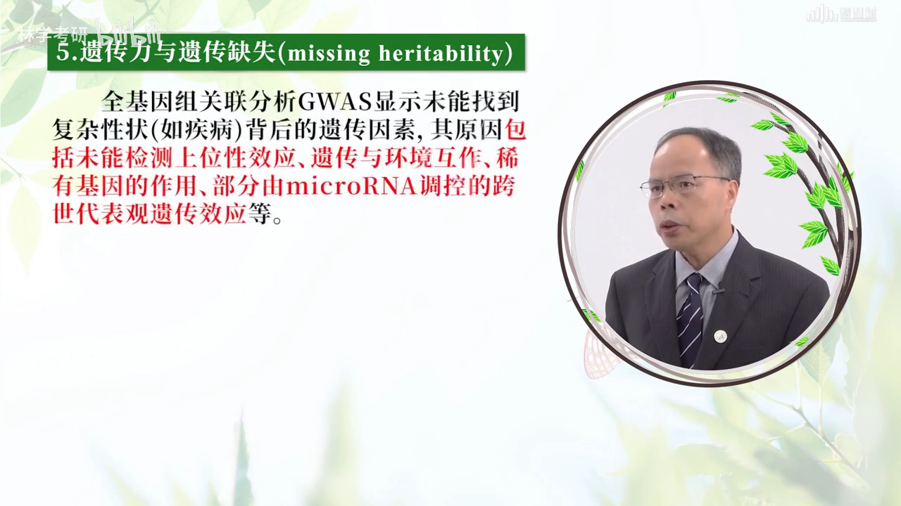

# 遗传力从哪里来：加性与非加性效应怎样分掉表型方差

> 视频来源：[2.4.1 遗传力](https://www.bilibili.com/video/BV1Jr421h7f9/)（B 站 · 华南农业大学 胡老师）｜时长约 9 分钟
> 这支视频用一条线性模型把“表型差异”拆成加性、显性、上位和环境四块，再给出广义/狭义遗传力的定义与估计思路。本文按“先分解、再取比值、最后看边界”的顺序整理。

## 本讲要解决的核心问题（SCQA）

**背景**：身高、产量、抗病性这类数量性状在群体里连续分布，看起来近似正态；同一批材料种在不同环境里，表现又会变。

**冲突**：我们能看到个体之间的差异，也能看到亲子之间的相似，但“差异里有多少是基因造成的”并不能直接从一个个体的表型读出来。

**疑问**：能不能把表型变异拆成几部分，分别归给基因和环境？归给基因的那部分，又该用哪一个比值来衡量？

**回答（中心思想）**：先把表型写成 $P=G+E+G\times E$，再把基因型值 $G$ 拆成加性 $A$、显性 $D$、上位 $I$；然后把“遗传方差占表型方差的比例”定义为广义遗传力，把“加性方差占表型方差的比例”定义为狭义遗传力。遗传力是一个随基因频率和环境变化的群体比值，不是某个性状的固定常数。

## 一、先把表型写成可分解的线性模型

### 1.1 表型值 = 基因型值 + 环境值

数量性状的出发点是一个很朴素的加法模型：

$$
P = G + E
$$

$P$ 是表型值（个体某个性状的度量值），$G$ 是基因型值（表型中由基因型决定的部分），$E$ 是环境离差（环境条件引起的偏离）。视频用一张分布图说明：表型分布近似正态，可以看成遗传分布和环境分布叠在一起的结果。[【跳转到 01:01】](https://www.bilibili.com/video/BV1Jr421h7f9/?t=61)

更完整的写法还要加上基因型与环境的互作：

$$
P = G + E + G\times E
$$

$G\times E$ 的意思是：同一个基因型在不同环境下的表现不一样，或者不同基因型对环境的敏感程度不一样。比如同一批种子种在肥力不同的两块地里，排名可能发生变化。[【跳转到 01:31】](https://www.bilibili.com/video/BV1Jr421h7f9/?t=91)

### 1.2 基因型值再拆成加性、显性和上位

$G$ 还不是“一个数”，它内部有三种来源：

$$
G = A + D + I
$$

- **加性效应 $A$**：等位基因和非等位基因效应可以一项项累加。多一个“增效”等位基因，性状就平均高一点。视频特别指出，这是“可以固定的分量”，因为亲代传给子代时，加性效应能稳定地传递下去。
- **显性效应 $D$**：同一个位点内两个等位基因之间的互作。比如杂合子的表现不等于两个纯合子的平均。
- **上位性 $I$**：不同位点之间的互作。一个基因的效应依赖另一个基因的存在。

这张图同时给出了“一个位点”和“两个位点”的分布：一个位点时，基因型值只有少数几档；两个位点叠加后，分布开始变平滑。位点越多，越接近连续的正态分布。[【跳转到 01:18】](https://www.bilibili.com/video/BV1Jr421h7f9/?t=78)

显性和上位性合称**非加性效应**：它们依赖特定的等位基因组合，不能像加性效应那样按“每个等位基因贡献多少”简单相加，也不能原样稳定地传给下一代。

### 1.3 换成方差，就有了可比较的分量

把模型两边取方差，得到表型方差的分解：

$$
V_P = V_G + V_E + V_{GE}
$$

$$
V_G = V_A + V_D + V_I
$$

$V_P$ 是表型方差，$V_G$ 是遗传方差，$V_E$ 是环境方差，$V_{GE}$ 是遗传与环境的互作方差；遗传方差又分成加性方差 $V_A$、显性方差 $V_D$、上位性方差 $V_I$。[【跳转到 02:01】](https://www.bilibili.com/video/BV1Jr421h7f9/?t=121)

这一步很关键：**“遗传力”不是比较均值，而是比较方差**。均值告诉你群体平均有多高，方差才告诉你群体里个体之间差多少、这些差能归给谁。

## 二、遗传力是两个比值，不是一个绝对值

### 2.1 广义遗传力：遗传方差占表型方差的比例

$$
H^2 = \frac{V_G}{V_P} = \frac{V_A+V_D+V_I}{V_A+V_D+V_I+V_E+V_{GE}}
$$

这就是**广义遗传力**（broad-sense heritability），取值在 0 到 1 之间。它回答的是：表型变异里，所有遗传来源加起来占多大比例。[【跳转到 02:23】](https://www.bilibili.com/video/BV1Jr421h7f9/?t=143)

### 2.2 狭义遗传力：只算能稳定传递的加性部分

$$
h^2 = \frac{V_A}{V_P}
$$

这就是**狭义遗传力**（narrow-sense heritability）。它只把加性方差放进分子，因为亲代传给子代的是等位基因，而不是“某个基因型组合”；显性和上位性依赖组合，传代时会重新洗牌。

视频还给了一个统计学的等价说法：从统计学上看，狭义遗传力就是**表型值与加性效应值之间相关系数的平方**。这也解释了为什么用“子代对双亲的回归”能估计狭义遗传力：回归系数刻画的正是亲代加性值能预测子代多少。

### 2.3 为什么两个都要有

- 想知道“这个性状总体上受遗传影响大不大”，看 $H^2$。
- 想知道“选择或杂交后，后代能稳定继承多少”，看 $h^2$。

视频用林木育种的例子说明：同一张表里，不同树种、不同性状的遗传力差别很大，有的只有 0.10，有的到 0.87。遗传力低不等于“没有基因作用”，而是说在当前群体和环境里，遗传差异占总变异的比例小。

## 三、遗传方差本身会随基因频率变化

### 3.1 纯加性时，基因频率 0.5 附近遗传方差最大

视频考虑一个位点、两个等位基因、三种基因型，并假设群体处于哈迪-温伯格平衡，推导加性方差、显性方差和总遗传方差怎样随基因频率变化。[【跳转到 03:08】](https://www.bilibili.com/video/BV1Jr421h7f9/?t=188)

结论是：

- 纯加性（显性程度 $k=0$）时，基因频率等于 0.5，遗传方差达到最大。
- 存在显性或超显性时，遗传方差的最大值会偏离 0.5。

这说明**遗传方差不是性状自带的常数**，它取决于群体里等位基因的频率和显性关系。换一个群体、换一个环境，同一个性状的遗传力可以不同。

### 3.2 所以遗传力只对“特定群体 + 特定环境”负责

这一点在后文反复出现：遗传力是群体参数，不是个体参数。说“身高的遗传力是 0.8”，意思是“在这个人群、这个环境条件下，身高变异中约 80% 可归给遗传差异”，而不是“你的身高 80% 由基因决定”。

## 四、怎么估：亲属相似性 + 环境设计

### 4.1 基本套路

视频把估计思路压成三句话：[【跳转到 04:32】](https://www.bilibili.com/video/BV1Jr421h7f9/?t=272)

1. 用不同类型的遗传交配设计，估计不同的遗传方差成分；
2. **亲属间的相似性是估计一切遗传方差的基础**；
3. 用试验环境设计估计环境方差；两种设计同时应用，还能估计遗传与环境的互作方差。

图下半部分是林木性状的狭义遗传力估计值，可以看到同一类性状在不同树种之间差别很大。

### 4.2 现实遗传力：用两代人的选择结果反推

除了方差分解，视频还介绍**现实遗传力**（realized heritability）：

$$
h^2 = \frac{R}{S}
$$

- $S$ 是**选择差**：被选中的亲本均值，与选择前亲本群体均值之差。
- $R$ 是**选择响应**：繁殖出的后代均值，与原来亲代群体均值之差。

它牵涉两个世代：亲代施加了多强的选择，子代实际改变了多少。视频指出，通常也可以用“子代对双亲的回归分析”来获得狭义遗传力，两者在概念上对应。[【跳转到 06:06】](https://www.bilibili.com/video/BV1Jr421h7f9/?t=366)

### 4.3 哪些性状遗传力高

视频给出几条经验规律：[【跳转到 04:42】](https://www.bilibili.com/video/BV1Jr421h7f9/?t=282)

- 不易受环境影响的性状，遗传力较高；易受环境影响的性状，遗传力较低。
- 变异系数小的性状，遗传力通常较高。
- 质量性状一般比数量性状有更高的遗传力。
- 遗传力不是固定值；对自花授粉植物，随着杂种世代推移，遗传力有逐渐升高的趋势。

## 五、遗传力的边界：缺失的遗传力与“加性还是上位”

### 5.1 GWAS 找不到的那部分

视频最后把遗传力和全基因组关联分析（GWAS）接起来：GWAS 往往找不到复杂性状背后的全部遗传因素，这部分没被解释的遗传力叫**遗传缺失**（missing heritability）。[【跳转到 07:06】](https://www.bilibili.com/video/BV1Jr421h7f9/?t=426)

视频列出的可能原因包括：

- 上位性效应没有被检测到；
- 基因与环境的互作；
- 稀有基因的作用；
- 部分由 microRNA 调控的跨代表观遗传效应。

这些没被检测到的部分，可能影响性状的遗传力、相关性状的遗传以及遗传稳定性。

### 5.2 数量性状到底以加性为主还是上位为主

视频给出两种经典观点：

- **Fisher 等人的观点**：数量性状、尤其是适应性数量性状，多数由微效加性基因决定，遗传方式主要是加性。
- **Wright 的观点**：上位性效应也占很重要的一部分，基因之间的互作会影响性状的遗传。

视频提到，现代基因组数据分析看到很多基因之间存在相互作用网络，这种模式让人更倾向于支持 Wright 的观点。这也解释了为什么“只把每个位点的效应相加”的模型会漏掉一部分遗传力。[【跳转到 05:15】](https://www.bilibili.com/video/BV1Jr421h7f9/?t=315)

### 5.3 遗传力与群体改良的潜力

视频最后提到 Fisher 的自然选择定理：一个群体改良的潜力有多大，取决于这个群体相对适应值的**加性方差**。狭义遗传率可以看作选择响应的效率；加性方差越大，群体对选择的响应潜力越大。本节只把这一点作为遗传力的出口提一句，不展开育种预测细节。

## 小结

- 数量性状用线性模型分解：$P=G+E+G\times E$，$G=A+D+I$。
- 方差层面：$V_P=V_G+V_E+V_{GE}$，$V_G=V_A+V_D+V_I$。
- 广义遗传力 $H^2=V_G/V_P$，狭义遗传力 $h^2=V_A/V_P$；后者只算能稳定传递的加性部分。
- 遗传方差随基因频率和显性关系变化，所以遗传力是“特定群体 + 特定环境”的参数。
- 估计靠亲属相似性（遗传设计）加环境设计；现实遗传力用 $R/S$ 从两代选择结果反推。
- GWAS 找不到的遗传力叫缺失遗传力，可能藏在上位性、基因与环境互作、稀有变异和表观遗传里。

## 关键术语速查

| 术语 | 一句话解释 |
| --- | --- |
| 数量性状 | 在群体里连续分布、受多基因和环境共同影响的性状，如身高、产量。 |
| 加性效应 $A$ | 等位基因效应可以逐项累加、能稳定传给后代的部分。 |
| 显性效应 $D$ | 同一位点内两个等位基因之间的互作。 |
| 上位性 $I$ | 不同位点之间的互作，一个基因的效应依赖另一个基因。 |
| 广义遗传力 $H^2$ | 全部遗传方差占表型方差的比例。 |
| 狭义遗传力 $h^2$ | 加性方差占表型方差的比例，决定亲代能稳定传给子代多少。 |
| 现实遗传力 | 用选择响应 $R$ 除以选择差 $S$ 得到的、实际实现了的遗传力。 |
| 缺失遗传力 | GWAS 已找到的位点解释不了的遗传力部分。 |