# 遗传力怎么估、能说明什么：双胞胎、SNP 遗传力与关联研究的边界

> 视频来源：[Heritability of Common Complex Traits](https://www.bilibili.com/video/BV11gMtzZEXz/)（B 站 · PG Primer，讲者 Raymond Walters，麻省总医院 / 布罗德研究所）｜时长约 51 分钟
> 这是一场面向遗传学入门者的讲座：前半段把“遗传力”定义清楚，后半段讲双胞胎、GREML、LD 分数回归三种估计方法，以及遗传力怎样限制多基因风险评分、富集分析和遗传相关。字幕由 AI 生成，本文按幻灯片与上下文校正了术语。

## 本讲要解决的核心问题（SCQA）

**背景**：复杂性状的遗传力经常被引用成一个数字，比如“身高的遗传力是 80%”。

**冲突**：同一个性状，双胞胎研究给出的遗传力常在 0.5 左右，而用 GWAS 数据估出的 SNP 遗传力平均只有 0.1 左右；两个数字差得很远，甚至被称为“缺失遗传力”。

**疑问**：遗传力到底在估什么？为什么不同方法给出不同的数？这个数字能用来回答什么问题，又不能回答什么？

**回答（中心思想）**：遗传力是“特定群体、特定环境、特定测量方式下，表型变异中可归因于遗传的比例”。双胞胎/家庭方法估的是全部狭义遗传力，GREML 和 LD 分数回归估的是常见 SNP 能捕捉的那部分；它们本来就不是同一个量。遗传力是遗传预测的理论上限和后续研究的起点，但不是命运、不是干预效果，也不能解释群体之间的差异。

## 一、定义：一个比值，两种理解

### 1.1 从“孩子像父母”到方差比例

遗传力最早来自一个定性观察：孩子像父母，相似性在家族中代代相传。高尔顿等人把它定量化：看孩子的身高与父母平均身高的关系，会看到一种回归的形态，再思考其中有多少来自遗传。[【跳转到 02:54】](https://www.bilibili.com/video/BV11gMtzZEXz/?t=174)

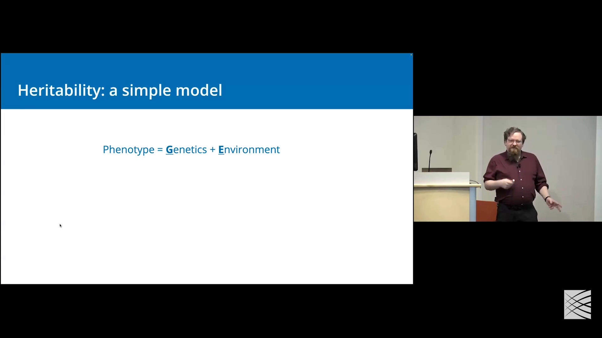

形式化的写法是：

$$
P = G + E
$$

遗传力就是表型总变异中由遗传因素引起、或者可以用遗传因素解释的比例。也就是把观察到的性状总变异做一个分割。

### 1.2 两种理解：因果效应，还是“最好能预测多少”

讲者指出，这个简单定义一到数学上就会遇到选择：

- **因果式理解**：把遗传因素看成真正潜在的因果效应，估计它对表型的因果贡献。
- **预测式理解**：把遗传风险“最多能解释多少方差”作为定义，环境就是遗传解释不了的残余，不管背后的因果机制是什么。

两种理解会给出不同的数，也会影响后面选哪种估计方法。讲者没有说哪一种“正确”，而是说两种都有位置，麻烦在于我们把同一个名字“遗传力”用在了两个概念上。

### 1.3 大写 H、小写 h、以及 h²_g

遗传力有一串由宽到窄的版本：

| 记号 | 分子里放什么 | 直观含义 |
| --- | --- | --- |
| $H^2$ | 全部遗传效应 | 广义遗传力 |
| $h^2$ | 只放加性效应 | 狭义遗传力，更容易估计 |
| $h^2_g$ | 只放常见 SNP 能捕捉的遗传贡献 | SNP 遗传力 |

它们有严格的顺序：遗传力在 0 到 1 之间；狭义遗传力小于或等于广义遗传力；SNP 遗传力通常又更小。讲者提醒：用 SNP 数据估计时，可能捕捉不到稀有变异，也可能漏掉从头突变——这些突变有遗传成分，却不是从父母遗传来的。

### 1.4 二分类性状：用“责任”量表

很多疾病性状是“有/没有”，没有连续的方差可以自然分割。经典解决办法是假设一个看不见的连续风险，叫**责任**（liability）：风险超过某个阈值就表现为“有”，低于阈值就是“没有”。[【跳转到 10:24】](https://www.bilibili.com/video/BV11gMtzZEXz/?t=624)

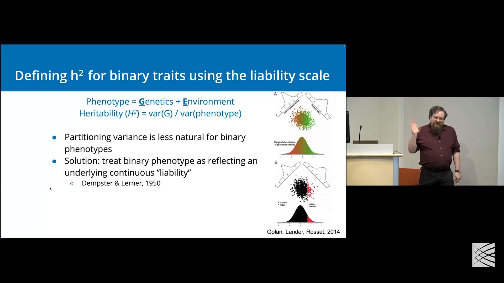

这样我们就可以谈“这个连续责任的遗传力”，而不是直接对二分类表型谈方差分割。代价是：从二分类表型反推责任量表时，需要做校正，校正效果取决于该性状的患病率。

## 二、遗传力不是什么

讲者专门用一页幻灯片划了三条边界：[【跳转到 13:19】](https://www.bilibili.com/video/BV11gMtzZEXz/?t=799)

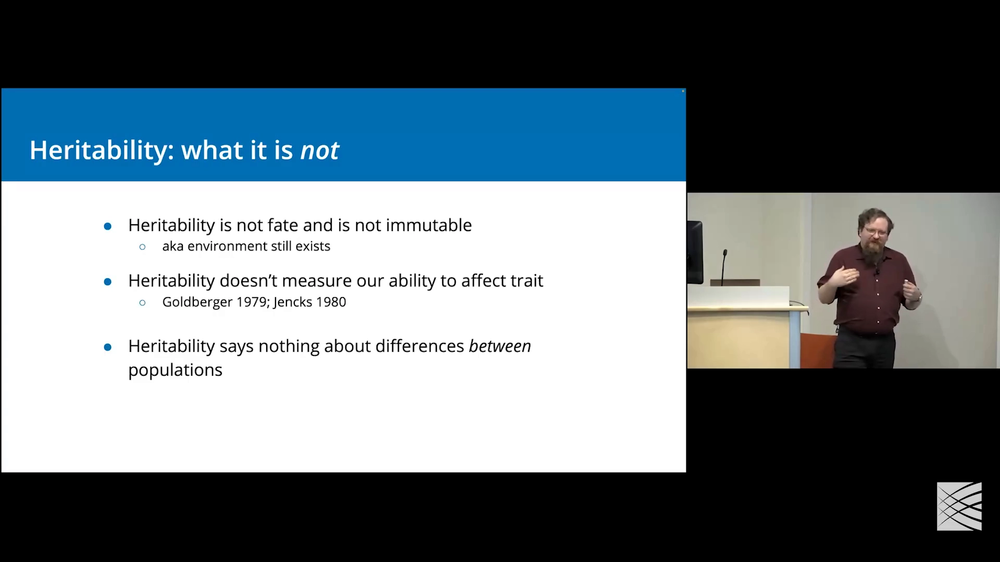

1. **不是命运，也不是不可改变**。遗传力高只说明当前群体里的变异有相当一部分与遗传差异有关，环境仍然存在、仍然可以起作用。讲者举的例子是视力：视力的遗传力可能接近 100%，但这不意味着我们不该给近视的人配眼镜。
2. **不衡量我们改变性状的能力**。即使一个生物学现象有遗传贡献，它在人群中的变异也不意味着我们必须去干预；遗传力只是衡量当前存在的变异。
3. **不解释群体之间的差异**。遗传力是群体**内**的参数，不是群体**间**的参数。同一个表型在 A 群体遗传力高、在 B 群体低，并不告诉你两个群体之间的表型差异是遗传造成的。

还有一条贯穿全讲的限制：遗传力不随时间、地点、测量方式保持稳定。环境变了、人口统计学变了、等位基因频率因漂变或选择变了，遗传力都会变。所以“身高的遗传力是 80%”是一个非常具体的陈述，不是关于身高的固定陈述。

## 三、估计方法一：家庭与双胞胎

### 3.1 基本逻辑：亲缘越近，表型应该越像

估计的起点是家庭内部的相似性。保持 $P=G+E$ 的模型，一对个体的表型相似性，应该反映两人遗传风险对表型贡献的相似性，以及两人环境贡献的相似性。对一对有亲缘关系的人，我们不需要直接测他们的遗传信息，也能从亲缘关系知道他们在预期上有多相似。

把一对个体按亲缘关系画在横轴、表型相似性画在纵轴：[【跳转到 17:29】](https://www.bilibili.com/video/BV11gMtzZEXz/?t=1049)

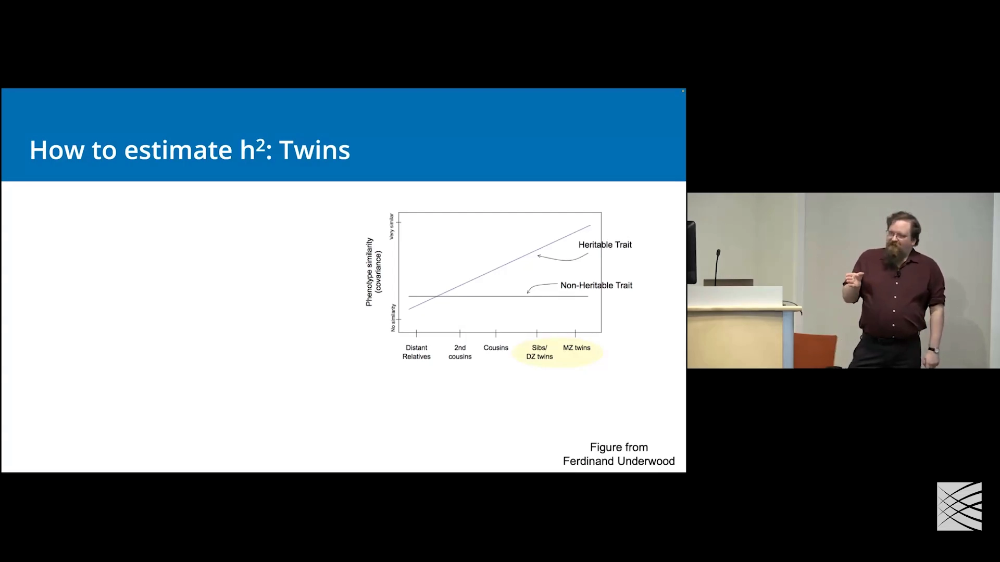

- 如果性状可遗传，亲缘越近的个体对，表型应该越相似，得到一条上升的线。
- 如果性状不可遗传，不管两人遗传上多相似，特征只受环境驱动，相似性就是一条接近零的背景线。

### 3.2 双胞胎：同卵与异卵的差值

最容易操作的是双胞胎：

- **同卵双胞胎（MZ）**：共享全部遗传信息。
- **异卵双胞胎（DZ）**：平均共享一半，就像普通兄弟姐妹。

这里有一个关键假设：一对双胞胎之间的环境相似性，无论同卵还是异卵，都相同。讲者明确说，这是一个相当有争议的假设，但很常见，因为它让估计最简单。在这个假设下，遗传力表现为同卵相关性与异卵相关性之差的一个函数：两者遗传相似性不同，相减就把环境部分抵消掉。

### 3.3 推广成 ACE 模型

更一般地写成 ACE 模型：[【跳转到 19:34】](https://www.bilibili.com/video/BV11gMtzZEXz/?t=1174)

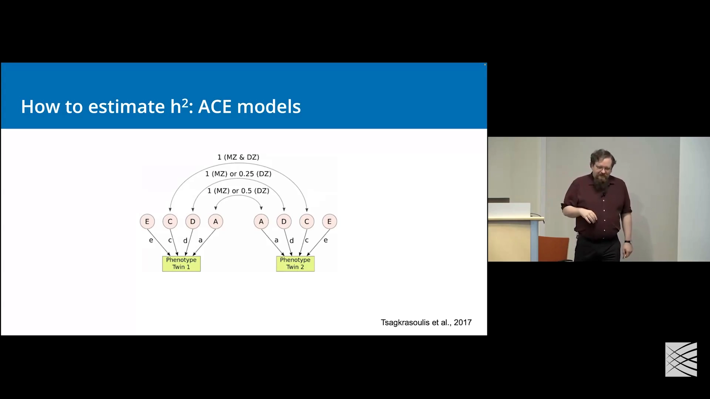

- $A$：加性遗传成分；
- $D$：显性遗传成分；
- $C$：共享共同环境；
- $E$：每个个体特有的环境或残差。

模型会设定各成分之间的相关性，以及每个个体应该表现出什么样的相关。显性部分与加性部分不同；共享环境部分可以有变化，尤其是把异卵双胞胎与其他形式的兄弟姐妹、表亲一起纳入时，可以用不同亲缘关系扩展模型。

### 3.4 家庭方法的软肋

双胞胎和家庭方法不直接观察基因型，全靠家庭结构推断，因此有几个必须注意的假设：

- 同卵和异卵双胞胎的环境相似性相同；如果违反，遗传力可能被高估。
- 家庭内共享环境是否真的被完全捕捉。
- 测量误差：表型测得越差，遗传力作为比例会被压低。

## 四、估计方法二：直接使用遗传数据

### 4.1 GREML：在“无关个体”里找细微的遗传相似性

GREML 是一种使用遗传相关性的受限最大似然估计。它和双胞胎、家庭估计来自同一个想法：更相关的个体在表型上更相似，相似程度与表型遗传力成正比。但它不再依赖完全相关的同卵双胞胎，而是在没有亲缘关系的个体中研究，利用人与人之间更细微的遗传相似性：有些人比平均更相似，有些人更不相似。[【跳转到 21:14】](https://www.bilibili.com/video/BV11gMtzZEXz/?t=1274)

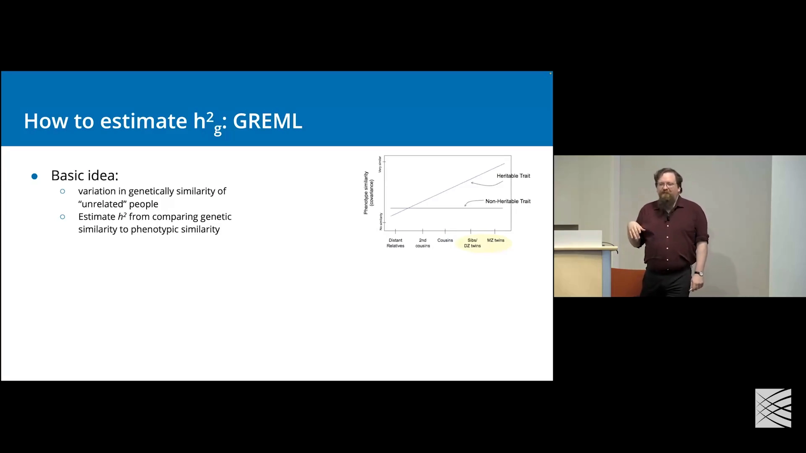

模型写成：

$$
\operatorname{var}(y) = \sigma^2_g K + \sigma^2_e I
$$

$K$ 是遗传关系矩阵（由 IBD 共享片段估计），$I$ 是单位矩阵（假设环境在个体之间独立）。字面上用最大似然估计，概念上等价于：任意一对个体的遗传相关估计在零附近很窄地波动，而表型相似程度对遗传相似程度回归出的那条很微弱的斜率，就给出遗传力估计。

### 4.2 LD 分数回归：只用 GWAS 结果估遗传力

LD 分数回归换了一个策略：不回到个体水平的基因型，而是把 GWAS 里的关联信号转化成遗传力估计。这样能跟上元分析的规模，计算开销也更低。[【跳转到 25:49】](https://www.bilibili.com/video/BV11gMtzZEXz/?t=1549)

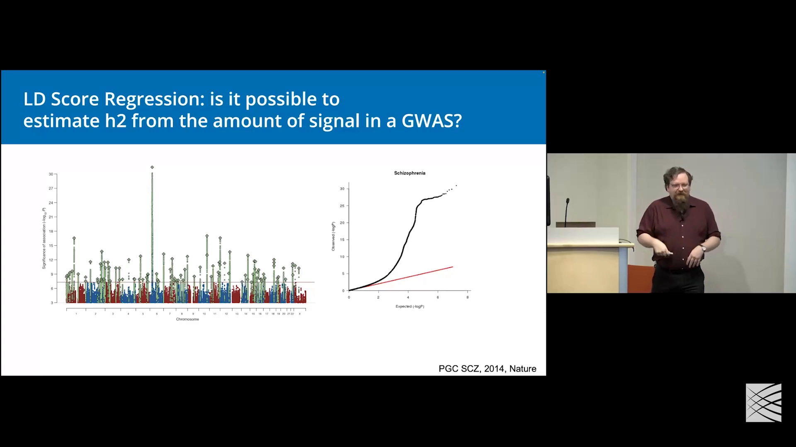

直觉可以这样理解：

1. 基因组有 LD 块结构，块内变异高度相关。
2. 假设致变位点随机分布在基因组上。一个致变位点所在的 LD 块都会在 GWAS 中显示关联，我们无法区分块里哪个是致变位点。
3. 一个片段在 GWAS 中显示关联的可能性，与它所在 LD 块的大小、也就是它标记的遗传变异量成正比。
4. 把每个片段与周围所有片段的相关性求和，就得到 LD 分数；LD 分数与卡方统计量回归，斜率是遗传力、样本量和片段数的函数。

因为唯一的输入是 GWAS 信息和 LD 信息，LD 信息可以从参考面板提取，所以不需要个体水平数据。

## 五、结果：所有性状都可遗传，但不同方法估的不是同一个量

### 5.1 双胞胎与家庭研究：中等遗传力

讲者引用大约 50 年的双胞胎研究和元分析：在所研究的表型领域里，可以看到中等程度的遗传力，通常在 0.5 左右。这被称为“行为遗传学第一定律”的一个版本：所有特征都是有遗传力的。不同表型领域会有差异：更直接测量的表型遗传力稍高，人格或社会价值观稍低，但几乎所有人类测量都有明显的遗传力。

### 5.2 SNP 遗传力：平均约 0.1

把 LD 分数回归应用到英国生物库的数千个特征上：[【跳转到 33:19】](https://www.bilibili.com/video/BV11gMtzZEXz/?t=1999)

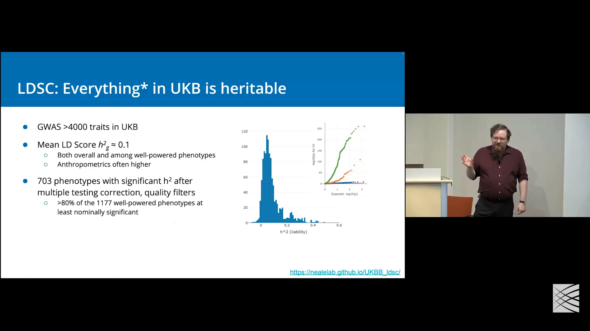

- GWAS 覆盖英国生物库 4000 多个性状；
- 平均 LD 分数 SNP 遗传力约 0.1，无论总体还是只看统计功效足够的表型；
- 人体测量学性状通常更高；
- 703 个表型在多重检验校正和质量过滤后遗传力显著；1177 个统计功效足够的表型中，超过 80% 至少名义显著。

### 5.3 缺失遗传力：先分清估的是哪个量

GWAS 数据的估计低于双胞胎/家庭估计，这个差距就是“缺失遗传力”（missing heritability）。[【跳转到 34:34】](https://www.bilibili.com/video/BV11gMtzZEXz/?t=2074)

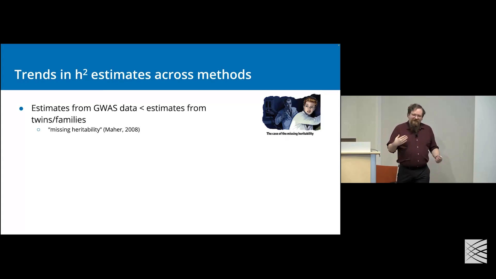

讲者强调，部分原因在于**不同的方法估计的是不同的量**：

- 双胞胎和家庭方法寻找的是全部狭义遗传力；
- LD 分数回归估的是常见 SNP 能捕捉的 $h^2_g$；
- 关于缺失遗传力的一些说法，关注的是与“用更多 SNP 或最显著位点解释的方差”之间的差异。

但也不只是方法差异。即使 LD 分数回归和 GREML 之间也有差异，通常 LD 分数回归略低；这回到估计量的细微差异和实现细节，比如等位基因频率怎么处理、遗传关系矩阵里各变异的权重怎么给。不同版本的软件、不同的底层遗传结构，都会带来变异。

### 5.4 每种方法都有自己的偏差来源

讲者列了一串“垃圾进、垃圾出”的风险：

- **测量误差**：表型测不准，遗传力作为比例会被压低。
- **血统和分层**：个体之间的遗传相似性包含血统相似性；如果不把血统信号与总体遗传信号分开，估计会有偏。
- **环境假设**：相关个体是否共享环境，还是简单当作独立残差。
- **责任量表校正**：从二分类表型反推连续责任时，校正效果取决于患病率。
- **加性假设**：GWAS 数据的估计是纯加性的；显性效应的大规模搜索几乎没有发现明显信号，大多数信号已被加性效应捕捉。更罕见的变异研究可能会看到更多显性或隐性作用。

## 六、遗传力能用来做什么

遗传力不是终点，而是许多后续研究的“跳板”。[【跳转到 40:24】](https://www.bilibili.com/video/BV11gMtzZEXz/?t=2424)

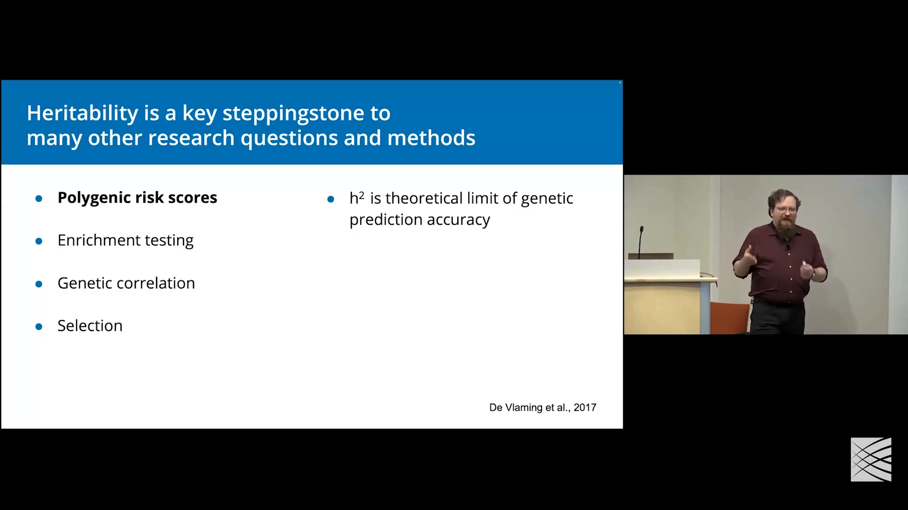

### 6.1 多基因风险评分的理论上限

遗传力是“最好的遗传预测器能解释的方差”。在无限数据的极限下，多基因风险评分（PRS）的预测能力永远不会超过它。即使在达到极限之前，也可以推导出：给定遗传力和样本量，预测效果应该怎样随遗传力变化。许多 PRS 方法现在把遗传力纳入先验，用来更稳健地估计效应量。

### 6.2 富集检验

大多数富集检验的零假设是：给定表型的遗传效应均匀分布在基因组上。如果我能估计某些基因组区域的遗传力，比如保守区域、与特定细胞或组织类型相关的开放染色质，就能得到特定类别的遗传力，再与“所有 SNP 均匀”的预期比较，得到富集量。

### 6.3 遗传相关

把同一个模型应用到两个表型：

$$
\text{Phenotype}_1 = \text{Genetics}_1 + \text{Environment}_1
$$

$$
\text{Phenotype}_2 = \text{Genetics}_2 + \text{Environment}_2
$$

遗传相关就是两个表型遗传成分之间的相关。估计时先估两者的遗传协方差，再用两个表型的遗传力标准化。这样就从“单个表型的方差参数”走到“两个表型之间的协方差参数”。[【跳转到 44:34】](https://www.bilibili.com/video/BV11gMtzZEXz/?t=2674)

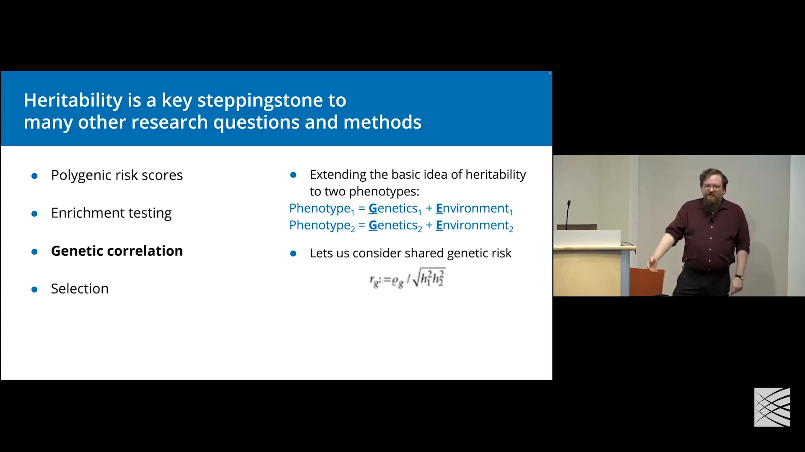

### 6.4 选择响应

遗传力也出现在关于选择强度、选择如何随时间改变遗传漂变、表型如何响应选择压力的期望里。加性方差越大，群体对选择的响应潜力越大。

## 七、比较不同群体的遗传力，为什么很难

讲座最后的提问环节讨论了一个常见需求：比较不同人群的遗传力。讲者的回答是：概念上理论上是可能的，但通常为了让结果可比，需要匹配所有研究特征，做“苹果与苹果”的比较相当困难。

即使测量误差这样的因素也会影响：如果一个表型测得更差、测量误差更多，遗传力作为总体比例会被压低。这并不意味着遗传学对真实特质的贡献有多少变化，只是估计被测量质量拖低了。所以原则上可以比较，实践中非常困难。

讲者还回到“因果 vs 预测”的模糊性：两种理解都有位置，大多数挑战来自我们把同一个名字用在两种概念上。预测版本更容易得到，因为可以把环境当作剩余部分；但它会混入分层、父母环境等与基因实际作用无关的信号，除非做家庭内研究。因果版本更有价值，但实际处理更难。关键是要清楚自己估计的是什么、它实际意味着什么。

## 小结

- 遗传力是表型变异中可归因于遗传的比例，是群体参数，随群体、环境、测量方式变化。
- 广义 $H^2$ 放全部遗传效应，狭义 $h^2$ 只放加性效应，SNP 遗传力 $h^2_g$ 只放常见 SNP 能捕捉的部分。
- 二分类性状用责任阈值模型定义遗传力。
- 双胞胎/家庭方法用亲缘相似性估全部狭义遗传力；GREML 用无关个体的细微遗传相似性；LD 分数回归只用 GWAS 汇总结果。
- 双胞胎研究给出的遗传力常在 0.5 左右，SNP 遗传力平均约 0.1；差距一部分来自“估的不是同一个量”，一部分来自方法假设和实现细节。
- 遗传力不是命运、不衡量干预能力、不解释群体间差异；它是 PRS 的理论上限，也是富集、遗传相关和选择研究的起点。

## 关键术语速查

| 术语 | 一句话解释 |
| --- | --- |
| 遗传力 | 表型变异中可归因于遗传因素的比例，是群体参数。 |
| 广义遗传力 $H^2$ | 全部遗传方差占表型方差的比例。 |
| 狭义遗传力 $h^2$ | 加性遗传方差占表型方差的比例。 |
| SNP 遗传力 $h^2_g$ | 常见 SNP 能捕捉到的遗传方差占表型方差的比例。 |
| 责任阈值模型 | 把二分类性状想成一个看不见的连续风险超过阈值的结果。 |
| ACE 模型 | 把表型方差分成加性遗传 A、显性遗传 D、共享环境 C 和个体环境 E。 |
| GREML | 用个体间遗传关系矩阵和最大似然估计 SNP 遗传力的方法。 |
| LD 分数回归 | 用 GWAS 汇总统计量和 LD 信息回归估计 SNP 遗传力的方法。 |
| 缺失遗传力 | GWAS 能解释的遗传力低于家庭研究估计的部分。 |
| 遗传相关 | 两个表型遗传成分之间的相关性。 |