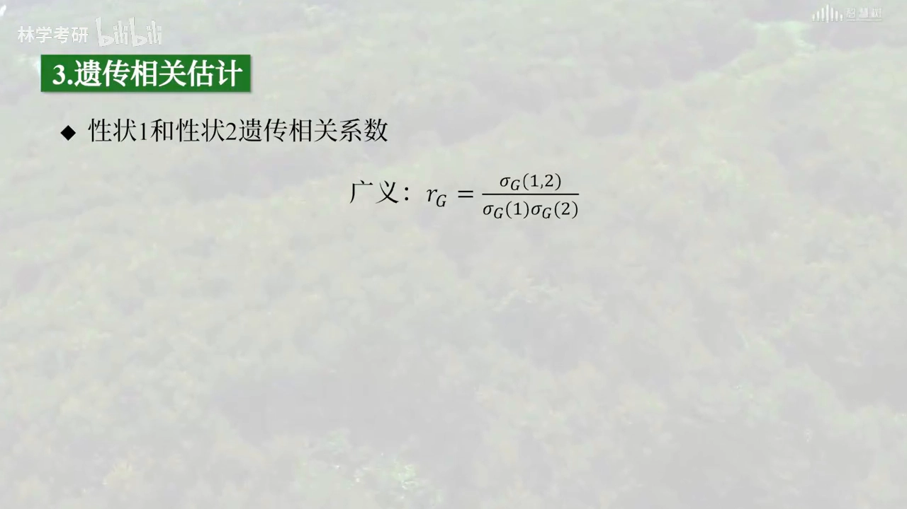
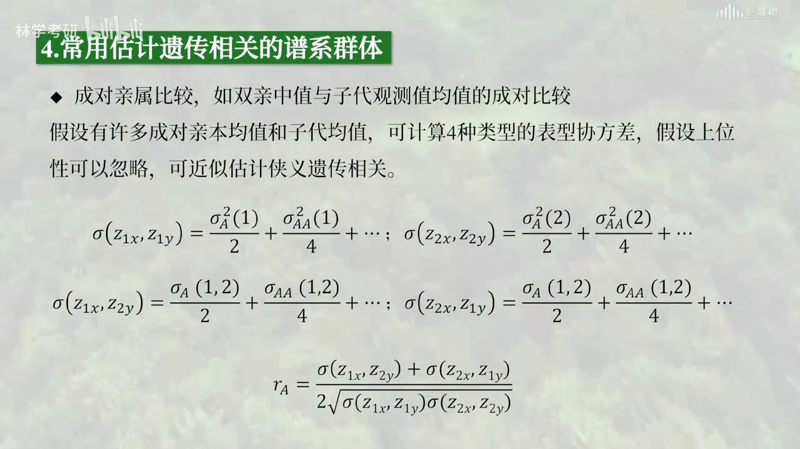
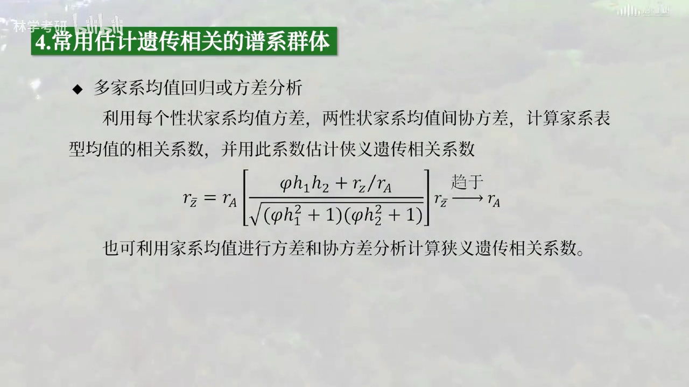
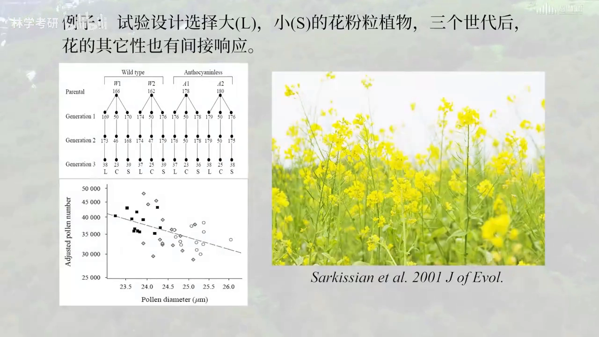

# 遗传相关：一因多效与连锁不平衡怎样让两个性状一起变

> 视频来源：[2.4.4 遗传相关](https://www.bilibili.com/video/BV1e1421S7YX/)（B 站 · 华南农业大学 胡老师）｜时长约 9 分钟
> 这支视频讲数量遗传里的“遗传相关”：它和表型相关有什么不同，两个来源怎样区分，广义和狭义怎么定义，以及它在选择、群体分化和生活史权衡里的用处。

## 本讲要解决的核心问题（SCQA）

**背景**：育种和演化里经常看到两个性状一起变：选了花粉粒大小，花的其他性状也跟着变；生活史里“活得久”和“生得多”常常此消彼长。

**冲突**：两个性状在表型上相关，不等于它们在遗传上相关。它们可能只是被同一个环境一起影响，也可能只是染色体上离得近、被一起继承。

**疑问**：怎样把两个性状的共同变异归到遗传上？遗传相关从哪里来，怎么定义、怎么估，又能用来解释什么？

**回答（中心思想）**：遗传相关是两个性状**遗传成分**之间的相关，不是表型相关。它有两个来源：一因多效（一个基因同时影响两个性状）和配子连锁不平衡（两个基因在染色体上连锁）。重组能改变后者，改变不了前者。把遗传协方差除以两个性状遗传方差的平方根，就得到遗传相关系数；它决定了选择一个性状时，另一个性状会跟着变多少。

## 一、两个来源：一因多效与配子连锁不平衡

视频开篇把遗传相关的遗传学基础分成两个机制：[【跳转到 00:20】](https://www.bilibili.com/video/BV1e1421S7YX/?t=20)

- **一因多效**：一个基因同时控制多个性状的表现。比如同一个调控基因既影响株高，又影响开花时间。
- **配子连锁不平衡**：两个性状背后的基因在染色体上离得近，配子形成时被一起传下去，导致两个性状的等位基因在群体里非随机地一起出现。

这两个机制不一样，关键差别在**重组**：

- 重组可以打散连锁不平衡，所以能改变第二个机制；
- 重组不能把一个基因拆成两个，所以改变不了第一个机制。

这个区分在后面解释“群体分化”时还会用到：一因多效能让群体在多个性状上产生实质性分化，而连锁不平衡造成的相关会随重组逐渐衰减。

## 二、定义：遗传协方差除以两个遗传标准差

### 2.1 广义遗传相关

两个性状的遗传相关，最一般的定义是：

$$
r_G = \frac{\sigma_G(1,2)}{\sigma_G(1)\sigma_G(2)}
$$

分子是两个性状之间的**遗传协方差**，分母是各自性状遗传方差的平方根，也就是各自的遗传标准差。[【跳转到 01:43】](https://www.bilibili.com/video/BV1e1421S7YX/?t=103)

这就是**广义遗传相关**：分子里放的是两个性状之间总的遗传协方差。

### 2.2 狭义遗传相关

和遗传力一样，遗传相关也可以只算加性部分：

$$
r_A = \frac{\sigma_A(1,2)}{\sigma_A(1)\sigma_A(2)}
$$

分子换成两个性状之间的**加性协方差**，分母换成各自的加性标准差，得到**狭义遗传相关**。它只关心能稳定传递的加性效应，因此在育种里更常用。

### 2.3 协方差本身也能拆

视频进一步把两个性状的遗传协方差拆开：

- 同一个体上两个性状之间，可以分解成加性协方差、显性协方差、加性×加性协方差，以及加性×显性、显性×显性等组成部分。
- 不同个体之间两个性状之间，也可以分解成加性效应相关、显性效应相关、显性×显性，以及家系×家系等不同的上位性关系。

这告诉我们：遗传相关不是单一机制，它和遗传力一样，是多个方差/协方差成分的组合。

## 三、遗传相关、表型相关、环境相关是三件事

### 3.1 三者的关系

视频强调，研究里同时存在三种相关：[【跳转到 03:38】](https://www.bilibili.com/video/BV1e1421S7YX/?t=218)

- **遗传相关**：两个性状遗传成分之间的相关；
- **表型相关**：两个性状观测值之间的相关；
- **环境相关**：两个性状环境成分之间的相关。

它们的协方差之间存在对应关系；加性方差之间也存在这种关系，环境协方差也可以推导出三者之间的关系。所以，如果知道遗传相关和表型相关，就可以反推出环境相关。

### 3.2 一个容易踩的坑：非加性相关会被归到环境里

视频提醒：如果我们只考虑加性效应，那么剩下的非加性效应、上位性效应那部分相关，就自然被归到了“环境相关”里。[【跳转到 04:24】](https://www.bilibili.com/video/BV1e1421S7YX/?t=264)

这听起来奇怪，但逻辑是：模型里只留了加性遗传项，剩下的所有协方差都被残差吸收，而残差在统计上就叫环境项。所以读“环境相关”时要知道，它可能混进了非加性遗传相关。

还有一个重要差别：**环境相关不能从上一代传递到下一代，遗传相关可以**。这也是为什么育种和演化更关心遗传相关。

## 四、怎么估：靠亲属的协方差

### 4.1 成对亲属比较

遗传相关不能直接观测，要靠亲属之间的协方差来估。视频给了三种常用群体。

第一种是**成对亲属比较**，比如双亲中亲值与子代观测值均值的成对比较。假设有许多成对亲本均值和子代均值，可以计算 4 种类型的表型协方差；假设上位性可以忽略，就能近似估计狭义遗传相关。[【跳转到 02:48】](https://www.bilibili.com/video/BV1e1421S7YX/?t=168)

### 4.2 巢式设计：全同胞/半同胞

第二种是**巢式设计**（也叫全同胞/半同胞设计）：比如 N 个父本与 M 个母本交配，产生全同胞后代，得到巢式方差分析表；根据这张表可以计算加性相关以及各自性状的遗传方差，再算出遗传相关。

### 4.3 家系均值回归

第三种是**多个家系的均值回归或方差分析**：利用每个性状的家系均值方差、两性状家系均值之间的协方差，计算家系表型均值的相关系数，再用它估计狭义遗传相关系数。[【跳转到 03:38】](https://www.bilibili.com/video/BV1e1421S7YX/?t=218)

### 4.4 估计时的统计问题

视频点了三个坑：

1. **显著性检验**：遗传相关是否为零，可以对成对数据做回归、检验回归系数；也可以用 bootstrap 或 jackknife 做重抽样，生成很多样本再重新分析，估计置信区间。检测多个性状之间的遗传相关时，还要调整显著性水平，通常用 Bonferroni 校正。
2. **选择引起的偏差**：如果所研究的性状与亲本群体选择的目标性状相关联，那么在经过选择的子代群体中估计遗传相关，会带来偏差。[【跳转到 05:14】](https://www.bilibili.com/video/BV1e1421S7YX/?t=314)
3. **标准误难算**：遗传相关系数的标准差/标准误要根据具体的遗传交配设计和群体推导，相对困难；视频用模拟图展示了不同情况下标准误的量级。

## 五、遗传相关能解释什么

### 5.1 相关响应：选一个，另一个跟着变

第一个应用是人工或自然群体中的选择。选择改变一个性状的同时，也会改变与它相关的另一个或多个性状，这就产生了进化上的制约，或者育种改良上的限制。[【跳转到 06:06】](https://www.bilibili.com/video/BV1e1421S7YX/?t=366)

视频还提到，人工群体与自然群体对遗传相关改变的响应不一样：遗传相关的改变会影响对自然选择的响应，但不会改变这个群体从一个选择方向转向另一个方向。

### 5.2 间接选择：油菜花粉粒的例子

第二个应用是**间接选择响应**：当我们对性状一进行选择时，与它有显著遗传相关的另一个性状也会产生选择响应。

视频举了一个油菜实验：[【跳转到 06:53】](https://www.bilibili.com/video/BV1e1421S7YX/?t=413)

实验朝两个方向选择花粉粒大小：一个方向是花粉粒越来越大，另一个方向是越来越小。经过三个世代的选择后发现，不仅花粉粒大小发生变化，与它相关的其他花部性状也发生变化，比如花粉数目。这说明间接选择响应确实存在，而它的基础就是遗传相关。

### 5.3 群体分化：一因多效 vs 连锁不平衡

第三个应用是解释群体分化的遗传基础。通过一因多效——注意是一因多效，不是连锁平衡或不平衡——一个性状受到的选择，会导致另一个或几个性状产生类似的选择响应。当不同群体对不同的选择做出响应时，群体就会在多个性状上出现相应分化。[【跳转到 07:30】](https://www.bilibili.com/video/BV1e1421S7YX/?t=450)

这和 LD 不一样：LD 造成的相关会随重组衰减，而一因多效造成的相关不会，所以一因多效能产生群体在多个性状上的实质性分化。

### 5.4 遗传协方差矩阵的同质性

第四个应用是遗传协方差矩阵的同质性：遗传相关密切或相近的群体，具有相似的遗传协方差矩阵。这一点在很多试验和研究中已经被证实，机制主要也是一因多效。[【跳转到 08:01】](https://www.bilibili.com/video/BV1e1421S7YX/?t=481)

### 5.5 生活史性状的负相关

最后一个应用是生活史性状。视频指出，生活史性状之间的遗传相关通常呈现负相关。[【跳转到 08:25】](https://www.bilibili.com/video/BV1e1421S7YX/?t=505)

这背后的直觉是“资源有限”：把更多资源投给繁殖，就少了投给存活；于是两个性状在遗传上此消彼长。视频把它留成思考题：生活史性状负相关的遗传与进化机制是什么？

## 小结

- 遗传相关是两个性状遗传成分之间的相关，不是表型相关。
- 它有两个来源：一因多效和配子连锁不平衡；重组只改变后者。
- 广义遗传相关用总遗传协方差，狭义遗传相关只用加性协方差。
- 遗传相关、表型相关、环境相关是三件事；只考虑加性时，非加性相关会被归到环境相关里；环境相关不跨代传递。
- 估计靠亲属协方差：成对亲属比较、巢式设计、家系均值回归；要注意显著性、选择偏差和标准误。
- 应用包括相关响应、间接选择、群体分化、遗传协方差矩阵同质性和生活史性状的负相关。

## 关键术语速查

| 术语 | 一句话解释 |
| --- | --- |
| 遗传相关 | 两个性状遗传成分之间的相关系数。 |
| 一因多效 | 一个基因同时影响多个性状，是遗传相关的稳定来源。 |
| 配子连锁不平衡 | 两个基因在染色体上连锁，被一起继承，造成非随机的性状组合。 |
| 广义遗传相关 | 用两个性状总遗传协方差定义的遗传相关。 |
| 狭义遗传相关 | 只用加性协方差定义的遗传相关。 |
| 表型相关 | 两个性状观测值之间的相关，混合了遗传和环境。 |
| 环境相关 | 两个性状环境成分之间的相关，不跨代传递。 |
| 间接选择响应 | 选择性状一时，与它遗传相关的性状二也跟着改变。 |
| 遗传协方差矩阵 | 多个性状之间遗传方差与协方差的整体结构。 |