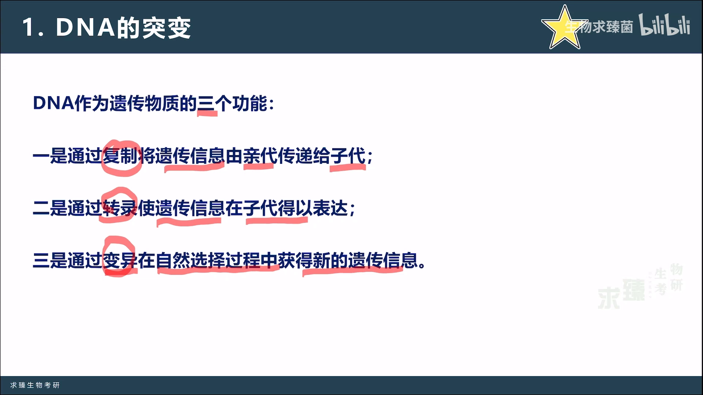
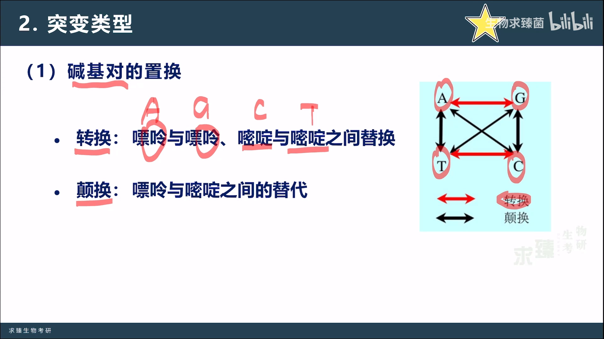
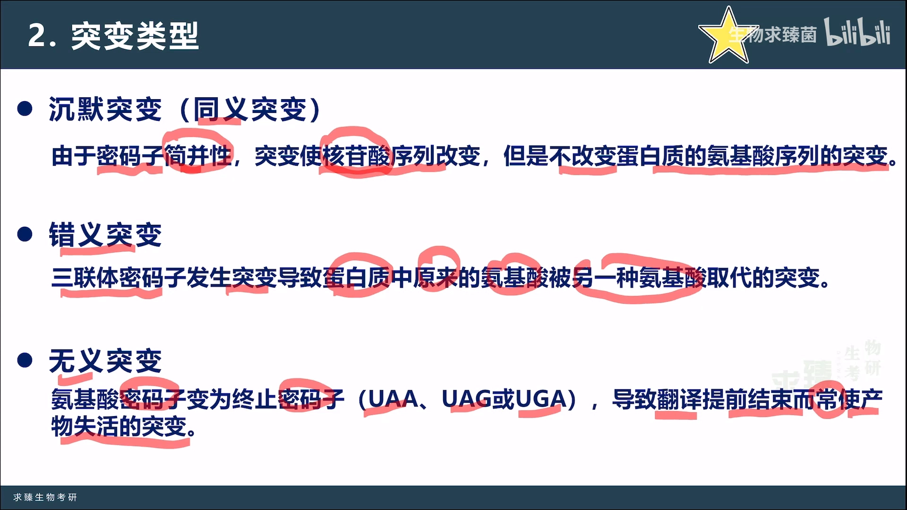
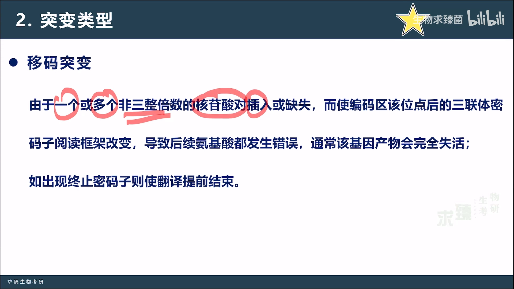
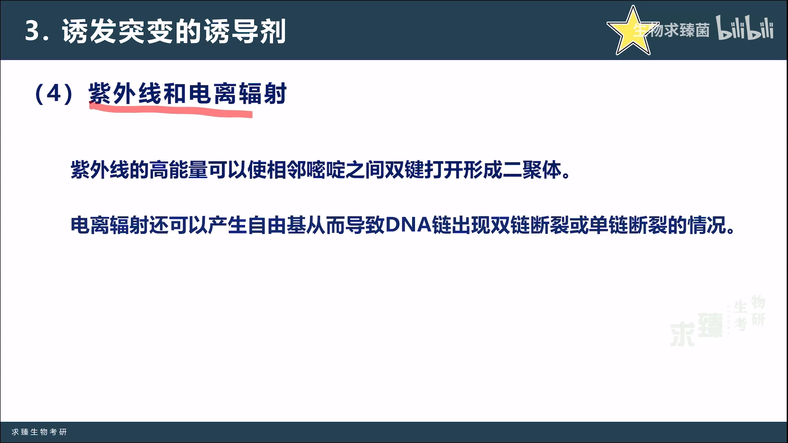

# 编码区变异的四类后果：同义、错义、无义与移码

> 视频来源：[分子生物学-DNA的突变](https://www.bilibili.com/video/BV1kbK9z9EFR/)（Bilibili · 生物求臻菌，约 12 分钟）
> 导读：一支把"碱基改变"落到"蛋白改变"上的短课。本文保留全部四类后果的判据，并把诱变剂与 Ames 试验压缩成与后果相连的一段，详细机制见 4.1.1。

## 本讲要解决的核心问题（SCQA）

**背景**：密码子是三联体，从起始密码子开始按阅读框连续读下去；密码子表有简并性，同一个氨基酸常对应好几个密码子（见 [B01 §2.2.4 遗传密码](../../../../B01_生命科学基础主干/2_遗传信息流与中心法则/2.2_从基因到产物/2.2.4_遗传密码：密码子、简并性与阅读框/【分子生物学】遗传密码（遗传密码的特点）.md)）。

**冲突**：同样是一个碱基的改变，后果差别可以极大：有的蛋白一个氨基酸都没变，有的换掉一个氨基酸，有的蛋白直接截短，有的从变异位点往后全乱。只看"哪个碱基变了"完全看不出后果。

**疑问**：一段编码区序列改变，怎么一步步推到蛋白层面的后果？

**回答（中心思想）**：编码区变异按三个判据分层——**密码子变没变、氨基酸变没变、阅读框变没变**。由此得到四类后果：同义（密码子变、氨基酸不变）、错义（换一个氨基酸）、无义（变成终止密码子、翻译提前结束）、移码（插入或缺失非三整倍数碱基，下游阅读框整体错位）。前三类只影响一个密码子，移码影响的是变异位点之后的整段蛋白。

---

## 一、先界定"突变"：突然、稳定、可遗传的序列改变

视频先把 DNA 作为遗传物质的三个功能摆出来：通过**复制**把遗传信息由亲代传给子代，通过**转录**让遗传信息在子代得以表达，通过**变异**在自然选择中获得新的遗传信息。[【跳转到 01:09】](https://www.bilibili.com/video/BV1kbK9z9EFR/?t=69)

在这个框架下，突变被定义为 **DNA 分子中的核苷酸序列发生突然而稳定的改变**。要点有三个：突然（不是渐变）、稳定（能保持下去）、可遗传（随复制传给子代），因此它会改变复制、转录、翻译的产物，表现出与亲代不同的遗传特性。[【跳转到 01:09】](https://www.bilibili.com/video/BV1kbK9z9EFR/?t=69) [【跳转到 01:34】](https://www.bilibili.com/video/BV1kbK9z9EFR/?t=94)

"异常"是相对亲代说的，**不等于有害**：同样的改变可能有利于它在环境中生存，也可能有害。视频还提醒，突变是进化的基础——物种多样性的来源就是突变加上自然选择，而不是"所有突变都是坏事"。[【跳转到 00:44】](https://www.bilibili.com/video/BV1kbK9z9EFR/?t=44)

按来源，视频把突变分成两类：一是 **DNA 损伤和错配得不到修复**造成的突变；二是**不同 DNA 分子之间的交换**引起的遗传重组。[【跳转到 02:24】](https://www.bilibili.com/video/BV1kbK9z9EFR/?t=144) 这两类来源的机制（损伤类型、修复通路、重组）属于 [4.1.1 变异来源](../../4.1_变异的层级/4.1.1_变异来源：生殖系与体细胞突变、突变率与突变特征/变异来源：生殖系与体细胞、突变率与突变特征.md) 的范围，本节只关心它们落到蛋白上的后果。

## 二、单碱基替换的两种化学分类：转换与颠换

在讲后果之前，先给替换本身分类。**碱基对的置换**分两种：[【跳转到 02:40】](https://www.bilibili.com/video/BV1kbK9z9EFR/?t=160)

- **转换**（transition）：嘌呤与嘌呤之间（A↔G）、或嘧啶与嘧啶之间（C↔T）的替换；
- **颠换**（transversion）：嘌呤与嘧啶之间的替换。

这个分类是化学层面的，**不能直接推出蛋白后果**——同样是转换，可能同义、可能错义、也可能无义。它的用处在于：某些诱变剂只产生特定类型的替换（见第五节），因此"突变谱里转换多还是颠换多"能反过来提示诱变来源。

## 三、四类后果：判据是"密码子、氨基酸、阅读框"

视频把编码区变异的后果分成四类，这是本节的主干。[【跳转到 05:01】](https://www.bilibili.com/video/BV1kbK9z9EFR/?t=301)

### 3.1 同义突变（沉默突变）：密码子变了，氨基酸没变

**定义**：由于遗传密码子的简并性，突变使核苷酸序列改变，但**不改变蛋白质氨基酸序列**，叫沉默突变或同义突变。[【跳转到 03:46】](https://www.bilibili.com/video/BV1kbK9z9EFR/?t=226)

**为什么可能**：mRNA 上的密码子确实变了，但变成了同一个氨基酸的另一个"简并性密码子"（同义密码子），多肽链里的氨基酸序列因此没有变化。

**判读要点**：同义突变"沉默"的是**氨基酸序列**，不等于对表型绝对无影响。视频的表述限定在蛋白序列这一层；密码子使用偏好、翻译速率、剪接或调控层面的影响不在本讲范围，不能据"同义"就断言"无表型"。

### 3.2 错义突变：换掉一个氨基酸

**定义**：三联体密码子发生突变，导致蛋白质中**原来的氨基酸被另一种氨基酸取代**，叫错义突变。[【跳转到 04:11】](https://www.bilibili.com/video/BV1kbK9z9EFR/?t=251)

**例子**：视频举的例子是镰状红细胞贫血的那个突变——它就是一个错义突变。这个例子在蛋白层面的后果，见本节的另一篇 [错义突变的蛋白后果](错义突变的蛋白后果：血红蛋白S如何把红细胞变成镰刀.md)。

**判读要点**：错义突变是四类里**后果最不确定**的一类。换上的氨基酸化学性质相近（都疏水、都带正电）时，蛋白可能几乎不受影响；换在活性位点或结构核心上，可能直接失活。所以"错义"只说明改变的类型，**不说明严重程度**——这正是后面需要功能证据和预测工具的原因。

### 3.3 无义突变：密码子变成终止密码子

**定义**：编码氨基酸的密码子因为突变变成了**终止密码子**（UAA、UAG 或 UGA），导致翻译提前结束，常常使产物失活的突变。[【跳转到 04:36】](https://www.bilibili.com/video/BV1kbK9z9EFR/?t=276)

**后果链**：终止信号提前出现 → 核糖体在该处释放肽链 → 得到一条**截短的蛋白**。截短通常同时丢掉后端的结构域和修饰位点，所以"常常失活"。

**延伸**：真核细胞还有一套专门处理"提前终止密码子"的监视机制（无义介导降解 NMD），它会把这类 mRNA 一起清除，后果比"只少一段蛋白"更复杂，见 [B01 §2.2.5 mRNA 监视](../../../../B01_生命科学基础主干/2_遗传信息流与中心法则/2.2_从基因到产物/2.2.5_翻译：核糖体、mRNA%20与多肽合成/mRNA%20监视：提前终止密码子、无义介导降解与核糖体足迹的读框证据.md)。

### 3.4 移码突变：插入或缺失非三整倍数碱基，下游全错

**定义**：由于一个或多个**非三整倍数**的核苷酸对（碱基对）插入或缺失，使编码区该位点之后的**三联体密码子阅读框架发生改变**，导致后续氨基酸都发生错误，通常该基因产物会完全失活；如果中途出现终止密码子，则翻译提前结束。[【跳转到 05:19】](https://www.bilibili.com/video/BV1kbK9z9EFR/?t=319)

**为什么严重**：密码子是三个三个读的，插入 1 个碱基就等于把下游所有碱基的"断句"整体挪了一位。移码位点之后的每一个密码子都被重新解释，所以它不是"改一个氨基酸"，而是"改一整段"。视频的结论是：移码通常导致产物完全失活，属于比较严重的一类。

**按定义反推的一类**：定义里"非三整倍数"这个条件同时划出了另一半——**三整倍数的插入或缺失不改变阅读框**，只是在蛋白里增删若干个氨基酸（常称整码或 in-frame 插入缺失）。视频没有展开这一类，本节把它记为一个待补的边界：它的后果取决于增删的氨基酸落在结构域还是柔性区，需要结构层面的证据，不能沿用"移码=失活"的判断。

## 四、四类后果的对照

| 类型 | 序列层面发生了什么 | 密码子层面 | 蛋白层面 | 严重程度 |
| --- | --- | --- | --- | --- |
| 同义（沉默） | 单碱基替换 | 变成同义密码子 | 氨基酸序列不变 | 序列层"沉默"，其他层面另论 |
| 错义 | 单碱基替换 | 换成另一个氨基酸的密码子 | 一个氨基酸被替换 | 不确定，取决于位置与替换性质 |
| 无义 | 单碱基替换 | 变成终止密码子 | 蛋白截短、常失活 | 通常严重 |
| 移码 | 插入/缺失非三整倍数碱基 | 该位点后阅读框全变 | 下游氨基酸全错，常完全失活 | 通常最严重 |

判读顺序可以固定成三步：**先看变异是否落在编码区、用的是哪个转录本；再看是否三整倍数；最后看密码子是否改变、氨基酸是否改变**。第一、二步依赖注释与转录本选择（见 [2.2.1 ORF、CDS 与 UTR](../../../2_转录与转录本加工/2.2_编码与非编码/2.2.1_开放阅读框、编码区与非翻译区/ORF、CDS与UTR：转录本编码区边界.md)），第三步才轮到密码子表。

## 五、诱变剂：不同类型偏向不同后果

视频后半段讲诱发突变的四类诱变剂。它们与本节的关系是：**诱变剂的化学作用方式决定了它偏向产生哪一类替换**，从而偏向某一类后果。[【跳转到 06:15】](https://www.bilibili.com/video/BV1kbK9z9EFR/?t=375)

1. **碱基类似物**：结构与正常碱基相似，复制时冒充正常碱基掺入并与互补链配对。视频强调：所有碱基类似物引起的突变都是**转换**而不是颠换，例如 5-溴尿嘧啶使 AT 变 GC，二氨基嘌呤使 A 变 G、T 变 C。[【跳转到 06:39】](https://www.bilibili.com/video/BV1kbK9z9EFR/?t=399)
2. **碱基修饰剂**：亚硝酸使腺嘌呤脱氨生成次黄嘌呤（A→I）、使胞嘧啶脱氨变成尿嘧啶（C→U），于是 AT 变 GC；羟胺类使胞嘧啶生成四羟胺，形成 GC→AT 转换；烷化剂使碱基氮原子烷基化，改变氢键结合能力、完全阻断配对，还能让碱基容易被水解下来造成缺失。[【跳转到 07:09】](https://www.bilibili.com/video/BV1kbK9z9EFR/?t=429)
3. **嵌入染料**：扁平的稠环分子（吖啶橙、原黄素、溴化乙锭等）插入碱基对之间，造成两条链错位，**导致移码突变**——所以这一类偏向最严重的后果。[【跳转到 08:12】](https://www.bilibili.com/video/BV1kbK9z9EFR/?t=492)
4. **紫外线和电离辐射**：紫外线的高能量使相邻嘧啶之间双键打开形成二聚体（常见胸腺嘧啶二聚体 TT）；电离辐射产生自由基，导致双链或单链断裂，大剂量照射还可能破坏碱基。[【跳转到 09:02】](https://www.bilibili.com/video/BV1kbK9z9EFR/?t=542)

四类诱变剂都会诱发突变，而突变不断累积是肿瘤发生的基础，所以大多数诱变剂对人体也是致癌剂。[【跳转到 09:27】](https://www.bilibili.com/video/BV1kbK9z9EFR/?t=567) 诱变剂、致癌剂与损伤修复的完整机制见 [4.1.1 变异来源](../../4.1_变异的层级/4.1.1_变异来源：生殖系与体细胞突变、突变率与突变特征/变异来源：生殖系与体细胞、突变率与突变特征.md)。

## 六、怎么检测诱变力：Ames 试验的思路

视频最后介绍 Ames 试验（1975 年由 Ames 及其团队建立并不断完善），全称是**沙门氏菌营养缺陷型突变的回复实验**。[【跳转到 09:43】](https://www.bilibili.com/video/BV1kbK9z9EFR/?t=583)

逻辑很直接：所用菌株的组氨酸生物合成途径中有一个酶的基因发生了突变，酶失活，**环境中没有组氨酸时它活不下来**。把这种细菌和待测物一起放在无组氨酸的平板上培养：[【跳转到 10:08】](https://www.bilibili.com/video/BV1kbK9z9EFR/?t=608)

- 若待测物没有诱变作用，细菌不发生新的突变，长不出菌落；
- 若待测物有诱变作用，一部分细菌会因**回复突变**恢复合成组氨酸的能力，长出菌落。

菌落多少就反映诱变力的强弱，也常被用作致癌性强弱的指标。[【跳转到 11:23】](https://www.bilibili.com/video/BV1kbK9z9EFR/?t=683) 注意这是一个**表型回复**实验：它测的是"能不能重新长起来"，不是直接读出变异类型，所以它给出的是诱变力，而不是四类后果中的某一类。

## 小结

- 编码区变异的后果按三个判据分层：密码子是否改变、氨基酸是否改变、阅读框是否改变。
- 同义突变改变密码子但不改变氨基酸；错义突变换掉一个氨基酸；无义突变把密码子变成终止密码子，蛋白截短；移码突变由非三整倍数的插入缺失造成，下游整段错位。
- 转换/颠换是化学分类，不能直接推出蛋白后果；但诱变剂的作用方式会偏向特定替换类型，嵌入染料偏向移码。
- 错义突变是后果最不确定的一类，严重程度必须靠位置（结构域、活性位点）与功能证据判断。
- 三整倍数的插入缺失不改变阅读框（整码变异），这一类本节只按定义点出，后果需结构层面证据。

## 关键术语速查

| 术语 | 一句话解释 |
| --- | --- |
| 转换 | 嘌呤换嘌呤（A↔G）或嘧啶换嘧啶（C↔T）的替换 |
| 颠换 | 嘌呤与嘧啶之间的替换 |
| 同义（沉默）突变 | 密码子改变但编码的氨基酸不变 |
| 错义突变 | 一个密码子改变导致一个氨基酸被另一个氨基酸取代 |
| 无义突变 | 编码氨基酸的密码子变成终止密码子（UAA/UAG/UGA），翻译提前结束 |
| 移码突变 | 插入或缺失非三整倍数碱基，使该位点之后阅读框整体改变 |
| 整码（in-frame）变异 | 三整倍数的插入或缺失，不改变阅读框，只增删氨基酸 |
| Ames 试验 | 用沙门氏菌营养缺陷型菌株的回复突变检测诱变力 |